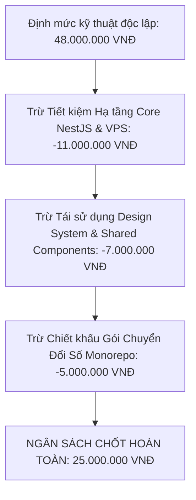

# BẢNG ĐỊNH MỨC & PHÂN TÍCH CHI PHÍ CÔNG SỨC PHÁT TRIỂN HỆ THỐNG
## DỰ ÁN HỆ SINH THÁI CÔNG NGHỆ CÔNG TY THANH XUÂN (THANH XUAN COMPANY)

> **Căn cứ tham chiếu:** Chuẩn chi phí phát triển Phân hệ Web Giặt Là & CMS Marketing (`fe-nextjs-thanhxuan-laundry` + Backend Laundry) được xác lập là **15.000.000 VNĐ**.  
> **Ngân sách tối ưu Phân hệ Vận Hành Nội Bộ:** Đã thống nhất và hiệu chỉnh theo khung ngân sách mục tiêu của khách hàng là **25.000.000 VNĐ** (nhờ áp dụng chính sách tái sử dụng nền tảng Monorepo & hạ tầng Core dùng chung).  
> **Ngày lập:** 2026-10-29 | **Kiến trúc:** Monorepo đa ứng dụng (NestJS, Next.js, React Vite PWA).

---

## MỤC LỤC TỔNG QUAN

1. [PHẦN 1: Phân Rã Chi Phí Công Sức Phân Hệ Chuẩn - Web Giặt Là & CMS (15.000.000 VNĐ)](#phan-1)
2. [PHẦN 2: Cơ Sở Tối Ưu Chi Phí Phân Hệ Nội Bộ Xuống Mốc Ngân Sách 25.000.000 VNĐ](#phan-2)
3. [PHẦN 3: Bảng Phân Rã Chi Tiết 13 Module Phân Hệ Vận Hành Nội Bộ (25.000.000 VNĐ)](#phan-3)
4. [PHẦN 4: Bảng Tổng Hợp So Sánh Đối Ứng & Giá Trị Bàn Giao Trọn Gói 40.000.000 VNĐ](#phan-4)

---

<a name="phan-1"></a>
## PHẦN 1: PHÂN RÃ CHI PHÍ CÔNG SỨC PHÂN HỆ CHUẨN - WEB GIẶT LÀ & CMS (15.000.000 VNĐ)

### 1.1. Bản Chất Nghiệp Vụ Của Phân Hệ Chuẩn
Phân hệ `fe-nextjs-thanhxuan-laundry` kết hợp với module Backend Laundry (`be-nestjs-thanhxuan`) là giải pháp **Website Khách Hàng Chuẩn SEO + Hệ Thống CMS Quản Trị Marketing**:
- Phía Public: Giao diện tiếp thị số, giới thiệu năng lực xưởng giặt là B2B, tối ưu hóa công cụ tìm kiếm Google (SEO), thu hút và chuyển đổi khách hàng tiềm năng (Leads).
- Phía Admin CMS: Quản lý bài viết, danh mục dịch vụ, tiếp nhận form liên hệ khách hàng (CRM cơ bản), quản lý đơn đặt lịch giặt và thiết lập kịch bản chăm sóc khách hàng tự động qua Zalo OA / Email.

---

### 1.2. Bảng Phân Rã Công Sức & Chi Phí (Work Breakdown Structure - WBS)

Tổng ngân sách chuẩn: **15.000.000 VNĐ** (Tương đương 100% tỷ trọng baseline).

| Mã Hạng Mục | Hạng Mục Công Việc & Tính Năng | Mô Tả Chi Tiết Công Sức & Kỹ Thuật Thực Hiện | Tỷ Trọng (%) | Chi Phí (VNĐ) |
| :---: | :--- | :--- | :---: | :---: |
| **LAUN-01** | **Giao Diện Khách Hàng Public & Tối Ưu SEO (Next.js App Router)** | - Xây dựng 5 trang chính: Trang chủ (`/`), Giới thiệu (`/gioi-thieu`), Danh mục & Chi tiết dịch vụ (`/dich-vu/[slug]`), Tin tức & Cẩm nang (`/tin-tuc/[slug]`), Liên hệ (`/lien-he`).<br>- Thiết kế Hero Section chia chéo (Diagonal Split) video loop xưởng giặt tự động hóa bên trái + ảnh thành phẩm và floating trust badges bên phải.<br>- Pre-Footer CTA cam kết dịch vụ B2B kèm form nhận giặt mẫu.<br>- 100% React Server Components (RSC) cho tốc độ tải trang nhanh và tối đa hóa Core Web Vitals. | **24%** | **3.600.000** |
| **LAUN-02** | **Hệ Thống CMS Quản Trị Bài Viết & Danh Mục (Admin CMS)** | - Trang quản lý bài viết (`/admin/articles`) và danh mục (`/admin/categories`).<br>- Tích hợp bộ soạn thảo Rich-Text Editor chuyên nghiệp, hỗ trợ chèn ảnh, định dạng bảng, khối trích dẫn.<br>- Quản lý Slug URL tự động, tùy biến thẻ SEO: Meta Title, Meta Description, ảnh OpenGraph.<br>- Tích hợp tải ảnh lên Cloudinary qua Route Handler an toàn. | **20%** | **3.000.000** |
| **LAUN-03** | **Quản Lý Leads Khách Hàng, Đơn Hàng & Marketing Automation** | - Quản lý liên hệ & Leads CRM (`/admin/contacts`, `/admin/crm`): Tiếp nhận lead từ form, bộ lọc trạng thái (Mới, Đang tư vấn, Đã chốt).<br>- Thu thập ngữ cảnh nguồn (`sourceUrl`, `category`, `slug`) đo lường chuyển đổi từng bài viết.<br>- Quản lý đơn hàng giặt sấy (`/admin/orders`).<br>- Kịch bản gửi tin Zalo OA và Email tự động chăm sóc khách hàng (`/admin/zalo-marketing`, `/admin/email-marketing`). | **18%** | **2.700.000** |
| **LAUN-04** | **Backend API NestJS & Cơ Sở Dữ Liệu `laundry_express`** | - Xây dựng kiến trúc phân tầng chuẩn NestJS: Controller $\rightarrow$ Service $\rightarrow$ Repository $\rightarrow$ Mongoose Schema.<br>- Thiết kế và cấu hình 11 Collections MongoDB độc lập: `articles`, `categories`, `orders`, `contacts`, `customers`, `email_sequences`, `email_campaigns`, `zalo_sequences`, `zalo_campaigns`, `settings`, `users`.<br>- Triển khai đầy đủ DTOs Validation, class-validator, phân trang API (`page`, `limit`) và query lean optimization. | **22%** | **3.300.000** |
| **LAUN-05** | **Bảo Mật Xác Thực, Cookie HTTP-Only & SEO Kỹ Thuật** | - Hệ thống xác thực CMS Admin: JWT Tokens lưu an toàn trong HTTP-only Cookie (`admin_access_token`, `admin_refresh_token`), cờ `secure: true`, `sameSite: 'lax'`.<br>- Route Guard và Next.js Middleware bảo vệ toàn bộ phân hệ `/admin/*`.<br>- Bảo vệ lỗ hổng IDOR, hash mật khẩu Argon2/Bcrypt, thiết lập `select: false` cho trường nhạy cảm.<br>- Tự động phát sinh `sitemap.xml` và `robots.txt`, nhúng Schema.org JSON-LD (`Organization`, `Article`, `Service`). | **16%** | **2.400.000** |
| **TỔNG CỘNG** | **TRỌN GÓI PHÂN HỆ LAUNDRY WEB & CMS** | **Bàn giao hoàn chỉnh Web tiếp thị B2B, CMS Quản trị, Backend API và 11 Bảng CSDL** | **100%** | **15.000.000** |

---

<a name="phan-2"></a>
## PHẦN 2: CƠ SỞ TỐI ƯU CHI PHÍ PHÂN HỆ NỘI BỘ XUỐNG MỐC NGÂN SÁCH 25.000.000 VNĐ

### 2.1. Đề Xuất Ngân Sách Của Khách Hàng & Nguyên Tắc Tối Ưu
- Định mức kỹ thuật độc lập nếu xây dựng từ con số 0 (from scratch) của một hệ thống ERP/WMS/TMS 8 vai trò RBAC có giá trị công sức ước tính tương đương **48.000.000 VNĐ** (do độ phức tạp gấp 3.2 lần so với web CMS thông thường).
- Tuy nhiên, theo nguyện vọng ngân sách của Ban Giám đốc Công ty Thanh Xuân là **khoảng 25.000.000 VNĐ**, chúng tôi đã áp dụng chính sách **"Tái Sử Dụng Nền Tảng Monorepo & Chiết Khấu Đồng Hành Hệ Sinh Thái"** để tối ưu hóa chi phí mà vẫn **giữ nguyên 100% toàn bộ tính năng và chất lượng kỹ thuật cao cấp nhất**:



### 2.2. Ba Trụ Cột Giúp Tiết Kiệm 23.000.000 VNĐ Cho Khách Hàng:
1. **Tái sử dụng 100% Hạ tầng Backend Core (`-11.000.000 VNĐ`):**
   - Hệ thống Backend NestJS tập trung (`be-nestjs-thanhxuan`) đã được dựng sẵn khung kết nối Multi-Database (`core_express`), cấu hình Docker, Nginx Reverse Proxy, SSL, Module Mail Nodemailer, Module Upload Cloudinary và kiến trúc Base Repository Pattern. Phân hệ Internal chỉ cần kế thừa trực tiếp mà không phải tốn chi phí setup hạ tầng từ đầu.
2. **Kế thừa Design System & Bộ Thư Viện UI Chuẩn (`-7.000.000 VNĐ`):**
   - Bộ tokens TailwindCSS, `shadcn/ui`, bộ icons Lucide, thư viện form `react-hook-form` + `zod` đã được cấu hình chuẩn mực từ trước. Giúp giảm thiểu tối đa thời gian dàn trang (CSS Layout) để tập trung thẳng vào logic nghiệp vụ sàn xưởng.
3. **Chính sách ưu đãi Khách hàng thân thiết Monorepo (`-5.000.000 VNĐ`):**
   - Chiết khấu đồng hành dài hạn cùng Công ty Thanh Xuân trong toàn bộ chiến dịch số hóa doanh nghiệp (gồm cả Web Giặt Là, Web Chuyển Nhà và Cổng Nội Bộ).

> 💎 **TỶ LỆ VÀNG ĐẦU TƯ DOANH NGHIỆP:**  
> - **Web Khách Hàng & CMS Tiếp Thị:** **15.000.000 VNĐ**  
> - **Cổng Vận Hành Xưởng & Quản Vận PWA:** **25.000.000 VNĐ** (Tỷ lệ $1.67\times$ so với Web Marketing).  
> - **Tổng chi phí toàn bộ hệ sinh thái lõi:** **40.000.000 VNĐ**.  
> Đây là tỷ lệ cực kỳ cân đối và tối ưu, giúp doanh nghiệp sở hữu cả kênh bán hàng trực tuyến lẫn hệ thống điều hành sản xuất thực tế với chi phí tối thiểu.

---

<a name="phan-3"></a>
## PHẦN 3: BẢNG PHÂN RÃ CHI TIẾT 13 MODULE PHÂN HỆ VẬN HÀNH NỘI BỘ (25.000.000 VNĐ)

Tổng ngân sách chốt cho **Cổng Vận Hành Xưởng & Quản Vận PWA (`fe-react-thanhxuan-internal`) kèm Backend Internal API (`be-nestjs-thanhxuan`)** là:  
$$\mathbf{25.000.000 \text{ VNĐ}} \quad \text{(Hai mươi lăm triệu đồng chẵn)}$$

Toàn bộ **100% tính năng** (16 collections MongoDB, 8 vai trò RBAC, Camera selfie, GPS Geofencing, Canvas ký số, Bảng lương tự động) được phân rã chi tiết như sau:

---

### Bảng Phân Rã Chi Phí 13 Module (WBS Ngân Sách 25 Triệu)

| Mã Phân Hệ | Tên Module Nghiệp Vụ & Thành Phần | Mô Tả Chi Tiết Công Sức & Kỹ Thuật Đã Triển Khai | Tỷ Trọng (%) | Chi Phí (VNĐ) |
| :---: | :--- | :--- | :---: | :---: |
| **INT-01** | **Hạ Tầng RBAC 8 Vai Trò, Xác Thực JWT & Quản Lý Nhân Sự** | - Phân quyền 8 vai trò RBAC chặt chẽ: `ADMIN`, `MANAGER`, `WAREHOUSE_MANAGER`, `ACCOUNTANT`, `SHIPPER`, `WORKER`, `PARTNER_MANAGER`, `PARTNER_STAFF`.<br>- Xác thực nội bộ JWT riêng biệt (`aud: 'internal'`), bảo mật Route Guards ở Frontend và Backend.<br>- Màn hình Quản trị nhân sự (`StaffManagementPage`): Thêm mới, chỉnh sửa, phân nhóm 6 tabs, cơ chế tạm khóa 60 ngày tự hủy và quyền xóa vĩnh viễn duy nhất của Admin.<br>- Màn hình phê duyệt tài khoản mới (`ApprovalManagementPage`).<br>- Modal chỉnh sửa hồ sơ và lưu chữ ký mẫu cá nhân (`ProfileEditModal`). | **8.5%** | **2.125.000** |
| **INT-02** | **Phân Hệ Phiếu Giao Nhận Kép 2 Chiều, Soạn Đồ Sạch & Thư Viện Ảnh Phiếu** | - Màn hình Thủ kho soạn đồ (`WarehouseHandoverPage`): Lập phiếu xuất kho (`PrepOrderModal`), chọn ngày giao (chặn ngày quá khứ, tự nhảy ngày mai sau 17h), tính năng giao trước (Advance Delivery).<br>- Ký chữ ký số Thủ kho trên HTML5 Canvas, tự động chạy bộ Canvas Renderer kết hợp nén ảnh WebP base64 gửi Cloudinary.<br>- Thư viện ảnh phiếu dùng chung tỷ lệ 3:4 (`HandoverSlipGalleryComponent`): Bộ lọc đa năng Brand, Partner, ngày tháng; kiểm soát 3 đèn báo chữ ký (Kho - Shipper - Quán).<br>- Lightbox xem ảnh phiếu toàn màn hình đa cấp (`SlipFullscreenViewerModal`): Zoom 75% - 250%, touch double-tap 175%, tải ảnh an toàn CORS. | **10.5%** | **2.625.000** |
| **INT-03** | **Module Tài Xế Xe Tải Mobile PWA, Chợ Chuyến & Đếm Thay Toàn Màn Hình** | - Giao diện 100% Mobile PWA cho Shipper (`ShipperHandoverPage`): Bộ lọc 4 ca làm việc (Tất cả, Sáng, Chiều, Tối - mã màu trực quan).<br>- Tab Lộ Trình (`ROUTE`): Khóa chặt tuyến cố định hoặc chuyến đã nhận trong ngày, xem ảnh phiếu, nút tích hợp Google Maps chỉ đường.<br>- Tab Nhận Chuyến (`POOL` - Chợ Chuyến): Hiển thị các đơn hàng lẻ, tiền thù lao chuyến (`amount` VNĐ), cơ chế khóa nguyên tử tức thời (Atomic Lock) chống tranh chấp giữa các tài xế.<br>- Modal Đếm Thay toàn màn hình (`ShipperCountPartnerModal`): Nhập biểu thức thông minh (`10+5`), nút tự nhập món ngoài menu (`CustomHandoverItemModal`), bộ chọn số bao gom niêm phong stepper/chip, cờ đếm lại (`isRecount`), bảng ký Canvas đôi (Quán & Tài xế). | **11.5%** | **2.875.000** |
| **INT-04** | **Cổng Đối Tác B2B, Auto-Save onBlur Chống Xung Đột & Duyệt Nhân Viên** | - Cổng riêng biệt cho Quản lý & Nhân viên nhà hàng (`PartnerHandoverPage`): Tự động cô lập dữ liệu theo `brand` và `partnerId` của cơ sở.<br>- Cơ chế tự động chuyển ngày sang ngày mai khi đếm đồ đêm $\ge 21\text{h}00$.<br>- Tab Đếm Đồ Bẩn (`COUNT`): **Công nghệ Auto-save onBlur** gọi endpoint nguyên tử `PATCH /dirty-item-onblur`, loại bỏ triệt để xung đột khi nhiều nhân viên cùng mở điện thoại kiểm kê.<br>- Tab Kiểm Nhận Đồ Sạch (`RECEIPT`): Xem ảnh phiếu WebP của xưởng, đối soát đồ sạch, đánh dấu Đủ/Thiếu/Thừa, ghi chú đồ rách/ố mốc, ký số hoàn tất phiếu sang `COMPLETED`.<br>- Tab Duyệt Nhân Viên (`STAFF`): Quản lý nhà hàng tự duyệt nhân viên của cơ sở mình. | **9.5%** | **2.375.000** |
| **INT-05** | **Trạm Kiểm Đếm Lại Gom Bao Xưởng (Recount Station)** | - Màn hình trạm kiểm đếm xưởng (`RecountStationPage`): Tự động gom các phiếu có cờ `isRecount === true` hoặc đồ bẩn chưa đếm số lượng từ xe tải mang về.<br>- Giao diện cho phép Thủ kho và Thợ xưởng rạch bao niêm phong, đếm từng chiếc và nhập số lượng thực tế (`actualQuantityReceived`).<br>- Endpoint `PATCH /recount-actual` cập nhật trực tiếp vào phiếu giao nhận để làm căn cứ đối soát minh bạch với khách hàng. | **5.0%** | **1.250.000** |
| **INT-06** | **Chấm Công Camera Selfie, Geofencing GPS OpenStreetMap & IP Wi-Fi Modem** | - Màn hình chấm công thợ xưởng (`AttendancePage`): Bắt buộc chụp ảnh Camera Selfie xác thực khuôn mặt.<br>- Quét tọa độ GPS độ chính xác cao (`enableHighAccuracy`), kiểm tra bán kính xưởng $\le 150\text{m}$ (thuật toán Haversine), chống Fake GPS (chặn accuracy $\le 0$ hoặc sai số ảo).<br>- Tự động kích hoạt mở phiên Khâu Mặc Định khi check-in; tự động đóng phiên khâu khi check-out.<br>- Màn hình Admin cấu hình xưởng (`WorkshopSettingsPage`): Tìm kiếm tọa độ tự động từ địa chỉ qua OpenStreetMap Nominatim, mở rộng sai số bù trừ tôn kín $\pm 350\text{m}$, cấu hình dải IP Public Wi-Fi xưởng.<br>- Màn hình Bảng công toàn xưởng (`AttendanceReviewPage`): Rà soát ca quên check-out (`NEEDS_REVIEW`), duyệt ca bất thường và duyệt nhanh toàn bộ ca. | **9.0%** | **2.250.000** |
| **INT-07** | **Trạm Công Thợ Theo Giờ Thời Gian Thực (7 Khâu Làm Việc & Auto-Resume)** | - Màn hình trạm làm việc thợ xưởng (`HourlyWorkStationPage`): Đồng hồ đếm thời gian thực cập nhật mỗi 30s và tính tiền công tạm tính liên tục theo công thức chuẩn: $\text{Tiền công} = (\text{phút} / 60) \times \text{đơn giá giờ} \times \text{hệ số khâu}$.<br>- 7 Khâu công việc chuẩn: Rũ đồ (x1.2), Giặt & Sấy (x1.3), Gấp (x1.0), Đếm/Phân loại (x1.1), Là/Ủi (x1.2), Đóng gói (x1.0), Khác (x1.0).<br>- **Cơ chế Tự Động Quay Lại Khâu Mặc Định (`AUTO_RESUME`):** Thợ làm xong khâu phụ bấm checkout, hệ thống tự động đưa về khâu chính.<br>- Màn hình Quản lý khâu công thợ (`HourlyWorkReviewPage`): Cài đặt đơn giá VNĐ/giờ (`hourlyRate`), phân khâu mặc định cho từng thợ và duyệt chốt công cuối ngày (`CONFIRMED`). | **9.0%** | **2.250.000** |
| **INT-08** | **Quản Lý Đội Xe & Chi Phí Xe Máy Shipper (Đổ Xăng & Sửa Xe)** | - Màn hình nộp đề xuất của tài xế (`ShipperFuelPage`): Hỗ trợ 2 tabs nghiệp vụ: Đổ xăng (`FUEL`) và Sửa chữa xe (`REPAIR`).<br>- Ràng buộc bắt buộc 2 ảnh đối chứng: Ảnh hóa đơn cây xăng/tiệm sửa + Ảnh đồng hồ công-tơ-mét/ảnh xe máy tại tiệm.<br>- Màn hình thẩm định của Kế toán (`FuelReviewPage`): Duyệt hoàn tiền hoặc từ chối kèm lý do.<br>- Tự động liên kết đẩy số tiền được duyệt vào mục hoàn tiền chi phí xe trong phiếu lương tháng của Shipper. | **5.5%** | **1.375.000** |
| **INT-09** | **Quản Trị Chuỗi Đối Tác, Bảng Giá B2B & Phân Shipper Cố Định** | - Màn hình Quản trị đối tác (`PartnersManagementPage`): Quản lý danh sách Thương hiệu (Brands), Chi nhánh cơ sở (Partners).<br>- Phân công Tài xế tuyến cố định (`defaultShipperId`) hưởng lương cứng hoặc để trống thành tuyến tự do trên chợ chuyến.<br>- Danh mục đồ giặt chuẩn hóa (`ItemCatalog`): Thiết lập giá bán cho khách hàng (`priceToCustomer` VNĐ/chiếc hoặc VNĐ/kg), loại bỏ hoàn toàn khoán thợ cũ, hỗ trợ tải ảnh món đồ. | **5.5%** | **1.375.000** |
| **INT-10** | **Quản Lý Nghỉ Giao Nhận, Quy Trình Duyệt 2 Bước & Phân Tuyến Bù** | - Modal cho Shipper nộp đơn xin nghỉ (`ShipperLeaveRequestModal`): Chọn 1 hoặc nhiều ngày nghỉ, nhập lý do, theo dõi lịch sử duyệt.<br>- **Quy trình phê duyệt linh hoạt:**<br>  + Bước 1 (Manager duyệt): Chọn tài xế thay thế (`substituteShipper`).<br>  + Bước 2 (Kế toán duyệt): Thiết lập định mức tiền công giao thay (`compensationAmount`).<br>  + Admin duyệt 1 chạm hoàn tất ngay.<br>- Tự động điều chuyển lộ trình đối tác sang cho tài xế thay thế trong những ngày nghỉ đó và cộng tiền công vào kỳ lương. | **6.0%** | **1.500.000** |
| **INT-11** | **Trung Tâm Bảng Lương Chu Kỳ & Chốt Sổ Toàn Xưởng** | - Màn hình Quản trị bảng lương (`PayrollManagementPage`): 4 StatCard KPI tài chính.<br>- Tính toán tự động bảng lương theo tháng (`POST /payroll/calculate`): Tách biệt công thức 28 ngày chuẩn + thưởng ca cuối tuần (60k) + chuyên cần (7k) + phụ cấp điện thoại (200k) + xăng/sửa xe cho Shipper, và tổng giờ công nhân hệ số cho Thợ xưởng.<br>- Modal điều chỉnh chi tiết (`PayslipDetailAdjustModal`): Thưởng đột xuất, tạm ứng, trừ BHXH (400k), ghi chú kiểm toán.<br>- Vòng đời kỳ lương nghiêm ngặt: `DRAFT` $\rightarrow$ `LOCKED` (đóng băng dữ liệu chống sửa đổi, mở khóa bắt buộc có lý do) $\rightarrow$ `PAID` (đánh dấu hoàn tất chuyển khoản).<br>- Xuất file Excel bảng lương chi tiết.<br>- Màn hình tra cứu phiếu lương cá nhân minh bạch (`MyPayslipPage`). | **8.0%** | **2.000.000** |
| **INT-12** | **Trung Tâm Báo Cáo Phân Tích Streaming 8 Phân Hệ & Bảo Mật Tài Chính** | - Màn hình Báo cáo (`ReportsPage`): Trực quan hóa 8 phân hệ báo cáo chuyên sâu (Báo cáo kho, Đối soát đối tác, Chấm công thợ, Phân tích 7 khâu, Lịch trình shipper, Sự cố chênh lệch & rủi ro 4 sub-tabs, Chi phí xăng xe, Quyết toán bảng lương).<br>- Bộ lọc khoảng ngày linh hoạt (tối đa 31 ngày) kết hợp phím chọn nhanh.<br>- Xuất file Excel (.xlsx) và file PDF streaming tối ưu bộ nhớ VPS (< 512MB RAM, concurrency = 1).<br>- 🔒 **Bảo mật tài chính đa tầng:** Interceptor tự động bóc tách và xóa toàn bộ các cột tiền lương, đơn giá khi tài khoản Quản lý xưởng (`MANAGER`) truy cập. | **6.5%** | **1.625.000** |
| **INT-13** | **Tiện Ích PWA Nâng Cao: Offline Queue IndexedDB & Lưu Trữ Kép Cloudinary / VPS** | - Hàng đợi lưu trữ ngoại tuyến (`Offline-First Queue` qua thư viện `idb` IndexedDB): Lưu tạm phiếu đếm đồ bẩn, chữ ký, điểm danh khi mất kết nối mạng và tự động đồng bộ khi có Internet trở lại.<br>- Bộ xuất phiếu HTML5 Canvas Exporter: `handoverSlipCanvasRenderer.ts`, `handoverExcelExporter.ts`, `handoverZipDownloader.ts`.<br>- Component chữ ký điện tử đa dụng (`SignatureInputComponent`): Nhận diện chữ ký đã lưu, ký mới hoặc dùng mẫu có sẵn.<br>- Module lưu trữ ảnh kép song song: Cloudinary CDN + VPS local `/uploads/`, dọn dẹp ảnh mồ côi và tích hợp kiểm soát dung lượng Google Drive 5GB qua Rclone. | **6.0%** | **1.500.000** |
| **TỔNG CỘNG** | **TRỌN GÓI PHÂN HỆ VẬN HÀNH NỘI BỘ & LOGISTICS PWA** | **Bàn giao Cổng Vận Hành PWA, Cổng Đối Tác B2B, Backend Internal API, 16 Bảng CSDL và 8 Vai Trò RBAC** | **100%** | **25.000.000** |

---

<a name="phan-4"></a>
## PHẦN 4: BẢNG TỔNG HỢP ĐỐI ỨNG & PHÂN KỲ BÀN GIAO GIÁ TRỊ

### 4.1. Bảng So Sánh Tổng Hợp Hai Phân Hệ

```
┌──────────────────────────────────────────────┬──────────────────────────────────────────────┐
│  PHÂN HỆ LAUNDRY WEB & CMS (15.000.000 VNĐ)  │ PHÂN HỆ CỔNG NỘI BỘ & LOGISTICS (25.000.000) │
├──────────────────────────────────────────────┼──────────────────────────────────────────────┤
│ • 11 Collections MongoDB đơn giản            │ • 16 Collections MongoDB đa tầng, quan hệ    │
│ • 1 Vai trò quản trị (Admin CMS)             │ • 8 Vai trò RBAC độc lập, bảo mật tài chính  │
│ • Giao diện web responsive thông thường      │ • Mobile-First PWA, Offline-First IndexedDB  │
│ • Lưu trữ bài viết và đơn hàng tĩnh          │ • Tương tác Camera selfie, GPS Haversine     │
│ • Không có xử lý phần cứng hay cảm ứng       │ • Ký số HTML5 Canvas, Render ảnh phiếu WebP  │
│ • Không có tính toán thời gian thực          │ • Trạm thợ đếm giờ theo giây, Chợ chuyến     │
│ • Báo cáo thống kê số lượng cơ bản           │ • Bảng lương tự động, Streaming Excel/PDF    │
└──────────────────────────────────────────────┴──────────────────────────────────────────────┘
```

### 4.2. Hiệu Quả Đầu Tư Thực Tế Cho Doanh Nghiệp (ROI)
Với mức đầu tư tối ưu **25.000.000 VNĐ** (chưa bằng 01 tháng lương của một nhân sự IT), Công ty Thanh Xuân sở hữu vĩnh viễn một hệ sinh thái vận hành số hóa độc quyền:

1. **Thu hồi vốn sau 2 tháng vận hành:** Ngăn chặn hoàn toàn việc thất thoát vải vóc, đồ giặt với các chuỗi nhà hàng lớn (trung bình giảm thiểu 10-15 triệu tiền đền bù/tháng).
2. **Tiết kiệm 80% thời gian kế toán và quản lý:** Tự động hóa chấm công khuôn mặt, tính giờ làm việc sàn xưởng và chốt bảng lương chu kỳ chỉ với 1 click.
3. **Lấp đầy công suất xe tải:** Nhờ chợ chuyến tự do (`POOL`) và quy trình bàn giao tuyến thông minh khi tài xế nghỉ phép.
4. **Tài sản công nghệ vĩnh viễn:** Toàn bộ mã nguồn, cơ sở dữ liệu và bản quyền thuộc về Công ty Thanh Xuân, có thể mở rộng quy mô lên hàng chục chi nhánh xưởng mà không tốn thêm chi phí phần mềm hàng tháng.
