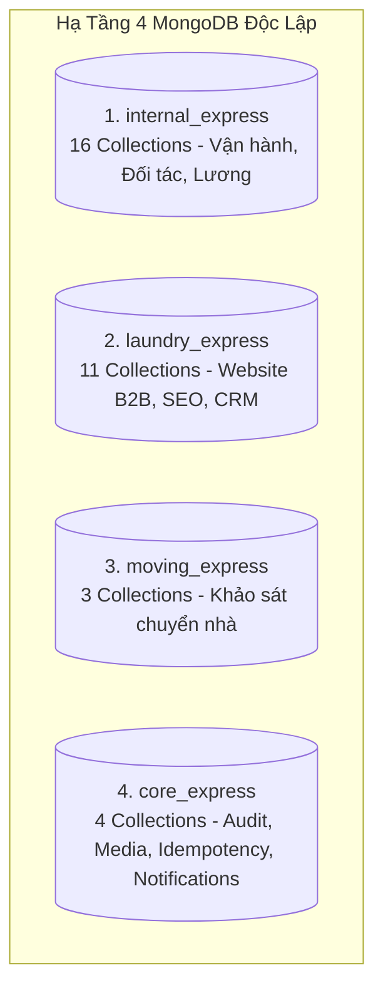
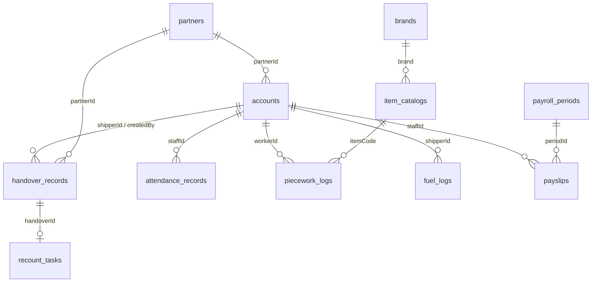
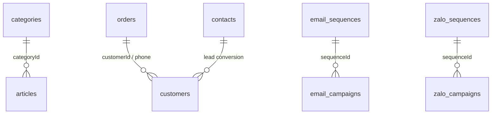

# TỪ ĐIỂN CƠ SỞ DỮ LIỆU TOÀN HỆ THỐNG (DATABASE DATA DICTIONARY)

> **Hệ sinh thái:** Công ty Giặt Sấy Thanh Xuân (Thanh Xuan Laundry & Moving Company)
> **Phiên bản:** 2.0 | **Ngày cập nhật:** 2026-10-10
> **Kiến trúc dữ liệu:** Multi-Database Isolation trên MongoDB (4 Databases độc lập)
> **Tổng số bảng (Collections):** 34 Collections
> **Quy chuẩn duy trì:** Mọi thay đổi Schema trong Backend NestJS bắt buộc cập nhật đồng bộ file này theo Definition of Done trong [AGENTS.md](file:///d:/PROJECT/Website_Thanh_Xuan_Company/.agents/rules/AGENTS.md).

---

## MỤC LỤC & TỔNG QUAN PHÂN VÙNG DỮ LIỆU

| Phân Vùng CSDL  | Tên Database MongoDB | Số Collections | Trọng Tâm Nghiệp Vụ                                                                                                                                   |
| :-------------- | :------------------- | :------------: | :---------------------------------------------------------------------------------------------------------------------------------------------------- |
| **Phân Vùng 1** | `internal_express`   |     **16**     | Tài khoản nội bộ, đối tác nhà hàng, phiếu giao nhận kép, trạm rạch bao đếm lại xưởng, chấm công selfie, khoán thợ, hoàn tiền xăng, bảng lương chu kỳ. |
| **Phân Vùng 2** | `laundry_express`    |     **11**     | Website khách hàng`thanhxuanlaundry.com`, CMS bài viết chuẩn SEO, đơn hàng giặt ủi, CRM khách hàng, chiến dịch Email & Zalo OA Marketing.             |
| **Phân Vùng 3** | `moving_express`     |     **3**      | Website dịch vụ chuyển nhà`chuyennhatietkiem.vn`, khảo sát báo giá cước vận tải xe tải, danh mục xe tải & cẩm nang chuyển nhà.                        |
| **Phân Vùng 4** | `core_express`       |     **4**      | Kết nối qua`CORE_CONNECTION`: Nhật ký kiểm toán bảo mật (Audit Log), file media Cloudinary, khóa chống trùng lặp (Idempotency), thông báo in-app.     |

---

# PHẦN 1: CƠ SỞ DỮ LIỆU `internal_express` (VẬN HÀNH NỘI BỘ & ĐỐI TÁC)

Kết nối qua: `INTERNAL_CONNECTION`
Phạm vi: Cổng vận hành xưởng, điều phối logistics, chấm công, khoán sản lượng và tính lương.

---

### 1.1. Bảng `accounts` (StaffAccount)

- **Mã nguồn:** [`staff-account.schema.ts`](file:///d:/PROJECT/Website_Thanh_Xuan_Company/be-nestjs-thanhxuan/src/modules/internal/auth/schemas/staff-account.schema.ts)
- **Mục đích nghiệp vụ:** Lưu trữ thông tin tài khoản nhân viên nội bộ xưởng (Thợ, Tài xế, Quản lý kho, Kế toán, Admin) và đối tác chuỗi nhà hàng (Quản lý chi nhánh, Nhân viên nhà hàng). Quản lý đăng nhập, trạng thái tài khoản, mức lương cấu hình và avatar Cloudinary.

| Tên Trường                | Kiểu Dữ Liệu    |      Ràng Buộc / Mặc Định       |    Index / Ref     | Ý Nghĩa & Tác Dụng Nghiệp Vụ                                                                                                           |
| :------------------------ | :-------------- | :-----------------------------: | :----------------: | :------------------------------------------------------------------------------------------------------------------------------------- |
| `username`                | `String`        | Bắt buộc, Unique, min 3, max 30 |       Unique       | Tên đăng nhập tài khoản (viết thường).                                                                                                 |
| `email`                   | `String`        |   Bắt buộc, Unique, lowercase   |       Unique       | Email nhận mã OTP xác thực và thông báo hệ thống.                                                                                      |
| `phone`                   | `String`        |        Bắt buộc, Unique         |       Unique       | Số điện thoại liên hệ cá nhân.                                                                                                         |
| `passwordHash`            | `String`        |            Bắt buộc             |         -          | Mật khẩu băm an toàn bằng bcrypt.                                                                                                      |
| `fullName`                | `String`        |            Bắt buộc             |         -          | Họ và tên đầy đủ hiển thị trên giao diện và phiếu ký.                                                                                  |
| `role`                    | `String (Enum)` |        Mặc định:`GUEST`         |         -          | Vai trò chính:`ADMIN`, `MANAGER`, `WAREHOUSE_MANAGER`, `ACCOUNTANT`, `SHIPPER`, `WORKER`, `PARTNER_MANAGER`, `PARTNER_STAFF`, `GUEST`. |
| `roles`                   | `Array<String>` |          Mặc định`[]`           |         -          | Danh sách vai trò phụ mở rộng quyền RBAC.                                                                                              |
| `brand`                   | `String`        |            Tùy chọn             |       Index        | Mã thương hiệu đối tác nếu là nhân sự nhà hàng (ví dụ:`PIZZA_4PS`, `HAIDILAO`).                                                        |
| `partnerId`               | `ObjectId`      |            Tùy chọn             |   Ref:`Partner`    | Chi nhánh nhà hàng cụ thể mà nhân sự đối tác trực thuộc.                                                                               |
| `status`                  | `String (Enum)` |    Mặc định:`PENDING_EMAIL`     |       Index        | Trạng thái:`PENDING_EMAIL` (chờ OTP), `PENDING_APPROVAL` (chờ duyệt), `ACTIVE`, `REJECTED`, `LOCKED` (tạm khóa).                       |
| `emailVerifiedAt`         | `Date`          |            Tùy chọn             |         -          | Thời điểm xác thực email bằng OTP thành công.                                                                                          |
| `approvedBy`              | `ObjectId`      |            Tùy chọn             | Ref:`StaffAccount` | Người duyệt tài khoản (Admin hoặc Quản lý đối tác).                                                                                    |
| `approvedAt`              | `Date`          |            Tùy chọn             |         -          | Thời điểm phê duyệt tài khoản.                                                                                                         |
| `rejectedReason`          | `String`        |            Tùy chọn             |         -          | Lý do từ chối đăng ký nếu trạng thái là`REJECTED`.                                                                                     |
| `failedLoginCount`        | `Number`        |          Mặc định:`0`           |         -          | Đếm số lần nhập sai mật khẩu liên tiếp (quá 5 lần bị khóa 15 phút).                                                                    |
| `lockedUntil`             | `Date`          |            Tùy chọn             |         -          | Thời điểm hết hạn tạm khóa 15 phút do nhập sai mật khẩu.                                                                               |
| `lockedAt`                | `Date`          |            Tùy chọn             |         -          | Thời điểm bị Admin/Manager tạm khóa (nếu quá 60 ngày tự động xóa vĩnh viễn).                                                           |
| `avatarUrl`               | `String`        |            Tùy chọn             |         -          | Đường dẫn ảnh đại diện lưu trên Cloudinary (`internal/avatars`).                                                                       |
| `avatarPublicId`          | `String`        |            Tùy chọn             |         -          | Mã định danh Cloudinary public ID để tự xóa ảnh cũ khi upload ảnh mới.                                                                 |
| `payProfile`              | `Object`        |            Tùy chọn             |         -          | Cấu hình lương cá nhân:`pay_type` (HOURLY, PIECEWORK, HYBRID, MONTHLY_FIXED), `hourly_rate`, `monthly_salary`.                         |
| `createdAt` / `updatedAt` | `Date`          |             Tự động             |         -          | Dấu thời gian tạo và cập nhật bản ghi.                                                                                                 |

---

### 1.2. Bảng `otp_codes` (OtpCode)

- **Mã nguồn:** [`otp-code.schema.ts`](file:///d:/PROJECT/Website_Thanh_Xuan_Company/be-nestjs-thanhxuan/src/modules/internal/auth/schemas/otp-code.schema.ts)
- **Mục đích nghiệp vụ:** Quản lý mã OTP 6 chữ số gửi qua email phục vụ đăng ký tài khoản và quên mật khẩu. Giới hạn tần suất và tự hủy sau 5 phút.

| Tên Trường  | Kiểu Dữ Liệu    |     Ràng Buộc / Mặc Định      | Index / Ref | Ý Nghĩa & Tác Dụng Nghiệp Vụ                                   |
| :---------- | :-------------- | :---------------------------: | :---------: | :------------------------------------------------------------- |
| `email`     | `String`        |      Bắt buộc, lowercase      |    Index    | Email nhận OTP.                                                |
| `code`      | `String`        |           Bắt buộc            |      -      | Mã OTP 6 chữ số ngẫu nhiên.                                    |
| `purpose`   | `String (Enum)` | `REGISTER` / `RESET_PASSWORD` |      -      | Mục đích cấp OTP (Đăng ký tài khoản hay Đặt lại mật khẩu).     |
| `attempts`  | `Number`        |         Mặc định:`0`          |      -      | Số lần đã nhập thử (tối đa 5 lần sai là vô hiệu).              |
| `expiresAt` | `Date`          |           Bắt buộc            |  TTL Index  | Thời gian hết hạn OTP (tự động xóa sau 5 phút bằng TTL Index). |

---

### 1.3. Bảng `refresh_tokens` (RefreshToken)

- **Mã nguồn:** [`refresh-token.schema.ts`](file:///d:/PROJECT/Website_Thanh_Xuan_Company/be-nestjs-thanhxuan/src/modules/internal/auth/schemas/refresh-token.schema.ts)
- **Mục đích nghiệp vụ:** Hỗ trợ cơ chế Xoay vòng Refresh Token Rotation (7 ngày). Phát hiện và thu hồi toàn bộ phiên nếu token đã dùng lại.

| Tên Trường   | Kiểu Dữ Liệu | Ràng Buộc / Mặc Định |        Index / Ref        | Ý Nghĩa & Tác Dụng Nghiệp Vụ                           |
| :----------- | :----------- | :------------------: | :-----------------------: | :----------------------------------------------------- |
| `token`      | `String`     |   Bắt buộc, Unique   |          Unique           | Chuỗi token ngẫu nhiên bảo mật cao.                    |
| `accountId`  | `ObjectId`   |       Bắt buộc       | Ref:`StaffAccount`, Index | Tài khoản người dùng sở hữu token này.                 |
| `isRevoked`  | `Boolean`    |   Mặc định:`false`   |             -             | Đánh dấu token đã bị thu hồi/đã dùng.                  |
| `deviceInfo` | `String`     |       Tùy chọn       |             -             | Thông tin thiết bị / User-Agent của người đăng nhập.   |
| `ipAddress`  | `String`     |       Tùy chọn       |             -             | Địa chỉ IP đăng nhập.                                  |
| `expiresAt`  | `Date`       |       Bắt buộc       |         TTL Index         | Thời gian hết hạn token (7 ngày, TTL tự động dọn dẹp). |

---

### 1.4. Bảng `approval_requests` (ApprovalRequest)

- **Mã nguồn:** [`approval-request.schema.ts`](file:///d:/PROJECT/Website_Thanh_Xuan_Company/be-nestjs-thanhxuan/src/modules/internal/auth/schemas/approval-request.schema.ts)
- **Mục đích nghiệp vụ:** Hàng đợi phê duyệt tài khoản mới. Quản lý nhà hàng duyệt nhân viên của mình; Admin/Quản lý xưởng duyệt nhân viên nội bộ.

| Tên Trường        | Kiểu Dữ Liệu    |       Ràng Buộc / Mặc Định        |        Index / Ref        | Ý Nghĩa & Tác Dụng Nghiệp Vụ        |
| :---------------- | :-------------- | :-------------------------------: | :-----------------------: | :---------------------------------- |
| `accountId`       | `ObjectId`      |             Bắt buộc              | Ref:`StaffAccount`, Index | Tài khoản đang chờ duyệt.           |
| `requestedRole`   | `String`        |             Bắt buộc              |             -             | Vai trò nhân viên xin đăng ký.      |
| `brand`           | `String`        |             Tùy chọn              |           Index           | Thương hiệu đối tác liên quan.      |
| `partnerId`       | `ObjectId`      |             Tùy chọn              |   Ref:`Partner`, Index    | Chi nhánh đối tác liên quan.        |
| `status`          | `String (Enum)` | `PENDING`, `APPROVED`, `REJECTED` |           Index           | Trạng thái yêu cầu duyệt.           |
| `reviewedBy`      | `ObjectId`      |             Tùy chọn              |    Ref:`StaffAccount`     | Người thực hiện duyệt hoặc từ chối. |
| `reviewedAt`      | `Date`          |             Tùy chọn              |             -             | Thời điểm quyết định duyệt.         |
| `rejectionReason` | `String`        |             Tùy chọn              |             -             | Lý do từ chối nếu không duyệt.      |

---

### 1.5. Bảng `partners` (Partner)

- **Mã nguồn:** [`partner.schema.ts`](file:///d:/PROJECT/Website_Thanh_Xuan_Company/be-nestjs-thanhxuan/src/modules/internal/partners/schemas/partner.schema.ts)
- **Mục đích nghiệp vụ:** Quản lý danh bạ khách hàng chuỗi B2B (Nhà hàng Pizza 4P's Tràng Tiền, Haidilao Phạm Ngọc Thạch...). Lưu địa chỉ, cấu hình lịch giao định kỳ và thông tin người phụ trách.

| Tên Trường          | Kiểu Dữ Liệu    |     Ràng Buộc / Mặc Định      | Index / Ref | Ý Nghĩa & Tác Dụng Nghiệp Vụ                                              |
| :------------------ | :-------------- | :---------------------------: | :---------: | :------------------------------------------------------------------------ |
| `partnerCode`       | `String`        |  Bắt buộc, Unique, uppercase  |   Unique    | Mã đối tác viết tắt (ví dụ:`4PS_HBT`, `HDL_LM81`).                        |
| `brand`             | `String`        |      Bắt buộc, uppercase      |    Index    | Thương hiệu chuỗi nhà hàng (ví dụ:`PIZZA_4PS`, `HAIDILAO`).               |
| `name`              | `String`        |        Bắt buộc, trim         |    Index    | Tên đầy đủ của chi nhánh (ví dụ: "Pizza 4P's - Tràng Tiền").              |
| `address`           | `String`        |           Bắt buộc            |      -      | Địa chỉ chi nhánh nhà hàng shipper sẽ giao/nhận hàng.                     |
| `deliveryFrequency` | `String (Enum)` | `DAILY` hoặc `ALTERNATE_DAYS` |      -      | Tần suất giao hàng: Mỗi ngày (`DAILY`) hoặc Cách ngày (`ALTERNATE_DAYS`). |
| `contactPerson`     | `String`        |           Bắt buộc            |      -      | Họ tên người đại diện tiếp nhận giao đồ tại chi nhánh.                    |
| `contactPhone`      | `String`        |           Bắt buộc            |      -      | Số điện thoại liên hệ đại diện nhà hàng.                                  |
| `contactEmail`      | `String`        |           Tùy chọn            |      -      | Email nhận biên bản giao nhận và bảng kê đối soát.                        |
| `isActive`          | `Boolean`       |        Mặc định:`true`        |    Index    | Đánh dấu đối tác còn đang hợp tác giặt ủi hay tạm ngưng.                  |
| `notes`             | `String`        |           Tùy chọn            |      -      | Ghi chú đặc biệt (ví dụ: "Giao trước 9h sáng, đi cửa sau").               |

---

### 1.6. Bảng `brands` (Brand)

- **Mã nguồn:** [`brand.schema.ts`](file:///d:/PROJECT/Website_Thanh_Xuan_Company/be-nestjs-thanhxuan/src/modules/internal/partners/schemas/brand.schema.ts)
- **Mục đích nghiệp vụ:** Danh mục các tập đoàn/thương hiệu đối tác F&B lớn để gom nhóm các chi nhánh và bảng danh mục đồ giặt.

| Tên Trường  | Kiểu Dữ Liệu |    Ràng Buộc / Mặc Định     | Index / Ref | Ý Nghĩa & Tác Dụng Nghiệp Vụ                                 |
| :---------- | :----------- | :-------------------------: | :---------: | :----------------------------------------------------------- |
| `brandCode` | `String`     | Bắt buộc, Unique, uppercase |   Unique    | Mã định danh thương hiệu (ví dụ:`PIZZA_4PS`, `GOLDEN_GATE`). |
| `brandName` | `String`     |          Bắt buộc           |      -      | Tên đầy đủ của thương hiệu chuỗi.                            |
| `logoUrl`   | `String`     |          Tùy chọn           |      -      | Logo thương hiệu.                                            |
| `isActive`  | `Boolean`    |       Mặc định:`true`       |    Index    | Trạng thái kích hoạt thương hiệu.                            |

---

### 1.7. Bảng `item_catalogs` (ItemCatalog)

- **Mã nguồn:** [`item-catalog.schema.ts`](file:///d:/PROJECT/Website_Thanh_Xuan_Company/be-nestjs-thanhxuan/src/modules/internal/partners/schemas/item-catalog.schema.ts)
- **Mục đích nghiệp vụ:** Quản lý mã quy chuẩn từng loại đồ giặt (Khăn lau bàn, Tạp dề, Khăn ăn, Áo bếp...). Lưu đơn giá giặt khách hàng, đơn giá khoán thợ (gấp, ủi, đóng gói) và ảnh chụp mẫu đồ giặt Cloudinary.

| Tên Trường          | Kiểu Dữ Liệu |    Ràng Buộc / Mặc Định     | Index / Ref | Ý Nghĩa & Tác Dụng Nghiệp Vụ                                        |
| :------------------ | :----------- | :-------------------------: | :---------: | :------------------------------------------------------------------ |
| `itemCode`          | `String`     | Bắt buộc, Unique, uppercase |   Unique    | Mã chuẩn đồ giặt (ví dụ:`4PS_GRAY_TOWEL`, `4PS_APRON_DENIM`).       |
| `brand`             | `String`     |     Bắt buộc, uppercase     |    Index    | Thương hiệu sở hữu loại đồ giặt này.                                |
| `itemName`          | `String`     |          Bắt buộc           |      -      | Tên tiếng Việt của món đồ (ví dụ: "Khăn xám lau bàn lớn").          |
| `unit`              | `String`     |       Mặc định:`Cái`        |      -      | Đơn vị tính:`Cái`, `Bộ`, `Kg`...                                    |
| `foldingRateWorker` | `Number`     |        Mặc định:`0`         |      -      | Đơn giá khoán trả cho thợ xưởng khi gấp 1 cái (VND).                |
| `ironingRateWorker` | `Number`     |        Mặc định:`0`         |      -      | Đơn giá khoán trả cho thợ khi ủi 1 cái (VND).                       |
| `packingRateWorker` | `Number`     |        Mặc định:`0`         |      -      | Đơn giá khoán trả cho thợ khi đóng gói 1 cái (VND).                 |
| `customerPrice`     | `Number`     |        Mặc định:`0`         |      -      | Đơn giá dịch vụ thu của nhà hàng (bảo mật, chỉ Admin/Kế toán thấy). |
| `imageUrl`          | `String`     |          Tùy chọn           |      -      | Ảnh chụp mẫu món đồ giặt thực tế trên Cloudinary.                   |
| `imagePublicId`     | `String`     |          Tùy chọn           |      -      | Cloudinary ID để dọn ảnh cũ khi cập nhật ảnh mới.                   |
| `isActive`          | `Boolean`    |       Mặc định:`true`       |    Index    | Đánh dấu loại đồ còn sử dụng hay đã ngưng.                          |

---

### 1.8. Bảng `handover_records` (HandoverRecord)

- **Mã nguồn:** [`handover-record.schema.ts`](file:///d:/PROJECT/Website_Thanh_Xuan_Company/be-nestjs-thanhxuan/src/modules/internal/handovers/schemas/handover-record.schema.ts)
- **Mục đích nghiệp vụ:** **Bảng nghiệp vụ quan trọng nhất của xưởng.** Quản lý phiếu giao nhận 2 chiều giữa xưởng và nhà hàng. Lưu trữ quy trình soạn đồ sạch, đếm đồ bẩn (tại bàn giao hoặc đem về xưởng rạch bao), chữ ký điện tử Canvas Base64 và cơ chế khóa lạc quan (Optimistic Locking).

| Tên Trường        | Kiểu Dữ Liệu    |    Ràng Buộc / Mặc Định     |        Index / Ref        | Ý Nghĩa & Tác Dụng Nghiệp Vụ                                                                                                                                                                                                                  |
| :---------------- | :-------------- | :-------------------------: | :-----------------------: | :-------------------------------------------------------------------------------------------------------------------------------------------------------------------------------------------------------------------------------------------- |
| `recordCode`      | `String`        | Bắt buộc, Unique, uppercase |          Unique           | Mã phiếu nguyên tử`GN-YYYYMMDD-NNN` (sinh tự động qua Counter).                                                                                                                                                                               |
| `brand`           | `String`        |     Bắt buộc, uppercase     |           Index           | Thương hiệu nhà hàng đối tác.                                                                                                                                                                                                                 |
| `partnerId`       | `ObjectId`      |          Bắt buộc           |   Ref:`Partner`, Index    | Chi nhánh nhà hàng tiếp nhận giao hàng.                                                                                                                                                                                                       |
| `status`          | `String (Enum)` |    Mặc định:`SCHEDULED`     |           Index           | Vòng đời phiếu:`SCHEDULED` $\rightarrow$ `IN_TRANSIT` $\rightarrow$ `DELIVERED` $\rightarrow$ `COMPLETED` (hoặc `DISPUTED`).                                                                                                                  |
| `datePrefix`      | `String`        |    Bắt buộc (`YYYYMMDD`)    |           Index           | Tiền tố ngày theo múi giờ Việt Nam để truy vấn và sinh số thứ tự.                                                                                                                                                                             |
| `shipperId`       | `ObjectId`      |          Tùy chọn           | Ref:`StaffAccount`, Index | Shipper nhận phụ trách phiếu này.                                                                                                                                                                                                             |
| `cleanDelivery`   | `Object`        |          Tùy chọn           |             -             | **Nhánh Giao Đồ Sạch:** Gồm `planned` (kế hoạch thủ kho soạn hàng: số lượng giao, chưa giao, giao trả nợ, chữ ký thủ kho) và `delivered` (số lượng thực giao tới nhà hàng).                                                                   |
| `dirtyPickup`     | `Object`        |          Tùy chọn           |             -             | **Nhánh Nhận Đồ Bẩn:** Gồm `countMode` (`ON_SITE` hoặc `AT_FACTORY`), `shipperItems` (thợ/tài xế đếm), `bagsCount` (số bao gom niêm phong), `bagPhotos` (ảnh chụp bao), `factoryCount` (đếm lại tại xưởng), `variance` (chênh lệch số lượng). |
| `restaurantCount` | `Object`        |          Tùy chọn           |             -             | Số lượng do đại diện nhà hàng tự đếm và gửi lên kèm chữ ký đối tác.                                                                                                                                                                           |
| `receiptCheck`    | `Object`        |          Tùy chọn           |             -             | Kết quả nhà hàng kiểm nhận đồ sạch (`ENOUGH`, `SHORT`, `EXCESS`), chữ ký kiểm nhận.                                                                                                                                                           |
| `defects`         | `Array<Object>` |        Mặc định`[]`         |             -             | Danh sách đồ bị rách hỏng/ố bẩn nghiêm trọng phát hiện kèm ảnh đối chứng.                                                                                                                                                                     |
| `signatures`      | `Object`        |          Tùy chọn           |             -             | Lưu Base64 ảnh chữ ký của Shippper và Đại diện nhà hàng ký nhận tại chỗ.                                                                                                                                                                      |
| `editMarks`       | `Array<Object>` |        Mặc định`[]`         |             -             | Lịch sử sửa đổi các trường sau khi đã ký nhận (ghi nhận ai sửa, thời gian, giá trị cũ/mới).                                                                                                                                                   |
| `adjustments`     | `Array<Object>` |        Mặc định`[]`         |             -             | Số liệu điều chỉnh giải quyết khiếu nại sau khi phiếu đã hoàn tất.                                                                                                                                                                            |
| `version`         | `Number`        |        Mặc định:`1`         |             -             | Phiên bản khóa lạc quan (Optimistic Locking) chống 2 người sửa đè nhau.                                                                                                                                                                       |
| `notes`           | `String`        |          Tùy chọn           |             -             | Ghi chú chung của chuyến xe.                                                                                                                                                                                                                  |

---

### 1.9. Bảng `recount_tasks` (RecountTask)

- **Mã nguồn:** [`recount-task.schema.ts`](file:///d:/PROJECT/Website_Thanh_Xuan_Company/be-nestjs-thanhxuan/src/modules/internal/handovers/schemas/recount-task.schema.ts)
- **Mục đích nghiệp vụ:** Quản lý nhiệm vụ rạch bao niêm phong và đếm lại đồ bẩn tại xưởng khi tài xế gom bao theo chế độ `AT_FACTORY`.

| Tên Trường       | Kiểu Dữ Liệu    | Ràng Buộc / Mặc Định |         Index / Ref          | Ý Nghĩa & Tác Dụng Nghiệp Vụ                                                          |
| :--------------- | :-------------- | :------------------: | :--------------------------: | :------------------------------------------------------------------------------------ |
| `handoverId`     | `ObjectId`      |       Bắt buộc       | Ref:`HandoverRecord`, Unique | Phiếu giao nhận tương ứng của nhiệm vụ đếm lại.                                       |
| `recordCode`     | `String`        |       Bắt buộc       |            Index             | Mã phiếu giao nhận`GN-YYYYMMDD-NNN`.                                                  |
| `partnerId`      | `ObjectId`      |       Bắt buộc       |        Ref:`Partner`         | Chi nhánh đối tác gửi bao đồ bẩn.                                                     |
| `status`         | `String (Enum)` |  Mặc định:`PENDING`  |            Index             | Trạng thái:`PENDING` (chờ rạch bao), `IN_PROGRESS` (đang đếm), `COMPLETED` (đã xong). |
| `bagsReceived`   | `Number`        |       Bắt buộc       |              -               | Số lượng bao xưởng tiếp nhận thực tế từ xe tải.                                       |
| `assignedTo`     | `ObjectId`      |       Tùy chọn       |      Ref:`StaffAccount`      | Thợ hoặc Quản lý kho được phân công rạch bao.                                         |
| `countedItems`   | `Array<Object>` |     Mặc định`[]`     |              -               | Danh sách số lượng từng món đồ đếm được tại xưởng.                                    |
| `evidencePhotos` | `Array<String>` |     Mặc định`[]`     |              -               | Danh sách ảnh chụp hiện trường bao đồ khi mở niêm phong.                              |
| `discrepancies`  | `Array<Object>` |     Mặc định`[]`     |              -               | Bảng thống kê chênh lệch thừa/thiếu so với số liệu nhà hàng khai báo.                 |
| `completedAt`    | `Date`          |       Tùy chọn       |              -               | Thời điểm hoàn tất kiểm đếm xưởng.                                                    |

---

### 1.10. Bảng `counters` (Counter)

- **Mã nguồn:** [`counter.schema.ts`](file:///d:/PROJECT/Website_Thanh_Xuan_Company/be-nestjs-thanhxuan/src/modules/internal/handovers/schemas/counter.schema.ts)
- **Mục đích nghiệp vụ:** Sinh số thứ tự tăng dần nguyên tử (Atomic Auto-increment) cho mã phiếu giao nhận hàng ngày, đảm bảo không bao giờ trùng số khi nhiều người tạo phiếu cùng lúc.

| Tên Trường | Kiểu Dữ Liệu | Ràng Buộc / Mặc Định | Index / Ref | Ý Nghĩa & Tác Dụng Nghiệp Vụ                   |
| :--------- | :----------- | :------------------: | :---------: | :--------------------------------------------- |
| `_id`      | `String`     |       Bắt buộc       | Primary Key | Khóa định danh bộ đếm dạng`HANDOVER_YYYYMMDD`. |
| `seq`      | `Number`     |     Mặc định:`0`     |      -      | Số thứ tự hiện tại (tăng bằng`$inc` atomic).   |

---

### 1.11. Bảng `piecework_logs` (PieceworkLog)

- **Mã nguồn:** [`piecework-log.schema.ts`](file:///d:/PROJECT/Website_Thanh_Xuan_Company/be-nestjs-thanhxuan/src/modules/internal/piecework/schemas/piecework-log.schema.ts)
- **Mục đích nghiệp vụ:** Ghi nhận sản lượng khoán theo từng món đồ của thợ xưởng (gấp, ủi, đóng gói). Snapshot đơn giá tại thời điểm làm để tính lương khoán chính xác.

| Tên Trường      | Kiểu Dữ Liệu    | Ràng Buộc / Mặc Định |          Index / Ref          | Ý Nghĩa & Tác Dụng Nghiệp Vụ                                                                       |
| :-------------- | :-------------- | :------------------: | :---------------------------: | :------------------------------------------------------------------------------------------------- |
| `workerId`      | `ObjectId`      |       Bắt buộc       |   Ref:`StaffAccount`, Index   | Thợ xưởng thực hiện công việc.                                                                     |
| `attendanceId`  | `ObjectId`      |       Bắt buộc       | Ref:`AttendanceRecord`, Index | Ca làm việc đang mở của thợ (chặn ghi sản lượng khi chưa check-in).                                |
| `stage`         | `String (Enum)` |       Bắt buộc       |               -               | Công đoạn thực hiện:`FOLDING` (Gấp), `IRONING` (Ủi), `PACKING` (Đóng gói).                         |
| `itemCode`      | `String`        | Bắt buộc, uppercase  |             Index             | Mã loại đồ giặt thợ vừa làm xong.                                                                  |
| `quantity`      | `Number`        |       Bắt buộc       |               -               | Số lượng sản phẩm thợ làm (hỗ trợ số âm để sửa sai bù trừ).                                        |
| `rateSnapshot`  | `Number`        |       Bắt buộc       |               -               | Đơn giá khoán snapshot từ`ItemCatalog` tại thời điểm ghi nhận (chống đổi giá hồi tố).              |
| `totalEarnings` | `Number`        |       Bắt buộc       |               -               | Tiền công tính được =`quantity * rateSnapshot`.                                                    |
| `status`        | `String (Enum)` |  Mặc định:`PENDING`  |             Index             | Trạng thái:`PENDING` (chờ chốt), `CONFIRMED` (Quản lý đã duyệt), `LOCKED` (đã đưa vào bảng lương). |
| `confirmedBy`   | `ObjectId`      |       Tùy chọn       |      Ref:`StaffAccount`       | Quản lý xưởng xác nhận sản lượng cuối ngày.                                                        |
| `loggedAt`      | `Date`          | Mặc định:`Date.now`  |             Index             | Thời điểm thợ ghi nhận sản lượng.                                                                  |

---

### 1.12. Bảng `attendance_records` (AttendanceRecord)

- **Mã nguồn:** [`attendance-record.schema.ts`](file:///d:/PROJECT/Website_Thanh_Xuan_Company/be-nestjs-thanhxuan/src/modules/internal/attendance/schemas/attendance-record.schema.ts)
- **Mục đích nghiệp vụ:** Chấm công nhân sự bằng ảnh chụp camera selfie. Quản lý giờ vào/ra, tính số phút làm việc và hỗ trợ tự động check-in ca cho tài xế xe tải khi ký phiếu đầu ngày.

| Tên Trường        | Kiểu Dữ Liệu    |  Ràng Buộc / Mặc Định   |        Index / Ref        | Ý Nghĩa & Tác Dụng Nghiệp Vụ                                                                                       |
| :---------------- | :-------------- | :---------------------: | :-----------------------: | :----------------------------------------------------------------------------------------------------------------- |
| `staffId`         | `ObjectId`      |        Bắt buộc         | Ref:`StaffAccount`, Index | Nhân sự chấm công.                                                                                                 |
| `workDate`        | `String`        | Bắt buộc (`YYYY-MM-DD`) |           Index           | Ngày làm việc tính theo múi giờ Việt Nam.                                                                          |
| `status`          | `String (Enum)` |     Mặc định:`OPEN`     |           Index           | Trạng thái:`OPEN` (đang trong ca), `CLOSED` (đã checkout), `NEEDS_REVIEW` (quên checkout > 16h), `APPROVED`.       |
| `checkIn`         | `Object`        |        Bắt buộc         |             -             | Giờ vào:`time` (Date), `photoUrl` (ảnh selfie Cloudinary), `source` (`CAMERA` hoặc `AUTO_SHIPPER_FIRST_HANDOVER`). |
| `checkOut`        | `Object`        |        Tùy chọn         |             -             | Giờ ra:`time` (Date), `photoUrl` (ảnh selfie lúc về).                                                              |
| `workedMinutes`   | `Number`        |      Mặc định:`0`       |             -             | Tổng thời gian làm việc thực tế trong ca tính bằng phút.                                                           |
| `overtimeMinutes` | `Number`        |      Mặc định:`0`       |             -             | Số phút làm tăng ca ngoài giờ quy định.                                                                            |
| `isLocked`        | `Boolean`       |    Mặc định:`false`     |             -             | Đánh dấu đã đóng băng khi kỳ lương đã chốt.                                                                        |

---

### 1.13. Bảng `fuel_logs` (FuelLog)

- **Mã nguồn:** [`fuel-log.schema.ts`](file:///d:/PROJECT/Website_Thanh_Xuan_Company/be-nestjs-thanhxuan/src/modules/internal/fuel/schemas/fuel-log.schema.ts)
- **Mục đích nghiệp vụ:** Quản lý đề xuất hoàn tiền xăng của đội shipper. Bắt buộc ảnh chụp hóa đơn và ảnh đồng hồ công-tơ-mét/vạch xăng xe. Phân quyền bảo mật: Kế toán duyệt, Quản lý xưởng bị ẩn tiền.

| Tên Trường         | Kiểu Dữ Liệu    | Ràng Buộc / Mặc Định |        Index / Ref        | Ý Nghĩa & Tác Dụng Nghiệp Vụ                                                   |
| :----------------- | :-------------- | :------------------: | :-----------------------: | :----------------------------------------------------------------------------- |
| `shipperId`        | `ObjectId`      |       Bắt buộc       | Ref:`StaffAccount`, Index | Tài xế nộp đề xuất hoàn tiền xăng.                                             |
| `amount`           | `Number`        |  Bắt buộc, min 1000  |             -             | Số tiền xăng đề xuất thanh toán (VND).                                         |
| `liters`           | `Number`        |       Tùy chọn       |             -             | Số lít xăng đổ thực tế.                                                        |
| `odometer`         | `Number`        |       Tùy chọn       |             -             | Số Km hiển thị trên đồng hồ xe tại thời điểm đổ xăng.                          |
| `receiptPhotoUrl`  | `String`        |       Bắt buộc       |             -             | Ảnh chụp hóa đơn VAT hoặc biên nhận tại cây xăng.                              |
| `odometerPhotoUrl` | `String`        |       Bắt buộc       |             -             | Ảnh chụp đồng hồ công-tơ-mét hoặc kim xăng đối chứng.                          |
| `status`           | `String (Enum)` |  Mặc định:`PENDING`  |           Index           | Trạng thái:`PENDING` (chờ duyệt), `APPROVED` (đã duyệt), `REJECTED` (từ chối). |
| `approvedBy`       | `ObjectId`      |       Tùy chọn       |    Ref:`StaffAccount`     | Kế toán hoặc Admin phê duyệt khoản tiền.                                       |
| `rejectedReason`   | `String`        |       Tùy chọn       |             -             | Lý do từ chối thanh toán nếu có sai lệch.                                      |

---

### 1.14. Bảng `pay_settings` (PaySettings)

- **Mã nguồn:** [`pay-settings.schema.ts`](file:///d:/PROJECT/Website_Thanh_Xuan_Company/be-nestjs-thanhxuan/src/modules/internal/payroll/schemas/pay-settings.schema.ts)
- **Mục đích nghiệp vụ:** Thiết lập quy tắc tính lương toàn công ty: hệ số làm đêm, hệ số tăng ca (OT), hệ số làm ngày chủ nhật và lễ tết.

| Tên Trường            | Kiểu Dữ Liệu | Ràng Buộc / Mặc Định | Index / Ref | Ý Nghĩa & Tác Dụng Nghiệp Vụ                     |
| :-------------------- | :----------- | :------------------: | :---------: | :----------------------------------------------- |
| `overtimeRate`        | `Number`     |    Mặc định:`1.5`    |      -      | Hệ số lương làm thêm giờ ngày thường (150%).     |
| `sundayRate`          | `Number`     |    Mặc định:`2.0`    |      -      | Hệ số lương làm ngày Chủ Nhật (200%).            |
| `holidayRate`         | `Number`     |    Mặc định:`3.0`    |      -      | Hệ số lương làm ngày Lễ, Tết (300%).             |
| `standardHoursPerDay` | `Number`     |     Mặc định:`8`     |      -      | Số giờ tiêu chuẩn của một ca làm việc hàng ngày. |

---

### 1.15. Bảng `payroll_periods` (PayrollPeriod)

- **Mã nguồn:** [`payroll-period.schema.ts`](file:///d:/PROJECT/Website_Thanh_Xuan_Company/be-nestjs-thanhxuan/src/modules/internal/payroll/schemas/payroll-period.schema.ts)
- **Mục đích nghiệp vụ:** Quản lý vòng đời chu kỳ tính lương (tháng hoặc nửa tháng). Trạng thái `LOCKED` đóng băng toàn bộ dữ liệu nguồn để chống sửa đổi số liệu đã phát lương.

| Tên Trường    | Kiểu Dữ Liệu    | Ràng Buộc / Mặc Định |    Index / Ref     | Ý Nghĩa & Tác Dụng Nghiệp Vụ                                                                      |
| :------------ | :-------------- | :------------------: | :----------------: | :------------------------------------------------------------------------------------------------ |
| `periodCode`  | `String`        |   Bắt buộc, Unique   |       Unique       | Mã chu kỳ lương (ví dụ:`LUONG-2026-10`).                                                          |
| `startDate`   | `Date`          |       Bắt buộc       |         -          | Ngày bắt đầu tính công và sản lượng.                                                              |
| `endDate`     | `Date`          |       Bắt buộc       |         -          | Ngày kết thúc chu kỳ tính lương.                                                                  |
| `status`      | `String (Enum)` |   Mặc định:`OPEN`    |       Index        | Vòng đời kỳ lương:`OPEN` $\rightarrow$ `CALCULATING` $\rightarrow$ `LOCKED` $\rightarrow$ `PAID`. |
| `totalAmount` | `Number`        |     Mặc định:`0`     |         -          | Tổng quỹ lương thực chi cho toàn thể nhân viên kỳ này.                                            |
| `lockedAt`    | `Date`          |       Tùy chọn       |         -          | Thời điểm chốt sổ và đóng băng kỳ lương.                                                          |
| `lockedBy`    | `ObjectId`      |       Tùy chọn       | Ref:`StaffAccount` | Admin hoặc Kế toán trưởng thực hiện chốt lương.                                                   |

---

### 1.16. Bảng `payslips` (Payslip)

- **Mã nguồn:** [`payslip.schema.ts`](file:///d:/PROJECT/Website_Thanh_Xuan_Company/be-nestjs-thanhxuan/src/modules/internal/payroll/schemas/payslip.schema.ts)
- **Mục đích nghiệp vụ:** Phiếu lương chi tiết của từng cá nhân. Bảo mật nghiêm ngặt: Nhân sự chỉ xem được phiếu lương của chính mình khi kỳ lương đã `LOCKED` hoặc `PAID`.

| Tên Trường      | Kiểu Dữ Liệu    | Ràng Buộc / Mặc Định |        Index / Ref         | Ý Nghĩa & Tác Dụng Nghiệp Vụ                                                  |
| :-------------- | :-------------- | :------------------: | :------------------------: | :---------------------------------------------------------------------------- |
| `periodId`      | `ObjectId`      |       Bắt buộc       | Ref:`PayrollPeriod`, Index | Kỳ lương của phiếu lương này.                                                 |
| `staffId`       | `ObjectId`      |       Bắt buộc       | Ref:`StaffAccount`, Index  | Nhân sự nhận lương.                                                           |
| `baseSalary`    | `Number`        |     Mặc định:`0`     |             -              | Lương cơ bản hoặc lương giờ công tính được (VND).                             |
| `pieceworkPay`  | `Number`        |     Mặc định:`0`     |             -              | Tổng tiền thu nhập từ sản lượng khoán giặt/ủi (VND).                          |
| `fuelAllowance` | `Number`        |     Mặc định:`0`     |             -              | Tổng tiền hoàn xăng xe được duyệt trong kỳ (VND).                             |
| `bonus`         | `Number`        |     Mặc định:`0`     |             -              | Tiền thưởng chuyên cần, năng suất thêm.                                       |
| `deductions`    | `Number`        |     Mặc định:`0`     |             -              | Các khoản khấu trừ (đi trễ, làm hỏng đồ, tạm ứng).                            |
| `netPay`        | `Number`        |       Bắt buộc       |             -              | Thực lĩnh nhận về =`(baseSalary + piecework + fuel + bonus) - deductions`.    |
| `status`        | `String (Enum)` |   Mặc định:`DRAFT`   |             -              | Trạng thái:`DRAFT` (nháp), `FINALIZED` (chốt), `PAID` (đã trả qua ngân hàng). |

---

# PHẦN 2: CƠ SỞ DỮ LIỆU `laundry_express` (WEBSITE & CMS GIẶT SẤY)

Kết nối qua: Default Connection (`DB_Laundry`)
Phạm vi: Website khách hàng `thanhxuanlaundry.com`, CMS quản trị bài viết, CRM Leads và chiến dịch tự động hóa tiếp thị.

---

### 2.1. Bảng `articles` (Article)

- **Mã nguồn:** [`articles.schema.ts`](file:///d:/PROJECT/Website_Thanh_Xuan_Company/be-nestjs-thanhxuan/src/modules/laundry/articles/schemas/articles.schema.ts)
- **Mục đích nghiệp vụ:** Bài viết cẩm nang, dịch vụ giặt là chuẩn SEO Google. Quản lý slug, Rich Text HTML, thẻ OpenGraph và chuyển đổi CTA đặt lịch.

| Tên Trường       | Kiểu Dữ Liệu |    Ràng Buộc / Mặc Định     |      Index / Ref      | Ý Nghĩa & Tác Dụng Nghiệp Vụ                            |
| :--------------- | :----------- | :-------------------------: | :-------------------: | :------------------------------------------------------ |
| `title`          | `String`     |       Bắt buộc, trim        |         Index         | Tiêu đề bài viết hiển thị trên web.                     |
| `slug`           | `String`     | Bắt buộc, Unique, lowercase |        Unique         | Đường dẫn tĩnh thân thiện SEO (URL slug).               |
| `content`        | `String`     |          Bắt buộc           |           -           | Nội dung chi tiết bài viết (Rich Text / Markdown HTML). |
| `excerpt`        | `String`     |          Tùy chọn           |           -           | Đoạn mô tả ngắn trích dẫn bài viết.                     |
| `thumbnail`      | `String`     |          Tùy chọn           |           -           | URL ảnh đại diện bài viết.                              |
| `categoryId`     | `ObjectId`   |          Bắt buộc           | Ref:`Category`, Index | Chuyên mục của bài viết.                                |
| `seoTitle`       | `String`     |          Tùy chọn           |           -           | Thẻ meta title tối ưu cho công cụ tìm kiếm Google.      |
| `seoDescription` | `String`     |          Tùy chọn           |           -           | Thẻ meta description tóm tắt phục vụ click search.      |
| `isPublished`    | `Boolean`    |      Mặc định:`false`       |         Index         | Trạng thái xuất bản công khai hay đang là bản nháp.     |
| `viewsCount`     | `Number`     |        Mặc định:`0`         |           -           | Lượt xem bài viết từ độc giả.                           |

---

### 2.2. Bảng `categories` (Category)

- **Mã nguồn:** [`categories.schema.ts`](file:///d:/PROJECT/Website_Thanh_Xuan_Company/be-nestjs-thanhxuan/src/modules/laundry/categories/schemas/categories.schema.ts)
- **Mục đích nghiệp vụ:** Chuyên mục phân loại bài viết và dịch vụ giặt sấy (Giặt ủi nhà hàng, Giặt khách sạn, Giặt rèm cửa...).

| Tên Trường    | Kiểu Dữ Liệu | Ràng Buộc / Mặc Định | Index / Ref | Ý Nghĩa & Tác Dụng Nghiệp Vụ                          |
| :------------ | :----------- | :------------------: | :---------: | :---------------------------------------------------- |
| `name`        | `String`     |       Bắt buộc       |      -      | Tên chuyên mục bài viết.                              |
| `slug`        | `String`     |   Bắt buộc, Unique   |   Unique    | Đường dẫn tĩnh chuyên mục phục vụ định tuyến Next.js. |
| `description` | `String`     |       Tùy chọn       |      -      | Mô tả ngắn chuyên mục.                                |
| `order`       | `Number`     |     Mặc định:`0`     |    Index    | Thứ tự sắp xếp hiển thị trên thanh menu điều hướng.   |

---

### 2.3. Bảng `orders` (Order)

- **Mã nguồn:** [`orders.schema.ts`](file:///d:/PROJECT/Website_Thanh_Xuan_Company/be-nestjs-thanhxuan/src/modules/laundry/orders/schemas/orders.schema.ts)
- **Mục đích nghiệp vụ:** Quản lý đơn hàng đặt lịch giặt sấy từ khách hàng trực tuyến qua website.

| Tên Trường      | Kiểu Dữ Liệu    | Ràng Buộc / Mặc Định | Index / Ref | Ý Nghĩa & Tác Dụng Nghiệp Vụ                                               |
| :-------------- | :-------------- | :------------------: | :---------: | :------------------------------------------------------------------------- |
| `orderCode`     | `String`        |   Bắt buộc, Unique   |   Unique    | Mã đơn hàng đặt lịch (ví dụ:`TX-ORD-12345`).                               |
| `customerName`  | `String`        |       Bắt buộc       |      -      | Tên khách hàng đặt giặt.                                                   |
| `phone`         | `String`        |       Bắt buộc       |    Index    | Số điện thoại liên hệ xác nhận đơn.                                        |
| `pickupAddress` | `String`        |       Bắt buộc       |      -      | Địa chỉ nhân viên tới lấy đồ giặt.                                         |
| `serviceType`   | `String`        |       Bắt buộc       |      -      | Loại dịch vụ giặt (Giặt sấy lấy liền, Giặt hấp cao cấp...).                |
| `status`        | `String (Enum)` |  Mặc định:`PENDING`  |    Index    | Trạng thái:`PENDING`, `CONFIRMED`, `PROCESSING`, `COMPLETED`, `CANCELLED`. |
| `pickupTime`    | `Date`          |       Tùy chọn       |      -      | Thời gian khách hẹn tới lấy hàng.                                          |
| `totalPrice`    | `Number`        |     Mặc định:`0`     |      -      | Tổng giá trị đơn hàng ước tính.                                            |
| `notes`         | `String`        |       Tùy chọn       |      -      | Ghi chú yêu cầu của khách hàng.                                            |

---

### 2.4. Bảng `contacts` (Contact)

- **Mã nguồn:** [`contacts.schema.ts`](file:///d:/PROJECT/Website_Thanh_Xuan_Company/be-nestjs-thanhxuan/src/modules/laundry/contacts/schemas/contacts.schema.ts)
- **Mục đích nghiệp vụ:** Tiếp nhận thông tin liên hệ / Form tư vấn doanh nghiệp B2B từ các form kêu gọi hành động (CTA) trên website.

| Tên Trường    | Kiểu Dữ Liệu | Ràng Buộc / Mặc Định | Index / Ref | Ý Nghĩa & Tác Dụng Nghiệp Vụ                                      |
| :------------ | :----------- | :------------------: | :---------: | :---------------------------------------------------------------- |
| `fullName`    | `String`     |       Bắt buộc       |      -      | Tên người gửi yêu cầu tư vấn.                                     |
| `phone`       | `String`     |       Bắt buộc       |    Index    | Số điện thoại liên hệ lại.                                        |
| `email`       | `String`     |       Tùy chọn       |      -      | Email khách hàng.                                                 |
| `companyName` | `String`     |       Tùy chọn       |      -      | Tên doanh nghiệp/nhà hàng cần báo giá giặt công nghiệp.           |
| `message`     | `String`     |       Bắt buộc       |      -      | Lời nhắn hoặc khối lượng đồ cần báo giá.                          |
| `sourceUrl`   | `String`     |       Tùy chọn       |      -      | Trang web khách gửi form (giúp đo lường hiệu quả chuyển đổi SEO). |
| `isProcessed` | `Boolean`    |   Mặc định:`false`   |    Index    | Đánh dấu nhân viên kinh doanh đã gọi điện chăm sóc chưa.          |

---

### 2.5. Bảng `customers` (Customer - CRM)

- **Mã nguồn:** [`customer.schema.ts`](file:///d:/PROJECT/Website_Thanh_Xuan_Company/be-nestjs-thanhxuan/src/modules/laundry/crm/schemas/customer.schema.ts)
- **Mục đích nghiệp vụ:** Quản lý vòng đời khách hàng CRM, phân nhóm khách hàng (B2B, B2C), thẻ tag và lịch sử tương tác.

| Tên Trường      | Kiểu Dữ Liệu    | Ràng Buộc / Mặc Định | Index / Ref | Ý Nghĩa & Tác Dụng Nghiệp Vụ                               |
| :-------------- | :-------------- | :------------------: | :---------: | :--------------------------------------------------------- |
| `phone`         | `String`        |   Bắt buộc, Unique   |   Unique    | Số điện thoại định danh khách hàng.                        |
| `fullName`      | `String`        |       Bắt buộc       |      -      | Họ tên khách hàng.                                         |
| `email`         | `String`        |       Tùy chọn       |    Index    | Email khách hàng nhận email marketing.                     |
| `type`          | `String (Enum)` |   `B2B` hoặc `B2C`   |    Index    | Phân loại khách hàng: Doanh nghiệp hay Cá nhân.            |
| `tags`          | `Array<String>` |     Mặc định`[]`     |    Index    | Nhãn chăm sóc khách hàng (ví dụ:`VIP`, `NHA_HANG_QUAN_1`). |
| `totalSpent`    | `Number`        |     Mặc định:`0`     |      -      | Tổng số tiền khách hàng đã thanh toán tích lũy.            |
| `lastOrderDate` | `Date`          |       Tùy chọn       |      -      | Lần đặt dịch vụ gần nhất.                                  |

---

### 2.6 - 2.9. Các Bảng Tiếp Thị Tự Động Hóa (Marketing Automation)

- **`campaigns` & `sequences`** ([`campaigns.schema.ts`](file:///d:/PROJECT/Website_Thanh_Xuan_Company/be-nestjs-thanhxuan/src/modules/laundry/zalo-marketing/schemas/campaigns.schema.ts), [`sequences.schema.ts`](file:///d:/PROJECT/Website_Thanh_Xuan_Company/be-nestjs-thanhxuan/src/modules/laundry/zalo-marketing/schemas/sequences.schema.ts)): Quản lý chiến dịch và kịch bản gửi tin nhắn chăm sóc tự động qua Zalo OA (Zalo ZNS).
- **`email_campaigns` & `email_sequences`** ([`email-campaign.schema.ts`](file:///d:/PROJECT/Website_Thanh_Xuan_Company/be-nestjs-thanhxuan/src/modules/laundry/email-marketing/schemas/email-campaign.schema.ts), [`email-sequence.schema.ts`](file:///d:/PROJECT/Website_Thanh_Xuan_Company/be-nestjs-thanhxuan/src/modules/laundry/email-marketing/schemas/email-sequence.schema.ts)): Quản lý chiến dịch email nuôi dưỡng leads và kịch bản email tự động theo chu kỳ qua Resend/SMTP.

---

### 2.10. Bảng `settings` (Setting)

- **Mã nguồn:** [`setting.schema.ts`](file:///d:/PROJECT/Website_Thanh_Xuan_Company/be-nestjs-thanhxuan/src/modules/laundry/settings/schemas/setting.schema.ts)
- **Mục đích nghiệp vụ:** Cấu hình toàn trang website: Số điện thoại hotline, địa chỉ xưởng, liên kết mạng xã hội Facebook/Zalo, kịch bản Google Analytics/Tag Manager.

---

### 2.11. Bảng `users` (User - Web Admin)

- **Mã nguồn:** [`user.schema.ts`](file:///d:/PROJECT/Website_Thanh_Xuan_Company/be-nestjs-thanhxuan/src/modules/laundry/users/schemas/user.schema.ts)
- **Mục đích nghiệp vụ:** Quản lý tài khoản quản trị nội dung bài viết và marketing trên giao diện CMS Next.js (`/admin`).

---

# PHẦN 3: CƠ SỞ DỮ LIỆU `moving_express` (DỊCH VỤ CHUYỂN NHÀ & XE TẢI)

Kết nối qua: `MOVING_CONNECTION`
Phạm vi: Cổng tiếp nhận dịch vụ chuyển nhà trọn gói `chuyennhatietkiem.vn` và xe tải vận chuyển.

---

### 3.1. Bảng `moving_quotes` (MovingQuote)

- **Mã nguồn:** [`moving-quote.schema.ts`](file:///d:/PROJECT/Website_Thanh_Xuan_Company/be-nestjs-thanhxuan/src/modules/moving/quotes/schemas/moving-quote.schema.ts)
- **Mục đích nghiệp vụ:** Lưu trữ yêu cầu khảo sát báo giá chuyển nhà. Tính toán tự động cự ly Km, điều kiện vận chuyển (tầng lầu, thang máy) và ước tính cước xe tải sơ bộ.

| Tên Trường        | Kiểu Dữ Liệu    | Ràng Buộc / Mặc Định | Index / Ref | Ý Nghĩa & Tác Dụng Nghiệp Vụ                                                                    |
| :---------------- | :-------------- | :------------------: | :---------: | :---------------------------------------------------------------------------------------------- |
| `quoteCode`       | `String`        |   Bắt buộc, Unique   |   Unique    | Mã phiếu báo giá (ví dụ:`CN-20261010-001`).                                                     |
| `customerName`    | `String`        |       Bắt buộc       |      -      | Họ tên khách hàng cần chuyển nhà/văn phòng.                                                     |
| `phone`           | `String`        |       Bắt buộc       |    Index    | Số điện thoại liên hệ khảo sát.                                                                 |
| `pickupAddress`   | `String`        |       Bắt buộc       |      -      | Địa chỉ nơi đi (điểm dọn đồ).                                                                   |
| `deliveryAddress` | `String`        |       Bắt buộc       |      -      | Địa chỉ nơi đến (điểm trả đồ).                                                                  |
| `distanceKm`      | `Number`        |       Tùy chọn       |      -      | Cự ly khoảng cách Km đo được giữa 2 điểm.                                                       |
| `truckType`       | `String`        |       Bắt buộc       |      -      | Loại xe tải đề xuất:`1.25 Tấn`, `1.9 Tấn`, `2.4 Tấn`...                                         |
| `hasElevator`     | `Boolean`       |   Mặc định:`true`    |      -      | Có thang máy hay phải khiêng bộ thang bộ.                                                       |
| `floorNumber`     | `Number`        |     Mặc định:`1`     |      -      | Số tầng lầu vận chuyển đồ.                                                                      |
| `bulkyItems`      | `Array<String>` |     Mặc định`[]`     |      -      | Danh sách đồ cồng kềnh (Tủ lạnh Side-by-side, Đàn Piano, Giường gỗ...).                         |
| `photos`          | `Array<String>` |     Mặc định`[]`     |      -      | Ảnh chụp đồ đạc khách tải lên để xưởng ước lượng nhân công.                                     |
| `estimatedPrice`  | `Number`        |     Mặc định:`0`     |      -      | Cước vận chuyển sơ bộ thuật toán tự động tính toán.                                             |
| `status`          | `String (Enum)` |  Mặc định:`PENDING`  |    Index    | Trạng thái:`PENDING` (chờ khảo sát), `QUOTED` (đã báo giá), `CONFIRMED` (đã chốt), `CANCELLED`. |

---

### 3.2. Bảng `moving_services` (MovingService)

- **Mã nguồn:** [`moving-service.schema.ts`](file:///d:/PROJECT/Website_Thanh_Xuan_Company/be-nestjs-thanhxuan/src/modules/moving/services/schemas/moving-service.schema.ts)
- **Mục đích nghiệp vụ:** Danh mục các gói cước và dịch vụ xe tải (Chuyển nhà sinh viên, Chuyển chung cư, Cho thuê xe tải theo giờ).

---

### 3.3. Bảng `moving_articles` (MovingArticle)

- **Mã nguồn:** [`moving-article.schema.ts`](file:///d:/PROJECT/Website_Thanh_Xuan_Company/be-nestjs-thanhxuan/src/modules/moving/articles/schemas/moving-article.schema.ts)
- **Mục đích nghiệp vụ:** Các bài viết tư vấn, cẩm nang đóng gói đồ đạc chuẩn SEO cho phân hệ chuyển nhà.

---

# PHẦN 4: CƠ SỞ DỮ LIỆU `core_express` (HẠ TẦNG CHIA SẺ & BẢO MẬT HỆ THỐNG)

Kết nối qua: `CORE_CONNECTION`
Phạm vi: Hạ tầng kiểm toán an toàn thông tin, đa phương tiện Cloudinary, khóa chống trùng lặp idempotency và trung tâm thông báo in-app.

---

### 4.1. Bảng `audit_logs` (AuditLog)

- **Mã nguồn:** [`audit-log.schema.ts`](file:///d:/PROJECT/Website_Thanh_Xuan_Company/be-nestjs-thanhxuan/src/modules/core/audit/schemas/audit-log.schema.ts)
- **Mục đích nghiệp vụ:** Lưu lại toàn bộ dấu vết các hành động nhạy cảm của người dùng (Sửa phiếu sau ký, duyệt hoàn tiền xăng, mở khóa kỳ lương, xóa tài khoản) để phục vụ thanh tra và kiểm toán.

| Tên Trường         | Kiểu Dữ Liệu | Ràng Buộc / Mặc Định | Index / Ref | Ý Nghĩa & Tác Dụng Nghiệp Vụ                                            |
| :----------------- | :----------- | :------------------: | :---------: | :---------------------------------------------------------------------- |
| `action`           | `String`     |       Bắt buộc       |    Index    | Hành động thực hiện (ví dụ:`HANDOVER_EDIT_SIGNED`, `PAYROLL_UNLOCKED`). |
| `actorId`          | `ObjectId`   |       Bắt buộc       |    Index    | Người dùng thực hiện hành động.                                         |
| `targetCollection` | `String`     |       Bắt buộc       |    Index    | Bảng bị can thiệp dữ liệu.                                              |
| `targetId`         | `String`     |       Bắt buộc       |    Index    | ID bản ghi bị thay đổi.                                                 |
| `oldData`          | `Object`     |       Tùy chọn       |      -      | Dữ liệu trạng thái trước khi sửa.                                       |
| `newData`          | `Object`     |       Tùy chọn       |      -      | Dữ liệu trạng thái sau khi sửa.                                         |
| `ipAddress`        | `String`     |       Tùy chọn       |      -      | Địa chỉ IP của người dùng thực hiện.                                    |
| `timestamp`        | `Date`       | Mặc định:`Date.now`  |    Index    | Thời điểm chính xác xảy ra hành động.                                   |

---

### 4.2. Bảng `idempotency_keys` (IdempotencyKey)

- **Mã nguồn:** [`idempotency-key.schema.ts`](file:///d:/PROJECT/Website_Thanh_Xuan_Company/be-nestjs-thanhxuan/src/modules/core/idempotency/schemas/idempotency-key.schema.ts)
- **Mục đích nghiệp vụ:** Khóa chống trùng lặp request (Idempotency). Đảm bảo mạng lag nhấn nút 2 lần không bị trừ tiền 2 lần hoặc tạo trùng 2 phiếu giao nhận. Tự hủy sau 24h bằng TTL index.

---

### 4.3. Bảng `media_files` (MediaFile)

- **Mã nguồn:** [`media-file.schema.ts`](file:///d:/PROJECT/Website_Thanh_Xuan_Company/be-nestjs-thanhxuan/src/modules/core/media/schemas/media-file.schema.ts)
- **Mục đích nghiệp vụ:** Quản lý tập trung mọi file hình ảnh tải lên hệ thống (Cloudinary public ID, định dạng MIME, kích thước byte, phân loại thư mục).

---

### 4.4. Bảng `notifications` (Notification)

- **Mã nguồn:** [`notification.schema.ts`](file:///d:/PROJECT/Website_Thanh_Xuan_Company/be-nestjs-thanhxuan/src/modules/core/notifications/schemas/notification.schema.ts)
- **Mục đích nghiệp vụ:** Quản lý thông báo trong ứng dụng (In-app Notification) gửi tới nhân sự: Nhắc lịch giao hàng, báo có phiếu bị sửa đổi sau ký, thông báo kết quả duyệt tài khoản.

---

## BẢNG TRA CỨU NHANH TÊN BẢNG VÀ FILE CODE LIÊN KẾT

| STT | Tên Bảng (Collection) | Database Mongoose  | Model Class        | File Schema Mã Nguồn                                                                                                                                                 |
| :-: | :-------------------- | :----------------- | :----------------- | :------------------------------------------------------------------------------------------------------------------------------------------------------------------- |
|  1  | `accounts`            | `internal_express` | `StaffAccount`     | [staff-account.schema.ts](file:///d:/PROJECT/Website_Thanh_Xuan_Company/be-nestjs-thanhxuan/src/modules/internal/auth/schemas/staff-account.schema.ts)               |
|  2  | `otp_codes`           | `internal_express` | `OtpCode`          | [otp-code.schema.ts](file:///d:/PROJECT/Website_Thanh_Xuan_Company/be-nestjs-thanhxuan/src/modules/internal/auth/schemas/otp-code.schema.ts)                         |
|  3  | `refresh_tokens`      | `internal_express` | `RefreshToken`     | [refresh-token.schema.ts](file:///d:/PROJECT/Website_Thanh_Xuan_Company/be-nestjs-thanhxuan/src/modules/internal/auth/schemas/refresh-token.schema.ts)               |
|  4  | `approval_requests`   | `internal_express` | `ApprovalRequest`  | [approval-request.schema.ts](file:///d:/PROJECT/Website_Thanh_Xuan_Company/be-nestjs-thanhxuan/src/modules/internal/auth/schemas/approval-request.schema.ts)         |
|  5  | `partners`            | `internal_express` | `Partner`          | [partner.schema.ts](file:///d:/PROJECT/Website_Thanh_Xuan_Company/be-nestjs-thanhxuan/src/modules/internal/partners/schemas/partner.schema.ts)                       |
|  6  | `brands`              | `internal_express` | `Brand`            | [brand.schema.ts](file:///d:/PROJECT/Website_Thanh_Xuan_Company/be-nestjs-thanhxuan/src/modules/internal/partners/schemas/brand.schema.ts)                           |
|  7  | `item_catalogs`       | `internal_express` | `ItemCatalog`      | [item-catalog.schema.ts](file:///d:/PROJECT/Website_Thanh_Xuan_Company/be-nestjs-thanhxuan/src/modules/internal/partners/schemas/item-catalog.schema.ts)             |
|  8  | `handover_records`    | `internal_express` | `HandoverRecord`   | [handover-record.schema.ts](file:///d:/PROJECT/Website_Thanh_Xuan_Company/be-nestjs-thanhxuan/src/modules/internal/handovers/schemas/handover-record.schema.ts)      |
|  9  | `recount_tasks`       | `internal_express` | `RecountTask`      | [recount-task.schema.ts](file:///d:/PROJECT/Website_Thanh_Xuan_Company/be-nestjs-thanhxuan/src/modules/internal/handovers/schemas/recount-task.schema.ts)            |
| 10  | `counters`            | `internal_express` | `Counter`          | [counter.schema.ts](file:///d:/PROJECT/Website_Thanh_Xuan_Company/be-nestjs-thanhxuan/src/modules/internal/handovers/schemas/counter.schema.ts)                      |
| 11  | `piecework_logs`      | `internal_express` | `PieceworkLog`     | [piecework-log.schema.ts](file:///d:/PROJECT/Website_Thanh_Xuan_Company/be-nestjs-thanhxuan/src/modules/internal/piecework/schemas/piecework-log.schema.ts)          |
| 12  | `attendance_records`  | `internal_express` | `AttendanceRecord` | [attendance-record.schema.ts](file:///d:/PROJECT/Website_Thanh_Xuan_Company/be-nestjs-thanhxuan/src/modules/internal/attendance/schemas/attendance-record.schema.ts) |
| 13  | `fuel_logs`           | `internal_express` | `FuelLog`          | [fuel-log.schema.ts](file:///d:/PROJECT/Website_Thanh_Xuan_Company/be-nestjs-thanhxuan/src/modules/internal/fuel/schemas/fuel-log.schema.ts)                         |
| 14  | `pay_settings`        | `internal_express` | `PaySettings`      | [pay-settings.schema.ts](file:///d:/PROJECT/Website_Thanh_Xuan_Company/be-nestjs-thanhxuan/src/modules/internal/payroll/schemas/pay-settings.schema.ts)              |
| 15  | `payroll_periods`     | `internal_express` | `PayrollPeriod`    | [payroll-period.schema.ts](file:///d:/PROJECT/Website_Thanh_Xuan_Company/be-nestjs-thanhxuan/src/modules/internal/payroll/schemas/payroll-period.schema.ts)          |
| 16  | `payslips`            | `internal_express` | `Payslip`          | [payslip.schema.ts](file:///d:/PROJECT/Website_Thanh_Xuan_Company/be-nestjs-thanhxuan/src/modules/internal/payroll/schemas/payslip.schema.ts)                        |
| 17  | `articles`            | `laundry_express`  | `Article`          | [articles.schema.ts](file:///d:/PROJECT/Website_Thanh_Xuan_Company/be-nestjs-thanhxuan/src/modules/laundry/articles/schemas/articles.schema.ts)                      |
| 18  | `categories`          | `laundry_express`  | `Category`         | [categories.schema.ts](file:///d:/PROJECT/Website_Thanh_Xuan_Company/be-nestjs-thanhxuan/src/modules/laundry/categories/schemas/categories.schema.ts)                |
| 19  | `orders`              | `laundry_express`  | `Order`            | [orders.schema.ts](file:///d:/PROJECT/Website_Thanh_Xuan_Company/be-nestjs-thanhxuan/src/modules/laundry/orders/schemas/orders.schema.ts)                            |
| 20  | `contacts`            | `laundry_express`  | `Contact`          | [contacts.schema.ts](file:///d:/PROJECT/Website_Thanh_Xuan_Company/be-nestjs-thanhxuan/src/modules/laundry/contacts/schemas/contacts.schema.ts)                      |
| 21  | `customers`           | `laundry_express`  | `Customer`         | [customer.schema.ts](file:///d:/PROJECT/Website_Thanh_Xuan_Company/be-nestjs-thanhxuan/src/modules/laundry/crm/schemas/customer.schema.ts)                           |
| 22  | `campaigns`           | `laundry_express`  | `Campaign`         | [campaigns.schema.ts](file:///d:/PROJECT/Website_Thanh_Xuan_Company/be-nestjs-thanhxuan/src/modules/laundry/zalo-marketing/schemas/campaigns.schema.ts)              |
| 23  | `sequences`           | `laundry_express`  | `Sequence`         | [sequences.schema.ts](file:///d:/PROJECT/Website_Thanh_Xuan_Company/be-nestjs-thanhxuan/src/modules/laundry/zalo-marketing/schemas/sequences.schema.ts)              |
| 24  | `email_campaigns`     | `laundry_express`  | `EmailCampaign`    | [email-campaign.schema.ts](file:///d:/PROJECT/Website_Thanh_Xuan_Company/be-nestjs-thanhxuan/src/modules/laundry/email-marketing/schemas/email-campaign.schema.ts)   |
| 25  | `email_sequences`     | `laundry_express`  | `EmailSequence`    | [email-sequence.schema.ts](file:///d:/PROJECT/Website_Thanh_Xuan_Company/be-nestjs-thanhxuan/src/modules/laundry/email-marketing/schemas/email-sequence.schema.ts)   |
| 26  | `settings`            | `laundry_express`  | `Setting`          | [setting.schema.ts](file:///d:/PROJECT/Website_Thanh_Xuan_Company/be-nestjs-thanhxuan/src/modules/laundry/settings/schemas/setting.schema.ts)                        |
| 27  | `users`               | `laundry_express`  | `User`             | [user.schema.ts](file:///d:/PROJECT/Website_Thanh_Xuan_Company/be-nestjs-thanhxuan/src/modules/laundry/users/schemas/user.schema.ts)                                 |
| 28  | `moving_quotes`       | `moving_express`   | `MovingQuote`      | [moving-quote.schema.ts](file:///d:/PROJECT/Website_Thanh_Xuan_Company/be-nestjs-thanhxuan/src/modules/moving/quotes/schemas/moving-quote.schema.ts)                 |
| 29  | `moving_services`     | `moving_express`   | `MovingService`    | [moving-service.schema.ts](file:///d:/PROJECT/Website_Thanh_Xuan_Company/be-nestjs-thanhxuan/src/modules/moving/services/schemas/moving-service.schema.ts)           |
| 30  | `moving_articles`     | `moving_express`   | `MovingArticle`    | [moving-article.schema.ts](file:///d:/PROJECT/Website_Thanh_Xuan_Company/be-nestjs-thanhxuan/src/modules/moving/articles/schemas/moving-article.schema.ts)           |
| 31  | `audit_logs`          | `core_express`     | `AuditLog`         | [audit-log.schema.ts](file:///d:/PROJECT/Website_Thanh_Xuan_Company/be-nestjs-thanhxuan/src/modules/core/audit/schemas/audit-log.schema.ts)                          |
| 32  | `media_files`         | `core_express`     | `MediaFile`        | [media-file.schema.ts](file:///d:/PROJECT/Website_Thanh_Xuan_Company/be-nestjs-thanhxuan/src/modules/core/media/schemas/media-file.schema.ts)                        |
| 33  | `idempotency_keys`    | `core_express`     | `IdempotencyKey`   | [idempotency-key.schema.ts](file:///d:/PROJECT/Website_Thanh_Xuan_Company/be-nestjs-thanhxuan/src/modules/core/idempotency/schemas/idempotency-key.schema.ts)        |
| 34  | `notifications`       | `core_express`     | `Notification`     | [notification.schema.ts](file:///d:/PROJECT/Website_Thanh_Xuan_Company/be-nestjs-thanhxuan/src/modules/core/notifications/schemas/notification.schema.ts)            |
