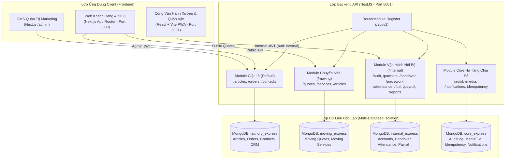

# TÀI LIỆU PHÂN TÍCH & THIẾT KẾ HỆ THỐNG TỔNG THỂ (MASTER SRS & SDD)

## HỆ SINH THÁI CÔNG NGHỆ CÔNG TY THANH XUÂN (THANH XUAN COMPANY)

> **Phiên bản:** 3.0
> **Kiến trúc:** Modular Living Architecture Specification (Tài liệu tổng quan + 3 phân hệ chi tiết)
> **Synced:** 2026-10-05 | **Môi trường:** Monorepo đa ứng dụng (NestJS, Next.js, React Vite)
> **Quy chuẩn kỹ thuật:** SOLID, Repository Pattern, Multi-Database Isolation, Clean Architecture, PWA Standards, Mobile-First

---

## 1. BỐI CẢNH & TỔNG QUAN HỆ THỐNG (SYSTEM CONTEXT)

### 1.1. Bối Cảnh Hệ Sinh Thái Doanh Nghiệp

Công ty Thanh Xuân vận hành một hệ sinh thái dịch vụ đa ngành, kết hợp chặt chẽ giữa dịch vụ tiếp thị khách hàng và điều hành chuỗi cung ứng sản xuất thực tế:

1. **Dịch vụ Giặt Sấy Chuyên Nghiệp & Tiếp Thị B2B (`thanhxuanlaundry.com`)**:
   - Cung cấp dịch vụ giặt ủi công nghiệp cao cấp cho các chuỗi nhà hàng ẩm thực lớn (Pizza 4P's, Golden Gate, Haidilao Hotpot...), khách sạn và spa.
   - Hệ thống bài viết tư vấn chuẩn SEO Google, tối ưu hóa tỷ lệ chuyển đổi leads báo giá.
2. **Dịch vụ Chuyển Nhà Trọn Gói & Cho Thuê Xe Tải (`chuyennhatietkiem.vn`)**:
   - Tiếp nhận thông tin khảo sát, tự động ước tính cước vận chuyển xe tải theo cự ly Km.
   - Bảng giá cước vận tải minh bạch và hệ thống bài viết cẩm nang chuyển nhà.
3. **Cổng Điều Hành Xưởng & Quản Vận B2B (`noibo.thanhxuanlaundry.com`)**:
   - Số hóa toàn diện quy trình giao nhận 2 chiều (đồ sạch / đồ bẩn), trạm rạch bao đếm lại xưởng, chữ ký điện tử.
   - Chấm công camera selfie thợ xưởng, tự động check-in ca cho tài xế xe tải khi ký phiếu giao nhận đầu tiên trong ngày.
   - Quản lý định mức khoán sản lượng (gấp, ủi, đóng gói), đề xuất xăng xe, tính bảng lương chu kỳ và trung tâm báo cáo streaming tối ưu VPS.

---

### 1.2. Danh Mục Tài Liệu Chi Tiết Theo Phân Hệ (Modular SRS & SDD)

Hệ thống tài liệu kỹ thuật được module hóa thành 3 phân hệ chuyên sâu, tương ứng với 3 ứng dụng trong Monorepo:

|  STT   | Phân Hệ                               | Ứng Dụng                       | Đường Dẫn Tài Liệu Chi Tiết                                                                                         | Trọng Tâm Đặc Tả                                                                                                                                                  |
| :----: | :------------------------------------ | :----------------------------- | :------------------------------------------------------------------------------------------------------------------ | :---------------------------------------------------------------------------------------------------------------------------------------------------------------- |
| **01** | **Backend API Tập Trung**             | `be-nestjs-thanhxuan/`         | [srs_sdd_backend.md](file:///d:/PROJECT/Website_Thanh_Xuan_Company/.agents/docs/srs_sdd/srs_sdd_backend.md)         | Kiến trúc 3 MongoDB độc lập, Repository Pattern, toàn bộ bảng API Contracts, DTO Validation, State Machine, RBAC Guards, Cron Jobs, Streaming Reports.            |
| **02** | **Web Khách Hàng & CMS**              | `fe-nextjs-thanhxuan-laundry/` | [srs_sdd_fe_nextjs.md](file:///d:/PROJECT/Website_Thanh_Xuan_Company/.agents/docs/srs_sdd/srs_sdd_fe_nextjs.md)     | Next.js App Router, Server Components SEO (RSC), Metadata động, Lead Capture CTA, CMS Quản trị bài viết, chiến dịch Zalo OA/Email.                                |
| **03** | **Cổng Vận Hành Xưởng & Đối Tác**     | `fe-react-thanhxuan-internal/` | [srs_sdd_fe_internal.md](file:///d:/PROJECT/Website_Thanh_Xuan_Company/.agents/docs/srs_sdd/srs_sdd_fe_internal.md) | React Router v7, Centralized Routes (`van-hanh/` & `quan-ly/`), Mobile-First PWA, Canvas Signature, Offline Queue IndexedDB, phân quyền giao diện 8 vai trò RBAC. |
| **04** | **Từ Điển Dữ Liệu (Data Dictionary)** | `be-nestjs-thanhxuan/`         | [DATABASE_DICTIONARY.md](file:///d:/PROJECT/Website_Thanh_Xuan_Company/.agents/docs/DATABASE_DICTIONARY.md)         | Từ điển 34+ collections thuộc 3 MongoDB độc lập, chi tiết từng thuộc tính, kiểu dữ liệu, index, quan hệ và ý nghĩa nghiệp vụ.                                     |
| **05** | **Bản Đồ Mã Nguồn (Codebase Atlas)**  | Monorepo (3 apps)              | [CODEBASE_ATLAS.md](file:///d:/PROJECT/Website_Thanh_Xuan_Company/.agents/docs/CODEBASE_ATLAS.md)                   | Chỉ mục truy xuất tức thì: Endpoint ↔ Controller ↔ Service ↔ Repository ↔ Schema và Route ↔ Page ↔ Modal ↔ Hooks ↔ Service.                                       |

---

## 2. THIẾT KẾ KIẾN TRÚC TỔNG QUAN (SYSTEM DESIGN)

### 2.1. Sơ Đồ Cấu Trúc Monorepo & Luồng Tích Hợp Hệ Thống



---

### 2.2. Cấu Trúc Monorepo Dự Án

```Markdown
Website_Thanh_Xuan_Company/
├── be-nestjs-thanhxuan/                  # Backend API NestJS tập trung
│   ├── src/
│   │   ├── common/                      # BaseRepository, Interceptors, Guards, time.util.ts
│   │   ├── config/                      # app.config, database.config, jwt.config
│   │   ├── mail/                        # Nodemailer & Resend SMTP service
│   │   └── modules/
│   │       ├── core/                    # Upload, AI Gemini, Audit Log, Idempotency
│   │       ├── laundry/                 # DB: laundry_express
│   │       ├── moving/                  # DB: moving_express
│   │       └── internal/                # DB: internal_express
│
├── fe-nextjs-thanhxuan-laundry/          # Web Khách Hàng thanhxuanlaundry.com & CMS (Port 3000)
│   ├── src/app/(public)/                # Server Components SEO công khai
│   ├── src/app/(admin)/admin/           # Quản trị CMS bài viết, đơn hàng, CRM leads
│   └── src/features/                    # Colocation logic bài viết, form liên hệ
│
├── fe-react-thanhxuan-internal/          # Cổng Vận Hành Xưởng & Quản Vận noibo.thanhxuanlaundry.com (Port 3001)
│   ├── src/app/(auth)/                  # Đăng nhập, đăng ký OTP, quên mật khẩu
│   ├── src/app/(internal)/operations/   # Phân hệ vận hành cho Kho, Thợ, Shipper, Đối tác (100% số ít)
│   ├── src/app/(internal)/management/   # Phân hệ điều hành cho Quản lý, Kế toán, Admin (100% số ít)
│   ├── src/features/                    # Colocation phân định rõ ràng management/ và operations/ chuẩn backend
│   └── src/lib/                         # offline-queue (IndexedDB), api-client, permissions
│
├── docker-compose.yml                    # Điều phối 4 container (mongodb, backend, frontend, internal)
└── .agents/
    ├── docs/
    │   ├── SRS_SDD.md                   # Tài liệu kiến trúc tổng quan (File này)
    │   ├── CHANGELOG.md                 # Nhật ký chi tiết toàn bộ các Plan & Fix
    │   ├── srs_sdd/                     # 3 tài liệu phân hệ chi tiết
    │   │   ├── srs_sdd_backend.md       # Đặc tả chi tiết Backend API
    │   │   ├── srs_sdd_fe_nextjs.md     # Đặc tả chi tiết Web Khách Hàng & CMS
    │   │   └── srs_sdd_fe_internal.md   # Đặc tả chi tiết Cổng Vận Hành Xưởng
    │   ├── plans/                       # Các kế hoạch kỹ thuật plan1.md -> planN.md
    │   └── reviews/                     # Các biên bản kiểm định mã nguồn reviewN.md
    └── rules/                           # Quy chuẩn kỹ thuật dự án (AGENTS.md, GEMINI.md...)
```

---

## 3. QUY CHUẨN KỸ THUẬT DÙNG CHUNG TOÀN HỆ THỐNG

1. **Chuẩn Hóa Múi Giờ Việt Nam (`Asia/Ho_Chi_Minh` - GMT+7):**
   - Toàn bộ thời gian chấm công, tính giờ công làm việc, phân loại lịch giao nhận ngày chẵn/lẻ, tiền tố mã phiếu (`GN-YYYYMMDD-NNN`) và báo cáo thống kê phải được xử lý qua helper `time.util.ts` (`startOfDayVN`, `endOfDayVN`, `getDatePrefixVN`).
   - Tuyệt đối không dùng `setHours(0,0,0,0)` theo local timezone của máy chủ VPS để tránh lệch giờ khi deploy.
2. **Cô Lập Token & Phân Vùng Quyền Hạn (`Token Audience`):**
   - Passport JWT Strategy ở phân hệ nội bộ bắt buộc kiểm tra `aud: 'internal'`. Chặn tuyệt đối việc dùng chéo token giữa tài khoản khách hàng web và nhân viên nội bộ.
3. **Bảo Mật Dữ Liệu Tài Chính Đa Tầng:**
   - Tại Backend: `PayFieldFilterInterceptor` đệ quy bóc tách toàn bộ trường tiền/lương khi user thiếu quyền `pay.view`.
   - Tại Frontend: `canViewFinancials` ẩn hoàn toàn các cột đơn giá, bảng tính lương, phê duyệt xăng xe với vai trò `MANAGER` và `WAREHOUSE_MANAGER`.
4. **Tối Ưu Hóa Tài Nguyên VPS Giá Rẻ (< 512MB RAM):**
   - Không chạy `docker-compose build` trực tiếp trên VPS (dùng GitHub Actions build image và push GHCR).
   - Xuất báo cáo Excel bằng `exceljs` streaming ghi từng dòng xuống stream và PDF bằng `pdfmake`.
   - Hàng đợi xuất file giới hạn concurrency = 1 chống tràn bộ nhớ (Out-Of-Memory).
5. **Đồng Bộ Dữ Liệu Ngoại Tuyến (Offline-First):**
   - Hàng đợi ngoại tuyến PWA sử dụng IndexedDB (`idb`) kết hợp header `Idempotency-Key` (UUIDv4) để đảm bảo an toàn giao dịch khi tài xế giao nhận tại các khu vực tầng hầm mất sóng mạng.

---

## 4. DOCUMENT HISTORY

> 📌 **Chi tiết toàn bộ nhật ký các Plan và Bugfix:** Xem đầy đủ tại [CHANGELOG.md](file:///d:/PROJECT/Website_Thanh_Xuan_Company/.agents/docs/CHANGELOG.md).

- **2026-10-27 - Nâng Cấp Cấu Hình Xưởng (Geocoding & Sai Số GPS ±350m):** Bổ sung tra cứu tọa độ GPS tự động từ địa chỉ nhập tay thông qua OpenStreetMap Nominatim, nâng ngưỡng sai số GPS tối đa (maxAccuracyMeters) từ 150m lên ±350m giúp nhân sự chấm công ổn định trong xưởng trần tôn; tái cấu trúc màn hình cấu hình xưởng thành các sub-components độc lập (< 250 dòng).

- **2026-10-27 - Plan 42 - Kiến Trúc Lưu Trữ Kép (Cloudinary + VPS), Tự Động Nén ZIP Gửi Mail Đối Tác & Quản Lý Google Drive 5GB:** Triển khai ArchiveModule lưu trữ kép song song (Cloudinary CDN + VPS local /uploads/internal-thanhxuan), cơ chế xóa đè ảnh cũ triệt tiêu rò rỉ dung lượng; tự động nén ZIP ảnh phiếu hàng tháng theo đối tác gửi email đối soát kế toán; quét định kỳ dọn dẹp ảnh mồ côi và ảnh phụ 90 ngày; tích hợp bảo vệ dung lượng Google Drive 5GB qua Rclone tự động xoay vòng khi đầy 80%.
- **2026-10-27 - Plan 41 - Tích Hợp Xác Thực IP Wi-Fi Router Xưởng & Màn Hình Admin Cấu Hình Xưởng (/management/admin/workshop):** Ngăn chặn triệt để gian lận chấm công từ xa bằng xác thực kép Geofencing GPS (haversine) + IP Public Wi-Fi xưởng; xây dựng bảng workshop_settings lưu cấu hình vị trí và danh sách IP Wi-Fi kèm cờ bắt buộc/cảnh báo mềm; phát triển màn hình Admin cấu hình xưởng 4 tầng công thái học (< 250 dòng) tích hợp 1 chạm lấy GPS và thêm IP mạng hiện tại; cập nhật trạm thợ (/attendance) và bảng công (/management/manager/attendance) hiển thị trực quan nhãn Wi-Fi xưởng / 4G.
- **2026-10-26 - Plan 40 - Xây Dựng Lại Bảng Công Toàn Xưởng (/management/manager/attendance) & Bảng Lương Chu Kỳ (/management/accountant/payroll):** Tái thiết toàn diện hai màn hình theo chuẩn 4 tầng công thái học (< 250 dòng/file); sửa lỗi lệch dateKey khiến bảng chấm công rỗng, bổ sung modal rà soát ảnh selfie/GPS và duyệt ca bất thường; khôi phục toàn bộ hợp đồng API chu kỳ lương (tính toán tháng YYYY-MM, chốt sổ, mở khóa, thanh toán, xuất Excel); cập nhật PayrollService tính đúng công thợ/tài xế và điều chỉnh phiếu lương bảo toàn công thức.
- **2026-10-26 - Plan 39 - Xóa Trang /management, Thiết Kế Lại /dashboard & Trung Tâm Báo Cáo /operations/report 8 Phân Hệ:** Xóa bỏ hoàn toàn trang Hub trung gian /management (chuyển tab AuditLogPage sang StaffManagementPage và redirect /management sang /dashboard); thiết kế lại giao diện Dashboard và Trung tâm Báo cáo theo chuẩn bố cục 4 tầng công thái học (< 250-300 dòng); sửa lỗi hiển thị công thợ và sửa đứt gãy hợp đồng API báo cáo giữa FE & BE; nâng cấp Backend hỗ trợ đối soát tất cả đối tác và mở rộng 8 loại báo cáo vận hành - tài chính.
- **2026-10-26 - Plan 37 - Công Thợ Theo Khâu Mặc Định Gắn Chấm Công, Đơn Giá Giờ Theo Khâu & Phiếu Lương Theo Ngày:** Chuyển đổi toàn diện công thợ theo giờ sang mô hình phiên khâu thời gian thực (Job Segment), gắn kết tự động với ca chấm công camera selfie (/attendance); quản lý phân khâu mặc định cho thợ xưởng, cài đặt đơn giá giờ VNĐ/khâu độc lập (bỏ hệ số cũ); checkout khâu phụ tự động quay lại khâu mặc định; tích hợp bảng lương tạm tính theo từng ngày (/operations/payslip) và phiếu lương chính thức đã chốt kỳ.
- **2026-10-26 - Plan 36 - Chuẩn Hóa Kiến Trúc Domain Handovers & Partners và Đồng Bộ Frontend Với Backend Internal:** Di chuyển trọn vẹn Cổng đối tác (PartnerHandoverPage, các tabs đếm đồ bẩn, kiểm nhận đồ sạch và hooks) từ operations/partners sang operations/handovers, xóa bỏ thư mục operations/partners đặt sai vị trí nghiệp vụ; giữ management/partners là nơi duy nhất quản lý dữ liệu đối tác (partners, item_catalogs, brands); loại bỏ 100% any trong StaffManagementPage.
- **2026-10-26 - Plan 35 - Chức Năng Lưu & Chọn Chữ Ký Đã Lưu Trong Tài Khoản Cho Web Internal:** Bổ sung trường signatureUrl vào bảng accounts (StaffAccount) và DTO UpdateProfileDto ở Backend; xây dựng SignatureInputComponent hỗ trợ toggle dùng chữ ký đã lưu / ký tay mới và checkbox lưu làm mặc định; tích hợp trọn vẹn vào ProfileEditModal và 5 vị trí ký nhận (PrepOrderModal, SignatureModal, ShipperCountPartnerModal, PartnerReceiptTabComponent, PartnerCountTabComponent).

- **2026-10-25 - Plan 34 - Tái Cấu Trúc UI/UX Trang Chủ (Hero Diagonal Split Video-Ảnh & Di Dời Form Liên Hệ Xuống Pre-Footer):** Tái cấu trúc Hero Section thành dạng chia chéo (Diagonal Split 12°-14°) với video loop xưởng giặt tự động hóa bên trái và ảnh thành phẩm chất lượng cao kèm floating trust badges bên phải; tích hợp framer-motion entrance reveal và tự động pause video khi out-of-view; di dời form liên hệ xuống vị trí Pre-Footer tích hợp cam kết chuyển đổi B2B (tặng 01 tuần giặt mẫu, giao nhận 24/7, bồi thường 100%); mở rộng schema Setting và CMS Admin cho phép tùy biến video URL, poster và ảnh bên phải.
- **2026-10-25 - Plan 32 - Tái Cấu Trúc Toàn Diện Thư Mục & Chuẩn Hóa Kiến Trúc fe-nextjs-thanhxuan-laundry:** Chuẩn hóa cấu trúc thư mục phẳng theo chuẩn fe-react-thanhxuan-internal (AGENTS.md Mục 5.5): [Tên]Page.tsx, modals/[Tên]Modal.tsx, components/[Tên]Component.tsx; tổ chức lại 11 module Admin và 6 module Public, shared components (common/, layout/, ui/), loại bỏ 100% any trong route public và triệt tiêu toàn bộ file re-export mồ côi.
- **2026-10-25 - Plan 33 - Tái Cấu Trúc Thư Mục Laundry Đồng Bộ Với Internal & Chuẩn NestJS:** Tạo LaundryModule và constants đóng gói 12 submodule giặt là đăng ký vào AppModule, di chuyển toàn bộ repository vào thư mục repositories/ và dọn dẹp triệt để 7 file cũ, cập nhật toàn bộ import.
- **2026-10-15 - Plan 31 - Dọn Dẹp File Thừa Mồ Côi & Chuẩn Hóa Tên Màn Hình Frontend Ánh Xạ Backend:** Dọn dẹp sạch sẽ 6 file thừa/mồ côi (ItemCounterCardComponent, WarehouseSlipGalleryTabComponent, WarehouseRecountQueueTabComponent, CreateHandoverModal, RegisterModal, management/reports/); chuẩn hóa tên 6 màn hình Frontend cấp cao nhất (HourlyWorkStationPage, HourlyWorkReviewPage, WarehouseHandoverPage, ShipperHandoverPage, ShipperFuelPage, PartnersManagementPage) ánh xạ 1-1 với 8 module Backend; triệt tiêu 100% file bridge/alias re-export tạm thời.
- **2026-10-15 - Plan 29 & Plan 30 - Chuẩn Hóa Bộ Lọc Ngày Phiếu Giao Nhận & Chuyển Đổi Trạm Khoán Việc Sang HourlyWork:** Chuẩn hóa bộ lọc ngày thư viện ảnh phiếu (từ ngày đầu tháng đến ngày mai), kiểm nhận đối tác ca đêm 21h-24h tự động chọn ngày mai, đổi tên Kho Sạch sang Phiếu Giao Nhận và tích hợp sửa phiếu qua PrepOrderModal; chuyển đổi trạm khoán việc thợ xưởng sang tính tiền công theo giờ (minutesWorked/60 * hourlyBaseRate * coefficient) với 7 khâu công việc chuẩn, ràng buộc ca OPEN và giao diện trạm ghi công thợ trực quan.
- **2026-10-13 - Plan 28 - Chuẩn Hóa Toàn Diện Schema & Dọn Rác Dữ Liệu Các Bảng (Accounts, ItemCatalogs, HandoverRecords):** Chuẩn hóa bảng accounts (xóa bỏ roles: string[] trùng lặp, dùng duy nhất role: StaffRole, bỏ pay_profile rỗng mặc định); chuẩn hóa bảng item_catalogs đúng 8 trường cốt lõi (đổi customerPrice -> priceToCustomer, giữ sortOrder, loại bỏ 100% khoán thợ cũ foldingRateWorker/ironingRateWorker); triệt tiêu mảng rỗng mặc định notes: [] trong handover_records bằng default: undefined; chạy script dọn dẹp và $unset dữ liệu sạch sẽ trên MongoDB Atlas.
- **2026-10-13 - Plan 27 - Tinh Gọn Triệt Để Bản Ghi HandoverRecord, Triệt Tiêu Lặp Base64 Chữ Ký & Mảng Mặc Định Rỗng:** Loại bỏ preparedByName/Signature/at/warehouseManagerId khỏi cleanClothes, lưu chữ ký duy nhất 1 nơi tại signatures.warehouseManager (tiết kiệm 50% dung lượng byte do nhân đôi Base64); loại bỏ các giá trị mặc định rỗng (dirtyClothes, notes, recount) trong Mongoose Schema; dọn dẹp sạch sẽ toàn bộ collection handover_records trên MongoDB Atlas.


