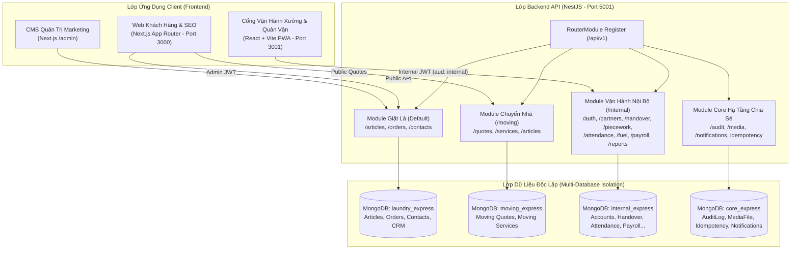

# TÀI LIỆU PHÂN TÍCH & THIẾT KẾ HỆ THỐNG TỔNG THỂ (MASTER SRS & SDD)

## HỆ SINH THÁI CÔNG NGHỆ CÔNG TY THANH XUÂN (THANH XUAN COMPANY)

> **Phiên bản:** 3.0
> **Kiến trúc:** Modular Living Architecture Specification (Tài liệu tổng quan + 3 phân hệ chi tiết)
> **Synced:** 2026-10-05 | **Môi trường:** Monorepo đa ứng dụng (NestJS, Next.js, React Vite)
> **Quy chuẩn kỹ thuật:** SOLID, Repository Pattern, Multi-Database Isolation, Clean Architecture, PWA Standards, Mobile-First

---

## 1. BỐI CẢNH & TỔNG QUAN HỆ THỐNG (SYSTEM CONTEXT)

### 1.1. Bối Cảnh Hệ Sinh Thái Doanh Nghiệp

Công ty Thanh Xuân vận hành một hệ sinh thái dịch vụ đa ngành, kết hợp chặt chẽ giữa dịch vụ tiếp thị khách hàng và điều hành chuỗi cung ứng sản xuất thực tế:

1. **Dịch vụ Giặt Sấy Chuyên Nghiệp & Tiếp Thị B2B (`thanhxuanlaundry.com`)**:
   - Cung cấp dịch vụ giặt ủi công nghiệp cao cấp cho các chuỗi nhà hàng ẩm thực lớn (Pizza 4P's, Golden Gate, Haidilao Hotpot...), khách sạn và spa.
   - Hệ thống bài viết tư vấn chuẩn SEO Google, tối ưu hóa tỷ lệ chuyển đổi leads báo giá.
2. **Dịch vụ Chuyển Nhà Trọn Gói & Cho Thuê Xe Tải (`chuyennhatietkiem.vn`)**:
   - Tiếp nhận thông tin khảo sát, tự động ước tính cước vận chuyển xe tải theo cự ly Km.
   - Bảng giá cước vận tải minh bạch và hệ thống bài viết cẩm nang chuyển nhà.
3. **Cổng Điều Hành Xưởng & Quản Vận B2B (`noibo.thanhxuanlaundry.com`)**:
   - Số hóa toàn diện quy trình giao nhận 2 chiều (đồ sạch / đồ bẩn), trạm rạch bao đếm lại xưởng, chữ ký điện tử.
   - Chấm công camera selfie thợ xưởng, tự động check-in ca cho tài xế xe tải khi ký phiếu giao nhận đầu tiên trong ngày.
   - Quản lý định mức khoán sản lượng (gấp, ủi, đóng gói), đề xuất xăng xe, tính bảng lương chu kỳ và trung tâm báo cáo streaming tối ưu VPS.

---

### 1.2. Danh Mục Tài Liệu Chi Tiết Theo Phân Hệ (Modular SRS & SDD)

Hệ thống tài liệu kỹ thuật được module hóa thành 3 phân hệ chuyên sâu, tương ứng với 3 ứng dụng trong Monorepo:

|  STT   | Phân Hệ                               | Ứng Dụng                       | Đường Dẫn Tài Liệu Chi Tiết                                                                                         | Trọng Tâm Đặc Tả                                                                                                                                                  |
| :----: | :------------------------------------ | :----------------------------- | :------------------------------------------------------------------------------------------------------------------ | :---------------------------------------------------------------------------------------------------------------------------------------------------------------- |
| **01** | **Backend API Tập Trung**             | `be-nestjs-thanhxuan/`         | [srs_sdd_backend.md](file:///d:/PROJECT/Website_Thanh_Xuan_Company/.agents/docs/srs_sdd/srs_sdd_backend.md)         | Kiến trúc 3 MongoDB độc lập, Repository Pattern, toàn bộ bảng API Contracts, DTO Validation, State Machine, RBAC Guards, Cron Jobs, Streaming Reports.            |
| **02** | **Web Khách Hàng & CMS**              | `fe-nextjs-thanhxuan-laundry/` | [srs_sdd_fe_nextjs.md](file:///d:/PROJECT/Website_Thanh_Xuan_Company/.agents/docs/srs_sdd/srs_sdd_fe_nextjs.md)     | Next.js App Router, Server Components SEO (RSC), Metadata động, Lead Capture CTA, CMS Quản trị bài viết, chiến dịch Zalo OA/Email.                                |
| **03** | **Cổng Vận Hành Xưởng & Đối Tác**     | `fe-react-thanhxuan-internal/` | [srs_sdd_fe_internal.md](file:///d:/PROJECT/Website_Thanh_Xuan_Company/.agents/docs/srs_sdd/srs_sdd_fe_internal.md) | React Router v7, Centralized Routes (`van-hanh/` & `quan-ly/`), Mobile-First PWA, Canvas Signature, Offline Queue IndexedDB, phân quyền giao diện 8 vai trò RBAC. |
| **04** | **Từ Điển Dữ Liệu (Data Dictionary)** | `be-nestjs-thanhxuan/`         | [DATABASE_DICTIONARY.md](file:///d:/PROJECT/Website_Thanh_Xuan_Company/.agents/docs/DATABASE_DICTIONARY.md)         | Từ điển 34+ collections thuộc 3 MongoDB độc lập, chi tiết từng thuộc tính, kiểu dữ liệu, index, quan hệ và ý nghĩa nghiệp vụ.                                     |
| **05** | **Bản Đồ Mã Nguồn (Codebase Atlas)**  | Monorepo (3 apps)              | [CODEBASE_ATLAS.md](file:///d:/PROJECT/Website_Thanh_Xuan_Company/.agents/docs/CODEBASE_ATLAS.md)                   | Chỉ mục truy xuất tức thì: Endpoint ↔ Controller ↔ Service ↔ Repository ↔ Schema và Route ↔ Page ↔ Modal ↔ Hooks ↔ Service.                                       |

---

## 2. THIẾT KẾ KIẾN TRÚC TỔNG QUAN (SYSTEM DESIGN)

### 2.1. Sơ Đồ Cấu Trúc Monorepo & Luồng Tích Hợp Hệ Thống



---

### 2.2. Cấu Trúc Monorepo Dự Án

```Markdown
Website_Thanh_Xuan_Company/
├── be-nestjs-thanhxuan/                  # Backend API NestJS tập trung
│   ├── src/
│   │   ├── common/                      # BaseRepository, Interceptors, Guards, time.util.ts
│   │   ├── config/                      # app.config, database.config, jwt.config
│   │   ├── mail/                        # Nodemailer & Resend SMTP service
│   │   └── modules/
│   │       ├── core/                    # Upload, AI Gemini, Audit Log, Idempotency
│   │       ├── laundry/                 # DB: laundry_express
│   │       ├── moving/                  # DB: moving_express
│   │       └── internal/                # DB: internal_express
│
├── fe-nextjs-thanhxuan-laundry/          # Web Khách Hàng thanhxuanlaundry.com & CMS (Port 3000)
│   ├── src/app/(public)/                # Server Components SEO công khai
│   ├── src/app/(admin)/admin/           # Quản trị CMS bài viết, đơn hàng, CRM leads
│   └── src/features/                    # Colocation logic bài viết, form liên hệ
│
├── fe-react-thanhxuan-internal/          # Cổng Vận Hành Xưởng & Quản Vận noibo.thanhxuanlaundry.com (Port 3001)
│   ├── src/app/(auth)/                  # Đăng nhập, đăng ký OTP, quên mật khẩu
│   ├── src/app/(internal)/operations/   # Phân hệ vận hành cho Kho, Thợ, Shipper, Đối tác (100% số ít)
│   ├── src/app/(internal)/management/   # Phân hệ điều hành cho Quản lý, Kế toán, Admin (100% số ít)
│   ├── src/features/                    # Colocation phân định rõ ràng management/ và operations/ chuẩn backend
│   └── src/lib/                         # offline-queue (IndexedDB), api-client, permissions
│
├── docker-compose.yml                    # Điều phối 4 container (mongodb, backend, frontend, internal)
└── .agents/
    ├── docs/
    │   ├── SRS_SDD.md                   # Tài liệu kiến trúc tổng quan (File này)
    │   ├── CHANGELOG.md                 # Nhật ký chi tiết toàn bộ các Plan & Fix
    │   ├── srs_sdd/                     # 3 tài liệu phân hệ chi tiết
    │   │   ├── srs_sdd_backend.md       # Đặc tả chi tiết Backend API
    │   │   ├── srs_sdd_fe_nextjs.md     # Đặc tả chi tiết Web Khách Hàng & CMS
    │   │   └── srs_sdd_fe_internal.md   # Đặc tả chi tiết Cổng Vận Hành Xưởng
    │   ├── plans/                       # Các kế hoạch kỹ thuật plan1.md -> planN.md
    │   └── reviews/                     # Các biên bản kiểm định mã nguồn reviewN.md
    └── rules/                           # Quy chuẩn kỹ thuật dự án (AGENTS.md, GEMINI.md...)
```

---

## 3. QUY CHUẨN KỸ THUẬT DÙNG CHUNG TOÀN HỆ THỐNG

1. **Chuẩn Hóa Múi Giờ Việt Nam (`Asia/Ho_Chi_Minh` - GMT+7):**
   - Toàn bộ thời gian chấm công, tính giờ công làm việc, phân loại lịch giao nhận ngày chẵn/lẻ, tiền tố mã phiếu (`GN-YYYYMMDD-NNN`) và báo cáo thống kê phải được xử lý qua helper `time.util.ts` (`startOfDayVN`, `endOfDayVN`, `getDatePrefixVN`).
   - Tuyệt đối không dùng `setHours(0,0,0,0)` theo local timezone của máy chủ VPS để tránh lệch giờ khi deploy.
2. **Cô Lập Token & Phân Vùng Quyền Hạn (`Token Audience`):**
   - Passport JWT Strategy ở phân hệ nội bộ bắt buộc kiểm tra `aud: 'internal'`. Chặn tuyệt đối việc dùng chéo token giữa tài khoản khách hàng web và nhân viên nội bộ.
3. **Bảo Mật Dữ Liệu Tài Chính Đa Tầng:**
   - Tại Backend: `PayFieldFilterInterceptor` đệ quy bóc tách toàn bộ trường tiền/lương khi user thiếu quyền `pay.view`.
   - Tại Frontend: `canViewFinancials` ẩn hoàn toàn các cột đơn giá, bảng tính lương, phê duyệt xăng xe với vai trò `MANAGER` và `WAREHOUSE_MANAGER`.
4. **Tối Ưu Hóa Tài Nguyên VPS Giá Rẻ (< 512MB RAM):**
   - Không chạy `docker-compose build` trực tiếp trên VPS (dùng GitHub Actions build image và push GHCR).
   - Xuất báo cáo Excel bằng `exceljs` streaming ghi từng dòng xuống stream và PDF bằng `pdfmake`.
   - Hàng đợi xuất file giới hạn concurrency = 1 chống tràn bộ nhớ (Out-Of-Memory).
5. **Đồng Bộ Dữ Liệu Ngoại Tuyến (Offline-First):**
   - Hàng đợi ngoại tuyến PWA sử dụng IndexedDB (`idb`) kết hợp header `Idempotency-Key` (UUIDv4) để đảm bảo an toàn giao dịch khi tài xế giao nhận tại các khu vực tầng hầm mất sóng mạng.

---

## 4. DOCUMENT HISTORY

> 📌 **Chi tiết toàn bộ nhật ký các Plan và Bugfix:** Xem đầy đủ tại [CHANGELOG.md](file:///d:/PROJECT/Website_Thanh_Xuan_Company/.agents/docs/CHANGELOG.md).

- **2026-10-10 - Plan 22 - Tách Database core_express (CORE_CONNECTION) & Migration Dữ Liệu An Toàn:** Tách 4 bảng dùng chung (`audit_logs`, `media_files`, `idempotency_keys`, `notifications`) từ `internal_express` sang cơ sở dữ liệu độc lập `core_express`; cấu hình Mongoose connection thứ 4 `CORE_CONNECTION`; di chuyển toàn bộ dữ liệu kèm indexes sang `core_express` và drop sạch 4 bảng cũ bên `internal_express`; cập nhật tài liệu [DATABASE_DICTIONARY.md](file:///d:/PROJECT/Website_Thanh_Xuan_Company/.agents/docs/DATABASE_DICTIONARY.md) và topology 4 DBs.
- **2026-10-10 - Harness Engineering Baseline & Data Dictionary:** Sửa lỗi render Mermaid diagram; khởi tạo hoàn chỉnh Từ điển dữ liệu toàn hệ thống [DATABASE_DICTIONARY.md](file:///d:/PROJECT/Website_Thanh_Xuan_Company/.agents/docs/DATABASE_DICTIONARY.md) cho 34 Mongoose collections; khởi tạo Bản đồ định vị mã nguồn [CODEBASE_ATLAS.md](file:///d:/PROJECT/Website_Thanh_Xuan_Company/.agents/docs/CODEBASE_ATLAS.md) cho 3 apps; bổ sung quy định bắt buộc cập nhật Dictionary & Atlas vào Definition of Done trong [AGENTS.md](file:///d:/PROJECT/Website_Thanh_Xuan_Company/.agents/rules/AGENTS.md).
- **2026-10-10 - Plan 21 - Cải Tiến Giao Diện Đối Tác B2B, Form Đếm Đồ Bẩn Thông Minh, Kiểm Nhận Canvas 2 Chiều, Lịch Sử Phân Trang & Khắc Phục Lỗi 403 / Loop Re-render:** Tái cấu trúc cổng đối tác chuẩn `@/components/common`, chuyển menu điều hướng 4 tab xuống Mobile BottomBar; nâng cấp form Đếm đồ bẩn thông minh (Smart Math Parser, auto-save on blur, khóa chi nhánh/ngày theo phiếu soạn); tích hợp phiếu giao nhận 2 chiều Canvas lùi/tiến ngày và ký kiểm nhận đồ sạch; lịch sử phân trang 12 phiếu/trang; sửa lỗi 403 Permissions và loop re-render ở PrepOrderModal ([srs_sdd_fe_internal.md](file:///d:/PROJECT/Website_Thanh_Xuan_Company/.agents/docs/srs_sdd/srs_sdd_fe_internal.md), [srs_sdd_backend.md](file:///d:/PROJECT/Website_Thanh_Xuan_Company/.agents/docs/srs_sdd/srs_sdd_backend.md)).
- **2026-10-10 - Refactor - Chuẩn Hóa Kiến Trúc File Features & Giới Hạn Dung Lượng (*Page.tsx, modals/*Modal.tsx, components/\*Component.tsx):** Rà soát và bóc tách các file vượt kích thước (> 350-400 dòng), chia nhỏ thành các component con và modal độc lập; chuẩn hóa toàn diện quy tắc đặt tên file trong `src/features/` ([srs_sdd_fe_internal.md](file:///d:/PROJECT/Website_Thanh_Xuan_Company/.agents/docs/srs_sdd/srs_sdd_fe_internal.md)); cập nhật rules và skills đồng bộ.
- **2026-10-10 - Docs-sync:** Đồng bộ chi tiết phân hệ vận hành & quản lý đối tác ([srs_sdd_fe_internal.md](file:///d:/PROJECT/Website_Thanh_Xuan_Company/.agents/docs/srs_sdd/srs_sdd_fe_internal.md)): chuẩn hóa Canvas Phiếu in A4 (lề trên 50px, 4 dòng công ty căn trái cỡ to, tiêu đề bảng rõ nét), Clean Print tắt header/footer trình duyệt, sửa lỗi cuộn flexbox, tích hợp nút QR Zalo phân quyền Admin/Manager và thu nhỏ Action Bar.
- **2026-10-10 - Plan 20 - Soạn Đồ Giao Hàng, Xuất Phiếu Giấy Zalo Chuẩn Khổ A4, Tự Động Định Kỳ & Sửa Lỗi Popup Đối Tác:** Bổ sung tính năng Soạn đồ tại kho với cơ chế tự động điền sẵn (prefill) đồ bẩn hôm trước, nhập 3 loại số lượng sạch (_Đã giao_, _Chưa giao_, _Giao trả_) + ghi chú từng dòng và Canvas ký điện tử; hoàn thiện modal & helper xuất ảnh Phiếu Xuất Nhập Kho Vận Chuyển A4 chuẩn mẫu thực tế Pizza 4P's gửi nhóm Zalo; thiết lập tự động lên đơn theo lịch định kỳ; sửa triệt để lỗi popup sửa đối tác.
- **2026-10-10 - Plan 19 - Nâng Tầm Toàn Diện UI/UX Phân Hệ Nội Bộ (`fe-react-thanhxuan-internal`):** Chuẩn hóa typography Plus Jakarta Sans & JetBrains Mono tabular-nums; nâng cấp hệ thống CSS Tokens & shadows; bổ sung bộ UI components cốt lõi (StatCard KPI có trend, EmptyState sinh động, SkeletonLoader shimmer, Badge status dot logistics); tái cấu trúc Header kính mờ, Desktop Sidebar active indicator, Mobile Bottom Bar tactile pill và thiết kế lại Dashboard trung tâm điều hành xưởng.
