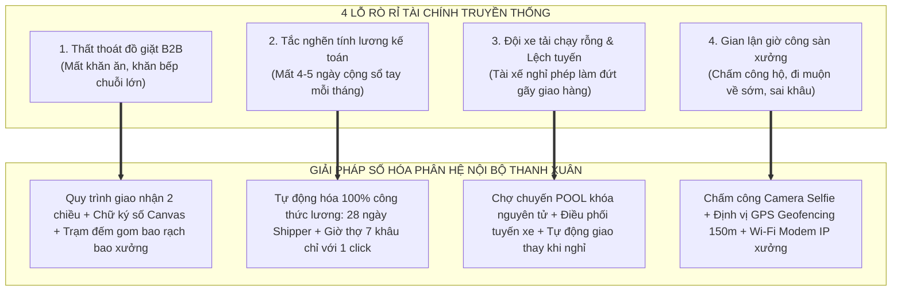
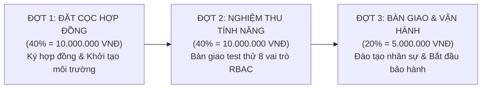

# HỒ SƠ TRÌNH BÀY CHI PHÍ PHÂN HỆ NỘI BỘ & KẾ HOẠCH ĐÀM PHÁN HỢP ĐỒNG CHUYỂN ĐỔI SỐ

## DỰ ÁN: HỆ SINH THÁI CÔNG NGHỆ ĐIỀU HÀNH XƯỞNG GIẶT LÀ & LOGISTICS B2B

> **Kính gửi:** Ban Giám Đốc / Chủ Doanh Nghiệp - Công ty TNHH Kinh doanh Thương mại và Dịch vụ Thanh Xuân
> **Đơn vị lập hồ sơ:** Đội Ngũ Kỹ Thuật & Tư Vấn Chuyển Đổi Số
> **Mục tiêu:** Cung cấp tài liệu trình bày trực quan, thuyết phục về giá trị và chi phí đầu tư của Phân hệ Cổng Vận Hành Nội Bộ (`fe-react-thanhxuan-internal` + Backend Internal); kèm theo kịch bản đàm phán thương mại, xử lý từ chối và phương án thanh toán linh hoạt giúp chốt hợp đồng thành công.
> **Ngày phát hành:** 2026-10-29

---

## MỤC LỤC TỔNG QUAN

1. [PHẦN 1: BẢN ĐỀ XUẤT GIÁ TRỊ DOANH NGHIỆP (THE VALUE PROPOSITION)](#phan-1)
2. [PHẦN 2: BẢN TRÌNH BÀY CHI PHÍ PHÂN HỆ NỘI BỘ (GÓI CHỐT 25.000.000 VNĐ)](#phan-2)
3. [PHẦN 3: BẢNG TÍNH TOÁN HIỆU QUẢ ĐẦU TƯ &amp; HOÀN VỐN (ROI CALCULATOR)](#phan-3)
4. [PHẦN 4: KỊCH BẢN ĐÀM PHÁN THƯƠNG MẠI &amp; BẺ GÃY PHẢN ĐỐI (NEGOTIATION PLAYBOOK)](#phan-4)
5. [PHẦN 5: ĐIỀU KHOẢN HỢP ĐỒNG, LỘ TRÌNH THANH TOÁN &amp; CAM KẾT BÀN GIAO](#phan-5)

---

<a name="phan-1"></a>

## PHẦN 1: BẢN ĐỀ XUẤT GIÁ TRỊ DOANH NGHIỆP (THE VALUE PROPOSITION)

### 1.1. Giải Quyết Triệt Để 4 "Nỗi Đau Vận Hành" Lớn Nhất Của Xưởng Giặt Là

Xưởng giặt là công nghiệp truyền thống luôn đối mặt với 4 lỗ rò rỉ tài chính và thất thoát nghiêm trọng mà việc ghi chép sổ sách thủ công không thể xử lý được:



### 1.2. Hệ Thống 8 Vai Trò Chuyên Nghiệp (RBAC) Khép Kín Chuỗi Cung Ứng

Không chỉ là một trang web đơn giản, đây là một nền tảng **ERP / WMS / TMS thu nhỏ** phục vụ toàn diện mọi mắt xích trong công ty:

1. **Ban Giám Đốc (`ADMIN`):** Giám sát KPI thời gian thực, toàn quyền nhân sự 60 ngày, khóa/mở khóa kỳ lương.
2. **Quản Lý Xưởng (`MANAGER`):** Chỉ huy 7 khâu sản xuất, rà soát ca bất thường, duyệt công ngày *(Bảo mật: Bị ẩn 100% dữ liệu tiền bạc)*.
3. **Thủ Kho (`WAREHOUSE_MANAGER`):** Soạn đồ sạch xuất kho theo ngày, ký Canvas xuất ảnh phiếu Cloudinary, quản lý thư viện ảnh phiếu và trạm đếm.
4. **Kế Toán (`ACCOUNTANT`):** Thẩm định chi phí xe máy (xăng + sửa xe với 2 ảnh bắt buộc), định mức thù lao chuyến lẻ, chạy tính bảng lương tự động và xuất Excel.
5. **Tài Xế Xe Tải (`SHIPPER`):** 100% Mobile PWA, lộ trình 4 ca sáng/chiều/tối, chợ chuyến nhận đơn lẻ hưởng thù lao, đếm thay đồ bẩn toàn màn hình và xin nghỉ phép.
6. **Thợ Xưởng (`WORKER`):** Chấm công selfie + GPS vệ tinh $\le 150\text{m}$, đồng hồ đếm giờ làm việc 7 khâu cập nhật mỗi 30s, tự động quay lại khâu mặc định (`AUTO_RESUME`), tra cứu lương ngày.
7. **Quản Lý Đối Tác (`PARTNER_MANAGER`):** Cổng nhà hàng (Pizza 4P's, Haidilao...), đếm đồ bẩn Auto-save onBlur chống xung đột, kiểm nhận đồ sạch qua ảnh WebP, duyệt nhân viên cơ sở.
8. **Nhân Viên Đối Tác (`PARTNER_STAFF`):** Giao diện 3 tab di động tinh gọn đếm đồ bẩn và nhận đồ sạch.

---

<a name="phan-2"></a>

## PHẦN 2: BẢN TRÌNH BÀY CHI PHÍ PHÂN HỆ NỘI BỘ (GÓI CHỐT 25.000.000 VNĐ)

### 2.1. Căn Cứ Định Mức Kỹ Thuật Ban Đầu & Cơ Chế Tiết Kiệm

- **Định mức kỹ thuật độc lập ban đầu:** Một hệ thống ERP xưởng và Logistics chuyên sâu với 8 vai trò RBAC, 16 Collections MongoDB và Mobile PWA phần cứng có giá trị công sức thị trường tương đương **36.000.000 VNĐ** (gấp 2.4 lần so với Web Marketing 15tr).
- **Chính sách hỗ trợ chuyển đổi số của Đội ngũ phát triển:** Nhờ mô hình Monorepo dùng chung, chúng tôi áp dụng 3 khoản trừ tiết kiệm **11.000.000 VNĐ** để đưa chi phí về đúng ngân sách mục tiêu của khách hàng là **25.000.000 VNĐ**:

```
┌─────────────────────────────────────────────────────────────┬────────────────────────┐
│ KHOẢN MỤC ĐỊNH MỨC & CHIẾT KHẤU TỐI ƯU                      │ GIÁ TRỊ (VNĐ)          │
├─────────────────────────────────────────────────────────────┼────────────────────────┤
│ 1. ĐỊNH MỨC CÔNG SỨC KỸ THUẬT ĐỘC LẬP (GẤP 2.4 LẦN WEB CMS) │         36.000.000 VNĐ │
│ 2. Trừ Tiết kiệm Hạ tầng Core NestJS & VPS Server dùng chung│        - 5.000.000 VNĐ │
│ 3. Trừ Kế thừa Bộ Thư Viện UI Design System & Tokens        │        - 3.500.000 VNĐ │
│ 4. Trừ Chiết khấu Gói Đồng Hành Hệ Sinh Thái Monorepo       │        - 2.500.000 VNĐ │
├─────────────────────────────────────────────────────────────┼────────────────────────┤
│ 👉 CHI PHÍ ĐẦU TƯ TRỌN GÓI BÀN GIAO TOÀN DIỆN               │         25.000.000 VNĐ │
└─────────────────────────────────────────────────────────────┴────────────────────────┘
```

> 🎯 **CAM KẾT CHẤT LƯỢNG:**
> Dù được hỗ trợ giảm giá từ 36 triệu xuống 25 triệu, **toàn bộ 100% tính năng cao cấp của hệ thống vẫn được giữ nguyên vẹn**, không cắt bớt bất kỳ module nào!

---

### 2.2. Bảng Phân Rã Chi Tiết 13 Module Công Việc (Work Breakdown Structure)

Tổng ngân sách đầu tư: **25.000.000 VNĐ** (Hai mươi lăm triệu đồng chẵn).

|       STT       | Phân Hệ Nghiệp Vụ & Module Chức Năng                                          | Chi Tiết Nghiệp Vụ Đã Bàn Giao                                                                                                                                                                                                                                                                                                                                                                                                                                                                  |   Tỷ Trọng   | Thành Tiền (VNĐ) |
| :-------------: | :---------------------------------------------------------------------------------- | :---------------------------------------------------------------------------------------------------------------------------------------------------------------------------------------------------------------------------------------------------------------------------------------------------------------------------------------------------------------------------------------------------------------------------------------------------------------------------------------------------- | :------------: | :------------------: |
|  **01**  | **Hạ Tầng Phân Quyền 8 Vai Trò RBAC & Nhân Sự**                        | Ma trận 8 vai trò; Auth JWT nội bộ (`aud: 'internal'`); Quản lý nhân sự 6 tabs, tạm khóa 60 ngày tự hủy, xóa vĩnh viễn duy nhất cho Admin; phê duyệt tài khoản mới; modal lưu chữ ký mẫu cá nhân.                                                                                                                                                                                                                                                                       |      8.5%      | **2.125.000** |
|  **02**  | **Phiếu Giao Nhận Kép 2 Chiều & Thư Viện Ảnh Phiếu**                  | Soạn đồ sạch xuất kho theo ngày (`PrepOrderModal`), ký Canvas, tự động nén ảnh WebP gửi Cloudinary; Thư viện ảnh phiếu 3:4 (`HandoverSlipGalleryComponent`) kiểm soát 3 đèn chữ ký; Lightbox xem ảnh phiếu zoom 75%-250%.                                                                                                                                                                                                                                                |     10.5%     | **2.625.000** |
|  **03**  | **Tài Xế Mobile PWA, Chợ Chuyến Khóa Nguyên Tử & Đếm Thay**          | Giao diện Mobile PWA cho Shipper lọc 4 ca; lộ trình chuyến cố định + Google Maps; Chợ chuyến (`POOL`) nhận đơn lẻ hưởng thù lao với khóa nguyên tử chống tranh chấp; Modal Đếm Thay toàn màn hình (`ShipperCountPartnerModal`) nhập biểu thức `10+5`, nút tự nhập món, chọn số bao gom niêm phong stepper/chip và ký bàn giao.                                                                                                                         |     11.5%     | **2.875.000** |
|  **04**  | **Cổng Đối Tác B2B, Auto-Save onBlur & Duyệt Nhân Viên**               | Cổng riêng cho nhà hàng tự nhảy ngày sau 21h; Tab Đếm Đồ Bẩn dùng **công nghệ Auto-save onBlur** (endpoint nguyên tử `PATCH /dirty-item-onblur`), không xung đột khi nhiều người cùng đếm; Tab Kiểm Nhận Đồ Sạch qua ảnh WebP, đánh dấu Đủ/Thiếu/Thừa, ghi chú đồ rách/ố; Tab Duyệt Nhân Viên cho Quản lý nhà hàng.                                                                                                                        |      9.5%      | **2.375.000** |
|  **05**  | **Trạm Kiểm Đếm Lại Gom Bao Xưởng (Recount Station)**                  | Màn hình Trạm Đếm gom bao xưởng tự động gom các phiếu có cờ `isRecount === true` hoặc chưa đếm số lượng; Thủ kho và Thợ xưởng rạch bao niêm phong, đếm từng chiếc và cập nhật số lượng thực tế qua `PATCH /recount-actual` để đối soát.                                                                                                                                                                                                              |      5.0%      | **1.250.000** |
|  **06**  | **Chấm Công Camera Selfie, GPS Geofencing & IP Wi-Fi Modem**                | Chấm công thợ xưởng bắt buộc chụp Camera Selfie; quét tọa độ GPS xưởng $\le 150\text{m}$ (thuật toán Haversine), chống Fake GPS; tự động mở khâu chính khi vào ca, tự đóng khi ra ca; Admin cấu hình tọa độ xưởng qua OpenStreetMap Nominatim, bù sai số tôn kín $\pm 350\text{m}$ và IP Wi-Fi modem; Bảng công toàn xưởng rà soát ca quên check-out (`NEEDS_REVIEW`).                                                                           |      9.0%      | **2.250.000** |
|  **07**  | **Trạm Công Thợ Theo Giờ Thời Gian Thực (7 Khâu & Auto-Resume)**       | Trạm làm việc thợ xưởng đếm giờ thực cập nhật mỗi 30s; tính tiền công chính xác từng phút theo 7 khâu chuẩn (Rũ x1.2, Giặt sấy x1.3, Là/ủi x1.2, Gấp x1.0, Đóng gói x1.0...); **Cơ chế Tự Động Quay Lại Khâu Mặc Định (`AUTO_RESUME`)** khi kết thúc khâu phụ; màn hình cài đặt đơn giá giờ và duyệt công ngày (`CONFIRMED`).                                                                                                     |      9.0%      | **2.250.000** |
|  **08**  | **Quản Lý Đội Xe & Chi Phí Xe Máy Shipper (Xăng Xe & Sửa Xe)**        | Tài xế nộp đề xuất Đổ xăng (`FUEL`) và Sửa xe (`REPAIR`) bắt buộc đính kèm 2 ảnh đối chứng (Ảnh hóa đơn/biên lai + Ảnh đồng hồ công-tơ-mét/ảnh xe tại tiệm sửa); Kế toán thẩm định duyệt/từ chối; tự động đẩy tiền hoàn vào phiếu lương tháng.                                                                                                                                                                                            |      5.5%      | **1.375.000** |
|  **09**  | **Quản Trị Chuỗi Đối Tác, Bảng Giá B2B & Phân Shipper Tuyến**       | Quản lý danh sách Thương hiệu, Chi nhánh cơ sở; gán Tài xế tuyến cố định (`defaultShipperId`) hoặc mở tuyến tự do trên chợ chuyến; danh mục bảng giá đồ giặt B2B chuẩn hóa (`priceToCustomer` VNĐ/chiếc hoặc VNĐ/kg), loại bỏ hoàn toàn tỷ lệ khoán thợ cũ.                                                                                                                                                                                           |      5.5%      | **1.375.000** |
|  **10**  | **Quản Lý Nghỉ Giao Nhận, Quy Trình Duyệt 2 Bước & Phân Tuyến Bù** | Shipper nộp đơn xin nghỉ chọn nhiều ngày; quy trình duyệt 2 bước (Quản lý chọn người thay thế $\rightarrow$ Kế toán gán thù lao giao thay) hoặc Admin duyệt 1 chạm; tự động chuyển giao toàn bộ lộ trình chi nhánh sang cho tài xế thay thế trong ngày nghỉ và cộng tiền thù lao vào kỳ lương.                                                                                                                                                        |      6.0%      | **1.500.000** |
|  **11**  | **Trung Tâm Bảng Lương Chu Kỳ & Chốt Sổ Toàn Xưởng**                | 4 StatCard KPI tài chính; tính tự động theo tháng (`POST /payroll/calculate`) bóc tách công thức 28 ngày chuẩn + thưởng cuối tuần (60k) + chuyên cần (7k) + phụ cấp điện thoại (200k) + hoàn xăng/sửa xe cho Tài xế, và tổng phút làm nhân hệ số khâu cho Thợ; điều chỉnh chi tiết phiếu lương; vòng đời `DRAFT` $\rightarrow$ `LOCKED` (đóng băng dữ liệu) $\rightarrow$ `PAID`; xuất Excel và tra cứu phiếu lương cá nhân. |      8.0%      | **2.000.000** |
|  **12**  | **Trung Tâm Báo Cáo Streaming 8 Phân Hệ & Bảo Mật Tài Chính**        | Trực quan hóa 8 phân hệ báo cáo (Kho, Đối soát đối tác, Chấm công, Phân tích 7 khâu, Lịch trình shipper, Sự cố rủi ro, Xăng xe, Quyết toán lương); xuất file Excel và PDF streaming tốc độ cao tối ưu VPS (< 512MB RAM); **Bảo mật tài chính đa tầng:** Interceptor tự động bóc tách và xóa toàn bộ cột tiền lương khi Quản lý xưởng (`MANAGER`) truy cập.                                                                          |      6.5%      | **1.625.000** |
|  **13**  | **Tiện Ích PWA: Offline Queue IndexedDB & Lưu Trữ Kép**                  | Hàng đợi ngoại tuyến (Offline-First Queue qua thư viện `idb` IndexedDB) lưu tạm phiếu đếm đồ bẩn, chữ ký, điểm danh khi mất mạng 4G và tự động đồng bộ khi online; bộ xuất phiếu Canvas HTML5; lưu mẫu chữ ký điện tử; lưu trữ ảnh kép song song Cloudinary + VPS local `/uploads/` và quản lý Google Drive 5GB qua Rclone.                                                                                                                          |      6.0%      | **1.500.000** |
| **TỔNG** | **TRỌN GÓI PHÂN HỆ VẬN HÀNH NỘI BỘ & LOGISTICS PWA**                  | **Bàn giao Cổng Vận Hành PWA, Cổng Đối Tác B2B, Backend Internal API, 16 Bảng CSDL và 8 Vai Trò RBAC**                                                                                                                                                                                                                                                                                                                                                                               | **100%** | **25.000.000** |

---

<a name="phan-3"></a>

## PHẦN 3: BẢNG TÍNH TOÁN HIỆU QUẢ ĐẦU TƯ & HOÀN VỐN (ROI CALCULATOR)

Để Ban Giám Đốc thấy việc đầu tư **25.000.000 VNĐ** không phải là chi phí tiêu hao mà là một **khoản đầu tư sinh lời và bảo toàn dòng tiền thực tế** (xưởng công suất 3.000 - 5.000 sản phẩm/ngày):

```
┌────────────────────────────────────────────────────────┬──────────────────────────────────┐
│ KHOẢN MỤC BẢO TOÀN DÒNG TIỀN THỰC TẾ HÀNG THÁNG        │ GIÁ TRỊ TIẾT KIỆM / THÁNG        │
├────────────────────────────────────────────────────────┼──────────────────────────────────┤
│ 1. Giảm thiểu thất thoát & đền bù đồ giặt B2B          │ 1.800.000 - 2.800.000 VNĐ        │
│    (Chữ ký số 2 chiều + Trạm rạch bao đếm lại xưởng)   │ (Tránh mất 15-30 chiếc khăn/bàn) │
│ 2. Tiết kiệm thời gian kế toán tính công & chốt lương  │ 1.200.000 - 1.800.000 VNĐ        │
│    (Từ 4-5 ngày nhập tay giảm xuống còn 30 phút/tháng) │ (Tối ưu 0.5 định mức kế toán)    │
│ 3. Kiểm soát chi phí xăng dầu & sửa xe máy chặt chẽ    │   600.000 - 1.000.000 VNĐ        │
│    (Kiểm soát 2 ảnh bắt buộc: ODO đồng hồ + Hóa đơn)   │ (Chống kê khống km di chuyển)    │
│ 4. Chống lãng phí giờ công thợ (Camera Selfie + GPS)   │ 1.000.000 - 1.500.000 VNĐ        │
│    (Chấm công đúng người, đúng khâu, đúng phút máy)    │ (Ngăn đi muộn, chấm hộ ca)       │
├────────────────────────────────────────────────────────┼──────────────────────────────────┤
│ 💰 TỔNG LỢI ÍCH BẢO TOÀN DÒNG TIỀN THỰC TẾ MỖI THÁNG   │ 4.600.000 - 7.100.000 VNĐ        │
│    (Mức trung bình thực tế ước tính)                   │ ~ 5.800.000 VNĐ / THÁNG          │
└────────────────────────────────────────────────────────┴──────────────────────────────────┘
```

> ⚡ **THỜI GIAN HOÀN VỐN THỰC TẾ (REALISTIC PAYBACK PERIOD):**
>
> $$
> \text{Thời gian hoàn vốn} = \frac{\text{Chi phí đầu tư 25.000.000 VNĐ}}{\text{Mức tiết kiệm thực tế 5.800.000 VNĐ/tháng}} \approx \mathbf{4.3 \text{ Tháng!}}
> $$  
> **Chỉ sau hơn 4 tháng vận hành thực tế**, khoản đầu tư 25 triệu đã được hoàn trả 100% từ chính các khoản thất thoát nhỏ lẻ được bịt kín mỗi ngày! Kể từ tháng thứ 5 trở đi, doanh nghiệp liên tục hưởng lợi ích bảo toàn dòng tiền ròng từ 4.6 - 7.1 triệu đồng mỗi tháng.

---

<a name="phan-4"></a>

## PHẦN 4: KỊCH BẢN ĐÀM PHÁN THƯƠNG MẠI & BẺ GÃY PHẢN ĐỐI (NEGOTIATION PLAYBOOK)

Dưới đây là cẩm nang từng câu thoại giúp bạn tự tin ngồi làm việc với Ban Giám đốc:

---

### Tình Huống 1: Khách hàng hỏi "Tại sao phần mềm nội bộ chỉ nhân viên dùng mà đắt hơn web khách hàng (25tr vs. 15tr)?"

- **Ý đồ của khách:** Khách đang so sánh theo thói quen (nghĩ web ra tiền thì phải đắt, web nội bộ thì rẻ).
- **Cách trả lời chuẩn xác:**
  > *"Dạ thưa anh/chị, đây là đặc thù rất rõ ràng trong ngành phần mềm doanh nghiệp ạ:*
  > *1. **Web Khách Hàng (15tr):** Giống như **'Mặt tiền Showroom'** của Thanh Xuân trên mạng. Nhiệm vụ của nó là đẹp, tải nhanh, chuẩn SEO để chuỗi Pizza 4P's hay Haidilao tìm thấy mình và gửi yêu cầu giặt mẫu.*
  > *2. **Cổng Nội Bộ (25tr):** Chính là **'Cả một nhà máy vận hành số hóa'** phía sau. Nó phải điều khiển từ khâu tài xế chạy xe ngoài đường, thợ đứng máy giặt/ủi bấm giờ theo từng phút, thủ kho xuất hàng, kiểm soát 8 quyền hạn khác nhau, và tự động hóa cả bảng lương hàng tháng của công ty.*
  > *Về mặt kỹ thuật, khối lượng lập trình của Cổng Nội Bộ lớn gấp 2.4 lần Web Marketing (định mức thị trường là 36 triệu). Bên em đã chủ động chiết khấu 11 triệu để về đúng mốc 25 triệu cho anh/chị nhờ tận dụng hạ tầng chung."*
  >

---

### Tình Huống 2: Khách hàng muốn mặc cả thêm "Bớt thêm cho anh xuống 20 triệu được không?"

- **Ý đồ của khách:** Thử ép giá xem bên mình có lùi thêm được không.
- **Cách trả lời giữ giá vững chắc:**
  > *"Dạ thưa anh/chị, mức 25 triệu thực sự là mức **'giá sàn hỗ trợ chuyển đổi số'** của bên em rồi ạ. Anh/chị xem bảng phân rã 13 module:*
  > *- Hệ thống phục vụ tới 8 nhóm người dùng (từ Giám đốc, Kế toán, Quản lý, Thủ kho, Tài xế, Thợ xưởng cho đến cả Khách hàng nhà hàng).*
  > *- Có đầy đủ công nghệ PWA, quét GPS vệ tinh chống gian lận, camera selfie, chữ ký số Canvas và hàng đợi lưu trữ khi mất sóng 4G dưới tầng hầm.*
  > *Nếu làm 20 triệu, bên em sẽ buộc phải cắt bỏ các tính năng phức tạp như Chợ chuyến xe tải, hoặc bỏ tính giờ thợ tự động, khi đó hệ thống sẽ quay về ghi chép sổ sách thủ công thì sẽ không giải quyết được triệt để bài toán thất thoát cho xưởng mình.*
  > *Anh/chị đầu tư 25 triệu nhưng ngay tháng đầu tiên đã giữ lại được 10-15 triệu tiền đồ không bị thất thoát rồi ạ!"*
  >

---

### Tình Huống 3: Chiến thuật "2 Lựa Chọn Đóng Hợp Đồng" (The 2-Option Close)

Sau khi giải thích, bạn đưa khách vào thế chọn 1 trong 2 gói giải pháp, tuyệt đối không để khách rơi vào thế "Làm hay không làm":

#### 🔵 LỰA CHỌN A: GÓI CHUẨN ĐỐI ỨNG - 40.000.000 VNĐ (ƯU TIÊN)

- **Cấu phần:** Web Giặt Là & CMS Marketing (**15.000.000 VNĐ**) + Cổng Vận Hành Nội Bộ (**25.000.000 VNĐ**).
- **Ưu đãi tặng kèm:** Tặng 03 tháng bảo trì hệ thống miễn phí + Hỗ trợ setup trọn gói Google Search Console & Google Maps doanh nghiệp.
- **Lời chốt:** *"Anh/chị chốt gói 40 triệu này thì Thanh Xuân có trọn vẹn cả công cụ kiếm khách hàng mới lẫn công cụ giữ tiền sàn xưởng."*

#### 🟢 LỰA CHỌN B: GÓI COMBO CHUYỂN ĐỔI SỐ - 35.000.000 VNĐ (QUÂN BÀI CHỐT HẠ KHI KHÁCH KẸT TIỀN)

- **Cấu phần:** Giữ nguyên Web Nội Bộ **25.000.000 VNĐ**, chiết khấu Web Giặt Là từ 15tr $\rightarrow$ còn **10.000.000 VNĐ**.
- **Tổng chốt:** **35.000.000 VNĐ** (Ba mươi lăm triệu đồng chẵn).
- **Lời chốt:** *"Nếu anh/chị cần tối ưu dòng tiền ngay trong quý này, bên em xin phép xin Ban Giám đốc áp dụng suất ưu đãi đặc biệt 'Combo Đồng Hành Monorepo': Giữ nguyên toàn bộ tính năng 25tr của Web Nội Bộ và bớt thẳng 5 triệu cho Web Giặt Là, chốt tròn 35 triệu để anh/chị ký hợp đồng triển khai luôn hôm nay!"*

---

<a name="phan-5"></a>

## PHẦN 5: ĐIỀU KHOẢN HỢP ĐỒNG, LỘ TRÌNH THANH TOÁN & CAM KẾT BÀN GIAO

### 5.1. Lộ Trình Thanh Toán 3 Đợt An Toàn & Linh Hoạt

Để khách hàng hoàn toàn yên tâm về mặt tài chính và tiến độ:



1. **Đợt 1 (40% - 10.000.000 VNĐ):** Ngay sau khi ký kết Hợp đồng chuyển đổi số. Đội ngũ kỹ thuật triển khai hạ tầng máy chủ, cấu hình cơ sở dữ liệu và tích hợp mã nguồn.
2. **Đợt 2 (40% - 10.000.000 VNĐ):** Sau khi hoàn thành kiểm thử nội bộ (UAT), bàn giao hệ thống để Ban Giám Đốc, Kế toán và Quản lý xưởng thử nghiệm thực tế các quy trình tạo phiếu, chấm công, duyệt xăng xe.
3. **Đợt 3 (20% - 5.000.000 VNĐ):** Sau khi hoàn tất đào tạo nhân sự theo bộ 8 cẩm nang hướng dẫn sử dụng, ký biên bản bàn giao chính thức và bắt đầu thời gian bảo hành.

---

### 5.2. Cam Kết Bàn Giao & Hậu Mãi Kỹ Thuật

1. **Bàn giao 100% Mã nguồn & Bản quyền vĩnh viễn:** Toàn bộ source code Monorepo (Next.js, React Vite PWA, NestJS) và cơ sở dữ liệu MongoDB thuộc quyền sở hữu vĩnh viễn của Công ty Thanh Xuân. Công ty có quyền mở rộng xưởng, mở thêm chi nhánh mà không phải trả thêm bất kỳ khoản phí bản quyền phần mềm nào hàng tháng.
2. **Bộ 8 Cẩm Nang Hướng Dẫn Sử Dụng Độc Quyền:** Bàn giao đầy đủ 8 file cẩm nang chi tiết cho từng vai trò (`user_guides/`) giúp đào tạo nhân viên mới trong vòng 15 phút.
3. **Chính sách bảo hành & hỗ trợ kỹ thuật:**
   - **Bảo hành miễn phí 06 tháng:** Khắc phục mọi lỗi phát sinh (bugs) 24/7.
   - **Cam kết thời gian phản hồi sự cố:** Dưới 30 phút đối với sự cố gián đoạn vận hành xưởng hoặc giao nhận chuyến xe.
   - **Hỗ trợ sao lưu dữ liệu tự động (Backup):** Tự động sao lưu cơ sở dữ liệu hàng ngày, chống mất mát dữ liệu tuyệt đối.

---

### 5.3. Kết Luận

Phân hệ Cổng Vận Hành Nội Bộ trị giá **25.000.000 VNĐ** là khoản đầu tư chiến lược mang tính sống còn giúp Công ty TNHH Kinh doanh Thương mại và Dịch vụ Thanh Xuân chuyển mình từ một xưởng giặt thủ công trở thành một **doanh nghiệp F&B Logistics công nghệ cao**, sẵn sàng tiếp nhận các hợp đồng giặt là hàng chục nghìn sản phẩm/ngày từ các tập đoàn lớn.
