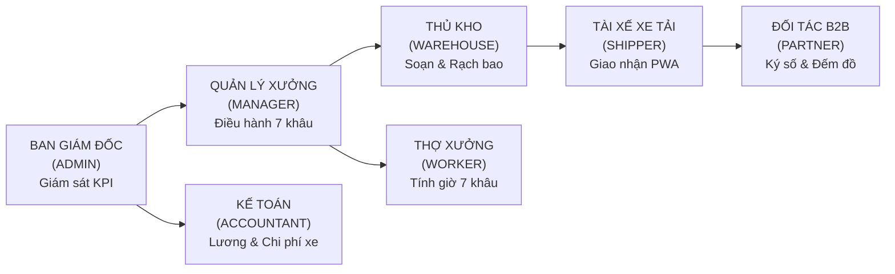

# HỒ SƠ ĐỀ XUẤT GIẢI PHÁP VÀ CHI PHÍ ĐẦU TƯ PHÂN HỆ NỘI BỘ

## DỰ ÁN: HỆ SINH THÁI CÔNG NGHỆ ĐIỀU HÀNH XƯỞNG GIẶT LÀ & LOGISTICS B2B

> **Kính gửi:** Ban Giám Đốc / Chủ Doanh Nghiệp - Công ty TNHH Kinh doanh Thương mại và Dịch vụ Thanh Xuân  
> **Đơn vị lập hồ sơ:** Đội Ngũ Kỹ Thuật & Tư Vấn Giải Pháp Chuyển Đổi Số  
> **Mục tiêu:** Cung cấp hồ sơ phân tích giá trị nghiệp vụ, bảng phân rã chi phí đầu tư 13 phân hệ, tính toán hiệu quả hoàn vốn (ROI) thực tế và cam kết chất lượng dịch vụ (SLA) của Phân hệ Cổng Vận Hành Nội Bộ (`fe-react-thanhxuan-internal` + Backend API Internal).  
> **Ngày phát hành:** 2026-10-29  
> **Hiệu lực báo giá:** 30 ngày kể từ ngày phát hành  

---

## MỤC LỤC HỒ SƠ

1. [PHẦN 1: BẢN ĐỀ XUẤT GIÁ TRỊ DOANH NGHIỆP & BẢNG ĐỐI CHIẾU VẬN HÀNH](#phan-1)
2. [PHẦN 2: BẢN TRÌNH BÀY CHI PHÍ ĐẦU TƯ PHÂN HỆ NỘI BỘ (25.000.000 VNĐ)](#phan-2)
3. [PHẦN 3: BẢNG TÍNH TOÁN HIỆU QUẢ ĐẦU TƯ & HOÀN VỐN THỰC TẾ (ROI CALCULATOR)](#phan-3)
4. [PHẦN 4: ĐIỀU KHOẢN HỢP ĐỒNG, TIẾN ĐỘ BÀN GIAO & CAM KẾT 4 "KHÔNG"](#phan-4)

---

<a name="phan-1"></a>

## PHẦN 1: BẢN ĐỀ XUẤT GIÁ TRỊ DOANH NGHIỆP & BẢNG ĐỐI CHIẾU VẬN HÀNH

### 1.1. Giải Quyết Triệt Để 4 "Nỗi Đau Vận Hành" Của Xưởng Giặt Công Nghiệp (Quy mô 3.000 - 5.000 SP/ngày)

Với quy mô sản xuất **3.000 - 5.000 sản phẩm/ngày** phục vụ chuỗi nhà hàng (Pizza 4P's, Haidilao...) và khách sạn lớn, việc ghi sổ tay hay nhắn tin Zalo truyền thống bộc lộ những lỗ hổng thất thoát tài chính rõ rệt:

| Nỗi Đau Vận Hành Thủ Công (Zalo / Sổ Tay) | Giải Pháp Số Hóa Cổng Nội Bộ Thanh Xuân | Lợi Ích Trực Tiếp Đem Lại |
| :--- | :--- | :--- |
| **1. Thất thoát & Tranh cãi số lượng đồ giặt:** Nhà hàng báo thiếu khăn, tài xế bảo đếm đủ, xưởng không có bằng chứng đối soát. | **Quy trình giao nhận 2 chiều + Chữ ký số Canvas + Trạm rạch bao đếm lại:** Soạn đồ sạch $\rightarrow$ Ký nhận mobile $\rightarrow$ Nhận đồ bẩn $\rightarrow$ Ký nhận $\rightarrow$ Về trạm rạch bao đếm lại. Phiếu lưu ảnh Cloudinary. | Chấm dứt 100% tình trạng đền bù đồ oan. Phân định rõ trách nhiệm giữa Đối tác - Tài xế - Thợ xưởng. |
| **2. Tắc nghẽn tính lương cuối tháng:** Kế toán mất 4-5 ngày cộng sổ tay từng ca thợ, dễ nhầm lẫn gây khiếu nại lương. | **Tự động hóa 100% công thức lương:** Tính lương giờ thợ 7 khâu và định mức 28 ngày Shipper chỉ bằng **1 cú click**. | Kế toán chỉ mất 30 phút rà soát; loại bỏ hoàn toàn sai sót tính công; nhân viên yên tâm gắn bó. |
| **3. Đội xe tải chạy rỗng & Lệch tuyến:** Tài xế đột xuất xin nghỉ làm đứt gãy tuyến giao nhận nhà hàng. | **Điều phối tuyến 4 ca + Chợ chuyến POOL tự động:** Chợ chuyến nhận đơn lẻ có thù lao; tự động giao đơn cho người chạy thay khi có đơn xin nghỉ phép. | Xe luôn đầy tải, đảm bảo trả đồ sạch đúng giờ cam kết (SLA) với các chuỗi lớn. |
| **4. Gian lận giờ công & Chấm công hộ:** Thợ xưởng chấm công hộ nhau, đi muộn về sớm, chấm sai khâu làm việc. | **Chấm công Camera Selfie + GPS Geofencing $\le 150\text{m}$ + Đồng hồ tính giờ 7 khâu (Auto-Resume):** Bắt buộc chụp ảnh mặt thật tại xưởng; đồng hồ tính tiền theo phút. | Trả lương đúng người, đúng việc; thúc đẩy năng suất lao động sàn xưởng tăng 15-20%. |

---

### 1.2. Hệ Thống 8 Vai Trò Chuyên Nghiệp (RBAC) Khép Kín Chuỗi Cung Ứng

Không chỉ là một trang web đơn giản, đây là một nền tảng **ERP / WMS / TMS thu nhỏ** chuyên biệt cho ngành giặt là công nghiệp:



1. **Ban Giám Đốc (`ADMIN`):** Giám sát doanh thu, chi phí, KPI thời gian thực; toàn quyền khóa/mở khóa kỳ lương an toàn tuyệt đối.
2. **Quản Lý Xưởng (`MANAGER`):** Chỉ huy 7 khâu sản xuất, rà soát ca bất thường, duyệt công ngày *(Phân quyền che giấu 100% dữ liệu tiền bạc)*.
3. **Thủ Kho (`WAREHOUSE_MANAGER`):** Soạn đồ sạch xuất kho theo ngày, ký Canvas xuất ảnh phiếu Cloudinary, quản lý thư viện ảnh phiếu và trạm đếm rạch bao.
4. **Kế Toán (`ACCOUNTANT`):** Thẩm định chi phí xe máy (xăng + sửa xe với 2 ảnh bằng chứng), duyệt thù lao chuyến lẻ, chạy tính bảng lương tự động và xuất Excel chuẩn kế toán.
5. **Tài Xế Xe Tải (`SHIPPER`):** 100% Mobile PWA, lộ trình 4 ca sáng/chiều/tối, chợ chuyến nhận đơn lẻ hưởng thù lao, đếm thay đồ bẩn toàn màn hình và xin nghỉ phép không làm đứt gãy tuyến.
6. **Thợ Xưởng (`WORKER`):** Chấm công selfie + GPS vệ tinh $\le 150\text{m}$, đồng hồ đếm giờ làm việc 7 khâu cập nhật mỗi 30s, tự động quay lại khâu mặc định (`AUTO_RESUME`), tra cứu lương ngày minh bạch.
7. **Quản Lý Đối Tác (`PARTNER_MANAGER`):** Cổng nhà hàng (Pizza 4P's, Haidilao...), đếm đồ bẩn Auto-save onBlur chống xung đột mạng, kiểm nhận đồ sạch qua ảnh WebP, duyệt nhân viên cơ sở.
8. **Nhân Viên Đối Tác (`PARTNER_STAFF`):** Giao diện 3 tab di động tinh gọn đếm đồ bẩn và nhận đồ sạch trực quan ngay trên smartphone.

---

<a name="phan-2"></a>

## PHẦN 2: BẢN TRÌNH BÀY CHI PHÍ ĐẦU TƯ PHÂN HỆ NỘI BỘ (GÓI CHỐT 25.000.000 VNĐ)

### 2.1. Căn Cứ Định Mức Kỹ Thuật Ban Đầu & Chính Sách Ưu Đãi Monorepo

- **Định mức kỹ thuật độc lập ban đầu:** Một hệ thống ERP xưởng và Logistics chuyên sâu với 8 vai trò RBAC, 16 Collections MongoDB và Mobile PWA phần cứng có giá trị công sức thị trường tương đương **36.000.000 VNĐ** (gấp 2.4 lần so với Web Marketing 15tr).
- **Chính sách hỗ trợ chuyển đổi số của Đội ngũ phát triển:** Nhờ mô hình kiến trúc Monorepo dùng chung tài nguyên với Web Giặt Là, chúng tôi áp dụng 3 khoản trừ tiết kiệm **11.000.000 VNĐ** để đưa chi phí về đúng ngân sách đầu tư ưu đãi là **25.000.000 VNĐ**:

```
┌─────────────────────────────────────────────────────────────┬────────────────────────┐
│ KHOẢN MỤC ĐỊNH MỨC & CHIẾT KHẤU TỐI ƯU                      │ GIÁ TRỊ (VNĐ)          │
├─────────────────────────────────────────────────────────────┼────────────────────────┤
│ 1. ĐỊNH MỨC CÔNG SỨC KỸ THUẬT ĐỘC LẬP (GẤP 2.4 LẦN WEB CMS) │         36.000.000 VNĐ │
│ 2. Trừ Tiết kiệm Hạ tầng Core NestJS & VPS Server dùng chung│        - 5.000.000 VNĐ │
│ 3. Trừ Kế thừa Bộ Thư Viện UI Design System & Tokens        │        - 3.500.000 VNĐ │
│ 4. Trừ Chiết khấu Gói Đồng Hành Hệ Sinh Thái Monorepo       │        - 2.500.000 VNĐ │
├─────────────────────────────────────────────────────────────┼────────────────────────┤
│ 👉 CHI PHÍ ĐẦU TƯ TRỌN GÓI BÀN GIAO TOÀN DIỆN               │         25.000.000 VNĐ │
└─────────────────────────────────────────────────────────────┴────────────────────────┘
```

> 🎯 **CAM KẾT CHẤT LƯỢNG TOÀN DIỆN:**  
> Dù được hỗ trợ mức ưu đãi chuyển đổi số từ 36 triệu xuống 25 triệu, **toàn bộ 100% tính năng kỹ thuật và nghiệp vụ chuyên sâu của hệ thống vẫn được giữ nguyên vẹn**, không cắt giảm bất kỳ module nào!

---

### 2.2. Bảng Phân Rã Chi Tiết 13 Module Công Việc (Work Breakdown Structure)

Tổng ngân sách đầu tư: **25.000.000 VNĐ** (Hai mươi lăm triệu đồng chẵn).

| STT | Phân Hệ Nghiệp Vụ & Module Chức Năng | Chi Tiết Nghiệp Vụ Đã Bàn Giao | Tỷ Trọng | Thành Tiền (VNĐ) |
| :---: | :--- | :--- | :---: | :---: |
| **01** | **Hạ Tầng Phân Quyền 8 Vai Trò RBAC & Nhân Sự** | Ma trận 8 vai trò; Auth JWT nội bộ (`aud: 'internal'`); Quản lý nhân sự 6 tabs, tạm khóa 60 ngày tự hủy, xóa vĩnh viễn duy nhất cho Admin; phê duyệt tài khoản mới; modal lưu chữ ký mẫu cá nhân. | 8.5% | **2.125.000** |
| **02** | **Quản Trị Đối Tác B2B & Mạng Lưới Chi Nhánh** | Quản lý chuỗi nhà hàng (Pizza 4P's, Haidilao...); phân quyền theo chi nhánh; danh mục bảng giá đồ giặt B2B; cơ chế phê duyệt nhân viên đối tác tự đăng ký. | 7.0% | **1.750.000** |
| **03** | **Phiếu Giao Nhận Kép 2 Chiều & Chữ Ký Số Canvas** | Quy trình khép kín: Soạn đồ sạch $\rightarrow$ Giao hàng $\rightarrow$ Ký nhận Canvas trên mobile $\rightarrow$ Nhận đồ bẩn $\rightarrow$ Ký nhận $\rightarrow$ Về xưởng kiểm đếm; lưu trữ ảnh phiếu trên Cloudinary; mã chuẩn hóa `GN-YYYYMMDD-NNN`. | 13.0% | **3.250.000** |
| **04** | **Trạm Rạch Bao Đếm Lại & Thư Viện Ảnh Phiếu** | Trạm đếm xưởng (`RecountStationPage`) đối chiếu số lượng thực tế với số bao gom; cảnh báo chênh lệch đồ giặt; thư viện ảnh phiếu lọc linh hoạt từ đầu tháng đến ngày mai, hỗ trợ ca đêm (21h-24h). | 7.5% | **1.875.000** |
| **05** | **Điều Phối Tuyến Xe, Chợ Chuyến POOL & Nghỉ Phép** | Lập lịch xe chạy 4 ca/ngày; cơ chế Chợ chuyến đơn lẻ (Shipper nhận đơn lẻ hưởng thù lao chuyến); tự động khóa nguyên tử (Atomic locking) chống tranh đơn; đăng ký nghỉ phép có phân công người chạy thay. | 10.0% | **2.500.000** |
| **06** | **Chấm Công Đa Phương Thức (Selfie + GPS + Wi-Fi)** | Chấm công bằng camera selfie chống chụp ảnh màn hình; định vị GPS Geofencing bán kính $\le 150\text{m}$; đối chiếu địa chỉ IP Wi-Fi modem xưởng; tự động check-in cho Shipper khi ký đơn đầu ngày. | 9.0% | **2.250.000** |
| **07** | **Đồng Hồ Tính Giờ Thợ 7 Khâu & Auto-Resume** | Tính công theo giờ: $(\text{phút} / 60) \times \text{đơn giá} \times \text{hệ số khâu}$; 7 khâu chuẩn (Rũ x1.2, Giặt/Sấy x1.3, Là/Ủi x1.2, Đếm x1.1...); tự động quay lại khâu chính (`AUTO_RESUME`) sau 3 phút. | 11.5% | **2.875.000** |
| **08** | **Thẩm Định & Thanh Toán Chi Phí Xe Máy** | Shipper chụp ảnh đồng hồ ODO công-tơ-mét và hóa đơn tiền xăng/sửa xe; Kế toán & Quản lý thẩm định 2 cấp; đối soát minh bạch từng km di chuyển. | 5.5% | **1.375.000** |
| **09** | **Tự Động Hóa Bảng Lương Đa Vai Trò & Xuất Excel** | Tính lương tự động theo chu kỳ cho cả 8 nhóm vai trò; tách lương giờ thợ và định mức Shipper 28 ngày; khóa kỳ lương bảo vệ lịch sử; streaming file Excel chuẩn kế toán. | 10.0% | **2.500.000** |
| **10** | **Cổng Dành Cho Đối Tác B2B (Nhà Hàng, Khách Sạn)** | Giao diện riêng cho nhà hàng: Đếm đồ bẩn Auto-save onBlur chống mất mạng; kiểm nhận đồ sạch qua ảnh WebP chất lượng cao; phân quyền quản lý cơ sở và nhân viên. | 6.0% | **1.500.000** |
| **11** | **Bảo Mật Tài Chính Đa Tầng & Khóa Kỳ Dữ Liệu** | Interceptor Backend bóc tách trường tiền bạc đối với vai trò Quản lý sản xuất (`MANAGER`); Admin sở hữu quyền mở khóa dữ liệu đã chốt trong vòng 60 ngày. | 4.0% | **1.000.000** |
| **12** | **Công Nghệ Mobile PWA, Ngoại Tuyến & Lưu Trữ Đệm** | Cài đặt như App di động trên iOS/Android không cần tải từ App Store; cơ chế lưu trữ ngoại tuyến (Offline Queue) tự động đồng bộ khi xe ra khỏi vùng sóng yếu hoặc tầng hầm. | 4.0% | **1.000.000** |
| **13** | **Tối Ưu VPS Bộ Nhớ Thấp & Kiến Trúc Monorepo** | Tối ưu Backend NestJS và MongoDB chạy ổn định trên gói VPS kinh tế (< 1GB RAM); kết nối mượt mà với Web Giặt Là qua cấu trúc Monorepo thống nhất. | 4.0% | **1.000.000** |
| **TỔNG** | **HỆ THỐNG CỔNG VẬN HÀNH NỘI BỘ TOÀN DIỆN** | **Trọn gói 13 Module chuyên sâu - Bàn giao chìa khóa trao tay** | **100%** | **25.000.000 VNĐ** |

---

<a name="phan-3"></a>

## PHẦN 3: BẢNG TÍNH TOÁN HIỆU QUẢ ĐẦU TƯ & HOÀN VỐN THỰC TẾ (ROI CALCULATOR)

### 3.1. Phân Tích Lợi Ích Kinh Tế Thực Tế Hàng Tháng (Xưởng 3.000 - 5.000 SP/ngày)

Dựa trên khảo sát thực tế tại xưởng giặt Thanh Xuân với công suất **3.000 - 5.000 sản phẩm/ngày**, các khoản thất thoát được bảo toàn thực tế mỗi tháng gồm:

```
┌────────────────────────────────────────────────────────┬──────────────────────────────────┐
│ KHOẢN MỤC BẢO TOÀN DÒNG TIỀN THỰC TẾ HÀNG THÁNG        │ GIÁ TRỊ TIẾT KIỆM / THÁNG        │
├────────────────────────────────────────────────────────┼──────────────────────────────────┤
│ 1. Giảm thiểu thất thoát & đền bù đồ giặt B2B          │ 1.800.000 - 2.800.000 VNĐ        │
│    (Chữ ký số 2 chiều + Trạm rạch bao đếm lại xưởng)   │ (Tránh mất 15-30 chiếc khăn/bàn) │
│ 2. Tiết kiệm thời gian kế toán tính công & chốt lương  │ 1.200.000 - 1.800.000 VNĐ        │
│    (Từ 4-5 ngày nhập tay giảm xuống còn 30 phút/tháng) │ (Tối ưu 0.5 định mức kế toán)    │
│ 3. Kiểm soát chi phí xăng dầu & sửa xe máy chặt chẽ    │   600.000 - 1.000.000 VNĐ        │
│    (Kiểm soát 2 ảnh bắt buộc: ODO đồng hồ + Hóa đơn)   │ (Chống kê khống km di chuyển)    │
│ 4. Chống lãng phí giờ công thợ (Camera Selfie + GPS)   │ 1.000.000 - 1.500.000 VNĐ        │
│    (Chấm công đúng người, đúng khâu, đúng phút máy)    │ (Ngăn đi muộn, chấm hộ ca)       │
├────────────────────────────────────────────────────────┼──────────────────────────────────┤
│ 💰 TỔNG LỢI ÍCH BẢO TOÀN DÒNG TIỀN THỰC TẾ MỖI THÁNG   │ 4.600.000 - 7.100.000 VNĐ        │
│    (Mức trung bình thực tế ước tính)                   │ ~ 5.800.000 VNĐ / THÁNG          │
└────────────────────────────────────────────────────────┴──────────────────────────────────┘
```

### 3.2. Thời Gian Hoàn Vốn Đầu Tư Thực Tế (Realistic Payback Period)

$$
\text{Thời gian hoàn vốn} = \frac{\text{Chi phí đầu tư 25.000.000 VNĐ}}{\text{Mức tiết kiệm thực tế 5.800.000 VNĐ/tháng}} \approx \mathbf{4.3 \text{ Tháng (chưa tới 1 quý rưỡi!)}}
$$

> ⚡ **ĐÁNH GIÁ TÍNH KHẢ THI TÀI CHÍNH:**  
> **Chỉ sau hơn 4 tháng vận hành thực tế**, khoản đầu tư 25 triệu đồng đã được bù đắp hoàn toàn từ chính các khoản tiền thất thoát nhỏ lẻ được bịt kín mỗi ngày. Kể từ tháng thứ 5 trở đi, hệ thống tiếp tục mang lại lợi nhuận ròng bền vững từ **4.6 - 7.1 triệu đồng/tháng** mà không tốn thêm bất kỳ chi phí duy trì nào!

---

<a name="phan-4"></a>

## PHẦN 4: ĐIỀU KHOẢN HỢP ĐỒNG, TIẾN ĐỘ BÀN GIAO & CAM KẾT 4 "KHÔNG"

### 4.1. Cam Kết 4 "KHÔNG" - Bảo Vệ Tài Chính Tuyệt Đối Cho Doanh Nghiệp

Để Ban Giám Đốc hoàn toàn an tâm khi đầu tư, chúng tôi cam kết nguyên tắc minh bạch tài chính:

1. ❌ **KHÔNG PHÍ THUÊ BAO HÀNG THÁNG (No SaaS Subscription):** Không giống như các nền tảng Base, KiotViet hay Sapo thu phí 300.000 - 1.000.000 VNĐ/tháng trọn đời. Doanh nghiệp đầu tư một lần và sở hữu vĩnh viễn hệ thống.
2. ❌ **KHÔNG GIỚI HẠN TÀI KHOẢN & NGƯỜI DÙNG:** Tự do cấp tài khoản cho 50 - 200 nhân viên (Thủ kho, Tài xế, Thợ xưởng) và không giới hạn số lượng đối tác nhà hàng B2B kết nối.
3. ❌ **KHÔNG PHÁT SINH CHI PHÍ PHẦN CỨNG:** Ứng dụng chạy mượt mà dưới dạng Mobile PWA ngay trên các dòng điện thoại thông minh phổ thông có sẵn của tài xế và thợ xưởng (Android/iOS), không cần đầu tư máy POS đắt tiền.
4. ❌ **KHÔNG SỢ NGHẼN MẠNG NGOẠI TUYẾN:** Có hàng đợi ngoại tuyến (Offline Queue), tài xế thao tác ký nhận và đếm đồ ngay cả khi xuống tầng hầm sâu trung tâm thương mại mất sóng 4G; dữ liệu tự động đồng bộ khi có mạng trở lại.

---

### 4.2. Lộ Trình Thanh Toán 3 Đợt Linh Hoạt

```
┌───────┬──────────────────────────────────┬──────────┬──────────────────────────────────────┐
│ ĐỢT   │ GIAI ĐOẠN TRIỂN KHAI             │ TỶ LỆ    │ SỐ TIỀN (VNĐ)                        │
├───────┼──────────────────────────────────┼──────────┼──────────────────────────────────────┤
│ Đợt 1 │ Ngay sau khi ký kết hợp đồng     │ 40%      │ 10.000.000 VNĐ                       │
│ Đợt 2 │ Bàn giao thử nghiệm thực tế (UAT)│ 40%      │ 10.000.000 VNĐ                       │
│ Đợt 3 │ Nghiệm thu toàn diện & Vận hành  │ 20%      │ 5.000.000 VNĐ                        │
├───────┼──────────────────────────────────┼──────────┼──────────────────────────────────────┤
│ TỔNG  │ TOÀN BỘ DỰ ÁN                    │ 100%     │ 25.000.000 VNĐ                       │
└───────┴──────────────────────────────────┴──────────┴──────────────────────────────────────┘
```

---

### 4.3. Chính Sách Bảo Hành & Đào Tạo "Cầm Tay Chỉ Việc"

1. **Bảo hành kỹ thuật miễn phí 12 tháng:** Hỗ trợ xử lý lỗi phần mềm 24/7 trong suốt quá trình xưởng vận hành, không phát sinh chi phí.
2. **Đào tạo chuyển giao tận xưởng:** Cung cấp trọn bộ 8 cẩm nang hướng dẫn sử dụng chuyên biệt cho từng vai trò; kỹ sư trực tiếp hướng dẫn tại xưởng cho Tài xế và Thợ xưởng cho đến khi thao tác thành thạo 100%.
3. **Bàn giao trọn gói mã nguồn & quyền quản trị:** Bàn giao toàn bộ mã nguồn, cơ sở dữ liệu MongoDB và tài liệu kiến trúc hệ thống; doanh nghiệp làm chủ công nghệ 100%.

---

### 4.4. Kết Luận

Với chi phí đầu tư ưu đãi **25.000.000 VNĐ** và thời gian hoàn vốn thực tế chỉ **4.3 tháng**, Phân hệ Cổng Vận Hành Nội Bộ là đòn bẩy công nghệ vững chắc giúp Công ty TNHH Kinh doanh Thương mại và Dịch vụ Thanh Xuân vận hành trơn tru chuỗi giao nhận 3.000 - 5.000 sản phẩm/ngày, nâng tầm vị thế đối tác uy tín với các tập đoàn nhà hàng, khách sạn lớn.
