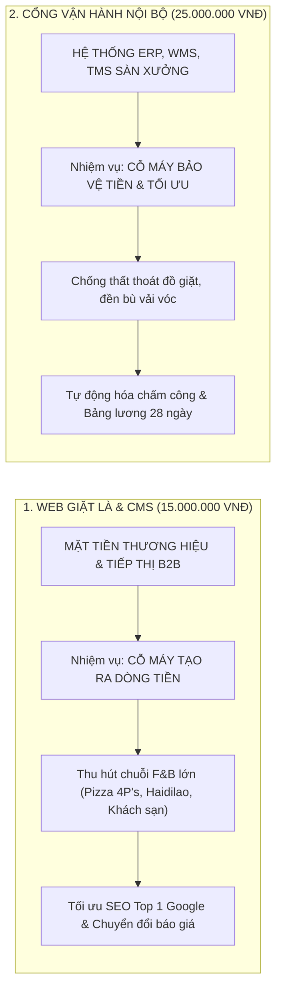

# BẢN THUYẾT MINH CHI PHÍ & ĐỊNH GIÁ HAI PHÂN HỆ HỆ THỐNG
## DÀNH CHO KHÁCH HÀNG: WEB GIẶT LÀ & CMS (15TR) vs. CỔNG VẬN HÀNH NỘI BỘ (25TR)

> **Mục đích tài liệu:** Cung cấp luận cứ kinh tế, kỹ thuật và giá trị thực tế nhằm giải thích rõ ràng, thuyết phục thắc mắc của Ban Giám đốc:  
> *"Tại sao Phân hệ Web Giặt Là & CMS nhìn ít chức năng hơn Phân hệ Cổng Vận Hành Nội Bộ mà lại có chi phí 15.000.000 VNĐ?"*  
> **Áp dụng cho:** Hệ sinh thái Công ty TNHH Kinh doanh Thương mại và Dịch vụ Thanh Xuân.

---

## 1. BẢN CHẤT GIÁ TRỊ: "TẠO RA TIỀN" vs. "BẢO VỆ TIỀN"

Trong một doanh nghiệp sản xuất và dịch vụ, phần mềm được chia làm 2 nhóm mang sứ mệnh hoàn toàn khác biệt:



| Tiêu Chí So Sánh | Web Khách Hàng & CMS (`15.000.000 VNĐ`) | Cổng Vận Hành Nội Bộ PWA (`25.000.000 VNĐ`) |
| :--- | :--- | :--- |
| **Sứ mệnh cốt lõi** | **Tạo ra doanh thu mới (Revenue Generation)** | **Tiết kiệm chi phí & Vận hành (Cost Saving)** |
| **Đối tượng tiếp xúc** | Đối tác B2B, chủ chuỗi nhà hàng, khách sạn lớn, người trả tiền dịch vụ. | Công nhân, tài xế xe tải, thủ kho, kế toán và quản lý xưởng. |
| **Yêu cầu quan trọng nhất** | **Tốc độ tải trang (< 1s), chuẩn SEO Google tuyệt đối, độ thẩm mỹ và uy tín thương hiệu.** | **Tính chính xác của số liệu, tính liên tục thời gian thực và tiện lợi trên điện thoại di động.** |
| **Giá trị hoàn vốn (ROI)** | **Chỉ cần mang về 1 hợp đồng giặt là B2B lớn mỗi tháng là thừa sức thu hồi 15 triệu.** | Giảm thiểu 10-15 triệu tiền đền bù đồ rách/mất và tiết kiệm 80% công kế toán mỗi tháng. |

---

## 2. BÓC TÁCH CÔNG SỨC "VÔ HÌNH" CỦA WEB GIẶT LÀ & CMS (15 TRIỆU)

Nhiều người nhìn vào web khách hàng thường nghĩ: *"Chỉ có vài trang giới thiệu, tin tức và form liên hệ thì có gì đâu mà 15 triệu?"*.  
Tuy nhiên, chi phí 15 triệu được cấu thành từ những công việc kỹ thuật chuyên sâu vô hình mà mắt thường không thấy được:

### 2.1. Không Phải Web WordPress Mẫu Kéo Thả Giá Rẻ (5 - 7 Triệu)
- Trên thị trường, các web giá rẻ 5-7 triệu thường dùng mã nguồn WordPress cài sẵn template: Tải trang rất nặng nề (3-5 giây), bảo mật kém, dễ bị chèn mã độc, khó lên Top Google và không thể mở rộng.
- **Web Thanh Xuân được lập trình hoàn toàn độc bản bằng Next.js 14+ App Router (React Server Components) kết hợp Backend NestJS độc lập:**
  - Tốc độ tải trang gần như tức thì (**dưới 1 giây**).
  - Điểm Google Core Web Vitals xanh tuyệt đối (**95 - 100 điểm Performance & SEO**).
  - Khách hàng bấm vào là thấy ngay sự chuyên nghiệp, nâng tầm vị thế công ty khi tiếp cận các đối tác lớn như Pizza 4P's hay Haidilao.

### 2.2. Đầu Tư Sâu Vào Thiết Kế Giao Diện & Tỷ Lệ Chuyển Đổi (UI/UX)
- Thiết kế **Hero Section dạng chia chéo (Diagonal Split)** hiện đại: Video reel xưởng giặt tự động hóa chạy vòng lặp bên trái kết hợp ảnh thành phẩm cao cấp và huy hiệu uy tín bên phải.
- Khối **Pre-Footer CTA chuyển đổi B2B**: Form cam kết tặng 01 tuần giặt mẫu, giao nhận 24/7 và bồi thường 100%.
- Tự động gắn nhãn nguồn gốc (`sourceUrl`, `category`, `slug`) cho từng khách hàng gửi form, giúp đo lường chính xác bài viết nào đem lại nhiều khách hàng nhất.

### 2.3. Hệ Thống CMS Quản Trị Marketing Riêng Biệt (11 Bảng CSDL)
- Không chỉ là một trang web tĩnh, hệ thống bao gồm một phân hệ quản trị CMS đồ sộ:
  - Soạn thảo bài viết chuẩn SEO với Rich-Text Editor chuyên nghiệp.
  - Tự động sinh `sitemap.xml`, `robots.txt` và nhúng Schema.org JSON-LD cấu trúc dữ liệu cho Google cào dữ liệu.
  - Tích hợp kịch bản tự động hóa tiếp thị: Chăm sóc khách hàng tự động qua **Zalo OA và Email Marketing**.

### 2.4. Là Nền Móng Kỹ Thuật Giúp Web Nội Bộ Được Giảm Giá Xuống 25 Triệu!
- Đây là điểm mấu chốt: **Nếu không có phân hệ Web Giặt Là làm nền tảng hạ tầng ban đầu, Web Nội Bộ không bao giờ có mức giá 25 triệu!**
- Toàn bộ khung Backend NestJS Core (`be-nestjs-thanhxuan`), hệ thống máy chủ Docker VPS, Nginx, chứng chỉ SSL, Module gửi Email Nodemailer, Module lưu trữ Cloudinary CDN và bộ thư viện UI TailwindCSS/shadcn đã được xây dựng và tính chi phí vào gói Web Giặt Là. Web Nội Bộ chỉ việc "kế thừa miễn phí" toàn bộ hạ tầng này nên mới có thể tối ưu từ 36 triệu xuống 25 triệu (tiết kiệm ngay 11 triệu đồng cho doanh nghiệp).

---

## 3. ĐỐI CHIẾU MỨC GIÁ THỊ TRƯỜNG THỰC TẾ (BENCHMARK)

Để khách hàng có góc nhìn tham chiếu khách quan trên thị trường phát triển phần mềm hiện nay:

```
┌──────────────────────────────────────┬────────────────────┬──────────────────────────────────────┐
│ LOẠI HÌNH PHẦN MỀM THỊ TRƯỜNG        │ MỨC GIÁ THỊ TRƯỜNG │ GIẢI PHÁP CÔNG TY THANH XUÂN         │
├──────────────────────────────────────┼────────────────────┼──────────────────────────────────────┤
│ 1. Web WordPress template kéo thả    │ 7.000.000 - 12.000K│ Không sử dụng vì chậm, bảo mật kém.  │
│ 2. Web Next.js + NestJS Custom SEO   │ 25.000.000 - 35.000K│ Gói Web Giặt Là & CMS: 15.000.000 đ  │
│ 3. Hệ thống ERP / WMS / TMS Nội bộ   │ 60.000.000 - 90.000K│ Gói Cổng Vận Hành PWA: 25.000.000 đ  │
└──────────────────────────────────────┴────────────────────┴──────────────────────────────────────┘
```

> 👉 **Nhận xét:** Mức giá **15.000.000 VNĐ** cho Web Giặt Là & CMS và **25.000.000 VNĐ** cho Cổng Vận Hành Nội Bộ thực chất đã là **mức giá hỗ trợ đặc biệt thấp hơn 40% - 50% so với giá thị trường agency bên ngoài**.

---

## 4. HAI PHƯƠNG ÁN ĐÀM PHÁN TÀI CHÍNH DÀNH CHO KHÁCH HÀNG

Tùy theo thái độ và khả năng ngân sách thực tế của khách hàng, có 2 phương án trình bày rõ ràng:

---

### PHƯƠNG ÁN 1: GÓI CHUẨN ĐỐI ỨNG - 40.000.000 VNĐ (KHUYÊN DÙNG)
*Áp dụng khi khách hàng có năng lực tài chính và cần giải thích để hiểu đúng giá trị.*

- **Cơ cấu ngân sách:**
  - **Web Giặt Là & CMS Marketing:** **15.000.000 VNĐ** (Cỗ máy tìm kiếm khách hàng & thương hiệu B2B).
  - **Cổng Vận Hành Nội Bộ & Quản Vận PWA:** **25.000.000 VNĐ** (Cỗ máy điều hành xưởng, chống thất thoát, tự động tính lương).
  - **TỔNG GÓI TOÀN BỘ HỆ SINH THÁI:** **40.000.000 VNĐ**
- **Luận điểm giải thích:**
  - Tỷ lệ 15tr (Web mặt tiền) / 25tr (Phần mềm nội bộ) là **tỷ lệ vàng cân đối hoàn hảo** cho một hệ sinh thái Monorepo doanh nghiệp.
  - Mức 15 triệu đã bao gồm toàn bộ công tác tối ưu SEO kỹ thuật, cài đặt tên miền/hosting, viết tài liệu hướng dẫn và bảo hành hệ thống lâu dài.

---

### PHƯƠNG ÁN 2: COMBO "CHUYỂN ĐỔI SỐ TOÀN DIỆN" - 35.000.000 VNĐ (QUÂN BÀI CHỐT HẠ)
*Áp dụng khi khách hàng vẫn còn đắn đo về tổng ngân sách 40 triệu và muốn thương lượng giảm thêm.*

- **Cơ cấu ngân sách ưu đãi:**
  - **Cổng Vận Hành Nội Bộ & Quản Vận PWA:** Giữ nguyên **25.000.000 VNĐ** (đây là mức tối thiểu để bảo toàn công sức cho 8 vai trò và 13 module phức tạp).
  - **Web Giặt Là & CMS Marketing:** **Chiết khấu trực tiếp 33% từ 15.000.000 VNĐ $\rightarrow$ còn 10.000.000 VNĐ**.
  - **TỔNG GÓI CHỐT TOÀN BỘ:** **35.000.000 VNĐ** (Ba mươi lăm triệu đồng chẵn).
- **Cách nói khéo léo với khách hàng:**
  > *"Thưa anh/chị, bên em rất hiểu bài toán tối ưu chi phí đầu tư ban đầu của xưởng. Để đồng hành lâu dài cùng Công ty Thanh Xuân chuyển đổi số toàn diện, bên em xin phép tặng anh/chị gói **'Ưu Đãi Combo Hệ Sinh Thái'**: Giữ nguyên toàn bộ tính năng cao cấp của Web Nội Bộ 25 triệu, đồng thời chiết khấu trực tiếp Web Giặt Là & CMS từ 15 triệu xuống còn đúng **10 triệu đồng**. Tổng trọn gói cả 2 hệ sinh thái là **35 triệu đồng tròn**. Đây là mức giá hỗ trợ tối đa để anh/chị an tâm đưa hệ thống vào vận hành ngay trong tháng này!"*

---

## 5. KẾT LUẬN & ĐỀ XUẤT HÀNH ĐỘNG

1. **Khẳng định giá trị:** 15 triệu cho Web Giặt Là & CMS không hề đắt vì đây là kênh mang lại hợp đồng trực tiếp cho công ty.
2. **Chiến lược đàm phán:** 
   - Ưu tiên bảo vệ mức **40 triệu (15tr + 25tr)** với đầy đủ lý lẽ về SEO và hạ tầng đã nêu ở Phần 1 & 2.
   - Chỉ đưa ra phương án **35 triệu (10tr + 25tr)** như một "đặc quyền chiết khấu combo" ở bước cuối cùng để chốt hợp đồng dứt điểm.

