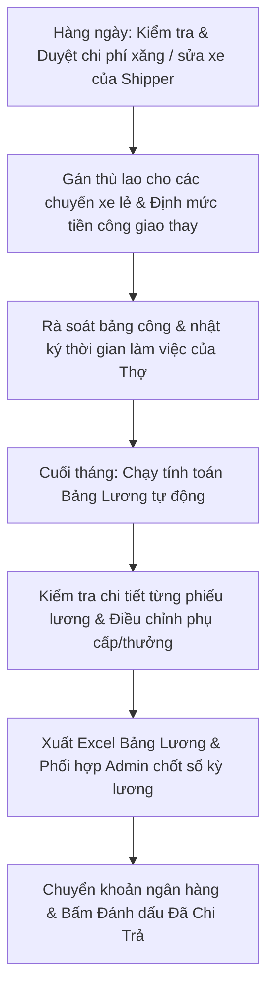

# HƯỚNG DẪN SỬ DỤNG HỆ THỐNG NỘI BỘ - VAI TRÒ KẾ TOÁN (ACCOUNTANT)

> **Cổng vận hành xưởng & quản vận B2B PWA:** `noibo.thanhxuanlaundry.com` (Port `3001`)  
> **Tài khoản:** `ACCOUNTANT` (Kế toán / Kế toán trưởng)  
> **Mật khẩu khởi tạo / Mẫu:** `ThanhXuan@2026`  
> **Phạm vi quyền hạn:** Nắm giữ toàn bộ dòng tiền và nghiệp vụ kế toán - tiền lương của công ty: Cấu hình đơn giá khâu công thợ, tính và chốt bảng lương chu kỳ, duyệt chi phí xăng và sửa xe của tài xế, định mức thù lao chuyến lẻ và thù lao giao thay khi tài xế nghỉ phép, đối soát doanh thu và xuất báo cáo tài chính.  
> ⚠️ **Ràng buộc:** Kế toán viên không tham gia phê duyệt tài khoản nhân sự mới đăng ký.

---

## 1. TỔNG QUAN VAI TRÒ & TRÁCH NHIỆM KẾ TOÁN

Kế toán là mắt xích kiểm soát tài chính và bảo đảm quyền lợi thu nhập minh bạch cho toàn bộ nhân sự:
1. **Quản lý & Duyệt chi phí phương tiện:** Thẩm định từng đề xuất đổ xăng (`FUEL`) và sửa chữa bảo dưỡng xe máy (`REPAIR`) của đội ngũ tài xế dựa trên ảnh hóa đơn VAT, biên lai và ảnh đồng hồ công-tơ-mét / ảnh xe thực tế.
2. **Cài đặt chính sách lương & đơn giá:** Cấu hình đơn giá giờ làm việc (`hourlyRate`) cho 7 khâu công thợ, hệ số khâu và bộ tham số định mức của tài xế.
3. **Định mức thù lao chuyến lẻ & phân tuyến:** Định giá thù lao chuyến xe phát sinh (`TripCompensationModal`) và thiết lập tiền công giao thay khi tài xế nghỉ phép (`shipper_leaves`).
4. **Tính toán & Quyết toán bảng lương:** Vận hành chu kỳ tính lương tự động, bóc tách minh bạch từng khoản thu nhập/khấu trừ, xuất bảng lương Excel XLSX và đánh dấu hoàn tất chi trả (`Mark Paid`).
5. **Đối soát công nợ đối tác:** Quản trị bảng giá dịch vụ đồ giặt (`Item Catalog`) và xuất các báo cáo tài chính, báo cáo kho, báo cáo đối soát doanh thu.

---

## 2. QUY TRÌNH TÁC NGHIỆP CỦA KẾ TOÁN

---

## 3. HƯỚNG DẪN CHI TIẾT TỪNG MÀN HÌNH TÁC NGHIỆP

### 3.1. Đăng Nhập & Bố Cục Menu Của Kế Toán

1. **Đăng nhập (`/login`):** Nhập Email và Mật khẩu (hoặc bấm nút **"Kế toán"** trên lưới đăng nhập mẫu).
2. **Thanh Menu:**
   - *TỔNG QUAN:* Bảng điều khiển thời gian thực (`/dashboard`).
   - *VẬN HÀNH XƯỞNG & ĐỐI TÁC:* Kho Sạch & Soạn Đồ (`/operations/warehouse-manager/warehouse`) - Dùng để gán thù lao chuyến lẻ.
   - *ĐIỀU HÀNH & KINH DOANH:* Trung Tâm Báo Cáo (`/operations/report`), Duyệt Nghỉ Giao Nhận (`/management/shipper-leaves`), Đối Tác & Đồ Giặt (`/management/manager/partner`).
   - *BẢNG CÔNG & LƯƠNG:* Bảng Lương & Chốt Kỳ (`/management/accountant/payroll`), Duyệt Chi Phí Xăng (`/management/accountant/fuel`), Duyệt Công Thợ (`/management/manager/piecework`), Bảng Công Toàn Xưởng (`/management/manager/attendance`).
3. **Thanh Mobile Bottom Bar (trên điện thoại):** Gồm 5 nút: *Tổng Quan*, *Báo Cáo*, *Kho Sạch*, *Bảng Lương*, *Duyệt Xăng*.

---

### 3.2. Duyệt Chi Phí Xe Của Tài Xế: Xăng Xe & Sửa Chữa (`/management/accountant/fuel`)

Đây là màn hình thẩm định tài chính hàng ngày đối với đội xe giao nhận:

1. **Bộ lọc trạng thái đề xuất:**
   - *Chờ duyệt (`PENDING`):* Danh sách các hóa đơn tài xế vừa gửi lên, cần kế toán thẩm định.
   - *Đã duyệt (`APPROVED`):* Các khoản chi phí đã được chấp thuận hoàn tiền.
   - *Từ chối (`REJECTED`):* Các đề xuất không hợp lệ.
2. **Thẩm định hồ sơ đề xuất (Hệ thống yêu cầu bắt buộc 2 ảnh đối chứng):**
   - **Đề xuất Đổ Xăng (`FUEL`):**
     - Xem số tiền đề xuất hoàn (`amountMoney`), số lít xăng và số Km đồng hồ (`odometer`).
     - So sánh ảnh chụp hóa đơn/biên lai cây xăng với ảnh chụp đồng hồ công-tơ-mét xe máy. Kiểm tra tính hợp lý giữa quãng đường đã chạy và số lít xăng đã đổ.
   - **Đề xuất Sửa Chữa Xe (`REPAIR`):**
     - Xem số tiền chi trả, mô tả phụ tùng thay thế (thay dầu nhớt, săm lốp, bảo dưỡng nhông xích...).
     - Xem ảnh chụp hóa đơn/phiếu thu tiệm sửa xe và ảnh chụp thực tế xe máy tại tiệm sửa xe.
3. **Quyết định phê duyệt:**
   - **Duyệt:** Bấm nút **"Duyệt"** (màu xanh). Số tiền này sẽ tự động được hệ thống đẩy vào mục *Hoàn chi phí xe* trên phiếu lương của tài xế đó trong tháng.
   - **Từ chối:** Bấm nút **"Từ chối"** (màu đỏ). Bắt buộc nhập lý do từ chối (ví dụ: *Ảnh hóa đơn bị mờ không thấy rõ ngày*, hoặc *Số Km không khớp với lịch trình xe*). Lý do này sẽ hiển thị trực tiếp trên app của tài xế.

---

### 3.3. Cài Đặt Thù Lao Chuyến Lẻ Tại Kho Sạch (`/operations/warehouse-manager/warehouse`)

Hệ thống cho phép Kế toán viên truy cập trực tiếp màn hình Kho Sạch để định giá thù lao cho các chuyến đi phát sinh hoặc các điểm giao lẻ:

1. **Truy cập tab Soạn Đồ Sạch (`CLEAN_PLAN`):**
   - Trên mỗi thẻ phiếu xuất kho của các chi nhánh, Kế toán sẽ thấy nút màu tím **"Set Giá"** hoặc **"Sửa Giá"** (nút này chỉ hiển thị riêng cho Admin và Kế toán, ẩn hoàn toàn với Quản lý và Thủ kho).
2. **Thao tác cài đặt thù lao qua Modal (`TripCompensationModal`):**
   - Bấm nút **"Set Giá"** để mở modal.
   - **Trường hợp 1 - Chuyến lẻ độc lập:** Nhập số tiền thù lao cho chuyến đi này (ví dụ: *50.000 VNĐ*).
   - **Trường hợp 2 - Gom cụm đối tác cùng tuyến đường:** Nếu tài xế chạy một cung đường tiện chuyến giao cho 3 nhà hàng gần nhau, Kế toán có thể gom 3 đối tác này lại và nhập tổng mức tiền công (ví dụ: *90.000 VNĐ* $\rightarrow$ hệ thống tự động chia đều *30.000 VNĐ/điểm*).
   - Nhập ghi chú nếu có (ví dụ: *Phụ cấp giao giờ cao điểm mưa gió*).
   - Bấm **"Lưu Thù Lao"**. Số tiền này sẽ tự động cộng vào thu nhập chuyến lẻ trong kỳ lương của tài xế nhận chuyến.

---

### 3.4. Định Mức Tiền Công Giao Thay Khi Shipper Nghỉ Phép (`/management/shipper-leaves`)

Khi Quản lý xưởng đã duyệt đơn xin nghỉ bước 1 và chỉ định tài xế thay thế, đơn sẽ chuyển sang cho Kế toán định mức thù lao:

1. Vào trang **Duyệt Nghỉ Giao Nhận**, lọc trạng thái *Chờ định mức (`APPROVED_PENDING_COMPENSATION`)*.
2. Bấm nút **"Thiết Lập Tiền Công"** (mở `SetLeaveCompensationModal`).
3. Xem thông tin: Tên tài xế chạy thay, số lượng chi nhánh cần giao trong các ngày nghỉ đó.
4. **Nhập mức tiền công giao thay (`compensationAmount`):** Nhập số tiền VNĐ công ty chi trả cho tài xế nhận việc (ví dụ: *150.000 VNĐ/ngày*).
5. Nhập ghi chú kế toán và bấm **"Xác Nhận & Hoàn Tất Duyệt"**. Đơn chuyển sang trạng thái `APPROVED` và tiền thù lao được liên kết tự động vào kỳ lương của tài xế chạy thay.

---

### 3.5. Cài Đặt Đơn Giá Giờ Công Thợ (`/management/manager/piecework`)

Kế toán toàn quyền quản trị cấu hình đơn giá tại tab **Cài đặt đơn giá khâu (`JobRatesSettingsComponent`)**:
- Xem danh mục 7 khâu công việc chuẩn của công ty:
  1. *Rũ đồ*
  2. *Giặt & Sấy*
  3. *Gấp đồ*
  4. *Đếm / Phân loại*
  5. *Là / Ủi*
  6. *Đóng gói*
  7. *Khác*
- **Điều chỉnh đơn giá VNĐ/Giờ (`hourlyRate`):** Nhập mức đơn giá cơ sở (ví dụ: *25.000 VNĐ/giờ* hoặc điều chỉnh theo từng vị trí).
- Bật/Tắt công tắc trạng thái hoạt động của khâu.
- Bấm **"Lưu cấu hình đơn giá"**. Đơn giá mới sẽ được áp dụng cho toàn bộ các phiên làm việc phát sinh từ thời điểm lưu.

---

### 3.6. Quản Trị Bảng Lương Chu Kỳ & Quyết Toán (`/management/accountant/payroll`)

Đây là màn hình nghiệp vụ trọng tâm cuối mỗi tháng của Kế toán:

1. **4 StatCard KPI tài chính:**
   - *Tổng quân số:* Số lượng nhân viên được tính lương trong kỳ.
   - *Tổng lương chính / khâu:* Quỹ lương cơ bản theo ngày công và lương theo giờ công thợ.
   - *Tổng phụ cấp & thưởng:* Tổng tiền thưởng ca cuối tuần, chuyên cần, hỗ trợ điện thoại, hoàn tiền xăng/sửa xe và thù lao chuyến lẻ.
   - *Tổng thực lĩnh Net Pay:* Tổng số tiền thực chi công ty cần thanh toán qua ngân hàng.
2. **Tính toán tự động bảng lương (`POST /payroll/calculate`):**
   - Chọn tháng làm việc (ví dụ: `2026-10`).
   - Bấm nút **"Tính Lương Tự Động"**.
   - Máy chủ NestJS tự động quét toàn bộ cơ sở dữ liệu và tính toán chính xác theo công thức:
     - **Đối với Tài xế Shipper:**
       $$\text{Lương cơ bản} = \frac{\text{Lương thỏa thuận}}{28} \times \text{Số ngày công thực tế}$$
       $$\text{Thưởng cuối tuần} = 60.000 \times \text{Số ca (Tối T7/CN, Sáng CN/T2)}$$
       $$\text{Chuyên cần} = 7.000 \times \text{Số ngày đi làm}$$
       $$\text{Phụ cấp điện thoại} = 200.000 \text{ VNĐ}$$
       $$\text{Cộng:} \text{ Tiền hoàn xăng/sửa xe đã duyệt} + \text{Thù lao chuyến lẻ/nhận thay}$$
       $$\text{Trừ:} \text{ Bảo hiểm xã hội } 400.000 \text{ VNĐ} + \text{Tạm ứng (nếu có)}$$
     - **Đối với Thợ xưởng:**
       $$\text{Lương công thợ} = \sum \left( \frac{\text{Số phút làm}}{60} \times \text{Đơn giá giờ} \times \text{Hệ số khâu} \right)$$
       $$\text{Cộng:} \text{ Thưởng chuyên cần, phụ cấp trách nhiệm}$$
       $$\text{Trừ:} \text{ Tạm ứng, khấu trừ nội bộ}$$
3. **Điều chỉnh chi tiết từng phiếu lương (`PayslipDetailAdjustModal`):**
   - Bấm vào tên nhân viên trên bảng để mở modal chi tiết.
   - Kiểm tra bóc tách từng ngày công, từng mẻ việc, từng cuống hóa đơn xăng xe.
   - Nhập các khoản điều chỉnh: *Thưởng thêm*, *Khấu trừ phạt*, *Tạm ứng*, kèm theo lý do ghi chú rõ ràng.
   - Bấm **"Lưu điều chỉnh"**.
4. **Xuất bảng lương ra Excel XLSX:**
   - Bấm nút **"Xuất Excel"** trên thanh công cụ.
   - Hệ thống tải về file Excel chứa đầy đủ các cột công thức, thuận tiện cho việc trình Giám đốc ký duyệt và gửi ngân hàng chi lương.
5. **Đóng sổ & Đánh dấu thanh toán:**
   - Khi bảng lương đã được duyệt: Phối hợp cùng Admin bấm **"Khóa Sổ Kỳ Lương"** (`LOCKED`).
   - Khi ngân hàng đã giải ngân chuyển khoản: Bấm nút **"Đánh Dấu Đã Chi Trả"** (`POST /payroll/periods/:id/mark-paid`). Kỳ lương chuyển sang trạng thái `PAID`. Toàn bộ nhân viên sẽ nhận được thông báo và xem được phiếu lương chính thức trên app của họ.

---

### 3.7. Trung Tâm Báo Cáo Phân Tích & Đối Soát Doanh Thu (`/operations/report`)

- **Báo cáo quyết toán bảng lương:** Tổng hợp cơ cấu chi phí nhân sự theo tháng.
- **Báo cáo chi phí xăng xe:** Theo dõi tổng số lít xăng và tiền xăng tiêu hao theo từng đầu xe/tài xế, phát hiện kịp thời các trường hợp xe hao xăng bất thường.
- **Đối soát đối tác:** Tổng hợp sản lượng đồ giặt, đơn giá bán cho khách hàng (`priceToCustomer`) và công nợ phải thu của từng chuỗi nhà hàng (Pizza 4P's, Haidilao...).
- Hỗ trợ xuất dữ liệu ra định dạng Excel và PDF tốc độ cao.

---

## 4. XỬ LÝ SỰ CỐ & CÂU HỎI THƯỜNG GẶP CỦA KẾ TOÁN (FAQ)

| Tình Huống | Hướng Dẫn Xử Lý |
| :--- | :--- |
| **Tiền xăng của tài xế đã duyệt nhưng không thấy nhảy vào bảng lương?** | Kiểm tra xem ngày của đề xuất đổ xăng đó nằm trong tháng nào. Nếu tài xế đổ xăng vào ngày 31/10 nhưng nộp đề xuất sang ngày 01/11, hệ thống sẽ tính khoản hoàn tiền đó vào kỳ lương tháng 11. Ngoài ra, sau khi duyệt xăng, hãy bấm nút **"Tính Lương Tự Động"** lại trên trang Bảng Lương để hệ thống làm mới số liệu. |
| **Tại sao Kế toán không thể xóa tài khoản của nhân viên đã nghỉ việc?** | Để bảo toàn tính toàn vẹn của sổ sách kế toán và lịch sử giao dịch (phiếu lương cũ, chữ ký giao nhận cũ), tài khoản nhân viên không được tự ý xóa. Khi nhân viên nghỉ việc, hãy vào trang Quản lý nhân sự và chọn **"Khóa tài khoản"**. |
| **Cần mở khóa kỳ lương đã khóa để sửa một khoản khấu trừ thì làm sao?** | Trạng thái `LOCKED` nhằm bảo vệ chống sửa đổi số liệu đã chi. Chỉ tài khoản `ADMIN` mới có quyền bấm **"Mở Khóa"** (`UNLOCK`) kèm lý do kiểm toán. Hãy liên hệ Admin để mở khóa trước khi kế toán điều chỉnh lại. |
