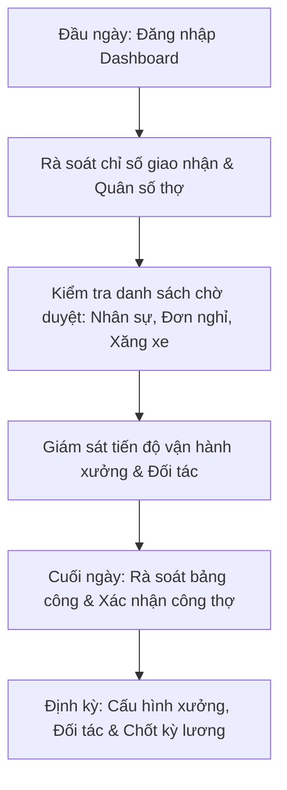

# HƯỚNG DẪN SỬ DỤNG HỆ THỐNG NỘI BỘ - VAI TRÒ QUẢN TRỊ VIÊN (ADMIN)

> **Cổng vận hành xưởng & quản vận B2B PWA:** `noibo.thanhxuanlaundry.com` (Port `3001`)  
> **Tài khoản:** `ADMIN` (Quản trị viên hệ thống)  
> **Mật khẩu khởi tạo / Mẫu:** `ThanhXuan@2026`  
> **Phạm vi quyền hạn:** Toàn quyền tối cao 100% các tính năng vận hành hiện trường, quản lý điều hành, cấu hình hạ tầng GPS/Wi-Fi, duyệt tài chính và xóa vĩnh viễn dữ liệu.

---

## 1. TỔNG QUAN VAI TRÒ & ĐẶC QUYỀN

Quản trị viên (`ADMIN`) là vai trò nắm giữ quyền lực cao nhất trong hệ sinh thái vận hành Thanh Xuân:
- **Giám sát thời gian thực:** Điều hành dashboard trung tâm, theo dõi tiến độ giao nhận của đội xe tải, năng suất làm việc của thợ xưởng và quân số điểm danh.
- **Quản trị nhân sự & RBAC:** Toàn quyền thêm mới, phân quyền 8 vai trò, tạm khóa tài khoản (cơ chế 60 ngày) và **đặc quyền duy nhất trong toàn bộ hệ thống được phép Xóa tài khoản vĩnh viễn**.
- **Cấu hình vị trí xưởng & Bảo mật Wi-Fi:** Thiết lập tọa độ GPS xưởng giặt qua OpenStreetMap, bán kính Geofencing $\pm 150\text{m}$, ngưỡng bù sai số GPS $\pm 350\text{m}$ và dải IP Public Wi-Fi modem chống gian lận điểm danh.
- **Điều hành chuỗi đối tác & Bảng giá:** Quản lý thương hiệu, chi nhánh nhà hàng/khách sạn, phân công tài xế chạy tuyến cố định và danh mục đồ giặt.
- **Duyệt nghỉ giao nhận & Chốt thù lao:** Xét duyệt đơn xin nghỉ phép của Shipper, chỉ định tài xế thay thế và định mức thù lao giao thay.
- **Quản lý tài chính & Kỳ lương:** Cấu hình đơn giá khâu làm việc, tính toán bảng lương, khóa/mở khóa kỳ lương kèm lý do kiểm toán, và giám sát duyệt chi phí xăng/sửa xe.

---

## 2. QUY TRÌNH TÁC NGHIỆP HÀNG NGÀY CỦA ADMIN

---

## 3. HƯỚNG DẪN CHI TIẾT TỪNG TÍNH NĂNG & MÀN HÌNH

### 3.1. Đăng Nhập & Hồ Sơ Quản Trị Viên

1. **Đăng nhập (`/login`):**
   - Truy cập cổng nội bộ, nhập Email và Mật khẩu.
   - Hoặc tại môi trường thử nghiệm/nội bộ, bấm vào nút **"Quản trị viên (Admin)"** trong lưới tài khoản mẫu để đăng nhập tức thì.
2. **Quản lý thông tin cá nhân & Chữ ký (Header Profile):**
   - Bấm vào Avatar góc trên cùng bên phải Header.
   - Chọn **"Thông tin cá nhân"**: Cập nhật Họ và tên, Số điện thoại, chọn ảnh đại diện từ máy tính để tải lên Cloudinary.
   - Ký chữ ký điện tử mẫu trong khung Canvas để hệ thống tự động gán khi cần ký duyệt văn bản/phiếu điều phối.
   - Chọn **"Đổi mật khẩu"**: Nhập mật khẩu hiện tại và mật khẩu mới khi cần bảo mật định kỳ.

---

### 3.2. Trung Tâm Điều Hành Xưởng Thời Gian Thực (`/dashboard`)

- **Bộ điều hướng ngày:** Dùng cụm nút `[< Ngày trước]` - `[Hôm nay]` - `[Ngày sau >]` để xem tình hình bất kỳ ngày nào.
- **Thẻ chỉ số tổng quan (KPI StatCards):**
  - **Sản lượng giao nhận:** Tổng số phiếu giao nhận, số chuyến đã hoàn thành, số chuyến đang di chuyển hoặc gặp sự cố chênh lệch (`DISPUTED`).
  - **Quân số vận hành:** Số thợ đã check-in camera selfie, số ca đang mở (`OPEN`), số ca cần rà soát (`NEEDS_REVIEW`).
  - **Tổng giờ công & Tiền công:** Tổng số phút công thợ tích lũy trong ngày và chi phí công thợ tạm tính.
  - **Cảnh báo cần xử lý gấp:** Số tài khoản mới chờ duyệt, số đề xuất chi phí xăng/sửa xe chưa duyệt, số đơn xin nghỉ của shipper đang chờ giải quyết.
- **Bảng tiến độ giao nhận (`DashboardHandoverPanelComponent`):** Giám sát từng chuyến xe tải của các đối tác theo thời gian thực (đã soạn sạch, đang giao, đối tác đã ký).

---

### 3.3. Quản Trị Nhân Sự & Phân Quyền RBAC (`/management/manager/personnel`)

1. **Bộ lọc danh sách nhân sự:**
   - 6 Tabs phân loại trực quan: *Tất Cả*, *Ban Quản Trị & Kế Toán*, *Vận Hành Xưởng & Kho*, *Giao Nhận*, *Khối Đối Tác B2B*, *Tài Khoản Tạm Khóa*.
   - Thanh tìm kiếm theo Tên, Email, Số điện thoại hoặc Vai trò.
2. **Thêm mới nhân sự:**
   - Bấm nút **"+ Thêm Nhân Sự"** (mở `StaffFormModal`).
   - Nhập Họ tên, Email, Số điện thoại.
   - Chọn 1 trong 8 vai trò chuẩn: `ADMIN`, `MANAGER`, `WAREHOUSE_MANAGER`, `ACCOUNTANT`, `SHIPPER`, `WORKER`, `PARTNER_MANAGER`, `PARTNER_STAFF`.
   - Nếu là vai trò Đối tác (`PARTNER_MANAGER`, `PARTNER_STAFF`): Chọn Thương hiệu (Brand) và Chi nhánh đối tác (Partner) tương ứng.
   - Mật khẩu khởi tạo mặc định là `ThanhXuan@2026`.
3. **Chỉnh sửa thông tin:** Bấm nút **"Sửa"** trên dòng nhân viên để điều chỉnh quyền hạn hoặc chi nhánh.
4. **Tạm khóa tài khoản & Cơ chế tự động 60 ngày:**
   - Bấm **"Khóa"**: Tài khoản chuyển sang trạng thái `LOCKED`, ghi nhận thời điểm khóa.
   - Thẻ tài khoản hiển thị đồng hồ đếm ngược: *"Còn X ngày trước khi xóa vĩnh viễn"*.
   - Trong vòng 60 ngày, Admin có thể bấm **"Mở khóa"** (`ACTIVE`) bất cứ lúc nào để khôi phục quyền truy cập cho nhân viên.
5. **Xóa tài khoản vĩnh viễn (Đặc quyền độc nhất của ADMIN):**
   - Chỉ xuất hiện trên giao diện của tài khoản `ADMIN` (ẩn hoàn toàn với `MANAGER`).
   - Bấm nút **"Xóa vĩnh viễn"** (icon thùng rác đỏ) $\rightarrow$ Modal xác nhận cảnh báo dữ liệu không thể phục hồi $\rightarrow$ Bấm xác nhận để dọn sạch tài khoản khỏi cơ sở dữ liệu.

---

### 3.4. Phê Duyệt Tài Khoản Đăng Ký Mới (`/management/manager/approval`)

- Khi nhân viên xưởng (`WORKER`), tài xế (`SHIPPER`) hoặc nhân viên đối tác (`PARTNER_STAFF`) đăng ký tài khoản qua trang công khai `/register`, tài khoản ở trạng thái `PENDING_APPROVAL`.
- Admin vào màn hình Phê duyệt tài khoản:
  - Xem thông tin ứng viên, ngày đăng ký, vai trò đề xuất, chi nhánh đối tác (nếu có).
  - Bấm **"Phê duyệt"** để kích hoạt tài khoản sang `ACTIVE` ngay lập tức.
  - Bấm **"Từ chối"** kèm ghi chú lý do nếu thông tin không chính xác.

---

### 3.5. Duyệt Đơn Xin Nghỉ Giao Nhận & Phân Tuyến Bù (`/management/shipper-leaves`)

1. **Xem danh sách đơn xin nghỉ:**
   - Lọc theo trạng thái: *Chờ duyệt (`PENDING_APPROVAL`)*, *Đã duyệt chờ định mức (`APPROVED_PENDING_COMPENSATION`)*, *Hoàn tất (`APPROVED`)*, *Từ chối*.
   - Xem thông tin: Tên tài xế xin nghỉ, các ngày nghỉ (`leaveDates`), lý do, danh sách các chi nhánh đối tác cần bàn giao lại.
2. **Quy trình duyệt 2 bước hoặc 1 chạm của Admin:**
   - **Bước 1 - Duyệt & Phân tuyến thay thế:** Bấm nút **"Duyệt & Giao Tuyến"** (mở `ApproveShipperLeaveModal`). Chọn tài xế thay thế (`substituteShipper`) từ danh sách tài xế đang rảnh/sẵn sàng.
   - **Bước 2 - Định mức tiền công giao thay:** Nhập số tiền thù lao (VNĐ) hỗ trợ tài xế nhận làm thay các điểm giao nhận đó, nhập ghi chú điều phối.
   - Bấm **"Xác nhận duyệt"**: Hệ thống tự động chuyển toàn bộ lộ trình đối tác sang cho tài xế thay thế trong những ngày nghỉ, và tự động cộng dồn số tiền thù lao vào phiếu lương của tài xế đó.
3. **Từ chối đơn:** Bấm nút **"Từ chối"** (mở `RejectShipperLeaveModal`), nhập lý do từ chối (ví dụ: *Trùng lịch nghỉ với tài xế khác, không có người thay thế*).

---

### 3.6. Cấu Hình Vị Trí Xưởng, Geofencing & Wi-Fi IP (`/management/admin/workshop`)

1. **Cấu hình tọa độ GPS xưởng qua bản đồ OpenStreetMap:**
   - Nhập chuỗi địa chỉ thực tế của xưởng vào ô tìm kiếm (ví dụ: *Số 12 ngõ 45 đường Thanh Xuân, Hà Nội*).
   - Bấm **"Tìm kiếm tọa độ"**: Hệ thống kết nối máy chủ OpenStreetMap Nominatim tự động điền Kinh độ (`Longitude`) và Vĩ độ (`Latitude`).
2. **Cài đặt bán kính Geofencing & Ngưỡng sai số di động:**
   - **Bán kính cho phép (`radiusMeters`):** Mặc định $150\text{m}$. Cho phép công nhân viên điểm danh trong phạm vi này tính từ tâm xưởng.
   - **Ngưỡng sai số GPS tối đa (`maxAccuracyMeters`):** Mặc định $\pm 350\text{m}$. Giúp bù trừ độ lệch khi điện thoại bắt sóng GPS trong xưởng có mái tôn hoặc tường bê tông dày.
   - Công tắc **"Bắt buộc kiểm tra GPS"**: Bật để chặn tuyệt đối các thiết bị không bật vị trí.
3. **Quản lý danh sách IP Public Wi-Fi xưởng:**
   - Hệ thống tự động nhận diện IP Public hiện tại của mạng đang truy cập. Bấm **"+ Thêm IP này vào danh sách hợp lệ"**.
   - Thêm các địa chỉ IP của các đường truyền mạng/modem phụ tại xưởng.
   - Công tắc **"Bắt buộc kết nối Wi-Fi xưởng"**: Nếu bật, thợ xưởng bắt buộc phải kết nối Wi-Fi của công ty mới được phép check-in điểm danh.

---

### 3.7. Quản Trị Đối Tác, Tài Xế Tuyến & Danh Mục Đồ Giặt (`/management/manager/partner`)

1. **Quản lý Thương hiệu (`Brand`):** Thêm mới thương hiệu (Pizza 4P's, Haidilao, Khách sạn boutique...), cấu hình chu kỳ giao nhận (Hàng ngày, Cách ngày, Theo yêu cầu).
2. **Quản lý Chi nhánh đối tác (`Partner`):**
   - Thêm/sửa chi nhánh đối tác: Tên cơ sở, địa chỉ chi tiết, người liên hệ, số điện thoại.
   - **Gán Tài xế giao nhận cố định (`defaultShipperId`):** Chọn một tài xế xe tải phụ trách tuyến cố định cho cơ sở này từ danh sách. Thẻ chi nhánh sẽ hiển thị badge tím nổi bật tên tài xế. Nếu để trống, chi nhánh sẽ trở thành điểm giao tự do trên chợ chuyến (`POOL`).
3. **Danh mục đồ giặt & Bảng giá bán (`Item Catalog`):**
   - Thiết lập các món đồ giặt theo thương hiệu: Khăn bàn, Áo bếp, Tạp dề, Ga giường...
   - Nhập đơn giá bán cho khách hàng (`priceToCustomer` VNĐ/chiếc hoặc VNĐ/kg). Hệ thống đã chuẩn hóa bỏ hoàn toàn tỷ lệ khoán thợ cũ.

---

### 3.8. Bảng Công Toàn Xưởng & Xử Lý Ca Bất Thường (`/management/manager/attendance`)

- **Bộ chọn ngày:** Xem bảng công theo từng ngày hoặc lọc theo khoảng ngày (tối đa 31 ngày).
- **Xem ảnh selfie & GPS:** Xem trực tiếp ảnh selfie lúc vào ca / ra ca của thợ, vị trí GPS và khoảng cách tính tới xưởng.
- **Xử lý ca quên check-out (`NEEDS_REVIEW`):**
  - Khi thợ ra về quên bấm check-out, ca chuyển sang màu vàng cảnh báo.
  - Admin bấm **"Rà soát ca"** (mở `AttendanceReviewModal`): Bổ sung giờ ra ca thực tế, chọn loại ngày công (*Ngày thường*, *Làm thêm giờ*, *Chủ nhật*, *Ngày lễ*), nhập lý do điều chỉnh để hoàn tất duyệt sang `APPROVED`.
- **Nút "Duyệt nhanh toàn bộ ca":** Bấm 1 chạm để chốt toàn bộ các ca hoàn thành đúng giờ trong ngày.

---

### 3.9. Quản Lý Khâu Công Thợ & Đơn Giá Giờ (`/management/manager/piecework`)

Gồm 3 Tabs quản lý:
1. **Tab Cài đặt đơn giá khâu (`JobRatesSettingsComponent`):** Cấu hình đơn giá VNĐ/giờ (`hourlyRate`) và hệ số lương cho từng khâu (Rũ đồ, Giặt & Sấy, Là/Ủi, Gấp, Đóng gói...). Bật/Tắt trạng thái hoạt động của khâu.
2. **Tab Phân khâu mặc định (`WorkerDefaultJobComponent`):** Gán khâu làm việc mặc định cho từng công nhân (ví dụ: Thợ Lan chuyên khâu *Là/Ủi*, Thợ Tuấn chuyên khâu *Rũ đồ*). Khi thợ bấm check-in ca làm việc, hệ thống tự động mở phiên làm việc cho khâu mặc định này.
3. **Tab Duyệt công theo ngày (`DailyWorkReviewComponent`):** Chọn ngày, xem tổng hợp số phút làm việc và tiền công tạm tính của từng thợ theo từng mẻ việc trong ngày. Bấm **"Xác nhận duyệt công"** (`CONFIRMED`).

---

### 3.10. Quản Trị Bảng Lương Chu Kỳ & Chốt Sổ (`/management/accountant/payroll`)

1. **Xem chỉ số tổng quan chu kỳ lương:** Quân số toàn xưởng, Tổng lương chính/khâu, Tổng phụ cấp & thưởng, Tổng thực lĩnh Net Pay toàn công ty.
2. **Tính toán tự động bảng lương (`Calculate`):** Chọn tháng (ví dụ: `2026-10`), bấm **"Tính Lương Tự Động"**. Hệ thống NestJS tự động tổng hợp:
   - Với Thợ xưởng: Tổng số phút làm việc từng khâu $\times$ đơn giá giờ $\times$ hệ số.
   - Với Tài xế: Công thức chuẩn 28 ngày công, thưởng ca cuối tuần (60k/ca), chuyên cần (7k/ngày), phụ cấp điện thoại (200k), tiền hoàn xăng và sửa xe đã duyệt, tiền thù lao chuyến lẻ/nhận thay và khấu trừ BHXH (400k).
3. **Điều chỉnh chi tiết phiếu lương (`PayslipDetailAdjustModal`):** Bấm vào từng nhân sự để xem bóc tách chi tiết. Cho phép thêm các khoản Thưởng đột xuất, Trừ tạm ứng, Phụ cấp trách nhiệm kèm ghi chú.
4. **Khóa sổ kỳ lương (`LOCKED`):** Khi đã đối soát xong, Admin bấm **"Khóa Sổ Kỳ Lương"**. Dữ liệu sẽ đóng băng vĩnh viễn, chống sửa đổi. Nếu có sai sót cần mở lại, bấm **"Mở Khóa"** (`UNLOCK`) và bắt buộc nhập lý do vào nhật ký kiểm toán (Audit Log).
5. **Đánh dấu đã thanh toán (`Mark Paid`):** Bấm khi kế toán đã chuyển khoản lương qua ngân hàng.
6. **Xuất bảng lương Excel:** Bấm **"Xuất Excel"** để tải file bảng lương đầy đủ công thức về máy.

---

### 3.11. Trung Tâm Báo Cáo Phân Tích Đa Chiều (`/operations/report`)

- Truy cập 8 phân hệ báo cáo chuyên sâu:
  1. *Báo cáo kho:* Sản lượng đồ sạch xuất kho theo từng ngày, đối tác.
  2. *Đối soát đối tác:* Tổng hợp số lượng đồ giao - nhận, tỷ lệ chênh lệch, công nợ.
  3. *Chấm công thợ:* Bảng tổng hợp ngày công, ca làm thêm, đi muộn về sớm.
  4. *Phân tích 7 khâu công thợ:* Biểu đồ thời gian làm việc và năng suất theo từng khâu.
  5. *Lịch trình shipper:* Chi tiết các chuyến xe chạy, tỷ lệ giao đúng giờ.
  6. *Sự cố chênh lệch & rủi ro:* Báo cáo đồ rách, đồ ố, đồ mất và các phiếu khiếu nại (`DISPUTED`).
  7. *Báo cáo chi phí xe:* Tổng hợp tiền xăng, tiền sửa xe theo từng tài xế.
  8. *Quyết toán bảng lương:* Báo cáo tài chính lương toàn công ty.
- Hỗ trợ xuất file Excel (.xlsx) và file PDF streaming tức thì.

---

## 4. XỬ LÝ SỰ CỐ & CÂU HỎI THƯỜNG GẶP (FAQ / TROUBLESHOOTING)

| Tình Huống Gặp Phải | Nguyên Nhân | Cách Xử Lý Của Admin |
| :--- | :--- | :--- |
| **Thợ xưởng báo không check-in được vì "Ngoài phạm vi GPS xưởng"** | Vị trí GPS trên điện thoại thợ bị trôi hoặc thợ đang đứng ở góc khuất sóng tôn. | 1. Kiểm tra lại trang `/management/admin/workshop`. 2. Tăng tạm thời bán kính `radiusMeters` lên 200m hoặc mở rộng sai số `maxAccuracyMeters` lên 400m. 3. Hoặc yêu cầu thợ kết nối vào Wi-Fi xưởng nếu đã cấu hình IP hợp lệ. |
| **Shipper báo không thấy nút nhận chuyến ở chợ chuyến** | Chi nhánh đối tác đó đã có tài xế khác bấm nhận, hoặc chi nhánh đó đã được gán tài xế cố định. | Vào `/management/manager/partner`, tìm chi nhánh đối tác đó để kiểm tra mục `Tài xế tuyến cố định`. Nếu muốn mở cho mọi người cùng nhận tự do, hãy bỏ chọn tài xế cố định. |
| **Kỳ lương bị khóa không thể điều chỉnh số liệu** | Kỳ lương đang ở trạng thái `LOCKED`. | Chỉ duy nhất tài khoản `ADMIN` mới có quyền bấm nút **"Mở Khóa Kỳ Lương"** (`UNLOCK`). Nhập lý do mở khóa vào pop-up cảnh báo để tiếp tục sửa đổi. |
| **Xóa nhầm tài khoản nhân viên** | Admin bấm xóa vĩnh viễn tài khoản. | Hành động xóa vĩnh viễn không thể hoàn tác trong cơ sở dữ liệu. Cần thông báo nhân sự thực hiện đăng ký mới lại từ đầu. Nếu chỉ muốn ngưng hoạt động tạm thời, hãy dùng tính năng **Khóa tài khoản** thay vì Xóa. |
