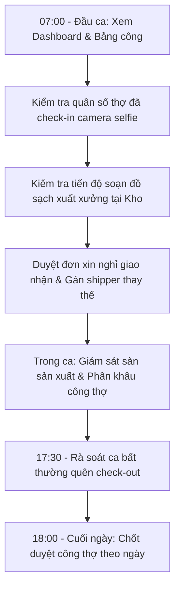

# HƯỚNG DẪN SỬ DỤNG HỆ THỐNG NỘI BỘ - VAI TRÒ QUẢN LÝ XƯỞNG (MANAGER)

> **Cổng vận hành xưởng & quản vận B2B PWA:** `noibo.thanhxuanlaundry.com` (Port `3001`)  
> **Tài khoản:** `MANAGER` (Quản lý Xưởng / Giám đốc điều hành sản xuất)  
> **Mật khẩu khởi tạo / Mẫu:** `ThanhXuan@2026`  
> **Phạm vi quyền hạn:** Trực tiếp chỉ huy toàn bộ sàn sản xuất, nhân sự thợ giặt/ủi/gấp, chấm công, duyệt công thợ, điều phối đối tác và duyệt nghỉ giao nhận.  
> ⚠️ **Ràng buộc bảo mật tài chính tối cao (Critical Constraint):** Tài khoản Quản lý xưởng bị ẩn và bóc tách 100% thông tin tiền bạc, đơn giá khâu, đơn giá đồ giặt, bảng lương và báo cáo chi phí tài chính.

---

## 1. TỔNG QUAN VAI TRÒ & NGUYÊN TẮC BẢO MẬT

Quản lý xưởng (`MANAGER`) là vị trí chỉ huy hiện trường cao nhất tại xưởng giặt công nghiệp:
- **Chỉ huy sàn sản xuất:** Giám sát toàn bộ tiến độ xử lý đơn hàng từ khi đồ bẩn về xưởng, qua 7 khâu giặt/sấy/rũ/ủi/gấp/đóng gói, cho đến khi đồ sạch được soạn xuất xưởng.
- **Quản lý công & thời gian làm việc:** Kiểm soát chấm công camera selfie, xử lý các ca quên check-out, phân khâu mặc định và chốt duyệt công thợ hàng ngày.
- **Điều phối tuyến giao nhận:** Phân công tài xế phụ trách tuyến cố định cho từng nhà hàng, duyệt đơn xin nghỉ phép của tài xế và chỉ định người giao thay.
- **Quản trị nhân sự hiện trường:** Thêm mới nhân sự, phê duyệt tài khoản thợ và tài xế mới, tạm khóa tài khoản vi phạm nội quy. *(Lưu ý: Quản lý không có quyền xóa vĩnh viễn tài khoản - chức năng này thuộc về Admin)*.

---

## 2. QUY TRÌNH ĐIỀU HÀNH HÀNG NGÀY CỦA QUẢN LÝ XƯỞNG

---

## 3. HƯỚNG DẪN CHI TIẾT TỪNG MÀN HÌNH TÁC NGHIỆP

### 3.1. Đăng Nhập & Bố Cục Giao Diện Quản Lý

1. **Đăng nhập (`/login`):** Nhập Email và Mật khẩu. Tại bản nội bộ, có thể bấm nút **"Quản lý Xưởng"** để đăng nhập trực tiếp.
2. **Bố cục màn hình:**
   - **Thanh Menu (Desktop Sidebar hoặc Mobile Drawer):** Gồm 4 phân vùng chính: *TỔNG QUAN*, *VẬN HÀNH XƯỞNG & ĐỐI TÁC*, *ĐIỀU HÀNH & KINH DOANH*, *BẢNG CÔNG & LƯƠNG*.
   - **Thanh Quick Navigation đáy màn hình điện thoại (Mobile Bottom Bar):** Hiển thị 4 nút truy cập nhanh: *Tổng Quan*, *Báo Cáo*, *Kho Sạch*, *Giao Nhận* và nút *Thêm (Mở Menu)*.

---

### 3.2. Trung Tâm Điều Hành Xưởng (`/dashboard`)

- **Theo dõi tiến độ đơn hàng thời gian thực:**
  - Tổng số phiếu giao nhận trong ngày, số phiếu đã giao trả cho nhà hàng, số phiếu đang trên đường đi.
  - Cảnh báo các phiếu có tranh chấp (`DISPUTED`) hoặc ghi nhận đồ rách/ố cần xử lý gấp với đối tác.
- **Theo dõi quân số hiện diện tại xưởng:**
  - Số lượng thợ đang trong ca làm việc (`OPEN`).
  - Số lượng ca làm việc bất thường cần xử lý ngay (`NEEDS_REVIEW`).
- **Thao tác chuyển ngày:** Bấm `<` hoặc `>` trên thanh điều hướng ngày để kiểm tra lịch sử hoặc kế hoạch ngày tiếp theo.

---

### 3.3. Bảng Công Toàn Xưởng & Xử Lý Ca Quên Check-out (`/management/manager/attendance`)

Màn hình giúp Quản lý giám sát kỷ luật lao động và chốt ngày công của toàn bộ công nhân viên:

1. **Kiểm tra ảnh chụp Camera Selfie & Vị trí GPS:**
   - Mỗi dòng nhân viên hiển thị ảnh selfie chụp lúc vào ca và lúc ra ca, kèm thời gian chính xác và khoảng cách GPS tới xưởng (ví dụ: *Cách xưởng 12m*).
   - Nếu là tài xế giao nhận, hệ thống tự động gắn nhãn ca làm việc dựa trên chuyến xe đầu tiên trong ngày.
2. **Bộ lọc trạng thái ca làm việc:**
   - *Đang mở (`OPEN`):* Thợ đang làm việc trong ca.
   - *Cần rà soát (`NEEDS_REVIEW`):* Thợ đã làm xong nhưng quên bấm chụp ảnh ra ca. Ca này sẽ hiển thị cảnh báo viền vàng.
   - *Đã đóng (`CLOSED`):* Đã check-in và check-out đầy đủ nhưng chưa chốt.
   - *Đã duyệt (`APPROVED`):* Ca công đã được Quản lý xác nhận hợp lệ.
3. **Quy trình xử lý ca quên check-out:**
   - Bước 1: Tìm nhân viên có ca màu vàng `NEEDS_REVIEW`.
   - Bước 2: Bấm nút **"Rà soát ca"** để mở `AttendanceReviewModal`.
   - Bước 3: Nhập giờ ra ca thực tế (ví dụ: *17:30*), chọn loại ngày công (*Ngày thường*, *Làm thêm giờ OT*, *Chủ nhật*, *Ngày lễ*), nhập lý do (ví dụ: *Thợ quên bấm check-out, đã kiểm tra camera xưởng về lúc 17h30*).
   - Bước 4: Bấm **"Lưu & Duyệt ca"**.
4. **Duyệt nhanh toàn bộ ca (`Duyệt Toàn Bộ`):** Bấm nút trên thanh công cụ để duyệt đồng loạt toàn bộ các ca làm việc bình thường trong ngày sang `APPROVED`.

---

### 3.4. Quản Lý Khâu Công Thợ & Duyệt Nhật Ký Phiên (`/management/manager/piecework`)

Màn hình gồm 2 tab trọng tâm cho Quản lý xưởng (Tab đơn giá tiền bị ẩn):

#### Tab 1: Phân Khâu Mặc Định (`WorkerDefaultJobComponent`)
- **Mục đích:** Mỗi thợ xưởng sẽ có một khâu làm việc sở trường chính. Khi thợ check-in ca làm việc, hệ thống tự động mở phiên làm việc cho khâu mặc định này.
- **Thao tác:**
  - Danh sách hiển thị toàn bộ tài khoản `WORKER`.
  - Tại dòng của từng thợ, chọn Khâu mặc định từ danh sách:
    - *Rũ đồ*
    - *Giặt & Sấy*
    - *Gấp đồ*
    - *Đếm / Phân loại*
    - *Là / Ủi*
    - *Đóng gói*
    - *Khác*
  - Bấm **"Lưu phân công"**.

#### Tab 2: Duyệt Công Theo Ngày (`DailyWorkReviewComponent`)
- **Mục đích:** Kiểm tra toàn bộ nhật ký phiên làm việc trong ngày của từng thợ trước khi đóng ca.
- **Thao tác:**
  - Chọn ngày cần xem xét.
  - Xem danh sách từng thợ: Số lượng phiên làm việc, tổng số phút thực tế đã làm ở từng khâu.
  - Bấm mở chi tiết từng phiên để xem: Thời điểm bắt đầu, thời điểm kết thúc, phân loại (*Khâu mặc định*, *Khâu phụ nhận thêm*, *Tự động quay lại*).
  - Bấm nút **"Xác Nhận Chốt Công"** (`CONFIRMED`) để đóng băng nhật ký công thợ trong ngày, chuyển dữ liệu cho Kế toán tính lương.

---

### 3.5. Duyệt Đơn Xin Nghỉ Giao Nhận & Chỉ Định Shipper Thay Thế (`/management/shipper-leaves`)

Khi tài xế xe tải cần nghỉ phép, Quản lý xưởng chịu trách nhiệm phê duyệt và sắp xếp người chạy thay để không bị đứt gãy chuyến hàng:

1. **Xem danh sách đơn xin nghỉ:** Lọc danh sách đơn ở trạng thái *Chờ duyệt (`PENDING_APPROVAL`)*.
2. **Kiểm tra thông tin:** Xem ngày xin nghỉ của tài xế, lý do và danh sách các chi nhánh nhà hàng mà tài xế này đang phụ trách.
3. **Thao tác duyệt và bàn giao tuyến:**
   - Bấm nút **"Duyệt & Giao Tuyến"** (mở `ApproveShipperLeaveModal`).
   - Tại ô **"Tài xế nhận thay"**, chọn một tài xế đang rảnh hoặc có tuyến đường thuận tiện.
   - Nhập ghi chú điều phối (ví dụ: *Đã thống nhất Tuấn chạy thay tuyến Pizza 4P's ngày 28/10*).
   - Bấm **"Xác nhận chuyển tuyến"**. Đơn sẽ chuyển sang trạng thái chờ Kế toán set thù lao giao thay.
4. **Từ chối đơn:** Nếu ngày đó xưởng quá tải chuyến hoặc không có người thay thế, bấm **"Từ chối"**, nhập lý do giải thích cho tài xế.

---

### 3.6. Quản Trị Chuỗi Đối Tác & Gán Tài Xế Cố Định (`/management/manager/partner`)

1. **Quản lý danh sách chi nhánh:**
   - Tra cứu danh sách các nhà hàng, khách sạn đang hợp tác.
   - Xem thông tin địa chỉ, lịch giao nhận (Hàng ngày, Cách ngày) và trạng thái hoạt động.
2. **Gán Tài Xế Tuyến Cố Định (`PartnerModal`):**
   - Bấm nút **"Sửa"** tại chi nhánh đối tác.
   - Tại trường **"Tài xế phụ trách cố định"**, chọn một tài xế xe tải trong công ty.
   - Bấm **"Lưu chi nhánh"**. Thẻ nhà hàng sẽ hiển thị huy hiệu tím mang tên tài xế đó. Toàn bộ các chuyến xuất kho của chi nhánh này sẽ tự động xuất hiện trên tab *Lộ trình* của tài xế.
   - Nếu muốn chuyển nhà hàng thành điểm giao tự do cho mọi tài xế tranh nhận trên chợ chuyến (`POOL`), hãy chọn mục *"Để trống (Tuyến tự do)"*.

---

### 3.7. Quản Trị Nhân Sự & Duyệt Tài Khoản Mới

#### Màn hình Quản Lý Nhân Sự (`/management/manager/personnel`)
- **Thêm nhân sự mới:** Bấm **"+ Thêm Nhân Sự"**, nhập thông tin, chọn vai trò (`WORKER`, `SHIPPER`, `WAREHOUSE_MANAGER`...).
- **Chỉnh sửa thông tin:** Cập nhật số điện thoại, đổi vai trò khi nhân viên chuyển bộ phận.
- **Tạm khóa tài khoản:** Bấm **"Khóa"** với các nhân viên tạm nghỉ việc hoặc vi phạm kỷ luật. Tài khoản chuyển sang trạng thái `LOCKED` (cơ chế 60 ngày). Khi nhân viên đi làm lại, bấm **"Mở khóa"** (`ACTIVE`).
- ⚠️ *Lưu ý: Quản lý không có quyền Xóa vĩnh viễn tài khoản. Nếu cần xóa triệt để dữ liệu nhân sự, hãy báo Admin.*

#### Màn hình Phê Duyệt Tài Khoản (`/management/manager/approval`)
- Khi thợ xưởng hoặc tài xế mới tự đăng ký qua trang web, đơn sẽ hiện tại đây.
- Quản lý kiểm tra đúng họ tên nhân viên mới tuyển $\rightarrow$ Bấm **"Phê duyệt"** để cấp quyền đăng nhập vào hệ thống.

---

### 3.8. Giám Sát Vận Hành Kho Sạch & Chuyến Xe Giao Nhận

- **Kho Sạch (`/operations/warehouse-manager/warehouse`):** Chế độ xem theo dõi Thủ kho đã lập kế hoạch soạn đồ cho ngày mai chưa, số lượng bao nhiêu món sạch, đã render ảnh phiếu chưa.
- **Giao Nhận (`/operations/shipper/handover`):** Theo dõi lộ trình từng chuyến xe, kiểm tra xem tài xế đã lấy được chữ ký bàn giao của nhà hàng chưa, có phiếu nào bị yêu cầu rạch bao đếm lại (`isRecount`) không.

---

### 3.9. Báo Cáo Sản Lượng & Năng Suất Sàn Xưởng (`/operations/report`)

- Quản lý truy cập xem 6 phân hệ báo cáo vận hành:
  1. *Báo cáo kho:* Sản lượng đồ sạch xuất kho theo ngày.
  2. *Đối soát đối tác:* Số lượng đồ giao - nhận thực tế của từng chi nhánh.
  3. *Chấm công thợ:* Tổng hợp giờ công, ca làm việc, tỷ lệ đi đúng giờ.
  4. *Phân tích 7 khâu công thợ:* Thống kê năng suất, số phút làm việc ở từng khâu giặt, sấy, ủi, gấp.
  5. *Lịch trình shipper:* Tỷ lệ hoàn thành chuyến giao nhận của đội xe.
  6. *Sự cố chênh lệch & rủi ro:* Báo cáo các sự cố đồ rách, đồ ố, đồ thất lạc để có phương án bồi hoàn cho khách hàng.
- 🔒 **Tính năng bảo mật tự động:** Khi Quản lý xưởng xem hoặc tải các báo cáo này, hệ thống Backend tự động bóc tách (loại bỏ) toàn bộ các cột tiền lương, đơn giá và chi phí tài chính.

---

## 4. CÂU HỎI THƯỜNG GẶP & LƯU Ý CHO QUẢN LÝ (FAQ)

| Câu Hỏi / Tình Huống | Hướng Dẫn Xử Lý |
| :--- | :--- |
| **Tại sao tôi không thấy mục "Bảng Lương" và không xem được số tiền lương của thợ?** | Đây là quy chuẩn thiết kế bảo mật nghiêm ngặt của công ty Thanh Xuân. Quản lý xưởng chỉ tập trung điều hành sản xuất, quản lý thời gian và chất lượng. Toàn bộ tiền bạc, đơn giá và bảng lương do Kế toán và Admin phụ trách. |
| **Thợ xưởng chuyển giữa chừng từ khâu Gấp sang khâu Là/Ủi thì quản lý phải làm gì?** | Quản lý không cần can thiệp trên hệ thống. Bản thân người thợ sẽ tự thao tác trên điện thoại của họ: Bấm Checkout khâu Gấp $\rightarrow$ Chọn nhận khâu Là/Ủi. Khi thợ làm xong khâu Là/Ủi và bấm checkout, hệ thống sẽ tự động đưa thợ quay về khâu Gấp mặc định. Cuối ngày Quản lý chỉ cần vào trang Duyệt công để bấm xác nhận. |
| **Một chi nhánh nhà hàng phản ánh tài xế giao thiếu đồ sạch thì xử lý thế nào?** | Quản lý vào trang Giao Nhận (`/operations/shipper/handover`) hoặc Thư viện ảnh phiếu (`SLIP_GALLERY`), tìm mã phiếu của chi nhánh đó, bấm phóng to ảnh phiếu xuất kho để kiểm tra đối chứng chữ ký của Thủ kho lúc xuất hàng và chữ ký của đại diện quán lúc nhận hàng. |
