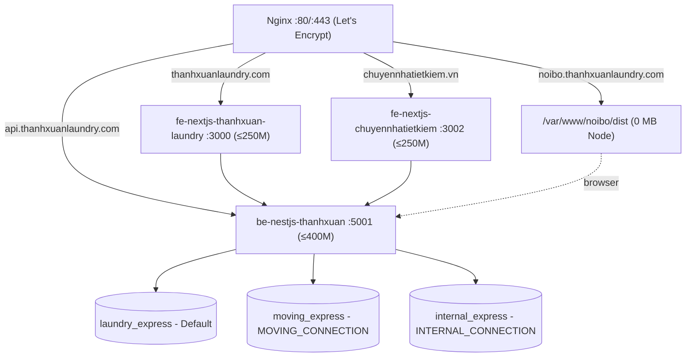
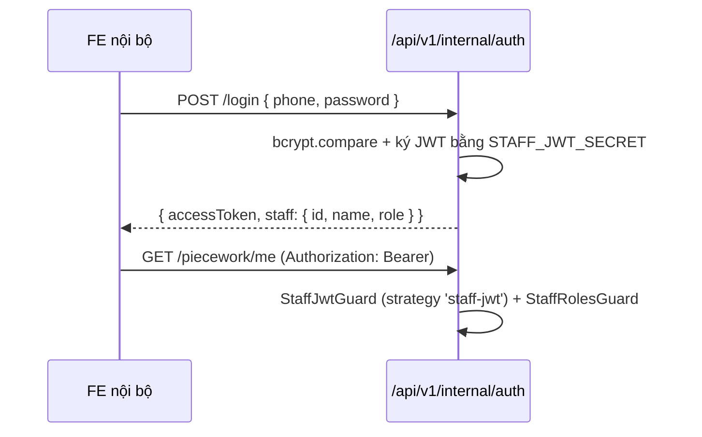
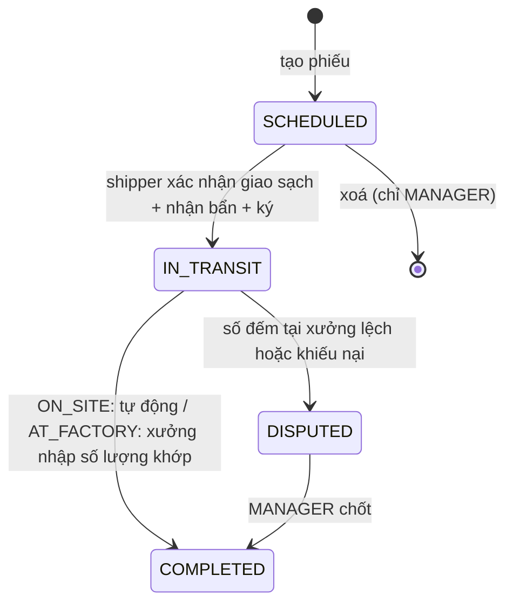

# Plan 2: Hoàn Thiện Hệ Thống Multi-Tenant (Internal Ops, Moving, Hạ Tầng VPS 4GB)

> Kế thừa: [plan1.md](./plan1.md) (đã hoàn tất tái cấu trúc thư mục + 3 Mongoose connections).
> Nguồn yêu cầu: "Technical Specification & Implementation Roadmap: Multi-Tenant System" (03/10/2026).

## 0. Quyết Định Kiến Trúc Đã Chốt

| # | Vấn đề | Quyết định |
|---|--------|-----------|
| D1 | Cổng Backend | **Giữ 5001**. Nginx: `api.thanhxuanlaundry.com → 127.0.0.1:5001` (đặc tả ghi 3001 → bỏ) |
| D2 | API prefix | **Giữ nguyên route giặt là cũ** (`/articles`, `/orders`...). Chỉ module mới dùng `/api/v1/moving/*`, `/api/v1/internal/*` qua `RouterModule` |
| D3 | Đặt tên field | **camelCase** cho field (`recordCode`, `partnerId`), collection giữ snake_case (`handover_records`) |
| D4 | FE Chuyển nhà | Repo/thư mục riêng `fe-nextjs-chuyennhatietkiem`, copy component cần dùng từ FE giặt là |
| D5 | Phạm vi plan | Plan tổng Phase 1→5; Phase 1–2 chi tiết, Phase 3–5 ở mức task |

---

## 1. Overview & Affected Files

### 1.1. Gap Analysis (Hiện trạng vs Đặc tả)

| Hạng mục | Hiện trạng | Đặc tả yêu cầu | Trạng thái |
|---|---|---|---|
| 3 Mongoose connections | Có ([app.module.ts](../../be-nestjs-thanhxuan/src/app.module.ts)) | Có | ✅ Xong |
| Cấu trúc `core/laundry/moving/internal` | Có, nhưng `internal`/`moving` **phẳng** (1 service + 1 controller) | Sub-module: `handover/`, `piecework/`, `attendance/`, `partners/`, `staff-auth/`; `quotes/`, `services/`, `articles/` | ⚠️ Cần tách |
| Schema `partners` | `brandName`, `branchName` (string tự do) | `brand` enum, `deliverySchedule`, `billingType` | ⚠️ Cần sửa |
| Schema `item_catalogs` | **Chưa có** | `brand`, `itemCode`, `unit`, `priceToCustomer`, `foldingRateWorker` | ❌ |
| Schema `handover_records` | 1 mảng `items` (soiled/clean), status `PICKED_UP/IN_PROCESS/DELIVERED` | `cleanDelivery` + `dirtyPickup` kép, `countMode`, ảnh, chữ ký Base64, status `SCHEDULED/IN_TRANSIT/COMPLETED/DISPUTED` | ⚠️ Viết lại |
| Schema `piecework_logs` | 1 item/log, `workerName` string, client tự gửi `ratePerPiece` | 1 doc/thợ/ngày, mảng `tasks[]`, `workerId`, rate lấy từ catalog | ⚠️ Viết lại |
| `staffs`, `attendance_logs` | **Chưa có** | Có, JWT độc lập | ❌ |
| Schema `moving_quotes` | Thiếu tầng, đồ cồng kềnh, ảnh; status khác | Đủ field + status `PENDING_QUOTE/QUOTED/CONFIRMED/CANCELLED` | ⚠️ Mở rộng |
| `moving_articles` | **Chưa có** | Có | ❌ |
| DTO / Validation | Controller nhận `Partial<Document>` → **ValidationPipe bị Bypass** | DTO class-validator | ❌ |
| Bảo mật | `/internal/*`, `GET /moving/quotes` **public, lộ PII** | Guard staff JWT / admin JWT | ❌ Nghiêm trọng |
| Body size | Express mặc định JSON 100KB → **chữ ký Base64 sẽ bị 413** | Hỗ trợ chữ ký + upload 20MB | ❌ |
| CORS | Callback luôn `true` (mở toàn bộ) | Whitelist 3 domain | ❌ |
| FE nội bộ | 1 file `App.tsx` mock tĩnh, chưa Router/Axios/Shadcn; `.env.example` trỏ sai `VITE_API_URL=3001` | Touch-first UI, Thợ xưởng + Shipper, chữ ký Canvas | ❌ |
| FE chuyển nhà | **Chưa có** | Next.js standalone :3002 | ❌ |
| Docker | mongo 512m, backend 512m, frontend 768m, `internal_frontend` container 512m, Mongo **expose public 27018** | mongo 800M, backend 400M, FE 250M×2, nội bộ = file tĩnh Nginx | ⚠️ |
| Nginx / SSL / Swap | **Chưa có** trong repo | 4 server block + Let's Encrypt + 4GB swap | ❌ |

### 1.2. Danh Sách File Ảnh Hưởng

**Backend `be-nestjs-thanhxuan/src/`**

- [MODIFY] `main.ts` — body limit, CORS whitelist.
- [MODIFY] `app.module.ts` — đăng ký `RouterModule` cho `/api/v1/internal`, `/api/v1/moving`.
- [MODIFY] `config/jwt.config.ts` — thêm `staffSecret`, `staffExpiresIn`.
- [DELETE] `modules/internal/internal.service.ts`, `internal.controller.ts`, `repositories/*`, `schemas/*` (thay bằng sub-module).
- [MODIFY] `modules/internal/internal.module.ts` — chỉ còn là aggregator import các sub-module.
- [NEW] `modules/internal/common/` — `guards/staff-jwt.guard.ts`, `guards/staff-roles.guard.ts`, `decorators/staff-roles.decorator.ts`, `decorators/current-staff.decorator.ts`, `enums/*.ts`.
- [NEW] `modules/internal/staff-auth/` — `staff.schema.ts`, `staff.repository.ts`, `staff-auth.service.ts`, `staff-auth.controller.ts`, `strategies/staff-jwt.strategy.ts`, `dto/*`, `specs/*`.
- [NEW] `modules/internal/partners/` — `partner.schema.ts`, `item-catalog.schema.ts`, 2 repository, service, controller, dto, specs.
- [NEW] `modules/internal/handover/` — `handover-record.schema.ts`, `counter.schema.ts`, repository, `handover.service.ts`, `handover-state.ts` (state machine thuần), controller, dto, specs.
- [NEW] `modules/internal/piecework/` — schema, repository, `piecework-calculator.ts` (hàm thuần), service, controller, dto, specs.
- [NEW] `modules/internal/attendance/` — schema, repository, service, controller, dto, specs.
- [DELETE] `modules/moving/moving.service.ts`, `moving.controller.ts`, `repositories/*`, `schemas/*` (thay bằng sub-module).
- [NEW] `modules/moving/quotes/` — schema mở rộng, repository, `moving-pricing.ts` (hàm thuần tính giá tạm), service, controller (public + admin), dto, specs.
- [NEW] `modules/moving/services/` — schema, repository, service, controller, dto.
- [NEW] `modules/moving/articles/` — schema, repository, service, controller, dto.
- [MODIFY] `modules/core/upload/upload.controller.ts` — thêm endpoint upload cho staff (`/api/v1/internal/uploads`) hoặc cho phép folder theo tenant.
- [MODIFY] `.env.example` — `STAFF_JWT_SECRET`, `STAFF_JWT_EXPIRES_IN`, `CORS_ORIGINS`.
- [NEW] `src/scripts/seed-internal.ts` — seed partners + item_catalogs (4P's 7 loại khăn, Haidilao) + 1 tài khoản ADMIN staff.

**Frontend nội bộ `fe-react-thanhxuan-internal/`** (Phase 3)

- [MODIFY] `package.json`, `vite.config.ts`, `tailwind.config.js`, `.env.example`, `index.html`.
- [NEW] `components.json` (Shadcn), `src/components/ui/*`.
- [MODIFY] `src/App.tsx` → chỉ còn Router + Providers; [NEW] `src/app/router.tsx`, `src/app/providers.tsx`.
- [NEW] `src/lib/api-client.ts`, `src/lib/auth-storage.ts`, `src/lib/image-compress.ts`, `src/types/*`.
- [NEW] `src/features/{auth,piecework,handover,attendance,partners}/{components,hooks,services}/*`.
- [NEW] `.github/workflows/main.yml` — build `dist` + SCP lên VPS.

**Frontend chuyển nhà `fe-nextjs-chuyennhatietkiem/`** (Phase 4) — [NEW] toàn bộ project.

**Hạ tầng root** (Phase 5)

- [MODIFY] `docker-compose.yml`, `.env.example`.
- [NEW] `deploy/nginx/thanhxuanlaundry.com.conf`, `chuyennhatietkiem.vn.conf`, `noibo.thanhxuanlaundry.com.conf`, `api.thanhxuanlaundry.com.conf`.
- [NEW] `deploy/scripts/setup-swap.sh`, `deploy/scripts/setup-certbot.sh`, `deploy/README.md`.
- [MODIFY] `docs/SRS_SDD.md` — cập nhật API contract & schema mới.

---

## 2. Technical Approach

### 2.1. Kiến Trúc Tổng Thể Sau Khi Hoàn Thành



### 2.2. Routing Backend (D2)

- `RouterModule.register` trong `AppModule`:
  - `{ path: 'api/v1/internal', module: InternalModule, children: [StaffAuthModule, PartnersModule, HandoverModule, PieceworkModule, AttendanceModule] }`
  - `{ path: 'api/v1/moving', module: MovingModule, children: [QuotesModule, MovingServicesModule, MovingArticlesModule] }`
- Controller sub-module chỉ khai báo path ngắn: `@Controller('handover')` → `/api/v1/internal/handover`.
- 12 module giặt là **không đổi** — FE Next.js production không bị ảnh hưởng.

### 2.3. Xác Thực Staff Độc Lập



- Passport strategy tên `'staff-jwt'` (khác `'jwt'` của admin giặt là) → token admin web **không** dùng được cho nội bộ và ngược lại.
- Payload chứa `aud: 'internal'` để chống nhầm token.
- Role: `ADMIN` | `MANAGER` | `WORKER` | `SHIPPER`.

### 2.4. Data Schema — `internal_express`

```ts
// enums
type PartnerBrand = 'PIZZA_4PS' | 'HAIDILAO' | 'SMALL_RESTAURANT';
type DeliverySchedule = 'DAILY' | 'ALTERNATE_DAYS' | 'ON_DEMAND';
type BillingType = 'PER_UNIT' | 'PER_KG';
type ItemUnit = 'PIECE' | 'SET' | 'KG';              // UI hiển thị: chiếc | bộ | kg
type CountMode = 'ON_SITE' | 'AT_FACTORY';
type HandoverStatus = 'SCHEDULED' | 'IN_TRANSIT' | 'COMPLETED' | 'DISPUTED';
type StaffRole = 'ADMIN' | 'MANAGER' | 'WORKER' | 'SHIPPER';

// partners
interface Partner { brand: PartnerBrand; name: string; address?: string; contactPerson?: string;
  contactPhone?: string; deliverySchedule: DeliverySchedule; billingType: BillingType; isActive: boolean }
// Index: { brand: 1, isActive: 1 }

// item_catalogs
interface ItemCatalog { brand: PartnerBrand; itemCode: string; name: string; unit: ItemUnit;
  priceToCustomer: number; foldingRateWorker: number; isActive: boolean }
// Index: unique { itemCode: 1 }, { brand: 1 }

// handover_records
interface HandoverLine { itemCode: string; quantity: number }
interface HandoverRecord {
  recordCode: string;                 // GN-YYYYMMDD-NNN, unique
  partnerId: ObjectId; shipperId: ObjectId; date: Date;
  cleanDelivery: { items: HandoverLine[]; totalKg?: number };
  dirtyPickup: { items: HandoverLine[]; totalKg?: number; countMode: CountMode;
    bagsCount?: number; defectNotes?: string; images: string[] };   // images = Cloudinary URL
  status: HandoverStatus;
  receivedBySignature?: string;       // data:image/png;base64,... (giới hạn ~200KB)
  receivedByName?: string;
  disputeReason?: string;
}
// Index: unique { recordCode: 1 }, { date: -1, shipperId: 1 }, { partnerId: 1, date: -1 }

// counters (sinh mã phiếu atomic, chống trùng khi 2 shipper tạo cùng lúc)
interface Counter { _id: string /* 'GN-20261003' */; seq: number }

// piecework_logs (1 document / thợ / ngày)
interface PieceworkTask { itemCode: string; quantity: number; rate: number; subtotal: number }
interface PieceworkLog { workerId: ObjectId; date: Date /* 00:00 giờ VN */; tasks: PieceworkTask[]; totalEarnings: number }
// Index: unique { workerId: 1, date: 1 }

// staffs
interface Staff { name: string; phone: string /* unique */; passwordHash: string; role: StaffRole; isActive: boolean }

// attendance_logs
interface AttendanceLog { staffId: ObjectId; date: Date; checkInAt: Date; checkOutAt?: Date; note?: string }
// Index: unique { staffId: 1, date: 1 }
```

### 2.5. Data Schema — `moving_express`

```ts
type MovingQuoteStatus = 'PENDING_QUOTE' | 'QUOTED' | 'CONFIRMED' | 'CANCELLED';
interface Location { address: string; floor: number; hasElevator: boolean }
interface MovingQuote {
  customerName: string; phoneNumber: string;
  pickup: Location; destination: Location;
  serviceType: 'STUDENT_ROOM' | 'APARTMENT' | 'OFFICE' | 'TRUCK_RENTAL';
  serviceId?: ObjectId; movingDate?: Date; estimatedDistanceKm?: number;
  bulkyItems: { code: string /* FRIDGE, WASHER, BED, WARDROBE... */; quantity: number }[];
  images: string[]; notes?: string;
  estimatedPrice?: number;   // server tự tính khi tạo
  quotedPrice?: number;      // admin báo giá chính thức
  status: MovingQuoteStatus;
  context: { sourceUrl: string; category?: string; slug?: string };   // Business Rule GEMINI.md 4.5
}
interface MovingServiceItem { title; slug; truckCapacity; basePrice; pricePerKm; floorSurcharge; bulkyItemSurcharge; isActive }
interface MovingArticle { title; slug /* unique */; excerpt; content; thumbnail; seoTitle; seoDescription; status: 'DRAFT'|'PUBLISHED'; publishedAt }
```

### 2.6. API Contract

**Internal** (`/api/v1/internal`, mọi route trừ login yêu cầu `StaffJwtGuard`)

| Method | Path | Role | Mô tả |
|---|---|---|---|
| POST | `/auth/login` | public | Đăng nhập staff |
| GET | `/auth/me` | all | Thông tin staff hiện tại |
| POST/PATCH | `/auth/staffs` | ADMIN | Tạo/sửa tài khoản staff |
| GET/POST/PATCH/DELETE | `/partners` | GET: all, ghi: ADMIN/MANAGER | CRUD đối tác |
| GET | `/partners/schedule?date=` | SHIPPER+ | Điểm giao trong ngày (DAILY + ALTERNATE_DAYS theo parity + ON_DEMAND có lịch hẹn) |
| GET/POST/PATCH | `/item-catalogs?brand=` | GET: all, ghi: ADMIN | Danh mục đồ & đơn giá |
| POST | `/handover` | SHIPPER/MANAGER | Tạo phiếu (server sinh `recordCode`) |
| GET | `/handover?date=&shipperId=&status=` | SHIPPER (chỉ của mình) / MANAGER | Danh sách |
| GET | `/handover/:recordCode` | all | Chi tiết |
| PATCH | `/handover/:id/clean-delivery` | SHIPPER | Cập nhật đồ sạch giao |
| PATCH | `/handover/:id/dirty-pickup` | SHIPPER (ON_SITE) / MANAGER (AT_FACTORY) | Cập nhật đồ bẩn nhận |
| PATCH | `/handover/:id/sign` | SHIPPER | Gửi chữ ký Base64 + tên người nhận |
| PATCH | `/handover/:id/status` | theo state machine | Chuyển trạng thái / DISPUTED |
| POST | `/uploads` | SHIPPER/WORKER | Upload ảnh (multipart, ≤5MB, Cloudinary folder `internal/handover`) |
| POST | `/piecework/me/tasks` | WORKER | `{ itemCode, quantity }` → cộng dồn vào log hôm nay |
| GET | `/piecework/me?date=` | WORKER | Log + tổng tiền hôm nay |
| GET | `/piecework?from=&to=&workerId=` | MANAGER | Báo cáo lương khoán |
| POST | `/attendance/check-in` \| `/check-out` | all | Chấm công |
| GET | `/attendance?from=&to=&staffId=` | MANAGER | Bảng công |

**Moving** (`/api/v1/moving`)

| Method | Path | Guard | Mô tả |
|---|---|---|---|
| POST | `/quotes` | public + Throttler chặt (5 req/phút/IP) | Tạo khảo sát, trả `estimatedPrice` |
| POST | `/quotes/estimate` | public | Tính giá tạm (không lưu) |
| GET/PATCH | `/quotes`, `/quotes/:id` | Admin `JwtAuthGuard` (tái dùng auth giặt là) | Quản lý / báo giá |
| GET | `/services`, `/articles`, `/articles/:slug` | public | Bảng giá & blog SEO |
| POST/PATCH/DELETE | `/services`, `/articles` | Admin | CMS |

### 2.7. Logic Nghiệp Vụ Cốt Lõi

**Handover state machine** (`handover-state.ts`, hàm thuần → dễ unit test):



- `countMode = ON_SITE`: bắt buộc `dirtyPickup.items` (≥1 dòng) + chữ ký trước khi sang `IN_TRANSIT`.
- `countMode = AT_FACTORY`: chỉ bắt buộc `bagsCount` + chữ ký; `items` được MANAGER nhập khi về xưởng.
- Validate mọi `itemCode` tồn tại trong `item_catalogs` và cùng `brand` với partner.
- `recordCode`: `counters.findOneAndUpdate({_id:'GN-YYYYMMDD'}, {$inc:{seq:1}}, {upsert:true, new:true})` → pad 3 chữ số. Ngày tính theo `Asia/Ho_Chi_Minh`.

**Piecework**:
- Client chỉ gửi `{ itemCode, quantity }`; server tra `foldingRateWorker` từ catalog → **không tin rate từ client**.
- `piecework-calculator.ts`: `mergeTask(tasks, newTask) → tasks` (cộng dồn cùng itemCode, giữ rate snapshot), `calcTotal(tasks) → number`. Dùng số nguyên VNĐ.
- Repository dùng upsert theo `{ workerId, date }`; cho phép `quantity` âm để sửa sai nhưng không để subtotal của item < 0.

**Moving pricing** (`moving-pricing.ts`): `basePrice + max(0, km - kmIncluded) * pricePerKm + floorSurcharge * (floor nếu !hasElevator) cho cả 2 đầu + Σ bulkyItemSurcharge`. Chỉ là giá tạm tính.

### 2.8. Cấu Hình `main.ts`

- `app.useBodyParser('json', { limit: '1mb' })` (đủ cho chữ ký ≤200KB); ảnh đi multipart qua Multer giới hạn 5MB/file. Nginx `client_max_body_size 20M`.
- CORS: whitelist từ `CORS_ORIGINS` (phân tách dấu phẩy) + localhost khi `NODE_ENV !== 'production'`. Bỏ nhánh `callback(null, true)` cho mọi origin.

---

## 3. Implementation Tasks (Checklist)

### Phase 1 — Chuẩn hoá Backend & Schemas

- [x] **1.1** `config/jwt.config.ts`, `.env.example` — thêm `staffSecret`, `staffExpiresIn` (mặc định `12h`), `CORS_ORIGINS` — App khởi động đọc được config.
- [x] **1.2** `main.ts` — body limit JSON 1mb + CORS whitelist — Gửi payload 500KB không bị 413; origin lạ bị chặn ở production.
- [x] **1.3** `modules/internal/common/enums/*` — khai báo toàn bộ enum ở §2.4 — Dùng chung cho schema, DTO, FE (copy type).
- [x] **1.4** Tạo schemas internal mới theo §2.4 (`partner`, `item-catalog`, `handover-record`, `counter`, `piecework-log`, `staff`, `attendance-log`) kèm Index — `tsc --noEmit` pass.
- [x] **1.5** Tạo schemas moving mới theo §2.5 (`moving-quote` mở rộng, `moving-service` thêm surcharge, `moving-article`) — `tsc` pass.
- [x] **1.6** Repository cho từng schema (kế thừa `BaseRepository`, inject đúng connection, mọi read dùng `.lean()`) — Không Service nào inject Model trực tiếp.
- [x] **1.7** Tách sub-module: `internal/{staff-auth,partners,handover,piecework,attendance}/*.module.ts`, `moving/{quotes,services,articles}/*.module.ts`; `InternalModule`/`MovingModule` thành aggregator; xoá file phẳng cũ.
- [x] **1.8** `app.module.ts` — `RouterModule.register` theo §2.2 — `GET /api/v1/internal/...` và route giặt là cũ cùng hoạt động.
- [x] **1.9** `src/scripts/seed-internal.ts` + script `pnpm seed:internal` — seed 7 item 4P's (`4PS_GRAY_TOWEL`, `4PS_BLUE_TOWEL`, `4PS_WHITE_GLASS`, ...), item Haidilao (`HDL_APRON`, `HDL_BABY_CRIB`, ...), vài partner mẫu, 1 staff ADMIN — Chạy idempotent (upsert theo `itemCode`/`phone`).
- [x] **1.10** Drop collection `handover_records`, `piecework_logs`, `partners`, `moving_quotes` cũ ở môi trường dev — Đã tạo script `src/scripts/drop-legacy-collections.ts` và tích hợp `pnpm run db:drop-legacy`. Đã chạy thành công trên MongoDB dev (`internal_express`, `moving_express`), sau đó seed lại toàn bộ dữ liệu sạch qua `pnpm run seed:internal`.


### Phase 2 — Nghiệp Vụ Nội Bộ & Moving API

- [x] **2.1** `staff-auth/` — Strategy `'staff-jwt'`, `StaffJwtGuard`, `StaffRolesGuard`, `@StaffRoles()`, `@CurrentStaff()`, login/me/CRUD staff (`POST/PATCH/DELETE /staffs`), hash bcrypt, audience `'internal'`, unit tests pass.
- [x] **2.2** `partners/` — CRUD partner + item-catalog + `GET /partners/schedule?date=` (logic DAILY/ALTERNATE_DAYS xen kẽ theo ngày VN) + unit tests `partners-schedule.spec.ts` pass.
- [x] **2.3** `handover/handover-state.ts` — hàm thuần `canTransition(from, to, record, role)` — Unit test 14 test cases đủ các nhánh §2.7 pass.
- [x] **2.4** `handover/handover.service.ts` + controller + DTO (`CreateHandoverDto`, `UpdateCleanDeliveryDto`, `UpdateDirtyPickupDto`, `SignHandoverDto`, `UpdateHandoverStatusDto`) — Sinh `recordCode` atomic, validate itemCode theo brand, chuyển sang `IN_TRANSIT`.
- [x] **2.5** `core/upload` — endpoint `/api/v1/internal/uploads` (`StaffJwtGuard`, multer 5MB, chỉ image/*, folder `internal/handover`) — Trả về URL Cloudinary.
- [x] **2.6** `piecework/piecework-calculator.ts` + service/controller — rate lấy từ catalog, upsert theo ngày — Unit test: cộng dồn, nhiều item, quantity âm, không để âm, làm tròn tiền VNĐ pass.
- [x] **2.7** `attendance/` — check-in/out (chặn check-in 2 lần/ngày 409, bọc bắt lỗi MongoDB duplicate key E11000 chống race condition trả 409, check-out khi chưa check-in 400) + báo cáo + unit test pass.
- [x] **2.8** `moving/quotes/` — `moving-pricing.ts` + public create/estimate gắn `@UseGuards(ThrottlerGuard)` (5 req/phút/IP, đã kiểm chứng bằng e2e test trả 429 ở request thứ 6) + nạp đơn giá từ `MovingServiceItem` theo `serviceId` (không gửi `serviceId` → dùng biểu phí mặc định; gửi `serviceId` sai → trả 404) + admin list/patch (`JwtAuthGuard` giặt là) — Unit test pricing/controller & e2e test pass.
- [x] **2.9** `moving/services/`, `moving/articles/` — CRUD + public list/slug — Dữ liệu ghi vào `moving_express`, admin bảo vệ bởi `JwtAuthGuard` (xóa bài viết thực hiện soft-delete chuyển `status = DRAFT`).
- [x] **2.10** `docs/SRS_SDD.md` — cập nhật API contract & schema — Khớp 100% với code.

### Phase 3 — Frontend Nội Bộ (`fe-react-thanhxuan-internal`)

- [x] **3.1** Cài: `react-router-dom`, `axios`, `@tanstack/react-query`, `react-signature-canvas`, `browser-image-compression`, `zod`, `react-hook-form`; sửa `.env.example` `VITE_API_URL=http://localhost:5001`.
- [x] **3.2** Khởi tạo Shadcn (lưu ý Tailwind v3): `button`, `card`, `input`, `dialog`, `sheet`, `tabs`, `badge`, `sonner`.
- [x] **3.3** `src/lib/api-client.ts` — Axios baseURL `${VITE_API_URL}/api/v1/internal`, interceptor bóc tách envelope `{ success, data }`, gắn Bearer, 401 → logout.
- [x] **3.4** `features/auth` — Màn đăng nhập (số điện thoại + mật khẩu, bàn phím số), route guard theo role, điều hướng: WORKER → `/tram-dem`, SHIPPER → `/giao-nhan`, MANAGER/ADMIN → `/tong-quan`.
- [x] **3.5** `features/piecework` — Màn Thợ xưởng: lưới thẻ to theo item catalog, nút `+1/+10/+50/+100` và `-1`, tiền công tạm tính realtime (optimistic update + debounce 500ms gom batch), nút target ≥ 56px.
- [x] **3.6** `features/handover` — Màn Shipper: danh sách điểm giao hôm nay → chi tiết phiếu 2 cột Giao sạch/Nhận bẩn, toggle `Đếm tại quán`/`Đếm tại xưởng`, chụp ảnh (`<input capture>` + nén ≤ 1MB, 1600px) → upload, Canvas ký tên full-screen, lưu nháp `localStorage` khi mất mạng / đang thao tác.
- [x] **3.7** `features/handover` (MANAGER) — Quản lý trạng thái, xử lý khiếu nại `DISPUTED`.
- [x] **3.8** `features/attendance`, `features/partners` — Check-in/out 1 chạm; CRUD đối tác & catalog cho ADMIN khớp DTO backend.
- [x] **3.9** Cấu hình CI/CD GitHub Actions (`deploy-internal.yml`) build `dist/` với `VITE_API_URL` từ Secrets và deploy file tĩnh lên `/var/www/noibo/dist` (phục vụ qua Nginx server block cổng 80/443, đồng bộ triệt tiêu container ở Phase 5.1).
- [x] **3.10** `pnpm build` thành công; xoá `App.tsx` mock cũ, chuyển sang hệ thống Router đa tầng và tối ưu manualChunks.

### Phase 4 — Frontend Chuyển Nhà (`fe-nextjs-chuyennhatietkiem`)

- [ ] **4.1** Khởi tạo Next.js 15 App Router + Tailwind + Shadcn (cùng version FE giặt là), `output: 'standalone'`, port 3002, Git repo riêng.
- [ ] **4.2** Copy & điều chỉnh: Header, Footer, Blog Grid, Form Controls, `lib/api-url.ts`, `/api/proxy` rewrite → backend.
- [ ] **4.3** Design tokens mới (bảng màu riêng mảng vận tải), bộ icon xe tải (Lucide `Truck`, `Package`, `Building`).
- [ ] **4.4** Trang (Server Components): Trang chủ, Bảng giá (từ `/moving/services`), Blog SEO (`/moving/articles`), Giới thiệu, Liên hệ; metadata/OG/sitemap/robots.
- [ ] **4.5** `features/quote-form` ("use client"): wizard nhiều bước — Điểm A/B + tầng + thang máy → đồ cồng kềnh → ảnh hiện trạng (nén) → thông tin liên hệ; gọi `/quotes/estimate` hiển thị giá tạm; submit kèm `context.sourceUrl`.
- [ ] **4.6** CTA/form liên hệ cuối mọi trang nội dung (Business Rule 4.5).
- [ ] **4.7** Dockerfile (copy từ FE giặt là) + GitHub Actions build image GHCR với build args `NEXT_PUBLIC_*`.
- [ ] **4.8** `pnpm build` standalone pass; submit thử → document xuất hiện trong `moving_express.moving_quotes`.

### Phase 5 — Docker, Nginx, SSL, Tối Ưu RAM

- [ ] **5.1** `docker-compose.yml`:
  - `mongodb`: `mem_limit: 800m`, giữ `--wiredTigerCacheSizeGB 0.5`, **bind `127.0.0.1:27018`** (hiện đang mở public).
  - `backend`: `mem_limit: 400m`, `NODE_OPTIONS=--max-old-space-size=300`, bind `127.0.0.1:5001`, thêm `MONGODB_*` + `STAFF_JWT_SECRET`, `CORS_ORIGINS`.
  - `frontend` (laundry): `mem_limit: 250m`, `NODE_OPTIONS=--max-old-space-size=180`, bind `127.0.0.1:3000`.
  - [NEW] `frontend_moving`: image GHCR, `mem_limit: 250m`, bind `127.0.0.1:3002`.
  - [DELETE] service `internal_frontend` (chuyển sang file tĩnh).
  - Thêm `logging: { driver: json-file, options: { max-size: 10m, max-file: 3 } }` cho mọi service (bảo vệ SSD 40GB).
  - `healthcheck` cho mongodb & backend; `depends_on: condition: service_healthy`.
- [ ] **5.2** `deploy/nginx/*.conf` — 4 server block theo đặc tả (proxy 3000/3002/5001, `root /var/www/noibo/dist` + `try_files $uri /index.html` cho SPA, cache dài cho `/assets/*`), gzip, `client_max_body_size 20M` cho api, header bảo mật.
- [ ] **5.3** `deploy/scripts/setup-swap.sh` — tạo 4GB swapfile, `vm.swappiness=10`, ghi `/etc/fstab`.
- [ ] **5.4** `deploy/scripts/setup-certbot.sh` — `certbot --nginx` cho 4 domain (+ `www`), cron renew.
- [ ] **5.5** Cập nhật CI backend (deploy script đã có) và FE giặt là: không đổi; thêm job cho moving FE & internal FE (Phase 3.9, 4.7).
- [ ] **5.6** `deploy/README.md` — runbook: DNS, thứ tự chạy script, rollback.
- [ ] **5.7** Đo `docker stats --no-stream` + `free -m` sau 24h — Tổng RAM < 2.0GB.

---

## 4. Verification & Testing

### Lệnh

```bash
# Backend
cd be-nestjs-thanhxuan
pnpm exec tsc --noEmit
pnpm test -- internal moving       # unit test mới
pnpm test                          # đảm bảo spec giặt là cũ vẫn pass
pnpm run build

# FE nội bộ
cd ../fe-react-thanhxuan-internal && pnpm run build   # xuất dist/

# FE giặt là (hồi quy) & FE chuyển nhà
cd ../fe-nextjs-thanhxuan-laundry && pnpm run build
cd ../fe-nextjs-chuyennhatietkiem && pnpm run build

# Hạ tầng (trên VPS)
docker compose config -q
sudo nginx -t
docker stats --no-stream
```

### Kịch bản test

**Happy path**
1. Route giặt là cũ (`GET /articles`, `POST /contacts`, `POST /auth/login`) trả kết quả như trước → ghi vào `laundry_express`.
2. Staff WORKER login → `POST /api/v1/internal/piecework/me/tasks {4PS_GRAY_TOWEL, 100}` 3 lần → `totalEarnings = 300 × foldingRateWorker`.
3. SHIPPER tạo phiếu ON_SITE → nhập 2 chiều → upload 2 ảnh → ký → status `IN_TRANSIT` → `COMPLETED`; `recordCode` dạng `GN-20261003-001`.
4. Phiếu AT_FACTORY → shipper chỉ nhập `bagsCount` + ký → MANAGER nhập số đếm → `COMPLETED`.
5. Khách gửi form chuyển nhà → document trong `moving_express.moving_quotes` có `estimatedPrice` và `context.sourceUrl`.

**Edge cases**
- Token admin giặt là gọi `/api/v1/internal/*` → 401; WORKER gọi `POST /partners` → 403.
- `GET /api/v1/moving/quotes` không token → 401.
- 2 request tạo phiếu đồng thời → 2 `recordCode` khác nhau.
- `itemCode` của Haidilao trong phiếu của Pizza 4P's → 400.
- Chữ ký sai định dạng / > 280KB → 400; ảnh > 5MB hoặc không phải image → 400.
- ON_SITE thiếu items mà chuyển `IN_TRANSIT` → 400; chuyển `COMPLETED → SCHEDULED` → 400.
- Check-in 2 lần trong ngày → 409.
- Gửi body DTO thừa field → 400 (forbidNonWhitelisted hoạt động thật).
- Lịch `ALTERNATE_DAYS` trả đúng partner vào ngày chẵn/lẻ.
- FE nội bộ: mất mạng giữa chừng → nháp phiếu khôi phục sau reload.

---

## 5. Risks & Rollback

| # | Rủi ro | Phòng ngừa / Rollback |
|---|---|---|
| R1 | Làm gãy route giặt là production khi thêm `RouterModule` | `RouterModule` chỉ khai báo cho `InternalModule`/`MovingModule`; chạy lại toàn bộ spec giặt là + test thủ công FE Next.js trước khi deploy. Rollback: revert commit `app.module.ts`, `docker compose pull` tag cũ |
| R2 | Dữ liệu `internal_express`/`moving_express` shape cũ không tương thích | Hiện chỉ có dữ liệu dev → drop sau khi người dùng xác nhận (Task 1.10). Nếu đã có dữ liệu thật: viết script migrate trước |
| R3 | OOM trên VPS 4GB khi mem_limit quá chặt (backend 400M, Next 250M) | `NODE_OPTIONS` thấp hơn limit ~25%; swap 4GB; `restart: always`; theo dõi `docker stats` 24h, nới lên 300M cho Next nếu cần |
| R4 | Chữ ký Base64 phình document & payload | Giới hạn 280KB ở DTO, canvas xuất PNG nhỏ (~600×300). Phương án thay thế: upload chữ ký lên Cloudinary, chỉ lưu URL |
| R5 | Shadcn CLI mới mặc định Tailwind v4, FE nội bộ đang v3 | Dùng `shadcn@2.x` (hỗ trợ v3) hoặc nâng FE nội bộ lên Tailwind v4 — chốt khi vào Phase 3 |
| R6 | Mongo đang expose public `27018` không auth | Bind `127.0.0.1` ngay ở Phase 5.1; cân nhắc bật `MONGO_INITDB_ROOT_USERNAME/PASSWORD` (cần cập nhật URI trong `.env` VPS) |
| R7 | Mỗi app là Git repo riêng (root repo đang thấy chúng là untracked) | CI giữ theo từng repo; `docker-compose.yml` + `deploy/` nằm ở root repo, copy lên `~/services/laundry-express` trên VPS |
| R8 | Ngày/giờ lệch UTC khi gom log theo ngày | Mọi tính `date` dùng helper `startOfDayVN()` (Asia/Ho_Chi_Minh) trong `common/utils` |
| R9 | Deploy file tĩnh nội bộ bị nửa vời (user tải giữa chừng) | Upload vào `releases/<sha>` rồi `ln -sfn` sang `dist`; rollback = trỏ symlink về release trước |
