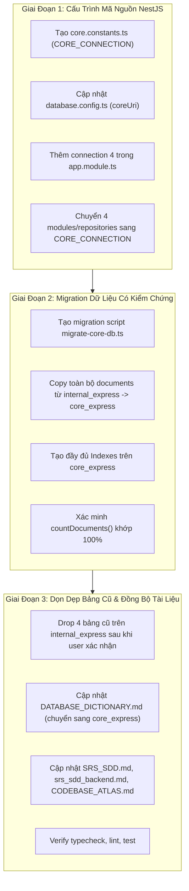

# KẾ HOẠCH KỸ THUẬT: TÁCH DATABASE `core_express`, CHUYỂN DỮ LIỆU & DROPS BẢNG CŨ (PLAN 22)

> **Mã kế hoạch:** PLAN-22  
> **Mục tiêu:** Tách 4 bảng dùng chung (`audit_logs`, `media_files`, `idempotency_keys`, `notifications`) từ database `internal_express` sang một database riêng biệt (`core_express`), cấu hình `CORE_CONNECTION` trong NestJS, thực hiện migration dữ liệu an toàn có kiểm chứng và dọn dẹp bảng cũ.  
> **Trạng thái:** COMPLETED (Đã hoàn thành và kiểm chứng thực tế)  
> **Nguyên tắc an toàn:** Không xóa bảng bên `internal_express` cho đến khi toàn bộ dữ liệu đã được sao chép sang `core_express` và xác minh số lượng trùng khớp 100%.

---

## 1. BỐI CẢNH & HIỆN TRẠNG

### 1.1. Hiện trạng
- Hiện tại NestJS đang cấu hình 3 kết nối Mongoose:
  1. Default Connection (`laundry_express`)
  2. `MOVING_CONNECTION` (`moving_express`)
  3. `INTERNAL_CONNECTION` (`internal_express`)
- Lớp Core gồm 4 modules chia sẻ:
  - `AuditModule` (`AuditLog`) $\rightarrow$ đang inject `INTERNAL_CONNECTION`
  - `MediaModule` (`MediaFile`) $\rightarrow$ đang inject `INTERNAL_CONNECTION`
  - `IdempotencyModule` (`IdempotencyKey`) $\rightarrow$ đang inject `INTERNAL_CONNECTION`
  - `NotificationsModule` (`Notification`) $\rightarrow$ đang inject `INTERNAL_CONNECTION`
- Việc để 4 bảng này trong `internal_express` làm phân hệ vận hành xưởng bị gắn chặt với các tác vụ hạ tầng dùng chung toàn hệ thống (media web, audit dùng chung, khóa chống trùng lặp...).

### 1.2. Mục tiêu sau khi tách
- Hệ thống sẽ vận hành với **4 Cơ sở Dữ liệu MongoDB Độc Lập**:
  1. `laundry_express`: Website giặt sấy, bài viết, đơn hàng, khách hàng B2B.
  2. `moving_express`: Dịch vụ chuyển nhà và báo giá vận tải.
  3. `internal_express`: ERP vận hành xưởng (chấm công, phiếu giao nhận, khoán thợ, lương).
  4. `core_express`: Hạ tầng dùng chung (kiểm toán bảo mật, file media, idempotency, thông báo).

---

## 2. KẾ HOẠCH THỰC THI CHI TIẾT (3 GIAI ĐOẠN)



---

### Giai Đoạn 1: Cấu Trúc Mã Nguồn NestJS Cho `CORE_CONNECTION`

1. **Tạo hằng số kết nối:**
   - File: `be-nestjs-thanhxuan/src/modules/core/core.constants.ts`
   ```typescript
   export const CORE_CONNECTION = 'CORE_CONNECTION';
   ```
2. **Cập nhật cấu hình cơ sở dữ liệu:**
   - File: `be-nestjs-thanhxuan/src/config/database.config.ts`
   - Bổ sung `coreUri`:
     - Ưu tiên `process.env.MONGODB_CORE_URI`.
     - Fallback: tự động trỏ sang `.../core_express`.
3. **Đăng ký kết nối trong `AppModule`:**
   - File: `be-nestjs-thanhxuan/src/app.module.ts`
   - Bổ sung `MongooseModule.forRootAsync` với `connectionName: CORE_CONNECTION`.
4. **Cập nhật 4 Modules & Repositories Core:**
   - `AuditModule` & `AuditLogRepository`: Đổi từ `INTERNAL_CONNECTION` sang `CORE_CONNECTION`.
   - `MediaModule` & `MediaFileRepository`: Đổi từ `INTERNAL_CONNECTION` sang `CORE_CONNECTION`.
   - `IdempotencyModule` & `IdempotencyInterceptor`: Đổi từ `INTERNAL_CONNECTION` sang `CORE_CONNECTION`.
   - `NotificationsModule` & `NotificationRepository`: Đổi từ `INTERNAL_CONNECTION` sang `CORE_CONNECTION`.

---

### Giai Đoạn 2: Kịch Bản Di Chuyển Dữ Liệu (Migration Script)

Tạo file script độc lập: `be-nestjs-thanhxuan/src/scripts/migrate-core-db.ts`.

Quy trình thực thi của Script:
1. Kết nối đồng thời tới `internal_express` (Source) và `core_express` (Target).
2. Lặp qua danh sách 4 collections: `audit_logs`, `media_files`, `idempotency_keys`, `notifications`.
3. Đọc dữ liệu từ Source:
   - Nếu collection có dữ liệu, thực hiện `insertMany(documents, { ordered: false })` sang Target giữ nguyên toàn bộ `_id`, kiểu dữ liệu và timestamps.
4. Đồng bộ Indexes:
   - Đọc các index hiện có từ Source collection và tạo lại trên Target collection (bao gồm cả TTL Index `expiresAt` của `idempotency_keys`).
5. Kiểm chứng tính toàn vẹn (Verification):
   - Đếm `sourceCount = await sourceCol.countDocuments()` và `targetCount = await targetCol.countDocuments()`.
   - Nếu `sourceCount !== targetCount`, script dừng ngay lập tức và ném lỗi báo động, không cho phép xóa dữ liệu gốc.

---

### Giai Đoạn 3: Dọn Dẹp Bảng Cũ & Đồng Bộ Tài Liệu

1. **Dọn dẹp bảng cũ bên `internal_express`:**
   - Sau khi script migration xác nhận 100% dữ liệu đã nằm an toàn bên `core_express` và được người dùng đồng ý, chạy lệnh drop 4 collections:
     - `internal_express.audit_logs.drop()`
     - `internal_express.media_files.drop()`
     - `internal_express.idempotency_keys.drop()`
     - `internal_express.notifications.drop()`
2. **Cập nhật tài liệu kỹ thuật:**
   - `DATABASE_DICTIONARY.md`: Đổi Database Mongoose của 4 bảng này sang `core_express`, connection `CORE_CONNECTION`.
   - `SRS_SDD.md`: Cập nhật topology từ 3 database thành 4 database độc lập.
   - `srs_sdd_backend.md`: Cập nhật mục 2.2 kiến trúc Multi-Database.
   - `CODEBASE_ATLAS.md`: Cập nhật chỉ mục hạ tầng Core.
3. **Kiểm thử & Xác minh hệ thống:**
   - Chạy `pnpm exec tsc --noEmit` tại `be-nestjs-thanhxuan` để đảm bảo không lỗi kiểu dữ liệu.
   - Chạy `pnpm test` tại backend.

---

## 3. CHECKLIST HOÀN THÀNH (DEFINITION OF DONE)

- [x] Tạo `src/modules/core/core.constants.ts` chứa `CORE_CONNECTION`.
- [x] Cập nhật `src/config/database.config.ts` hỗ trợ `MONGODB_CORE_URI` / `core_express`.
- [x] Cập nhật `src/app.module.ts` nạp Mongoose Connection thứ 4.
- [x] Chuyển `AuditModule`, `MediaModule`, `IdempotencyModule`, `NotificationsModule` sang `CORE_CONNECTION`.
- [x] Chuyển các Repositories & Interceptors tương ứng sang `CORE_CONNECTION`.
- [x] Viết script `src/scripts/migrate-core-db.ts`.
- [x] Chạy migration copy dữ liệu từ `internal_express` sang `core_express`.
- [x] Xác nhận số lượng bản ghi trùng khớp 100%.
- [x] Xóa 4 collections bên `internal_express` sau khi có xác nhận.
- [x] Cập nhật `DATABASE_DICTIONARY.md`, `SRS_SDD.md`, `srs_sdd_backend.md`, `CODEBASE_ATLAS.md`.
- [x] Typecheck pass / Build pass: `pnpm build` (`nest build`) thành công trong `be-nestjs-thanhxuan`.
- [x] Ghi nhật ký chi tiết vào `CHANGELOG.md`.
