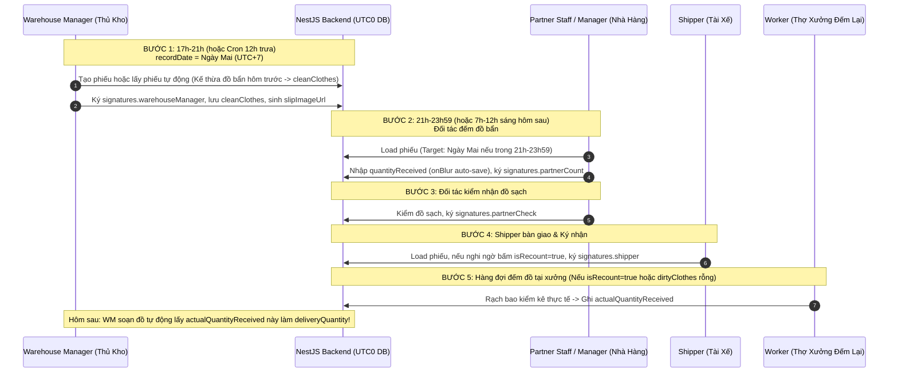

# Plan 24: Thiết Kế Lại Toàn Diện CSDL & Quy Trình Giao Nhận Vận Hành `internal_express` (Handovers, Chấm Công, Khoán Lương Thợ & Shipper)

> Status: Done | Created: 2026-10-13 | Completed: 2026-10-13  
> Phân vùng CSDL: `internal_express` (MongoDB) | Monorepo: `be-nestjs-thanhxuan` & `fe-react-thanhxuan-internal`  
> Quy chuẩn múi giờ: CSDL lưu chuẩn UTC0 (`Date`), Giao diện & Nghiệp vụ tính toán theo múi giờ Việt Nam UTC+7 (`Asia/Ho_Chi_Minh`)

---

## 1. Overview & Affected Files

### 1.1. Mục Tiêu & Bối Cảnh

Tái cấu trúc (Redesign) toàn bộ mô hình dữ liệu và nghiệp vụ cốt lõi của CSDL `internal_express`:

1. **Tinh gọn & Chuẩn hóa Quy trình Giao Nhận 5 Bước (`handover_records`)**: Tối ưu hóa cấu trúc đồ sạch/đồ bẩn theo nghiệp vụ thực tế xưởng giặt là B2B, quản lý chữ ký 4 bên trên Canvas, loại bỏ bảng `counters`, tự động kế thừa số liệu đồ bẩn hôm trước sang đồ sạch hôm sau, xử lý mốc thời gian ca đêm (21h-23h59 sang ngày hôm sau).
2. **Xử lý triệt để bài toán Ghi đè & Mất dữ liệu (Concurrency Control)**: Đảm bảo khi Thủ kho, Shipper và Nhân viên đối tác thao tác đồng thời trong khung giờ đêm 21h-23h59, không bao giờ bị ghi đè mất chữ ký hay mất số lượng của nhau.
3. **Tái cấu trúc mô hình lương Thợ xưởng (`WORKER`)**: Chuyển đổi từ khoán sản lượng chiếc cũ sang tính lương theo thời gian làm việc nhân hệ số công việc linh hoạt (`jobType`, `coefficient`: rũ đồ, giặt sấy, gấp, đếm...).
4. **Mở rộng bảng chi phí xe Shipper (`fuel_logs`)**: Bổ sung chi phí sửa xe/bảo dưỡng bên cạnh tiền đổ xăng, tinh gọn các trường ảnh đối chứng và xét duyệt.
5. **Chuẩn hóa công thức lương Shipper (`SHIPPER`)**: Triển khai công thức lương tháng tự động tích hợp ngày công / 28, trợ cấp điện thoại, xe cá nhân, chuyên cần, thưởng cuối tuần theo ca sáng/tối, tiền giao thêm, phụ cấp, trách nhiệm và giảm trừ BHXH.
6. **Đồng bộ các bảng liên quan**: Tinh giản `item_catalogs` (bỏ 3 đơn giá khoán thợ thừa), cập nhật `payroll_periods` và `payslips` phản ánh trung thực 2 bảng lương mới.

### 1.2. Phản Biện & Các Quyết Định Kiến Trúc Trọng Tâm (Architectural Critique)

| Vấn đề người dùng đặt ra                                   | Đánh giá & Rủi ro phát hiện                                                                                                                                                                                         | Giải pháp kiến trúc tối ưu (Senior Architect)                                                                                                                                                                                    |
| :--------------------------------------------------------- | :------------------------------------------------------------------------------------------------------------------------------------------------------------------------------------------------------------------ | :------------------------------------------------------------------------------------------------------------------------------------------------------------------------------------------------------------------------------- |
| **Bỏ `seq` trong `handover_records`?**                     | Nếu sinh mã phiếu bằng Timestamp/NanoID thì `seq` không bắt buộc. Nhưng kế toán và nhà hàng vẫn cần biết "Chuyến thứ mấy trong ngày".                                                                               | Giữ `tripNumber` (hoặc `seq`) nhưng sinh độc lập theo chi nhánh và ngày. Xóa bỏ bảng `counters`. Mã phiếu `recordCode` định dạng `GN-YYYYMMDD-XXXX` (kết hợp ngày và mã định danh ngẫu nhiên 4 ký tự chống trùng lặp tuyệt đối). |
| **Không lưu `partnerId`, lưu `partner` luôn?**             | **RẤT NGUY HIỂM.** Mất khóa ngoại logic sẽ làm gãy cơ chế phân quyền nhân viên nhà hàng (`PARTNER_MANAGER`, `PARTNER_STAFF`), hỏng tính năng lọc theo chuỗi đối tác, và gây bất nhất dữ liệu khi chi nhánh đổi tên. | **Mô hình Hybrid:** Bắt buộc giữ `partnerId: ObjectId` (để query, auth, index) + Snapshot `partnerName: string` & `brand: string` (để hiển thị tức thì không cần `.populate()`).                                                 |
| **Chỉ lưu tên Thủ kho / Shipper thay vì ID?**              | **RỦI RO CAO.** Trùng tên, không thể truy vấn chuyến xe của tôi (`GET /handovers/my-trips`), và hệ thống không tự động tính được lương cho Shipper dựa trên chuyến xe.                                              | **Lưu cả hai:** `shipperId: ObjectId` + `shipperName: string`; `warehouseManagerId: ObjectId` + `warehouseManagerName: string`.                                                                                                  |
| **Dùng `itemName` trong danh sách đồ thay vì `itemCode`?** | Tên đồ giặt gõ tay tự do sẽ làm gãy việc thống kê, đối soát, định mức và so khớp đơn giá tự động.                                                                                                                   | Mỗi dòng lưu cả hai: `itemCode` (định danh chuẩn cho máy) và `itemName` (tên hiển thị cho người dùng).                                                                                                                           |
| **Xóa bảng `counters`?**                                   | Không cần bảng phụ `counters` nữa. Sinh mã bằng Timestamp/NanoID kèm unique index và retry loop.                                                                                                                    | **Xóa bỏ hoàn toàn bảng `counters`.**                                                                                                                                                                                            |
| **Xóa trường `defects`?**                                  | Hợp lý. Tích hợp lỗi/hỏng trực tiếp vào mảng `notes: [{ itemCode, itemName, note }]` của phiếu.                                                                                                                     | Xóa sub-schema `DefectItem`, chuẩn hóa `notes: [{ itemCode, itemName, note }]`.                                                                                                                                                  |
| **Rủi ro mất dữ liệu khi sửa quy trình giao nhận?**        | Trong khung giờ 21h-23h59, cả Shipper, Partner và Thủ kho cùng mở phiếu và nhập dữ liệu onBlur. Nếu gọi `findByIdAndUpdate(id, body)` thì **sẽ ghi đè làm mất chữ ký hoặc số lượng của nhau!**                      | **Field-Level Atomic Updates (`$set` path con) + Optimistic Locking (`version`)**. Mỗi bước gọi endpoint riêng biệt, chỉ update đúng trường được phép.                                                                           |
| **Hiệu năng ảnh Canvas & `slipImageUrl`?**                 | Nếu mỗi lần onBlur hoặc ký mà client chụp canvas rồi upload Cloudinary thì sẽ nghẽn mạng, chậm lag (1-3s/lần) và sinh hàng trăm ảnh rác.                                                                            | **Client-side Vector Canvas:** Màn hình tự vẽ canvas 2D trực tiếp từ state JSON trong 10ms. Chỉ upload `slipImageUrl` lên Cloudinary dạng background khi chốt bước hoặc khi phiếu hoàn tất.                                      |

### 1.3. Bảng File Ảnh Hưởng (Affected Files)

| Path                                                                                      | Action | Lý do                                                                                                            |
| :---------------------------------------------------------------------------------------- | :----: | :--------------------------------------------------------------------------------------------------------------- |
| `be-nestjs-thanhxuan/src/modules/internal/handovers/schemas/handover-record.schema.ts`    |  Edit  | Tái cấu trúc `cleanClothes`, `dirtyClothes`, `recount`, `signatures`, `notes`, bỏ `defects`, bỏ `counters`.      |
| `be-nestjs-thanhxuan/src/modules/internal/handovers/schemas/counter.schema.ts`            | Delete | Xóa bỏ bảng `counters` theo yêu cầu.                                                                             |
| `be-nestjs-thanhxuan/src/modules/internal/handovers/handovers.service.ts`                 |  Edit  | Cập nhật logic sinh mã phiếu, cron auto-create lúc 12h, kế thừa số lượng hôm trước, các API update path con.     |
| `be-nestjs-thanhxuan/src/modules/internal/handovers/handovers.controller.ts`              |  Edit  | Bổ sung các endpoint cập nhật nguyên tử: `/clean-clothes`, `/dirty-clothes`, `/signatures/*`, `/recount`.        |
| `be-nestjs-thanhxuan/src/modules/internal/fuel/schemas/fuel-log.schema.ts`                |  Edit  | Đổi thành `VehicleExpenseLog` (hỗ trợ cả xăng và sửa xe) với các trường tinh gọn.                                |
| `be-nestjs-thanhxuan/src/modules/internal/attendance/schemas/attendance-record.schema.ts` |  Edit  | Hỗ trợ tính số phút làm việc thực tế, liên kết ca làm việc với nhật ký công việc thợ.                            |
| `be-nestjs-thanhxuan/src/modules/internal/piecework/schemas/piecework-log.schema.ts`      |  Edit  | Đổi mô hình: lưu nhật ký công việc thợ theo thời gian x hệ số công việc (`worker_task_logs`).                    |
| `be-nestjs-thanhxuan/src/modules/internal/payroll/schemas/pay-settings.schema.ts`         |  Edit  | Lưu bảng cấu hình hệ số công việc xưởng (`jobCoefficients`) và tham số lương shipper.                            |
| `be-nestjs-thanhxuan/src/modules/internal/partners/schemas/item-catalog.schema.ts`        |  Edit  | Xóa bỏ các đơn giá khoán thợ thừa (`foldingRateWorker`, `ironingRateWorker`, `packingRateWorker`).               |
| `be-nestjs-thanhxuan/src/modules/internal/payroll/schemas/payslip.schema.ts`              |  Edit  | Thiết kế lại chi tiết phiếu lương cho 2 đối tượng: Thợ xưởng (giờ x hệ số) và Shipper (công thức chuyên biệt).   |
| `be-nestjs-thanhxuan/src/modules/internal/auth/schemas/staff-account.schema.ts`           |  Edit  | Bổ sung các trường cấu hình cá nhân cho Shipper (`baseSalary`, `hasPersonalVehicle`, `insuranceDeduction`).      |
| `fe-react-thanhxuan-internal/src/features/handovers/...`                                  |  Edit  | Cập nhật toàn bộ UI giao nhận 5 bước, canvas render vector tức thì, auto-save onBlur, lọc theo ngày/khoảng ngày. |
| `.agents/docs/DATABASE_DICTIONARY.md`                                                     |  Edit  | Cập nhật định nghĩa 9 bảng/schemas liên quan.                                                                    |
| `.agents/docs/srs_sdd/srs_sdd_backend.md`                                                 |  Edit  | Cập nhật luồng nghiệp vụ Backend và API Contracts.                                                               |
| `.agents/docs/srs_sdd/srs_sdd_fe_internal.md`                                             |  Edit  | Cập nhật luồng giao diện React Internal.                                                                         |

---

## 2. Đặc Tả Quy Trình Vận Hành Giao Nhận 5 Bước (Workflow Specifications)



### Bước 1: Thủ kho (`warehouse-manager`) Soạn đồ (17h - 21h) & Cron Tự động 12h Trưa

1. **Khung giờ & Tạo phiếu**:
   - Thường diễn ra từ **17:00 đến 21:00** hàng ngày.
   - **Tự động hóa**: Cron Job NestJS chạy lúc **12:00 trưa hàng ngày (giờ VN)** quét danh sách `partners`:
     - Nếu `deliveryFrequency === 'DAILY'`: Tự động tạo phiếu cho ngày mai.
     - Nếu `deliveryFrequency === 'ALTERNATE_DAYS'`: Kiểm tra ngày giao gần nhất, nếu cách 1 ngày thì tạo phiếu cho ngày mai.
2. **Quy tắc ngày phiếu (`recordDate`)**:
   - Mặc định là **Ngày Mai** (theo giờ Việt Nam UTC+7).
   - Thủ kho có thể đổi sang ngày hôm nay hoặc ngày trong tương lai, **chặn không cho chọn ngày đã qua**.
3. **Kế thừa số lượng tự động (Auto-fill từ hôm trước)**:
   - Hệ thống tự động truy vấn phiếu giao nhận gần nhất của đối tác đó.
   - Lấy số lượng `actualQuantityReceived` (nếu chưa có thì lấy `quantityReceived`) gán làm `deliveryQuantity` gợi ý sẵn cho `cleanClothes.items`. Thủ kho chỉ việc đối chiếu thực tế và chỉnh sửa nếu có lệch, giúp giảm 80% thời gian gõ tay!
4. **Chữ ký & Canvas Slip Image**:
   - Thủ kho ký tên vào ô `signatures.warehouseManager`.
   - Giao diện hiển thị Canvas kết hợp dữ liệu bảng đồ sạch + ghi chú (`notes: [{ itemName, note }]`) + chữ ký thủ kho.
   - Bấm "Lưu / Xuất phiếu": Hệ thống xuất ảnh từ Canvas, upload lên Cloudinary và lưu `slipImageUrl`.
5. **Giao diện quản lý**:
   - Thủ kho có màn hình xem ảnh phiếu các ngày với bộ lọc: Thương hiệu (`brand`), Đối tác (`partnerId`), Khoảng ngày (`fromDate` - `toDate`).

### Bước 2: Nhân viên/Quản lý Nhà hàng (`partner staff/manager`) Đếm đồ bẩn

1. **Khung giờ thao tác**:
   - Thường từ **21:00 đến 23:59** cùng ngày thủ kho soạn đồ, hoặc một số đối tác đếm vào **07:00 đến 12:00 sáng hôm sau**.
2. **Quy tắc xác định ngày phiếu (`recordDate`)**:
   - **Đồng nhất mốc ngày:** Dù giao tối hay sáng hôm sau thì `recordDate` của phiếu luôn tính là **buổi sáng ngày hôm sau**.
   - Do đó, nếu nhà hàng mở app trong khung giờ **21:00 - 23:59**, hệ thống **tự động load phiếu có `recordDate = Ngày hiện tại + 1`**.
3. **Nhập liệu & Lưu tự động (Auto-save onBlur)**:
   - Nhà hàng nhập số lượng đồ bẩn gom giao xưởng vào trường `dirtyClothes.quantityReceived`.
   - Cơ chế lưu: Bắn API cập nhật ngay sau mỗi lần con trỏ rời ô nhập (`onBlur`), không cần nút bấm Lưu cồng kềnh.
   - Ký tên vào `signatures.partnerCount`.
   - Canvas trên màn hình lập tức cập nhật vector tức thì, hiển thị đầy đủ đồ sạch và đồ bẩn vừa nhập.

### Bước 3: Nhân viên/Quản lý Nhà hàng Kiểm đồ sạch nhận được

1. **Kiểm nhận**:
   - Mở phiếu (hệ thống tự chọn phiếu `Ngày hiện tại + 1` nếu đang trong khung giờ 21:00 - 23:59).
   - Kiểm tra số lượng đồ sạch nhận được so với phiếu thủ kho đã soạn.
2. **Ký xác nhận**:
   - Ký tên vào `signatures.partnerCheck`.
   - Hệ thống lưu nguyên tử vào trường `signatures.partnerCheck` của phiếu đúng ngày, canvas cập nhật hiển thị chữ ký người nhận.

### Bước 4: Shipper Bàn giao & Ký nhận

1. **Thao tác**:
   - Shipper mở app, hệ thống tự động chọn phiếu ngày `Ngày hiện tại + 1` nếu đang trong 21:00 - 23:59.
2. **Kích hoạt Đếm Lại (`isRecount`)**:
   - Nếu shipper nghi ngờ số lượng hoặc nhà hàng vội không đếm đồ bẩn mà chỉ giao bao, shipper tích chọn **"Yêu cầu đếm lại tại xưởng"** $\rightarrow$ Hệ thống đổi cờ `isRecount = true`, `recount.status = 'PENDING'`.
3. **Ký xác nhận**:
   - Shipper ký tên vào `signatures.shipper`.
   - Cập nhật trạng thái phiếu sang `IN_TRANSIT` (nếu đang đi) hoặc `DELIVERED`. Canvas cập nhật hiển thị chữ ký tài xế.

### Bước 5: Hàng Đợi Đếm Đồ Tại Xưởng (Recount Station Queue)

1. **Điều kiện lọt vào Hàng Đợi**:
   - Phiếu có `isRecount === true`, **HOẶC**
   - Trường `dirtyClothes` chưa có số lượng (`quantityReceived` trống) nhưng đã có chữ ký của `shipper`.
2. **Xử lý tại xưởng**:
   - Thợ xưởng (`worker`) hoặc Thủ kho (`warehouse-manager`) mở màn hình "Trạm Đếm Lại".
   - Rạch bao đếm kiểm kê thực tế từng chiếc đồ, nhập số lượng vào trường `dirtyClothes.actualQuantityReceived`.
   - Cập nhật `recount.status = 'DONE'`.
   - Số liệu `actualQuantityReceived` này được chốt làm căn cứ đối soát giặt và sẽ được bước 1 của ngày tiếp theo tự động kế thừa làm `deliveryQuantity`!

---

## 3. Kiến Trúc Dữ Liệu & Giải Pháp Chống Ghi Đè (Concurrency Architecture)

### 3.1. Rủi Ro Ghi Đè & Mất Dữ Liệu (Race Condition Analysis)

Trong khung giờ cao điểm 21h00 - 23h59:

- Partner đang gõ số lượng đồ bẩn onBlur.
- Shipper cùng lúc đó ký tên và tích đếm lại.
- Thủ kho có thể đang mở màn hình xem phiếu.
  $\rightarrow$ **Nếu Backend dùng lệnh `findByIdAndUpdate(id, req.body)` thông thường, request của người này sẽ ghi đè toàn bộ document, xóa mất chữ ký hoặc số liệu của người kia!**

### 3.2. Giải Pháp Triệt Để: Field-Level Specific Path Updates & Optimistic Locking

1. **Tuyệt đối không có API "Update toàn bộ phiếu"**:
   Mỗi tác nhân chỉ được gọi API cập nhật chuyên biệt bằng toán tử `$set` vào đúng field-path của mình:
   - `PATCH /handovers/:id/clean-clothes`: Thủ kho sửa đồ sạch và ghi chú.
   - `PATCH /handovers/:id/dirty-item-onblur`: Partner sửa 1 dòng `quantityReceived` (chỉ cập nhật đúng phần tử trong mảng bằng `dirtyClothes.items.$[elem].quantityReceived`).
   - `PATCH /handovers/:id/partner-count-signature`: Ký chữ ký đếm đồ bẩn.
   - `PATCH /handovers/:id/partner-check-signature`: Ký chữ ký nhận đồ sạch.
   - `PATCH /handovers/:id/shipper-confirm`: Shipper ký và bật/tắt `isRecount`.
   - `PATCH /handovers/:id/recount-actual`: Thợ xưởng cập nhật `actualQuantityReceived`.
2. **Khóa Lạc Quan (Optimistic Concurrency Control - OCC)**:
   - Document có trường `version: number`.
   - Mọi thao tác ghi tăng `version` lên 1 (`$inc: { version: 1 }`).

### 3.3. Xử Lý Múi Giờ: UTC0 trong DB vs UTC+7 trong Nghiệp Vụ

- **Trong CSDL MongoDB**: Mọi trường kiểu `Date` (`createdAt`, `updatedAt`, `signedAt`, `deliveredAt`) được lưu theo chuẩn quốc tế **UTC0**.
- **Chuỗi ngày `recordDate`**: Lưu chuỗi định dạng `YYYY-MM-DD` theo múi giờ Việt Nam (`Asia/Ho_Chi_Minh`, UTC+7).
- **Helper xác định ngày phiếu (`resolveTargetRecordDate`)**:
  ```typescript
  // Logic chuẩn hóa múi giờ Việt Nam (UTC+7)
  export function getTargetRecordDateVN(now: Date = new Date()): string {
    const vnTime = new Date(
      now.toLocaleString("en-US", { timeZone: "Asia/Ho_Chi_Minh" }),
    );
    const hours = vnTime.getHours();
    // Nếu trong khung giờ đêm 21h00 - 23h59, ngày giao nhận được tính là ngày mai (+1 ngày)
    if (hours >= 21) {
      vnTime.setDate(vnTime.getDate() + 1);
    }
    const year = vnTime.getFullYear();
    const month = String(vnTime.getMonth() + 1).padStart(2, "0");
    const day = String(vnTime.getDate()).padStart(2, "0");
    return `${year}-${month}-${day}`;
  }
  ```

---

## 4. Đặc Tả Chi Tiết 9 Bảng CSDL Cải Tiến (`internal_express`)

### 4.1. Bảng `handover_records` (Phiếu Giao Nhận Tinh Gọn)

- **Mã nguồn**: [`handover-record.schema.ts`](file:///d:/PROJECT/Website_Thanh_Xuan_Company/be-nestjs-thanhxuan/src/modules/internal/handovers/schemas/handover-record.schema.ts)
- **Mã phiếu (`recordCode`)**: Định dạng `GN-YYYYMMDD-XXXX` (ví dụ `GN-20261014-7A9B`). Sinh tự động bằng hàm ngẫu nhiên + Unique Index + retry loop.
- **Xóa bỏ hoàn toàn**: Bảng `counters`, sub-schema `defects`, các trường `seq` phụ thuộc counter.

```typescript
// Sub-schema Dòng Đồ Sạch
class CleanItemLine {
  itemCode: string; // Định danh chuẩn máy tính (ví dụ: '4PS_GRAY_TOWEL')
  itemName: string; // Tên hiển thị người dùng (ví dụ: 'Khăn ăn xám lau bàn')
  deliveryQuantity: number; // Số lượng giao sạch lần này
  undeliveredQuantity: number; // Số lượng còn thiếu/nợ lại
  quantityReturned: number; // Số lượng giao bù/trả nợ lần trước
}

// Sub-schema Dòng Đồ Bẩn
class DirtyItemLine {
  itemCode: string;
  itemName: string;
  quantityReceived: number; // Số lượng đồ bẩn nhà hàng đếm giao
  actualQuantityReceived: number; // Số lượng xưởng rạch bao đếm thực tế
}

// Sub-schema Ghi Chú Chi Tiết Theo chiếc
class HandoverItemNote {
  itemCode?: string;
  itemName: string;
  note: string; // "Rách 2 cái", "Ố màu nặng"...
}

// Sub-schema Chữ Ký
class SignatureData {
  name: string;
  signatureUrl: string; // Base64 hoặc link ảnh chữ ký Canvas
  signedAt: Date;
}
```

_Root Schema:_

- `recordCode: string` (Unique, uppercase)
- `recordDate: string` (`YYYY-MM-DD` theo giờ VN)
- `partnerId: ObjectId` (Ref: `Partner`, Bắt buộc)
- `partnerName: string` (Snapshot tên chi nhánh đối tác)
- `brand: string` (Snapshot mã thương hiệu: `PIZZA_4PS`, `HAIDILAO`...)
- `warehouseManagerId?: ObjectId` & `warehouseManagerName?: string`
- `shipperId?: ObjectId` & `shipperName?: string`
- `deliveryShift: 'MORNING' | 'EVENING'` (Ca sáng/tối phục vụ tính bonus shipper)
- `cleanClothes: { items: CleanItemLine[] }`
- `dirtyClothes: { items: DirtyItemLine[] }`
- `notes: HandoverItemNote[]`
- `isRecount: boolean` (Mặc định `false`)
- `recount: { isRecount: boolean, status: 'NONE' | 'PENDING' | 'DONE', note?: string, recountedBy?: ObjectId, recountedAt?: Date }`
- `signatures: { warehouseManager?: SignatureData, shipper?: SignatureData, partnerCount?: SignatureData, partnerCheck?: SignatureData }`
- `status: 'SCHEDULED' | 'IN_TRANSIT' | 'DELIVERED' | 'COMPLETED' | 'CANCELLED'`
- `slipImageUrl?: string` (Link ảnh phiếu xuất từ Canvas trên Cloudinary)
- `version: number` (Optimistic locking)

---

### 4.2. Bảng `worker_task_logs` (Thay Thế Cho `piecework_logs`)

- **Mục đích**: Chấm công lương thợ xưởng theo **Thời gian làm việc $\times$ Hệ số loại công việc**.
- Các loại công việc (`WorkshopJobType`):
  - `SHAKE` (Rũ đồ)
  - `WASH_DRY` (Giặt và sấy)
  - `FOLD` (Gấp đồ)
  - `COUNT` (Đếm đồ / Phân loại)
  - `IRON` (Là / Ủi)
  - `PACK` (Đóng gói)
  - `OTHER` (Khác)
- **Các trường**:
  - `workerId: ObjectId` (Ref: `StaffAccount`)
  - `workerName: string` (Snapshot)
  - `attendanceId: ObjectId` (Ref: `AttendanceRecord`, ca làm việc hôm đó)
  - `dateKey: string` (`YYYY-MM-DD`)
  - `jobType: WorkshopJobType`
  - `jobName: string`
  - `minutesWorked: number` (Số phút làm công việc này)
  - `coefficient: number` (Hệ số công việc snapshot, ví dụ 1.25)
  - `hourlyBaseRate: number` (Lương giờ cơ bản snapshot)
  - `totalEarnings: number` = `(minutesWorked / 60) * hourlyBaseRate * coefficient`
  - `status: 'PENDING' | 'CONFIRMED' | 'LOCKED'`

---

### 4.3. Bảng `pay_settings` (Cấu Hình Hệ Số Toàn Xưởng)

- `jobCoefficients: [{ jobType: string, jobName: string, coefficient: number }]` (Quản lý tự cấu hình linh hoạt)
- `defaultHourlyRate: number` (Mức lương giờ tiêu chuẩn)
- `shipperPhoneAllowance: number` (120,000 VND)
- `shipperPersonalVehicleBonus: number` (700,000 VND)
- `shipperAttendanceDaily: number` (7,000 VND / ngày công)
- `shipperWeekendShiftBonus: number` (60,000 VND / ca)
- `shipperResponsibilityAllowance: number` (400,000 VND)
- `standardWorkingDays: number` (28 ngày)

---

### 4.4. Bảng `fuel_logs` $\rightarrow$ Nâng cấp thành `vehicle_expense_logs`

- Hỗ trợ cả chi phí xăng và tiền sửa chữa, bảo dưỡng xe của Shipper.
- `shipperId: ObjectId` (Ref: `StaffAccount`) & `shipperName: string`
- `expenseType: 'FUEL' | 'REPAIR'`
- `dateKey: string` (`YYYY-MM-DD`)
- `amountMoney: number` (Số tiền VNĐ)
- `receiptPhotoUrl: string` (Ảnh hóa đơn xăng / biên lai sửa xe)
- `odometerOrMotorcyclePhotoUrl: string` (Ảnh đồng hồ công-tơ-mét hoặc ảnh xe máy)
- `note?: string` (Nội dung sửa xe, biển số...)
- `status: 'PENDING' | 'APPROVED' | 'REJECTED'`
- `approvedBy?: ObjectId`
- `rejectedReason?: string`

---

### 4.5. Bảng `item_catalogs`

- Xóa bỏ hoàn toàn 3 trường đơn giá khoán thợ thừa: `foldingRateWorker`, `ironingRateWorker`, `packingRateWorker`.
- Chỉ giữ lại thông tin danh mục chuẩn: `brand`, `itemCode`, `name`, `unit`, `customerPrice`, `sortOrder`, `imageUrl`, `isActive`.

---

### 4.6. Bảng `staff_accounts`

- Bổ sung cấu hình tính lương cho Shipper:
  - `baseSalary: number` (Lương cơ bản)
  - `hasPersonalVehicle: boolean` (Có đăng ký đi xe máy cá nhân không)
  - `insuranceDeduction: number` (Mức giảm trừ BHXH hàng tháng)

---

### 4.7. Bảng `payslips` & Công Thức Tính Lương Shipper

- **Công thức lương tháng Shipper**:
  $$\text{Lương Tháng} = \text{Lương Công Ngày} + \text{Chuyên Cần} + \text{Bonus Cuối Tuần} + \text{Giao Thêm} + \text{Phụ Cấp} + \text{Trách Nhiệm} + \text{Hoàn Chi Phí Xe} - \text{BHXH}$$
  _Trong đó:_
  - $\text{Lương Công Ngày} = \frac{\text{baseSalary} + 120.000 + (700.000 \text{ nếu xe cá nhân})}{28} \times \text{Số Ngày Công}$
  - $\text{Chuyên Cần} = 7.000 \times \text{Số Ngày Công}$
  - $\text{Bonus Cuối Tuần}$: Số ca thoả mãn $\times 60.000$:
    - Thứ Bảy, Chủ Nhật: Ca tối (`deliveryShift === 'EVENING'`)
    - Chủ Nhật, Thứ Hai: Ca sáng (`deliveryShift === 'MORNING'`)
  - $\text{Trách Nhiệm}$: 400.000 VND
  - $\text{Hoàn Chi Phí Xe}$: Tổng các khoản `vehicle_expense_logs` trạng thái `APPROVED` trong tháng.

---

## 5. Implementation Tasks (Checklist)

### Giai đoạn 1: Schema & Data Model Backend (`be-nestjs-thanhxuan`)

- [x] T1: Xóa file `counter.schema.ts`, dọn module imports liên quan trong HandoversModule.
- [x] T2: Cập nhật `handover-record.schema.ts` theo data contract mới (`cleanClothes`, `dirtyClothes`, `recount`, `signatures`, `notes: [{ itemCode, itemName, note }]`, bỏ `defects`, bỏ `counters`, thêm `deliveryShift`).
- [x] T3: Nâng cấp `fuel-log.schema.ts` thành `vehicle_expense_logs` (thêm loại chi phí `FUEL`/`REPAIR`, tiền `amountMoney`, ảnh đối chứng).
- [x] T4: Thiết kế lại `pay-settings.schema.ts` lưu mảng `jobCoefficients` và các tham số lương Shipper.
- [x] T5: Chuyển đổi `piecework-log.schema.ts` thành mô hình ghi nhận theo giờ $\times$ hệ số công việc (`worker_task_logs`).
- [x] T6: Tinh gọn `item-catalog.schema.ts` (xóa 3 trường đơn giá khoán thợ cũ).
- [x] T7: Cập nhật `staff-account.schema.ts` bổ sung các trường cấu hình cá nhân Shipper (`baseSalary`, `hasPersonalVehicle`, `insuranceDeduction`).
- [x] T8: Cập nhật `payslip.schema.ts` phản ánh đầy đủ công thức lương Shipper và lương Thợ xưởng mới.

### Giai đoạn 2: Service Logic, Cron Job & API Contracts (`be-nestjs-thanhxuan`)

- [x] T9: Viết lại `HandoversService.createRecord()` sinh mã `GN-YYYYMMDD-XXXX` không dùng `counters`, xử lý snapshot `partnerName`, `shipperName`.
- [x] T10: Thêm tính năng tự động kế thừa số lượng: Truy vấn `actualQuantityReceived` (hoặc `quantityReceived`) ngày gần nhất của đối tác để điền sẵn vào `cleanClothes.items`.
- [x] T11: Cài đặt Cron Job NestJS chạy 12:00 trưa hàng ngày tự động tạo phiếu cho các đối tác có lịch giao ngày mai theo `deliveryFrequency`.
- [x] T12: Xây dựng các API cập nhật nguyên tử chống ghi đè: `/clean-clothes`, `/dirty-item-onblur`, `/partner-count-signature`, `/partner-check-signature`, `/shipper-confirm`, `/recount-actual`.
- [x] T13: Cập nhật `VehicleExpenseService` xử lý duyệt/từ chối tiền xăng và tiền sửa xe.
- [x] T14: Cập nhật `WorkerTaskService` tính tiền công theo giờ và hệ số công việc.
- [x] T15: Viết thuật toán tính lương tự động trong `PayrollService` theo đúng công thức Shipper (đếm ca T7, CN tối và CN, T2 sáng) và lương thợ.

### Giai đoạn 3: Đồng Bộ Giao Diện Frontend Internal (`fe-react-thanhxuan-internal`)

- [x] T16: Cập nhật màn hình Soạn đồ Thủ kho: Auto-fill số lượng hôm trước, vẽ canvas vector trực tiếp, ký tên xuất phiếu, upload `slipImageUrl` background.
- [x] T17: Xây dựng màn hình xem ảnh phiếu kèm bộ lọc thương hiệu, đối tác, khoảng ngày.
- [x] T18: Cập nhật màn hình Đối tác đếm đồ bẩn: Tự động load phiếu ngày + 1 nếu vào lúc 21h-23h59, cơ chế auto-save onBlur từng ô nhập, ký `partnerCount`.
- [x] T19: Cập nhật màn hình Đối tác kiểm đồ nhận: Ký `partnerCheck`, cập nhật hiển thị canvas.
- [x] T20: Cập nhật màn hình Shipper: Tự load phiếu ngày + 1 nếu 21h-23h59, checkbox đếm lại (`isRecount`), ký `shipper`.
- [x] T21: Xây dựng màn hình Hàng đợi Trạm Đếm Lại cho thợ xưởng (lọc phiếu có `isRecount === true` hoặc đồ bẩn trống số mà shipper đã ký).
- [x] T22: Cập nhật màn hình Chi phí xe Shipper (Xăng + Sửa xe) và màn hình Bảng lương Shipper / Thợ xưởng.

### Giai đoạn 4: Tài Liệu Hóa & Kiểm Chứng Hệ Thống

- [x] T23: Cập nhật toàn bộ định nghĩa 9 bảng trong `.agents/docs/DATABASE_DICTIONARY.md`.
- [x] T24: Cập nhật `.agents/docs/srs_sdd/srs_sdd_backend.md` và `.agents/docs/srs_sdd/srs_sdd_fe_internal.md`.
- [x] T25: Ghi 1 dòng Document History vào `.agents/docs/SRS_SDD.md` và bài luận chi tiết vào `.agents/docs/CHANGELOG.md`.

---

## 6. Verification & Testing

### 6.1. Lệnh Kiểm Tra Cú Pháp & Build

```bash
# Backend
cd d:\PROJECT\Website_Thanh_Xuan_Company\be-nestjs-thanhxuan
pnpm exec tsc --noEmit
pnpm lint
pnpm test
pnpm build

# Frontend Internal
cd d:\PROJECT\Website_Thanh_Xuan_Company\fe-react-thanhxuan-internal
pnpm exec tsc --noEmit
pnpm lint
pnpm build
```

### 6.2. Kịch Bản Kiểm Thử Trọng Yếu

1. **Kiểm tra Concurrency (Chống ghi đè)**: Giả lập 2 client gửi đồng thời lúc 21:30: Client A nhập đồ bẩn onBlur, Client B gửi chữ ký Shipper $\rightarrow$ Document trong MongoDB cập nhật đầy đủ cả 2 trường, không trường nào bị mất.
2. **Kiểm tra Mốc Giờ Ca Đêm (21h - 23h59)**: Chạy lúc 21:15 ngày 13/10 $\rightarrow$ Cả Partner và Shipper mở app đều tự động tải phiếu ngày 14/10 (`recordDate = 2026-10-14`).
3. **Kế thừa số lượng đồ bẩn**: Phiếu ngày 13/10 có `actualQuantityReceived` = 120 cái Khăn ăn xám. Khi thủ kho mở soạn phiếu ngày 14/10 $\rightarrow$ `deliveryQuantity` tự động điền sẵn 120.
4. **Kiểm tra Công thức Lương Shipper**: Kiểm thử ca tối Thứ 7/CN và ca sáng CN/T2 $\rightarrow$ Mỗi ca được cộng chính xác 60.000đ bonus vào phiếu lương.

---

## 7. Risks & Rollback

| Rủi Ro                                                 |    Mức Độ    | Phương Án Phòng Ngừa & Giảm Thiểu                                                                                        |
| :----------------------------------------------------- | :----------: | :----------------------------------------------------------------------------------------------------------------------- |
| **Ghi đè dữ liệu đồng thời khi nhiều người sửa phiếu** | Nghiêm trọng | Bắt buộc dùng Field-level Specific `$set` API, cấm cập nhật toàn bộ document.                                            |
| **Mất kết nối mạng lúc onBlur lưu đồ bẩn**             |  Trung bình  | Frontend cài đặt retry queue cục bộ và hiển thị toast trạng thái "Đã lưu" / "Đang lưu...".                               |
| **Lệch múi giờ giữa máy chủ VPS và Việt Nam**          |  Trung bình  | Toàn bộ logic lấy chuỗi ngày `recordDate` bắt buộc qua helper `Asia/Ho_Chi_Minh`, không dùng `new Date().toISOString()`. |

---

## Changelog

- 2026-10-13: Khởi tạo Plan 24.
- 2026-10-13: Cập nhật toàn diện Plan 24: Tích hợp chuẩn UTC0 / UTC+7, chi tiết quy trình giao nhận 5 bước, kiến trúc chống ghi đè dữ liệu (Field-Level Updates), kế thừa số lượng tự động và Canvas rendering vector.
- 2026-10-13: Hoàn thành 100% triển khai mã nguồn Backend & Frontend Internal, verify build pass và đồng bộ tài liệu hệ thống.

---

## Execution Log

- **Ngày hoàn tất:** 2026-10-13
- **Thực thi:**
  - Hoàn tất T1 -> T8: Tái cấu trúc Mongoose schemas, xóa collection `counters`, tinh gọn cấu trúc `cleanClothes`/`dirtyClothes`/`notes`, mô hình lương giờ x hệ số và chi phí xe.
  - Hoàn tất T9 -> T15: Service logic, Cron Job 12:00 trưa, API cập nhật nguyên tử field-level ngăn chặn race condition 21h-23h59, thuật toán lương Shipper (chia 28 ngày) & lương Thợ xưởng.
  - Hoàn tất T16 -> T22: Frontend Internal: Modal soạn đồ chặn ngày đã qua, Thư viện ảnh phiếu giao nhận (`WarehouseSlipGalleryTabComponent`), Cổng đối tác tự động chuyển ngày & auto-save onblur, Shipper nhận bàn giao, Trạm rạch bao đếm lại xưởng, Form chi phí xe (Xăng & Sửa xe), Tra cứu phiếu lương chi tiết.
  - Hoàn tất T23 -> T25: Đồng bộ Database Dictionary (33 collections), Codebase Atlas, SRS/SDD phân hệ Backend & Frontend Internal, Master SRS/SDD và bài luận chi tiết CHANGELOG.
- **Biên dịch & Kiểm chứng:** Backend NestJS `tsc` & `nest build` PASS 100%; Frontend React Internal `tsc` & `vite build` PASS 100%. Không có bất kỳ lỗi biên dịch nào.
