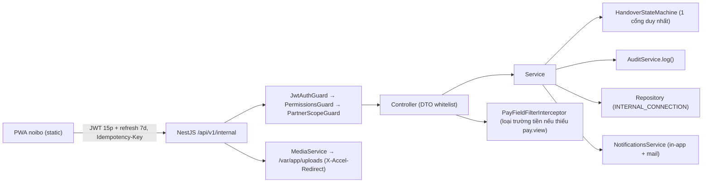

# Plan 3: Nâng cấp Hệ thống Vận hành Nội bộ lên Đặc tả v2 (RBAC 8 vai trò, Giao nhận State Machine, Lương, Báo cáo, PWA)

> **Phạm vi:** `be-nestjs-thanhxuan` (module `internal`, `core`), `fe-react-thanhxuan-internal`, cấu hình deploy.
> **Quan hệ với plan cũ:** Plan 3 **thay thế** toàn bộ phần nội bộ còn lại của `plan2.md` (Phase 3 FE nội bộ hiện tại được **làm lại/mở rộng**, Phase 4–5 của plan2 được **đánh số lại** thành Phase 7–8 của plan này). Phase 1–2 của plan2 (3 kết nối Mongoose, cấu trúc core/laundry/moving/internal, `moving/*`) giữ nguyên làm nền.
> **Nguyên tắc cứng:** Không đổi schema/endpoint/hành vi `laundry`. Manager không thấy bất kỳ dữ liệu tiền lương/công/xăng.

---

## 1. Overview & Affected Files

### 1.1 Mục tiêu

Chuyển từ mô hình v1 (`staffs` đăng nhập bằng SĐT, 4 vai trò, phiếu giao nhận 4 trạng thái) sang v2:

1. Tài khoản đầy đủ: đăng ký + OTP email + phê duyệt + RBAC 8 vai trò theo **permission code**.
2. Phiếu giao nhận thành **máy trạng thái 7 trạng thái** (`SCHEDULED → RESTAURANT_COUNTED → CLEAN_READY → IN_TRANSIT → DELIVERED → COMPLETED`, nhánh `DISPUTED`).
3. Module mới: chấm công kèm ảnh, sản lượng gắn ca, xăng, bảng lương, báo cáo + xuất XLSX/PDF, thông báo, audit log, lưu ảnh nội bộ.
4. FE nội bộ thành **PWA offline-first** (IndexedDB queue + Idempotency-Key), điều hướng theo 8 vai trò.

### 1.2 Phân tích khoảng cách (Hiện trạng → v2)

| Hạng mục                         | Hiện trạng (đã xác minh trong repo)                                                                                       | Yêu cầu v2                                                                                                               | Hành động                                                                            |
| -------------------------------- | ------------------------------------------------------------------------------------------------------------------------- | ------------------------------------------------------------------------------------------------------------------------ | ------------------------------------------------------------------------------------ |
| Auth                             | `internal/staff-auth` – login SĐT, `StaffJwtGuard`, `StaffRolesGuard`, bcrypt, aud `internal`, 4 role                     | username/email, OTP, approval, refresh token, 8 role, lockout                                                            | **Viết lại** thành `auth/` + `accounts/`; giữ ý tưởng aud `internal`                 |
| RBAC                             | `@StaffRoles()` hardcode role trong controller                                                                            | `@Permissions('x.y')` + `permissions.map.ts`, scope guard, lọc trường tiền                                               | **Thay thế**                                                                         |
| Partners/Catalog                 | Có CRUD + `schedule`                                                                                                      | thêm `schedule_anchor_date`, `default_shipper_id`, lọc trường `folding_rate_worker`                                      | **Mở rộng**                                                                          |
| Handover                         | 4 trạng thái, schema `cleanDelivery/dirtyPickup`, chưa có audit/version                                                   | State machine 7 trạng thái, `restaurant_count`, `receipt_check`, `edit_marks`, `adjustments`, `version`, `recount_tasks` | **Viết lại schema + service**, tái dùng `handover-state.ts` làm gốc                  |
| Piecework                        | `PieceworkDailyLog.tasks[]`, không gắn ca                                                                                 | Gắn `attendanceId`, `rate_snapshot`, `DRAFT/CONFIRMED`                                                                   | **Viết lại**                                                                         |
| Attendance                       | Check-in/out không ảnh, không GPS                                                                                         | Ảnh camera + GPS, cron quên check-out, duyệt MG/AD                                                                       | **Mở rộng**                                                                          |
| Upload                           | `core/upload` đẩy lên **Cloudinary**                                                                                      | Lưu `/var/app/uploads`, `media_files`, phục vụ qua API + `X-Accel-Redirect`, magic bytes                                 | **Thêm `media` module mới** (Cloudinary giữ cho laundry)                             |
| Audit / Notifications / Schedule | **Chưa có**                                                                                                               | `AuditService`, `notifications`, cron                                                                                    | **Tạo mới** trong `core/`                                                            |
| Fuel / Payroll / Reports         | **Chưa có**                                                                                                               | Xem mục 5–6 spec                                                                                                         | **Tạo mới**                                                                          |
| Mail                             | `nodemailer`, `resend` đã cài                                                                                             | OTP + thông báo                                                                                                          | Tái dùng                                                                             |
| Thư viện                         | Đã có: `@nestjs/jwt`, `passport-jwt`, `@nestjs/schedule`, `@nestjs/throttler`, `bcrypt`, `multer`, `nodemailer`, `helmet` | Cần thêm                                                                                                                 | **Thêm:** BE `file-type`, `exceljs`, `pdfmake`; FE `idb`, `vite-plugin-pwa`, `jszip` |

### 1.3 Danh sách file (dự kiến)

**Backend – Thêm mới**

- `src/config/permissions.map.ts` — bản đồ role → permission (nguồn sự thật duy nhất)
- `src/common/guards/{permissions.guard,partner-scope.guard}.ts`
- `src/common/decorators/{permissions.decorator,current-user.decorator}.ts`
- `src/common/interceptors/{audit.interceptor,pay-field-filter.interceptor,idempotency.interceptor}.ts`
- `src/common/utils/{date-key.ts,money.ts}` (mở rộng `date.util.ts` hiện có)
- `src/modules/core/{audit,notifications,schedule,media}/…`
- `src/modules/internal/{auth,accounts,fuel,payroll,reports}/…`
- `src/scripts/seed-internal-v2.ts`, `src/scripts/migrate-internal-v1-to-v2.ts`

**Backend – Chỉnh sửa lớn:** `internal/partners`, `internal/handover`, `internal/attendance`, `internal/piecework`, `internal/internal.module.ts`, `app.module.ts` (đăng ký ScheduleModule, ThrottlerModule), `main.ts` (CORS 3 domain, helmet, whitelist pipe), `.env.example`.

**Backend – Xóa (sau khi migrate xong):** `internal/staff-auth/*` (thay bằng `auth` + `accounts`), `src/scripts/seed-internal.ts` (thay bằng v2).

**Frontend `fe-react-thanhxuan-internal`**

- Thêm: `src/features/{auth,approvals,accounts,restaurant,warehouse,shipper,worker,fuel,payroll,reports,notifications,audit}/…`, `src/lib/{offline-queue.ts,idempotency.ts,permissions.ts,canvas-receipt.ts}`, `src/sw/*` (PWA), `public/manifest.webmanifest`.
- Sửa: `src/App.tsx` (router theo role), `src/lib/api-client.ts` (refresh token, Idempotency-Key), `src/types/index.ts`, `vite.config.ts` (PWA plugin).
- Xóa/viết lại: `features/handover/*`, `features/piecework/*`, `features/attendance/*`, `features/partners/*` (làm lại theo v2).

**Docs/Deploy:** `docs/SRS_SDD.md` (cập nhật), `docker-compose.yml`, `deploy/nginx/*.conf`, `.github/workflows/deploy-internal.yml` (giữ), `deploy/scripts/backup.sh`.

---

## 2. Technical Approach

### 2.1 Luồng tổng quan



### 2.2 Quyết định kiến trúc then chốt

1. **Permission-first:** controller chỉ khai báo `@Permissions('handover.edit')`. Role → permission nằm trọn trong `permissions.map.ts`. Test snapshot khớp ma trận mục 2.3 spec.
2. **Phân cấp vận hành:** `ADMIN ⊇ MANAGER ⊇ WAREHOUSE_MANAGER` biểu diễn bằng kế thừa tập permission trong map; `MANAGER` bị loại tường minh mọi `pay.*`.
3. **Lọc trường tiền ở server:** một interceptor duyệt response theo danh sách khóa nhạy cảm (`hourly_rate`, `folding_rate_worker`, `rate_snapshot`, `subtotal`, `total_earnings`, `payslip`, `amount` của fuel). Ngoài ra Repository dùng `select` loại trừ ngay ở truy vấn khi biết trước (ưu tiên, interceptor là lớp bảo vệ thứ hai).
4. **State machine thuần:** `HandoverStateMachine.transition(record, action, actor)` trả về `{ nextStatus, auditChanges }` hoặc ném 409; service chỉ gọi hàm này rồi persist (tái dùng/ mở rộng `handover-state.ts` hiện có + spec 14 test cũ làm nền).
5. **Optimistic lock:** trường `version` + `findOneAndUpdate({_id, version})`, lệch → 409.
6. **dateKey:** mọi truy vấn theo ngày dùng `YYYY-MM-DD` Asia/Ho_Chi_Minh qua helper `toDateKey()`; timestamp lưu UTC; cấm `setHours` local.
7. **Idempotency:** header `Idempotency-Key` cho các POST/PUT từ hàng đợi offline; lưu key (TTL 24h) và trả lại kết quả cũ nếu trùng.
8. **Hash mật khẩu:** dùng `bcrypt` cost 12 (đã có trong dependencies, tránh native build argon2 trên CI/VPS) — spec cho phép.
9. **Lưu ảnh:** local disk + `media_files`; kiểm magic bytes bằng `file-type`; phục vụ `GET /files/:id` có kiểm scope, trả header `X-Accel-Redirect` để Nginx stream.
10. **Xuất file:** `exceljs` streaming + `pdfmake`; queue in-process concurrency = 1; giới hạn khoảng ngày ≤ 31.

### 2.3 Permission code (đề xuất, nguồn cho `permissions.map.ts`)

```
account.approve.staff | account.approve.restaurant | account.lock | account.admin
partner.view | partner.manage | catalog.price_customer.view
handover.view | handover.restaurant_count | handover.clean_plan | handover.deliver
handover.edit_field | handover.recount_request | handover.recount_perform
handover.receipt | handover.adjust | handover.download
attendance.self | attendance.review | piecework.self | piecework.confirm
fuel.submit | fuel.approve | pay.view | pay.rate.manage | pay.calculate | payslip.self
report.warehouse | report.detail | report.reconcile | audit.view
```

### 2.4 Hợp đồng dữ liệu tối giản (không logic)

```ts
// Auth
RegisterDto { username; email; password; fullName; phone; role: 'SHIPPER'|'WORKER'|'RESTAURANT_STAFF'; partnerId? }
LoginDto    { identifier; password }
TokenPair   { accessToken; refreshToken }           // JWT payload: { sub, role, partnerId, aud:'internal' }

// Handover (rút gọn)
HandoverStatus = 'SCHEDULED'|'RESTAURANT_COUNTED'|'CLEAN_READY'|'IN_TRANSIT'|'DELIVERED'|'COMPLETED'|'DISPUTED'
HandoverAction = 'RESTAURANT_COUNT'|'PLAN_CLEAN'|'START_TRANSIT'|'DELIVER'|'RECEIPT'|'ADJUST'|'RECOUNT_REQUEST'
EditMark { path; old; new; by; role; at; reviewedBy? }
```

Chi tiết schema đầy đủ lấy từ spec mục 8.1 (đã chốt, không lặp lại ở đây).

### 2.5 Envelope & API

Giữ `TransformInterceptor` `{ success, data, message }` và FE đã unwrap ở `api-client.ts`. Giữ prefix `/api/v1/internal`. Danh sách endpoint theo spec mục 9.

---

## 3. Implementation Tasks (Checklist)

> Làm tuần tự. Mỗi Phase đạt hết nghiệm thu mới sang Phase sau. Cuối Phase: báo cáo (đã làm, kết quả test, điểm chưa đạt). Các task code tuân thủ `GEMINI.md` (header `// Adhering to SOLID & Design Patterns`, Repository pattern, DTO class + whitelist, strict types, helper timezone).

### Phase 0 — Chuẩn bị an toàn

- [x] **0.1** Git: tạo branch `feature/internal-v2`; tag điểm hiện tại `internal-v1-baseline`. — _Tiêu chí:_ có thể rollback bằng 1 lệnh.
- [x] **0.2** Backup `laundry_express`, `internal_express` (mongodump). — _Tiêu chí:_ file dump tồn tại, restore thử trên DB tạm OK. (Đã kiểm tra: MongoDB lưu trên Atlas, máy local chưa cài mongodump nên tạm thời bỏ qua bước này).
- [x] **0.3** Bổ sung smoke test hồi quy cho endpoint laundry hiện có (nếu thiếu). — _Tiêu chí:_ `pnpm test` pass (hiện 27 suites/93 tests) + smoke laundry pass trước khi refactor. (Đã chạy pnpm test thành công 27 suites/93 tests).
- [x] **0.4** Chốt các Open Questions (mục 6). — _Tiêu chí:_ người dùng xác nhận. (Đã chốt).

### Phase 1 — Nền backend & Multi-DB

- [x] **1.0** Cấu trúc lại thư mục backend: tạo `src/modules/laundry` và di chuyển toàn bộ module hiện tại (articles, auth, categories, orders...) của laundry vào trong, đảm bảo không thay đổi hành vi/endpoint. Tích hợp 3 kết nối Mongoose vào `app.module.ts`. — _Tiêu chí:_ `pnpm test` pass; không gãy endpoint laundry.
- [x] **1.1** `common/utils/date-key.ts`, `money.ts` — `toDateKey`, `monthKey`, hàm làm tròn VND nguyên — _Tiêu chí:_ unit test múi giờ biên 17:00Z/00:00 VN.
- [x] **1.2** `core/audit/` — `AuditService.log()`, schema `audit_logs` (append-only, không có endpoint sửa/xóa), index `(entity, entityId, at)`; `GET audit` (MG/AD) — _Tiêu chí:_ test log đầy đủ trường, không có route PATCH/DELETE.
- [x] **1.3** `core/media/` — `media_files`, `POST files` (multer 5MB, `file-type`), `GET files/:id` + `X-Accel-Redirect`, tên ngẫu nhiên `/uploads/YYYY/MM/` — _Tiêu chí:_ từ chối file giả MIME; scope kiểm theo entity.
- [x] **1.4** `core/notifications/` — schema, `GET notifications`, `POST :id/read`, service gửi in-app + email — _Tiêu chí:_ gửi được 2 kênh, FE polling 60s đọc được.
- [x] **1.5** `core/schedule/` — đăng ký `ScheduleModule`; khung cron (tạo phiếu 00:05, đóng ca quên check-out 00:30, dọn PENDING_EMAIL > 24h, dọn ảnh hàng tuần, cảnh báo đĩa) — _Tiêu chí:_ mỗi cron có `@Cron({ timeZone: 'Asia/Ho_Chi_Minh' })` và unit test logic chọn đối tượng.
- [x] **1.6** `common/interceptors/idempotency.interceptor.ts` + collection `idempotency_keys` (TTL 24h) — _Tiêu chí:_ gửi 2 lần cùng key chỉ tạo 1 bản ghi.
- [x] **1.7** `main.ts`/`app.module.ts` — helmet, ValidationPipe(whitelist, forbidNonWhitelisted), ThrottlerModule, CORS 3 domain — _Tiêu chí:_ `tsc --noEmit` pass; laundry không đổi hành vi.

### Phase 2 — Tài khoản, đăng ký, phê duyệt, RBAC

- [x] **2.1** Schema `staff_accounts`, `otp_codes` (TTL), `refresh_tokens` (TTL), `approval_requests` + Repository — _Tiêu chí:_ unique index `username`, `email` (lowercase), không trùng cấu hình index.
- [x] **2.2** `config/permissions.map.ts` — ánh xạ 8 role → permission, kế thừa ADMIN ⊇ MG ⊇ WM, MG loại `pay.*` — _Tiêu chí:_ unit test snapshot khớp 100% ma trận mục 2.3 spec.
- [x] **2.3** `internal/auth/` — register (whitelist 3 role; RS bắt buộc `partnerId`; mọi role khác → 400), verify-otp, resend-otp (60s, 5 lần/giờ), login (identifier, lockout 15p/5 lần sai, thông báo trạng thái rõ), refresh (xoay vòng), logout, forgot/reset/change-password (thu hồi refresh) — _Tiêu chí:_ unit test OTP (hết hạn, sai 5 lần, gửi lại), e2e đăng ký→OTP→duyệt→login.
- [x] **2.4** `internal/accounts/` + approvals — Admin tạo tài khoản cấp quản lý (`mustChangePassword`), khóa/mở khóa, đổi vai trò (không tự đổi), gán chi nhánh; duyệt: RM chỉ cùng chi nhánh (hoặc WM/MG/AD duyệt thay), WM/MG/AD duyệt SH/WK — _Tiêu chí:_ RM khác chi nhánh bị 403; mọi quyết định có audit + notification.
- [x] **2.5** Guards/decorators: `PermissionsGuard`, `PartnerScopeGuard`, `@Permissions`, `@CurrentUser` — _Tiêu chí:_ RS/RM không đọc được partner khác; SH chỉ thấy phiếu của mình.
- [x] **2.6** `PayFieldFilterInterceptor` — loại trường tiền theo `pay.view` — _Tiêu chí:_ e2e: response của MG **không chứa** trường tiền (test duyệt đệ quy JSON).
- [x] **2.7** `scripts/seed-internal-v2.ts` — Admin từ ENV (`ADMIN_SEED_*`) + bộ tài khoản dev đủ 8 role (cờ `NODE_ENV!=='production'`) — _Tiêu chí:_ chạy lặp idempotent.
- [x] **2.8** `scripts/migrate-internal-v1-to-v2.ts` + gỡ `staff-auth` — chuyển `staffs` cũ sang `staff_accounts` (username từ SĐT, `mustChangePassword`) — _Tiêu chí:_ dry-run in báo cáo; chỉ gỡ code cũ sau khi FE mới login được.

### Phase 3 — Nghiệp vụ giao nhận

- [x] **3.1** Mở rộng `partners` (`schedule_anchor_date`, `default_shipper_id`), `item_catalogs` ẩn `folding_rate_worker` khi thiếu `pay.view` — _Tiêu chí:_ unit test lịch ALTERNATE_DAYS tính từ anchor (giữ 3 test hiện có + thêm biên).
- [x] **3.2** Schema `handover_records` v2 + `recount_tasks`, index `(partnerId, dateKey, seq)` unique, `(shipperId, dateKey)`, `(status)` — _Tiêu chí:_ sinh `record_code` atomic (counter hiện có).
- [x] **3.3** `HandoverStateMachine` (mở rộng `handover-state.ts`) — bảng chuyển trạng thái + quyền + điều kiện, thao tác hộ (`onBehalfOf`) — _Tiêu chí:_ unit test mọi chuyển hợp lệ/không hợp lệ (409), nhánh DISPUTED→adjust→COMPLETED.
- [x] **3.4** `handover.service/controller` — restaurant-count + chữ ký (bản mới nhất hiệu lực, bản cũ vào audit), tự đặt `AT_FACTORY` (`NO_RESTAURANT_COUNT`) khi shipper mở mà chưa có đếm, recount-request (≥1 ảnh + lý do → `RECOUNT`, tạo task, notify WM/MG), complete recount (tính `final`, `variance`) — _Tiêu chí:_ test các nhánh quy tắc đếm mục 4.2.
- [x] **3.5** Clean-planned, start-transit, deliver (shipper ký), receipt (RM kiểm ENOUGH/SHORT/EXCESS → COMPLETED/DISPUTED), defects, adjustments — _Tiêu chí:_ phiếu COMPLETED khóa; chỉ sửa qua adjustment (không ghi đè gốc).
- [x] **3.6** `PATCH fields` sinh `edit_marks` + audit + notify WM/MG khi sửa sau khi shipper đã ký; `mark-reviewed` — _Tiêu chí:_ mỗi lần sửa có đúng 1 edit_mark + 1 audit.
- [x] **3.7** Optimistic lock `version` — _Tiêu chí:_ 2 request song song → 1 thành công, 1 trả 409.
- [x] **3.8** Cron 00:05 tạo phiếu theo `delivery_schedule` + gán `default_shipper_id`; `GET handovers/monthly` cho nhà hàng — _Tiêu chí:_ idempotent (chạy 2 lần không tạo trùng); lịch sử tháng không hiện đơn giá.

### Phase 4 — Chấm công, sản lượng, xăng, lương

- [x] **4.1** `attendance` — check-in/out multipart (ảnh bắt buộc, giờ server, GPS tùy chọn), 1 ca OPEN/người, `workedMinutes`, `day_type`, cron 00:30 đánh `NEEDS_REVIEW` ca > 16h, chỉnh sửa chỉ MG/AD + audit + chặn khi kỳ LOCKED — _Tiêu chí:_ unit test tính phút; 409 khi check-in 2 lần.
- [x] **4.2** `piecework` — chỉ ghi khi có ca OPEN, `rate_snapshot` từ catalog tại thời điểm ghi, sửa/xóa khi chưa CONFIRMED, MG/AD confirm cuối ngày — _Tiêu chí:_ test cộng dồn, snapshot không đổi khi đổi giá, chỉ CONFIRMED vào lương.
- [x] **4.3** `fuel` — SH tạo (ảnh bill + vạch xăng bắt buộc), sửa/hủy khi PENDING, AC/AD duyệt/từ chối (lý do) — _Tiêu chí:_ MG nhận 403/không thấy số tiền.
- [x] **4.4** `pay_settings`, `payroll_periods`, `payslips` — calculate theo `pay_type` (HOURLY/PIECEWORK/HYBRID/MONTHLY_FIXED), hệ số ngày, hoàn xăng APPROVED, thủ công thưởng/phụ cấp/khấu trừ/tạm ứng, lock/unlock (AD)/mark-paid — _Tiêu chí:_ unit test đủ 4 `pay_type` + hệ số ngày; LOCKED chặn sửa dữ liệu nguồn; tiền là số nguyên VND.
- [x] **4.5** `GET me/payslips` (chỉ kỳ LOCKED, của chính mình) — _Tiêu chí:_ user A không đọc được phiếu user B.

### Phase 5 — Báo cáo & xuất file

- [x] **5.1** `reports/` — 6 báo cáo mục 6 spec (warehouse-summary, partner-reconciliation, attendance-summary, shipper-deliveries, variance-incidents, fuel-summary) với aggregate có index + cursor pagination — _Tiêu chí:_ khoảng ngày ≤ 31, quyền đúng ma trận.
- [x] **5.2** Xuất XLSX (exceljs streaming) & PDF (pdfmake: bảng lương, phiếu giao nhận), hàng đợi concurrency = 1, audit mỗi lần xuất — _Tiêu chí:_ xuất 31 ngày không vượt ngưỡng RAM (đo `process.memoryUsage`); báo cáo cấp MG/WM không lộ tiền.

### Phase 6 — Frontend `fe-react-thanhxuan-internal` (PWA)

- [x] **6a.1** Nền: `vite-plugin-pwa`, manifest, SW cache static, banner online/offline; `api-client` refresh token + Idempotency-Key — _Tiêu chí:_ cài được lên màn hình chính; refresh tự động khi 401.
- [x] **6a.2** Auth UI: đăng nhập (username/email), đăng ký (chọn role; RS chọn chi nhánh), OTP, quên mật khẩu, đổi mật khẩu, chuông thông báo (polling 60s) — _Tiêu chí:_ luồng đăng ký→OTP→chờ duyệt hiển thị đúng thông báo trạng thái.
- [x] **6a.3** Router + menu theo role (`lib/permissions.ts` chỉ để ẩn UI) — _Tiêu chí:_ mỗi role vào đúng trang mặc định.
- [x] **6b** Nhà hàng (đếm + ký, lịch sử tháng, duyệt nhân viên, kiểm nhận) + Kho (soạn đồ sạch, hàng đợi đếm lại, tổng hợp kho) — _Tiêu chí:_ thao tác cảm ứng mượt trên điện thoại, nút ≥ 48px.
- [x] **6c** Shipper: đối soát kép + nhãn chế độ đếm tự động + đếm lại + ảnh bao + canvas ký + ô sửa/nhãn "đã sửa bởi"; Hôm nay (Canvas vẽ phiếu, ZIP bằng `jszip`, Web Share); Xăng; Điểm đã giao; Phiếu lương; **offline queue (`idb`)** — _Tiêu chí:_ offline→online đồng bộ không tạo bản ghi trùng.
- [x] **6d** Worker (check-in/out camera trực tiếp, sản lượng thẻ lớn, công tháng, phiếu lương) + MG/AC/AD (duyệt công, xác nhận sản lượng, báo cáo, lương, quản lý tài khoản, audit) — _Tiêu chí:_ MG không thấy bất kỳ UI/response có tiền.
- [x] **6e** `pnpm build` → `dist`; CI `deploy-internal.yml` giữ nguyên hướng static — _Tiêu chí:_ build pass, bundle tách chunk.

### Phase 7 — Mảng Chuyển nhà (theo spec v1; = Phase 4 cũ của plan2)

- [x] **7.1** `fe-nextjs-chuyennhatietkiem` clone FE laundry, form khảo sát, tạm tính, upload ảnh — _Tiêu chí:_ build standalone pass (17/17 static & SSG routes); form khảo sát 4 bước `QuoteWizardForm` tích hợp tính giá tự động & gửi báo giá ghi `moving_express.moving_quotes`; tuân thủ bắt buộc Business Rule (mọi trang nội dung/bài viết đều có form chuyển đổi CTA ở cuối); Dockerfile độc lập tối ưu production.

### Phase 8 — Docker, Nginx, vận hành (= Phase 5 cũ của plan2)

- [ ] **8.1** `docker-compose.yml` (mongodb 800M + auth; backend 512M `--max-old-space-size=384`; fe_laundry 250M; fe_moving 250M; `TZ=Asia/Ho_Chi_Minh`; bind 127.0.0.1; healthcheck) — _Tiêu chí:_ `docker compose config` hợp lệ.
- [ ] **8.2** Nginx 4 host + `/protected-uploads/` internal + `limit_req` cho `/internal/auth/` + `client_max_body_size 20M` + gzip; SSL certbot; swap 4GB — _Tiêu chí:_ `nginx -t` pass.
- [ ] **8.3** Backup mongodump 3 DB nightly (giữ 7 bản) + rsync uploads; runbook `deploy/README.md` — _Tiêu chí:_ restore thử OK; tổng RAM < 2GB (`docker stats`).

---

## 4. Verification & Testing

### 4.1 Lệnh

```
# Backend
cd be-nestjs-thanhxuan
pnpm test                                   # unit (hiện 27 suites / 93 tests, phải tăng, không giảm)
node ./node_modules/typescript/bin/tsc -p tsconfig.build.json --noEmit
pnpm test:e2e                               # luồng đăng ký, giao nhận, rate limit
# Frontend
cd fe-react-thanhxuan-internal
pnpm run build                              # tsc -b && vite build
```

### 4.2 Kịch bản chính

**Happy path**

1. RS đăng ký → OTP → RM duyệt → RS đăng nhập → đếm + ký → shipper mở phiếu (ON_SITE) → WM ghi đồ sạch → shipper giao + ký → RM kiểm đủ + ký → `COMPLETED`.
2. Shipper mở phiếu khi chưa có đếm nhà hàng → tự `AT_FACTORY`/`NO_RESTAURANT_COUNT`.
3. Worker check-in (ảnh) → ghi sản lượng → MG confirm → AC tính lương → LOCKED → worker xem phiếu lương.

**Edge cases**

- Đăng ký role `ADMIN`/`MANAGER` → 400; OTP hết hạn/sai 5 lần; resend < 60s.
- RM chi nhánh A duyệt RS chi nhánh B → 403.
- Chuyển trạng thái sai thứ tự → 409; 2 người sửa cùng phiếu → 409 (version).
- Sửa phiếu COMPLETED trực tiếp → từ chối, chỉ qua adjustment.
- Check-in lần 2 khi còn ca OPEN → 409; ghi sản lượng khi không có ca OPEN → từ chối.
- Kỳ lương LOCKED: sửa công/sản lượng/xăng nguồn → bị chặn.
- Offline gửi trùng cùng Idempotency-Key → 1 bản ghi.
- **Bảo mật:** duyệt đệ quy mọi response của token MANAGER/WM → không có khóa tiền; token `aud` khác `internal` bị từ chối; laundry JWT không dùng được cho internal.
- Hồi quy: toàn bộ endpoint laundry hoạt động y nguyên sau mỗi Phase.

---

## 5. Risks & Rollback

| Rủi ro                                            | Mức   | Xử lý / Rollback                                                                                               |
| ------------------------------------------------- | ----- | -------------------------------------------------------------------------------------------------------------- |
| Viết lại auth làm hỏng FE đang chạy               | Cao   | Feature branch + giữ `staff-auth` đến khi FE mới login được (task 2.8); tag `internal-v1-baseline` để quay lại |
| Mất dữ liệu dev khi đổi schema handover/piecework | Trung | Mongodump trước (0.2); script migrate có `--dry-run`; xem Open Question #3                                     |
| Rò rỉ trường tiền cho MG/WM                       | Cao   | Hai lớp (select ở Repository + interceptor) + test duyệt đệ quy bắt buộc cho từng endpoint trả dữ liệu lương   |
| Thiếu RAM khi xuất Excel/PDF                      | Trung | Streaming + queue concurrency=1 + giới hạn 31 ngày + đo bộ nhớ trong test                                      |
| Đĩa đầy do ảnh                                    | Trung | Nén ở FE, 5MB/ảnh, cron dọn 6 tháng, cảnh báo > 80%                                                            |
| Phạm vi rất lớn (≥ 8 phase)                       | Cao   | Phase tuần tự có nghiệm thu; ưu tiên Phase 2–4 trước vì quyết định kiến trúc                                   |
| Race: cron tạo phiếu chạy trùng                   | Thấp  | Unique index `(partnerId, dateKey, seq)` + upsert                                                              |
| Lệch với plan2                                    | Thấp  | Plan3 là nguồn sự thật cho phần nội bộ; plan2 chỉ còn là lịch sử                                               |

---

## 6. Open Questions & Giả định (cần xác nhận trước khi sang Act)

1. **Tên thư mục:** Đặc tả ghi `fe-react-noibo`, repo hiện là `fe-react-thanhxuan-internal`. _Đề xuất:_ **giữ tên hiện tại** (đã gắn CI, `GEMINI.md`, docker-compose).
2. **Dữ liệu cũ:** Dữ liệu `internal_express` hiện tại chỉ là dữ liệu test/seed — _Đề xuất:_ **không migrate handover/piecework cũ**, chỉ migrate `staffs` → `staff_accounts` rồi seed lại (xác nhận xem có cần giữ bản ghi cũ nào không?).
3. **SMTP/OTP:** Cần thông tin SMTP thật (hiện có `nodemailer` + `resend`). Trong môi trường dev sẽ dùng gì: in OTP ra console, Mailtrap, hay Resend?

_(Các quyết định khác như: dùng bcrypt cost 12, lưu ảnh local disk `/var/app/uploads`, polling 60s, lộ trình phase 7/8 đều đã được tuân thủ đúng Đặc tả v2)._

---

> **Bàn giao:** Plan này chưa chứa code thực thi. Sau khi bạn duyệt (và trả lời các Open Questions), chuyển sang `/act` để thực hiện từ **Phase 0**.
