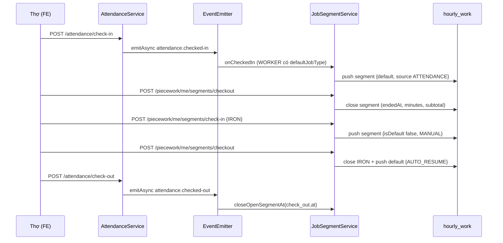

# Plan 37: Công Thợ Theo Khâu Mặc Định — Đơn Giá Giờ Theo Khâu, Phiên Khâu Gắn Chấm Công & Phiếu Lương Theo Ngày

> Status: Done | Created: 2026-10-26 | Completed: 2026-10-26

## 1. Overview & Affected Files

### 1.1. Mục tiêu

Chuyển phân hệ Công Thợ Theo Giờ từ mô hình "thợ tự khai số phút + hệ số" sang mô hình **phiên khâu (job segment) tính theo thời gian thực, gắn với chấm công**:

1. `/management/manager/piecework`:
   - **Cài đặt đơn giá VNĐ/giờ cho từng khâu** (bỏ hệ số) — chỉ ADMIN/ACCOUNTANT (quyền `pay.rate.manage`).
   - **Phân khâu mặc định cho từng WORKER** — ADMIN/MANAGER (quyền `piecework.confirm`).
   - **Duyệt giờ công theo ngày** (giữ nghiệp vụ CONFIRMED hiện có) — MANAGER không thấy tiền.
2. `/operations/attendance`: Check-in ca ⇒ tự động mở phiên **khâu mặc định**; Check-out ca ⇒ tự động đóng phiên đang mở.
3. `/operations/worker/piecework`: Thợ thấy khâu mặc định + phiên đang chạy (đồng hồ). Muốn làm khâu khác: **Checkout khâu hiện tại → Check-in khâu mới → Checkout khâu mới ⇒ hệ thống tự check-in lại khâu mặc định** cho tới khi checkout ca ở Attendance.
4. `/operations/payslip`: Lương **tạm tính theo từng ngày** (Chờ duyệt / Đã duyệt) + **tổng hợp tháng**; số chính thức là phiếu lương sau khi Kế toán chốt kỳ (LOCKED/PAID).

Công thức: `subtotal = round(floor((endedAt − startedAt)/60000) / 60 × hourlyRate)` với `hourlyRate` = đơn giá khâu snapshot tại thời điểm mở phiên.

### 1.2. Out of scope

- Hiển thị chi tiết lương Shipper trên `MyPayslipPage` (mapping field Shipper hiện đang lệch BE — `MyPayslipPage.tsx:103-148` dùng `fuelRefund`, `diligencePay`… trong khi BE trả `vehicleExpenseReimbursement`, `attendanceBonus` tại `payslip.schema.ts:22-55`). Chỉ giữ nguyên, không sửa trong plan này.
- Lương các vai trò ADMIN/MANAGER/ACCOUNTANT, công thức lương Shipper.
- Hệ số ngày (`dayCoefficients`: OT/Chủ nhật/Lễ) cho thợ — thợ tính thuần theo đơn giá khâu.

### 1.3. Quyết định đã chốt với người dùng

| # | Câu hỏi | Quyết định |
|---|---|---|
| D1 | Mức lương khâu | Mỗi khâu có đơn giá VNĐ/giờ riêng, **bỏ hệ số** |
| D2 | Payslip theo ngày | Hiển thị tạm tính ngay theo ngày (Chờ duyệt/Đã duyệt); số chính thức sau khi Kế toán chốt kỳ |
| D3 | Sau khi checkout khâu phụ | **Tự động check-in lại khâu mặc định** đến khi checkout ca |
| D4 | Ai cài đơn giá khâu | Chỉ ADMIN/ACCOUNTANT (`pay.rate.manage`); MANAGER phân khâu + duyệt nhưng không thấy tiền (giữ chính sách `permissions.map.ts:86-89`) |

### 1.4. Hiện trạng & lỗi tồn đọng phát hiện khi khảo sát (bắt buộc sửa để luồng chạy được)

| # | Hiện trạng | Dẫn chứng |
|---|---|---|
| H1 | Lương khâu = `minutes/60 × hourlyBaseRate × coefficient`, thợ tự nhập số phút | `piecework.service.ts:62-129`, `useHourlyWorkStation.ts:105-131` |
| H2 | FE Attendance gọi `GET /attendance/history` (BE không có), gửi `checkInPhotoUrl`/`checkOutPhotoUrl` (BE yêu cầu `photoId`), đọc `checkInAt` (BE trả `check_in.at`) | `AttendancePage.tsx:26,70,91,103`; `attendance.controller.ts:28-62`; `check-in.dto.ts:14-16`; `attendance-record.schema.ts:71-75` |
| H3 | FE Manager gọi `GET /piecework/today` và `POST /piecework/:id/confirm` — BE không có; BE thực tế là `GET /piecework?dateKey=` và `POST /piecework/confirm {dateKey, workerId}` | `HourlyWorkReviewPage.tsx:21,28`; `piecework.controller.ts:76-110` |
| H4 | FE gọi `GET /payroll/me/payslips` không truyền `month`, kỳ vọng mảng; BE yêu cầu `month` và trả 1 object, ném 404 khi kỳ DRAFT | `MyPayslipPage.tsx:13`; `payroll.controller.ts:67-71`; `payroll.service.ts:456-479` |
| H5 | `PayFieldFilterInterceptor` xóa `subtotal`, `totalEarnings`, `netPay`… với user không có `pay.view` ⇒ **WORKER không thấy tiền của chính mình** ở `/piecework/me` và `/payroll/me/payslips` | `pay-field-filter.interceptor.ts:12-42,84-101`; `permissions.map.ts:123-127` |
| H6 | Payroll đọc `profile.hourlyRate` / `profile.payType` nhưng schema là `hourly_rate` / `pay_type` | `payroll.service.ts:73-75`; `staff-account.schema.ts:29-36` |
| H7 | `AttendanceService` không phụ thuộc Piecework; `PieceworkModule` import `AttendanceModule` ⇒ gọi ngược sẽ gây circular dependency | `piecework.module.ts:9,26`; `attendance.module.ts:13-24` |

### 1.5. Assumptions

- A1: Chỉ áp dụng phiên khâu tự động cho tài khoản `role = WORKER`. Shipper vẫn auto check-in qua handover như cũ (`attendance.service.ts:64-88`) và **không** sinh phiên khâu.
- A2: WORKER chưa được phân khâu mặc định ⇒ check-in ca không mở phiên nào; thợ phải tự chọn khâu trên trạm. Checkout khâu phụ khi không có khâu mặc định ⇒ không auto-resume.
- A3: Thợ tự checkout **khâu mặc định** (để đi làm khâu khác) ⇒ không auto-resume (chỉ auto-resume sau khi đóng một khâu **không phải** mặc định).
- A4: Mỗi thợ tối đa **1 phiên mở** tại một thời điểm. Check-in khâu khi đang có phiên mở ⇒ 409 (bắt buộc checkout trước — đúng yêu cầu người dùng).
- A5: Cron đóng ca quên checkout (`attendance.service.ts:203-225`) chỉ đổi trạng thái `NEEDS_REVIEW`; phiên khâu vẫn mở cho tới khi Manager review ca với `checkOutAt` ⇒ đóng phiên tại `checkOutAt` đó.
- A6: Ngày công của phiên = `dateKey` của ca chấm công (ca qua nửa đêm vẫn tính vào ngày check-in).
- A7: Payslip theo ngày lấy trực tiếp từ `hourly_work` (tạm tính); phiên đang mở được tính tạm tới thời điểm hiện tại, đánh dấu "Đang chạy".
- A8: Dữ liệu `hourly_work` cũ (tasks dạng `minutesWorked` khai tay) được migrate sang dạng phiên đã đóng (`startedAt = endedAt = at`, giữ `minutesWorked`, `subtotal`) để tổng tiền lịch sử không đổi.

### 1.6. Open Questions

- Q1: Có cần cho Manager sửa tay giờ bắt đầu/kết thúc của từng phiên khâu khi thợ quên bấm không? (Plan này **không** làm; Manager chỉ sửa giờ ca qua review chấm công.)

### 1.7. Bảng file ảnh hưởng

**Backend (`be-nestjs-thanhxuan/src/`)**

| Path | Action | Lý do |
|---|---|---|
| `modules/internal/payroll/schemas/pay-settings.schema.ts` | edit | `jobCoefficients{coefficient}` → `jobRates{jobType, jobName, hourlyRate, isActive}`; xóa `defaultHourlyRate` |
| `modules/internal/auth/schemas/staff-account.schema.ts` | edit | Thêm `defaultJobType?: string` (root, không nằm trong `pay_profile` để không bị interceptor strip) |
| `modules/internal/piecework/schemas/piecework-log.schema.ts` | edit | `PieceworkTask` → phiên khâu: `startedAt`, `endedAt?`, `isDefault`, `source`, `hourlyRate`; xóa `coefficient`, `hourlyBaseRate`, `itemCode`, `quantity`, `rateSnapshot`, `rate`; thêm index phiên mở |
| `modules/internal/piecework/piecework-calculator.ts` | edit | Thay `mergePieceworkTask` bằng hàm thuần `calcSegmentMinutes`, `calcSegmentSubtotal`, `summarizeDailyLog` |
| `modules/internal/piecework/piecework.service.ts` | edit | Bỏ luồng khai phút/itemCode; chỉ giữ query + confirm; tách logic phiên sang service mới |
| `modules/internal/piecework/services/job-segment.service.ts` | add | `startSegment`, `checkoutSegment` (+ auto-resume), `closeOpenSegmentAt`, listener sự kiện chấm công |
| `modules/internal/piecework/services/job-rate-settings.service.ts` | add | Đọc/cập nhật `jobRates`; phân khâu mặc định cho WORKER |
| `modules/internal/piecework/piecework.controller.ts` | edit | Endpoint phiên khâu, job-rates, workers default-job; xóa `POST me/tasks`, `DELETE me/tasks/:taskIndex`, `PUT me/tasks/:itemCode` |
| `modules/internal/piecework/dto/record-hourly-work.dto.ts` | delete | Thay bằng DTO check-in khâu |
| `modules/internal/piecework/dto/record-task.dto.ts` | delete | Luồng itemCode cũ không còn dùng |
| `modules/internal/piecework/dto/check-in-segment.dto.ts` | add | `{ jobType }` |
| `modules/internal/piecework/dto/update-job-rates.dto.ts` | add | `{ jobRates: JobRateDto[] }` (nested đủ bộ 3) |
| `modules/internal/piecework/dto/assign-default-job.dto.ts` | add | `{ jobType: string \| null }` |
| `modules/internal/piecework/dto/index.ts` | edit | Cập nhật export |
| `modules/internal/piecework/repositories/piecework-log.repository.ts` | edit | `findOpenSegmentLog`, `pushSegment`, `closeSegment` (atomic `$set` theo positional), `findByWorkerAndMonth` (lean/select) |
| `modules/internal/piecework/piecework.module.ts` | edit | Đăng ký service mới; xóa alias `PieceworksModule` nếu không còn nơi dùng (kiểm grep trước) |
| `modules/internal/attendance/attendance.service.ts` | edit | `emitAsync('attendance.checked-in' / 'attendance.checked-out' / 'attendance.reviewed')` sau khi ghi DB (tránh circular — H7) |
| `modules/internal/attendance/attendance.events.ts` | add | Hằng tên sự kiện + payload interface |
| `modules/internal/payroll/payroll.service.ts` | edit | WORKER: tổng từ phiên khâu (`hourlyRate`), bỏ `coefficient`; sửa H6 (`hourly_rate`, `pay_type`); thêm `getMyDailyEarnings(month)` |
| `modules/internal/payroll/payroll.controller.ts` | edit | `GET payroll/me/daily?month=` ; giữ `GET me/payslips?month=` |
| `modules/internal/payroll/schemas/payslip.schema.ts` | edit | `WorkerTaskPayLine`: `coefficient` → `hourlyRate`; `WorkerPayDetails`: bỏ `hourlyBaseRate`, thêm `days[]` tóm tắt theo ngày |
| `common/interceptors/pay-field-filter.interceptor.ts` | edit | Thêm decorator `@SelfPayFields()` để bỏ qua strip trên endpoint `me/*` (dữ liệu của chính user) — sửa H5 |
| `common/decorators/self-pay-fields.decorator.ts` | add | `SetMetadata` cho interceptor đọc qua `Reflector` |
| `scripts/drop-legacy-collections.ts` | edit | Migration: `jobCoefficients` → `jobRates` (`hourlyRate = round(defaultHourlyRate × coefficient)`), `$unset defaultHourlyRate`; chuyển tasks cũ sang dạng phiên (A8); `$unset` field legacy |
| `modules/internal/piecework/specs/*.spec.ts`, `attendance/specs/attendance.service.spec.ts`, `payroll/specs/payroll.service.spec.ts` | edit/add | Cập nhật & thêm test (xem mục 4) |

**Frontend (`fe-react-thanhxuan-internal/src/`)**

| Path | Action | Lý do |
|---|---|---|
| `types/index.ts` | edit | `AttendanceLog` khớp BE (`check_in.at`, `check_out.at`, `workerId`, `day_type`); `JobRateSetting`; `JobSegment`; `HourlyWorkDailyLog`; `DailyEarning`; `Payslip.workerDetails` khớp BE; xóa `JobCoefficientSetting` |
| `features/operations/attendance/AttendancePage.tsx` | edit | Sửa H2 (`/attendance/me`, `photoId`, đọc `check_in.at`); invalidate query trạm khâu sau check-in/out; tách hook nếu > 300 dòng |
| `features/operations/attendance/hooks/useAttendance.ts` | add | Tách query/mutation khỏi page (page hiện 296 dòng) |
| `features/operations/piecework/HourlyWorkStationPage.tsx` | edit | Viết lại theo mô hình phiên khâu, < 250 dòng |
| `features/operations/piecework/hooks/useHourlyWorkStation.ts` | edit | Query `/piecework/me/station`; mutation check-in/checkout khâu; bỏ khai phút |
| `features/operations/piecework/components/CurrentSegmentCardComponent.tsx` | add | Khâu mặc định, phiên đang chạy + đồng hồ, nút Checkout khâu |
| `features/operations/piecework/components/JobStagePickerComponent.tsx` | add | Lưới chọn khâu để Check-in (disable khi đang có phiên mở) |
| `features/operations/piecework/components/HourlyWorkTaskListComponent.tsx` | edit | Hiển thị timeline phiên trong ngày (giờ vào/ra, phút, thành tiền, nhãn Mặc định/Phụ/Tự quay lại) |
| `features/management/piecework/HourlyWorkReviewPage.tsx` | edit | Khung 3 tab: Đơn giá khâu (ẩn nếu thiếu quyền) / Phân khâu mặc định / Duyệt theo ngày |
| `features/management/piecework/components/JobRatesSettingsComponent.tsx` | add | Bảng sửa đơn giá VNĐ/giờ + bật/tắt khâu |
| `features/management/piecework/components/WorkerDefaultJobComponent.tsx` | add | Danh sách WORKER + Select khâu mặc định |
| `features/management/piecework/components/DailyWorkReviewComponent.tsx` | add | Chọn ngày, danh sách log, nút Xác nhận chốt (sửa H3) |
| `features/management/piecework/hooks/useJobRates.ts` | add | GET/PUT job-rates |
| `features/management/piecework/hooks/useWorkerDefaultJobs.ts` | add | GET workers, PUT default-job |
| `features/management/piecework/hooks/useDailyWorkReview.ts` | add | GET `/piecework?dateKey=`, POST `/piecework/confirm` |
| `features/management/ManagementPage.tsx` | edit | Truyền đúng prop quyền cho `HourlyWorkReviewPage` (dòng 356) |
| `app/(internal)/management/manager/piecework.tsx` | edit | Truyền `canViewPay` / `canManageRates` theo user |
| `components/layout/nav-config.ts` | edit | Mục `quan-ly-khoan-viec` (dòng ~208-219) thêm `ACCOUNTANT`; đổi title "Công Thợ Theo Khâu" |
| `features/operations/payroll/MyPayslipPage.tsx` | edit | Chọn tháng; khối WORKER: bảng theo ngày + tổng tháng; khối phiếu chính thức (nếu đã chốt) — sửa H4 |
| `features/operations/payroll/components/DailyEarningsTableComponent.tsx` | add | Bảng ngày: giờ công từng khâu, tạm tính, trạng thái duyệt |
| `features/operations/payroll/components/OfficialPayslipCardComponent.tsx` | add | Tách phần hiển thị phiếu chính thức hiện có (giữ nguyên khối Shipper) |
| `features/operations/payroll/hooks/useMyPayslip.ts` | add | Query `/payroll/me/daily?month=` + `/payroll/me/payslips?month=` (404 ⇒ "chưa chốt") |

**Tài liệu (`.agents/docs/`)**: `DATABASE_DICTIONARY.md` (mục 1.1, 1.10, 1.12, 1.14 + ERD dòng 48), `CODEBASE_ATLAS.md` (dòng 32, 35, 100-105), `srs_sdd/srs_sdd_backend.md`, `srs_sdd/srs_sdd_fe_internal.md`, `SRS_SDD.md` (Document History), `CHANGELOG.md`.

## 2. Technical Approach

### 2.1. Data flow



- Dùng `@nestjs/event-emitter` (đã cài `package.json:34`, đã đăng ký `app.module.ts:108`) với `emitAsync` để phiên được mở/đóng **trước khi** API chấm công trả về — tránh circular dependency H7, **không thêm dependency mới**.
- Lỗi trong listener không làm hỏng chấm công: listener log lỗi qua `Logger` và ghi audit; chấm công vẫn thành công (thợ có thể check-in khâu tay).

### 2.2. Schema (minh họa data shape)

```ts
// pay_settings.jobRates[]
interface JobRateSetting { jobType: string; jobName: string; hourlyRate: number; isActive: boolean }
// accounts
interface StaffAccount { defaultJobType?: string /* jobType, chỉ WORKER */ }
// hourly_work.tasks[] (PieceworkTask = phiên khâu)
interface JobSegment {
  jobType: string; jobName: string; isDefault: boolean;
  source: 'ATTENDANCE' | 'MANUAL' | 'AUTO_RESUME';
  startedAt: Date; endedAt?: Date;          // endedAt rỗng = đang mở
  hourlyRate: number;                        // snapshot đơn giá khâu
  minutesWorked: number; subtotal: number;   // tính khi đóng phiên
}
```

Index mới: `{ workerId: 1, 'tasks.endedAt': 1 }` hỗ trợ tìm phiên mở. Giữ unique `{ workerId, dateKey }` (`piecework-log.schema.ts:90`).

### 2.3. API contract

| Method & Path | Quyền | Body / Query | Trả về |
|---|---|---|---|
| `GET /piecework/me/station` | `piecework.self` + `@SelfPayFields` | – | `{ defaultJobType, jobRates[], hasOpenShift, openSegment?, todayLog }` |
| `POST /piecework/me/segments/check-in` | `piecework.self` | `{ jobType }` | `HourlyWorkDailyLog` (409 nếu đang có phiên mở; 400 nếu ca không OPEN / khâu không active) |
| `POST /piecework/me/segments/checkout` | `piecework.self` | – | `HourlyWorkDailyLog` (đã auto-resume nếu đủ điều kiện) |
| `GET /piecework/job-rates` | `piecework.self` | – | `{ jobRates[] }` — `jobType/jobName/isActive` cho mọi người; `hourlyRate` chỉ trả cho user có `pay.view` (interceptor strip). WORKER xem đơn giá khâu của mình qua `/piecework/me/station` |
| `PUT /piecework/job-rates` | `pay.rate.manage` | `UpdateJobRatesDto` | `{ jobRates[] }` + audit `UPDATE_JOB_RATES` |
| `GET /piecework/workers` | `piecework.confirm` | `?page&limit` | `{ items: {_id, fullName, defaultJobType}[], total }` |
| `PUT /piecework/workers/:id/default-job` | `piecework.confirm` | `{ jobType \| null }` | worker rút gọn + audit `ASSIGN_DEFAULT_JOB` |
| `GET /piecework?dateKey=` / `POST /piecework/confirm` | giữ nguyên (`piecework.controller.ts:76-110`) | – | – |
| `GET /payroll/me/daily?month=YYYY-MM` | `payslip.self` + `@SelfPayFields` | – | `{ month, days: DailyEarning[], totals }` |
| `GET /payroll/me/payslips?month=` | giữ, thêm `@SelfPayFields` | – | `Payslip` |

```ts
interface DailyEarning {
  dateKey: string; status: 'DRAFT' | 'CONFIRMED'; hasOpenSegment: boolean;
  segments: { jobName: string; startedAt: string; endedAt?: string; minutesWorked: number; hourlyRate: number; subtotal: number }[];
  totalMinutes: number; totalEarnings: number;
}
```

### 2.4. Quy tắc nghiệp vụ JobSegmentService

1. `startSegment(workerId, jobType, source, at)`: yêu cầu ca OPEN (`attendanceService.getOpenRecord`), log ngày không CONFIRMED, không có phiên mở, khâu `isActive`. Snapshot `hourlyRate` từ `jobRates`; `isDefault = (jobType === account.defaultJobType)`.
2. `checkoutSegment(workerId, at)`: đóng phiên mở (404/400 nếu không có). Nếu phiên vừa đóng `isDefault = false` **và** thợ có `defaultJobType` **và** ca còn OPEN ⇒ `startSegment(default, 'AUTO_RESUME', at)`.
3. `closeOpenSegmentAt(workerId, at)`: dùng cho checkout ca / review ca; không auto-resume. Nếu `at < startedAt` ⇒ `minutes = 0`.
4. Đóng phiên tính lại `totalEarnings` của log = tổng `subtotal` các phiên đã đóng.
5. Review chấm công (`attendance.reviewed`) có `checkOutAt`: đóng phiên còn mở tại `checkOutAt`; nếu phiên cuối đã đóng sau `checkOutAt` ⇒ kẹp `endedAt = checkOutAt` và tính lại.

### 2.5. Payroll WORKER

- `calculatePayroll` nhánh WORKER (`payroll.service.ts:202-238`): tổng `subtotal` phiên đã đóng của log `CONFIRMED`; `WorkerTaskPayLine` gom theo `jobType` (`minutesWorked`, `hourlyRate`, `subtotal`); `workerDetails.days[]` = `{ dateKey, minutes, earnings }`.
- `getMyDailyEarnings(staffId, month)`: đọc mọi log trong tháng (DRAFT + CONFIRMED), phiên đang mở tính tạm tới `now` (không ghi DB) — dùng chung hàm thuần trong `piecework-calculator.ts`.

### 2.6. Quyết định thiết kế & phương án loại

- **Event thay vì `forwardRef`**: tránh vòng lặp module, giữ Attendance độc lập (Shipper dùng chung).
- **`defaultJobType` ở root account**: nằm trong `pay_profile` sẽ bị interceptor strip với WORKER/MANAGER (`pay-field-filter.interceptor.ts:22`).
- **`@SelfPayFields` thay vì cấp `pay.view` cho WORKER**: `pay.view` mở quyền xem lương người khác (`piecework.controller.ts:87,99`).
- Loại phương án lưu phiên ở collection riêng: tăng số bảng, payroll phải join thêm; phiên nằm trong `hourly_work.tasks` giữ nguyên quan hệ ngày–thợ hiện có.

## 3. Implementation Tasks (Checklist)

**Backend**

- [x] T1: `pay-settings.schema.ts` — đổi sang `jobRates` (7 khâu mặc định, `hourlyRate` = 30.000 × hệ số cũ: 36k/39k/30k/33k/36k/30k/30k), xóa `defaultHourlyRate`, `JobCoefficientSetting` — tsc pass — Depends on: none
- [x] T2: `staff-account.schema.ts` — thêm `defaultJobType` (uppercase, trim, optional) — Depends on: none (song song T1)
- [x] T3: `piecework-log.schema.ts` + `piecework-calculator.ts` — schema phiên khâu, index mới; hàm thuần `calcSegmentMinutes`, `calcSegmentSubtotal`, `summarizeDailyLog(log, now?)` — unit test calculator pass — Depends on: none
- [x] T4: `piecework-log.repository.ts` — `findOpenSegmentLog`, `pushSegment`, `closeSegment`, `findByWorkerAndMonth` (`.lean()` + `.select()`) — Depends on: T3
- [x] T5: `common/decorators/self-pay-fields.decorator.ts` + sửa `pay-field-filter.interceptor.ts` đọc metadata qua `Reflector` — spec interceptor: endpoint có decorator trả đủ `subtotal/netPay` cho WORKER — Depends on: none
- [x] T6: `attendance.events.ts` + `attendance.service.ts` — `emitAsync` 3 sự kiện sau khi ghi DB (check-in, check-out, review có `checkOutAt`); inject `EventEmitter2` — spec: emit đúng payload — Depends on: none
- [x] T7: `job-rate-settings.service.ts` — `getJobRates`, `updateJobRates` (validate jobType unique, `hourlyRate ≥ 0`), `listWorkers` (phân trang), `assignDefaultJob` (chỉ WORKER, khâu tồn tại & active) + audit — Depends on: T1, T2
- [x] T8: `job-segment.service.ts` — quy tắc mục 2.4 + `@OnEvent` listener — spec đủ kịch bản mục 4.2 — Depends on: T4, T6, T7
- [x] T9: DTO mới (`check-in-segment`, `update-job-rates` nested đủ bộ 3, `assign-default-job`), xóa `record-hourly-work.dto.ts`, `record-task.dto.ts`, cập nhật `dto/index.ts` — Depends on: none
- [x] T10: `piecework.service.ts` + `piecework.controller.ts` + `piecework.module.ts` — endpoint mục 2.3, xóa `recordHourlyWorkTask`, `recordWorkerTask`, `updateWorkerEntry`, `deleteWorkerTask`, `mergePieceworkTask`; cập nhật `piecework.service.spec.ts` — Depends on: T5, T7, T8, T9
- [x] T11: `payslip.schema.ts` + `payroll.service.ts` + `payroll.controller.ts` — mục 2.5, sửa H6, thêm `GET me/daily`, `@SelfPayFields` cho `me/*` — spec payroll WORKER pass — Depends on: T3, T5
- [x] T12: `scripts/drop-legacy-collections.ts` — migration mục 1.7 (idempotent: chỉ chạy khi còn `jobCoefficients` / task có `coefficient`) — chạy `pnpm run db:drop-legacy` trên DB dev, kiểm tra tổng `totalEarnings` trước/sau bằng nhau — Depends on: T1, T3
- [x] T13: BE verify: `pnpm lint`, `pnpm exec tsc --noEmit`, `pnpm test`, `pnpm build` — Depends on: T1–T12

**Frontend Internal**

- [x] T14: `types/index.ts` — type mới mục 2.2/2.3, sửa `AttendanceLog`, `Payslip.workerDetails`; xóa `JobCoefficientSetting` — Depends on: T13
- [x] T15: `hooks/useAttendance.ts` + `AttendancePage.tsx` — sửa H2; sau check-in/out invalidate `['piecework-station']`, toast "Đã tự động bắt đầu khâu {jobName}" khi có `defaultJobType` — Depends on: T14
- [x] T16: Trạm thợ — `useHourlyWorkStation.ts`, `CurrentSegmentCardComponent.tsx`, `JobStagePickerComponent.tsx`, `HourlyWorkTaskListComponent.tsx`, `HourlyWorkStationPage.tsx` (< 250 dòng mỗi file); đồng hồ phiên cập nhật mỗi 30s; nút "Checkout khâu" + xác nhận; picker disable khi có phiên mở, kèm gợi ý "Checkout khâu hiện tại trước" — Depends on: T14
- [x] T17: Manager — 3 hook + 3 component + `HourlyWorkReviewPage.tsx` dạng tab; tab Đơn giá chỉ render khi `user.role ∈ {ADMIN, ACCOUNTANT}`; `piecework.tsx`, `ManagementPage.tsx`, `nav-config.ts` — Depends on: T14
- [x] T18: Payslip — `useMyPayslip.ts`, `DailyEarningsTableComponent.tsx`, `OfficialPayslipCardComponent.tsx`, `MyPayslipPage.tsx` (chọn tháng, mặc định tháng hiện tại theo `Asia/Ho_Chi_Minh`; dòng ngày có badge Chờ duyệt / Đã duyệt / Đang chạy; footer tổng tháng giờ công + tạm tính) — Depends on: T14
- [x] T19: FE verify: `pnpm lint`, `pnpm exec tsc --noEmit`, `pnpm test`, `pnpm build` — Depends on: T15–T18

**Tài liệu & bàn giao**

- [x] T20: Đồng bộ 5 trụ cột tài liệu (mục 1.7) — Depends on: T19
- [x] T21: Commit & push nhánh `dev` (ví dụ: `feat(piecework): phiên khâu mặc định gắn chấm công, đơn giá giờ theo khâu và lương theo ngày`) — Depends on: T20

## 4. Verification & Testing

### 4.1. Lệnh

| App | Lệnh |
|---|---|
| `be-nestjs-thanhxuan/` | `pnpm lint` · `pnpm exec tsc --noEmit` · `pnpm test` · `pnpm build` · `pnpm run db:drop-legacy` (DB dev) |
| `fe-react-thanhxuan-internal/` | `pnpm lint` · `pnpm exec tsc --noEmit` · `pnpm test` · `pnpm build` |

### 4.2. Kịch bản test (unit `job-segment.service.spec.ts` + kiểm tra tay trên `localhost:3001`)

Happy path:
1. ADMIN đặt Gấp = 30.000đ/h, Là = 36.000đ/h; MANAGER phân thợ A khâu mặc định Gấp.
2. Thợ A check-in ca 08:00 ⇒ trạm thấy phiên Gấp đang chạy (source ATTENDANCE).
3. 10:00 checkout Gấp ⇒ 120 phút, 60.000đ. Check-in Là 10:00, checkout 11:00 ⇒ 60 phút, 36.000đ, tự mở lại Gấp (AUTO_RESUME) 11:00.
4. 17:00 checkout ca ⇒ Gấp đóng 360 phút, 180.000đ. Tổng ngày 276.000đ.
5. `/operations/payslip` hiển thị ngày hôm nay "Chờ duyệt" 276.000đ; MANAGER chốt ⇒ "Đã duyệt"; Kế toán tính lương tháng ⇒ phiếu chính thức có `workerDetails.tasks` gom theo khâu.

Edge cases:
- Check-in khâu khi chưa check-in ca ⇒ 400. Check-in khâu khi đang có phiên mở ⇒ 409.
- Thợ chưa có khâu mặc định: check-in ca không sinh phiên; checkout khâu phụ không auto-resume.
- Thợ tự checkout khâu mặc định ⇒ không auto-resume (A3).
- Đổi đơn giá giữa ngày ⇒ phiên đã mở giữ đơn giá snapshot.
- Log đã CONFIRMED ⇒ check-in/checkout khâu 409; checkout ca vẫn thành công (listener chỉ ghi log lỗi).
- Ca quên checkout ⇒ cron NEEDS_REVIEW, phiên vẫn mở; Manager review với `checkOutAt` ⇒ phiên đóng đúng giờ đó.
- MANAGER gọi `GET /piecework/job-rates` ⇒ không có `hourlyRate`; gọi `PUT /piecework/job-rates` ⇒ 403.
- WORKER gọi `/payroll/me/daily` ⇒ thấy tiền của mình; gọi `GET /piecework/report` ⇒ 403.
- Shipper auto check-in qua handover ⇒ không sinh phiên khâu.

### 4.3. Definition of Done

- Lint, typecheck, test và build pass cho `be-nestjs-thanhxuan` và `fe-react-thanhxuan-internal`.
- Không còn file re-export/alias tạm; không file nào vượt 250-300 dòng chưa tách (`HourlyWorkStationPage.tsx` hiện 345 dòng phải giảm).
- Đồng bộ 5 trụ cột tài liệu: `DATABASE_DICTIONARY.md` (đã chạy `db:drop-legacy`), `CODEBASE_ATLAS.md`, `srs_sdd_backend.md`, `srs_sdd_fe_internal.md`, 1 dòng Document History ở `SRS_SDD.md`, nhật ký chi tiết ở `CHANGELOG.md`.
- Tự động commit và push lên nhánh `dev`.

## 5. Risks & Rollback

| Rủi ro | Giảm thiểu |
|---|---|
| Breaking change API: xóa `POST/DELETE/PUT /piecework/me/tasks*` | Chỉ FE Internal gọi (đã grep FE); cập nhật FE cùng đợt |
| Migration làm sai tổng tiền lịch sử | Script idempotent, giữ `subtotal` cũ; so tổng `totalEarnings` trước/sau; chạy DB dev trước, backup collection `hourly_work`, `pay_settings` trước khi chạy Production |
| Listener lỗi khiến phiên không mở dù ca đã check-in | Listener nuốt lỗi có `Logger.error` + audit; trạm thợ hiển thị cảnh báo "Chưa có khâu đang chạy" và cho check-in tay |
| Race: bấm checkout khâu 2 lần | `closeSegment` cập nhật có điều kiện `tasks.endedAt: null` (atomic), lần 2 trả 400 |
| Mở `@SelfPayFields` lộ tiền người khác | Chỉ gắn lên endpoint lọc cứng theo `req.user.sub`; test bảo mật ở 4.2 |
| Ca qua nửa đêm | Phiên gắn `dateKey` của ca (A6) |

Rollback: revert commit trên `dev`; khôi phục `hourly_work`, `pay_settings` từ backup (migration không xóa `subtotal`/`minutesWorked` nên dữ liệu tiền vẫn đọc được).

## Changelog

- 2026-10-26: Khởi tạo plan.


## 5. Execution Log

- **2026-10-26**: Hoàn thành toàn diện Plan 37:
  - **Backend**:
    - Schema `pay_settings` chuyển sang `jobRates` với 7 khâu mặc định, bỏ `defaultHourlyRate`.
    - Schema `accounts` thêm thuộc tính `defaultJobType` ở root document.
    - Schema `hourly_work` chuyển `tasks` thành phiên khâu (`isDefault`, `source`, `startedAt`, `endedAt`, `hourlyRate`, `minutesWorked`, `subtotal`).
    - Viết mới bộ thuần tính toán `piecework-calculator.ts` và unit test 100% pass.
    - Áp dụng `@SelfPayFields()` decorator cho các endpoint cá nhân `me/*` và `PayFieldFilterInterceptor` để Worker xem được tiền công của chính mình mà không cần cấp quyền quản lý `pay.view`.
    - Kết nối lỏng giữa `AttendanceService` và `PieceworkModule` bằng `EventEmitter2` (`attendance.checked-in`, `attendance.checked-out`, `attendance.reviewed`) qua `emitAsync`, tránh triệt để circular dependency.
    - Chạy migration dữ liệu `pnpm run db:drop-legacy` trên MongoDB Atlas thành công (chuyển đổi `jobCoefficients` sang `jobRates` và chuẩn hóa logs cũ).
    - Unit tests: `job-segment.service.spec.ts`, `piecework-calculator.spec.ts`, `piecework.service.spec.ts`, `pay-field-filter.interceptor.spec.ts`, `payroll.service.spec.ts` pass 100%. `nest build` pass 100%.
  - **Frontend (`fe-react-thanhxuan-internal`)**:
    - Chuẩn hóa TypeScript types (`JobRateSetting`, `PieceworkTask`, `WorkerStationState`, `DailyEarning`, `Payslip.workerDetails`).
    - Cải tổ `AttendancePage` kết hợp custom hook `useAttendance.ts` (< 250 dòng).
    - Viết lại trạm công thợ `HourlyWorkStationPage` (< 250 dòng) với đồng hồ đếm thời gian thực 30s, tự động check-in lại khâu mặc định (`AUTO_RESUME`) khi checkout khâu phụ.
    - Xây dựng màn hình quản trị `HourlyWorkReviewPage` với 3 tab: Cài đặt đơn giá khâu (Admin/Accountant), Phân khâu mặc định (Admin/Manager), Duyệt công theo ngày (Manager/Admin).
    - Trang `MyPayslipPage` hiển thị chi tiết thu nhập từng ngày theo thời gian thực kết hợp xem phiếu chính thức khi kỳ lương được chốt.
    - Typecheck `pnpm exec tsc --noEmit` & `pnpm build` pass 100%.
  - **Tài liệu**: Đồng bộ toàn bộ 5 trụ cột tài liệu (`DATABASE_DICTIONARY.md`, `CODEBASE_ATLAS.md`, `srs_sdd_backend.md`, `srs_sdd_fe_internal.md`, `SRS_SDD.md`, `CHANGELOG.md`).
