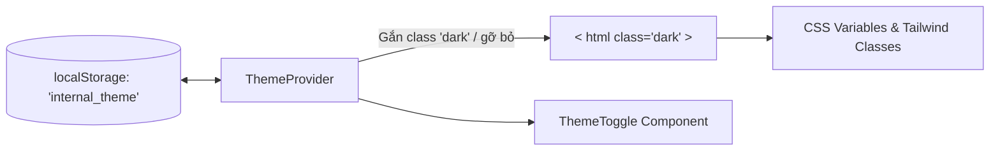

# Plan 4: Đổi Hệ Thống Màu Chủ Đạo Web Nội Bộ (Light Blue, Green, Dark / Light Mode)

> Status: Done | Created: 2026-10-04

---

## 1. Overview & Affected Files

### 1.1 Mục Tiêu & Yêu Cầu

Chuyển đổi toàn diện hệ thống nhận diện màu sắc trên ứng dụng web nội bộ (`fe-react-thanhxuan-internal`), thay thế gam màu đơn lẻ cũ (Teal) sang bộ phối màu chuẩn công nghiệp theo đúng yêu cầu:
- **Chế độ Tối (Dark Mode)**: Bộ ba **Đen** (nền sâu `slate-950/black`) + **Xanh dương nhạt** (Light Blue / `sky-400` điểm nhấn chính) + **Xanh lá** (Emerald / `emerald-400` điểm nhấn phụ/trạng thái thành công).
- **Chế độ Sáng (Light Mode)**: Bộ ba **Trắng** (nền sáng `white/slate-50`) + **Xanh dương nhạt** (Light Blue / `sky-600` điểm nhấn chính) + **Xanh lá** (Emerald / `emerald-600` điểm nhấn phụ/thao tác tích cực).
- **Cơ chế Theme Toggle**: Bổ sung bộ quản lý theme (`ThemeProvider`) hỗ trợ chuyển đổi mượt mà giữa Dark Mode và Light Mode, lưu cấu hình vào `localStorage`, có nút bấm bật/tắt (Sun/Moon icon) trên thanh Header và màn hình Đăng nhập.

### 1.2 Phạm Vi & Out of Scope

- **Phạm vi**: Ứng dụng `fe-react-thanhxuan-internal` (các token CSS, config Tailwind, ThemeProvider, layout chung, các màn hình nghiệp vụ chính và components UI).
- **Out of Scope**: 
  - Không sửa backend NestJS hay database schema.
  - Không thay đổi logic nghiệp vụ giao nhận, chấm công hay tính lương.
  - Ứng dụng khách hàng `fe-nextjs-thanhxuan-laundry` và `fe-nextjs-chuyennhatietkiem` giữ nguyên màu nhận diện riêng.

### 1.3 Assumptions & Open Questions

- **Assumptions**: 
  - Trải nghiệm xưởng giặt là B2B yêu cầu độ tương phản cao (WCAG AA/AAA) để thợ xưởng và tài xế đọc rõ thông tin dưới ánh sáng ngoài trời lẫn trong kho tối.
  - Mặc định khởi tạo lần đầu ưu tiên Dark Mode (hoặc theo `prefers-color-scheme` của hệ điều hành người dùng).
- **Open Questions**: Không có. Yêu cầu phối màu đã rõ ràng và chi tiết.

### 1.4 Bảng File Ảnh Hưởng Dự Kiến

| Đường Dẫn File | Hành Động | Lý Do Thay Đổi |
| :--- | :---: | :--- |
| `fe-react-thanhxuan-internal/tailwind.config.js` | Edit | Định nghĩa bảng màu brand mới (`sky` + `emerald`), cấu hình darkMode `class`. |
| `fe-react-thanhxuan-internal/src/index.css` | Edit | Định nghĩa lại CSS Variables cho cả `:root` (Light mode) và `.dark` (Dark mode). |
| `fe-react-thanhxuan-internal/src/lib/theme.tsx` | Add | Tạo `ThemeContext`, `ThemeProvider`, hook `useTheme` và lưu `theme` vào `localStorage`. |
| `fe-react-thanhxuan-internal/src/components/ui/button.tsx` | Edit | Cập nhật variant `brand` chuyển từ hardcode `bg-teal-500` sang gradient hoặc phối hợp `sky-500`/`emerald-500`. |
| `fe-react-thanhxuan-internal/src/components/layout/AppLayout.tsx` | Edit | Chuyển đổi nền cứng `bg-slate-950` sang `bg-slate-50 dark:bg-slate-950`, thêm nút ThemeToggle trên Header. |
| `fe-react-thanhxuan-internal/src/features/auth/LoginPage.tsx` | Edit | Chuyển đổi màu sắc sang xanh dương nhạt + xanh lá, hỗ trợ nền sáng/tối, thêm nút ThemeToggle góc trên. |
| `fe-react-thanhxuan-internal/src/features/dashboard/DashboardPage.tsx` | Edit | Thích ứng màu thẻ KPI, biểu đồ và icon theo theme mới. |
| `fe-react-thanhxuan-internal/src/features/restaurant/RestaurantPage.tsx` | Edit | Thích ứng màu nút xác nhận, badge trạng thái và bảng đếm đồ. |
| `fe-react-thanhxuan-internal/src/features/warehouse/WarehousePage.tsx` | Edit | Thích ứng màu bảng soạn đồ sạch và hàng đợi đếm lại. |
| `fe-react-thanhxuan-internal/src/features/handover/HandoverListPage.tsx` | Edit | Thích ứng danh sách thẻ phiếu giao nhận, màu tab và nhãn trạng thái. |
| `fe-react-thanhxuan-internal/src/features/piecework/PieceworkStationPage.tsx` | Edit | Nút bấm trạm đếm thẻ lớn tương phản cao trên cả 2 nền sáng và tối. |
| `fe-react-thanhxuan-internal/src/features/attendance/AttendancePage.tsx` | Edit | Màn hình selfie camera và thẻ giờ công thích ứng light/dark mode. |
| `fe-react-thanhxuan-internal/src/features/fuel/FuelPage.tsx` | Edit | Màn hình nộp đề xuất xăng xe và xem lịch sử hoàn tiền. |
| `fe-react-thanhxuan-internal/src/features/management/ManagementPage.tsx` | Edit | Màn hình quản lý điều hành, tabs duyệt công, chốt sản lượng và xuất báo cáo. |

---

## 2. Technical Approach

### 2.1 Bảng Màu Cốt Lõi (Color Palette Specification)

#### A. Chế độ Tối (Dark Mode)
- **Nền chính (Background)**: `#020617` (Deep Black / `slate-950`)
- **Nền thẻ/bề mặt (Surface / Card)**: `#0f172a` (`slate-900`) với đường viền mờ `#1e293b` (`slate-800`)
- **Màu chữ (Typography)**: Chữ tiêu đề trắng `#f8fafc` (`slate-50`), chữ nội dung `#cbd5e1` (`slate-300`), chữ phụ `#94a3b8` (`slate-400`)
- **Màu chủ đạo 1 — Xanh dương nhạt (Light Blue)**: `#38bdf8` (`sky-400`) & `#0ea5e9` (`sky-500`) dùng cho logo, nút chính, liên kết, tab active, focus rings.
- **Màu chủ đạo 2 — Xanh lá (Green / Emerald)**: `#34d399` (`emerald-400`) & `#10b981` (`emerald-500`) dùng cho nút hành động xác nhận, badge hoàn thành, thẻ sản lượng, chỉ số tăng trưởng.

#### B. Chế độ Sáng (Light Mode)
- **Nền chính (Background)**: `#f8fafc` (`slate-50`) & `#ffffff` (Pure White)
- **Nền thẻ/bề mặt (Surface / Card)**: `#ffffff` (`white`) với đường viền `#e2e8f0` (`slate-200`) và bóng đổ nhẹ `shadow-sm`
- **Màu chữ (Typography)**: Chữ tiêu đề đen than `#0f172a` (`slate-900`), chữ nội dung `#334155` (`slate-700`), chữ phụ `#64748b` (`slate-500`)
- **Màu chủ đạo 1 — Xanh dương nhạt (Light Blue)**: `#0284c7` (`sky-600`) & `#38bdf8` (`sky-400` tint)
- **Màu chủ đạo 2 — Xanh lá (Green / Emerald)**: `#059669` (`emerald-600`) & `#10b981` (`emerald-500`)

### 2.2 Kiến Trúc Theme & Cơ Chế Đồng Bộ



- Sử dụng cơ chế `class` của Tailwind (`<html class="dark">` hoặc `<html class="light">`).
- Biến CSS HSL trong `@layer base` của `src/index.css`:
  - `--background`, `--foreground`, `--card`, `--border`, `--primary` (Xanh dương nhạt), `--secondary` / `--accent` (Xanh lá).
- `ThemeToggle` component: Nút bấm chuyển đổi icon Mặt trời (Sun) khi đang ở Dark Mode và Mặt trăng (Moon) khi đang ở Light Mode.

---

## 3. Implementation Tasks (Checklist)

### Giai đoạn 1: Nền tảng Tokens & Theme Manager

- [x] **T1.1**: Cập nhật `fe-react-thanhxuan-internal/tailwind.config.js`
  - Bổ sung cấu hình `sky` (Light Blue) và `emerald` (Green) vào bảng màu chuẩn.
  - Cập nhật định nghĩa `brand` kết hợp 2 dải màu.
  - Tiêu chí: `pnpm exec tsc -b` pass, không gãy build.
- [x] **T1.2**: Tái cấu trúc `fe-react-thanhxuan-internal/src/index.css`
  - Khai báo đầy đủ 2 khối `:root` (Light mode) và `.dark` (Dark mode) với HSL tokens chuẩn xác.
  - Đảm bảo các component shadcn tự động đổi màu theo CSS variables.
  - Tiêu chí: Đổi class `dark` trên thẻ `<html>` tự động chuyển đổi nền và chữ tương ứng.
- [x] **T1.3**: Xây dựng `fe-react-thanhxuan-internal/src/lib/theme.tsx`
  - Tạo `ThemeContext`, `ThemeProvider` và hook `useTheme()`.
  - Khởi tạo đọc theme từ `localStorage` (fallback sang `'dark'`).
  - Tạo component `ThemeToggle` nút chuyển đổi theme mượt mà có animation.
  - Tiêu chí: Click toggle đổi trạng thái tức thì, reload trang vẫn giữ nguyên cấu hình đã chọn.
- [x] **T1.4**: Cập nhật `fe-react-thanhxuan-internal/src/components/ui/button.tsx`
  - Cập nhật variant `brand` sử dụng gradient hoặc phối màu giữa Xanh dương nhạt (`sky`) và Xanh lá (`emerald`).
  - Tiêu chí: Các nút bấm `variant="brand"` hiển thị đẹp mắt trên cả 2 nền sáng và tối.

### Giai đoạn 2: Cập nhật Khung Ứng Dụng (Layout & Auth)

- [x] **T2.1**: Tái cấu trúc `fe-react-thanhxuan-internal/src/components/layout/AppLayout.tsx`
  - Chuyển `bg-slate-950` thành `bg-slate-50 dark:bg-slate-950`, viền `border-slate-200 dark:border-slate-800`.
  - Tích hợp nút `ThemeToggle` vào thanh điều hướng Header bên cạnh `NotificationBell`.
  - Cập nhật màu sắc thanh menu điều hướng di động (`MobileBottomNav`).
  - Tiêu chí: Khung layout hiển thị chuẩn xác cả 2 chế độ, không còn tình trạng text đen trên nền đen hay text trắng trên nền trắng.
- [x] **T2.2**: Cập nhật màn hình Đăng Nhập (`src/features/auth/LoginPage.tsx`)
  - Chuyển đổi nền đăng nhập sang đa chế độ (Light: nền sáng `slate-100` với Card trắng; Dark: nền đen `slate-950` với Card đen xám).
  - Logo `TX` chuyển sang phối màu gradient Xanh dương nhạt + Xanh lá.
  - Đặt nút `ThemeToggle` ở góc phải trên cùng màn hình đăng nhập.
  - Cập nhật các modal phụ (`RegisterModal`, `OtpVerificationModal`, `ForgotPasswordModal`).
  - Tiêu chí: Màn hình login hiển thị sáng sủa, chuyên nghiệp ở cả Dark và Light mode.

### Giai đoạn 3: Chuyển đổi Màu Sắc Các Màn Hình Nghiệp Vụ

- [x] **T3.1**: Màn hình Tổng quan (`src/features/dashboard/DashboardPage.tsx`)
  - Chuyển các thẻ KPI card sang nền `bg-white dark:bg-slate-900`, viền `border-slate-200 dark:border-slate-800`.
  - Icon và chỉ số tích cực dùng màu Xanh lá (`text-emerald-600 dark:text-emerald-400`), liên kết dùng Xanh dương nhạt (`text-sky-600 dark:text-sky-400`).
- [x] **T3.2**: Màn hình Nhà Hàng (`src/features/restaurant/RestaurantPage.tsx`)
  - Bảng kiểm đếm đồ bẩn, modal ký Canvas và lịch sử tháng chuyển sang giao diện tương thích 2 nền.
  - Nút bấm xác nhận đếm đồ dùng màu Xanh lá nổi bật.
- [x] **T3.3**: Màn hình Kho (`src/features/warehouse/WarehousePage.tsx`)
  - Kế hoạch soạn đồ sạch và Hàng đợi đếm lại hiển thị rõ ràng trên nền sáng và tối.
- [x] **T3.4**: Màn hình Giao Nhận (`src/features/handover/HandoverListPage.tsx` & `HandoverDetailPage.tsx`)
  - Thẻ phiếu giao nhận thích ứng màu sắc, phân biệt rõ các tab *Chờ bến / Đang giao / Hoàn tất*.
- [x] **T3.5**: Trạm Khoán Sản Lượng (`src/features/piecework/PieceworkStationPage.tsx` & `ItemCounterCard.tsx`)
  - Các nút bấm số lượng lớn (thẻ trạm khoán) sử dụng màu Xanh dương nhạt và Xanh lá có độ tương phản cao, chống lóa mắt cho thợ.
- [x] **T3.6**: Chấm Công, Xăng Xe, Phiếu Lương & Quản Lý
  - `AttendancePage.tsx`: Khung xem camera selfie và bảng công.
  - `FuelPage.tsx`: Danh sách đề xuất hoàn tiền xăng.
  - `MyPayslipPage.tsx`: Bảng kê phiếu lương cá nhân.
  - `ManagementPage.tsx`: Tabs duyệt công, chốt khoán, xuất báo cáo và đối tác.

---

## 4. Verification & Testing

### 4.1 Lệnh Kiểm Tra

```bash
cd fe-react-thanhxuan-internal
# 1. Kiểm tra toàn bộ kiểu dữ liệu TypeScript
pnpm exec tsc -b

# 2. Biên dịch gói ứng dụng sản phẩm
pnpm build
```

### 4.2 Kịch Bản Kiểm Thử (Test Scenarios)

1. **Kiểm tra Chuyển đổi Theme (Theme Switch Flow)**:
   - Truy cập `http://localhost:3001/dang-nhap` ở chế độ Dark Mode mặc định: Nền đen sâu, điểm nhấn xanh dương nhạt + xanh lá.
   - Bấm nút icon Mặt trời trên màn hình đăng nhập: Toàn bộ chuyển sang Light Mode (nền trắng/xám sáng, chữ tối tương phản cao, điểm nhấn xanh dương + xanh lá).
   - Đăng nhập vào hệ thống: Trạng thái Light Mode vẫn được duy trì xuyên suốt qua các trang `/tong-quan`, `/giao-nhan`, `/tram-dem`, `/kho`, `/nha-hang`.
   - Bấm nút chuyển về Dark Mode trên Header: Toàn bộ giao diện lập tức chuyển về nền đen mượt mà không cần reload trang.
2. **Kiểm tra Độ Tương Phản & Trực Quan (Accessibility & Contrast)**:
   - Kiểm tra các nút bấm hành động (Xác nhận, Ký nhận, Bấm tăng sản lượng) dễ nhìn, rõ ràng trên cả 2 nền.
   - Chữ tiêu đề, phụ đề và các số liệu tiền/sản lượng không bị chìm màu.
3. **Kiểm tra Trạng thái Lưu Trữ (Persistence)**:
   - F5 / Tải lại trang hoặc mở tab mới: Theme đã chọn trước đó được giữ nguyên từ `localStorage`.

### 4.3 Definition of Done

- Toàn bộ 14 màn hình và component nội bộ tuân thủ bảng màu: Xanh dương nhạt + Xanh lá + Đen (Dark mode) và Xanh dương nhạt + Xanh lá + Trắng (Light mode).
- Không còn sót các class hardcode `bg-slate-950`, `bg-slate-900`, `teal-500` gây vỡ giao diện khi chuyển sang nền sáng.
- `pnpm exec tsc -b` đạt 0 lỗi; `pnpm build` biên dịch thành công.

---

## 5. Risks & Rollback

| Rủi ro tiềm ẩn | Mức độ | Biện pháp giảm thiểu & Rollback |
| :--- | :---: | :--- |
| Sót một số modal hoặc bảng bị chữ trắng trên nền trắng khi ở Light mode | Trung bình | Kiểm tra tuần tự từng màn hình với Checklist mục 3, dùng biến CSS `--foreground` và utility `text-slate-900 dark:text-slate-100`. |
| Lóa mắt thợ xưởng khi dùng Light mode trong xưởng tối | Thấp | Mặc định khởi tạo ưu tiên Dark mode; nút toggle chuyển đổi tức thì chỉ với 1 click. |
| Xung đột class khi build production | Thấp | Kiểm tra bằng lệnh `pnpm build` sau mỗi giai đoạn thay đổi. |

---

## Changelog & Execution Log

- 2026-10-04: Khởi tạo Plan 4 thiết kế lại hệ thống màu chủ đạo (Light Blue, Green, Dark / Light Mode) cho `fe-react-thanhxuan-internal`.
- 2026-10-04 (Execution Log):
  - Hoàn tất Phase 1: Tokens CSS, Tailwind Config, ThemeProvider & ThemeToggle component.
  - Hoàn tất Phase 2: AppLayout, LoginPage, Toaster, các modal Auth, UI primitives (Card, Input, Dialog, Sheet, Button).
  - Hoàn tất Phase 3: Toàn bộ 14 màn hình và phân hệ nghiệp vụ (Dashboard, Restaurant, Warehouse, Handover, Piecework, Attendance, Fuel, Payroll, Management, Partners).
  - Verification: `pnpm exec tsc -b` (0 lỗi), `pnpm build` (Pass hoàn toàn).
