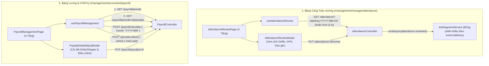

# Plan 40: Xây Dựng Lại Bảng Công Toàn Xưởng (`/management/manager/attendance`) & Bảng Lương Chu Kỳ (`/management/accountant/payroll`)

> Status: Done | Created: 2026-10-26 | Completed: 2026-10-26

## 1. Overview & Affected Files

### 1.1. Mục tiêu & Hiện trạng (Kèm dẫn chứng mã nguồn)

Qua khảo sát mã nguồn hiện tại của `fe-react-thanhxuan-internal` và `be-nestjs-thanhxuan`, hai trang `/management/manager/attendance` và `/management/accountant/payroll` đang bị lệch thiết kế 4 tầng của web hiện tại và đứt gãy nghiêm trọng hợp đồng API (API Contract Drift):

#### A. Trang `/management/manager/attendance` ([AttendanceReviewPage.tsx](file:///d:/PROJECT/Website_Thanh_Xuan_Company/fe-react-thanhxuan-internal/src/features/management/attendance/AttendanceReviewPage.tsx#L10-L113))
1. **Lỗi định dạng `dateKey` khiến bảng luôn trống:**
   - Tại [AttendanceReviewPage.tsx:16-17](file:///d:/PROJECT/Website_Thanh_Xuan_Company/fe-react-thanhxuan-internal/src/features/management/attendance/AttendanceReviewPage.tsx#L16-L17), Frontend xóa dấu gạch ngang `selectedDate.replace(/-/g, '')` (gửi `20261026`), trong khi Backend lưu và truy vấn `dateKey` chuẩn `YYYY-MM-DD` (`2026-10-26`) tại [attendance-record.schema.ts:84](file:///d:/PROJECT/Website_Thanh_Xuan_Company/be-nestjs-thanhxuan/src/modules/internal/attendance/schemas/attendance-record.schema.ts#L84) và [date-key.ts:7-12](file:///d:/PROJECT/Website_Thanh_Xuan_Company/be-nestjs-thanhxuan/src/common/utils/date-key.ts#L7-L12).
   - Tại [AttendanceReviewPage.tsx:11](file:///d:/PROJECT/Website_Thanh_Xuan_Company/fe-react-thanhxuan-internal/src/features/management/attendance/AttendanceReviewPage.tsx#L11), khởi tạo ngày bằng `new Date().toISOString().split('T')[0]` (UTC) thay vì `getTodayVN()` (`Asia/Ho_Chi_Minh`).
2. **Thiếu hoàn toàn tính năng Duyệt / Chỉnh sửa ca làm việc & Xem ảnh Selfie / GPS:**
   - Backend đã có `PUT /attendance/:id/review` ([attendance.controller.ts:80-88](file:///d:/PROJECT/Website_Thanh_Xuan_Company/be-nestjs-thanhxuan/src/modules/internal/attendance/attendance.controller.ts#L80-L88)) nhận `ReviewAttendanceDto` (`dayType`, `checkInAt`, `checkOutAt`, `status`, `reason`), nhưng Frontend chưa có Modal hay nút thao tác để Quản lý xử lý các ca quên check-out (`NEEDS_REVIEW`), duyệt ca (`APPROVED`), điều chỉnh giờ vào/ra hoặc loại ngày công (`NORMAL`, `OVERTIME`, `SUNDAY`, `HOLIDAY`).
   - Chưa hiển thị ảnh chụp camera selfie (`check_in.photoId`, `check_out.photoId`, hoặc nhãn tự động từ phiếu giao nhận `AUTO_HANDOVER_SIGN` của Shipper), thông tin sai số GPS và lịch sử người duyệt (`review`).
   - Tại Backend [job-segment.service.ts:279-290](file:///d:/PROJECT/Website_Thanh_Xuan_Company/be-nestjs-thanhxuan/src/modules/internal/piecework/services/job-segment.service.ts#L279-L290), khi Quản lý review ca của ngày hôm trước (`ATTENDANCE_EVENTS.REVIEWED`), hàm `closeOpenSegmentAt` đang lấy `toDateKey(new Date())` (hôm nay) thay vì `event.dateKey` của ca được duyệt.
3. **Lệch chuẩn UI 4 tầng & Type:**
   - Chưa dùng `PageBanner`, `PageActionBar`, 4 thẻ `StatCard`, bộ lọc khoảng ngày/trạng thái/tìm kiếm nhân viên.
   - Enum `DayType` và `AttendanceStatus` tại [types/index.ts:311-321](file:///d:/PROJECT/Website_Thanh_Xuan_Company/fe-react-thanhxuan-internal/src/types/index.ts#L311-L321) thiếu `OVERTIME`, `SUNDAY`, `APPROVED` so với Backend [internal.enums.ts:77-89](file:///d:/PROJECT/Website_Thanh_Xuan_Company/be-nestjs-thanhxuan/src/modules/internal/common/enums/internal.enums.ts#L77-L89).
   - Còn giữ re-export tạm `export { AttendanceReviewPage as AttendanceReviewView }` ([AttendanceReviewPage.tsx:113](file:///d:/PROJECT/Website_Thanh_Xuan_Company/fe-react-thanhxuan-internal/src/features/management/attendance/AttendanceReviewPage.tsx#L113)).

#### B. Trang `/management/accountant/payroll` ([PayrollManagementPage.tsx](file:///d:/PROJECT/Website_Thanh_Xuan_Company/fe-react-thanhxuan-internal/src/features/management/payroll/PayrollManagementPage.tsx#L10-L207))
1. **Đứt gãy toàn bộ các API gọi lên Backend:**
   - **Lấy kỳ lương & phiếu lương:** [PayrollManagementPage.tsx:20](file:///d:/PROJECT/Website_Thanh_Xuan_Company/fe-react-thanhxuan-internal/src/features/management/payroll/PayrollManagementPage.tsx#L20) gọi `GET /payroll/periods?month=${selectedMonth}&year=${selectedYear}` và đọc `payrollPeriod.payslips`, trong khi Backend [payroll.controller.ts:104-114](file:///d:/PROJECT/Website_Thanh_Xuan_Company/be-nestjs-thanhxuan/src/modules/internal/payroll/payroll.controller.ts#L104-L114) trả về danh sách `PayrollPeriod[]` tại `GET /payroll/periods` (với `month: 'YYYY-MM'`) và tách riêng API lấy danh sách phiếu lương tại `GET /payroll/periods/:id/payslips`.
   - **Tính lương:** [PayrollManagementPage.tsx:27](file:///d:/PROJECT/Website_Thanh_Xuan_Company/fe-react-thanhxuan-internal/src/features/management/payroll/PayrollManagementPage.tsx#L27) gửi `{ month: selectedMonth, year: selectedYear }` (số), trong khi `CalculatePayrollDto` ([calculate-payroll.dto.ts:4-10](file:///d:/PROJECT/Website_Thanh_Xuan_Company/be-nestjs-thanhxuan/src/modules/internal/payroll/dto/calculate-payroll.dto.ts#L4-L10)) bắt buộc `{ month: 'YYYY-MM' }` $\rightarrow$ luôn lỗi `400 Bad Request`.
   - **Chi trả lương:** [PayrollManagementPage.tsx:49](file:///d:/PROJECT/Website_Thanh_Xuan_Company/fe-react-thanhxuan-internal/src/features/management/payroll/PayrollManagementPage.tsx#L49) gọi `POST /payroll/periods/:id/pay`, trong khi Backend ([payroll.controller.ts:58](file:///d:/PROJECT/Website_Thanh_Xuan_Company/be-nestjs-thanhxuan/src/modules/internal/payroll/payroll.controller.ts#L58)) là `POST /payroll/periods/:id/mark-paid` $\rightarrow$ luôn lỗi `404 Not Found`.
   - **Thiếu tính năng Mở khóa kỳ lương & Điều chỉnh phiếu lương:** Backend có `POST /payroll/periods/:id/unlock` ([payroll.controller.ts:48](file:///d:/PROJECT/Website_Thanh_Xuan_Company/be-nestjs-thanhxuan/src/modules/internal/payroll/payroll.controller.ts#L48)) và `PUT /payroll/payslips/:id` (`AdjustPayslipDto`: thưởng `bonus`, phụ cấp `allowance`, khấu trừ `deduction`, tạm ứng `advance`, `notes` tại [payroll.controller.ts:67](file:///d:/PROJECT/Website_Thanh_Xuan_Company/be-nestjs-thanhxuan/src/modules/internal/payroll/payroll.controller.ts#L67)) nhưng Frontend chưa có giao diện.
2. **Lệch cấu trúc dữ liệu `Payslip` & Logic tính lương Backend:**
   - [PayrollManagementPage.tsx:180-190](file:///d:/PROJECT/Website_Thanh_Xuan_Company/fe-react-thanhxuan-internal/src/features/management/payroll/PayrollManagementPage.tsx#L180-L190) đọc `slip.workerName`, `slip.pieceworkPay`, `slip.fuelAllowance`, trong khi Schema thực tế ([payslip.schema.ts:143-201](file:///d:/PROJECT/Website_Thanh_Xuan_Company/be-nestjs-thanhxuan/src/modules/internal/payroll/schemas/payslip.schema.ts#L143-L201)) lưu tại `slip.staffName`, `slip.role`, `slip.summary` (`days`, `workedMinutes`, `pieceQty`), `slip.lines` (`hourlyPay`, `pieceworkPay`, `fixedSalary`, `fuelReimbursement`, `bonus`, `allowance`, `deduction`, `advance`), `slip.workerDetails` (chi tiết từng khâu `HourlyWork`), và `slip.shipperDetails` (công thức lương Shipper).
   - Tại Backend [payroll.service.ts:82-87](file:///d:/PROJECT/Website_Thanh_Xuan_Company/be-nestjs-thanhxuan/src/modules/internal/payroll/payroll.service.ts#L82-L87), khi tính lương chỉ đếm các bản ghi chấm công có `status: AttendanceStatus.APPROVED`, bỏ sót các ca hợp lệ đã check-out (`CLOSED`) hoặc ca tự động check-in của Shipper khi giao nhận (`OPEN`/`CLOSED`).
   - Tại Backend [payroll.service.ts:482-493](file:///d:/PROJECT/Website_Thanh_Xuan_Company/be-nestjs-thanhxuan/src/modules/internal/payroll/payroll.service.ts#L482-L493), hàm `adjustPayslip` tính lại `netPay` chỉ cộng `lines.*`, làm mất các khoản đặc thù trong `shipperDetails` (`attendanceBonus`, `weekendShiftBonus`, `responsibilityAllowance`, `extraDeliveryPay`, `insuranceDeduction`) đối với phiếu lương của `SHIPPER`.

---

### 1.2. Phạm vi & Out of Scope
- **Trong phạm vi (In-scope):**
  - Thiết kế lại toàn diện `/management/manager/attendance` và `/management/accountant/payroll` theo kiến trúc 4 tầng (`PageBanner` $\rightarrow$ `PageActionBar` $\rightarrow$ 4 `StatCard` $\rightarrow$ Bảng & Modal chi tiết), chia tách component/modal/hook dưới 250 dòng/file.
  - Đồng bộ chính xác API Contract giữa Frontend và Backend cho Attendance & Payroll, bổ sung tính năng duyệt nhanh/duyệt chi tiết chấm công, xem chi tiết phiếu lương theo vai trò (`WORKER` theo khâu, `SHIPPER` theo chuyến/phụ cấp, `OFFICE`), điều chỉnh thưởng/phụ cấp/khấu trừ/tạm ứng (`PUT /payroll/payslips/:id`), mở khóa kỳ lương (`POST /payroll/periods/:id/unlock`) và xuất Excel bảng lương tháng (`/reports/payroll/:month/export`).
- **Ngoài phạm vi (Out-of-scope):**
  - Không thay đổi cấu trúc trang chấm công cá nhân `/operations/attendance` và trang phiếu lương cá nhân `/operations/payslip`.
  - Không thêm bất kỳ thư viện (dependency) mới nào.

### 1.3. Assumptions
- **A1:** Các ca chấm công đã hoàn tất hợp lệ (`CLOSED`) hoặc đã được Quản lý duyệt (`APPROVED`) đều được tính vào ngày công/giờ công khi chạy tính bảng lương tháng; với `SHIPPER`, các ca tự động check-in từ phiếu giao nhận (`photoId === 'AUTO_HANDOVER_SIGN'`) trong tháng cũng được ghi nhận ngày công.
- **A2:** Kế toán (`ACCOUNTANT`) có quyền `attendance.review` trong [permissions.map.ts:110](file:///d:/PROJECT/Website_Thanh_Xuan_Company/be-nestjs-thanhxuan/src/config/permissions.map.ts#L110), do đó cấp quyền truy cập `/management/manager/attendance` cho cả `ADMIN`, `MANAGER` và `ACCOUNTANT` để Kế toán đối chiếu công trước khi tính lương.
- **A3:** Chỉ `ADMIN` có quyền Khóa (`lock`) và Mở khóa (`unlock`) kỳ lương (đúng theo `@Permissions(PERMISSIONS.ACCOUNT_ADMIN)` tại [payroll.controller.ts:40-50](file:///d:/PROJECT/Website_Thanh_Xuan_Company/be-nestjs-thanhxuan/src/modules/internal/payroll/payroll.controller.ts#L40-L50)); cả `ADMIN` và `ACCOUNTANT` có quyền Tính toán lại (`calculate`), Điều chỉnh phiếu lương (`adjustPayslip`) khi kỳ ở trạng thái `DRAFT`, và Đánh dấu đã thanh toán (`mark-paid`) khi kỳ ở trạng thái `LOCKED`.

---

### 1.4. Bảng File Ảnh Hưởng

| Path | Action | Lý do |
| :--- | :---: | :--- |
| `be-nestjs-thanhxuan/src/modules/internal/piecework/services/job-segment.service.ts` | edit | Truyền `event.dateKey` vào `closeOpenSegmentAt` khi xử lý sự kiện `ATTENDANCE_EVENTS.REVIEWED` và `CHECKED_OUT` để đóng đúng phiên khâu của ngày ca làm việc. |
| `be-nestjs-thanhxuan/src/modules/internal/payroll/payroll.service.ts` | edit | Cập nhật `calculatePayroll` tính ngày công từ các ca `CLOSED` & `APPROVED` (và ca `AUTO_HANDOVER_SIGN` của Shipper); sửa `adjustPayslip` bảo toàn công thức `shipperDetails` và đồng bộ `workerDetails`. |
| `be-nestjs-thanhxuan/src/modules/internal/payroll/dto/adjust-payslip.dto.ts` | edit | Hỗ trợ thêm `extraDeliveryPay` và `insuranceDeduction` tùy chọn cho phiếu lương `SHIPPER`. |
| `fe-react-thanhxuan-internal/src/types/index.ts` | edit | Chuẩn hóa `DayType`, `AttendanceStatus`, `AttendanceReviewInfo`, `PayrollPeriod`, `PayrollPeriodStatus`, `Payslip` khớp 100% với Schema Backend. |
| `fe-react-thanhxuan-internal/src/app/(internal)/management/manager/attendance.tsx` | edit | Bổ sung `StaffRole.ACCOUNTANT` vào `allowedRoles` khớp với `permissions.map.ts`. |
| `fe-react-thanhxuan-internal/src/components/layout/nav-config.ts` | edit | Cho phép `ACCOUNTANT` thấy mục `Bảng Công Toàn Xưởng` trong nhóm `BẢNG CÔNG & LƯƠNG`. |
| `fe-react-thanhxuan-internal/src/features/management/attendance/hooks/useAttendanceReview.ts` | add | Custom hook quản lý bộ lọc ngày/khoảng ngày (`getTodayVN`), trạng thái, tìm kiếm, query `GET /attendance` và mutation `PUT /attendance/:id/review`. |
| `fe-react-thanhxuan-internal/src/features/management/attendance/components/AttendanceFilterBarComponent.tsx` | add | Thanh lọc ngày/khoảng ngày, lọc theo vai trò/trạng thái ca và ô tìm kiếm nhân sự. |
| `fe-react-thanhxuan-internal/src/features/management/attendance/components/AttendanceTableComponent.tsx` | add | Bảng danh sách ca chấm công hiển thị nhân viên, vai trò, giờ vào/ra, ảnh selfie, khoảng cách GPS, loại ngày, trạng thái và nút Duyệt nhanh / Chỉnh sửa. |
| `fe-react-thanhxuan-internal/src/features/management/attendance/modals/AttendanceReviewModal.tsx` | add | Modal đối soát ảnh chụp vào/ra, tọa độ GPS và chỉnh sửa giờ vào/ra, loại ngày công (`NORMAL`, `OVERTIME`, `SUNDAY`, `HOLIDAY`), trạng thái ca kèm lý do audit. |
| `fe-react-thanhxuan-internal/src/features/management/attendance/AttendanceReviewPage.tsx` | edit | Xây dựng lại theo bố cục 4 tầng (`PageBanner`, `PageActionBar`, 4 `StatCard`, Filter + Table + Modal); xóa re-export alias cũ. |
| `fe-react-thanhxuan-internal/src/features/management/payroll/hooks/usePayrollManagement.ts` | add | Custom hook điều phối `GET /payroll/periods`, `GET /payroll/periods/:id/payslips`, `POST /payroll/calculate`, `lock`, `unlock`, `mark-paid`, `PUT /payroll/payslips/:id` và xuất Excel. |
| `fe-react-thanhxuan-internal/src/features/management/payroll/components/PayrollActionToolbarComponent.tsx` | add | Thanh trạng thái kỳ lương (`DRAFT` / `LOCKED` / `PAID`), bộ lọc vai trò/tìm kiếm và các nút hành động theo quyền (`ADMIN` / `ACCOUNTANT`). |
| `fe-react-thanhxuan-internal/src/features/management/payroll/components/PayslipTableComponent.tsx` | add | Bảng tổng hợp phiếu lương nhân sự với đầy đủ cột: Nhân viên, Vai trò, Ngày/Giờ công, Lương chính/Theo khâu, Phụ cấp/Xăng, Thưởng/Khấu trừ/Tạm ứng, Thực lĩnh (`netPay`) và thao tác. |
| `fe-react-thanhxuan-internal/src/features/management/payroll/modals/PayslipDetailAdjustModal.tsx` | add | Modal xem chi tiết bóc tách lương (`workerDetails` theo từng khâu & từng ngày, `shipperDetails` theo công thức tài xế) kết hợp form điều chỉnh thưởng/phụ cấp/khấu trừ/tạm ứng. |
| `fe-react-thanhxuan-internal/src/features/management/payroll/PayrollManagementPage.tsx` | edit | Xây dựng lại theo bố cục 4 tầng (`PageBanner`, `PageActionBar`, 4 `StatCard`, Toolbar + Table + Modal); xóa re-export alias cũ. |
| `.agents/docs/CODEBASE_ATLAS.md` | edit | Cập nhật ánh xạ `AttendanceReviewPage` và `PayrollManagementPage` cùng các components, modals, hooks mới. |
| `.agents/docs/srs_sdd/srs_sdd_fe_internal.md` | edit | Cập nhật đặc tả kiến trúc màn hình Quản lý Chấm công và Quản lý Bảng lương. |
| `.agents/docs/srs_sdd/srs_sdd_backend.md` | edit | Cập nhật quy tắc tính công trong `PayrollService` và điều chỉnh phiếu lương. |
| `.agents/docs/SRS_SDD.md` | edit | Ghi 1 dòng vào Document History cho Plan 40. |
| `.agents/docs/CHANGELOG.md` | edit | Ghi nhật ký kỹ thuật chi tiết cho Plan 40. |

---

## 2. Technical Approach

### 2.1. Kiến trúc & Luồng Dữ Liệu (Data Flow)



### 2.2. Chuẩn Hóa Interface & Data Contract (`src/types/index.ts`)

```ts
export enum DayType {
  NORMAL = 'NORMAL',
  OVERTIME = 'OVERTIME',
  SUNDAY = 'SUNDAY',
  HOLIDAY = 'HOLIDAY',
}

export enum AttendanceStatus {
  OPEN = 'OPEN',
  CLOSED = 'CLOSED',
  NEEDS_REVIEW = 'NEEDS_REVIEW',
  APPROVED = 'APPROVED',
}

export interface PayrollPeriod {
  _id: string;
  month: string; // 'YYYY-MM'
  status: 'DRAFT' | 'LOCKED' | 'PAID';
  lockedBy?: string | StaffUser;
  lockedAt?: string;
  notes?: string;
}
```

### 2.3. Thiết Kế Chi Tiết Hai Màn Hình Theo Chuẩn 4 Tầng

#### 1. Trang `/management/manager/attendance` (`AttendanceReviewPage.tsx`)
- **Tầng 1 (`PageBanner`):** Icon `CalendarCheck`, tiêu đề *"Bảng Chấm Công & Giám Sát Ca Toàn Xưởng"*, tích hợp cụm điều hướng ngày nhanh (`ChevronLeft`, `Hôm nay`, `ChevronRight`, `RefreshCw`) theo múi giờ `Asia/Ho_Chi_Minh`.
- **Tầng 2 (`PageActionBar`):**
  - *Trái:* Các tab lọc nhanh trạng thái (`Tất cả`, `Đang trong ca (OPEN)`, `Cần rà soát (NEEDS_REVIEW)`, `Đã đóng ca (CLOSED)`, `Đã duyệt (APPROVED)`).
  - *Phải:* Chuyển đổi chế độ xem (`Theo ngày` / `Khoảng ngày`) và nút **"Duyệt Nhanh Các Ca Hợp Lệ"** (duyệt hàng loạt các ca `CLOSED` trong ngày sang `APPROVED`).
- **Tầng 3 (`4 StatCard`):**
  1. **Tổng Quân Số Điểm Danh:** Tổng số ca trong ngày/kỳ (kèm số thợ xưởng & tài xế).
  2. **Đang Trong Ca (`OPEN`):** Số nhân viên đang làm việc tại xưởng.
  3. **Hoàn Tất / Đã Duyệt (`CLOSED` + `APPROVED`):** Tổng giờ công thực tế (`Xh Ym`).
  4. **Cần Rà Soát (`NEEDS_REVIEW`):** Cảnh báo đỏ các ca quên check-out (> 16h) hoặc bất thường cần Quản lý xử lý.
- **Tầng 4 (`AttendanceFilterBarComponent` + `AttendanceTableComponent` + `AttendanceReviewModal`):**
  - Bảng hiển thị rõ: Họ tên & Vai trò, Ngày (`dateKey`), Giờ vào & Ảnh/GPS Check-in, Giờ ra & Ảnh/GPS Check-out, Tổng thời gian (`Xh Ym`), Loại ngày (`NORMAL` x1.0, `OVERTIME` x1.5, `SUNDAY` x2.0, `HOLIDAY` x3.0), Trạng thái, Người duyệt và nút **Rà soát / Sửa ca** + **Duyệt nhanh**.

#### 2. Trang `/management/accountant/payroll` (`PayrollManagementPage.tsx`)
- **Tầng 1 (`PageBanner`):** Icon `Calculator`, tiêu đề *"Quản Trị Bảng Lương & Chốt Kỳ Thanh Toán"*, cụm chọn Tháng (`YYYY-MM`) + nút Làm mới + nút Xuất Excel (`/reports/payroll/:month/export`).
- **Tầng 2 (`PageActionBar`):**
  - *Trái:* Lọc theo nhóm nhân sự (`Tất cả`, `Thợ xưởng (WORKER)`, `Tài xế (SHIPPER)`, `Khối văn phòng/Quản lý`).
  - *Phải:* Các nút điều hành chu kỳ lương theo trạng thái kỳ:
    - Khi chưa có kỳ hoặc `DRAFT`: Nút **"Tính Toán Bảng Lương"** (`POST /payroll/calculate` với `{ month: 'YYYY-MM' }`) và nút **"Chốt Sổ & Khóa Kỳ (Lock)"** (dành cho `ADMIN`).
    - Khi `LOCKED`: Nút **"Mở Khóa Kỳ Lương"** (dành cho `ADMIN`, yêu cầu nhập lý do audit) và nút **"Xác Nhận Đã Chi Trả (Mark Paid)"** (`POST /payroll/periods/:id/mark-paid`).
- **Tầng 3 (`4 StatCard`):**
  1. **Tổng Nhân Sự Trong Kỳ:** Số phiếu lương đã tổng hợp & trạng thái kỳ (`DRAFT` / `LOCKED` / `PAID`).
  2. **Tổng Lương Công & Sản Lượng:** Tổng `pieceworkPay + hourlyPay + fixedSalary`.
  3. **Tổng Phụ Cấp, Thưởng & Xăng Xe:** Tổng `fuelReimbursement + bonus + allowance`.
  4. **Tổng Thực Lĩnh Toàn Xưởng (`Net Pay`):** Tổng `netPay` sau khi trừ khấu trừ & tạm ứng.
- **Tầng 4 (`PayrollActionToolbarComponent` + `PayslipTableComponent` + `PayslipDetailAdjustModal`):**
  - Bảng phiếu lương hiển thị: Nhân viên & Vai trò, Ngày công & Giờ công (`summary.days`, `summary.workedMinutes`), Lương chính/Khâu, Hoàn xăng & Phụ cấp, Thưởng, Khấu trừ/Tạm ứng, Thực lĩnh (`netPay`), và nút **"Chi Tiết / Điều Chỉnh"**.
  - `PayslipDetailAdjustModal`:
    - Hiển thị bóc tách chuyên sâu: với `WORKER` hiện bảng tổng hợp theo từng khâu (`jobName`, số giờ, đơn giá/giờ, thành tiền) và lịch sử từng ngày; với `SHIPPER` hiện chi tiết lương ngày định mức, thưởng chuyên cần, ca cuối tuần, phụ cấp trách nhiệm, hoàn chi phí xe, BHXH.
    - Cho phép chỉnh sửa `bonus`, `allowance`, `deduction`, `advance` (và `extraDeliveryPay`, `insuranceDeduction` cho `SHIPPER`), `notes` khi kỳ đang ở trạng thái `DRAFT`.

---

## 3. Implementation Tasks (Checklist)

### Backend (`be-nestjs-thanhxuan/`)
- [x] T1: `src/modules/internal/piecework/services/job-segment.service.ts` - Cập nhật `closeOpenSegmentAt(workerId, at, dateKey?)` nhận `dateKey` từ sự kiện `ATTENDANCE_EVENTS.CHECKED_OUT` và `ATTENDANCE_EVENTS.REVIEWED` thay vì luôn dùng ngày hiện tại - Verify unit test `job-segment.service.spec.ts` pass - Depends on: none
- [x] T2: `src/modules/internal/payroll/dto/adjust-payslip.dto.ts` & `src/modules/internal/payroll/payroll.service.ts` - Cập nhật `calculatePayroll` lấy bản ghi chấm công `status: { $in: [CLOSED, APPROVED] }` (và ca tự động giao nhận của Shipper); cập nhật `adjustPayslip` tính đúng `netPay` cho cả `SHIPPER`, `WORKER` và các vai trò khác - Verify unit test `payroll.service.spec.ts` pass - Depends on: none

### Frontend Internal (`fe-react-thanhxuan-internal/`)
- [x] T3: `src/types/index.ts`, `src/app/(internal)/management/manager/attendance.tsx`, `src/components/layout/nav-config.ts` - Chuẩn hóa type `DayType`, `AttendanceStatus`, `AttendanceLog`, `PayrollPeriod`, `Payslip` khớp Backend; bổ sung quyền `ACCOUNTANT` truy cập trang Bảng công toàn xưởng - Depends on: T1, T2
- [x] T4: `src/features/management/attendance/hooks/useAttendanceReview.ts` - Tạo custom hook quản lý state lọc ngày/khoảng ngày (`getTodayVN`), trạng thái, tìm kiếm, query `GET /attendance` (giữ đúng format `YYYY-MM-DD`), mutation `PUT /attendance/:id/review` và duyệt hàng loạt ca `CLOSED` - Depends on: T3
- [x] T5: `src/features/management/attendance/components/AttendanceFilterBarComponent.tsx` & `AttendanceTableComponent.tsx` - Tạo bộ lọc và bảng danh sách ca chấm công (hiển thị ảnh selfie, khoảng cách GPS, loại ngày, thời lượng, trạng thái, nút thao tác) (< 250 dòng/file) - Depends on: T4
- [x] T6: `src/features/management/attendance/modals/AttendanceReviewModal.tsx` & `AttendanceReviewPage.tsx` - Tạo Modal rà soát/chỉnh sửa ca làm việc và lắp ráp `AttendanceReviewPage.tsx` theo cấu trúc 4 tầng chuẩn, xóa alias `AttendanceReviewView` (< 250 dòng/file) - Depends on: T5
- [x] T7: `src/features/management/payroll/hooks/usePayrollManagement.ts` - Tạo custom hook kết nối đúng `GET /payroll/periods`, `GET /payroll/periods/:id/payslips`, `POST /payroll/calculate` (`{ month: 'YYYY-MM' }`), `lock`, `unlock`, `mark-paid`, `PUT /payroll/payslips/:id` và xuất Excel - Depends on: T3
- [x] T8: `src/features/management/payroll/components/PayrollActionToolbarComponent.tsx` & `PayslipTableComponent.tsx` - Tạo thanh điều khiển kỳ lương và bảng danh sách phiếu lương chuẩn hóa theo `Payslip` schema (< 250 dòng/file) - Depends on: T7
- [x] T9: `src/features/management/payroll/modals/PayslipDetailAdjustModal.tsx` & `PayrollManagementPage.tsx` - Tạo Modal xem chi tiết phiếu lương (`workerDetails` / `shipperDetails` / `lines`) & điều chỉnh khoản cộng/trừ, lắp ráp `PayrollManagementPage.tsx` theo cấu trúc 4 tầng chuẩn, xóa alias `PayrollManagementView` (< 250 dòng/file) - Depends on: T8

### Verification & Documentation Sync
- [x] T10: Chạy đầy đủ `pnpm lint`, `pnpm exec tsc --noEmit`, `pnpm test`, `pnpm build` cho cả `be-nestjs-thanhxuan` và `fe-react-thanhxuan-internal` - Depends on: T1–T9
- [x] T11: Đồng bộ tài liệu tại `.agents/docs/CODEBASE_ATLAS.md`, `.agents/docs/srs_sdd/srs_sdd_fe_internal.md`, `.agents/docs/srs_sdd/srs_sdd_backend.md`, `.agents/docs/SRS_SDD.md`, và `.agents/docs/CHANGELOG.md`; commit & push lên nhánh `dev` - Depends on: T10

---

## 4. Verification & Testing

### 4.1. Lệnh Kiểm Thử Tự Động
- Tại `be-nestjs-thanhxuan/`:
  - `pnpm lint`
  - `pnpm exec tsc --noEmit`
  - `pnpm test`
  - `pnpm build`
- Tại `fe-react-thanhxuan-internal/`:
  - `pnpm lint`
  - `pnpm exec tsc --noEmit`
  - `pnpm test`
  - `pnpm build`

### 4.2. Kịch Bản Kiểm Thử (Happy Path & Edge Cases)
1. **Bảng Công Toàn Xưởng (`/management/manager/attendance`):**
   - *Happy path:* Mở trang mặc định hiển thị đúng ngày hôm nay theo giờ Việt Nam (`YYYY-MM-DD`), tải đầy đủ các ca chấm công trong ngày, hiển thị đúng 4 thẻ `StatCard`, ảnh chụp camera selfie vào/ra và khoảng cách GPS tới xưởng.
   - *Review & Chỉnh sửa:* Bấm vào 1 ca `NEEDS_REVIEW` (quên check-out) hoặc `CLOSED`, nhập giờ ra ca + chọn loại ngày (`NORMAL`/`OVERTIME`/`SUNDAY`/`HOLIDAY`) + nhập lý do và bấm Lưu $\rightarrow$ Cập nhật thành công sang `APPROVED`, tự động tính lại `workedMinutes` và đóng phiên khâu tương ứng.
2. **Bảng Lương & Chốt Kỳ (`/management/accountant/payroll`):**
   - *Happy path:* Chọn tháng (`YYYY-MM`), bấm **"Tính Toán Bảng Lương"** $\rightarrow$ Gọi `POST /payroll/calculate { month: 'YYYY-MM' }` thành công, tự động tải danh sách phiếu lương qua `GET /payroll/periods/:id/payslips` và hiển thị đầy đủ 4 thẻ `StatCard` cùng bảng phiếu lương.
   - *Chi tiết & Điều chỉnh:* Bấm vào phiếu lương của Thợ xưởng (`WORKER`) hoặc Tài xế (`SHIPPER`) $\rightarrow$ Mở modal xem chi tiết từng khâu/từng ngày hoặc công thức tài xế; nhập Thưởng / Phụ cấp / Tạm ứng / Khấu trừ và lưu $\rightarrow$ `netPay` cập nhật chính xác ngay lập tức.
   - *Chu kỳ Khóa / Mở khóa / Chi trả:* `ADMIN` bấm **Chốt Sổ (Lock)** $\rightarrow$ trạng thái chuyển sang `LOCKED`, khóa nút chỉnh sửa; bấm **Hoàn Tất Chi Trả** $\rightarrow$ gọi `POST /payroll/periods/:id/mark-paid` chuyển sang `PAID`; `ADMIN` có thể bấm **Mở Khóa** kèm lý do nếu cần tính lại.

### 4.3. Definition of Done
- Lint, typecheck, test và build pass 100% cho `be-nestjs-thanhxuan` và `fe-react-thanhxuan-internal`.
- Không còn bất kỳ file re-export tạm thời nào, mọi file mới/sửa đều dưới ngưỡng 250-300 dòng.
- Đồng bộ đầy đủ hệ thống tài liệu (`CODEBASE_ATLAS.md`, `srs_sdd_backend.md`, `srs_sdd_fe_internal.md`, `SRS_SDD.md`, `CHANGELOG.md`).
- Tự động commit và push lên nhánh `dev`.

---

## 5. Risks & Rollback

- **Rủi ro:** Thay đổi interface `Payslip` trong `src/types/index.ts` có thể ảnh hưởng tới `OfficialPayslipCardComponent.tsx` tại trang `/operations/payslip`.
  - *Giảm thiểu:* Giữ tương thích các trường hiển thị trên `OfficialPayslipCardComponent.tsx` và kiểm chứng bằng `pnpm exec tsc --noEmit` + `pnpm build`.
- **Rollback:** Revert commit của Plan 40 trên nhánh `dev` (không có thay đổi phá hủy cấu trúc bảng DB).

## Changelog

- 2026-10-26: Khởi tạo và hoàn tất thực thi Plan 40 xây dựng lại `/management/manager/attendance` và `/management/accountant/payroll` chuẩn 4 tầng ergonomic.

## Execution Log

1. **Backend (`be-nestjs-thanhxuan`):**
   - Đã cập nhật `JobSegmentService.closeOpenSegmentAt` hỗ trợ `customDateKey` truyền từ sự kiện kết ca điểm danh.
   - Đã cập nhật `adjust-payslip.dto.ts` bổ sung `extraDeliveryPay` và `insuranceDeduction`.
   - Đã cập nhật `PayrollService.calculatePayroll` mở rộng lấy bản ghi điểm danh `CLOSED` + `APPROVED` (và Shipper `AUTO_HANDOVER_SIGN`).
   - Đã cập nhật `PayrollService.adjustPayslip` bảo toàn `shipperDetails` và cập nhật `workerDetails` khi điều chỉnh, tính lại `netPay` chính xác.
   - Unit tests: `job-segment.service.spec.ts` (3/3 pass), `payroll.service.spec.ts` (7/7 pass).
   - Typecheck & Build: `tsc --noEmit` pass (0 errors), `nest build` pass.

2. **Frontend Internal (`fe-react-thanhxuan-internal`):**
   - Chuẩn hóa kiểu dữ liệu tại `src/types/index.ts`.
   - Phân quyền cho phép `StaffRole.ACCOUNTANT` truy cập màn hình Bảng công toàn xưởng (`attendance.tsx` & `nav-config.ts`).
   - Tách nhỏ và xây dựng mới cụm màn hình Bảng công toàn xưởng:
     - `useAttendanceReview.ts`: Quản lý query, filter, review single/batch.
     - `AttendanceFilterBarComponent.tsx`: Thanh điều khiển lọc ngày/khoảng ngày, trạng thái, vai trò.
     - `AttendanceTableComponent.tsx`: Bảng hiển thị ca chấm công, ảnh selfie, tọa độ GPS, thao tác.
     - `AttendanceReviewModal.tsx`: Modal xem chi tiết ảnh/GPS, điều chỉnh giờ, loại ngày, duyệt ca.
     - `AttendanceReviewPage.tsx`: Màn hình 4 tầng chuẩn, xóa alias `AttendanceReviewView`.
   - Tách nhỏ và xây dựng mới cụm màn hình Bảng lương chu kỳ:
     - `usePayrollManagement.ts`: Quản lý kỳ lương theo tháng `YYYY-MM`, gọi tính lương, khóa/mở khóa, thanh toán, điều chỉnh.
     - `PayrollActionToolbarComponent.tsx`: Thanh công cụ thao tác kỳ lương & xuất Excel.
     - `PayslipTableComponent.tsx`: Bảng danh sách phiếu lương với đầy đủ cơ cấu thu nhập.
     - `PayslipDetailAdjustModal.tsx`: Modal bóc tách lương thợ/tài xế & điều chỉnh thưởng phạt.
     - `PayrollManagementPage.tsx`: Màn hình 4 tầng chuẩn, xóa alias `PayrollManagementView`.
   - Typecheck & Build: `tsc --noEmit` pass (0 errors), `vite build` pass.

3. **Documentation:**
   - Cập nhật đồng bộ `.agents/docs/CODEBASE_ATLAS.md`, `.agents/docs/SRS_SDD.md`, `.agents/docs/srs_sdd/srs_sdd_fe_internal.md`, `.agents/docs/srs_sdd/srs_sdd_backend.md`, và `.agents/docs/CHANGELOG.md`.
