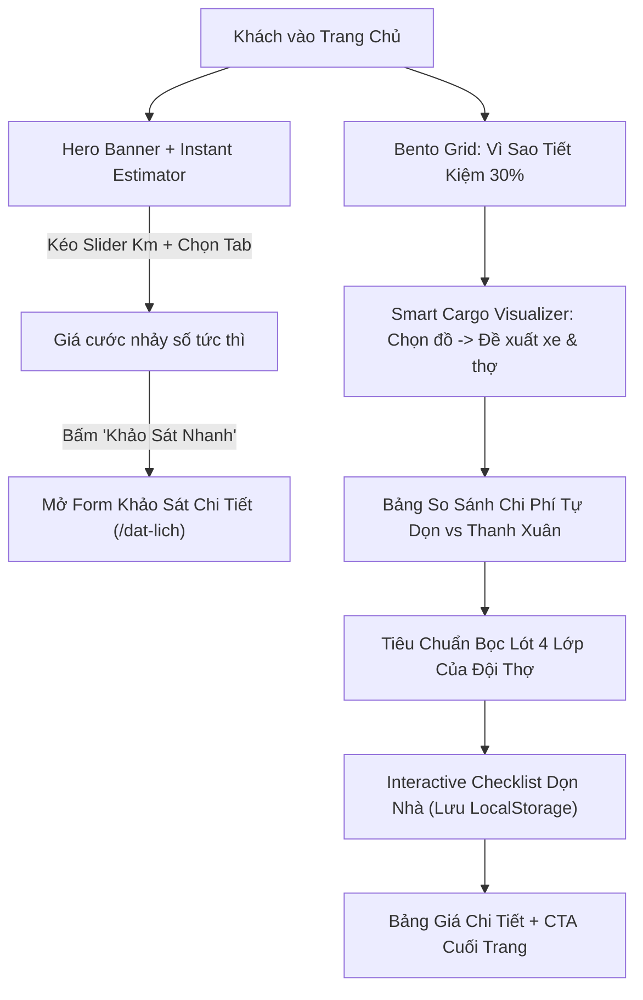

# Plan 49: Nâng Cấp Toàn Diện Website Chuyển Nhà Tiết Kiệm (Modern Tech-Logistics, Trải Nghiệm WOW & Tối Ưu Mô Hình Nhân Lực Bốc Xếp Chuyên Nghiệp)

> Status: Done | Created: 2026-10-28

## 1. Overview & Affected Files

### 1.1. Mục tiêu
- **Tái định vị chuẩn xác mô hình kinh doanh**: Thay thế toàn bộ các thông điệp cũ nhận vơ "sở hữu đội 50 xe tải" bằng định vị **Mô hình Tinh Gọn (Asset-Light Logistics)**: Thế mạnh cốt lõi là **Đội thợ bốc xếp, thợ mộc, thợ điện lạnh lành nghề cơ hữu của Thanh Xuân** kết hợp **Mạng lưới đối tác xe tải vệ tinh điều xe giá gốc**. Đây chính là lý do chân thực và thuyết phục nhất giải thích vì sao dịch vụ **tiết kiệm đến 30% chi phí**.
- **Tạo hiệu ứng thị giác WOW & Bắt kịp xu hướng thiết kế 2026**:
  - Giao diện phong cách Modern Tech-Logistics (kết hợp Slate hiện đại `#0f172a`, Cam năng động `#ea580c` và Xanh Emerald `#10b981` cho thông điệp tiết kiệm & bảo chứng).
  - Tích hợp **Hero Instant Estimator**: Widget tính giá tương tác ngay trên Hero với Slider Km, nhảy số trực quan trong 5 giây mà không cần chuyển trang.
  - Bố cục **Bento Grid**: Trực quan hóa 4 lý do tiết kiệm tiền (Không gánh khấu hao xe, Thợ kiêm tháo lắp điện lạnh/gỗ, Bao trọn vật tư, Đền bù 100%).
  - Bộ mô phỏng **Smart Cargo Visualizer**: Khách chọn đồ đạc trực quan -> Hệ thống đề xuất ngay kích cỡ xe vừa vặn nhất (tránh thuê xe quá to lãng phí) và số lượng nhân công tối ưu.
  - Bảng so sánh chi phí đa chiều **Cost Comparison Table**: Bóc tách chi phí ẩn của việc "Tự dọn bằng xe ba gác" vs "Dùng dịch vụ Thanh Xuân".
  - Bộ công cụ tương tác giữ chân người dùng **Interactive Moving Checklist**: Checklist 10 bước dọn nhà lưu tự động LocalStorage, kích thích người dùng bookmark trang.
  - Trực quan hóa **Quy chuẩn bọc lót 4 lớp**: Thể hiện tay nghề kỹ thuật của đội thợ Thanh Xuân (Màng PE, xốp nổ, carton góc, đai cố định).
- **Mở rộng các gói dịch vụ linh hoạt**:
  - Bổ sung gói: **Chỉ thuê Đội thợ bốc xếp & Tháo lắp theo giờ / theo người** (dành cho khách đã có xe).
  - Bổ sung gói: **Tháo lắp kỹ thuật chuyên sâu** (Điều hòa, bình nóng lạnh, giường tủ gỗ công nghiệp/tự nhiên).
- **Refactor kiến trúc code tuân thủ kỷ luật (< 250 - 300 dòng)**:
  - Chia nhỏ god-component `QuoteWizardForm.tsx` (hiện 778 dòng) thành 4 sub-components chuyên trách (`Step1LocationComponent`, `Step2ItemsComponent`, `Step3ScheduleComponent`, `Step4ReviewComponent`).
  - Tách các module giao diện trang chủ ra thư mục `src/components/home/`.
  - Bổ sung `LABOR_ONLY` vào enum dịch vụ ở cả Backend và Frontend.

### 1.2. Out of scope
- Không thay đổi cấu trúc database collections cốt lõi (`moving_quotes`, `moving_services`, `moving_articles`).
- Không làm thay đổi luồng xác thực hay phân hệ nội bộ (`fe-react-thanhxuan-internal`).

### 1.3. Bảng file ảnh hưởng

| Path | Action | Lý do |
| :--- | :---: | :--- |
| `be-nestjs-thanhxuan/src/modules/moving/common/enums/moving.enums.ts` | Edit | Bổ sung enum `LABOR_ONLY = 'LABOR_ONLY'` vào `MovingServiceType` |
| `fe-nextjs-chuyennhatietkiem/src/types/index.ts` | Edit | Đồng bộ enum `LABOR_ONLY` vào `MovingServiceType` |
| `fe-nextjs-chuyennhatietkiem/src/components/home/HeroEstimatorComponent.tsx` | Add | Widget tương tác tính giá nhanh trên Hero (Slider Km, Tab chuyển đổi nhu cầu, Counter nhảy số) |
| `fe-nextjs-chuyennhatietkiem/src/components/home/WhySaveBentoComponent.tsx` | Add | Bento Grid hiện đại giải thích mô hình tinh gọn tiết kiệm chi phí 30% |
| `fe-nextjs-chuyennhatietkiem/src/components/home/SmartCargoVisualizerComponent.tsx` | Add | Bộ mô phỏng chọn đồ đạc trực quan -> gợi ý kích cỡ xe và số thợ |
| `fe-nextjs-chuyennhatietkiem/src/components/home/CostComparisonComponent.tsx` | Add | Bảng so sánh trực quan "Tự dọn vs Dịch vụ Thanh Xuân" |
| `fe-nextjs-chuyennhatietkiem/src/components/home/PackingProtectionComponent.tsx` | Add | Trực quan hóa quy chuẩn đóng gói bọc lót 4 lớp của đội thợ |
| `fe-nextjs-chuyennhatietkiem/src/components/home/InteractiveChecklistComponent.tsx` | Add | Checklist dọn nhà tương tác có lưu LocalStorage |
| `fe-nextjs-chuyennhatietkiem/src/app/page.tsx` | Edit | Tái cấu trúc trang chủ tích hợp các component mới, loại bỏ câu chữ nhận vơ đội xe (< 250 dòng) |
| `fe-nextjs-chuyennhatietkiem/src/components/layout/Header.tsx` | Edit | Chuẩn hóa thông điệp cam kết, thêm hotline & định vị đội thợ cơ hữu |
| `fe-nextjs-chuyennhatietkiem/src/components/layout/Footer.tsx` | Edit | Cập nhật thông tin chi nhánh, dịch vụ thợ bốc xếp và xe tải đối tác |
| `fe-nextjs-chuyennhatietkiem/src/app/bang-gia/page.tsx` | Edit | Bổ sung bảng giá nhân công bốc xếp theo giờ và bảng giá tháo lắp điện lạnh/nội thất |
| `fe-nextjs-chuyennhatietkiem/src/app/dich-vu/page.tsx` | Edit | Chuẩn hóa danh mục dịch vụ (thêm gói thuê thợ bốc xếp, tháo lắp đồ gỗ điện lạnh) |
| `fe-nextjs-chuyennhatietkiem/src/app/dich-vu/[slug]/page.tsx` | Edit | Chuẩn hóa copywriting trang chi tiết, nhấn mạnh tay nghề thợ |
| `fe-nextjs-chuyennhatietkiem/src/app/lien-he/page.tsx` | Edit | Điều chỉnh câu từ mạng lưới điều phối xe và văn phòng tiếp nhận |
| `fe-nextjs-chuyennhatietkiem/src/features/quote-form/components/Step1LocationComponent.tsx` | Add | Sub-component bước 1: Địa điểm & thang bộ/thang máy (< 200 dòng) |
| `fe-nextjs-chuyennhatietkiem/src/features/quote-form/components/Step2ItemsComponent.tsx` | Add | Sub-component bước 2: Loại hình & danh sách đồ cồng kềnh (< 200 dòng) |
| `fe-nextjs-chuyennhatietkiem/src/features/quote-form/components/Step3ScheduleComponent.tsx` | Add | Sub-component bước 3: Thời gian, ảnh hiện trường & ghi chú (< 200 dòng) |
| `fe-nextjs-chuyennhatietkiem/src/features/quote-form/components/Step4ReviewComponent.tsx` | Add | Sub-component bước 4: Thông tin liên hệ, dự toán & gửi đơn (< 200 dòng) |
| `fe-nextjs-chuyennhatietkiem/src/features/quote-form/QuoteWizardForm.tsx` | Edit | Tinh gọn thành State Controller quản lý step và gọi API (< 200 dòng) |
| `fe-nextjs-chuyennhatietkiem/src/lib/api-client.ts` | Edit | Cập nhật fallback data thêm gói thuê thợ bốc xếp & tháo lắp kỹ thuật |
| `.agents/docs/CODEBASE_ATLAS.md` | Edit | Cập nhật cấu trúc component mới của `fe-nextjs-chuyennhatietkiem` |
| `.agents/docs/srs_sdd/srs_sdd_fe_nextjs.md` | Edit | Cập nhật tài liệu kiến trúc & tính năng phân hệ moving |
| `.agents/docs/DATABASE_DICTIONARY.md` | Edit | Cập nhật enum `MovingServiceType` có thêm `LABOR_ONLY` |
| `.agents/docs/SRS_SDD.md` | Edit | Cập nhật 1 dòng Document History |
| `CHANGELOG.md` | Edit | Ghi nhận chi tiết bài luận thực thi Plan 49 |

---

## 2. Technical Approach

### 2.1. Kiến Trúc Dữ Liệu & Enum Mở Rộng
- Thêm giá trị `LABOR_ONLY` vào enum `MovingServiceType`:
```typescript
export enum MovingServiceType {
  STUDENT_ROOM = 'STUDENT_ROOM', // Chuyển trọ sinh viên
  APARTMENT = 'APARTMENT',       // Chuyển căn hộ chung cư / nhà phố
  OFFICE = 'OFFICE',             // Chuyển văn phòng
  TRUCK_RENTAL = 'TRUCK_RENTAL', // Thuê xe tải chở hàng
  LABOR_ONLY = 'LABOR_ONLY',     // Chỉ thuê thợ bốc xếp / tháo lắp kỹ thuật
}
```
- Khi khách chọn `LABOR_ONLY`, thuật toán tính cước tạm tính ưu tiên tính theo:
  - Số lượng nhân công (mặc định 2 người, 150.000đ/giờ/người hoặc đơn giá theo số lượng đồ cồng kềnh cần khiêng vác).
  - Không cộng cước cự ly xe tải nếu khách tự bố trí xe.

### 2.2. Trải Nghiệm Người Dùng (UX Flow) Tại Trang Chủ


### 2.3. Kỷ Luật Chia Nhỏ God-Component `QuoteWizardForm.tsx`
- File hiện tại `fe-nextjs-chuyennhatietkiem/src/features/quote-form/QuoteWizardForm.tsx` dài tới **778 dòng** (vi phạm quy tắc `< 250-300 dòng`).
- **Giải pháp**: Tách thành 4 sub-components theo từng bước tại `src/features/quote-form/components/`:
  - `Step1LocationComponent.tsx`: Quản lý địa chỉ đi/đến, tầng và thang máy.
  - `Step2ItemsComponent.tsx`: Quản lý lựa chọn gói dịch vụ (`STUDENT_ROOM`, `APARTMENT`, `OFFICE`, `TRUCK_RENTAL`, `LABOR_ONLY`) và bộ tăng giảm đồ cồng kềnh.
  - `Step3ScheduleComponent.tsx`: Quản lý ngày dọn, ghi chú và danh sách ảnh hiện trường.
  - `Step4ReviewComponent.tsx`: Quản lý thông tin khách hàng, bảng chi tiết dự toán cước, và nút submit đơn.
  - `QuoteWizardForm.tsx`: Giữ vai trò orchestrator, quản lý state chung và điều hướng các bước (dưới 180 dòng).

---

## 3. Implementation Tasks (Checklist)

### Giai đoạn 1: Chuẩn Hóa Enum Backend & Types Frontend
- [x] T1: Bổ sung `LABOR_ONLY = 'LABOR_ONLY'` vào `MovingServiceType` tại `be-nestjs-thanhxuan/src/modules/moving/common/enums/moving.enums.ts` và kiểm tra typecheck Backend - Depends on: none
- [x] T2: Bổ sung `LABOR_ONLY` vào `MovingServiceType` tại `fe-nextjs-chuyennhatietkiem/src/types/index.ts` và cập nhật dữ liệu mẫu `DEFAULT_MOVING_SERVICES` tại `fe-nextjs-chuyennhatietkiem/src/lib/api-client.ts` để bổ sung gói "Gói Thuê Nhân Công Bốc Xếp & Tháo Lắp" - Depends on: T1

### Giai đoạn 2: Xây Dựng Các Component Tương Tác Hiện Đại Cho Trang Chủ
- [x] T3: Tạo `HeroEstimatorComponent.tsx` tại `fe-nextjs-chuyennhatietkiem/src/components/home/HeroEstimatorComponent.tsx` với giao diện Glassmorphism, 3 tab nhu cầu (Trọn gói / Thuê thợ / Thuê xe), thanh trượt cự ly Km, bộ đếm số tiền nhảy động và nút CTA nhanh - Depends on: T2
- [x] T4: Tạo `WhySaveBentoComponent.tsx` tại `fe-nextjs-chuyennhatietkiem/src/components/home/WhySaveBentoComponent.tsx` giải thích 4 trụ cột tiết kiệm chi phí (Mô hình tinh gọn, Thợ mộc/điện lạnh 2-trong-1, Vật tư miễn phí, Bảo hiểm 100%) - Depends on: none
- [x] T5: Tạo `SmartCargoVisualizerComponent.tsx` tại `fe-nextjs-chuyennhatietkiem/src/components/home/SmartCargoVisualizerComponent.tsx` cho phép người dùng click chọn nhanh đồ đạc để nhận gợi ý tải trọng xe và số lượng thợ tối ưu - Depends on: none
- [x] T6: Tạo `CostComparisonComponent.tsx` tại `fe-nextjs-chuyennhatietkiem/src/components/home/CostComparisonComponent.tsx` với bảng so sánh trực quan chi phí ẩn giữa tự dọn bằng ba gác vs dịch vụ trọn gói Thanh Xuân - Depends on: none
- [x] T7: Tạo `PackingProtectionComponent.tsx` tại `fe-nextjs-chuyennhatietkiem/src/components/home/PackingProtectionComponent.tsx` trực quan hóa tiêu chuẩn bọc lót 4 lớp bảo vệ tài sản - Depends on: none
- [x] T8: Tạo `InteractiveChecklistComponent.tsx` tại `fe-nextjs-chuyennhatietkiem/src/components/home/InteractiveChecklistComponent.tsx` với checklist 10 việc dọn nhà và tính năng tick chọn lưu LocalStorage - Depends on: none

### Giai đoạn 3: Cải Tiến Trang Chủ & Các Trang Nội Dung
- [x] T9: Cập nhật `fe-nextjs-chuyennhatietkiem/src/app/page.tsx` tích hợp 6 component tương tác trên, làm mới giao diện tổng thể theo chuẩn Modern Tech-Logistics, loại bỏ câu chữ nhận vơ đội xe (< 250 dòng) - Depends on: T3, T4, T5, T6, T7, T8
- [x] T10: Cập nhật `fe-nextjs-chuyennhatietkiem/src/components/layout/Header.tsx` và `Footer.tsx` để chuẩn hóa định vị thương hiệu, mạng lưới xe đối tác và số hotline 24/7 - Depends on: none
- [x] T11: Cập nhật `fe-nextjs-chuyennhatietkiem/src/app/bang-gia/page.tsx` bổ sung bảng giá nhân công bốc xếp (theo giờ/theo người) và phụ phí tháo lắp điều hòa/giường tủ minh bạch - Depends on: none
- [x] T12: Cập nhật `fe-nextjs-chuyennhatietkiem/src/app/dich-vu/page.tsx`, `src/app/dich-vu/[slug]/page.tsx` và `src/app/lien-he/page.tsx` chuẩn hóa copywriting nhấn mạnh tay nghề thợ dọn nhà - Depends on: none

### Giai đoạn 4: Refactor God-Component `QuoteWizardForm` Thành 4 Sub-Components
- [x] T13: Tạo `Step1LocationComponent.tsx`, `Step2ItemsComponent.tsx`, `Step3ScheduleComponent.tsx`, `Step4ReviewComponent.tsx` tại `fe-nextjs-chuyennhatietkiem/src/features/quote-form/components/` (< 200 dòng mỗi file) - Depends on: T2
- [x] T14: Cập nhật `fe-nextjs-chuyennhatietkiem/src/features/quote-form/QuoteWizardForm.tsx` kết nối 4 sub-components, hỗ trợ gói `LABOR_ONLY` và đảm bảo file dưới 200 dòng - Depends on: T13

### Giai đoạn 5: Verification, Tài Liệu & Git Push Nhánh `dev`
- [x] T15: Chạy typecheck và test cho `be-nestjs-thanhxuan` (`pnpm exec tsc --noEmit` & `pnpm test`) - Depends on: T1
- [x] T16: Chạy lint, typecheck và build cho `fe-nextjs-chuyennhatietkiem` (`pnpm lint`, `pnpm exec tsc --noEmit`, `pnpm build`) - Depends on: T2-T14
- [x] T17: Đồng bộ 5 trụ cột tài liệu (`CODEBASE_ATLAS.md`, `DATABASE_DICTIONARY.md`, `srs_sdd_fe_nextjs.md`, `SRS_SDD.md`, `CHANGELOG.md`), tự động commit và push lên nhánh `dev` - Depends on: T15, T16

---

## 4. Verification & Testing

### 4.1. Lệnh Kiểm Tra Cần Chạy
- **Backend**:
  - `cd be-nestjs-thanhxuan && pnpm exec tsc --noEmit`
  - `cd be-nestjs-thanhxuan && pnpm test`
- **Frontend Moving**:
  - `cd fe-nextjs-chuyennhatietkiem && pnpm lint`
  - `cd fe-nextjs-chuyennhatietkiem && pnpm exec tsc --noEmit`
  - `cd fe-nextjs-chuyennhatietkiem && pnpm build`

### 4.2. Kịch Bản Kiểm Thử (Test Scenarios)
1. **Happy Path - Hero Instant Estimator**:
   - Truy cập `http://localhost:3002/`: Thấy Hero mới với thanh trượt cự ly và tab chuyển đổi nhu cầu.
   - Kéo thanh trượt từ 5km lên 20km: Số tiền cước tạm tính nhảy mượt mà theo cước Km.
   - Chuyển sang tab "Chỉ Thuê Thợ": Giao diện chuyển sang chọn số lượng người (1-4 thợ), cước xe bị ẩn đi, chỉ tính tiền công thợ minh bạch.
   - Bấm nút "Báo Giá Nhanh": Tự động mở form hoặc dẫn đến `/dat-lich` với dữ liệu đã chọn sẵn.
2. **Happy Path - Smart Cargo Visualizer & Bento Grid**:
   - Bấm chọn các món đồ (Tủ lạnh, Máy giặt, Giường gỗ): Thẻ gợi ý tự động đổi xe tải phù hợp (Ví dụ: 1.25 Tấn) và gợi ý số thợ (2 thợ).
   - Kiểm tra các thẻ Bento Grid hiển thị sắc nét trên cả desktop và mobile, không bị vỡ layout.
3. **Happy Path - Interactive Checklist**:
   - Tick chọn 3 công việc trong checklist: Thanh tiến độ tăng lên 30%.
   - F5 tải lại trang: Trạng thái tick vẫn được giữ nguyên nhờ LocalStorage.
4. **Happy Path - Form Đặt Lịch (QuoteWizardForm)**:
   - Điền từ Bước 1 đến Bước 4, chọn gói `LABOR_ONLY` hoặc `APARTMENT`: Dự toán cước hiển thị chính xác.
   - Gửi khảo sát: Nhận thông báo thành công, lead được ghi nhận vào Backend MongoDB `moving_quotes`.
5. **Kỷ luật mã nguồn**:
   - Kiểm tra toàn bộ file mới và sửa đổi: Không file nào vượt ngưỡng 250-300 dòng.
   - Không còn câu chữ nhận vơ "sở hữu 50 xe tải" trong toàn bộ dự án.

---

## 5. Risks & Rollback

- **Rủi ro**: Thêm enum `LABOR_ONLY` vào Backend nếu không đồng bộ có thể khiến validator chặn request gửi từ Frontend.
  - *Biện pháp giảm thiểu*: Cập nhật DTO Backend trước (Task T1), typecheck backend xong mới triển khai Frontend (Task T2).
- **Rủi ro**: Tách file `QuoteWizardForm.tsx` có thể gây mất đồng bộ state form giữa các bước.
  - *Biện pháp giảm thiểu*: Giữ toàn bộ state tập trung tại `QuoteWizardForm.tsx`, truyền props và handler rõ ràng xuống các sub-components.
- **Rollback**: Nếu phát sinh lỗi, revert commit trên nhánh `dev` bằng lệnh `git revert HEAD`.

---

## Changelog

- 2026-10-28: Khởi tạo Plan 49 nâng cấp toàn diện website chuyển nhà tiết kiệm theo phong cách Modern Tech-Logistics và tái định vị mô hình nhân lực bốc xếp chuyên nghiệp.
