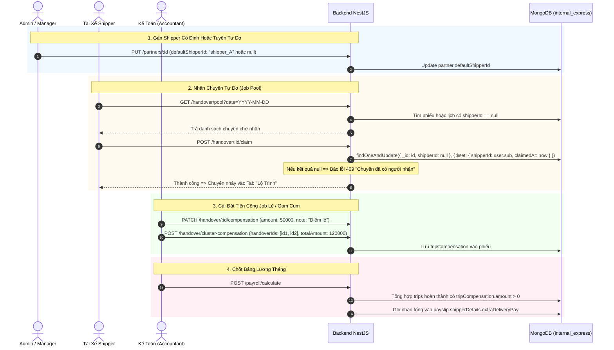

# Plan 52: Phân Shipper Cố Định Chi Nhánh, Tab Nhận Chuyến Tự Do Cho Shipper & Cài Đặt Tiền Công Job Lẻ / Cụm Cho Admin & Kế Toán

> Status: Done | Created: 2026-10-29 | Completed: 2026-10-29

## 1. Overview & Affected Files

### 1.1. Bối cảnh & Yêu cầu nghiệp vụ
Hiện tại hệ sinh thái vận hành xưởng đang có sự phân tách giữa hai mô hình logistics:
1. **Tuyến cố định (Dedicated Shippers):** Các chi nhánh đối tác có lịch trình giao nhận cố định hàng ngày/cách ngày. Shipper phụ trách tuyến này được hưởng **Lương cố định theo tháng + Phụ cấp** (xăng xe, điện thoại, ca cuối tuần, chuyên cần theo ngày công) mà không tính tiền công riêng theo từng đơn.
2. **Tuyến tự do / Chuyến phát sinh ngoài tuyến (On-Demand / Pool Jobs):** Những chi nhánh đối tác mới, đối tác giao phát sinh hoặc chưa được gán cố định cho shipper nào. Hiện tại:
   - Admin và Manager **chưa có chức năng gán 1 tài khoản shipper cố định** cho từng chi nhánh đối tác.
   - Shipper chưa có giao diện xem các chi nhánh/chuyến đang chờ nhận để chủ động **bấm nhận chuyến đi giao nhận**.
   - Admin và Kế toán (Accountant) **chưa có cơ chế thiết lập tiền công riêng** cho các job này (ví dụ: đi 1 đối tác lẻ = `x` VNĐ, đi gom nhiều cụm đối tác cùng tuyến = `xx` VNĐ) và tự động cộng vào bảng lương cuối tháng của Shipper.

### 1.2. Mục tiêu kỹ thuật
1. **Quản lý phân công Shipper cố định cho chi nhánh đối tác (Admin & Manager):**
   - Bổ sung cấu hình `defaultShipperId` (liên kết với `StaffAccount` có `role: SHIPPER`) trong Form tạo/sửa đối tác (`PartnerModal`) và hiển thị trực quan trong danh bạ đối tác (`PartnersManagementPage`).
   - Tự động gán `shipperId` cho phiếu giao nhận khi xuất xưởng/soạn đồ nếu đối tác đã có shipper cố định.
   - Phiếu của đối tác cố định chỉ hiển thị ở tab "Lộ Trình" của shipper đó, tính vào lương tháng cố định + phụ cấp.
2. **Tab "Chuyến Chờ Nhận" (Job Pool / Chuyến Tự Do) cho Shipper:**
   - Thêm Tab thứ 3 trên màn hình giao nhận của Shipper (`ShipperHandoverPage`): **"Nhận Chuyến" / "Chuyến Chờ Nhận" (Job Pool)** bên cạnh "Lộ Trình" và "Ảnh Phiếu".
   - Hiển thị các chi nhánh/phiếu giao nhận chưa có shipper cố định (`shipperId == null`).
   - Shipper có thể bấm **"Nhận Chuyến" (Claim Job)**. Áp dụng cơ chế khóa chống trùng (Concurrency Lock): ai bấm trước nhận trước, tránh xung đột nhận trùng chuyến.
   - Khi nhận thành công, chuyến lập tức chuyển sang Tab "Lộ Trình" của shipper để thực hiện giao nhận.
3. **Cài đặt tiền công riêng cho Job lẻ / Gom Cụm Đối Tác (Admin & Accountant):**
   - Hỗ trợ thiết lập tiền công cho chuyến tự do:
     - Đi 1 đối tác: `x` VNĐ (VD: 50.000 VNĐ).
     - Gom nhiều đối tác (Cụm tuyến / Multi-drop): `xx` VNĐ (VD: gom 3 quán cùng cung đường tính 120.000 VNĐ).
   - Thêm trường `tripCompensation` trong `HandoverRecord` và cấu hình định mức mặc định trong `PaySettings`.
   - Admin và Kế toán có giao diện / modal trực quan để:
     - Cài đặt / sửa tiền công cho từng phiếu.
     - Chọn nhiều phiếu $\rightarrow$ Bấm "Gom Cụm Đối Tác" $\rightarrow$ Nhập tổng tiền công cụm.
4. **Tích hợp tự động vào Bảng Lương (`Payroll`):**
   - Khi tính lương tháng cho Shipper, tự động quét và cộng tổng tiền công từ các chuyến tự do / ngoài tuyến đã hoàn thành (`tripCompensation.amount`) vào trường `extraDeliveryPay` (`ShipperPayDetails.extraDeliveryPay`).
   - Minh bạch thu nhập trên phiếu lương của Shipper, Kế toán không cần ghi chép hay cộng tay ngoài file Excel.

---

### 1.3. Bảng File Ảnh Hưởng (Expected File Changes)

| STT | Phân Vùng | Đường dẫn File | Thao tác | Mục đích / Tác dụng |
| :---: | :---: | :--- | :---: | :--- |
| 1 | Backend | `be-nestjs-thanhxuan/src/modules/internal/partners/dto/create-partner.dto.ts` | Edit | Bổ sung validate `defaultShipperId?: string` |
| 2 | Backend | `be-nestjs-thanhxuan/src/modules/internal/partners/dto/update-partner.dto.ts` | Edit | Bổ sung validate `defaultShipperId?: string \| null` |
| 3 | Backend | `be-nestjs-thanhxuan/src/modules/internal/partners/repositories/partner.repository.ts` | Edit | Populate `defaultShipperId` (`fullName`, `phone`, `username`) |
| 4 | Backend | `be-nestjs-thanhxuan/src/modules/internal/partners/partners.controller.ts` | Edit | Thêm endpoint `GET /partners/shippers-list` phục vụ dropdown chọn shipper an toàn |
| 5 | Backend | `be-nestjs-thanhxuan/src/modules/internal/partners/partners.service.ts` | Edit | Logic lấy danh sách shipper active cho dropdown và lọc schedule theo shipper |
| 6 | Backend | `be-nestjs-thanhxuan/src/modules/internal/handovers/schemas/handover-record.schema.ts` | Edit | Bổ sung sub-schema `tripCompensation` (`amount`, `isCluster`, `clusterId`, `clusterPartnerNames`, `setBy`, `setByName`, `note`) |
| 7 | Backend | `be-nestjs-thanhxuan/src/modules/internal/handovers/dto/claim-handover.dto.ts` | Add | DTO tiếp nhận nhận chuyến của Shipper |
| 8 | Backend | `be-nestjs-thanhxuan/src/modules/internal/handovers/dto/trip-compensation.dto.ts` | Add | DTO cài đặt tiền công lẻ và gom cụm đối tác (`SetTripCompensationDto`, `ClusterCompensationDto`) |
| 9 | Backend | `be-nestjs-thanhxuan/src/modules/internal/handovers/controllers/handover.controller.ts` | Edit | Thêm endpoint: `GET /handover/pool`, `POST /handover/:id/claim`, `PATCH /handover/:id/compensation`, `POST /handover/cluster-compensation` |
| 10 | Backend | `be-nestjs-thanhxuan/src/modules/internal/handovers/handover.service.ts` | Edit | Ủy nhiệm các method liên quan đến Pool, Claim và Compensation |
| 11 | Backend | `be-nestjs-thanhxuan/src/modules/internal/handovers/services/handover-pool-compensation.service.ts` | Add | Service chuyên trách xử lý concurrency nhận chuyến, phân cụm tuyến và cấu hình tiền công |
| 12 | Backend | `be-nestjs-thanhxuan/src/modules/internal/payroll/helpers/payroll-data-fetcher.helper.ts` | Edit | Lấy thêm thông tin `tripCompensation` từ các chuyến hoàn thành của Shipper |
| 13 | Backend | `be-nestjs-thanhxuan/src/modules/internal/payroll/helpers/payroll-shipper-calculator.helper.ts` | Edit | Tự động tính tổng tiền công chuyến tự do vào `extraDeliveryPay` |
| 14 | Backend | `be-nestjs-thanhxuan/src/modules/internal/handovers/handovers.module.ts` | Edit | Khai báo Provider mới `HandoverPoolCompensationService` |
| 15 | Frontend | `fe-react-thanhxuan-internal/src/features/management/partners/partner.types.ts` | Edit | Khai báo trường `defaultShipperId?: string \| StaffAccountSummary` |
| 16 | Frontend | `fe-react-thanhxuan-internal/src/features/management/partners/modals/PartnerModal.tsx` | Edit | Thêm dropdown chọn Shipper cố định cho chi nhánh |
| 17 | Frontend | `fe-react-thanhxuan-internal/src/features/management/partners/components/PartnerCardComponent.tsx` | Edit | Hiển thị badge Shipper cố định hoặc nhãn "Tự do / Chưa gán" |
| 18 | Frontend | `fe-react-thanhxuan-internal/src/features/operations/handovers/handover.types.ts` | Edit | Khai báo interface `TripCompensation` trong `HandoverRecord` |
| 19 | Frontend | `fe-react-thanhxuan-internal/src/features/operations/handovers/ShipperHandoverPage.tsx` | Edit | Thêm Tab "Nhận Chuyến" (Chuyến Chờ Nhận), hiển thị badge số lượng job khả dụng |
| 20 | Frontend | `fe-react-thanhxuan-internal/src/features/operations/handovers/components/ShipperJobPoolTabComponent.tsx` | Add | Giao diện danh sách chuyến tự do chờ nhận kèm nút "Nhận Chuyến" nổi bật |
| 21 | Frontend | `fe-react-thanhxuan-internal/src/features/operations/handovers/hooks/useShipperHandoverPage.ts` | Edit | Bổ sung query pool handovers và mutation nhận chuyến |
| 22 | Frontend | `fe-react-thanhxuan-internal/src/features/management/handovers/modals/TripCompensationModal.tsx` | Add | Modal cho Admin/Accountant set tiền công lẻ hoặc gom cụm nhiều đối tác |
| 23 | Frontend | `fe-react-thanhxuan-internal/src/features/management/handovers/components/HandoverCompensationManagerComponent.tsx` | Add | Bảng quản lý tiền công chuyến cho Admin/Kế toán duyệt và chốt giá |
| 24 | Docs | `.agents/docs/DATABASE_DICTIONARY.md` | Edit | Cập nhật định nghĩa bảng `partners` và `handover_records` (thêm `tripCompensation`) |
| 25 | Docs | `.agents/docs/CODEBASE_ATLAS.md` | Edit | Cập nhật các endpoint mới và components mới |
| 26 | Docs | `.agents/docs/srs_sdd/srs_sdd_backend.md` | Edit | Cập nhật kiến trúc phân hệ Backend |
| 27 | Docs | `.agents/docs/srs_sdd/srs_sdd_fe_internal.md` | Edit | Cập nhật kiến trúc giao diện Cổng nội bộ |
| 28 | Docs | `.agents/docs/SRS_SDD.md` | Edit | Cập nhật 1 dòng Document History |
| 29 | Docs | `.agents/docs/CHANGELOG.md` | Edit | Ghi nhận bài luận tiến hóa kỹ thuật chi tiết |

---

## 2. Technical Design & Architecture

### 2.1. Cấu trúc Dữ Liệu Chi Tiết (Data Model & Schema)

#### A. Bảng `partners` (Cập nhật)
```typescript
@Prop({ type: SchemaTypes.ObjectId, ref: 'StaffAccount', index: true })
defaultShipperId?: any; // Shipper cố định phụ trách chi nhánh (nếu có)
```

#### B. Bảng `handover_records` (Thêm trường `tripCompensation`)
```typescript
@Schema({ _id: false })
export class TripCompensation {
  @Prop({ type: Number, default: 0, min: 0 })
  amount!: number; // Tiền công chuyến (VND)

  @Prop({ type: Boolean, default: false })
  isCluster!: boolean; // Thuộc cụm nhiều đối tác hay đối tác đơn lẻ

  @Prop({ type: String, trim: true })
  clusterId?: string; // Mã gom cụm (VD: "CLUSTER-20261029-01")

  @Prop({ type: [String], default: [] })
  clusterPartnerNames?: string[]; // Danh sách tên các đối tác trong cùng cụm

  @Prop({ type: SchemaTypes.ObjectId, ref: 'StaffAccount' })
  setBy?: any; // Admin hoặc Kế toán đã thiết lập

  @Prop({ type: String, trim: true })
  setByName?: string; // Tên snapshot người duyệt giá

  @Prop({ type: String, trim: true })
  note?: string; // Ghi chú (VD: "Gom cụm 3 quán Hoàn Kiếm", "Job gấp ca tối")

  @Prop({ type: Date, default: Date.now })
  updatedAt?: Date;
}
export const TripCompensationSchema = SchemaFactory.createForClass(TripCompensation);
```
Trong `HandoverRecord`:
```typescript
@Prop({ type: TripCompensationSchema, default: null })
tripCompensation?: TripCompensation;
```

---

### 2.2. Luồng Nghiệp Vụ & Xử Lý Concurrency (Workflow & Race Condition)



---

### 2.3. Quy Chuẩn Giao Diện (UI/UX Impeccable)

1. **Giao diện Quản Lý Đối Tác (`PartnerModal.tsx`):**
   - Bổ sung nhóm trường: **"Phân Công Vận Chuyển"**.
   - Select box hiển thị Avatar + Tên đầy đủ + Số điện thoại của Shipper.
   - Lựa chọn linh hoạt:
     - `Chưa phân công (Tuyến tự do / Chờ nhận theo chuyến)`
     - `Tài xế Nguyễn Văn A (098xxxxxxx) - Tuyến cố định`
   - Ghi chú giải thích rõ ngay dưới input: *"Chi nhánh được gán tài xế cố định sẽ tính vào lương tháng và phụ cấp định mức của tài xế. Chi nhánh để trống sẽ hiển thị trên Chợ Chuyến để tài xế bấm nhận lẻ theo đơn giá riêng."*
2. **Giao diện Shipper (`ShipperHandoverPage.tsx`):**
   - Thanh Tab gồm 3 mục rõ ràng:
     - 🚚 **Lộ Trình Của Tôi** (Badge số lượng điểm đã nhận / tuyến cố định)
     - ⚡ **Nhận Chuyến** (Badge màu cam nổi bật hiển thị số chuyến đang chờ nhận)
     - 🖼️ **Ảnh Phiếu Lịch Sử**
   - Thẻ Chuyến Tự Do (`ShipperJobPoolCard`):
     - Hiển thị logo thương hiệu, tên chi nhánh, địa chỉ rõ ràng, ca giao nhận (Sáng/Tối).
     - Badge tiền công nổi bật (nếu Kế toán đã set giá trước, VD: `+50.000 đ/chuyến`).
     - Nút to rõ: **"Nhận Chuyến Này"** với hiệu ứng loading và phản hồi xúc giác (Haptic/Toast).
3. **Giao diện Kế Toán & Admin (`HandoverCompensationManagerComponent.tsx`):**
   - Đặt tại phân hệ Quản lý Giao nhận hoặc Quản lý Lương.
   - Bảng lọc theo ngày / tháng / shipper / trạng thái giá.
   - Thao tác nhanh:
     - Nút *"Set giá nhanh"* cho chuyến lẻ (`50k`, `60k`, `70k` hoặc tự nhập).
     - Checkbox chọn nhiều dòng $\rightarrow$ Xuất hiện thanh công cụ nổi *"Gom cụm N đối tác"* $\rightarrow$ Nhập tổng tiền công cả cụm (VD: `120.000 đ`). Hệ thống tự chia đều hoặc ghi chú rõ cụm.

---

## 3. Implementation Steps (Chi Tiết Từng Bước)

### Bước 1: Backend DTOs & Schema Expansion
- [x] Thêm `TripCompensation` sub-schema vào `handover-record.schema.ts`.
- [x] Cập nhật `CreatePartnerDto` và `UpdatePartnerDto` cho phép nhận `defaultShipperId?: string | null`.
- [x] Tạo DTOs:
  - `be-nestjs-thanhxuan/src/modules/internal/handovers/dto/claim-handover.dto.ts`
  - `be-nestjs-thanhxuan/src/modules/internal/handovers/dto/trip-compensation.dto.ts`
- [x] Chạy `pnpm exec tsc --noEmit` tại Backend để đảm bảo không lỗi kiểu.

### Bước 2: Backend Repository & Service Phân Công & Chợ Chuyến
- [x] Cập nhật `partner.repository.ts` populate thông tin `defaultShipperId`.
- [x] Bổ sung endpoint `GET /accounts/shippers-list` trong `accounts.controller.ts` & `accounts.service.ts` lấy danh sách tài khoản `role === 'SHIPPER'` đang hoạt động.
- [x] Tạo mới `HandoverPoolCompensationService` (`handover-pool-compensation.service.ts`):
  - `getPoolHandovers(date, shift)`: Lấy các phiếu/lịch giao nhận chưa có shipper.
  - `claimHandover(recordId, shipperUser)`: Nhận chuyến an toàn với Optimistic Concurrency check.
  - `setTripCompensation(recordId, actor, dto)`: Admin/Kế toán set tiền công lẻ.
  - `clusterCompensation(actor, dto)`: Gom nhiều phiếu thành 1 cụm và gán tổng tiền công.
- [x] Đăng ký controller endpoints trong `handover.controller.ts`.
- [x] Tích hợp vào `handover.service.ts`.

### Bước 3: Backend Payroll Shipper Auto Integration
- [x] Cập nhật `payroll-shipper-calculator.helper.ts`: Tự động tính tổng `tripCompensation.amount` của các chuyến đã giao hoàn tất đưa vào `extraDeliveryPay` trong `ShipperPayDetails`.
- [x] Viết unit tests kiểm chứng tính đúng đắn của logic tính lương và phân cụm (`handover-pool-compensation.service.spec.ts`).

### Bước 4: Frontend Admin & Manager Phân Shipper Cố Định
- [x] Cập nhật `partner.types.ts`: Thêm kiểu `defaultShipperId`.
- [x] Cập nhật `PartnerModal.tsx`: Tải danh sách shippers từ API `GET /accounts/shippers-list`, thêm Select chọn Shipper cố định cho chi nhánh.
- [x] Cập nhật `PartnerCardComponent.tsx`: Hiển thị badge Shipper cố định (Tên + Số điện thoại) hoặc nhãn "Tự do / Chưa gán".

### Bước 5: Frontend Shipper Màn Hình Nhận Chuyến (Job Pool)
- [x] Cập nhật `ShipperHandoverPage.tsx`: Thêm Tab "Nhận Chuyến" (`POOL`).
- [x] Tạo component `ShipperJobPoolTabComponent.tsx`: Danh sách các chuyến tự do chờ nhận trong ngày đã chọn.
- [x] Tạo nút "Nhận Chuyến" tích hợp mutation `claimJobMutation` với toast thông báo tức thì và chuyển ngay sang Tab "Lộ Trình".
- [x] Tối ưu lọc theo ca Sáng/Tối mượt mà, Mobile-First cho tài xế ngoài đường.

### Bước 6: Frontend Admin & Accountant Set Tiền Công Chuyến
- [x] Tạo `TripCompensationModal.tsx`: Modal nhập số tiền công lẻ, ghi chú, hoặc gom cụm nhiều đối tác cùng tuyến.
- [x] Bổ sung nút/cột quản lý tiền công trên giao diện quản trị kho `WarehouseCleanPlanTabComponent.tsx` cho người dùng có quyền `ADMIN`, `ACCOUNTANT`, `MANAGER`.
- [x] Hỗ trợ chọn nhiều phiếu giao nhận để gom thành cụm chuyến xe và set tiền trọn gói chia đều.

### Bước 7: Verification, Đồng Bộ Tài Liệu & Dev Push
- [x] Chạy Typecheck (`pnpm exec tsc --noEmit`) và Lint (`pnpm lint`) cho cả Backend và Frontend Internal.
- [x] Chạy Test (`pnpm test`) cho cả 2 app (50/50 suites passed, 233/233 tests passed).
- [x] Chạy Build (`pnpm build`) cho cả Backend và Frontend Internal.
- [x] Cập nhật 5 trụ cột tài liệu:
  - `DATABASE_DICTIONARY.md`: Định nghĩa bảng `partners` (cập nhật) và `handover_records` (thêm `tripCompensation`).
  - `CODEBASE_ATLAS.md`: Thêm các endpoint và components mới.
  - `srs_sdd_backend.md` & `srs_sdd_fe_internal.md`: Mô tả tính năng phân shipper, job pool và trip compensation.
  - `SRS_SDD.md`: Thêm 1 dòng Document History.
  - `CHANGELOG.md`: Viết bài luận chi tiết tiến hóa Plan 52.
- [x] Tự động commit và push lên nhánh `dev` theo đúng quy chuẩn AGENTS.md.
