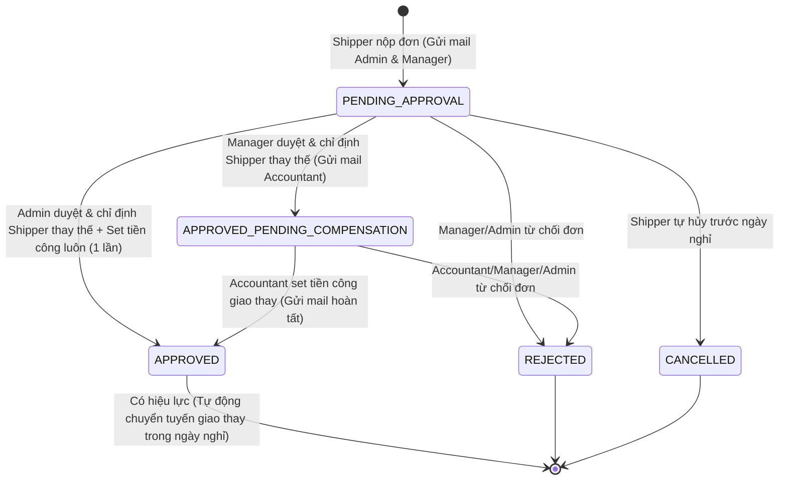

# Plan 55: Chức Năng Shipper Xin Nghỉ Giao Nhận & Phân Tuyến Kèm Tiền Công (Shipper Leave & Route Reassignment Workflow)

> Status: Done | Created: 2026-10-29

## 1. Overview & Affected Files

### 1.1. Mục tiêu & Bối cảnh
- **Bối cảnh nghiệp vụ:** Đội xe giao nhận (Shipper) chịu trách nhiệm nhận/giao đồ giặt 2 chiều giữa xưởng và các cơ sở đối tác (nhà hàng, khách sạn). Khi một Shipper cần xin nghỉ phép một hoặc nhiều ngày, các điểm giao nhận thuộc tuyến phụ trách của Shipper đó không thể bị gián đoạn mà phải được chuyển giao cho một Shipper khác giao thay.
- **Yêu cầu cốt lõi:**
  1. **Shipper gửi đơn xin nghỉ:** Cho phép chọn 1 hoặc nhiều ngày nghỉ (`YYYY-MM-DD`), nêu lý do xin nghỉ. Hệ thống tự động tính toán và hiển thị trước danh sách/số lượng các điểm đối tác cần giao trong những ngày đó.
  2. **Quy trình phê duyệt 2 bước (Chuẩn cho Manager + Accountant):**
     - **Bước 1 (Manager duyệt):** Xem xét đơn, chỉ định tài khoản Shipper thay thế (`substituteShipperId`) nhận toàn bộ các điểm giao trong các ngày nghỉ đó. Trạng thái chuyển sang `APPROVED_PENDING_COMPENSATION` (Chờ kế toán định mức tiền công).
     - **Bước 2 (Accountant set tiền công):** Thiết lập số tiền công giao thay (`compensationAmount` VNĐ) và ghi chú. Khi Kế toán xác nhận, đơn chuyển sang trạng thái `APPROVED` (Chính thức có hiệu lực nghỉ).
  3. **Đặc quyền Admin (1 chạm hoàn tất cả 2 bước):** Admin có thể vừa duyệt đơn, vừa chọn Shipper thay thế, vừa nhập luôn số tiền công giao thay trong cùng 1 lần để chuyển thẳng sang trạng thái `APPROVED`.
  4. **Hệ thống Email thông báo tự động (Nodemailer):**
     - Khi Shipper nộp đơn: Gửi email tới `ADMIN` và `MANAGER` để vào duyệt đơn.
     - Khi Manager duyệt bước 1: Gửi email tới `ACCOUNTANT` để vào thiết lập tiền công giao thay.
     - Khi đơn hoàn tất (`APPROVED`): Gửi email thông báo cho Shipper xin nghỉ (được duyệt nghỉ), Shipper thay thế (nhận tuyến & tiền công), Manager & Accountant.
     - Khi đơn bị từ chối (`REJECTED`): Gửi email thông báo cho Shipper xin nghỉ kèm lý do từ chối.
  5. **Tích hợp tự động vào Lịch Giao Nhận & Tuyến Xe:**
     - Trong các ngày nghỉ đã duyệt (`APPROVED`), các điểm giao nhận của Shipper nghỉ sẽ tạm thời được tự động chuyển sang tuyến của Shipper nhận thay thế (qua `/partners/schedule`), kèm nhãn chỉ báo "Tuyến giao thay (+ Tiền công)".
     - Shipper nghỉ sẽ không phải giao các điểm đó trong ngày nghỉ đã duyệt.

### 1.2. Phạm vi (Scope)
- **Backend `be-nestjs-thanhxuan`:**
  - Thêm schema & collection `shipper_leave_requests` (Connection `internal_express`).
  - Thêm Repository, Service, Controller, DTOs trong module mới `modules/internal/shipper-leaves/`.
  - Cập nhật logic lấy lịch giao nhận `/partners/schedule` trong `PartnersService` để hỗ trợ tính năng thay thế shipper tự động khi có đơn nghỉ `APPROVED`.
  - Thêm logic gửi email thông báo phê duyệt nhiều bước trong `MailService` qua EventEmitter.
  - Cập nhật danh mục quyền `PERMISSIONS` và `ROLE_PERMISSIONS`.
- **Frontend `fe-react-thanhxuan-internal`:**
  - Màn hình Shipper: Thêm nút/modal "Xin nghỉ giao nhận" và "Lịch sử đơn nghỉ" tại trang Giao Nhận (`ShipperHandoverPage.tsx`).
  - Màn hình Quản Lý & Kế Toán: Tạo trang quản lý duyệt đơn nghỉ `ShipperLeaveReviewPage.tsx` tại tuyến đường `/management/shipper-leaves`.
  - Modal duyệt đơn cho Quản lý / Admin (`ApproveShipperLeaveModal.tsx`).
  - Modal thiết lập tiền công giao thay cho Kế toán (`SetLeaveCompensationModal.tsx`).
  - Cập nhật Sidebar Navigation (`nav-config.ts` và `nav-mobile-config.ts`).
- **Out of scope:**
  - Không sửa đổi quy trình ký nhận chữ ký số của Đối tác hay Trạm rạch bao đếm lại.

### 1.3. Assumptions & Open Questions
- **Assumptions:**
  - Tiền công giao thay tính theo tổng số tiền cho cả đợt nghỉ hoặc tính trọn gói cho Shipper nhận giao thay (lưu `compensationAmount` dạng số nguyên VNĐ).
  - Một đơn xin nghỉ của một Shipper chỉ chọn 1 Shipper thay thế duy nhất nhận toàn bộ các điểm giao trong các ngày nghỉ đó (đúng như mô tả: *"số điểm cần giao ngày hôm nghỉ đó phải được phân cho 1 tài khoản shipper nào đó"*).
  - Tài khoản Admin và Manager/Accountant nhận email dựa trên danh sách các tài khoản đang `ACTIVE` có trường `email` hợp lệ trong `StaffAccount`.
- **Open Questions:**
  - Không có vướng mắc kiến trúc nào cản trở.

### 1.4. Bảng file ảnh hưởng

| Path | Action | Lý do |
| :--- | :---: | :--- |
| `be-nestjs-thanhxuan/src/config/permissions.map.ts` | Edit | Bổ sung các mã quyền `SHIPPER_LEAVE_*` và gán vào role permissions |
| `be-nestjs-thanhxuan/src/modules/internal/shipper-leaves/schemas/shipper-leave.schema.ts` | Add | Schema lưu trữ đơn xin nghỉ giao nhận, trạng thái, shipper thay thế, tiền công |
| `be-nestjs-thanhxuan/src/modules/internal/shipper-leaves/repositories/shipper-leave.repository.ts` | Add | Repository thao tác dữ liệu bảng `shipper_leave_requests` (lean query, pagination) |
| `be-nestjs-thanhxuan/src/modules/internal/shipper-leaves/dto/create-shipper-leave.dto.ts` | Add | Class DTO validate nộp đơn xin nghỉ (danh sách ngày YYYY-MM-DD, lý do) |
| `be-nestjs-thanhxuan/src/modules/internal/shipper-leaves/dto/approve-shipper-leave.dto.ts` | Add | Class DTO duyệt đơn (chọn shipper thay thế, ghi chú, tiền công tùy chọn nếu là Admin) |
| `be-nestjs-thanhxuan/src/modules/internal/shipper-leaves/dto/set-compensation.dto.ts` | Add | Class DTO thiết lập tiền công giao thay cho Kế toán/Admin |
| `be-nestjs-thanhxuan/src/modules/internal/shipper-leaves/dto/reject-shipper-leave.dto.ts` | Add | Class DTO từ chối đơn kèm lý do |
| `be-nestjs-thanhxuan/src/modules/internal/shipper-leaves/dto/query-shipper-leave.dto.ts` | Add | Class DTO phân trang & lọc trạng thái đơn xin nghỉ |
| `be-nestjs-thanhxuan/src/modules/internal/shipper-leaves/events/shipper-leave.events.ts` | Add | Định nghĩa sự kiện thông báo qua email |
| `be-nestjs-thanhxuan/src/modules/internal/shipper-leaves/shipper-leaves.service.ts` | Add | Nghiệp vụ tính toán điểm giao, chuyển đổi trạng thái (State Machine), bắn sự kiện |
| `be-nestjs-thanhxuan/src/modules/internal/shipper-leaves/shipper-leaves.controller.ts` | Add | Controller định tuyến REST API bảo vệ bởi JWT & RBAC Guards |
| `be-nestjs-thanhxuan/src/modules/internal/shipper-leaves/shipper-leaves.module.ts` | Add | NestJS Module đăng ký Controller, Service, Repository, Schema |
| `be-nestjs-thanhxuan/src/modules/internal/internal.module.ts` | Edit | Import `ShipperLeavesModule` vào `InternalModule` |
| `be-nestjs-thanhxuan/src/modules/internal/partners/partners.service.ts` | Edit | Cập nhật hàm `getSchedule` để tự động đổi tuyến cho Shipper thay thế vào ngày nghỉ |
| `be-nestjs-thanhxuan/src/mail/mail.service.ts` | Edit | Thêm event handlers gửi mail cho Admin, Manager, Accountant và Shipper |
| `fe-react-thanhxuan-internal/src/features/management/shipper-leaves/types/shipper-leave.types.ts` | Add | Type định nghĩa đơn xin nghỉ, trạng thái, payload |
| `fe-react-thanhxuan-internal/src/features/management/shipper-leaves/services/shipperLeaveService.ts` | Add | API Client gọi các endpoint nộp đơn, duyệt đơn, set tiền công |
| `fe-react-thanhxuan-internal/src/features/management/shipper-leaves/hooks/useShipperLeaveManagement.ts` | Add | Custom Hook quản lý dữ liệu, bộ lọc tab, pagination cho Quản lý & Kế toán |
| `fe-react-thanhxuan-internal/src/features/management/shipper-leaves/components/ShipperLeaveCardComponent.tsx` | Add | Thẻ hiển thị thông tin đơn xin nghỉ, trạng thái, shipper thay thế, tiền công |
| `fe-react-thanhxuan-internal/src/features/management/shipper-leaves/modals/ApproveShipperLeaveModal.tsx` | Add | Modal phê duyệt đơn cho Quản lý / Admin (chọn shipper thay thế & nhập tiền công nếu là Admin) |
| `fe-react-thanhxuan-internal/src/features/management/shipper-leaves/modals/SetLeaveCompensationModal.tsx` | Add | Modal cho Kế toán thiết lập tiền công giao thay |
| `fe-react-thanhxuan-internal/src/features/management/shipper-leaves/modals/RejectShipperLeaveModal.tsx` | Add | Modal từ chối đơn xin nghỉ |
| `fe-react-thanhxuan-internal/src/features/management/shipper-leaves/ShipperLeaveReviewPage.tsx` | Add | Trang điều hành & duyệt đơn nghỉ cho Quản lý, Kế toán và Admin |
| `fe-react-thanhxuan-internal/src/features/operations/handovers/modals/ShipperLeaveRequestModal.tsx` | Add | Modal cho Shipper gửi đơn xin nghỉ (chọn ngày, lý do, xem trước số điểm giao) |
| `fe-react-thanhxuan-internal/src/features/operations/handovers/modals/ShipperLeaveHistoryModal.tsx` | Add | Modal cho Shipper theo dõi trạng thái các đơn xin nghỉ của mình |
| `fe-react-thanhxuan-internal/src/features/operations/handovers/ShipperHandoverPage.tsx` | Edit | Tích hợp nút "Xin nghỉ" & "Lịch sử đơn nghỉ", badge nhận giao thay vào giao diện |
| `fe-react-thanhxuan-internal/src/components/layout/nav-config.ts` | Edit | Thêm mục "Duyệt Nghỉ Giao Nhận" vào menu Điều hành & Quản lý |
| `fe-react-thanhxuan-internal/src/app/router.tsx` | Edit | Định tuyến URL `/management/shipper-leaves` |
| `.agents/docs/DATABASE_DICTIONARY.md` | Edit | Bổ sung collection `shipper_leave_requests` vào từ điển dữ liệu MongoDB |
| `.agents/docs/CODEBASE_ATLAS.md` | Edit | Cập nhật API endpoint, controller, service, page và component mới |
| `.agents/docs/srs_sdd/srs_sdd_backend.md` | Edit | Cập nhật đặc tả module Shipper Leaves |
| `.agents/docs/srs_sdd/srs_sdd_fe_internal.md` | Edit | Cập nhật đặc tả màn hình Shipper Leaves & Workflow duyệt |
| `.agents/docs/SRS_SDD.md` | Edit | Cập nhật 1 dòng Document History |
| `.agents/docs/CHANGELOG.md` | Edit | Ghi nhận chi tiết thay đổi kỹ thuật của Plan 55 |

---

## 2. Technical Approach

### 2.1. State Machine của Đơn Xin Nghỉ Giao Nhận



### 2.2. Schema & Entity Design (`shipper_leave_requests`)
- **Collection:** `shipper_leave_requests` (Connection: `internal_express`).
- **Trường dữ liệu:**
  ```typescript
  export enum ShipperLeaveStatus {
    PENDING_APPROVAL = 'PENDING_APPROVAL',                         // Chờ quản lý/admin duyệt & chọn người giao thay
    APPROVED_PENDING_COMPENSATION = 'APPROVED_PENDING_COMPENSATION', // Manager đã duyệt, chờ kế toán set tiền công
    APPROVED = 'APPROVED',                                         // Đã duyệt hoàn tất, chính thức có hiệu lực
    REJECTED = 'REJECTED',                                         // Bị từ chối
    CANCELLED = 'CANCELLED',                                       // Shipper hủy đơn
  }

  export class ShipperLeaveRequest {
    shipperId: ObjectId;                 // Ref StaffAccount (Shipper xin nghỉ)
    leaveDates: string[];                // Mảng ngày YYYY-MM-DD (Ví dụ: ['2026-11-01', '2026-11-02'])
    reason: string;                      // Lý do xin nghỉ
    status: ShipperLeaveStatus;
    
    substituteShipperId?: ObjectId;      // Ref StaffAccount (Shipper nhận giao thay các điểm)
    reassignedPartnerIds?: ObjectId[];   // Danh sách các điểm đối tác cần giao trong các ngày đó
    reassignedPointsCount?: number;      // Tổng số lượt giao trong các ngày nghỉ
    
    compensationAmount?: number;         // Tiền công giao thay (VNĐ) do Accountant hoặc Admin set
    compensationNote?: string;           // Ghi chú của Accountant/Admin về tiền công
    
    approvedByManagerId?: ObjectId;      // Ref StaffAccount (Manager hoặc Admin duyệt bước 1)
    approvedByManagerAt?: Date;
    managerNote?: string;
    
    compensatedByAccountId?: ObjectId;   // Ref StaffAccount (Accountant hoặc Admin set công)
    compensatedAt?: Date;
    
    rejectedById?: ObjectId;             // Ref StaffAccount (Người từ chối)
    rejectedAt?: Date;
    rejectionReason?: string;
  }
  ```

### 2.3. Lịch Trình Giao Nhận Tự Động Hóa (`PartnersService.getSchedule`)
Khi truy vấn danh sách điểm giao nhận ngày `date` (`/partners/schedule?date=...&shipperId=...`):
1. **Tìm các đơn nghỉ `APPROVED` có chứa ngày `date`:**
   - Nếu Shipper được truyền vào là người xin nghỉ (`shipperId == leave.shipperId`):
     - Loại bỏ các điểm phụ trách mặc định của Shipper này khỏi kết quả trả về, vì Shipper đã được duyệt nghỉ hợp lệ!
   - Nếu Shipper được truyền vào là người giao thay (`shipperId == leave.substituteShipperId`):
     - Lấy thêm tất cả các đối tác có lịch giao vào ngày `date` mà Shipper nghỉ vốn phụ trách (`defaultShipperId == leave.shipperId`), gắn cờ `isSubstituted: true` kèm thông tin Shipper nghỉ và tiền công giao thay.
2. Đảm bảo toàn vẹn: Không một điểm giao nào bị bỏ sót hay chồng chéo trong ngày nghỉ của Shipper.

### 2.4. Luồng Email Thông Báo (Asynchronous via EventEmitter)
- **Sự kiện 1: `shipper_leave.created`**
  - Trigger: Khi Shipper nộp đơn thành công.
  - Listener: `MailService.handleShipperLeaveCreatedEvent`
  - Recipients: Tất cả tài khoản có `role: 'ADMIN'` hoặc `'MANAGER'` và `status: 'ACTIVE'`.
  - Email HTML: Thông tin Shipper xin nghỉ, số ngày nghỉ, lý do, số lượng điểm giao cần phân công, nút "Xem và duyệt đơn".
- **Sự kiện 2: `shipper_leave.approved_pending_compensation`**
  - Trigger: Khi Manager duyệt đơn và chỉ định Shipper thay thế.
  - Listener: `MailService.handleShipperLeavePendingCompensationEvent`
  - Recipients: Tất cả tài khoản có `role: 'ACCOUNTANT'` (và 'ADMIN') đang `ACTIVE`.
  - Email HTML: Thông báo Manager đã duyệt đơn và phân công cho Shipper thay thế, đề nghị Kế toán vào hệ thống để thiết lập số tiền công giao thay.
- **Sự kiện 3: `shipper_leave.completed`**
  - Trigger: Khi Accountant set tiền công HOẶC Admin duyệt 1 chạm cả 2 bước.
  - Listener: `MailService.handleShipperLeaveCompletedEvent`
  - Recipients: Shipper xin nghỉ, Shipper thay thế, Manager & Accountant.
  - Email HTML: Chúc mừng đơn nghỉ đã được thông qua chính thức, kèm thông báo tiền công giao thay cho Shipper nhận việc.

---

## 3. Implementation Tasks (Checklist)

### Giai Đoạn 1: Backend API, Schema, Mail & Tích Hợp Tuyến Xe
- [x] T1: Cập nhật `be-nestjs-thanhxuan/src/config/permissions.map.ts` - Thêm mã quyền `SHIPPER_LEAVE_REQUEST`, `SHIPPER_LEAVE_APPROVE`, `SHIPPER_LEAVE_COMPENSATE`, `SHIPPER_LEAVE_VIEW` và gán vào các vai trò SHIPPER, MANAGER, ACCOUNTANT, ADMIN - Depends on: none
- [x] T2: Tạo Schema `shipper-leave.schema.ts` và Repository `shipper-leave.repository.ts` trong `be-nestjs-thanhxuan/src/modules/internal/shipper-leaves/` với collection `shipper_leave_requests` (kèm index compound `status`, `leaveDates`, `shipperId`) - Depends on: none
- [x] T3: Tạo bộ DTOs validation: `create-shipper-leave.dto.ts`, `approve-shipper-leave.dto.ts`, `set-compensation.dto.ts`, `reject-shipper-leave.dto.ts`, `query-shipper-leave.dto.ts` - Depends on: none
- [x] T4: Xây dựng `shipper-leaves.service.ts` với đầy đủ nghiệp vụ State Machine: tạo đơn, tính toán số điểm giao, Manager duyệt bước 1, Accountant set tiền công bước 2, Admin duyệt 1 chạm cả 2 bước, từ chối, hủy đơn và bắn EventEmitter - Depends on: T2, T3
- [x] T5: Xây dựng `shipper-leaves.controller.ts` cung cấp các REST API: `POST /shipper-leaves`, `GET /shipper-leaves`, `GET /shipper-leaves/:id`, `PATCH /shipper-leaves/:id/approve`, `PATCH /shipper-leaves/:id/set-compensation`, `PATCH /shipper-leaves/:id/reject`, `PATCH /shipper-leaves/:id/cancel` - Depends on: T4
- [x] T6: Tích hợp `MailService` trong `be-nestjs-thanhxuan/src/mail/mail.service.ts` lắng nghe các sự kiện `shipper_leave.*` và gửi email HTML thông báo tự động cho Admin/Manager/Accountant/Shipper - Depends on: T4
- [x] T7: Cập nhật `PartnersService.getSchedule` trong `be-nestjs-thanhxuan/src/modules/internal/partners/partners.service.ts` tích hợp kiểm tra đơn nghỉ `APPROVED` để tự động đổi tuyến cho Shipper thay thế và loại trừ khỏi Shipper nghỉ - Depends on: T2, T4
- [x] T8: Đăng ký `ShipperLeavesModule` vào `be-nestjs-thanhxuan/src/modules/internal/internal.module.ts` - Depends on: T5

### Giai Đoạn 2: Frontend Phía Shipper (Nộp Đơn & Theo Dõi Trạng Thái)
- [x] T9: Tạo types `shipper-leave.types.ts` và service `shipperLeaveService.ts` trong `fe-react-thanhxuan-internal/src/features/management/shipper-leaves/` - Depends on: T5
- [x] T10: Xây dựng Modal `ShipperLeaveRequestModal.tsx` cho phép Shipper chọn ngày nghỉ, nhập lý do, hiển thị số điểm giao nhận dự kiến cần bàn giao - Depends on: T9
- [x] T11: Xây dựng Modal `ShipperLeaveHistoryModal.tsx` cho phép Shipper xem lịch sử các đơn xin nghỉ, trạng thái duyệt, shipper nhận giao thay và mức tiền công - Depends on: T9
- [x] T12: Tích hợp nút "Xin nghỉ" và "Lịch sử đơn nghỉ" vào `ShipperHandoverPage.tsx`, kèm hiển thị badge chỉ báo "Tuyến nhận giao thay (+ Tiền công)" nếu ngày đó Shipper là người giao thay - Depends on: T10, T11

### Giai Đoạn 3: Frontend Phía Quản Lý & Kế Toán (Màn Hình Duyệt & Set Tiền Công)
- [x] T13: Xây dựng Custom Hook `useShipperLeaveManagement.ts` xử lý fetch dữ liệu, phân trang, lọc tab theo trạng thái đơn - Depends on: T9
- [x] T14: Xây dựng `ShipperLeaveCardComponent.tsx` hiển thị chi tiết đơn xin nghỉ với giao diện trực quan, rõ ràng các mốc trạng thái duyệt - Depends on: T13
- [x] T15: Xây dựng `ApproveShipperLeaveModal.tsx` cho Quản lý / Admin duyệt đơn, chọn shipper thay thế, và cho phép Admin nhập luôn tiền công (1 chạm) - Depends on: T13
- [x] T16: Xây dựng `SetLeaveCompensationModal.tsx` cho Kế toán / Admin thiết lập tiền công giao thay - Depends on: T13
- [x] T17: Xây dựng `RejectShipperLeaveModal.tsx` cho Quản lý / Admin từ chối đơn kèm lý do - Depends on: T13
- [x] T18: Xây dựng trang tổng quan `ShipperLeaveReviewPage.tsx` tích hợp các tabs trạng thái, danh sách thẻ và các modals nghiệp vụ - Depends on: T14, T15, T16, T17
- [x] T19: Đăng ký route `/management/shipper-leaves` trong `fe-react-thanhxuan-internal/src/app/router.tsx` và bổ sung item vào menu `nav-config.ts` - Depends on: T18

### Giai Đoạn 4: Kiểm Thử, Verify & Đồng Bộ Tài Liệu
- [x] T20: Chạy lint, typecheck và build cho cả `be-nestjs-thanhxuan` và `fe-react-thanhxuan-internal` đảm bảo pass 100% không có lỗi - Depends on: T8, T19
- [x] T21: Cập nhật đồng bộ 5 trụ cột tài liệu: `.agents/docs/DATABASE_DICTIONARY.md` (bổ sung bảng `shipper_leave_requests`), `.agents/docs/CODEBASE_ATLAS.md`, `.agents/docs/srs_sdd/srs_sdd_backend.md`, `.agents/docs/srs_sdd/srs_sdd_fe_internal.md`, `.agents/docs/SRS_SDD.md` (1 dòng history), và ghi nhật ký `.agents/docs/CHANGELOG.md` - Depends on: T20
- [x] T22: Tự động commit và push lên nhánh `dev` theo quy chuẩn tiếng Việt - Depends on: T21

---

## 4. Verification & Testing

### 4.1. Lệnh kiểm thử
- **Backend `be-nestjs-thanhxuan/`:**
  - `pnpm exec tsc --noEmit` (Strict TypeScript check)
  - `pnpm lint`
  - `pnpm test`
  - `pnpm build`
- **Frontend `fe-react-thanhxuan-internal/`:**
  - `pnpm exec tsc --noEmit`
  - `pnpm lint`
  - `pnpm build`

### 4.2. Kịch bản kiểm thử (Test Scenarios)
1. **Happy Path 1 (Luồng 2 bước - Manager duyệt, Accountant set công):**
   - Shipper A nộp đơn xin nghỉ ngày mai. Email gửi tới Manager & Admin.
   - Manager đăng nhập, xem danh sách đơn chờ duyệt (`PENDING_APPROVAL`), mở modal duyệt, chọn Shipper B giao thay. Đơn chuyển sang `APPROVED_PENDING_COMPENSATION`. Email gửi tới Accountant.
   - Accountant đăng nhập, thấy đơn trong tab "Chờ kế toán set công", mở modal nhập tiền công 200,000đ. Đơn chuyển sang `APPROVED`. Email gửi tới Shipper A, Shipper B.
   - Kiểm tra ngày mai: Shipper A không thấy tuyến của mình; Shipper B thấy các điểm của Shipper A được thêm vào kèm nhãn giao thay.
2. **Happy Path 2 (Luồng 1 chạm của Admin):**
   - Shipper C nộp đơn xin nghỉ.
   - Admin đăng nhập, mở modal duyệt: Chọn Shipper D giao thay VÀ nhập luôn tiền công 250,000đ -> Bấm "Phê duyệt & Hoàn tất". Đơn chuyển thẳng sang `APPROVED`.
3. **Edge Case (Từ chối đơn & Trùng lặp ngày):**
   - Shipper xin nghỉ vào ngày đã có đơn đang chờ hoặc đã duyệt -> Báo lỗi xung đột.
   - Manager từ chối đơn kèm lý do -> Đơn chuyển `REJECTED`, email thông báo cho Shipper.

### 4.3. Definition of Done
- Tất cả các task trong checklist được hoàn tất.
- Lint, typecheck và build pass 100% trên cả Backend và Frontend.
- Không có file vượt quá 250-300 dòng (tuân thủ chia tách nhỏ Modal, Component, Hook).
- Cập nhật đủ 5 trụ cột tài liệu kỹ thuật.
- Tự động commit và push lên nhánh `dev`.

---

## 5. Risks & Rollback

- **Rủi ro phân tuyến giao nhận trùng lặp:** Nếu logic query lịch giao trong `PartnersService` không xử lý kỹ việc loại trừ/thêm vào, có thể dẫn đến việc điểm giao bị tính 2 lần hoặc bị bỏ sót.
  - *Giải pháp:* Kiểm tra điều kiện rõ ràng: khi ngày hiện tại nằm trong `leaveDates` của đơn `APPROVED`, loại trừ các điểm có `defaultShipperId == leave.shipperId`, và thêm các điểm đó vào danh sách khi query cho `substituteShipperId`.
- **Rủi ro gửi email bị lỗi mạng:** Việc gửi email qua SMTP nếu gặp sự cố mạng có thể làm nghẽn API response.
  - *Giải pháp:* Sử dụng NestJS `EventEmitter2` để xử lý gửi email bất đồng bộ trong background (`@OnEvent`), không làm chậm phản hồi API của người dùng.
- **Rollback:** Xóa các commit của tính năng hoặc tắt menu duyệt đơn và route tương ứng.

---

## Changelog
- 2026-10-29: Khởi tạo Plan 55 cho tính năng Shipper xin nghỉ giao nhận, duyệt đa cấp (Manager/Admin/Accountant), phân tuyến thay thế và gửi email tự động.
