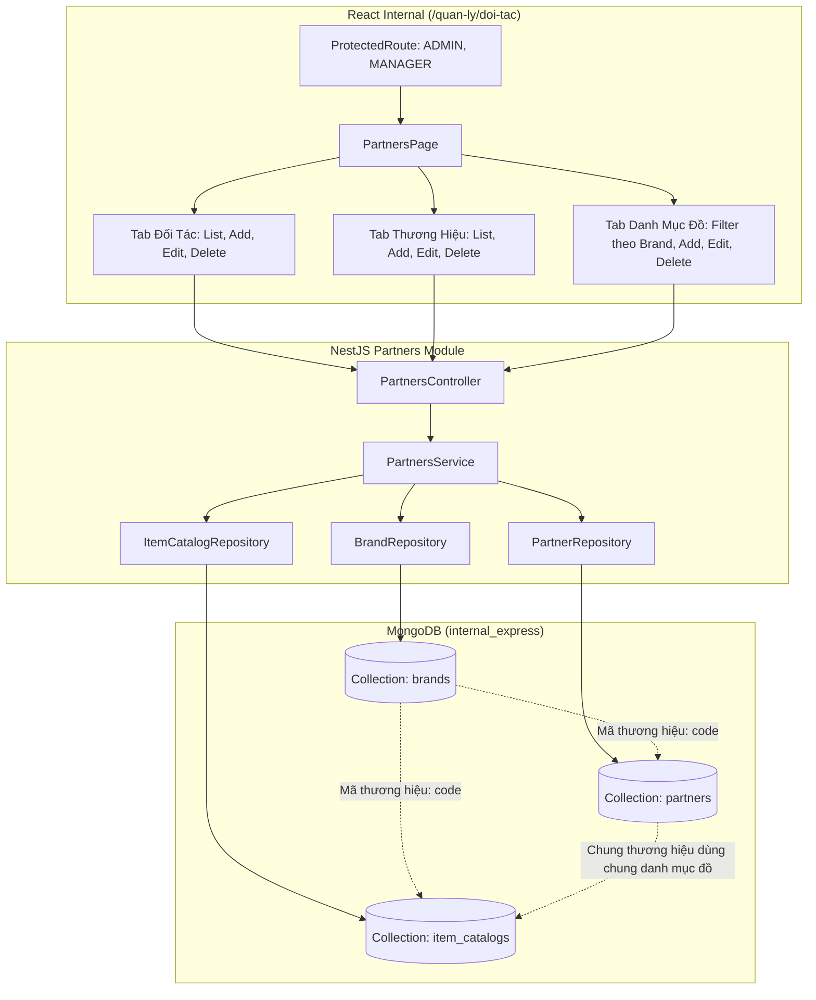

# Plan 7: Đổi route sang /quan-ly/doi-tac, Quản lý Thương hiệu động, Danh mục đồ giặt theo Thương hiệu & Seed dữ liệu Pizza 4P's

> Status: Done | Created: 2026-10-04

## 1. Overview & Affected Files

### 1.1. Mục tiêu & Phạm vi

- **Chuyển đổi route và phân quyền**:
  - Di chuyển trang Quản lý Đối tác từ `/doi-tac` sang `/quan-ly/doi-tac`.
  - Phân quyền giới hạn nghiêm ngặt: Chỉ vai trò `ADMIN` và `MANAGER` mới có quyền truy cập màn hình này (loại bỏ quyền của `ACCOUNTANT` và `WAREHOUSE_MANAGER` trên trang này theo đúng yêu cầu).
- **Quản lý Thương hiệu động (Brand Management)**:
  - Cho phép Thêm / Sửa / Xóa (ngưng hoạt động) các thương hiệu đối tác (ví dụ: Pizza 4P's, Haidilao, Nhà hàng nhỏ...) thay vì hardcode enum cố định.
  - Lưu trữ trong collection `brands` riêng biệt thuộc database `internal_express`.
- **Nâng cấp giao diện Quản lý Đối tác**:
  - Xóa bỏ hoàn toàn các đoạn chú thích trong ngoặc đơn `()` ở các nhãn và lựa chọn trong form (ví dụ: `Hàng ngày (DAILY)` ➔ `Hàng ngày`, `Thương Hiệu (Brand)` ➔ `Thương hiệu`, `Theo cái/chiếc (PER_UNIT)` ➔ `Theo chiếc / cái`, `Theo khối lượng (PER_KG)` ➔ `Theo Kg`).
  - Cho phép người dùng click trực tiếp vào thẻ đối tác trong danh sách để mở Modal xem chi tiết, chỉnh sửa thông tin hoặc xóa đối tác (`PATCH /partners/:id`, `DELETE /partners/:id`).
- **Quản lý Danh mục đồ giặt theo Thương hiệu**:
  - Quản lý Tạo / Sửa / Xóa danh mục đồ giặt theo từng thương hiệu.
  - Các chi nhánh chung một thương hiệu (ví dụ: Pizza 4P's Tràng Tiền, Pizza 4P's Lotte...) sẽ dùng chung danh mục đồ giặt của thương hiệu đó.
  - Thuộc tính danh mục đồ gồm: Thương hiệu (`brand`), Mã đồ (`itemCode`), Tên đồ giặt (`name`), Đơn vị tính (`unit`: `Chiếc` hoặc `Kg`), Đơn giá thu khách (`priceToCustomer`), Đơn giá công thợ gập (`foldingRateWorker`).
  - Giao diện có bộ lọc chọn thương hiệu, bảng danh sách đồ giặt tương ứng, nút Thêm / Sửa / Xóa đồ giặt.
- **Khởi tạo dữ liệu danh mục đồ cho thương hiệu `pizza_4ps`**:
  - Căn cứ theo phiếu xuất nhập kho vận chuyển thực tế ngày 03/10/2026 từ Pizza 4P's - HNC, seed sẵn 14 mặt hàng chuẩn:
    1. `4PS_KHAN_AN_XAM` - `Khăn ăn xám` - Đơn vị: `Chiếc`
    2. `4PS_KHAN_LAU_BAT` - `Khăn lau bát` - Đơn vị: `Chiếc`
    3. `4PS_KHAN_NAU` - `Khăn nâu` - Đơn vị: `Chiếc`
    4. `4PS_KHAN_XANH_NAVY` - `Khăn xanh navy` - Đơn vị: `Chiếc`
    5. `4PS_KHAN_TRANG_LAU_LY` - `Khăn trắng lau ly` - Đơn vị: `Chiếc`
    6. `4PS_KHAN_TRANG_BEP` - `Khăn trắng bếp` - Đơn vị: `Chiếc`
    7. `4PS_BOC_XE` - `Bọc xe` - Đơn vị: `Chiếc`
    8. `4PS_BOC_GIO` - `Bọc giỏ` - Đơn vị: `Chiếc`
    9. `4PS_TAP_DE` - `Tạp dề` - Đơn vị: `Chiếc`
    10. `4PS_CHAN_BAY` - `Chăn bay` - Đơn vị: `Chiếc`
    11. `4PS_KHAN_HONG` - `Khăn hồng` - Đơn vị: `Chiếc`
    12. `4PS_KHAN_XANH_NHAT` - `Khăn xanh nhạt` - Đơn vị: `Chiếc`
    13. `4PS_VO_NEM_GHE` - `Vỏ nệm ghế` - Đơn vị: `Chiếc`
    14. `4PS_TUI_BOC_TUONG` - `Túi bọc tương` - Đơn vị: `Chiếc`

### 1.2. Out of Scope

- Không làm gián đoạn luồng tạo Phiếu giao nhận (`handover`) và Ghi nhận năng suất trạm đếm (`piecework`) hiện hành; các module này tiếp tục đọc danh mục theo thương hiệu đối tác bình thường.

### 1.3. Assumptions & Open Questions

- **Assumptions**:
  - Xóa đối tác / thương hiệu / mặt hàng đồ giặt áp dụng cơ chế Xóa mềm (`isActive: false`) để bảo toàn toàn vẹn dữ liệu lịch sử đối soát và phiếu giao nhận cũ.
  - Người dùng có vai trò `ADMIN` và `MANAGER` có toàn quyền CRUD đối tác, thương hiệu và danh mục đồ.

### 1.4. Bảng file ảnh hưởng

| Path                                                                                 |   Action    | Lý do                                                                                                          |
| :----------------------------------------------------------------------------------- | :---------: | :------------------------------------------------------------------------------------------------------------- |
| `be-nestjs-thanhxuan/src/modules/internal/partners/schemas/brand.schema.ts`          |     Add     | Định nghĩa Schema Mongoose cho Brand (thương hiệu)                                                             |
| `be-nestjs-thanhxuan/src/modules/internal/partners/repositories/brand.repository.ts` |     Add     | Tầng Repository truy xuất collection `brands`                                                                  |
| `be-nestjs-thanhxuan/src/modules/internal/partners/dto/create-brand.dto.ts`          |     Add     | DTO xác thực dữ liệu khi tạo thương hiệu                                                                       |
| `be-nestjs-thanhxuan/src/modules/internal/partners/dto/update-brand.dto.ts`          |     Add     | DTO xác thực dữ liệu khi cập nhật thương hiệu                                                                  |
| `be-nestjs-thanhxuan/src/modules/internal/partners/schemas/partner.schema.ts`        |    Edit     | Nới lỏng kiểm tra enum `brand` sang string có index để hỗ trợ brand tạo động                                   |
| `be-nestjs-thanhxuan/src/modules/internal/partners/schemas/item-catalog.schema.ts`   |    Edit     | Nới lỏng kiểm tra enum `brand` sang string có index; hỗ trợ đơn vị `Chiếc` / `Kg`                              |
| `be-nestjs-thanhxuan/src/modules/internal/partners/dto/create-partner.dto.ts`        |    Edit     | Cho phép `brand` nhận mã chuỗi thương hiệu linh hoạt                                                           |
| `be-nestjs-thanhxuan/src/modules/internal/partners/dto/create-item-catalog.dto.ts`   |    Edit     | Cho phép `brand` nhận mã chuỗi thương hiệu linh hoạt                                                           |
| `be-nestjs-thanhxuan/src/modules/internal/partners/partners.controller.ts`           |    Edit     | Bổ sung các endpoint CRUD cho Brands (`/partners/brands`)                                                      |
| `be-nestjs-thanhxuan/src/modules/internal/partners/partners.service.ts`              |    Edit     | Triển khai business logic CRUD Brand                                                                           |
| `be-nestjs-thanhxuan/src/modules/internal/partners/partners.module.ts`               |    Edit     | Khai báo `Brand` schema và `BrandRepository` vào module                                                        |
| `be-nestjs-thanhxuan/src/scripts/seed-pizza-4ps-catalogs.ts`                         |     Add     | Script khởi tạo thương hiệu Pizza 4P's và 14 mặt hàng từ phiếu kho                                             |
| `fe-react-thanhxuan-internal/src/types/index.ts`                                     |    Edit     | Khai báo interface `Brand`, chuẩn hóa thuộc tính `Partner`, `ItemCatalog`                                      |
| `fe-react-thanhxuan-internal/src/app/(internal)/quan-ly/doi-tac/page.tsx`            |     Add     | Tạo trang Quản lý Đối tác mới, phân quyền `[StaffRole.ADMIN, StaffRole.MANAGER]`                               |
| `fe-react-thanhxuan-internal/src/app/(internal)/doi-tac/page.tsx`                    | Delete/Edit | Redirect hoặc thay thế sang `/quan-ly/doi-tac`                                                                 |
| `fe-react-thanhxuan-internal/src/app/router.tsx`                                     |    Edit     | Đăng ký route `quan-ly/doi-tac` và điều hướng                                                                  |
| `fe-react-thanhxuan-internal/src/features/partners/PartnersPage.tsx`                 |    Edit     | Tái cấu trúc 3 Tab (Đối Tác, Thương Hiệu, Danh Mục Đồ), bỏ chú thích `()`, modal Sửa/Xóa đối tác, CRUD đồ giặt |

---

## 2. Technical Approach

### 2.1. Kiến trúc dữ liệu & Data Flow



### 2.2. Interface / Schema Contract (Backend & Frontend)

#### 2.2.1. Brand Schema (`Brand`)

```ts
export class Brand {
  @Prop({
    required: true,
    unique: true,
    uppercase: true,
    trim: true,
    index: true,
  })
  code!: string; // Ví dụ: 'PIZZA_4PS', 'HAIDILAO'

  @Prop({ required: true, trim: true })
  name!: string; // Tên hiển thị: 'Pizza 4P\'s', 'Haidilao Hotpot'

  @Prop({ trim: true })
  description?: string;

  @Prop({ default: true, index: true })
  isActive!: boolean;
}
```

#### 2.2.2. API Endpoints mới / nâng cấp:

1. `GET /partners/brands` - Lấy danh sách thương hiệu đang hoạt động (`isActive: true`).
2. `POST /partners/brands` - Tạo thương hiệu mới (`code`, `name`, `description`).
3. `PATCH /partners/brands/:id` - Cập nhật thông tin thương hiệu.
4. `DELETE /partners/brands/:id` - Xóa mềm thương hiệu (`isActive: false`).
5. `GET /partners` - Lấy danh sách đối tác (giữ nguyên).
6. `PATCH /partners/:id` - Cập nhật đối tác (đã có ở Backend, gắn kết nối lên Frontend).
7. `DELETE /partners/:id` - Xóa đối tác (đã có ở Backend, gắn kết nối lên Frontend).
8. `GET /partners/catalogs?brand=...` - Lấy danh mục đồ theo thương hiệu (giữ nguyên).
9. `POST /partners/catalogs` - Tạo đồ giặt mới theo thương hiệu (giữ nguyên Backend, gắn form Frontend).
10. `PATCH /partners/catalogs/:id` - Cập nhật đồ giặt (giữ nguyên Backend, gắn modal Frontend).
11. `DELETE /partners/catalogs/:id` - Xóa đồ giặt (giữ nguyên Backend, gắn nút xóa Frontend).

#### 2.2.3. Quy ước Đơn vị tính (`ItemUnit`):

- `PIECE`: Chiếc / Cái (mặc định)
- `KG`: Kilogram (Kg)

---

## 3. Implementation Tasks (Checklist)

### Giai đoạn 1: Backend - Schema, Repository, DTO & Controller cho Brand và nới lỏng validation

- [x] T1: Tạo Schema `brand.schema.ts` trong `be-nestjs-thanhxuan/src/modules/internal/partners/schemas/` và `BrandRepository` trong `repositories/brand.repository.ts`.
- [x] T2: Tạo `CreateBrandDto` và `UpdateBrandDto` trong `be-nestjs-thanhxuan/src/modules/internal/partners/dto/`.
- [x] T3: Cập nhật `Partner` schema, `ItemCatalog` schema, `CreatePartnerDto`, `CreateItemCatalogDto` để trường `brand` nhận `string` (hỗ trợ mã brand động), giữ index.
- [x] T4: Thêm phương thức CRUD cho Brand trong `PartnersService` (`getAllBrands`, `createBrand`, `updateBrand`, `deleteBrand`) và Controller endpoints tương ứng tại `PartnersController` (`/partners/brands`).
- [x] T5: Đăng ký `Brand` schema và `BrandRepository` vào `PartnersModule`.
- [x] T6: Tạo script seed `seed-pizza-4ps-catalogs.ts` khởi tạo Brand `PIZZA_4PS` và 14 mặt hàng từ phiếu xuất nhập kho thực tế ngày 03/10/2026.

### Giai đoạn 2: Frontend - Đổi Route, Phân quyền & Quản lý Đối tác

- [x] T7: Cập nhật types trong `fe-react-thanhxuan-internal/src/types/index.ts`: Thêm interface `Brand`, cập nhật `ItemCatalog` và `Partner`.
- [x] T8: Tạo trang mới `fe-react-thanhxuan-internal/src/app/(internal)/quan-ly/doi-tac/page.tsx` bọc bởi `ProtectedRoute` với `allowedRoles={[StaffRole.ADMIN, StaffRole.MANAGER]}`.
- [x] T9: Xóa/chuyển tiếp trang cũ `fe-react-thanhxuan-internal/src/app/(internal)/doi-tac/page.tsx` và cập nhật router `src/app/router.tsx`.
- [x] T10: Cập nhật `PartnersPage.tsx` tab Đối Tác:
  - Bỏ toàn bộ các hậu tố `()` trong form thêm đối tác (`Hàng ngày`, `Cách ngày`, `Theo yêu cầu`, `Theo chiếc / cái`, `Theo Kg`, `Thương hiệu`).
  - Biến select Thương hiệu thành dropdown động lấy từ API `/partners/brands`.
  - Bổ sung sự kiện click vào Card đối tác để mở Modal Sửa / Xóa đối tác (với dialog xác nhận trước khi xóa mềm).

### Giai đoạn 3: Frontend - Quản lý Thương hiệu & Danh mục đồ giặt theo Thương hiệu

- [x] T11: Cập nhật `PartnersPage.tsx` bổ sung Tab "Thương Hiệu":
  - Hiển thị danh sách các thương hiệu hiện có (Mã, Tên, Mô tả, Trạng thái).
  - Modal Thêm mới Thương hiệu (`code`, `name`, `description`).
  - Modal Chỉnh sửa Thương hiệu & Nút Xóa thương hiệu.
- [x] T12: Cập nhật `PartnersPage.tsx` tab "Danh Mục Đồ":
  - Dropdown lọc danh mục theo Thương hiệu (chọn thương hiệu để xem đồ của thương hiệu đó).
  - Modal Thêm mới Đồ giặt (gắn theo thương hiệu, mã đồ, tên đồ, đơn vị: Chiếc / Kg, đơn giá thu khách, công thợ gập).
  - Modal Chỉnh sửa Đồ giặt và nút Xóa đồ giặt.
- [x] T13: Chạy script seed dữ liệu Pizza 4P's vào database và kiểm tra hiển thị trên giao diện.

### Giai đoạn 4: Kiểm thử và Hoàn thiện

- [x] T14: Chạy kiểm tra TypeScript (`pnpm exec tsc --noEmit`) và Build (`pnpm build`) trên cả Backend và Frontend Internal.
- [x] T15: Xác minh bằng Browser: Đăng nhập tài khoản Admin/Manager, truy cập `/quan-ly/doi-tac`, kiểm tra các chức năng Thêm/Sửa/Xóa Đối tác, Thương hiệu, Danh mục đồ giặt.

---

## 4. Verification & Testing

### 4.1. Lệnh kiểm tra kỹ thuật

- **Backend (`be-nestjs-thanhxuan`)**:
  ```bash
  cd be-nestjs-thanhxuan
  pnpm exec tsc --noEmit
  pnpm build
  ```
- **Frontend Internal (`fe-react-thanhxuan-internal`)**:
  ```bash
  cd fe-react-thanhxuan-internal
  pnpm exec tsc --noEmit
  pnpm build
  ```

### 4.2. Kịch bản kiểm thử (Test Scenarios)

1. **Phân quyền truy cập**:
   - Đăng nhập tài khoản `ADMIN` hoặc `MANAGER`: Truy cập được `/quan-ly/doi-tac` bình thường.
   - Đăng nhập tài khoản `WORKER`, `SHIPPER`, hoặc `ACCOUNTANT`: Truy cập `/quan-ly/doi-tac` bị chặn (chuyển hướng hoặc báo không có quyền).
2. **Quản lý Thương hiệu**:
   - Thêm thương hiệu mới (ví dụ: `GOLDEN_GATE` - Cổng Vàng). Kiểm tra thương hiệu xuất hiện ngay trong danh sách và trong dropdown chọn thương hiệu của form Đối tác và Danh mục đồ.
   - Sửa tên thương hiệu.
   - Xóa thương hiệu.
3. **Quản lý Đối tác**:
   - Form thêm đối tác: Các nhãn không còn dấu ngoặc đơn `()`.
   - Click vào một đối tác trên danh sách: Modal sửa hiện đầy đủ dữ liệu cũ. Sửa địa chỉ hoặc người liên hệ và lưu thành công.
   - Xóa đối tác: Đối tác biến mất khỏi danh sách hoạt động.
4. **Danh mục đồ giặt Pizza 4P's**:
   - Chọn thương hiệu `PIZZA_4PS` trong bộ lọc: Hiển thị đầy đủ 14 mặt hàng từ phiếu nhập xuất kho vận chuyển.
   - Thêm đồ giặt mới với đơn vị `Chiếc` hoặc `Kg`. Sửa thông tin và xóa thử 1 mặt hàng.

### 4.3. Definition of Done

- Route `/quan-ly/doi-tac` hoạt động trơn tru với phân quyền chuẩn.
- Các API CRUD cho Brand, Partner, ItemCatalog hoạt động ổn định.
- Form UI sạch sẽ, không còn chú thích `()`.
- 14 mặt hàng Pizza 4P's có đầy đủ dữ liệu trong hệ thống.
- Cả Backend và Frontend đều vượt qua typecheck và build không lỗi.

---

## 5. Risks & Rollback

### 5.1. Rủi ro

- **Rủi ro tương thích ngược**: Một số bản ghi `Partner` hoặc `ItemCatalog` cũ sử dụng enum `PartnerBrand`.
  - _Giải pháp_: Giữ nguyên các mã giá trị enum cũ (`PIZZA_4PS`, `HAIDILAO`, `SMALL_RESTAURANT`) làm mã `code` trong bảng `brands`, đảm bảo 100% bản ghi cũ liên kết khớp hoàn hảo.
- **Rủi ro xóa nhầm**: Xóa đối tác hoặc thương hiệu đang có phiếu giao nhận.
  - _Giải pháp_: Chỉ thực hiện Soft Delete (`isActive: false`), không dùng `deleteOne`/`deleteMany` vật lý.

### 5.2. Kế hoạch Rollback

- Nếu phát sinh lỗi nghiêm trọng, revert commit liên quan và khôi phục route `/doi-tac`.

---

## Changelog

- 2026-10-04: Khởi tạo Plan 7 theo yêu cầu tái cấu trúc trang Đối tác, quản lý thương hiệu và danh mục đồ giặt Pizza 4P's.

## Execution Log

- **2026-10-04**:
  - Hoàn tất toàn bộ 15/15 task (T1 - T15).
  - Backend: Đã tạo `Brand` schema, `BrandRepository`, DTOs, Controllers/Services CRUD `/partners/brands`. Nới lỏng kiểm tra brand sang string uppercase có index.
  - Script seed: Đã khởi tạo 3 thương hiệu (`PIZZA_4PS`, `HAIDILAO`, `SMALL_RESTAURANT`) và 14 mặt hàng chuẩn theo phiếu kho thực tế cho thương hiệu `pizza_4ps`.
  - Frontend: Di chuyển route sang `/quan-ly/doi-tac` với `allowedRoles={[StaffRole.ADMIN, StaffRole.MANAGER]}`. Nâng cấp `PartnersPage.tsx` với 3 Tab hoàn chỉnh, bỏ sạch dấu `()`, modal Sửa/Xóa đối tác, modal Thêm/Sửa/Xóa thương hiệu và danh mục đồ giặt.
  - Verification: Cả backend và frontend đều build và typecheck pass 100%. Xác minh browser giao diện hoạt động chính xác.
  - Docs: Cập nhật tài liệu SRS/SDD tại `.agents/docs/SRS_SDD.md`.
