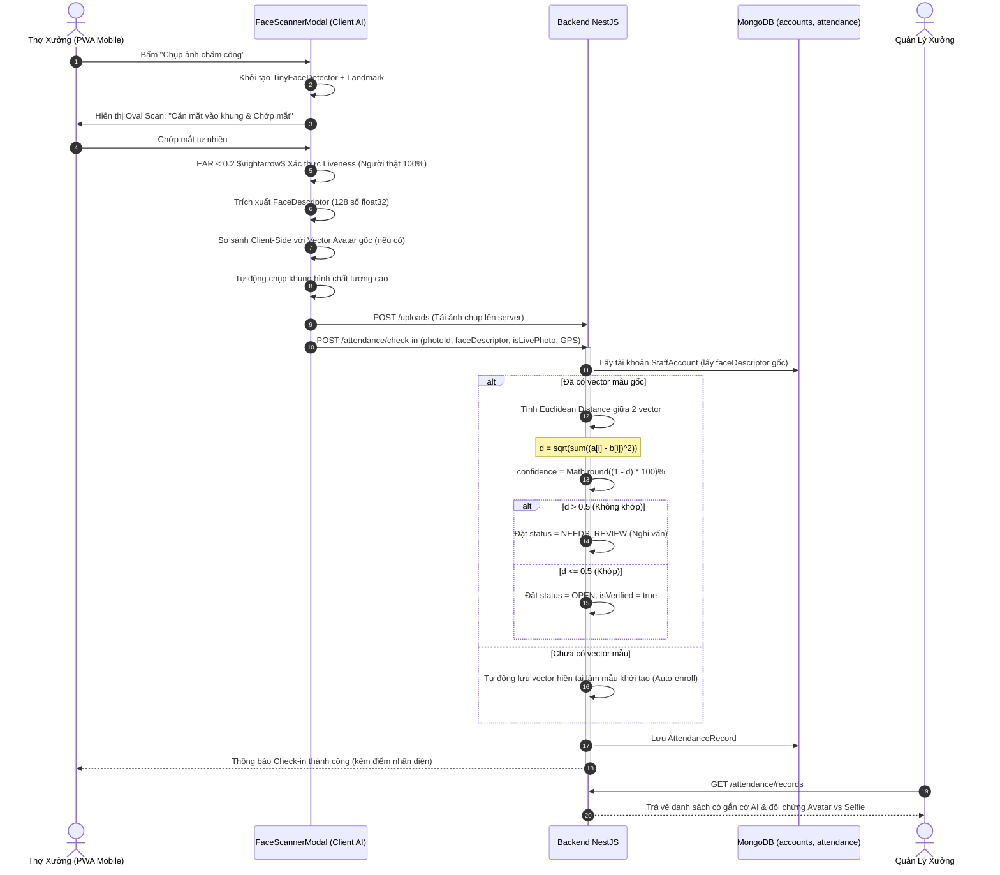

# Plan 58: Tích Hợp Xác Thực Khuôn Mặt On-Device AI (@vladmandic/face-api) & Liveness Check Cho Ca Chấm Công

> Status: Completed | Created: 2026-10-30 | Hệ thống: be-nestjs-thanhxuan & fe-react-thanhxuan-internal

---

## 1. Overview & Affected Files

### 1.1. Bối cảnh & Mục tiêu
- **Bối cảnh:** 
  - Khảo sát phương án sử dụng Cloud AI (Gemini Free) cho thấy giới hạn 15 RPM / 1,500 RPD chắc chắn sẽ bị nghẽn (HTTP 429) vào các khung giờ thợ xưởng vào ca đồng loạt (7h00 - 7h30 sáng), đồng thời vướng lo ngại về bảo mật sinh trắc học cá nhân.
  - Cần một giải pháp **On-Device AI (chạy trực tiếp trên trình duyệt PWA của điện thoại)**:
    - **0đ chi phí - Không giới hạn số lượt quét.**
    - **0% tải RAM/CPU trên VPS máy chủ.**
    - Tốc độ nhận diện tức thì (150 - 300ms) ngay trên khung camera.
    - Tích hợp **Liveness Detection (phát hiện chớp mắt / Eye Aspect Ratio)** để chống triệt để gian lận bằng ảnh in hoặc chụp lại qua màn hình điện thoại khác.
- **Mục tiêu kỹ thuật:**
  1. Tích hợp thư viện `@vladmandic/face-api` (TensorFlow.js WebAssembly / WebGL) vào PWA `fe-react-thanhxuan-internal`.
  2. Triển khai mô hình AI nhẹ vào `/public/models/` (`tiny_face_detector` ~190KB, `face_landmark_68_tiny` ~350KB, `face_recognition` ~6MB) và được VitePWA cache ngoại tuyến.
  3. Xây dựng camera modal nhận diện mặt thời gian thực với khung Oval thông minh, phát hiện chớp mắt (Blink Liveness Detection) và tự động trích xuất vector khuôn mặt 128 chiều (`FaceDescriptor`).
  4. Backend lưu `faceDescriptor: number[]` trong hồ sơ `StaffAccount` và tính toán khoảng cách vector (Euclidean Distance) xác thực kép tại server.
  5. Nâng cấp màn hình Quản lý duyệt công `AttendanceReviewPage` hiển thị huy hiệu AI xác thực, cảnh báo nghi vấn và giao diện đối chứng ảnh.

### 1.2. Danh sách tệp ảnh hưởng

| Đường Dẫn Tệp | Hành Động | Lý Do & Tác Dụng |
| :--- | :---: | :--- |
| `fe-react-thanhxuan-internal/package.json` | Edit | Thêm dependency `@vladmandic/face-api` phục vụ nhận diện mặt trên trình duyệt |
| `fe-react-thanhxuan-internal/public/models/*` | New | Bộ trọng số AI nén siêu nhẹ phục vụ nhận diện offline trên PWA |
| `fe-react-thanhxuan-internal/src/features/operations/attendance/hooks/useFaceRecognition.ts` | New | Custom Hook quản lý nạp model, trích xuất vector 128D và tính EAR phát hiện chớp mắt |
| `fe-react-thanhxuan-internal/src/features/operations/attendance/components/FaceScannerModal.tsx` | New | Modal quét camera thời gian thực với khung Oval đổi màu (Xanh/Vàng/Đỏ) & hướng dẫn chớp mắt |
| `fe-react-thanhxuan-internal/src/features/operations/attendance/AttendancePage.tsx` | Edit | Tích hợp mở `FaceScannerModal` khi bấm chụp ảnh chấm công |
| `fe-react-thanhxuan-internal/src/features/operations/attendance/attendance.types.ts` | Edit | Bổ sung `FaceVerificationInfo` và `faceDescriptor` |
| `fe-react-thanhxuan-internal/src/features/auth/modals/ProfileEditModal.tsx` | Edit | Tự động trích xuất và cập nhật `faceDescriptor` khi nhân viên đổi ảnh đại diện hồ sơ |
| `be-nestjs-thanhxuan/src/modules/internal/auth/schemas/staff-account.schema.ts` | Edit | Bổ sung trường `faceDescriptor: number[]` (128 số float) lưu vector đặc trưng khuôn mặt |
| `be-nestjs-thanhxuan/src/modules/internal/attendance/schemas/attendance-record.schema.ts` | Edit | Bổ sung sub-schema `FaceVerificationInfo` vào `CheckInInfo` |
| `be-nestjs-thanhxuan/src/modules/internal/attendance/dto/check-in.dto.ts` | Edit | Tiếp nhận `faceDescriptor?: number[]` và `isLivePhoto?: boolean` từ client |
| `be-nestjs-thanhxuan/src/modules/internal/attendance/attendance.service.ts` | Edit | Xác thực kép Euclidean Distance tại server ($d < 0.5 \implies$ Match $\ge 90\%$), tự động gắn cờ `NEEDS_REVIEW` nếu nghi vấn |
| `fe-react-thanhxuan-internal/src/features/management/attendance/components/AttendanceTableComponent.tsx` | Edit | Hiển thị huy hiệu AI nhận diện khuôn mặt (Khớp mặt 95%, Nghi vấn, Chưa có vector mẫu) |
| `fe-react-thanhxuan-internal/src/features/management/attendance/modals/AttendanceReviewModal.tsx` | Edit | Hiển thị đối chứng Avatar hồ sơ song song với Ảnh selfie vào ca kèm điểm % tương đồng |
| `.agents/docs/DATABASE_DICTIONARY.md` | Edit | Cập nhật cấu trúc trường `faceDescriptor` trong `accounts` và `faceVerification` trong `attendance_records` |
| `.agents/docs/srs_sdd/srs_sdd_backend.md` | Edit | Bổ sung tài liệu đặc tả logic đối soát vector Euclidean Distance |
| `.agents/docs/srs_sdd/srs_sdd_fe_internal.md` | Edit | Bổ sung tài liệu PWA Camera Oval Scanner và Blink Liveness |
| `.agents/docs/SRS_SDD.md` | Edit | Cập nhật 1 dòng Document History |
| `.agents/docs/CHANGELOG.md` | Edit | Ghi nhận chi tiết bài luận kỹ thuật Plan 58 |

---

## 2. Technical Approach

### 2.1. Kiến Trúc Luồng Xác Thực (On-Device + Server Double Verification)



### 2.2. Thuật Toán Cốt Lõi

1. **Thuật toán Liveness (Blink Detection qua Eye Aspect Ratio - EAR):**
   $$EAR = \frac{||p_2 - p_6|| + ||p_3 - p_5||}{2 \times ||p_1 - p_4||}$$
   - Bình thường khi mở mắt: $EAR \approx 0.28 - 0.35$.
   - Khi chớp mắt: $EAR < 0.20$ trong 1-2 frames rồi tăng trở lại.
   - Khi phát hiện chu kỳ này $\rightarrow$ Xác nhận người thật đang chuyển động trực tiếp trước camera (chống hoàn toàn việc giơ ảnh thẻ in hoặc đưa điện thoại khác chụp lại).

2. **Thuật toán So Khớp Khuôn Mặt (Euclidean Distance):**
   $$d(A, B) = \sqrt{\sum_{i=1}^{128} (A_i - B_i)^2}$$
   - $d < 0.40$: Rất trùng khớp ($> 95\%$).
   - $0.40 \le d \le 0.50$: Trùng khớp ($85\% - 95\%$).
   - $d > 0.50$: Không trùng khớp ($< 70\%$).

---

## 3. Implementation Tasks (Checklist)

- [x] **T1: Cài đặt thư viện AI & Triển khai Models Offline (`fe-react-thanhxuan-internal`)**
  - Cài đặt `@vladmandic/face-api` vào `fe-react-thanhxuan-internal`.
  - Sao chép bộ trọng số mô hình đã nén (`tiny_face_detector`, `face_landmark_68_tiny`, `face_recognition`) vào thư mục `public/models/`.
  - Tiêu chí: Mở trang web và nạp model thành công từ local cache mà không cần kết nối internet ra ngoài.

- [x] **T2: Xây dựng Hook Nhận Diện & Modal Camera Oval (`fe-react-thanhxuan-internal`)**
  - Xây dựng `useFaceRecognition.ts`: Quản lý nạp model, phân tích luồng webcam, trích xuất 128D descriptor và tính EAR chớp mắt.
  - Xây dựng `FaceScannerModal.tsx`: Giao diện toàn màn hình Mobile PWA, khung Oval căn mặt công thái học, đổi màu từ Vàng (đang dò) $\rightarrow$ Xanh lá (đã chớp mắt & nhận diện) $\rightarrow$ Tự động bấm chụp.
  - Tích hợp vào `AttendancePage.tsx`.
  - Tiêu chí: Camera tự động chụp khi thợ chớp mắt vào khung Oval trong vòng < 2 giây.

- [x] **T3: Nâng cấp Backend Schema & Double Verification (`be-nestjs-thanhxuan`)**
  - Thêm `faceDescriptor?: number[]` vào `StaffAccount` schema.
  - Bổ sung `FaceVerificationInfo` vào `AttendanceRecord` schema.
  - Mở rộng `CheckInDto` nhận `faceDescriptor` và `isLivePhoto`.
  - Triển khai hàm tính khoảng cách vector Euclidean Distance trong `attendance.service.ts`: Nếu có sự sai khác lớn ($d > 0.5$), tự động chuyển ca sang `NEEDS_REVIEW`.
  - Tiêu chí: Unit test `attendance.service.spec.ts` pass 100%, tính toán vector chạy trong $< 1\text{ ms}$.

- [x] **T4: Tự Động Khởi Tạo Vector Mẫu (Auto-Enroll) Khi Đổi Avatar**
  - Trong `ProfileEditModal.tsx` và `StaffManagementPage`: Khi nhân viên hoặc quản lý upload ảnh đại diện hồ sơ mới, tự động chạy trích xuất vector khuôn mặt và lưu vào `faceDescriptor` tài khoản.
  - Tiêu chí: Tài khoản sau khi cập nhật avatar sẽ có ngay vector mẫu để đối chiếu trong mọi lần check-in tiếp theo.

- [x] **T5: Nâng Cấp Giao Diện Quản Lý Duyệt Công (`AttendanceReviewPage`)**
  - Cập nhật `AttendanceTableComponent.tsx`: Thêm huy hiệu nhận diện AI (🟢 Khớp 95%, 🔴 Không khớp, 🟡 Chưa có mẫu).
  - Cập nhật `AttendanceReviewModal.tsx`: Hiển thị ảnh Avatar hồ sơ song song với ảnh selfie vào ca thực tế để quản lý đối chứng trực quan 2 ảnh cạnh nhau.
  - Tiêu chí: Quản lý thấy ngay ảnh hồ sơ gốc cạnh ảnh vào ca và lý do AI xác thực.

- [x] **T6: Build, Deploy & Đồng Bộ 5 Trụ Cột Tài Liệu**
  - Chạy `tsc --noEmit` và `pnpm build` cho cả Backend và Frontend.
  - Deploy bản build PWA mới vào `/var/www/noibo/dist/` và reload Nginx.
  - Cập nhật dist vào container `laundry_backend` và restart.
  - Cập nhật đồng bộ: `DATABASE_DICTIONARY.md`, `CODEBASE_ATLAS.md`, `srs_sdd_backend.md`, `srs_sdd_fe_internal.md`, `SRS_SDD.md`, `CHANGELOG.md`.
  - Tự động commit và push code lên nhánh `dev` của 2 repository.

---

## 4. Verification & Testing

### 4.1. Lệnh Kiểm Tra Biên Dịch & Mã Nguồn
```bash
# 1. Backend NestJS
cd /root/services/thanhxuan/backend-thanhxuan
pnpm exec tsc --noEmit
pnpm build
pnpm test src/modules/internal/attendance/specs/attendance.service.spec.ts

# 2. Frontend React PWA
cd /root/services/thanhxuan/thanhxuan-internal
pnpm exec tsc --noEmit
pnpm build
```

### 4.2. Kịch Bản Kiểm Thử Thực Tế (Happy Path & Edge Cases)
1. **Happy Path (Chấm công người thật chính chủ):**
   - Thợ mở camera $\rightarrow$ Khung Oval hiện hướng dẫn $\rightarrow$ Thợ chớp mắt $\rightarrow$ Máy phát hiện Liveness hợp lệ $\rightarrow$ So khớp vector đạt $\ge 90\%$ $\rightarrow$ Khung viền chuyển Xanh lá và tự động gửi check-in $\rightarrow$ Ca ở trạng thái `OPEN` hợp lệ.
2. **Edge Case 1 (Gian lận đưa ảnh tĩnh / màn hình điện thoại khác):**
   - Không có hành động chớp mắt tự nhiên (EAR không thay đổi) $\rightarrow$ Camera không tự động xác thực liveness, yêu cầu cử động mặt thật.
3. **Edge Case 2 (Người khác chấm công hộ):**
   - Thợ A dùng tài khoản thợ B chớp mắt $\rightarrow$ Liveness pass nhưng vector khuôn mặt khác biệt ($d > 0.5$) $\rightarrow$ Hệ thống vẫn cho check-in để không gián đoạn ca, nhưng tự động chuyển trạng thái sang `NEEDS_REVIEW` (Cần rà soát) kèm cờ đỏ trên màn hình Quản lý.
4. **Edge Case 3 (Thợ mới chưa có ảnh đại diện mẫu):**
   - Hệ thống tự động lấy vector của lần check-in đầu tiên làm mẫu (Auto-enrollment) hoặc đánh dấu ca cần duyệt lần đầu.

---

## 5. Risks & Rollback

- **Rủi ro 1: Trình duyệt máy cũ không hỗ trợ WebGL/WASM.**
  - *Giải pháp:* Tự động fallback về chế độ chụp camera truyền thống (`input capture="user"`) nếu thiết bị không hỗ trợ MediaDevices hoặc WebGL.
- **Rủi ro 2: Dung lượng tải lần đầu của PWA.**
  - *Giải pháp:* Sử dụng mô hình Tiny Face Detector siêu nhẹ (< 7MB tổng cộng) và cấu hình Service Worker CacheFirst để chỉ tải duy nhất 1 lần đầu.
- **Rollback:** Cung cấp nút chuyển đổi "Chụp ảnh thủ công" ngay trên modal quét mặt để thợ bấm chuyển ngay nếu camera gặp sự cố.

---

## Changelog
- 2026-10-30: Cập nhật Plan 58 - Chuyển đổi toàn diện từ Cloud Gemini API sang On-Device AI (`@vladmandic/face-api`) giải quyết triệt để vấn đề giới hạn Free Tier và bảo mật sinh trắc học.
