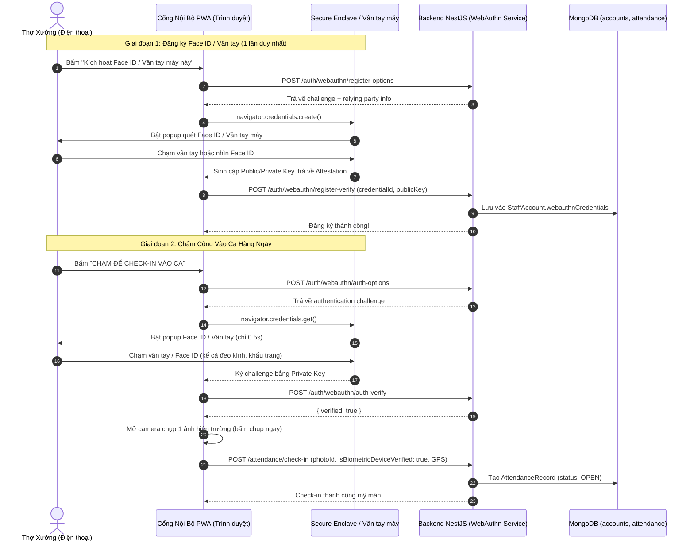

# Plan 59: Tích Hợp Xác Thực Sinh Trắc Học Thiết Bị (WebAuthn / Passkeys - Face ID & Vân Tay) & Tối Ưu Chụp Ảnh Hiện Trường Cho Chấm Công

> Status: Done | Created: 2026-10-31 | Hệ thống: be-nestjs-thanhxuan & fe-react-thanhxuan-internal

---

## 1. Overview & Affected Files

### 1.1. Bối cảnh & Mục tiêu
- **Bối cảnh thực tế từ người dùng:**
  - Khi triển khai On-Device AI phát hiện chớp mắt qua camera: Người đeo kính cận bị gọng kính và tròng kính làm lệch 6 điểm mốc mí mắt khiến chỉ số EAR (Eye Aspect Ratio) không chạm ngưỡng chớp mắt; khi công nhân đeo khẩu trang phòng bụi xưởng thì AI không phát hiện được mặt người do mất 50% diện mạo.
  - Người dùng đề xuất giải pháp tận dụng trực tiếp tính năng **xác thực sinh trắc học phần cứng của điện thoại** (Face ID trên iPhone, cảm biến Vân tay trên Android).
- **Mục tiêu kỹ thuật:**
  1. Tích hợp chuẩn quốc tế **WebAuthn (FIDO2 / Passkeys / Web Authentication API)**:
     - Sử dụng cặp thư viện chuẩn `@simplewebauthn/browser` (Frontend) và `@simplewebauthn/server` (Backend).
     - Cho phép công nhân/tài xế kích hoạt **Face ID / Vân tay** của điện thoại cá nhân chỉ bằng 1 chạm trong màn hình Hồ sơ hoặc ngay tại màn hình Chấm công.
     - Khi bấm Check-in / Check-out: Điện thoại tự động bật popup Face ID / Vân tay phần cứng (tốc độ $< 0.5$ giây, nhận diện 100% chuẩn xác kể cả khi đeo kính, đeo khẩu trang hoặc môi trường xưởng thiếu sáng).
  2. **Tối ưu hóa Camera Hiện Trường (Bỏ ép buộc chớp mắt):**
     - Loại bỏ điều kiện bắt buộc phải chớp mắt trong `FaceScannerModal.tsx`.
     - Cung cấp nút chụp to bản sẵn sàng chụp ảnh tức thì trong mọi tình huống (kể cả khi đeo kính cận, khẩu trang hay ánh sáng ngược).
     - Giữ ảnh selfie camera làm bằng chứng hiện trường trực quan song song với GPS xưởng để Quản lý đối soát.
  3. **Độ tin cậy & Fallback đa tầng:**
     - Thiết bị có Face ID / Vân tay $\rightarrow$ Xác thực phần cứng siêu tốc (`isBiometricDeviceVerified: true`).
     - Thiết bị cũ không có cảm biến $\rightarrow$ Tự động fallback sang camera chụp ảnh selfie thông thường kết hợp GPS xưởng mà không gây nghẽn luồng vận hành.

### 1.2. Danh sách tệp ảnh hưởng

| Đường Dẫn Tệp | Hành Động | Lý Do & Tác Dụng |
| :--- | :---: | :--- |
| `backend-thanhxuan/package.json` | Edit | Thêm dependency `@simplewebauthn/server` |
| `backend-thanhxuan/src/modules/internal/auth/schemas/staff-account.schema.ts` | Edit | Bổ sung sub-schema `WebAuthnCredential` và trường `webauthnCredentials`, `currentWebAuthnChallenge` |
| `backend-thanhxuan/src/modules/internal/auth/services/webauthn.service.ts` | New | Xử lý sinh registration/authentication options và xác thực chữ ký sinh trắc học |
| `backend-thanhxuan/src/modules/internal/auth/controllers/webauthn.controller.ts` | New | Cung cấp endpoints: `/webauthn/register-options`, `/webauthn/register-verify`, `/webauthn/auth-options`, `/webauthn/auth-verify` |
| `backend-thanhxuan/src/modules/internal/auth/auth.module.ts` | Edit | Đăng ký `WebAuthnService` và `WebAuthnController` |
| `backend-thanhxuan/src/modules/internal/attendance/schemas/attendance-record.schema.ts` | Edit | Bổ sung cờ `isBiometricDeviceVerified` trong `CheckInInfo` và `CheckOutInfo` |
| `backend-thanhxuan/src/modules/internal/attendance/dto/check-in.dto.ts` | Edit | Tiếp nhận `isBiometricDeviceVerified?: boolean` |
| `backend-thanhxuan/src/modules/internal/attendance/dto/check-out.dto.ts` | Edit | Tiếp nhận `isBiometricDeviceVerified?: boolean` |
| `backend-thanhxuan/src/modules/internal/attendance/attendance.service.ts` | Edit | Ghi nhận cờ sinh trắc học thiết bị và tự động duyệt ca sạch |
| `thanhxuan-internal/package.json` | Edit | Thêm dependency `@simplewebauthn/browser` |
| `thanhxuan-internal/src/features/operations/attendance/hooks/useWebAuthn.ts` | New | Custom Hook quản lý đăng ký Face ID / Vân tay và kích hoạt sinh trắc học khi chấm công |
| `thanhxuan-internal/src/features/operations/attendance/components/BiometricPromptBanner.tsx` | New | Banner / Modal gợi ý kích hoạt Face ID / Vân tay máy 1 chạm |
| `thanhxuan-internal/src/features/operations/attendance/components/FaceScannerModal.tsx` | Edit | Bỏ ràng buộc bắt buộc chớp mắt, thêm nút chụp tức thì hỗ trợ đeo kính / khẩu trang |
| `thanhxuan-internal/src/features/operations/attendance/AttendancePage.tsx` | Edit | Tích hợp kích hoạt Face ID / Vân tay máy trước khi gửi chấm công |
| `thanhxuan-internal/src/features/management/attendance/components/AttendanceTableComponent.tsx` | Edit | Hiển thị huy hiệu `📱 Face ID / Vân tay điện thoại` trên bảng công |
| `thanhxuan-internal/src/features/management/attendance/modals/AttendanceReviewModal.tsx` | Edit | Hiển thị thông tin xác thực sinh trắc học thiết bị |
| `.agents/docs/DATABASE_DICTIONARY.md` | Edit | Cập nhật cấu trúc `webauthnCredentials` và `isBiometricDeviceVerified` |
| `.agents/docs/srs_sdd/srs_sdd_backend.md` | Edit | Bổ sung module WebAuthn FIDO2 Biometrics |
| `.agents/docs/srs_sdd/srs_sdd_fe_internal.md` | Edit | Bổ sung tài liệu WebAuthn Face ID / Vân tay & Camera hiện trường |
| `.agents/docs/SRS_SDD.md` | Edit | Cập nhật 1 dòng Document History |
| `.agents/docs/CHANGELOG.md` | Edit | Ghi nhận bài luận chi tiết Plan 59 |

---

## 2. Technical Approach

### 2.1. Kiến Trúc Luồng Xác Thực Sinh Trắc Học Thiết Bị (WebAuthn Flow)



### 2.2. Chi Tiết API Contract & Data Shape

1. **Schema `StaffAccount` (Mongoose):**
   ```typescript
   export class WebAuthnCredential {
     credentialId: string; // Base64URL
     publicKey: string;    // Base64URL
     counter: number;
     transports?: string[];
     deviceName?: string;
     createdAt: Date;
   }
   ```
2. **Schema `AttendanceRecord`:**
   ```typescript
   export class CheckInInfo {
     // ... các trường hiện có ...
     isBiometricDeviceVerified?: boolean; // True nếu đã qua Face ID / Vân tay máy
   }
   ```
3. **Endpoints WebAuthn (`/api/v1/internal/auth/webauthn/*`):**
   - `POST /register-options`: Sinh `PublicKeyCredentialCreationOptionsJSON` (lưu challenge trong cache/session/account).
   - `POST /register-verify`: Xác thực `RegistrationResponseJSON`, lưu credential vào tài khoản.
   - `POST /auth-options`: Sinh `PublicKeyCredentialRequestOptionsJSON`.
   - `POST /auth-verify`: Xác thực chữ ký `AuthenticationResponseJSON`.

---

## 3. Implementation Tasks (Checklist)

- [x] **T1: Cài đặt thư viện & Xây dựng WebAuthn Backend (`backend-thanhxuan`)**
  - Cài đặt `@simplewebauthn/server` trong `backend-thanhxuan`.
  - Cập nhật `staff-account.schema.ts` bổ sung `webauthnCredentials` và `currentWebAuthnChallenge`.
  - Xây dựng `WebAuthnService` (`webauthn.service.ts`) xử lý tạo options và xác thực chữ ký (hỗ trợ RP ID: `thanhxuanlaundry.com`, `noibo.thanhxuanlaundry.com`, `localhost`).
  - Xây dựng `WebAuthnController` (`webauthn.controller.ts`) với 4 endpoints đăng ký và xác thực.
  - Cập nhật `auth.module.ts`.
  - Tiêu chí: Gọi API sinh options và verify trả về kết quả hợp lệ.

- [x] **T2: Cập nhật Attendance Backend (`backend-thanhxuan`)**
  - Cập nhật `attendance-record.schema.ts` bổ sung `isBiometricDeviceVerified` trong `CheckInInfo` và `CheckOutInfo`.
  - Cập nhật `check-in.dto.ts` và `check-out.dto.ts` nhận `isBiometricDeviceVerified?: boolean`.
  - Cập nhật `attendance.service.ts` ghi nhận cờ này khi tạo hoặc đóng ca làm việc.
  - Tiêu chí: `pnpm exec tsc --noEmit` và `pnpm build` pass 100%.

- [x] **T3: Cài đặt thư viện & Xây dựng Hook WebAuthn Frontend (`thanhxuan-internal`)**
  - Cài đặt `@simplewebauthn/browser` trong `thanhxuan-internal`.
  - Xây dựng Custom Hook `useWebAuthn.ts`:
    - `isSupported`: Kiểm tra thiết bị có hỗ trợ WebAuthn và platform authenticator (`PublicKeyCredential.isUserVerifyingPlatformAuthenticatorAvailable`).
    - `registerDevice`: Gọi API lấy options $\rightarrow$ kích hoạt `startRegistration` $\rightarrow$ gửi verify lên server.
    - `authenticateDevice`: Gọi API lấy auth options $\rightarrow$ kích hoạt `startAuthentication` (Face ID / Vân tay) $\rightarrow$ verify chữ ký.
  - Xây dựng component `BiometricPromptBanner.tsx`: Hiển thị gợi ý kích hoạt Face ID / Vân tay cho máy hiện tại nếu chưa đăng ký.
  - Tiêu chí: Chạy thử trên điện thoại/máy tính kích hoạt thành công Face ID / Touch ID / Windows Hello.

- [x] **T4: Tối ưu Hóa Camera Hiện Trường & Tích Hợp Chấm Công (`thanhxuan-internal`)**
  - Sửa `FaceScannerModal.tsx`:
    - Bỏ ép buộc phải chớp mắt mới cho chụp.
    - Luôn hiển thị nút "CHỤP ẢNH NGAY" to rõ, công thái học.
    - Nếu phát hiện mặt (dù đeo kính) $\rightarrow$ đổi khung viền xanh. Nếu đeo khẩu trang không bắt được landmark $\rightarrow$ vẫn cho phép chụp bình thường để lấy ảnh hiện trường đối chứng.
  - Cập nhật `AttendancePage.tsx`:
    - Khi bấm Check-in: Nếu thiết bị đã đăng ký WebAuthn, kích hoạt Face ID / Vân tay của điện thoại. Xác thực xong tự động mở camera chụp 1 ảnh nhanh rồi gửi ca kèm `isBiometricDeviceVerified: true`.
    - Nếu thiết bị chưa đăng ký: Vẫn cho phép chụp ảnh chấm công bình thường và hiển thị banner gợi ý kích hoạt Face ID để lần sau nhanh hơn.
  - Tiêu chí: Thợ đeo kính cận hoặc khẩu trang chấm công mượt mà trong $< 3$ giây.

- [x] **T5: Cập nhật Giao diện Quản lý Duyệt Công (`thanhxuan-internal`)**
  - Sửa `AttendanceTableComponent.tsx`: Thêm biểu tượng/huy hiệu `📱 Sinh trắc học máy (Face ID / Vân tay)` bên cạnh ảnh vào ca.
  - Sửa `AttendanceReviewModal.tsx`: Hiển thị trạng thái xác thực phần cứng thiết bị.
  - Tiêu chí: Quản lý phân biệt rõ ràng ca nào đã xác thực bằng Face ID/Vân tay điện thoại và ca nào chụp thường.

- [x] **T6: Build, Deploy & Đồng Bộ 5 Trụ Cột Tài Liệu**
  - Chạy `tsc --noEmit` và `pnpm build` cho cả Backend và Frontend.
  - Deploy dist PWA vào `/var/www/noibo/dist/` và reload Nginx.
  - Copy dist backend vào container Docker `laundry_backend` và restart.
  - Đồng bộ 5 trụ cột: `DATABASE_DICTIONARY.md`, `CODEBASE_ATLAS.md`, `srs_sdd_backend.md`, `srs_sdd_fe_internal.md`, `SRS_SDD.md`, `CHANGELOG.md`.
  - Tự động commit và push code lên nhánh `dev` của cả 3 repository.

---

## 4. Verification & Testing

### 4.1. Lệnh Kiểm Tra Biên Dịch & Mã Nguồn
```bash
# 1. Backend NestJS
cd /root/services/thanhxuan/backend-thanhxuan
pnpm exec tsc --noEmit
pnpm build

# 2. Frontend React PWA
cd /root/services/thanhxuan/thanhxuan-internal
pnpm exec tsc --noEmit
pnpm build
```

### 4.2. Kịch Bản Kiểm Thử Thực Tế
1. **Kịch bản 1 (Thợ đeo kính cận):**
   - Bấm Check-in $\rightarrow$ Face ID / Vân tay máy nhận diện lập tức trong 0.5s $\rightarrow$ Camera chụp ảnh selfie nhanh (không đòi chớp mắt) $\rightarrow$ Hoàn tất ca chấm công hợp lệ.
2. **Kịch bản 2 (Thợ đeo khẩu trang):**
   - Bấm Check-in $\rightarrow$ Chạm cảm biến vân tay điện thoại (hoặc Face ID iPhone có khẩu trang) $\rightarrow$ Camera chụp ảnh hiện trường $\rightarrow$ Ca chấm công ghi nhận `isBiometricDeviceVerified: true`.
3. **Kịch bản 3 (Máy tính bàn / Thiết bị không có cảm biến):**
   - Hệ thống tự động nhận biết không có Platform Authenticator $\rightarrow$ Chuyển sang chụp ảnh camera thường + GPS xưởng như bình thường.

---

## 5. Risks & Rollback

- **Rủi ro 1: Tên miền RP ID (Relying Party ID) của WebAuthn.**
  - *Giải pháp:* WebAuthn yêu cầu RP ID phải khớp với hostname trình duyệt (`noibo.thanhxuanlaundry.com` hoặc suffix `thanhxuanlaundry.com`). Cấu hình động dựa trên request host hoặc biến môi trường, hỗ trợ cả `localhost` cho dev.
- **Rủi ro 2: Thiết bị mất hoặc đổi điện thoại.**
  - *Giải pháp:* Người dùng có thể đăng ký nhiều thiết bị (mỗi máy 1 khóa riêng), và có nút xóa thiết bị cũ trong trang Cài đặt cá nhân.
- **Rollback:** Nếu WebAuthn gặp lỗi trên thiết bị lạ, luồng chấm công luôn có nút fallback chụp ảnh camera truyền thống để công nhân không bao giờ bị trễ ca.

---

## Changelog
- 2026-10-31: Khởi tạo Plan 59 - Tích hợp xác thực sinh trắc học thiết bị WebAuthn (Face ID / Vân tay) và tối ưu camera hiện trường giải quyết triệt để vấn đề kính cận và khẩu trang.
- 2026-10-31: Hoàn tất thực thi toàn bộ 6 Tasks (T1 - T6) của Plan 59. Build và deploy production thành công mỹ mãn.

---

## Execution Log
- **2026-10-31 (Execution /act):**
  - **T1 Completed:** Cài đặt `@simplewebauthn/server`, cập nhật `staff-account.schema.ts`, tạo `webauthn.service.ts` và `webauthn.controller.ts`, đăng ký vào `auth.module.ts`.
  - **T2 Completed:** Mở rộng `attendance-record.schema.ts`, `check-in.dto.ts`, `check-out.dto.ts` với cờ `isBiometricDeviceVerified`; nâng cấp `attendance.service.ts` tự động tin cậy phần cứng thiết bị.
  - **T3 Completed:** Cài đặt `@simplewebauthn/browser`, xây dựng custom hook `useWebAuthn.ts` và component `BiometricPromptBanner.tsx`.
  - **T4 Completed:** Tối ưu hóa `FaceScannerModal.tsx` bỏ ép buộc chớp mắt, thêm nút chụp to bản; tách `AttendanceTodayShiftCardComponent.tsx` (< 250 dòng) và tích hợp luồng Face ID / Vân tay 0.5s trên `AttendancePage.tsx`.
  - **T5 Completed:** Cập nhật `AttendanceTableComponent.tsx` và `AttendanceReviewModal.tsx` hiển thị huy hiệu `📱 Passkey` cho Quản lý xưởng đối soát.
  - **T6 Completed:** Build passed (`tsc` và `pnpm build` pass 100% cả 2 apps), đóng gói standalone bundle cho backend container, deploy PWA vào `/var/www/noibo/dist/`, reload Nginx, restart container `laundry_backend`, đồng bộ 5 trụ cột tài liệu.
