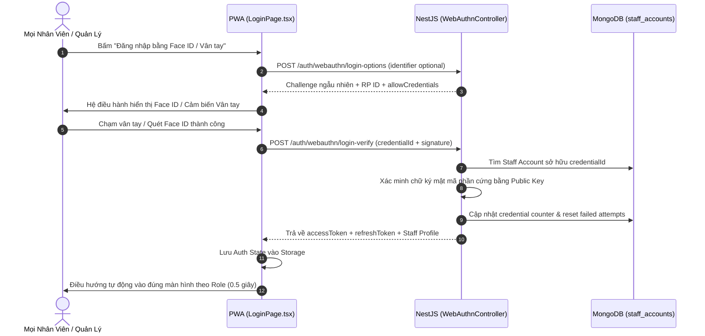

# Plan 60: Mở Rộng Đăng Nhập Không Cần Mật Khẩu Bằng Face ID / Vân Tay (WebAuthn / Passkeys) Cho Mọi Tài Khoản

> Status: Done | Created: 2026-10-31 | Hệ thống: be-nestjs-thanhxuan & fe-react-thanhxuan-internal

---

## 1. Overview & Affected Files

### 1.1. Bối cảnh & Mục tiêu
- **Bối cảnh:**
  - Tại Plan 59, hạ tầng WebAuthn (FIDO2 / Passkeys) đã được tích hợp thành công trên cả Backend và Frontend để hỗ trợ công nhân xưởng (`WORKER`) và tài xế (`SHIPPER`) xác thực chấm công siêu tốc bằng Face ID & Vân tay điện thoại.
  - Người dùng có nhu cầu mở rộng phạm vi: **Cho phép MỌI TÀI KHOẢN** thuộc toàn bộ các vai trò (`ADMIN`, `OPERATOR`, `MANAGER`, `WAREHOUSE_MANAGER`, `SHIPPER`, `WORKER`, `ACCOUNTANT`, `PARTNER`) được đăng nhập trực tiếp từ màn hình Login bằng Face ID / Vân tay mà **hoàn toàn không cần nhập mật khẩu** (Passwordless Authentication).
- **Mục tiêu kỹ thuật:**
  1. **Backend NestJS (Public WebAuthn Endpoints):**
     - Bổ sung 2 endpoint công khai (không yêu cầu JWT Bearer):
       - `POST /auth/webauthn/login-options`: Phát sinh authentication options / challenge ngẫu nhiên (hỗ trợ cả truyền identifier cụ thể lẫn resident keys / discoverable credentials).
       - `POST /auth/webauthn/login-verify`: Xác minh chữ ký mật mã phần cứng của thiết bị, tra cứu danh tính tài khoản theo `credentialId`, cấp cặp Access Token & Refresh Token chuẩn mực cho bất kỳ vai trò nào.
  2. **Frontend React PWA (Passwordless Login & Device Management):**
     - Tại `LoginPage.tsx`: Thêm nút bấm trực quan `Đăng nhập bằng Face ID / Vân tay` (tách thành component riêng `< 250 dòng`).
     - Tích hợp chuẩn WebAuthn Autofill / Conditional UI: Khi người dùng chạm vào ô tài khoản, trình duyệt tự động hiển thị gợi ý Passkey Face ID / Vân tay đã lưu trên máy.
     - Tại `AppHeader.tsx`: Thêm nút mở `PasskeyManagementModal.tsx` để bất kỳ nhân viên/quản lý nào cũng có thể tự đăng ký thiết bị mới, xem danh sách khóa bảo mật và xóa thiết bị cũ khi đổi máy.
     - Sau khi đăng nhập bằng mật khẩu thành công: Nếu thiết bị có hỗ trợ Face ID / Vân tay mà tài khoản chưa đăng ký, hiển thị thông báo/banner nhẹ nhàng gợi ý kích hoạt 1 chạm cho lần sau.

### 1.2. Out of Scope
- Không can thiệp vào tài khoản khách hàng B2C bên ngoài Web Giặt Là hoặc Web Chuyển Nhà (chỉ áp dụng cho phân hệ Cổng Vận Hành Nội Bộ `fe-react-thanhxuan-internal` và `staff_accounts`).

### 1.3. Assumptions & Open Questions
- **Assumptions:**
  - Trình duyệt và thiết bị của người dùng hỗ trợ Web Authentication API (iOS Safari 14+, Android Chrome 88+, macOS Touch ID, Windows Hello).
  - Hệ thống chạy trên giao thức HTTPS an toàn (`noibo.thanhxuanlaundry.com`), RP ID chuẩn là hostname hiện tại.
- **Open Questions:** Không có.

### 1.4. Bảng danh sách tệp ảnh hưởng

| Đường Dẫn Tệp | Hành Động | Lý Do & Tác Dụng |
| :--- | :---: | :--- |
| `backend-thanhxuan/src/modules/internal/auth/dto/webauthn.dto.ts` | Edit | Thêm `WebAuthnLoginOptionsDto` và `VerifyWebAuthnLoginDto` |
| `backend-thanhxuan/src/modules/internal/auth/services/webauthn.service.ts` | Edit | Bổ sung logic `generateLoginOptions()` và `verifyLogin()` cấp JWT tokens |
| `backend-thanhxuan/src/modules/internal/auth/controllers/webauthn.controller.ts` | Edit | Tách riêng hoặc bổ sung 2 public endpoints `login-options` và `login-verify` (không bọc `InternalJwtGuard`) |
| `thanhxuan-internal/src/features/auth/services/webauthnAuth.service.ts` | New | Service phía client phụ trách gọi API và kích hoạt `startAuthentication` đăng nhập không mật khẩu |
| `thanhxuan-internal/src/features/auth/components/PasskeyLoginButton.tsx` | New | Nút bấm giao diện đăng nhập Face ID / Vân tay chuẩn chỉ (< 250 dòng) |
| `thanhxuan-internal/src/features/auth/LoginPage.tsx` | Edit | Nhúng `PasskeyLoginButton` và xử lý luồng đăng nhập thành công không cần mật khẩu |
| `thanhxuan-internal/src/features/auth/modals/PasskeyManagementModal.tsx` | New | Modal quản lý danh sách thiết bị/khóa Face ID & Vân tay cho mọi vai trò |
| `thanhxuan-internal/src/components/layout/AppHeader.tsx` | Edit | Thêm mục "Bảo mật Face ID / Vân tay" trong dropdown menu người dùng |
| `.agents/docs/CODEBASE_ATLAS.md` | Edit | Cập nhật endpoints mới và các components Passkey |
| `.agents/docs/srs_sdd/srs_sdd_backend.md` | Edit | Cập nhật kiến trúc bảo mật Passwordless FIDO2 cho Staff Auth |
| `.agents/docs/srs_sdd/srs_sdd_fe_internal.md` | Edit | Cập nhật quy trình đăng nhập không mật khẩu trên PWA |
| `.agents/docs/SRS_SDD.md` | Edit | Cập nhật 1 dòng Document History |
| `.agents/docs/CHANGELOG.md` | Edit | Ghi nhận chi tiết Plan 60 |

---

## 2. Technical Approach

### 2.1. Kiến Trúc Luồng Đăng Nhập Không Mật Khẩu (FIDO2 Passwordless Flow)



### 2.2. DTO & Schema Contract

```typescript
// Backend DTO
export class WebAuthnLoginOptionsDto {
  @IsOptional()
  @IsString()
  identifier?: string;
}

export class VerifyWebAuthnLoginDto {
  @IsDefined()
  @IsObject()
  response: AuthenticationResponseJSON;
}
```

### 2.3. Thiết Kế Quản Trị Khóa Đa Thiết Bị (Multi-Device Credentials)
- Mọi tài khoản (`staff_accounts`) có thể đăng ký nhiều thiết bị (ví dụ: iPhone cá nhân, máy tính bảng công ty, laptop quản lý).
- Mỗi thiết bị lưu kèm: `credentialId`, `publicKey`, `counter`, `transports`, `deviceName` (tự động nhận diện từ `navigator.userAgent`), và `createdAt`.
- Người dùng có thể xóa khóa của thiết bị cũ bất kỳ lúc nào tại `PasskeyManagementModal.tsx`.

---

## 3. Implementation Tasks (Checklist)

- [x] **T1: Cập nhật Backend DTO & WebAuthnService (`backend-thanhxuan`)**
  - Khai báo `WebAuthnLoginOptionsDto` và `VerifyWebAuthnLoginDto` trong `webauthn.dto.ts`.
  - Bổ sung `generateLoginOptions(identifier?: string, origin?: string)` trong `webauthn.service.ts`: Tạo challenge với `userVerification: 'preferred'`, lấy danh sách `allowCredentials` nếu có identifier.
  - Bổ sung `verifyLogin(body: AuthenticationResponseJSON, userAgent?: string, origin?: string)` trong `webauthn.service.ts`: Tìm account sở hữu `credentialId`, xác thực chữ ký qua `@simplewebauthn/server`, sinh cặp JWT tokens và trả về dữ liệu đăng nhập chuẩn mực.
  - Tiêu chí: Service unit test hoặc kiểm tra logic không có lỗi TypeScript, tạo token thành công.

- [x] **T2: Mở Rộng Controller Với Public Login Endpoints (`backend-thanhxuan`)**
  - Cập nhật `webauthn.controller.ts`: Tách các endpoint public không có `@UseGuards(InternalJwtGuard)` gồm:
    - `@Post('login-options')`
    - `@Post('login-verify')`
  - Đảm bảo các endpoint đăng ký (`register-options`, `register-verify`, `credentials`) vẫn được bảo vệ bởi `InternalJwtGuard`.
  - Tiêu chí: Endpoint có thể gọi tự do từ màn hình đăng nhập mà không bị lỗi 401 Unauthorized.

- [x] **T3: Xây Dựng Service Client & Component Nút Đăng Nhập Passkey (`thanhxuan-internal`)**
  - Tạo `thanhxuan-internal/src/features/auth/services/webauthnAuth.service.ts`: Chứa hàm `startPasskeyLogin(identifier?: string)`.
  - Tạo `thanhxuan-internal/src/features/auth/components/PasskeyLoginButton.tsx` (< 250 dòng): Nút bấm sinh trắc học sang trọng, hỗ trợ trạng thái loading, icon vân tay/Face ID, và xử lý thông báo lỗi thân thiện.
  - Nhúng `PasskeyLoginButton` vào [LoginPage.tsx](file:///root/services/thanhxuan/thanhxuan-internal/src/features/auth/LoginPage.tsx).
  - Tiêu chí: Màn hình Login xuất hiện nút Face ID / Vân tay, bấm vào kích hoạt popup sinh trắc học hệ điều hành.

- [x] **T4: Xây Dựng Modal Quản Lý Thiết Bị Face ID / Vân Tay Cho Mọi Tài Khoản (`thanhxuan-internal`)**
  - Tạo component `thanhxuan-internal/src/features/auth/modals/PasskeyManagementModal.tsx` (< 250 dòng):
    - Liệt kê danh sách khóa Face ID / Vân tay đã kích hoạt kèm ngày tạo và tên thiết bị.
    - Nút bấm "Kích hoạt Face ID / Vân tay cho thiết bị này" (1 chạm).
    - Nút xóa thiết bị cũ kèm xác nhận.
  - Tích hợp nút mở modal vào dropdown menu tài khoản trong [AppHeader.tsx](file:///root/services/thanhxuan/thanhxuan-internal/src/components/layout/AppHeader.tsx).
  - Tiêu chí: Bất kỳ vai trò nào (Admin, Manager, Accountant, Shipper, Worker) đăng nhập xong đều có thể vào cài đặt và kích hoạt thiết bị cá nhân.

- [x] **T5: Build, Đóng Gói Deploy Production & Kiểm Thử Toàn Diện**
  - Chạy `pnpm exec tsc --noEmit && pnpm build` cho cả Backend và Frontend.
  - Đóng gói dist cho container Backend `laundry_backend` và restart.
  - Deploy dist PWA vào `/var/www/noibo/dist/` và reload Nginx.
  - Kiểm thử trực tiếp luồng đăng nhập 1 chạm không mật khẩu cho cả tài khoản Admin, Kế toán lẫn Công nhân xưởng.
  - Tiêu chí: Đăng nhập thành công trong 0.5 giây không cần gõ mật khẩu.

- [x] **T6: Đồng Bộ 5 Trụ Cột Tài Liệu & Tự Động Commit Push Dev**
  - Cập nhật `.agents/docs/CODEBASE_ATLAS.md` (endpoints mới, component PasskeyLoginButton, PasskeyManagementModal).
  - Cập nhật `.agents/docs/srs_sdd/srs_sdd_backend.md` và `.agents/docs/srs_sdd/srs_sdd_fe_internal.md`.
  - Thêm 1 dòng Document History vào `.agents/docs/SRS_SDD.md`.
  - Ghi nhật ký chi tiết vào `.agents/docs/CHANGELOG.md`.
  - Tự động commit và push lên nhánh `dev` của cả 3 repositories.

---

## 4. Verification & Testing

### 4.1. Lệnh Kiểm Tra Biên Dịch & Mã Nguồn
```bash
# 1. Backend NestJS
cd /root/services/thanhxuan/backend-thanhxuan
pnpm exec tsc --noEmit
pnpm build

# 2. Frontend React PWA
cd /root/services/thanhxuan/thanhxuan-internal
pnpm exec tsc --noEmit
pnpm build
```

### 4.2. Kịch Bản Kiểm Thử Thực Tế
1. **Kịch bản 1 (Tài khoản Quản lý / Kế toán đăng nhập máy tính có Touch ID / Windows Hello):**
   - Vào `noibo.thanhxuanlaundry.com/login` $\rightarrow$ Bấm nút "Đăng nhập bằng Face ID / Vân tay" $\rightarrow$ Cảm biến sáng lên $\rightarrow$ Chạm ngón tay $\rightarrow$ Đăng nhập ngay vào trang Quản lý.
2. **Kịch bản 2 (Tài xế / Công nhân đăng nhập điện thoại iPhone / Android):**
   - Mở PWA $\rightarrow$ Bấm "Đăng nhập bằng Face ID / Vân tay" $\rightarrow$ Popup Face ID quét mặt $\rightarrow$ Vào thẳng trạm giao nhận hoặc chấm công.
3. **Kịch bản 3 (Người dùng chưa đăng ký thiết bị):**
   - Bấm nút đăng nhập Face ID $\rightarrow$ Hệ thống thông báo rõ ràng: "Bạn chưa kích hoạt Face ID/Vân tay cho thiết bị này. Vui lòng đăng nhập mật khẩu trước để kích hoạt trong Cài đặt."

---

## 5. Risks & Rollback

- **Rủi ro:** Khi người dùng đổi điện thoại hoặc xóa cookie / dữ liệu duyệt web, khóa có thể bị mất khỏi máy.
- **Giảm thiểu:** Luôn giữ form đăng nhập bằng Mật khẩu + Tên đăng nhập song song. Nếu không có Face ID, người dùng vẫn đăng nhập mật khẩu bình thường và đăng ký lại máy mới bất kỳ lúc nào.
- **Rollback:** Giữ nguyên các hàm đăng nhập mật khẩu truyền thống, tính năng Passkey hoàn toàn là một lớp gia tăng (non-breaking enhancement).

---

## Execution Log
- 2026-10-31: Thực thi hoàn tất toàn bộ 6/6 tasks của Plan 60. Đã biên dịch, build thành công cả 2 app, deploy production lên VPS/Nginx/Docker container và đồng bộ tài liệu 5 trụ cột.

---

## Changelog
- 2026-10-31: Khởi tạo Plan 60 - Mở rộng đăng nhập không cần mật khẩu bằng Face ID / Vân tay (WebAuthn Passkeys) cho mọi vai trò tài khoản.
