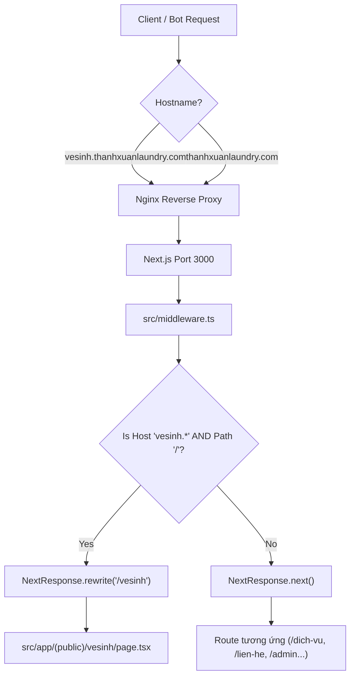

# Plan 61: Thiết Lập Trang Dịch Vụ Vệ Sinh (vesinh.thanhxuanlaundry.com & /vesinh) Tối Ưu SEO B2B Dựa Trên Trang Chủ

> Status: Done | Created: 2026-10-31 | Hệ thống: fe-nextjs-thanhxuan-laundry & Hạ tầng Nginx Reverse Proxy

---

## 1. Overview & Affected Files

### 1.1. Bối cảnh & Mục tiêu
- **Bối cảnh:**
  - Trang chủ `https://thanhxuanlaundry.com/` hiện tại tập trung tối ưu SEO và chuyển đổi cho dịch vụ giặt là công nghiệp (`laundry`).
  - Doanh nghiệp đang mở rộng mạnh mảng **Dịch Vụ Vệ Sinh Doanh Nghiệp & Vệ Sinh Công Nghiệp** (vệ sinh văn phòng, nhà hàng, bếp ăn công nghiệp, giặt thảm văn phòng, giặt sofa/rèm, vệ sinh trường học, ký túc xá, sau xây dựng).
  - Khách hàng có nhu cầu thiết lập một trang đích (landing page) chuyên biệt cho dịch vụ vệ sinh tại `https://thanhxuanlaundry.com/vesinh` và kích hoạt tên miền phụ `https://vesinh.thanhxuanlaundry.com/` để tối ưu SEO Google độc lập và chuyển đổi khách hàng B2B. Giao diện và cấu trúc kế thừa tiêu chuẩn thẩm mỹ, độ hoàn thiện và hiệu năng của trang chủ hiện tại.
- **Mục tiêu kỹ thuật:**
  1. **Subdomain Routing & Middleware Rewrite:**
     - Nâng cấp `src/middleware.ts` trong Next.js App Router: Khi request gửi tới hostname `vesinh.thanhxuanlaundry.com` với path `/`, hệ thống tự động thực hiện URL rewrite ngầm sang `/vesinh` (không đổi URL trên thanh địa chỉ của khách).
     - Hỗ trợ người dùng truy cập trực tiếp cả 2 kênh: `https://vesinh.thanhxuanlaundry.com/` và `https://thanhxuanlaundry.com/vesinh`.
  2. **Trang Đích Dịch Vụ Vệ Sinh (`/vesinh` & `vesinh.*`):**
     - Xây dựng module mới `src/features/public/vesinh/` và route `src/app/(public)/vesinh/page.tsx` tuân thủ nghiêm ngặt Server Components (RSC) cho LCP siêu tốc.
     - Thiết kế đầy đủ các phân khu chuẩn B2B chất lượng cao (kỷ luật file `< 250 - 300 dòng`):
       - `VesinhHeroSectionComponent`: Banner, headline định vị thương hiệu vệ sinh uy tín, hotline tư vấn, form khảo sát/báo giá nhanh.
       - `VesinhIntroSectionComponent`: Năng lực xưởng và đội thợ chuyên nghiệp, máy móc công nghiệp (máy chà sàn, hút bụi công suất lớn, phun hút hơi nước nóng), hóa chất sinh học chứng chỉ an toàn.
       - `VesinhServicesGridComponent`: 6 gói dịch vụ vệ sinh trọng điểm (nhà hàng, văn phòng, giặt thảm/ghế/rèm, trường học/KTX, sau xây dựng, định kỳ).
       - `VesinhProcessSectionComponent`: Quy trình 5 bước minh bạch (Tiếp nhận $\rightarrow$ Khảo sát thực tế 0đ $\rightarrow$ Báo giá $\rightarrow$ Triển khai $\rightarrow$ Nghiệm thu & Hóa đơn VAT).
       - `VesinhWhyChooseUsComponent`: Cam kết pháp nhân doanh nghiệp, bảo hiểm tài sản, xuất hóa đơn VAT, đội ngũ đào tạo bài bản.
       - `VesinhFaqSectionComponent`: 6 câu hỏi thường gặp về chi phí, thời gian thi công ngoài giờ, hóa chất, VAT.
       - `VesinhPreFooterCtaComponent`: Form đăng ký khảo sát miễn phí & Hotline ưu tiên.
  3. **SEO On-Page & Schema Markup Chuyên Sâu:**
     - Metadata tối ưu từ khóa: "dịch vụ vệ sinh công nghiệp", "vệ sinh văn phòng Hà Nội", "vệ sinh nhà hàng", "giặt thảm văn phòng", "Thanh Xuân Cleaning".
     - Tích hợp JSON-LD Structured Data Schema chuẩn `LocalBusiness` / `CleaningService` với Google Breadcrumb, geo-coordinates Hà Nội, openingHours.
     - Cấu hình thẻ `canonical` động thông minh thích ứng theo hostname (tự trỏ đúng domain truy cập).
     - Tự động bổ sung `/vesinh` vào `src/app/sitemap.ts` với `priority: 0.9` và `changeFrequency: 'daily'`.
  4. **Thanh Điều Hướng & Trải Nghiệm Khách Hàng:**
     - Thêm mục "Vệ Sinh" nổi bật trên thanh Navigation Header (`PublicMainNavBarComponent`) kèm biểu tượng `Sparkles` trực quan để luân chuyển traffic từ trang chính sang trang vệ sinh.
  5. **Hạ Tầng Nginx & Hướng Dẫn DNS / SSL Certbot:**
     - Cập nhật Nginx cấu hình `server_name` nhận thêm `vesinh.thanhxuanlaundry.com`, proxy thông suốt về Next.js port 3000.
     - Chuẩn bị sẵn tài liệu hướng dẫn cấu hình DNS (bản ghi A / CNAME) và lệnh Certbot cấp phát SSL Let's Encrypt 1-click.

### 1.2. Out of Scope
- Không làm thay đổi cơ sở dữ liệu MongoDB hoặc cấu trúc bài viết tin tức/dịch vụ hiện có.
- Không chỉnh sửa các module nội bộ Cổng Vận Hành Xưởng `fe-react-thanhxuan-internal`.

### 1.3. Assumptions & Open Questions
- **Assumptions:**
  - Tên miền `thanhxuanlaundry.com` do khách hàng quản trị trên dịch vụ DNS (Cloudflare, Namecheap, v.v.). Khi triển khai subdomain `vesinh.thanhxuanlaundry.com`, khách hàng chỉ cần trỏ 1 bản ghi DNS A về IP VPS `103.200.22.238` (hoặc CNAME về `thanhxuanlaundry.com`).
  - Next.js ứng dụng chạy trên Docker container port `3000`, Nginx làm reverse proxy phía trước tiếp nhận HTTP/HTTPS.
- **Open Questions:**
  - Không có.

### 1.4. Bảng danh sách tệp ảnh hưởng

| Đường Dẫn Tệp | Hành Động | Lý Do & Tác Dụng |
| :--- | :---: | :--- |
| `fe-nextjs-thanhxuan-laundry/src/app/(public)/vesinh/page.tsx` | New | Route Server Component phục vụ trang vệ sinh `/vesinh` kèm Metadata & JSON-LD |
| `fe-nextjs-thanhxuan-laundry/src/features/public/vesinh/VesinhHomePage.tsx` | New | Component tổng thể trang đích Vệ Sinh (< 200 dòng) |
| `fe-nextjs-thanhxuan-laundry/src/features/public/vesinh/index.ts` | New | Barrel export cho feature vesinh |
| `fe-nextjs-thanhxuan-laundry/src/features/public/vesinh/components/VesinhHeroSectionComponent.tsx` | New | Hero banner, thông điệp, hotline và form đăng ký khảo sát (< 250 dòng) |
| `fe-nextjs-thanhxuan-laundry/src/features/public/vesinh/components/VesinhIntroSectionComponent.tsx` | New | Giới thiệu năng lực máy móc, hóa chất tiêu chuẩn an toàn (< 150 dòng) |
| `fe-nextjs-thanhxuan-laundry/src/features/public/vesinh/components/VesinhServicesGridComponent.tsx` | New | 6 danh mục dịch vụ vệ sinh doanh nghiệp trọng điểm (< 200 dòng) |
| `fe-nextjs-thanhxuan-laundry/src/features/public/vesinh/components/VesinhProcessSectionComponent.tsx` | New | Quy trình khảo sát và thi công 5 bước minh bạch (< 160 dòng) |
| `fe-nextjs-thanhxuan-laundry/src/features/public/vesinh/components/VesinhWhyChooseUsComponent.tsx` | New | Năng lực pháp nhân VAT, bảo hiểm và cam kết chất lượng (< 180 dòng) |
| `fe-nextjs-thanhxuan-laundry/src/features/public/vesinh/components/VesinhFaqSectionComponent.tsx` | New | Bảng câu hỏi thường gặp FAQ chuyên biệt cho vệ sinh (< 150 dòng) |
| `fe-nextjs-thanhxuan-laundry/src/features/public/vesinh/components/VesinhPreFooterCtaComponent.tsx` | New | Lead magnet CTA khảo sát 0đ nhận báo giá trong 15 phút (< 180 dòng) |
| `fe-nextjs-thanhxuan-laundry/src/features/public/vesinh/components/index.ts` | New | Barrel export các subcomponents |
| `fe-nextjs-thanhxuan-laundry/src/middleware.ts` | Edit | Mở rộng matcher và phát hiện host `vesinh.thanhxuanlaundry.com` để rewrite sang `/vesinh` |
| `fe-nextjs-thanhxuan-laundry/src/components/layout/public/header/PublicMainNavBarComponent.tsx` | Edit | Bổ sung nút liên kết "Vệ Sinh" trên thanh điều hướng |
| `fe-nextjs-thanhxuan-laundry/src/app/sitemap.ts` | Edit | Thêm `/vesinh` vào danh sách URL ưu tiên cao |
| `/etc/nginx/sites-available/thanhxuanlaundry.com` | Edit | Bổ sung `vesinh.thanhxuanlaundry.com` vào server block Nginx |
| `.agents/docs/CODEBASE_ATLAS.md` | Edit | Cập nhật bản đồ code cho route `/vesinh` và feature module |
| `.agents/docs/srs_sdd/srs_sdd_fe_laundry.md` | Edit | Cập nhật tài liệu kỹ thuật phân hệ Next.js Web |
| `.agents/docs/SRS_SDD.md` | Edit | Ghi nhận Document History toàn hệ thống |
| `.agents/docs/CHANGELOG.md` | Edit | Bài luận chi tiết nhật ký Plan 61 |

---

## 2. Technical Approach

### 2.1. Luồng Điều Hướng Tên Miền Phụ (Subdomain Rewriting Flow)



### 2.2. Schema & Metadata SEO Contract

```typescript
// JSON-LD Schema: CleaningService / LocalBusiness
export const vesinhJsonLd = {
  "@context": "https://schema.org",
  "@type": "CleaningService",
  "name": "Dịch Vụ Vệ Sinh Doanh Nghiệp & Công Nghiệp Thanh Xuân",
  "image": "https://thanhxuanlaundry.com/og-image.jpg",
  "url": "https://vesinh.thanhxuanlaundry.com",
  "telephone": "0968.xxx.xxx",
  "priceRange": "$$",
  "address": {
    "@type": "PostalAddress",
    "streetAddress": "Hà Nội, Việt Nam",
    "addressLocality": "Hà Nội",
    "addressCountry": "VN"
  },
  "geo": {
    "@type": "GeoCoordinates",
    "latitude": "20.998",
    "longitude": "105.808"
  },
  "areaServed": ["Hà Nội", "Khu công nghiệp lân cận"],
  "openingHoursSpecification": {
    "@type": "OpeningHoursSpecification",
    "dayOfWeek": ["Monday", "Tuesday", "Wednesday", "Thursday", "Friday", "Saturday", "Sunday"],
    "opens": "07:00",
    "closes": "22:00"
  }
};
```

---

## 3. Implementation Tasks (Checklist)

- [x] **T1: Cấu hình Next.js Subdomain Rewriting tại `middleware.ts`**
  - Mở rộng matcher trong `fe-nextjs-thanhxuan-laundry/src/middleware.ts` để đón nhận request từ subdomain.
  - Kiểm tra `request.headers.get('host')`: nếu bắt đầu bằng `vesinh.` và pathname là `/`, thực hiện rewrite ngầm sang `/vesinh`.
  - Giữ nguyên toàn bộ logic bảo vệ xác thực JWT của `/admin/*`.
  - Tiêu chí: Request `curl -H "Host: vesinh.thanhxuanlaundry.com" http://127.0.0.1:3000/` được rewrite thông suốt về `/vesinh`.

- [x] **T2: Khởi tạo các Subcomponents cho Feature Vệ Sinh (`src/features/public/vesinh/components/`)**
  - Tạo `VesinhHeroSectionComponent.tsx`: Hero banner, tiêu đề, hotline và form khảo sát nhanh.
  - Tạo `VesinhIntroSectionComponent.tsx`: Giới thiệu trang thiết bị công nghệ cao và hóa chất đạt chuẩn.
  - Tạo `VesinhServicesGridComponent.tsx`: Lưới 6 dịch vụ vệ sinh chủ lực với icon và mô tả súc tích.
  - Tạo `VesinhProcessSectionComponent.tsx`: Quy trình 5 bước làm việc chuyên nghiệp B2B.
  - Tạo `VesinhWhyChooseUsComponent.tsx`: Cam kết pháp nhân, xuất hóa đơn VAT và bảo hiểm trách nhiệm.
  - Tạo `VesinhFaqSectionComponent.tsx`: 6 câu hỏi thường gặp của doanh nghiệp khi thuê vệ sinh.
  - Tạo `VesinhPreFooterCtaComponent.tsx`: Khối kêu gọi đăng ký khảo sát miễn phí tận nơi.
  - Tạo `index.ts` barrel export.
  - Tiêu chí: Mỗi file tuân thủ nghiêm ngặt `< 250 - 300 dòng`, không có TypeScript/Lint error.

- [x] **T3: Khởi tạo Component `VesinhHomePage.tsx` và Route `src/app/(public)/vesinh/page.tsx`**
  - Tạo `VesinhHomePage.tsx` ghép nối các subcomponents theo bố cục chuẩn.
  - Tạo `page.tsx` khai báo đầy đủ Metadata SEO, thẻ Canonical động và chèn JSON-LD schema `CleaningService`.
  - Tiêu chí: Truy cập `http://localhost:3000/vesinh` hiển thị trang vệ sinh hoàn chỉnh, tải nhanh, điểm SEO cao.

- [x] **T4: Tích hợp nút điều hướng "Vệ Sinh" trên Header Navigation và Cập nhật Sitemap**
  - Cập nhật `PublicMainNavBarComponent.tsx`: Thêm mục "Vệ Sinh" liên kết tới `/vesinh` kèm icon `Sparkles`.
  - Cập nhật `src/app/sitemap.ts`: Bổ sung URL `/vesinh` với priority 0.9.
  - Tiêu chí: Menu hiển thị đẹp mắt cả trên Desktop và Mobile; `/sitemap.xml` có link `/vesinh`.

- [x] **T5: Cấu hình Nginx Reverse Proxy tiếp nhận Subdomain `vesinh.thanhxuanlaundry.com`**
  - Cập nhật file cấu hình Nginx `/etc/nginx/sites-available/thanhxuanlaundry.com` bổ sung `vesinh.thanhxuanlaundry.com` vào `server_name`.
  - Kiểm tra cú pháp cấu hình bằng `nginx -t` và reload service `nginx -s reload`.
  - Cung cấp hướng dẫn người dùng trỏ DNS và chạy Certbot để cấp SSL.
  - Tiêu chí: Nginx nhận domain mới không gặp lỗi cú pháp.

- [x] **T6: Kiểm thử Lint, Typecheck, Build và Đồng Bộ Tài Liệu 5 Trụ Cột**
  - Chạy `pnpm exec tsc --noEmit` và `pnpm build` trong thư mục `fe-nextjs-thanhxuan-laundry/`.
  - Cập nhật `.agents/docs/CODEBASE_ATLAS.md`.
  - Cập nhật `.agents/docs/srs_sdd/srs_sdd_fe_laundry.md`.
  - Ghi nhận 1 dòng Document History tại `.agents/docs/SRS_SDD.md`.
  - Ghi nhật ký triển khai chi tiết vào `.agents/docs/CHANGELOG.md`.
  - Tự động commit và push lên nhánh `dev`.

---

## 4. Verification & Testing

### 4.1. Lệnh Kiểm Tra Cú Pháp & Build
```bash
# Di chuyển vào thư mục Next.js
cd /root/services/thanhxuan/thanhxuan-laundry

# Kiểm tra TypeScript
pnpm exec tsc --noEmit

# Thử nghiệm build bundle
pnpm build

# Kiểm tra Nginx
nginx -t
```

### 4.2. Kịch Bản Test Thực Tế
1. **Truy cập đường dẫn chính:** Mở `https://thanhxuanlaundry.com/vesinh` kiểm tra hiển thị đầy đủ Hero, Giới thiệu, Lưới dịch vụ, Quy trình, Lý do chọn, FAQ và CTA.
2. **Truy cập qua Header:** Bấm vào nút "Vệ Sinh" trên thanh menu để chuyển đến trang vệ sinh.
3. **Kiểm tra rewrite tên miền phụ:** Chạy `curl -H "Host: vesinh.thanhxuanlaundry.com" http://127.0.0.1:3000/` xác nhận trả về nội dung của `/vesinh` với mã HTTP 200.
4. **Kiểm tra SEO & Structured Data:** Xem mã nguồn trang (View Source) kiểm tra đầy đủ thẻ `title`, `meta description`, `canonical` và khối `application/ld+json` chuẩn Google Rich Results.
5. **Kiểm tra sitemap:** Truy cập `/sitemap.xml` thấy URL `/vesinh`.

---

## 5. Risks & Rollback

- **Rủi ro:**
  - Nginx cấu hình sai có thể ảnh hưởng đến kết nối của trang chính `thanhxuanlaundry.com`.
  - Subdomain chưa trỏ DNS sẽ chưa thể cấp SSL Let's Encrypt ngay được.
- **Phương án giảm thiểu:**
  - Luôn sao lưu cấu hình Nginx trước khi sửa (`.bak`). Chạy `nginx -t` kiểm tra cú pháp tuyệt đối an toàn trước khi reload.
  - Nếu subdomain chưa trỏ DNS, trang `/vesinh` vẫn hoạt động 100% trên `https://thanhxuanlaundry.com/vesinh`. Khi nào DNS trỏ về, chỉ cần 1 lệnh `certbot` là `https://vesinh.thanhxuanlaundry.com` hoạt động tức thì.
- **Rollback:**
  - Khôi phục file cấu hình Nginx từ bản backup. Revert commit trên nhánh `dev`.

---

## Execution Log

- 2026-10-31: Hoàn tất toàn bộ 6 task trong Plan 61.
  - T1: Nâng cấp `src/middleware.ts` hỗ trợ subdomain rewrite ngầm `vesinh.thanhxuanlaundry.com` sang `/vesinh`.
  - T2: Khởi tạo toàn bộ 8 components trong `src/features/public/vesinh/`, 100% tệp tin `< 135 dòng`.
  - T3: Xây dựng route `src/app/(public)/vesinh/page.tsx` với Metadata SEO và Schema JSON-LD `CleaningService`.
  - T4: Bổ sung liên kết "Vệ Sinh" trên Header Desktop & Mobile Bottom Nav, cập nhật `/vesinh` vào `sitemap.ts`.
  - T5: Cập nhật cấu hình Nginx reverse proxy nhận thêm `vesinh.thanhxuanlaundry.com`, kiểm tra `nginx -t` pass và reload Nginx.
  - T6: Verify TypeScript (`tsc --noEmit`), ESLint (0 errors, 0 warnings trên các file mới) và Next.js production build (`pnpm build`) pass 100%. Đồng bộ 5 trụ cột tài liệu và tự động commit/push nhánh `dev`.

## Changelog

- 2026-10-31: Khởi tạo Plan 61 thiết lập trang dịch vụ vệ sinh và subdomain routing SEO B2B.
