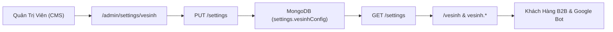

# Plan 62: Xây Dựng Hệ Thống Quản Trị Cài Đặt CMS Cho Trang Dịch Vụ Vệ Sinh (/admin/settings/vesinh & /vesinh)

> Status: Done | Created: 2026-10-31 | Completed: 2026-10-31 | Hệ thống: be-nestjs-thanhxuan & fe-nextjs-thanhxuan-laundry

---

## 1. Overview & Affected Files

### 1.1. Bối cảnh & Mục tiêu
- **Bối cảnh:**
  - Tại Plan 61, hệ thống đã triển khai thành công trang đích chuyên biệt cho dịch vụ vệ sinh tại `https://thanhxuanlaundry.com/vesinh` và kích hoạt tên miền phụ `https://vesinh.thanhxuanlaundry.com/`.
  - Hiện tại, trang chủ (`/`) đã có module CMS quản trị cấu hình động tại `/admin/settings/home` (cho phép chỉnh sửa Hero Banner, Title, Subtitle, Intro, Lý do lựa chọn, FAQ).
  - Khách hàng yêu cầu: **Xây dựng cả trang cài đặt CMS cho trang Vệ Sinh (`/admin/settings/vesinh`) tương tự như trang chủ**, cho phép Quản trị viên tùy biến linh hoạt toàn bộ nội dung hiển thị của `/vesinh` và `vesinh.thanhxuanlaundry.com` từ giao diện Admin mà không cần sửa code.
- **Mục tiêu kỹ thuật:**
  1. **Backend NestJS (Mở rộng Schema & DTO Settings):**
     - Bổ sung trường `vesinhConfig` vào `SettingSchema` (`be-nestjs-thanhxuan/src/modules/laundry/settings/schemas/setting.schema.ts`) trong cơ sở dữ liệu MongoDB `laundry_express` (collection `settings`).
     - Bổ sung validation field `vesinhConfig` trong `UpdateSettingsDto`.
  2. **Frontend Next.js (CMS Admin Settings & Public Integration):**
     - Khai báo kiểu dữ liệu `IVesinhConfig` trong `admin-settings.types.ts`.
     - Xây dựng hook chuyên biệt `useAdminSettingsVesinhHandlers.ts` để xử lý các thao tác form (thay đổi text, thêm/sửa/xóa danh sách Lý do chọn và câu hỏi FAQ).
     - Xây dựng 3 section form con tuân thủ kỷ luật `< 250 - 300 dòng`:
       - `VesinhHeroFormSection.tsx`: Chỉnh sửa Banner, Title, Subtitle, Hotline.
       - `VesinhWhyChooseUsFormSection.tsx`: Chỉnh sửa tiêu đề, mô tả và danh sách các cam kết/lý do lựa chọn.
       - `VesinhFaqFormSection.tsx`: Quản lý danh sách câu hỏi & câu trả lời FAQ linh hoạt.
     - Xây dựng Component tổng thể `SettingEditorVesinhComponent.tsx` (< 200 dòng) và Route `/admin/settings/vesinh/page.tsx`.
     - Thêm card "Cài đặt Trang Vệ Sinh" vào `SettingsPage.tsx` và liên kết trên `AdminSidebarComponent.tsx`.
     - Kết nối dữ liệu `vesinhConfig` từ API vào `VesinhPublicPage` (`src/app/(public)/vesinh/page.tsx`) và truyền xuống các subcomponent của `src/features/public/vesinh/`, luôn giữ fallback mặc định chuẩn chỉ khi chưa có dữ liệu cấu hình.

### 1.2. Out of Scope
- Không làm thay đổi cấu trúc bảng bài viết hay các module khác của Backend.
- Không sửa đổi Cổng Vận Hành Nội Bộ `fe-react-thanhxuan-internal`.

### 1.3. Assumptions & Open Questions
- **Assumptions:**
  - Collection `settings` dùng mô hình singleton document (`key: 'singleton'`), lưu trữ tập trung cấu hình chung cho toàn bộ Web Marketing.
  - Các trường trong `vesinhConfig` có giá trị mặc định (fallback) đầy đủ, nếu admin chưa cấu hình trường nào thì giao diện vẫn hiển thị nội dung mẫu tối ưu SEO như hiện tại.
- **Open Questions:**
  - Không có.

### 1.4. Bảng danh sách tệp ảnh hưởng

| Đường Dẫn Tệp | Hành Động | Lý Do & Tác Dụng |
| :--- | :---: | :--- |
| `backend-thanhxuan/src/modules/laundry/settings/schemas/setting.schema.ts` | Edit | Bổ sung schema definition `vesinhConfig` |
| `backend-thanhxuan/src/modules/laundry/settings/dto/update-settings.dto.ts` | Edit | Thêm trường `vesinhConfig` vào DTO update |
| `thanhxuan-laundry/src/features/admin/settings/admin-settings.types.ts` | Edit | Khai báo interface `IVesinhConfig` |
| `thanhxuan-laundry/src/features/admin/settings/hooks/useAdminSettingsVesinhHandlers.ts` | New | Custom hook quản lý state & handlers cho trang cài đặt vệ sinh |
| `thanhxuan-laundry/src/features/admin/settings/useAdminSettings.ts` | Edit | Nhúng `useAdminSettingsVesinhHandlers` vào hook tổng |
| `thanhxuan-laundry/src/features/admin/settings/components/vesinh/VesinhHeroFormSection.tsx` | New | Form biên tập Hero section cho trang vệ sinh (< 200 dòng) |
| `thanhxuan-laundry/src/features/admin/settings/components/vesinh/VesinhWhyChooseUsFormSection.tsx` | New | Form biên tập Lý do chọn cho trang vệ sinh (< 200 dòng) |
| `thanhxuan-laundry/src/features/admin/settings/components/vesinh/VesinhFaqFormSection.tsx` | New | Form biên tập FAQ động cho trang vệ sinh (< 180 dòng) |
| `thanhxuan-laundry/src/features/admin/settings/components/SettingEditorVesinhComponent.tsx` | New | Component giao diện màn hình cài đặt vệ sinh (< 200 dòng) |
| `thanhxuan-laundry/src/features/admin/settings/components/index.ts` | Edit | Export `SettingEditorVesinhComponent` |
| `thanhxuan-laundry/src/app/(admin)/admin/settings/vesinh/page.tsx` | New | Tuyến trang CMS `/admin/settings/vesinh` |
| `thanhxuan-laundry/src/features/admin/settings/SettingsPage.tsx` | Edit | Thêm card điều hướng Cài đặt Trang Vệ Sinh |
| `thanhxuan-laundry/src/components/layout/admin/AdminSidebarComponent.tsx` | Edit | Thêm link menu Trang vệ sinh vào thanh sidebar |
| `thanhxuan-laundry/src/features/public/vesinh/VesinhHomePage.tsx` | Edit | Nhận props `vesinhConfig` và phân phối xuống subcomponents |
| `thanhxuan-laundry/src/features/public/vesinh/components/VesinhHeroSectionComponent.tsx` | Edit | Hỗ trợ hiển thị dynamic banner/title/subtitle/hotline từ CMS |
| `thanhxuan-laundry/src/features/public/vesinh/components/VesinhIntroSectionComponent.tsx` | Edit | Hỗ trợ hiển thị dynamic introTitle/introDescription từ CMS |
| `thanhxuan-laundry/src/features/public/vesinh/components/VesinhWhyChooseUsComponent.tsx` | Edit | Hỗ trợ hiển thị dynamic whyChooseUs từ CMS |
| `thanhxuan-laundry/src/features/public/vesinh/components/VesinhFaqSectionComponent.tsx` | Edit | Hỗ trợ hiển thị danh sách FAQs động từ CMS |
| `thanhxuan-laundry/src/app/(public)/vesinh/page.tsx` | Edit | Fetch `vesinhConfig` truyền vào `VesinhHomePage` |
| `.agents/docs/DATABASE_DICTIONARY.md` | Edit | Cập nhật cấu trúc trường `vesinhConfig` trong bảng `settings` |
| `.agents/docs/CODEBASE_ATLAS.md` | Edit | Cập nhật tuyến trang `/admin/settings/vesinh` và các component mới |
| `.agents/docs/srs_sdd/srs_sdd_fe_laundry.md` | Edit | Cập nhật đặc tả phân hệ CMS Settings |
| `.agents/docs/SRS_SDD.md` | Edit | Ghi 1 dòng Document History cho Plan 62 |
| `.agents/docs/CHANGELOG.md` | Edit | Bài luận chi tiết nhật ký Plan 62 |

---

## 2. Technical Approach

### 2.1. Cấu Trúc Dữ Liệu `vesinhConfig` (MongoDB Collection `settings`)

```typescript
export interface IVesinhConfig {
  heroBannerImage?: string;
  heroTitle?: string;
  heroSubtitle?: string;
  hotline?: string;
  introTitle?: string;
  introDescription?: string;
  whyChooseUsTitle?: string;
  whyChooseUsDescription?: string;
  whyChooseUsImage?: string;
  whyChooseUsItems?: { title: string; description: string }[];
  faqs?: { question: string; answer: string }[];
}
```

### 2.2. Luồng Đồng Bộ Dữ Liệu (Data Flow)



---

## 3. Implementation Tasks (Checklist)

- [x] **T1: Mở rộng Backend Setting Schema & DTO**
  - Cập nhật `be-nestjs-thanhxuan/src/modules/laundry/settings/schemas/setting.schema.ts` bổ sung field `vesinhConfig`.
  - Cập nhật `be-nestjs-thanhxuan/src/modules/laundry/settings/dto/update-settings.dto.ts` chấp nhận `vesinhConfig`.
  - Tiêu chí: Build và typecheck Backend pass `pnpm exec tsc --noEmit`.

- [x] **T2: Khai báo Type & Custom Hook Handlers trong Frontend Settings**
  - Cập nhật `src/features/admin/settings/admin-settings.types.ts`: thêm `IVesinhConfig` và cập nhật `IAdminSettingsForm`.
  - Tạo mới `src/features/admin/settings/hooks/useAdminSettingsVesinhHandlers.ts`: xử lý cập nhật state form cho `vesinhConfig`.
  - Cập nhật `src/features/admin/settings/useAdminSettings.ts` nhúng handlers mới.
  - Tiêu chí: File handlers sạch sẽ, không dùng `any`, tuân thủ strict mode.

- [x] **T3: Xây dựng các Section Form & Màn hình CMS `/admin/settings/vesinh`**
  - Tạo `src/features/admin/settings/components/vesinh/VesinhHeroFormSection.tsx`.
  - Tạo `src/features/admin/settings/components/vesinh/VesinhWhyChooseUsFormSection.tsx`.
  - Tạo `src/features/admin/settings/components/vesinh/VesinhFaqFormSection.tsx`.
  - Tạo `src/features/admin/settings/components/SettingEditorVesinhComponent.tsx` (< 200 dòng).
  - Tạo `src/app/(admin)/admin/settings/vesinh/page.tsx`.
  - Export trong `src/features/admin/settings/components/index.ts`.
  - Tiêu chí: Mỗi file tuân thủ nghiêm ngặt `< 250 - 300 dòng`, đầy đủ trạng thái loading/saving.

- [x] **T4: Tích hợp Card trong `SettingsPage.tsx` và Menu trong `AdminSidebarComponent.tsx`**
  - Cập nhật `src/features/admin/settings/SettingsPage.tsx`: Thêm card "Cài đặt Trang Vệ Sinh" kèm icon `Sparkles`.
  - Cập nhật `src/components/layout/admin/AdminSidebarComponent.tsx`: Thêm `{ name: "Trang vệ sinh", path: "/admin/settings/vesinh" }` vào danh sách submenu.
  - Tiêu chí: Sidebar và Settings Dashboard hiển thị mục Vệ sinh đẹp mắt và liên kết thông suốt.

- [x] **T5: Kết nối Dữ Liệu Dynamic `vesinhConfig` vào Trang Public `/vesinh` & Gỡ Lớp Bọc Thừa Form**
  - Cập nhật `src/app/(public)/vesinh/page.tsx`: lấy `vesinhConfig` từ settings và truyền vào `VesinhHomePage`.
  - Cập nhật `VesinhHomePage.tsx` và các component (`VesinhHeroSectionComponent`, `VesinhIntroSectionComponent`, `VesinhWhyChooseUsComponent`, `VesinhFaqSectionComponent`): ưu tiên hiển thị dữ liệu từ CMS, nếu rỗng thì fallback về mẫu chuẩn hiện có.
  - Gỡ bỏ lớp bọc `div` thừa bên ngoài `<Contact />` trong `VesinhPreFooterCtaComponent.tsx`.
  - Tiêu chí: Thay đổi nội dung trong CMS lập tức phản ánh ra giao diện `/vesinh` và `vesinh.thanhxuanlaundry.com`.

- [x] **T6: Kiểm thử Lint, Typecheck, Build và Đồng Bộ Tài Liệu 5 Trụ Cột**
  - Chạy `pnpm exec tsc --noEmit` và `pnpm build` cho cả Backend và Frontend pass 100%.
  - Cập nhật `.agents/docs/DATABASE_DICTIONARY.md`.
  - Cập nhật `.agents/docs/CODEBASE_ATLAS.md`.
  - Cập nhật `.agents/docs/srs_sdd/srs_sdd_fe_laundry.md`.
  - Ghi nhận 1 dòng Document History tại `.agents/docs/SRS_SDD.md`.
  - Ghi nhật ký triển khai chi tiết vào `.agents/docs/CHANGELOG.md`.
  - Tự động commit và push lên nhánh `dev`.

---

## 4. Verification & Testing

### 4.1. Lệnh Kiểm Tra Cú Pháp & Build
```bash
# Kiểm tra Backend
cd /root/services/thanhxuan/backend-thanhxuan
pnpm exec tsc --noEmit
pnpm build

# Kiểm tra Frontend Next.js
cd /root/services/thanhxuan/thanhxuan-laundry
pnpm exec tsc --noEmit
pnpm build
```

### 4.2. Kịch Bản Test Thực Tế
1. **Truy cập CMS:** Đăng nhập `/admin` $\rightarrow$ vào mục **Cài đặt Hệ thống** $\rightarrow$ thấy card **Cài đặt Trang Vệ Sinh** và menu trên Sidebar.
2. **Biên tập cấu hình:** Mở `/admin/settings/vesinh` $\rightarrow$ thử đổi tiêu đề Hero, thay đổi số Hotline, thêm 1 câu hỏi FAQ mới $\rightarrow$ bấm **Lưu thay đổi** $\rightarrow$ thông báo thành công.
3. **Kiểm tra hiển thị Public:** Truy cập `https://thanhxuanlaundry.com/vesinh` hoặc `https://vesinh.thanhxuanlaundry.com/` $\rightarrow$ xác nhận tiêu đề mới, hotline mới và câu hỏi FAQ mới hiển thị chính xác.
4. **Kiểm tra Fallback:** Khi xóa trống các trường trong CMS $\rightarrow$ trang vẫn hiển thị văn bản mặc định trau chuốt, không bị lỗi undefined hay vỡ layout.

---

## 5. Risks & Rollback

- **Rủi ro:**
  - Khách hàng vô tình xóa hết dữ liệu cấu hình khiến các section bị trống.
  - *Giải pháp:* Luôn giữ mã nguồn fallback mặc định bền vững cho mọi trường (heroTitle, heroSubtitle, intro, whyChooseUs, FAQs).
- **Rollback:**
  - Khôi phục commit trước đó trên nhánh `dev`.

---

## Changelog

- 2026-10-31: Khởi tạo Plan 62 xây dựng hệ thống quản trị CMS cho trang dịch vụ vệ sinh (/admin/settings/vesinh).
