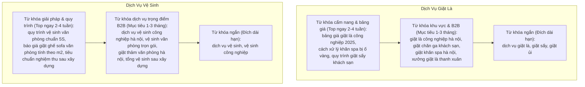

# Plan 63: Chiến Lược Tối Ưu Hóa SEO Toàn Diện Dịch Vụ Giặt Là & Dịch Vụ Vệ Sinh B2B (fe-nextjs-thanhxuan-laundry & Content Marketing)

> Status: Done | Created: 2026-11-01 | Completed: 2026-11-01

## 1. Overview & Affected Files

### 1.1. Bối cảnh & Mục tiêu
- **Bối cảnh:** Website `https://thanhxuanlaundry.com/` hiện tại mới chỉ lọt top Google với từ khóa thương hiệu (`thanh xuân laundry`), trong khi các từ khóa mang lại doanh thu chuyển đổi cao về:
  1. **Dịch vụ Giặt Là:** `dịch vụ giặt là`, `giặt sấy`, `giặt ủi`, `giặt là công nghiệp hà nội`, `giặt đồ khách sạn nhà hàng spa`.
  2. **Dịch vụ Vệ Sinh:** `dịch vụ vệ sinh công nghiệp hà nội`, `vệ sinh văn phòng`, `vệ sinh sau xây dựng`, `giặt thảm văn phòng`, `giặt ghế sofa văn phòng` (tại `/vesinh` và `vesinh.thanhxuanlaundry.com`).
  chưa lọt vào trang 1 Google do thiếu tính thẩm quyền theo chủ đề (Topical Authority), tín hiệu Local SEO địa phương chưa đồng bộ, cấu trúc liên kết nội bộ (Internal Links) và ma trận bài viết vệ tinh (Topic Cluster) chưa hoàn thiện.
- **Mục tiêu:**
  1. Xây dựng **Ma trận Từ khóa (Keyword Matrix)** phân tầng theo Search Intent (Ý định tìm kiếm) cho cả 2 dịch vụ Giặt là và Vệ sinh.
  2. Tối ưu On-Page toàn diện: Title, Meta Description, Heading H1/H2/H3, Alt ảnh và Dữ liệu có cấu trúc Schema.org JSON-LD (`DryCleaningOrLaundry`, `CleaningService`, `FAQPage`, `BreadcrumbList`).
  3. Xây dựng Kiến trúc Silo / Cụm chủ đề (Topic Cluster) liên kết từ các bài viết cẩm nang (`/tin-tuc/[slug]`) trỏ dòng sức mạnh (Link Equity) về các Landing Page dịch vụ cốt lõi (`/dich-vu/*` và `/vesinh`).
  4. Chuẩn hóa bộ tín hiệu Local SEO (NAP: Name - Address - Phone) gắn với Google Business Profile (Google Maps) phục vụ khách hàng doanh nghiệp và cư dân tại Hà Nội.

### 1.2. Out of Scope
- Không can thiệp vào nghiệp vụ logic chấm công, giao nhận, nhiên liệu trong Cổng vận hành nội bộ (`fe-react-thanhxuan-internal`).
- Không đổi cấu trúc database collection của backend NestJS.

### 1.3. Assumptions & Open Questions
- **Assumptions:** 
  - Khách hàng mục tiêu của Giặt là chia làm 2 nhánh: B2B trọng tâm (nhà hàng, khách sạn, spa, trường học) và B2C lấy ngay khu vực Hà Nội.
  - Khách hàng mục tiêu của Dịch vụ Vệ sinh: 100% hướng B2B doanh nghiệp (văn phòng, tòa nhà, showroom, nhà xưởng sau xây dựng, định kỳ giặt thảm/sofa).
- **Open Questions:**
  - Doanh nghiệp đã đăng ký hồ sơ Google Business Profile (Google Maps) chính thức cho cả 2 mảng hay chưa (để trỏ link CID Google Map vào Schema)?

### 1.4. Bảng File Ảnh Hưởng

| Path | Action | Lý do |
| :--- | :--- | :--- |
| `fe-nextjs-thanhxuan-laundry/src/app/(public)/layout.tsx` | Edit | Tối ưu Metadata gốc, OpenGraph, Canonical tags và Schema Organization |
| `fe-nextjs-thanhxuan-laundry/src/app/(public)/page.tsx` | Edit | Tối ưu Metadata động và Heading H1/H2 trang chủ giặt là |
| `fe-nextjs-thanhxuan-laundry/src/app/(public)/vesinh/page.tsx` | Edit | Tối ưu Metadata, Schema `CleaningService`, FAQPage Schema cho trang vệ sinh |
| `fe-nextjs-thanhxuan-laundry/src/features/public/vesinh/VesinhHomePage.tsx` | Edit | Rà soát cấu trúc H1/H2/H3 ngữ nghĩa ngữ cảnh chuẩn từ khóa B2B |
| `fe-nextjs-thanhxuan-laundry/src/app/sitemap.ts` | Edit | Bổ sung các cụm URL dịch vụ và bảng giá trọng điểm với priority cao |
| `fe-nextjs-thanhxuan-laundry/src/features/public/seo/` | Edit / Add | Cập nhật Schema JSON-LD đa thực thể (LocalBusiness + CleaningService) |
| `.agents/docs/plans/plan63.md` | Add | Kế hoạch kỹ thuật chi tiết Plan 63 |
| `.agents/docs/srs_sdd/srs_sdd_fe_laundry.md` | Edit | Cập nhật đặc tả kiến trúc SEO và bộ từ khóa chuẩn hóa |
| `.agents/docs/SRS_SDD.md` | Edit | Bổ sung 1 dòng Document History |
| `.agents/docs/CHANGELOG.md` | Edit | Ghi nhận bài luận giải pháp chiến lược SEO |

---

## 2. Technical Approach & SEO Architecture

### 2.1. Ma Trận Từ Khóa (Keyword Matrix) Phân Tầng



### 2.2. Cấu Trúc Topic Cluster & Luồng Dẫn Link Nội Bộ (Internal Links)

1. **Trụ cột Giặt Là (Pillar Page):**
   - URL Đích: `/dich-vu/giat-la-cong-nghiep` và Trang chủ `/`.
   - Bài viết vệ tinh (`/tin-tuc/[slug]`): Xuất bản tối thiểu 5-8 bài viết chia sẻ kinh nghiệm xử lý đồ vải nhà hàng, bảo quản chăn ga khách sạn, so sánh giặt khô - giặt ướt.
   - Anchor Text điều hướng: `dịch vụ giặt là công nghiệp`, `xưởng giặt là uy tín tại Hà Nội` trỏ về trang dịch vụ.
2. **Trụ cột Vệ Sinh Doanh Nghiệp (Pillar Page):**
   - URL Đích: `https://vesinh.thanhxuanlaundry.com/` (hoặc `/vesinh`).
   - Bài viết vệ tinh (`/tin-tuc/[slug]`): Xuất bản các bài viết về quy trình giặt thảm văn phòng bằng hơi nước nóng, checklist vệ sinh văn phòng định kỳ, định mức hóa chất an toàn Ecolab.
   - Anchor Text điều hướng: `dịch vụ vệ sinh công nghiệp`, `vệ sinh văn phòng Hà Nội` trỏ trực tiếp về `/vesinh`.

### 2.3. Quy Chuẩn Schema.org JSON-LD

Tích hợp đa tầng Schema chuẩn Structured Data của Google:
```json
{
  "@context": "https://schema.org",
  "@graph": [
    {
      "@type": "DryCleaningOrLaundry",
      "name": "Thanh Xuân Laundry - Xưởng Giặt Là Công Nghiệp",
      "telephone": "+84-xxx-xxx-xxx",
      "address": {
        "@type": "PostalAddress",
        "addressLocality": "Hà Nội",
        "addressCountry": "VN"
      },
      "areaServed": "Hà Nội"
    },
    {
      "@type": "CleaningService",
      "name": "Dịch Vụ Vệ Sinh Công Nghiệp & Doanh Nghiệp Thanh Xuân",
      "url": "https://vesinh.thanhxuanlaundry.com",
      "serviceType": ["Vệ sinh văn phòng", "Giặt thảm văn phòng", "Vệ sinh sau xây dựng"]
    }
  ]
}
```

---

## 3. Implementation Tasks (Checklist)

- [x] T1: Khảo sát và tối ưu cấu trúc Metadata động `generateMetadata` tại `src/app/(public)/layout.tsx` và `src/app/(public)/page.tsx` (Title chuẩn 60 ký tự, Meta Description 155 ký tự chứa từ khóa hạt nhân `dịch vụ giặt là`, `giặt sấy`, `Hà Nội`).
- [x] T2: Nâng cấp Metadata và Canonical URL tại `src/app/(public)/vesinh/page.tsx` chuẩn hóa cho subdomain `vesinh.thanhxuanlaundry.com` (Target từ khóa: `dịch vụ vệ sinh công nghiệp hà nội`, `vệ sinh văn phòng`, `giặt thảm sofa`).
- [x] T3: Bổ sung Schema JSON-LD đa thực thể (`DryCleaningOrLaundry`, `CleaningService`, `FAQPage`) vào `src/app/(public)/vesinh/page.tsx` và `src/features/public/seo/`.
- [x] T4: Rà soát cấu trúc Heading H1/H2/H3 trên `VesinhHomePage.tsx` và các component con (`VesinhHeroSectionComponent`, `VesinhServicesGridComponent`), đảm bảo chỉ có duy nhất 1 thẻ H1 và các thẻ H2 chứa đúng nhóm từ khóa dịch vụ mục tiêu.
- [x] T5: Cập nhật `src/app/sitemap.ts` đảm bảo toàn bộ các URL dịch vụ giặt là và vệ sinh được lập chỉ mục với priority cao (`0.9 - 1.0`) và `changeFrequency: 'weekly'`.
- [x] T6: Xây dựng tài liệu hướng dẫn xuất bản nội dung Topic Cluster trên CMS (`/admin/articles`) cho đội ngũ Marketing (Cách đặt tiêu đề, chèn anchor text ngữ cảnh, cấu hình thẻ OpenGraph và slug chuẩn SEO).
- [x] T7: Đồng bộ tài liệu kỹ thuật: Cập nhật `.agents/docs/srs_sdd/srs_sdd_fe_laundry.md`, ghi 1 dòng Document History tại `.agents/docs/SRS_SDD.md` và ghi nhật ký tại `.agents/docs/CHANGELOG.md`.

---

## 4. Verification & Testing

- **Typecheck & Build:**
  - Chạy `pnpm exec tsc --noEmit` trong thư mục `fe-nextjs-thanhxuan-laundry/`.
  - Chạy `pnpm build` xác nhận Next.js SSG/SSR render thành công không có lỗi metadata/schema.
- **SEO Validation:**
  - Kiểm tra tính hợp lệ của Schema JSON-LD qua Google Rich Results Test (Rich Snippets).
  - Kiểm tra Canonical Tag trên cả 2 môi trường: domain chính và subdomain vệ sinh.
- **Definition of Done:**
  - Toàn bộ checklist T1 - T7 hoàn tất.
  - Typecheck và build pass 100%.
  - Tự động commit và push lên nhánh `dev`.

---

## 5. Risks & Rollback

- **Rủi ro:** Trùng lặp nội dung (Duplicate Content) giữa domain chính `thanhxuanlaundry.com/vesinh` và subdomain `vesinh.thanhxuanlaundry.com`.
- **Giải pháp:** Cấu hình thẻ `rel="canonical"` trỏ nhất quán về URL chính thức được chọn làm đại diện để Google không phân tán tín hiệu xếp hạng.

---

## Execution Log

- 2026-11-01: Thực thi hoàn tất Plan 63.
  - Tối ưu Metadata động và Schema JSON-LD đa thực thể cho cả Giặt Là (`DryCleaningOrLaundry`, `LaundryService`) và Vệ Sinh (`CleaningService`, `FAQPage`, `BreadcrumbList`).
  - Chuẩn hóa Heading H1/H2 và cập nhật sitemap priority 0.85 cho các trang dịch vụ.
  - Ban hành cẩm nang xuất bản nội dung Topic Cluster tại `SEO_CONTENT_CLUSTER_GUIDE.md`.
  - Verification: `pnpm exec tsc --noEmit` pass 100%, `next build` pass 15/15 routes tĩnh và động.

---

## Changelog

- 2026-11-01: Khởi tạo Plan 63 chiến lược tối ưu hóa SEO toàn diện dịch vụ Giặt là và Vệ sinh.
- 2026-11-01: Hoàn thành triển khai và kiểm chứng toàn bộ DoD.
