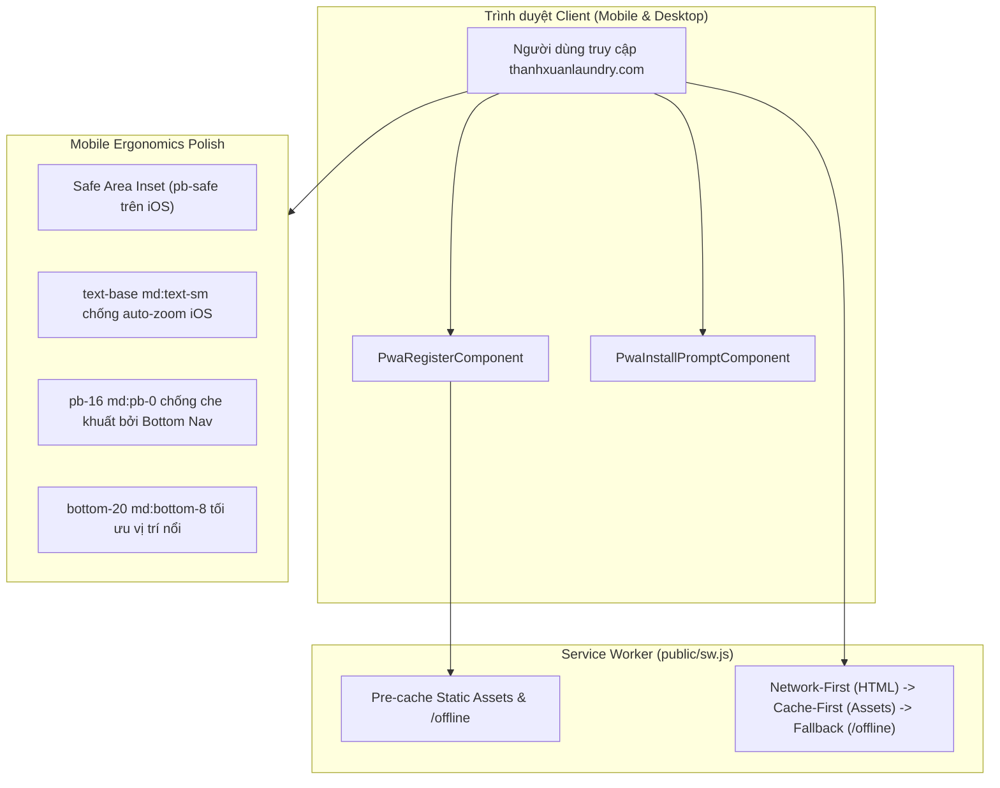
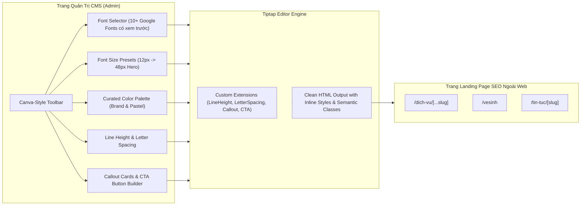

# Plan 64: Triển Khai PWA, Tối Ưu Mobile UX & Nâng Cấp Trình Soạn Thảo Phong Cách Canva Cho Các Trang SEO Chính (fe-nextjs-thanhxuan-laundry)

> Status: Done | Created: 2026-11-01

## 1. Overview & Affected Files

### 1.1. Bối cảnh & Mục tiêu
- **Bối cảnh:**
  1. Website `https://thanhxuanlaundry.com/` (`fe-nextjs-thanhxuan-laundry/`) là kênh kinh doanh B2B và bán lẻ giặt sấy trực tuyến trọng điểm. Hiện tại trang chưa hỗ trợ PWA (thiếu Service Worker, Manifest, Offline fallback, không thể bấm "Cài đặt ứng dụng" trên điện thoại). Trên mobile còn một số hạn chế: nút speed dial liên hệ đặt quá cao che bài viết, thiếu hỗ trợ Safe Area iPhone, nguy cơ auto-zoom khi chạm vào ô input, nguy cơ đè chân trang bởi Bottom Navigation.
  2. Về quản trị nội dung SEO: Admin cần thường xuyên xuất bản và tối ưu các trang landing page SEO dịch vụ (`/dich-vu/*`, `/vesinh`), bài viết cẩm nang (`/tin-tuc/*`) và giới thiệu (`/gioi-thieu`). Trình soạn thảo Rich Text hiện tại của CMS còn hạn chế: chỉ có 5 font chữ cổ điển hệ thống, thiếu bảng màu thiết kế trực quan, thiếu giãn dòng/giãn chữ (line-height, letter-spacing), thiếu khối khung nhấn (Callout cards) và nút bấm CTA phong cách kéo thả như Canva, khiến admin khó tạo ra những bài viết SEO bắt mắt, chuẩn thẩm mỹ hiện đại.
- **Mục tiêu:**
  1. **Triển khai PWA Toàn Diện & Tối Ưu Mobile UI/UX (Phần A):**
     - Đầy đủ Web App Manifest (`src/app/manifest.ts`), Vanilla Service Worker (`public/sw.js`), Offline page (`/offline`), bộ icon đa kích thước (`192x192`, `512x512`, `maskable`, `apple-touch-icon`).
     - Banner cài đặt PWA tự động (`PwaInstallPromptComponent.tsx`) cho Android/Chrome và iOS Safari.
     - Tối ưu Viewport, Apple web app meta, Safe Area Inset (`pb-safe`), chống auto-zoom trên iOS (`text-base md:text-sm`), điều chỉnh vị trí Floating Contact Dial và đệm đáy tránh che khuất bởi Bottom Nav.
  2. **Nâng Cấp Trình Soạn Thảo Visual Rich Text CMS Phong Cách Canva Cho Các Trang SEO (Phần B):**
     - **Canva Font Family Picker:** Bổ sung bộ font Google Fonts tiếng Việt hiện đại (`Inter`, `Be Vietnam Pro`, `Montserrat`, `Roboto`, `Playfair Display`, `Merriweather`, `Lora`, `Plus Jakarta Sans`, `Oswald`) kèm xem trước trực quan (Visual Font Preview) trong dropdown.
     - **Canva Font Size Presets:** Danh sách chọn nhanh các kích cỡ tiêu chuẩn (12px, 14px, 16px - Body, 18px, 20px - Subtitle, 24px - H3, 32px - H2, 40px - H1, 48px - Hero Title) và nút tăng/giảm pixel.
     - **Canva Curated Color Palette & Highlight:** Popover chọn màu chữ và màu nền highlight với các dải màu thương hiệu chuẩn (Brand Blue, Indigo, Emerald, Amber, Rose, Slate, Charcoal) và màu pastel dịu mắt.
     - **Line Spacing & Letter Spacing (Giãn dòng & Giãn chữ):** Tùy chỉnh line-height (1.2, 1.4, 1.6, 1.8, 2.0) và letter-spacing (-0.02em, 0, 0.05em, 0.1em) đúng đặc trưng Canva.
     - **Canva Callout Cards & SEO CTA Builder:** Nút chèn khối điểm nhấn SEO (Tip box, Lưu ý quan trọng, Bảng tóm tắt nổi bật) và nút CTA chuyển đổi cao (kêu gọi báo giá/gọi điện) trực tiếp vào bài viết.
     - Tự động nạp font và đồng bộ hiển thị CSS ra các trang dịch vụ và tin tức public ngoài website.

### 1.2. Out of Scope
- Không can thiệp vào Backend NestJS hay Cổng vận hành nội bộ (`fe-react-thanhxuan-internal`).
- Không cài thêm các thư viện cồng kềnh ngoài hệ thống Tiptap có sẵn của dự án; tận dụng tối đa Tiptap extensions & Tailwind CSS tokens.

### 1.3. Assumptions & Open Questions
- **Assumptions:** Các bài viết được lưu trữ dạng HTML sạch trong MongoDB; việc nâng cấp các tag inline style và class trong Tiptap hoàn toàn tương thích ngược 100% với dữ liệu bài viết cũ.
- **Open Questions:** Không có.

### 1.4. Bảng File Ảnh Hưởng

| Path | Action | Lý do |
| :--- | :--- | :--- |
| `fe-nextjs-thanhxuan-laundry/src/app/manifest.ts` | Add | Next.js Metadata Route sinh Web App Manifest (`/manifest.webmanifest`) |
| `fe-nextjs-thanhxuan-laundry/public/sw.js` | Add | Vanilla Service Worker xử lý pre-cache, offline fallback và network-first |
| `fe-nextjs-thanhxuan-laundry/src/app/offline/page.tsx` | Add | Giao diện thân thiện hiển thị khi mất kết nối mạng |
| `fe-nextjs-thanhxuan-laundry/src/components/pwa/PwaRegisterComponent.tsx` | Add | Component Client lá đăng ký Service Worker an toàn |
| `fe-nextjs-thanhxuan-laundry/src/components/pwa/PwaInstallPromptComponent.tsx` | Add | Banner & Dialog hướng dẫn cài đặt PWA cho Android và iOS Safari |
| `fe-nextjs-thanhxuan-laundry/scripts/generate-pwa-icons.mjs` | Add | Script tiện ích sinh tự động bộ icon PWA đa kích thước bằng `sharp` |
| `fe-nextjs-thanhxuan-laundry/public/icons/` | Add | Thư mục chứa icons PWA (192, 512, maskable, apple-touch-icon) |
| `fe-nextjs-thanhxuan-laundry/src/app/layout.tsx` | Edit | Bổ sung `export const viewport`, Apple web app meta, tích hợp PWA components |
| `fe-nextjs-thanhxuan-laundry/src/app/globals.css` | Edit | Bổ sung CSS Safe Area, CSS Callout Cards, CTA buttons & nạp Google Fonts |
| `fe-nextjs-thanhxuan-laundry/src/app/(public)/layout.tsx` | Edit | Bổ sung khoảng đệm đáy `pb-16 md:pb-0` cho `<main>` tránh bị che bởi Bottom Nav |
| `fe-nextjs-thanhxuan-laundry/src/components/layout/public/DraggableFloatingContactComponent.tsx` | Edit | Tối ưu vị trí đáy trên mobile (`bottom-20 md:bottom-8`) |
| `fe-nextjs-thanhxuan-laundry/src/components/ui/input.tsx` | Edit | Chuẩn hóa font-size `text-base md:text-sm` để chống giật/zoom iOS Safari |
| `fe-nextjs-thanhxuan-laundry/src/components/ui/rich-text-editor/extensions/rich-text-extensions.ts` | Edit | Bổ sung Tiptap extensions: LineHeight, LetterSpacing, CalloutBox, CtaButton |
| `fe-nextjs-thanhxuan-laundry/src/components/ui/rich-text-editor/components/RichTextFormattingButtons.tsx` | Edit | Canva Font Selector (Visual preview), Size presets, Curated Palette popover |
| `fe-nextjs-thanhxuan-laundry/src/components/ui/rich-text-editor/components/RichTextAlignHeadingsButtons.tsx` | Edit | Bổ sung Line-height, Letter-spacing controls, Callout & CTA insert |
| `fe-nextjs-thanhxuan-laundry/src/components/ui/rich-text-editor/RichTextEditorComponent.tsx` | Edit | Kích hoạt các extension mới và cấu hình typography |
| `.agents/docs/srs_sdd/srs_sdd_fe_laundry.md` | Edit | Cập nhật tài liệu kiến trúc PWA, Mobile UX & Rich Text CMS Styler |
| `.agents/docs/SRS_SDD.md` | Edit | Ghi nhận 1 dòng Document History |
| `.agents/docs/CHANGELOG.md` | Edit | Ghi chép bài luận kỹ thuật Plan 64 |

---

## 2. Technical Approach & Architecture

### 2.1. Kiến Trúc PWA & Mobile UX (Phần A)

### 2.2. Kiến Trúc Bộ Soạn Thảo Visual Phong Cách Canva (Phần B)

### 2.3. Chi Tiết Nâng Cấp Bộ Soạn Thảo Phong Cách Canva
1. **Bộ Font Tuyển Chọn (Vietnamese Typography Hierarchy):**
   - *Sans-Serif Thân Thiện / Công Nghiệp:* `Inter`, `Be Vietnam Pro`, `Montserrat`, `Roboto`, `Plus Jakarta Sans`.
   - *Serif Sang Trọng / Uy Tín:* `Playfair Display`, `Merriweather`, `Lora`.
   - *Display / Tiêu Đề Bắt Mắt:* `Oswald`, `Raleway`.
   - Dropdown hiển thị từng tên font bằng chính phông chữ tương ứng để admin nhìn trực quan trước khi chọn.
2. **Cỡ Chữ Chuẩn & Presets Nhanh:**
   - 12px (Chú thích), 14px (Nhỏ), 16px (Mặc định Body), 18px (Đoạn dẫn/Lead), 20px (Tiêu đề nhỏ), 24px (H3), 32px (H2), 40px (H1), 48px (Tiêu đề Hero banner).
3. **Bảng Màu Thiết Kế Phong Cách Canva:**
   - Bảng màu chọn sẵn (Curated Swatches):
     - *Brand Colors:* Xanh chủ đạo `#1e40af`, Xanh da trời `#0284c7`, Xanh mạ `#059669`, Cam nổi bật `#ea580c`, Đỏ cảnh báo `#dc2626`, Xám than `#1e293b`.
     - *Pastel Highlight:* Vàng nhạt `#fef08a`, Xanh ngọc `#a7f3d0`, Lam nhạt `#bfdbfe`, Tím nhạt `#e9d5ff`, Hồng nhạt `#fbcfe8`.
   - Kèm Color Picker tùy chỉnh mã HEX chính xác.
4. **Giãn Cách Dòng & Giãn Chữ (Line Spacing & Kerning):**
   - Line-height: `1.2` (Chặt chẽ tiêu đề), `1.4` (Gọn gàng), `1.6` (Chuẩn đọc web), `1.8` (Thoáng đãng), `2.0` (Cách dòng rộng).
   - Letter-spacing: `-0.02em` (Thu hẹp tiêu đề lớn), `0` (Mặc định), `0.05em` (Thoáng), `0.1em` (Cách đều uppercase).
5. **Khối Callout Box & Nút Kêu Gọi Hành Động (CTA Builder):**
   - Khối Callout: Chèn 1 card nổi bật có icon, viền màu và nền pastel (ví dụ: *Tip giặt là khách sạn*, *Lưu ý quan trọng*, *Cam kết chất lượng*).
   - Nút CTA: Chèn một button đẹp mắt (Gradient xanh, bo góc, text in đậm, icon mũi tên) liên kết tới form đặt lịch hoặc hotline để tối ưu tỷ lệ chuyển đổi khách hàng từ trang SEO.

---

## 3. Implementation Steps (Chi tiết các bước thực thi)

### Bước 1: Tạo Bộ Icon PWA Đầy Đủ Kích Thước
- [x] Tạo script `scripts/generate-pwa-icons.mjs` sử dụng `sharp` để xuất:
  - `public/icons/icon-192x192.png`
  - `public/icons/icon-512x512.png`
  - `public/icons/icon-maskable-192x192.png`
  - `public/icons/icon-maskable-512x512.png`
  - `public/icons/apple-touch-icon.png` (180x180)
- [x] Chạy script tạo icons và kiểm tra file xuất ra.

### Bước 2: Tạo Web App Manifest & Cấu Hình Viewport/Metadata
- [x] Tạo file `fe-nextjs-thanhxuan-laundry/src/app/manifest.ts` tuân thủ Metadata Route của Next.js 16.
- [x] Cập nhật `src/app/layout.tsx`:
  - Khai báo `export const viewport: Viewport` với `themeColor`, `viewportFit: "cover"`, `initialScale: 1`.
  - Cập nhật `metadata` bổ sung `appleWebApp` và link `apple-touch-icon`.

### Bước 3: Xây Dựng Service Worker & Trang Ngoại Tuyến (Offline Page)
- [x] Tạo `public/sw.js` xử lý install, activate, fetch cache và offline fallback.
- [x] Tạo trang `src/app/offline/page.tsx` giao diện thân thiện khi mất kết nối mạng.

### Bước 4: Xây Dựng Component Đăng Ký PWA & Install Prompt
- [x] Tạo `src/components/pwa/PwaRegisterComponent.tsx` (Client component lá).
- [x] Tạo `src/components/pwa/PwaInstallPromptComponent.tsx` hỗ trợ Chrome/Android và hướng dẫn iOS Safari.
- [x] Nhúng `PwaRegisterComponent` và `PwaInstallPromptComponent` vào `src/app/layout.tsx`.

### Bước 5: Tối Ưu Hóa Trải Nghiệm Di Động Toàn Diện
- [x] Thêm CSS Safe Area trong `src/app/globals.css`.
- [x] Cập nhật `src/components/ui/input.tsx` chống auto-zoom trên iOS.
- [x] Thêm padding đáy `pb-16 md:pb-0` cho `<main>` trong `src/app/(public)/layout.tsx`.
- [x] Tinh chỉnh vị trí nổi của `DraggableFloatingContactComponent.tsx` thành `bottom-20 md:bottom-8`.

### Bước 6: Nâng Cấp Trình Soạn Thảo Visual Rich Text CMS Phong Cách Canva
- [x] Bổ sung Tiptap extensions trong `rich-text-extensions.ts`:
  - `LineHeight` extension (1.2, 1.4, 1.6, 1.8, 2.0).
  - `LetterSpacing` extension (-0.02em, 0, 0.05em, 0.1em).
- [x] Nâng cấp `RichTextFormattingButtons.tsx`:
  - Bổ sung bộ font Google Fonts tiếng Việt hiện đại kèm xem trước font thực tế trong dropdown.
  - Bộ chọn nhanh kích thước font (12px -> 48px Hero).
  - Popover bảng màu tuyển chọn (Brand Palette & Pastel Highlights).
- [x] Nâng cấp `RichTextAlignHeadingsButtons.tsx`:
  - Bộ nút điều chỉnh khoảng cách dòng (Line Height) và giãn chữ (Letter Spacing).
  - Nút chèn khối Callout Card và nút CTA chuyển đổi cao.
- [x] Cập nhật `src/app/globals.css` nạp các font Google Fonts và CSS cho Callout/CTA blocks ngoài public.

### Bước 7: Kiểm Thử & Xác Minh (Verification)
- [x] Chạy Typecheck: `pnpm exec tsc --noEmit` trong `fe-nextjs-thanhxuan-laundry`.
- [x] Chạy Build ứng dụng: `pnpm build` trong `fe-nextjs-thanhxuan-laundry`.
- [x] Kiểm tra route manifest: `/manifest.webmanifest`.
- [x] Kiểm tra route offline: `/offline`.
- [x] Mở thử CMS admin chỉnh sửa bài viết với font mới, cỡ chữ mới, màu sắc và khối Callout/CTA.

### Bước 8: Đồng Bộ Tài Liệu Kỹ Thuật (DoD)
- [x] Cập nhật `.agents/docs/srs_sdd/srs_sdd_fe_laundry.md`.
- [x] Thêm 1 dòng Document History vào `.agents/docs/SRS_SDD.md`.
- [x] Ghi chép bài luận hoàn thành vào `.agents/docs/CHANGELOG.md`.
- [x] Commit và push lên nhánh `dev`.
