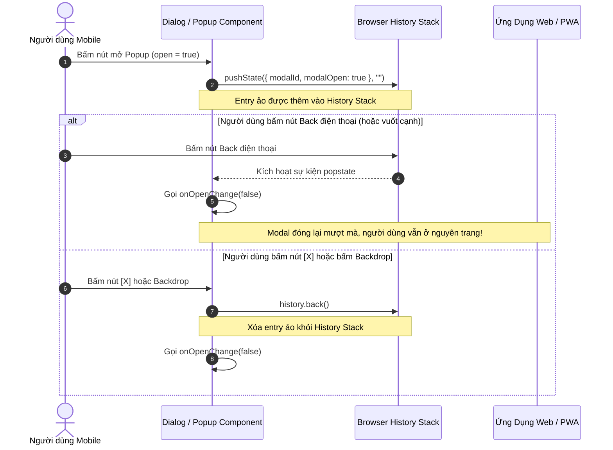

# Plan 65: Triển Khai Subdomain quantri.thanhxuanlaundry.com Riêng Biệt, Chủ Động Nhắc Cài Đặt App PWA & Xử Lý Nút Back Mobile Cho Popup / Modal

> Status: Done | Created: 2026-11-01 | Updated: 2026-11-01

## Execution Log

- 2026-11-01: Hoàn tất 100% các task T1 đến T14:
  - Cấu hình Nginx reverse proxy tiếp nhận subdomain `quantri.thanhxuanlaundry.com`.
  - Nâng cấp Next.js Middleware định tuyến subdomain `quantri.` vào `/admin` và manifest riêng.
  - Tạo Route Handler `/api/manifest/admin` trả về Web App Manifest "Quản trị Thanh Xuân".
  - Tối ưu Service Worker bypass cache cho `quantri.*`.
  - Tách `IosInstallGuideModal.tsx` và nâng cấp `PwaInstallPromptComponent.tsx` chủ động hiển thị banner "Cài Đặt App Quản trị Thanh Xuân" trên mobile.
  - Tạo `IosInstallGuideModal.tsx` và `PwaInstallPromptComponent.tsx` hiển thị banner "Cài Đặt App Nội Bộ Thanh Xuân" cho `fe-react-thanhxuan-internal`.
  - Tích hợp cơ chế History Popstate vào `Dialog` của cả 2 app, giúp nút Back điện thoại tự động đóng modal/popup thay vì văng ứng dụng.
  - Verify typecheck pass 100%, verify build pass 100% cả 2 app.
  - Đồng bộ 5 trụ cột tài liệu và tự động commit, push lên nhánh `dev`.

## 1. Overview & Affected Files

### 1.1. Bối cảnh & Mục tiêu
- **Bối cảnh:**
  1. Hiện tại, trang quản trị CMS của hệ sinh thái Thanh Xuân Laundry đang hoạt động tại đường dẫn con `/admin` của tên miền chính (`https://thanhxuanlaundry.com/admin` thuộc app `fe-nextjs-thanhxuan-laundry`). Khi người dùng muốn cài ứng dụng PWA lên điện thoại cho Ban Quản trị, trình duyệt sẽ dùng chung Web App Manifest của trang khách hàng (`thanhxuanlaundry.com`), dẫn đến tên app hiển thị là "Thanh Xuân Laundry" và khi mở ra lại trỏ vào trang chủ bán hàng thay vì giao diện quản trị riêng.
  2. Người dùng muốn tách tên miền phụ **`quantri.thanhxuanlaundry.com`** ánh xạ trực tiếp vào `thanhxuanlaundry.com/admin` với mục đích cài đặt thành 1 App PWA độc lập với tên app chính thức là **"Quản trị Thanh Xuân"** (short_name: **"Quản trị Thanh Xuân"**, icon riêng, start_url="/" trên subdomain quantri).
  3. Cả 2 cổng web dành cho quản lý và nhân sự vận hành: `quantri.thanhxuanlaundry.com` (Quản trị CMS) và `noibo.thanhxuanlaundry.com` (Cổng vận hành xưởng, giao nhận, chấm công `fe-react-thanhxuan-internal`) cần tính năng **chủ động thông báo / nhắc nhở người dùng cài đặt App PWA** khi họ truy cập từ thiết bị Mobile và chưa cài app:
     - Tại `quantri.thanhxuanlaundry.com`: Banner hiển thị tiêu đề **"Cài Đặt App Quản trị Thanh Xuân"**.
     - Tại `noibo.thanhxuanlaundry.com`: Banner hiển thị tiêu đề **"Cài Đặt App Nội Bộ Thanh Xuân"**.
  4. **Xử lý trải nghiệm Mobile Native (Hardware / Gesture Back Button Handling):** Trên thiết bị di động (Android / iOS cử chỉ vuốt cạnh), khi người dùng mở bất kỳ Modal / Dialog / Popup nào lên, nếu bấm nút "Quay về" (Back button) của điện thoại, hiện tại trình duyệt kích hoạt `history.back()` khiến toàn bộ trang web bị lùi về trang trước hoặc thoát hẳn ra ngoài màn hình chính, gây ức chế và không giống trải nghiệm App Mobile Native. Cần cơ chế tự động can thiệp History Popstate để nút Back điện thoại đóng modal đang mở thay vì thoát app.

- **Mục tiêu kỹ thuật:**
  1. **Subdomain Routing & Admin PWA Isolation (`quantri.thanhxuanlaundry.com`):**
     - Cấu hình Nginx reverse proxy trên VPS nhận diện host `quantri.thanhxuanlaundry.com` và chuyển tiếp đến cổng Next.js (`3000`).
     - Nâng cấp Next.js Middleware (`src/middleware.ts`): Tự động nhận diện hostname `quantri.thanhxuanlaundry.com`. Khi truy cập root `/`, tự động rewrite vào `/admin` (và chuyển hướng `/admin/dashboard` nếu đã login, `/admin/login` nếu chưa login). Các subpath khác như `/posts`, `/customers`, `/login` được rewrite nội bộ thành `/admin/...` giúp URL trên thanh địa chỉ sạch đẹp.
     - Tạo Route Handler Metadata Manifest riêng cho Quản trị (`/api/manifest/admin`): Trả về Web App Manifest độc lập với tên chính xác: `name: "Quản trị Thanh Xuân"`, `short_name: "Quản trị Thanh Xuân"`, `start_url: "/"`, `display: "standalone"`, `scope: "/"`. Middleware tự động route `/manifest.webmanifest` từ subdomain quantri sang manifest này.
     - Tối ưu Service Worker (`public/sw.js`): Bỏ qua cache tĩnh cho toàn bộ request từ subdomain `quantri.`, luôn Network-First.
  2. **Chủ Động Nhắc Cài Đặt App PWA Trên Mobile (`quantri.` & `noibo.`):**
     - **Điều kiện kích hoạt chính xác:** Phát hiện thiết bị Mobile (Smartphone/Tablet qua User-Agent / màn hình cảm ứng hẹp) VÀ chưa cài app (`!display-mode: standalone`) VÀ chưa bấm tắt trong 3-7 ngày (`localStorage`).
     - **Tiêu đề & Nội dung chuẩn hóa:**
       - Quản trị CMS: Tiêu đề **"Cài Đặt App Quản trị Thanh Xuân"** kèm mô tả quản lý đơn hàng, duyệt bài viết, tiếp nhận khách hàng 1 chạm.
       - Cổng Nội Bộ: Tiêu đề **"Cài Đặt App Nội Bộ Thanh Xuân"** kèm mô tả thao tác giao nhận shipper, chấm công selfie, rạch bao đếm đồ mượt mà.
     - **Cài đặt đa nền tảng:** Bắt sự kiện `beforeinstallprompt` (Android/Chrome) và Modal trực quan 2 bước (iOS Safari).
  3. **Xử lý Nút Back Điện Thoại Tự Động Đóng Popup / Modal (Native Mobile Back Handler):**
     - Triển khai hook / wrapper `useMobileBackHandler` tích hợp trực tiếp vào component cốt lõi `Dialog` của cả 2 app:
       - `fe-react-thanhxuan-internal/src/components/ui/dialog.tsx` (tự động áp dụng cho toàn bộ 25+ modals nghiệp vụ xưởng, giao nhận, đối tác, chấm công).
       - `fe-nextjs-thanhxuan-laundry/src/components/ui/dialog.tsx` (áp dụng cho các dialog, trash modal, media modal trong CMS).
       - Tích hợp cho các modal hướng dẫn iOS Install Guide và Install Banner.
     - **Cơ chế hoạt động:**
       - Khi modal mở (`open === true`): tự động đẩy state vào browser history (`window.history.pushState({ modalOpen: true, modalId }, '')`).
       - Lắng nghe sự kiện `popstate`: Khi người dùng bấm nút Back vật lý hoặc vuốt cạnh mép màn hình, ngăn chặn việc rời trang, tự động kích hoạt callback `onOpenChange(false)` để đóng modal.
       - Khi người dùng đóng modal bằng nút [X] hoặc bấm backdrop: tự động gọi `history.back()` an toàn để xóa state ảo, không làm tồn đọng rác trong history stack.

### 1.2. Out of Scope
- Không thay đổi nghiệp vụ logic backend NestJS hay database schema MongoDB.
- Không thay đổi layout/chức năng nghiệp vụ bên trong các form của modal.

### 1.3. Assumptions & Open Questions
- **Assumptions:**
  - Tên miền `quantri.thanhxuanlaundry.com` sẽ được người quản trị DNS trỏ bản ghi A về IP VPS `103.200.22.238`. Chứng chỉ SSL sẽ được cấp bổ sung qua Certbot (`certbot --nginx -d quantri.thanhxuanlaundry.com`).
  - Toàn bộ các modal trong dự án đều kế thừa từ `src/components/ui/dialog.tsx` nên việc tối ưu tại component lõi sẽ mang lại hiệu ứng bao phủ 100% các popup trong ứng dụng.
- **Open Questions:**
  - Không có.

### 1.4. Bảng File Ảnh Hưởng

| Path | Action | Lý do |
| :--- | :--- | :--- |
| `/etc/nginx/sites-available/thanhxuanlaundry.com` | Edit | Thêm `quantri.thanhxuanlaundry.com` vào `server_name` và proxy sang port 3000 |
| `fe-nextjs-thanhxuan-laundry/src/middleware.ts` | Edit | Nhận diện subdomain `quantri.`, rewrite routing `/admin` và manifest riêng |
| `fe-nextjs-thanhxuan-laundry/src/app/api/manifest/admin/route.ts` | Add | Route handler trả về Web App Manifest tên "Quản trị Thanh Xuân" cho CMS Quản trị |
| `fe-nextjs-thanhxuan-laundry/public/sw.js` | Edit | Bỏ qua cache tĩnh cho toàn bộ request từ subdomain `quantri.` |
| `fe-nextjs-thanhxuan-laundry/src/components/pwa/IosInstallGuideModal.tsx` | Add | Modal hướng dẫn cài PWA iOS Safari cho CMS Quản trị (< 100 dòng) |
| `fe-nextjs-thanhxuan-laundry/src/components/pwa/PwaInstallPromptComponent.tsx` | Edit | Đổi tên "Cài Đặt App Quản trị Thanh Xuân", chủ động hiện trên mobile |
| `fe-nextjs-thanhxuan-laundry/src/components/ui/dialog.tsx` | Edit | Tích hợp xử lý nút Back điện thoại tự động đóng modal trên mobile |
| `fe-react-thanhxuan-internal/src/components/ui/dialog.tsx` | Edit | Tích hợp xử lý nút Back điện thoại tự động đóng modal cho toàn bộ 25+ popup |
| `fe-react-thanhxuan-internal/src/components/pwa/IosInstallGuideModal.tsx` | Add | Modal hướng dẫn cài PWA trên iOS Safari cho cổng nội bộ (< 100 dòng) |
| `fe-react-thanhxuan-internal/src/components/pwa/PwaInstallPromptComponent.tsx` | Add | Banner "Cài Đặt App Nội Bộ Thanh Xuân" chủ động nhắc cài app (< 150 dòng) |
| `fe-react-thanhxuan-internal/src/app/RootLayout.tsx` | Edit | Nhúng `PwaInstallPromptComponent` vào layout gốc của ứng dụng nội bộ |
| `.agents/docs/srs_sdd/srs_sdd_fe_laundry.md` | Edit | Cập nhật tài liệu kiến trúc Subdomain Quản Trị PWA, Install Prompt & Mobile Back Handler |
| `.agents/docs/srs_sdd/srs_sdd_fe_internal.md` | Edit | Cập nhật tài liệu kiến trúc PWA Install Prompt & Mobile Back Handler cho cổng nội bộ |
| `.agents/docs/CODEBASE_ATLAS.md` | Edit | Đăng ký các component mới `PwaInstallPromptComponent`, `IosInstallGuideModal` |
| `.agents/docs/SRS_SDD.md` | Edit | Thêm 1 dòng Document History |
| `.agents/docs/CHANGELOG.md` | Edit | Ghi nhận nhật ký nâng cấp hệ thống Plan 65 |

---

## 2. Technical Approach

### 2.1. Subdomain Routing & Manifest Flow (`fe-nextjs-thanhxuan-laundry`)

```mermaid
flowchart TD
    Client["Trình duyệt Mobile / Desktop"] -->|Truy cập quantri.thanhxuanlaundry.com| Nginx["Nginx Reverse Proxy (:443)"]
    Nginx -->|Proxy Pass http://127.0.0.1:3000| NextMiddleware["Next.js Middleware (src/middleware.ts)"]
    
    NextMiddleware -->|Phát hiện hostname: quantri.*| CheckPath{"Kiểm tra Pathname"}
    
    CheckPath -->|/manifest.webmanifest| ManifestRoute["Rewrite -> /api/manifest/admin"]
    CheckPath -->|/ (Root)| RewriteAdmin["Rewrite -> /admin (Login/Dashboard)"]
    CheckPath -->|/login, /posts, ...| RewriteSubpath["Rewrite -> /admin/:subpath"]
    CheckPath -->|/_next/*, /icons/*, assets| PassThrough["Next.js Static Pipeline"]
    
    ManifestRoute --> AdminManifest["Admin Web App Manifest JSON\n(start_url: /, name: Quản trị Thanh Xuân)"]
    RewriteAdmin --> AdminPage["Admin Dashboard / Auth Check"]
    RewriteSubpath --> AdminSubPage["Trang chức năng CMS"]
```

### 2.2. Chi tiết Web App Manifest cho Quản trị (`/api/manifest/admin/route.ts`)
```json
{
  "name": "Quản trị Thanh Xuân",
  "short_name": "Quản trị Thanh Xuân",
  "description": "Cổng Quản Trị CMS & Điều Hành Dịch Vụ Thanh Xuân Laundry",
  "start_url": "/",
  "scope": "/",
  "display": "standalone",
  "background_color": "#0f172a",
  "theme_color": "#1e40af",
  "orientation": "portrait-primary",
  "icons": [
    { "src": "/icons/icon-192x192.png", "sizes": "192x192", "type": "image/png", "purpose": "any" },
    { "src": "/icons/icon-maskable-192x192.png", "sizes": "192x192", "type": "image/png", "purpose": "maskable" },
    { "src": "/icons/icon-512x512.png", "sizes": "512x512", "type": "image/png", "purpose": "any" },
    { "src": "/icons/icon-maskable-512x512.png", "sizes": "512x512", "type": "image/png", "purpose": "maskable" }
  ],
  "categories": ["business", "productivity"],
  "lang": "vi"
}
```

### 2.3. Giải Pháp Nút Back Mobile Tự Động Đóng Popup / Modal (Native App Back Button)



---

## 3. Implementation Tasks (Checklist)

### Giai đoạn 1: Cấu hình Nginx & Subdomain Routing Next.js
- [x] T1: `/etc/nginx/sites-available/thanhxuanlaundry.com` - Cập nhật `server_name` thêm `quantri.thanhxuanlaundry.com` và reload Nginx an toàn (`nginx -t && systemctl reload nginx`) - Depends on: none
- [x] T2: `fe-nextjs-thanhxuan-laundry/src/app/api/manifest/admin/route.ts` - Tạo Route Handler phục vụ Web App Manifest tên "Quản trị Thanh Xuân" - Depends on: none
- [x] T3: `fe-nextjs-thanhxuan-laundry/src/middleware.ts` - Nhận diện subdomain `quantri.`, rewrite routing URL `/admin/*` và manifest route `/manifest.webmanifest` - Depends on: T2
- [x] T4: `fe-nextjs-thanhxuan-laundry/public/sw.js` - Bổ sung quy tắc Network-First / bypass cache cho toàn bộ request từ subdomain `quantri.` - Depends on: none

### Giai đoạn 2: Nâng cấp PWA Install Prompt & Nút Back Mobile cho Web Admin Next.js
- [x] T5: `fe-nextjs-thanhxuan-laundry/src/components/pwa/IosInstallGuideModal.tsx` - Tách component modal hướng dẫn cài đặt trên iOS Safari ra file riêng (< 100 dòng) - Depends on: none
- [x] T6: `fe-nextjs-thanhxuan-laundry/src/components/pwa/PwaInstallPromptComponent.tsx` - Đổi tên tiêu đề thành "Cài Đặt App Quản trị Thanh Xuân", chủ động hiện trên mobile khi chưa cài - Depends on: T5
- [x] T7: `fe-nextjs-thanhxuan-laundry/src/components/ui/dialog.tsx` - Tích hợp cơ chế History Popstate giúp nút Back điện thoại đóng dialog thay vì thoát trang - Depends on: none

### Giai đoạn 3: Triển khai PWA Install Prompt & Nút Back Mobile cho Cổng Nội Bộ Xưởng (fe-react-thanhxuan-internal)
- [x] T8: `fe-react-thanhxuan-internal/src/components/ui/dialog.tsx` - Tích hợp History Popstate đóng dialog khi bấm Back trên mobile cho toàn bộ 25+ modal nội bộ - Depends on: none
- [x] T9: `fe-react-thanhxuan-internal/src/components/pwa/IosInstallGuideModal.tsx` - Tạo component modal hướng dẫn cài PWA trên iOS Safari cho cổng nội bộ (< 100 dòng) - Depends on: none
- [x] T10: `fe-react-thanhxuan-internal/src/components/pwa/PwaInstallPromptComponent.tsx` - Tạo component banner "Cài Đặt App Nội Bộ Thanh Xuân" chủ động nhắc cài app (< 150 dòng) - Depends on: T9
- [x] T11: `fe-react-thanhxuan-internal/src/app/RootLayout.tsx` - Nhúng `PwaInstallPromptComponent` vào RootLayout - Depends on: T10

### Giai đoạn 4: Kiểm thử, Xác Minh & Đồng Bộ Tài Liệu
- [x] T12: Chạy Typecheck & Build verify cả 2 ứng dụng (`fe-nextjs-thanhxuan-laundry` và `fe-react-thanhxuan-internal`) - Depends on: T1..T11
- [x] T13: Cập nhật đồng bộ tài liệu 5 trụ cột:
  - `.agents/docs/srs_sdd/srs_sdd_fe_laundry.md`
  - `.agents/docs/srs_sdd/srs_sdd_fe_internal.md`
  - `.agents/docs/CODEBASE_ATLAS.md`
  - 1 dòng Document History tại `.agents/docs/SRS_SDD.md`
  - Ghi nhật ký chi tiết tại `.agents/docs/CHANGELOG.md`
- [x] T14: Tự động commit và push lên nhánh `dev` tuân thủ quy chuẩn commit tiếng Việt - Depends on: T12, T13

---

## 4. Verification & Testing

### 4.1. Lệnh Kiểm Thử Từng App
1. **Web Quản Trị & CMS (`fe-nextjs-thanhxuan-laundry`):**
   ```bash
   cd /root/Project_Thanh_Xuan_Company/fe-nextjs-thanhxuan-laundry
   pnpm exec tsc --noEmit
   pnpm build
   ```
2. **Cổng Nội Bộ (`fe-react-thanhxuan-internal`):**
   ```bash
   cd /root/Project_Thanh_Xuan_Company/fe-react-thanhxuan-internal
   pnpm exec tsc --noEmit
   pnpm build
   ```
3. **Nginx Configuration Test:**
   ```bash
   nginx -t
   ```

### 4.2. Kịch bản Test Kiểm Chứng Thực Tế
- **Kịch bản 1 (Subdomain Routing quantri.thanhxuanlaundry.com):**
  - Gửi request với Host `quantri.thanhxuanlaundry.com` vào `/`: Phải được rewrite nội bộ đến `/admin`.
  - Gửi request đến `/manifest.webmanifest` với Host `quantri.thanhxuanlaundry.com`: Kiểm tra JSON trả về `name: "Quản trị Thanh Xuân"`, `short_name: "Quản trị Thanh Xuân"`.
- **Kịch bản 2 (Mobile PWA Prompt):**
  - Mở `quantri.thanhxuanlaundry.com` trên mobile: Xuất hiện banner tiêu đề **"Cài Đặt App Quản trị Thanh Xuân"**.
  - Mở `noibo.thanhxuanlaundry.com` trên mobile: Xuất hiện banner tiêu đề **"Cài Đặt App Nội Bộ Thanh Xuân"**.
- **Kịch bản 3 (Nút Back Điện Thoại Đóng Modal):**
  - Mở bất kỳ modal nào. Nhấn nút Back trên điện thoại (hoặc vuốt cạnh màn hình): Modal đóng ngay lập tức, màn hình chính phía sau vẫn giữ nguyên trạng thái.
  - Mở modal rồi đóng bằng nút [X] hoặc bấm backdrop: Modal đóng bình thường, bấm nút Back sau đó không bị nhảy lùi trang ngoài ý muốn.

---

## 5. Risks & Rollback

- **Rủi ro 1 (DNS Subdomain chưa trỏ kịp):** Bản ghi A record cho `quantri` cần thêm trên DNS provider.
  - *Giải pháp:* Thêm A record `quantri` -> `103.200.22.238` trên Cloudflare/nhà cung cấp tên miền.
- **Rủi ro 2 (Lệch State khi đóng Modal liên tiếp):** Nếu mở modal lồng nhau (nested modal), việc xử lý popstate cần quản lý cẩn thận theo ID để tránh pop nhầm state.
  - *Giải pháp:* Đính kèm `modalId` duy nhất trong `history.state` và chỉ `history.back()` khi `history.state?.modalId === currentModalId`.
- **Phương án Rollback:** Revert commit git trên nhánh `dev` và phục hồi cấu hình Nginx gốc.

---

## Changelog

- 2026-11-01: Cập nhật Plan 65 chuyển đổi subdomain từ `admin.thanhxuanlaundry.com` sang **`quantri.thanhxuanlaundry.com`** theo yêu cầu người dùng; đồng bộ Nginx, Middleware Next.js, Service Worker và Manifest Route.
- 2026-11-01: Cập nhật Plan 65 theo yêu cầu đổi tên banner PWA và bổ sung xử lý nút Back điện thoại đóng modal.
- 2026-11-01: Khởi tạo Plan 65.
