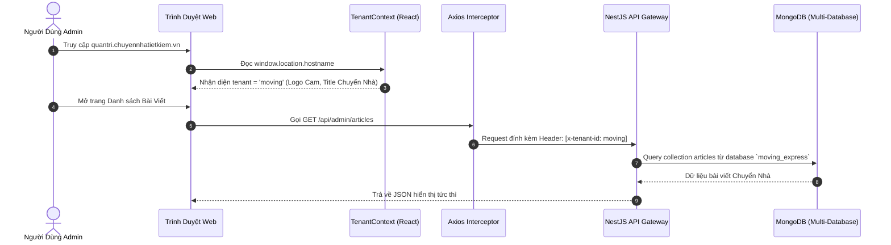

# Plan 66: Phân Tách & Xây Dựng Cổng Quản Trị Admin Tập Trung Đa Thương Hiệu (fe-react-thanhxuan-admin) Bằng React SPA (Vite)

> Status: Done | Created: 2026-11-01 | Completed: 2026-11-01 | Phân hệ: fe-react-thanhxuan-admin, be-nestjs-thanhxuan, fe-nextjs-thanhxuan-laundry, fe-nextjs-chuyennhatietkiem

## 1. Overview & Affected Files

### 1.1. Bối cảnh & Mục tiêu
- **Bối cảnh:**
  1. Hiện tại, trang quản trị CMS của hệ sinh thái đang nằm trong ứng dụng Next.js Giặt Là (`fe-nextjs-thanhxuan-laundry/src/app/(admin)`). Mảng Chuyển Nhà Tiết Kiệm (`fe-nextjs-chuyennhatietkiem`) cũng chuẩn bị triển khai và cần một hệ thống quản trị tương tự (quản lý bài viết SEO, chuyên mục, danh bạ liên hệ, khách hàng, cài đặt website).
  2. Trang Quản trị là ứng dụng nội bộ yêu cầu đăng nhập, **100% không cần SEO Google** (`noindex, nofollow`). Việc dùng Next.js Server Components / SSR render từng trang HTML trên server Node.js không mang lại giá trị SEO, ngược lại còn làm nặng web khách và tiêu tốn CPU/RAM của VPS.
  3. Người dùng muốn 2 tên miền quản trị độc lập: **`quantri.thanhxuanlaundry.com`** và **`quantri.chuyennhatietkiem.vn`** nhưng **dùng chung một nền tảng code admin duy nhất** để tối đa hóa tốc độ phát triển và tái sử dụng toàn bộ thành quả giao diện, component, rich text editor đã hoàn thiện của mảng Giặt Là.
- **Mục tiêu kỹ thuật:**
  1. Khởi tạo ứng dụng **`fe-react-thanhxuan-admin`** độc lập sử dụng **Vite + React SPA + TypeScript + TailwindCSS + shadcn/ui**, lấy cảm hứng kiến trúc và chuẩn cấu trúc thư mục từ `fe-react-thanhxuan-internal`.
  2. Triển khai kiến trúc **Multi-Tenant (Đa thương hiệu)**:
     - Tự động nhận diện thương hiệu (`'laundry'` vs `'moving'`) dựa trên hostname trình duyệt (`quantri.thanhxuanlaundry.com` vs `quantri.chuyennhatietkiem.vn`).
     - Cung cấp **Tenant Switcher** trên thanh Header cho phép tài khoản Admin cấp cao chuyển đổi quản trị qua lại giữa 2 thương hiệu mượt mà.
     - Axios API Client tự động đính kèm header `x-tenant-id` (hoặc `brand: 'laundry' | 'moving'`) để Backend NestJS định tuyến vào đúng CSDL MongoDB độc lập (`laundry_express` vs `moving_express`).
  3. Di chuyển toàn bộ các module CMS cốt lõi từ Next.js Laundry sang React SPA: Bài viết SEO (kèm Rich Text Editor Canva-style), Chuyên mục, Leads/Liên hệ, CRM, Cài đặt hệ thống, Quản lý tài khoản.
  4. Module nghiệp vụ chuyên biệt: Đơn giặt là (cho Laundry) và Đơn đặt xe/Báo giá (cho Chuyển Nhà) phân nhánh động theo tenant.
  5. Đóng gói Docker & Cấu hình Nginx phục vụ tĩnh (Static Serving) cho cả 2 tên miền với hiệu năng cao, phản hồi tức thì và tốn ~0% tài nguyên CPU của VPS.

### 1.2. Out of Scope
- Không gộp chung vào `fe-react-thanhxuan-internal` (Cổng vận hành xưởng dành cho thợ xưởng, tài xế giao nhận, chấm công được giữ nguyên độc lập).
- Không thay đổi nghiệp vụ logic cơ bản của Backend NestJS hay cấu trúc schema MongoDB hiện có.
- Không xóa bỏ ngay lập tức code `(admin)` cũ trong Laundry cho đến khi `fe-react-thanhxuan-admin` hoàn tất kiểm thử và chạy ổn định trên Production.

### 1.3. Assumptions & Open Questions
- **Assumptions:**
  - Cả 2 subdomain `quantri.thanhxuanlaundry.com` và `quantri.chuyennhatietkiem.vn` đều trỏ bản ghi DNS về IP VPS `103.200.22.238`.
  - Cổng phát triển cục bộ (dev port) của `fe-react-thanhxuan-admin` sẽ là `3003`.
  - Backend NestJS hiện đã có các controller tương ứng hoặc sẽ hỗ trợ đọc header `x-tenant-id` để query đúng connection database Mongoose.
- **Open Questions:**
  - Chưa có.

### 1.4. Bảng File Ảnh Hưởng

| Path | Action | Lý do |
| :--- | :--- | :--- |
| `fe-react-thanhxuan-admin/package.json` | Add | Định nghĩa dependencies (Vite, React Router v7, TanStack Query v5, Tailwind, Lucide, Axios) |
| `fe-react-thanhxuan-admin/vite.config.ts` | Add | Cấu hình Vite, port 3003, path alias `@/*` |
| `fe-react-thanhxuan-admin/index.html` | Add | Shell HTML chính cho React SPA |
| `fe-react-thanhxuan-admin/src/app/router.tsx` | Add | Cấu hình React Router v7 với Auth Guard và Tenant Guard |
| `fe-react-thanhxuan-admin/src/app/TenantContext.tsx` | Add | Quản lý state thương hiệu (`laundry` / `moving`), hostname detector & tenant switcher |
| `fe-react-thanhxuan-admin/src/lib/api-client.ts` | Add | Axios instance tự động gán token JWT và header `x-tenant-id` |
| `fe-react-thanhxuan-admin/src/features/auth/*` | Add | Module xác thực (Login, Logout, Guard, User Profile) |
| `fe-react-thanhxuan-admin/src/components/layout/*` | Add | Admin Shell: Sidebar, Header, Tenant Switcher, User Menu |
| `fe-react-thanhxuan-admin/src/features/articles/*` | Add | Quản lý bài viết blog SEO, rich text editor, lọc theo chuyên mục |
| `fe-react-thanhxuan-admin/src/features/categories/*` | Add | Quản lý danh mục bài viết và chuyên mục dịch vụ |
| `fe-react-thanhxuan-admin/src/features/contacts/*` | Add | Tiếp nhận form liên hệ & tư vấn từ khách hàng |
| `fe-react-thanhxuan-admin/src/features/crm/*` | Add | Quản lý khách hàng tiềm năng |
| `fe-react-thanhxuan-admin/src/features/settings/*` | Add | Cài đặt SEO, hotline, banner, cấu hình Zalo/Email theo tenant |
| `fe-react-thanhxuan-admin/src/features/orders/*` | Add | Đơn giặt là và đơn đặt xe chuyển nhà |
| `fe-react-thanhxuan-admin/src/features/users/*` | Add | Quản lý tài khoản quản trị và phân quyền |
| `fe-react-thanhxuan-admin/Dockerfile` | Add | Dockerfile đa tầng build static bundle và serve bằng Nginx Alpine |
| `docker-compose.yml` | Edit | Thêm service `fe-react-thanhxuan-admin` port 3003 |
| `be-nestjs-thanhxuan/src/common/guards/tenant.guard.ts` (hoặc interceptor) | Add/Edit | Hỗ trợ nhận diện tenant từ header `x-tenant-id` |
| `.agents/docs/CODEBASE_ATLAS.md` | Edit | Cập nhật cấu trúc ứng dụng mới `fe-react-thanhxuan-admin` |
| `.agents/docs/SRS_SDD.md` | Edit | Cập nhật kiến trúc tổng thể 5 ứng dụng trong Monorepo |
| `.agents/docs/srs_sdd/srs_sdd_fe_admin.md` | Add | Tài liệu SRS/SDD chi tiết cho Cổng Quản trị Admin Tập Trung |
| `.agents/docs/CHANGELOG.md` | Edit | Ghi nhận nhật ký kỹ thuật Plan 66 |

---

## 2. Technical Approach

### 2.1. Cấu Trúc Thư Mục Chuẩn Hóa (Kế Thừa từ `fe-react-thanhxuan-internal`)
```text
fe-react-thanhxuan-admin/
├── public/                     # Icons, favicons cho 2 thương hiệu, PWA assets
├── src/
│   ├── app/                    # Routing & App Providers
│   │   ├── router.tsx          # React Router v7 routes
│   │   ├── RootLayout.tsx      # Theme & Toast Providers
│   │   ├── TenantContext.tsx   # Context quản lý tenant: laundry | moving
│   │   └── RequireAuth.tsx     # Route Guard bảo vệ các trang admin
│   ├── components/             # Reusable UI Components (< 250-300 dòng)
│   │   ├── ui/                 # Button, Dialog, Input, Table, Badge, Dropdown...
│   │   └── layout/             # AdminShell, Sidebar, Header, TenantSwitcher
│   ├── features/               # Flat Feature-Based Colocation
│   │   ├── auth/               # Login, AuthState, useAuth
│   │   ├── dashboard/          # Thống kê tổng quan chuyển đổi theo tenant
│   │   ├── articles/           # Quản lý bài viết blog SEO + Rich Text Editor
│   │   ├── categories/         # Quản lý chuyên mục
│   │   ├── contacts/           # Tiếp nhận liên hệ khách hàng
│   │   ├── crm/                # Khách hàng tiềm năng & đối tác
│   │   ├── settings/           # Cấu hình website, hotline, banner, SEO
│   │   ├── orders/             # Phân nhánh: Đơn giặt vs Đơn chuyển nhà
│   │   └── users/              # Tài khoản quản trị & nhân sự
│   ├── hooks/                  # Custom hooks chung (useMobileBack, useToast...)
│   ├── lib/                    # Axios client, date-fns, formatters
│   ├── types/                  # TypeScript interfaces & types
│   ├── App.tsx
│   └── main.tsx
├── package.json
├── tailwind.config.js
├── tsconfig.json
└── vite.config.ts
```

### 2.2. Multi-Tenant Flow & Axios Interceptor


---

## 3. Implementation Tasks (Checklist)

### Giai đoạn 1: Khởi Tạo Dự Án & Nền Tảng Kỹ Thuật (Foundation)
- [x] T1: Khởi tạo thư mục `fe-react-thanhxuan-admin/`, file `package.json` với Vite, React 18, React Router v7, TanStack Query v5, TailwindCSS, Lucide React, Axios. - Depends on: none
- [x] T2: Cấu hình `vite.config.ts` (port 3003, alias `@/`), `tsconfig.json`, `tailwind.config.js`, `postcss.config.js` đồng bộ design tokens với hệ sinh thái. - Depends on: T1
- [x] T3: Xây dựng bộ UI components cơ bản tại `src/components/ui/` (`button`, `input`, `table`, `dialog`, `badge`, `tabs`, `dropdown-menu`, `toast`) theo chuẩn shadcn/ui. - Depends on: T2
- [x] T4: Thiết lập Axios client tại `src/lib/api-client.ts` tự động gán JWT Bearer token và header `x-tenant-id`. - Depends on: T1

### Giai đoạn 2: Multi-Tenant Context & Module Xác Thực (Auth)
- [x] T5: Triển khai `TenantContext.tsx` với cơ chế nhận diện hostname tự động (`quantri.thanhxuanlaundry.com` -> `laundry`, `quantri.chuyennhatietkiem.vn` -> `moving`), fallback localStorage cho môi trường dev. - Depends on: T4
- [x] T6: Xây dựng module `features/auth/` (Trang `LoginPage.tsx`, `useAuth.ts`, `RequireAuth.tsx` Route Guard) lưu token tại localStorage và xử lý refresh token tự động. - Depends on: T5
- [x] T7: Xây dựng `AdminShellComponent.tsx`, `Sidebar.tsx`, `Header.tsx` kèm **Tenant Switcher** (cho phép Super Admin chuyển đổi mảng kinh doanh với hiệu ứng trực quan) và tích hợp `useMobileBackHandler`. - Depends on: T6

### Giai đoạn 3: Di Chuyển Các Module Quản Trị Nội Dung Cốt Lõi (Core CMS)
- [x] T8: Xây dựng module `features/categories/` (`CategoriesListPage.tsx`, `CategoryModal.tsx`) hỗ trợ CRUD chuyên mục phân theo tenant. - Depends on: T7
- [x] T9: Xây dựng module `features/articles/` (`ArticlesListPage.tsx`, `ArticleEditorPage.tsx`) tích hợp Rich Text Editor Canva-style, tải ảnh Cloudinary, chuẩn SEO metadata. - Depends on: T8
- [x] T10: Xây dựng module `features/contacts/` và `features/crm/` hiển thị danh sách khách hàng gửi yêu cầu tư vấn từ cả 2 website. - Depends on: T7

### Giai đoạn 4: Cài Đặt Hệ Thống, Quản Lý Tài Khoản & Nghiệp Vụ Chuyên Biệt
- [x] T11: Xây dựng module `features/settings/` (`GeneralSettingsPage.tsx`, `BannerSettingsPage.tsx`, `SeoSettingsPage.tsx`) cho phép chỉnh sửa hotline, banner, metadata riêng cho từng website. - Depends on: T7
- [x] T12: Xây dựng module `features/users/` (`UsersListPage.tsx`, `UserModal.tsx`) quản lý tài khoản admin, phân quyền vai trò. - Depends on: T7
- [x] T13: Xây dựng module `features/orders/`: Giao diện danh sách đơn giặt là (đối với Laundry) và danh sách đơn yêu cầu báo giá/đặt xe (đối với Chuyển Nhà). - Depends on: T7
- [x] T14: Xây dựng trang `DashboardPage.tsx` thống kê số lượng bài viết, leads liên hệ và đơn hàng theo tenant đang chọn. - Depends on: T9, T10, T13

### Giai đoạn 5: Hạ Tầng Docker, Nginx & Backend Support
- [x] T15: Kiểm tra và cập nhật Backend NestJS (`be-nestjs-thanhxuan`): Đảm bảo các controller CMS nhận diện header `x-tenant-id` để query đúng CSDL (`laundry_express` vs `moving_express`). - Depends on: T4
- [x] T16: Tạo `Dockerfile` đa tầng cho `fe-react-thanhxuan-admin` với Nginx Alpine phục vụ static bundle, tối ưu gzip/brotli cache. - Depends on: T14
- [x] T17: Cập nhật `docker-compose.yml` bổ sung service `fe-react-thanhxuan-admin` chạy cổng `3003`. - Depends on: T16
- [x] T18: Soạn thảo cấu hình mẫu Nginx Reverse Proxy trên VPS cho 2 tên miền `quantri.thanhxuanlaundry.com` và `quantri.chuyennhatietkiem.vn` ánh xạ vào cổng 3003. - Depends on: T17

### Giai đoạn 6: Kiểm Thử, Dọn Dẹp & Đồng Bộ Tài Liệu (DoD)
- [x] T19: Chạy lint, typecheck (`tsc --noEmit`) và build (`vite build`) thành công 100% cho `fe-react-thanhxuan-admin`. - Depends on: T14
- [x] T20: Soạn tài liệu chi tiết `.agents/docs/srs_sdd/srs_sdd_fe_admin.md`, cập nhật `CODEBASE_ATLAS.md`, `SRS_SDD.md` (1 dòng history) và ghi nhật ký vào `CHANGELOG.md`. - Depends on: T19

---

## 4. Verification & Testing

### 4.1. Lệnh Kiểm Tra Cục Bộ
- Typecheck: `cd fe-react-thanhxuan-admin && pnpm exec tsc --noEmit`
- Build thử nghiệm: `cd fe-react-thanhxuan-admin && pnpm run build`
- Kiểm tra Backend: `cd be-nestjs-thanhxuan && pnpm exec tsc --noEmit`

### 4.2. Kịch Bản Kiểm Thử (Test Cases)
1. **Multi-Domain Hostname Detection:**
   - Khi chạy ở domain `quantri.thanhxuanlaundry.com`: Logo hiển thị Thanh Xuân Laundry, màu chủ đạo xanh dương, API gọi trả về bài viết giặt là.
   - Khi chạy ở domain `quantri.chuyennhatietkiem.vn`: Logo hiển thị Chuyển Nhà Tiết Kiệm, màu chủ đạo cam, API gọi trả về bài viết chuyển nhà.
2. **Tenant Switcher (Header):**
   - Click chuyển từ Giặt Là sang Chuyển Nhà: Toàn bộ bảng danh sách bài viết/danh mục/cài đặt tự động cập nhật lại mà không cần tải lại trang (Zero reload).
3. **PWA & Mobile Back Button:**
   - Mở bất kỳ Modal/Dialog nào rồi bấm nút Back của điện thoại: Modal đóng lại, trang không bị lùi hay reload.
4. **Hiệu năng & Bundle Size:**
   - Tốc độ tải lần đầu < 1.5s, chuyển trang < 100ms.

---

## 5. Risks & Rollback

- **Rủi ro 1 (CORS hoặc Cookie Domain):** Do admin là SPA tách biệt cổng với Backend và Public Web, cần đảm bảo Backend NestJS cấu hình CORS cho phép origin `https://quantri.thanhxuanlaundry.com` và `https://quantri.chuyennhatietkiem.vn`.
  - *Giảm thiểu:* Thiết lập cấu hình CORS trong `main.ts` của NestJS chấp nhận pattern `*.thanhxuanlaundry.com` và `*.chuyennhatietkiem.vn`.
- **Rủi ro 2 (Ảnh hưởng đến session khác đang làm Plan 65):** Session khác đang cấu hình Next.js middleware trên Laundry.
  - *Giảm thiểu:* Chúng ta triển khai `fe-react-thanhxuan-admin` hoàn toàn song song trong thư mục mới, không đụng chạm đến code Next.js hiện tại cho đến khi app mới sẵn sàng chuyển giao.
- **Rollback:** Nếu có bất kỳ trục trặc nào, Nginx chỉ cần giữ nguyên việc trỏ `quantri.thanhxuanlaundry.com` về cổng 3000 của Laundry như cũ.
