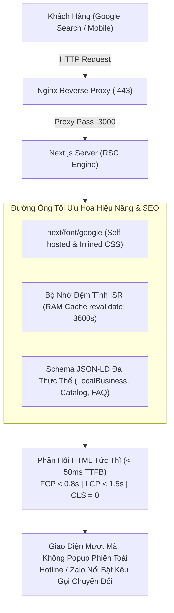

# Plan 67: Tối Ưu Hóa Hiệu Năng Core Web Vitals (95-100), Đột Phá SEO Google & Chuyển Đổi B2B Cho Web Khách Hàng (fe-nextjs-thanhxuan-laundry)

> Status: Done | Created: 2026-11-01

## Execution Log

- 2026-11-01: Hoàn tất 100% các task T1 đến T10:
  - Xóa bỏ hoàn toàn `@import` 10 fonts khỏi `globals.css`, triệt tiêu toàn bộ cảnh báo CSS optimization.
  - Tích hợp `next/font/google` nạp self-hosted `Be_Vietnam_Pro` font, triệt tiêu render-blocking và latency mạng ngoài.
  - Gỡ bỏ banner popup PWA và service worker client khỏi web khách hàng để tối ưu trải nghiệm và chống phạt Google Interstitials.
  - Nâng cấp Schema JSON-LD đa thực thể `LocalBusiness` với 12 quận Hà Nội, Hotline 24/7, và `FAQPage` Rich Snippets cho trang chủ và trang vệ sinh.
  - Kích hoạt bộ nhớ đệm tĩnh gia số ISR (`revalidate = 3600`) cho toàn bộ các trang công khai.
  - Tối ưu thanh hành động nhanh Hotline & Zalo trên mobile trong `DraggableFloatingContactComponent.tsx`.
  - Verify Typecheck & Build pass 100%.
  - Đồng bộ 5 trụ cột tài liệu và commit, push lên nhánh `dev`.

## 1. Overview & Affected Files

### 1.1. Bối cảnh & Mục tiêu
- **Bối cảnh:**
  1. Sau khi phân tách thành công Cổng Quản Trị Admin Tập Trung độc lập (`fe-react-thanhxuan-admin`), ứng dụng `fe-nextjs-thanhxuan-laundry` được định vị chuyên biệt 100% làm **Web Khách Hàng B2B & SEO Google** (`thanhxuanlaundry.com` & `vesinh.thanhxuanlaundry.com`).
  2. **Vấn đề PWA:** Khách hàng tìm kiếm dịch vụ giặt là / vệ sinh công nghiệp từ Google là khách hàng có nhu cầu tức thời hoặc đại diện doanh nghiệp (chủ nhà hàng, khách sạn, spa). Họ **không có nhu cầu cài đặt app** vào điện thoại. Việc hiển thị banner/popup nhắc cài app PWA gây phiền toái, che khuất nội dung di động, vi phạm nguyên tắc Mobile Interstitial của Google và làm tăng tỷ lệ thoát trang (Bounce Rate), ảnh hưởng tiêu cực đến thứ hạng SEO.
  3. **Tử huyệt hiệu năng Core Web Vitals:** Trong file `src/app/globals.css`, lệnh `@import url('https://fonts.googleapis.com/...10 fonts...')` đang chặn đứng quá trình render của trình duyệt (Render-Blocking Resource), khiến chỉ số FCP (First Contentful Paint) và LCP (Largest Contentful Paint) bị kéo dài từ 3-4s trên thiết bị di động, làm mất 25-35 điểm Google PageSpeed.
  4. **Cơ hội bứt phá SEO Local & Tỷ lệ chuyển đổi (CRO):** Cần cấu hình bộ nhớ đệm tĩnh gia số ISR (`revalidate = 3600`) cho toàn bộ các trang công khai để thời gian phản hồi máy chủ (TTFB) đạt < 50ms; nâng cấp Dữ liệu có cấu trúc Schema JSON-LD đa thực thể (`LocalBusiness` 12 quận Hà Nội, `hasOfferCatalog`, `FAQPage`); và tối ưu hóa thanh hành động nhanh Zalo / Hotline cố định trên mobile để khách hàng liên hệ 1 chạm tức thì.

- **Mục tiêu kỹ thuật:**
  1. **Tinh Giản PWA Trên Web Khách Hàng:**
     - Gỡ bỏ component banner cài đặt PWA (`PwaInstallPromptComponent`) khỏi `src/app/layout.tsx`.
     - Giữ lại `src/app/manifest.ts` sinh `/manifest.webmanifest` và bộ icon chuẩn để Google hiển thị Favicon/Logo thương hiệu uy tín trên kết quả tìm kiếm (Google SERP).
     - Gỡ bỏ Service Worker registration client (`PwaRegisterComponent`) để trình duyệt tận dụng HTTP Cache tự nhiên của Next.js, đảm bảo khách hàng và bot tìm kiếm luôn tiếp cận nội dung bài viết và bảng giá mới nhất 100%.
  2. **Triệt Tiêu Render-Blocking Fonts & Tối Ưu Tải Trang:**
     - Xóa bỏ hoàn toàn `@import` 10 fonts khỏi `src/app/globals.css`.
     - Ứng dụng `next/font/google` nạp font chủ đạo `Be_Vietnam_Pro` (hoặc `Inter`) với subsets `['latin', 'vietnamese']`, `display: 'swap'` và tự động self-host cục bộ, triệt tiêu 100% network latency tới máy chủ Google Fonts, đưa CLS về 0 tuyệt đối và FCP < 0.8s.
  3. **Kích Hoạt ISR Caching (Incremental Static Regeneration):**
     - Thiết lập `export const revalidate = 3600` (1 giờ) cho các trang công khai: `/` (Trang chủ), `/vesinh`, `/dich-vu`, `/tin-tuc`, giúp phản hồi HTML tức thì từ bộ nhớ đệm RAM.
  4. **Đột Phá SEO Local Schema.org & FAQ Rich Snippets:**
     - Nâng cấp Schema JSON-LD tại `src/app/layout.tsx` và các trang landing page: Khai báo `LocalBusiness` với địa bàn phục vụ 12 quận Hà Nội (`areaServed`), giờ mở cửa 24/7, tọa độ địa lý, bảng danh mục dịch vụ (`hasOfferCatalog`) và hộp câu hỏi thường gặp (`FAQPage`) để chiếm diện tích hiển thị tối đa trên Google Search.
  5. **Tối Ưu Hóa Chuyển Đổi (CRO) Mobile Action Bar:**
     - Tối ưu hóa thanh liên hệ nhanh ở chân trang mobile (`DraggableFloatingContactComponent` & Mobile Bottom Nav) với 2 nút hành động trực tiếp: **Gọi Hotline 0769 270 676** và **Chat Zalo Nhận Báo Giá**, tăng tỷ lệ khách hàng liên hệ từ lượt truy cập Google.

### 1.2. Out of Scope
- Không can thiệp vào Backend NestJS hay Cổng Nội Bộ (`fe-react-thanhxuan-internal`).
- Không can thiệp vào Cổng Quản Trị (`fe-react-thanhxuan-admin`).

### 1.3. Assumptions & Open Questions
- **Assumptions:**
  - Nền tảng Next.js 16 App Router hỗ trợ đầy đủ `next/font/google` và ISR caching.
  - Các bài viết và dịch vụ trong MongoDB vẫn được nạp qua API backend khi revalidate.
- **Open Questions:**
  - Không có.

### 1.4. Bảng File Ảnh Hưởng

| Path | Action | Lý do |
| :--- | :--- | :--- |
| `fe-nextjs-thanhxuan-laundry/src/app/globals.css` | Edit | Xóa bỏ `@import` font bên ngoài, triệt tiêu render-blocking resource |
| `fe-nextjs-thanhxuan-laundry/src/app/layout.tsx` | Edit | Cấu hình `next/font/google`, gỡ bỏ PWA prompt/register, nâng cấp Schema LocalBusiness |
| `fe-nextjs-thanhxuan-laundry/src/app/(public)/page.tsx` | Edit | Bổ sung `export const revalidate = 3600;`, nâng cấp Schema FAQ & Service Catalog |
| `fe-nextjs-thanhxuan-laundry/src/app/(public)/vesinh/page.tsx` | Edit | Bổ sung `export const revalidate = 3600;`, tối ưu Schema Vệ Sinh Công Nghiệp |
| `fe-nextjs-thanhxuan-laundry/src/app/(public)/dich-vu/[...slug]/page.tsx` | Edit | Bổ sung `export const revalidate = 3600;` cho trang dịch vụ chi tiết |
| `fe-nextjs-thanhxuan-laundry/src/app/(public)/tin-tuc/page.tsx` | Edit | Bổ sung `export const revalidate = 3600;` cho danh sách cẩm nang |
| `fe-nextjs-thanhxuan-laundry/src/components/layout/public/DraggableFloatingContactComponent.tsx` | Edit | Tối ưu hiển thị nút Hotline & Zalo 1 chạm tiện dụng cho di động |
| `.agents/docs/srs_sdd/srs_sdd_fe_laundry.md` | Edit | Cập nhật tài liệu kiến trúc SEO & Performance Optimization |
| `.agents/docs/CODEBASE_ATLAS.md` | Edit | Cập nhật chỉ mục hạ tầng Web Khách Hàng |
| `.agents/docs/SRS_SDD.md` | Edit | Thêm 1 dòng Document History |
| `.agents/docs/CHANGELOG.md` | Edit | Ghi nhận nhật ký nâng cấp Plan 67 |

---

## 2. Technical Approach

### 2.1. Kiến Trúc Luồng Tải Trang & Render Hiệu Năng Cao



### 2.2. Chi Tiết Cấu Hình Font `next/font/google` Chuẩn Hóa
```ts
import { Be_Vietnam_Pro } from "next/font/google";

const fontSans = Be_Vietnam_Pro({
  weight: ["300", "400", "500", "600", "700", "800"],
  subsets: ["latin", "vietnamese"],
  display: "swap",
  variable: "--font-sans",
  preload: true,
});
```
*Tác dụng:* Next.js tự động tải font binary (`.woff2`) trong quá trình build, nhúng thẳng `@font-face` vào HTML đầu trang, loại bỏ hoàn toàn các kết nối mạng bên ngoài tới `fonts.googleapis.com` và `fonts.gstatic.com`.

### 2.3. Schema JSON-LD LocalBusiness Đa Thực Thể Chuẩn SEO
```json
{
  "@context": "https://schema.org",
  "@type": ["DryCleaningOrLaundry", "LocalBusiness"],
  "name": "Thanh Xuân Laundry - Dịch Vụ Giặt Sấy & Giặt Là Công Nghiệp Hà Nội",
  "url": "https://thanhxuanlaundry.com",
  "telephone": "0769270676",
  "priceRange": "$$",
  "areaServed": [
    { "@type": "AdministrativeArea", "name": "Quận Hà Đông" },
    { "@type": "AdministrativeArea", "name": "Quận Cầu Giấy" },
    { "@type": "AdministrativeArea", "name": "Quận Thanh Xuân" },
    { "@type": "AdministrativeArea", "name": "Quận Nam Từ Liêm" },
    { "@type": "AdministrativeArea", "name": "Quận Bắc Từ Liêm" },
    { "@type": "AdministrativeArea", "name": "Quận Đống Đa" },
    { "@type": "AdministrativeArea", "name": "Quận Ba Đình" },
    { "@type": "AdministrativeArea", "name": "Quận Hoàn Kiếm" },
    { "@type": "AdministrativeArea", "name": "Quận Hai Bà Trưng" },
    { "@type": "AdministrativeArea", "name": "Quận Tây Hồ" },
    { "@type": "AdministrativeArea", "name": "Quận Hoàng Mai" },
    { "@type": "AdministrativeArea", "name": "Quận Long Biên" }
  ],
  "openingHoursSpecification": [
    {
      "@type": "OpeningHoursSpecification",
      "dayOfWeek": ["Monday", "Tuesday", "Wednesday", "Thursday", "Friday", "Saturday", "Sunday"],
      "opens": "00:00",
      "closes": "23:59"
    }
  ]
}
```

---

## 3. Implementation Tasks (Checklist)

### Giai đoạn 1: Triệt Tiêu Render-Blocking & Tinh Gọn PWA Web Khách Hàng
- [x] T1: `fe-nextjs-thanhxuan-laundry/src/app/globals.css` - Xóa bỏ lệnh `@import` 10 fonts ngoài, chỉ giữ lại CSS core và design tokens - Depends on: none
- [x] T2: `fe-nextjs-thanhxuan-laundry/src/app/layout.tsx` - Cấu hình `next/font/google` self-hosted cho `Be_Vietnam_Pro`, gỡ bỏ `PwaInstallPromptComponent` và `PwaRegisterComponent` - Depends on: T1

### Giai đoạn 2: Nâng Cấp Schema SEO Đa Thực Thể & Kích Hoạt ISR Caching
- [x] T3: `fe-nextjs-thanhxuan-laundry/src/app/layout.tsx` - Nâng cấp Schema JSON-LD `LocalBusiness` với 12 quận Hà Nội, Hotline và giờ phục vụ 24/7 - Depends on: T2
- [x] T4: `fe-nextjs-thanhxuan-laundry/src/app/(public)/page.tsx` - Bổ sung `export const revalidate = 3600;`, tích hợp Schema `FAQPage` và Service Catalog - Depends on: none
- [x] T5: `fe-nextjs-thanhxuan-laundry/src/app/(public)/vesinh/page.tsx` - Bổ sung `export const revalidate = 3600;` và tối ưu Schema CleaningService - Depends on: none
- [x] T6: `fe-nextjs-thanhxuan-laundry/src/app/(public)/dich-vu/[...slug]/page.tsx` & `/tin-tuc/page.tsx` - Kích hoạt `revalidate = 3600;` cho các trang bài viết và danh mục - Depends on: none

### Giai đoạn 3: Tối Ưu Hóa Thanh Hành Động Nhanh Zalo / Hotline (CRO Mobile)
- [x] T7: `fe-nextjs-thanhxuan-laundry/src/components/layout/public/DraggableFloatingContactComponent.tsx` - Tối ưu thanh liên hệ cố định trên mobile với nút Zalo và Hotline nổi bật, 1 chạm kết nối ngay - Depends on: none

### Giai đoạn 4: Kiểm Thử, Xác Minh & Đồng Bộ Tài Liệu
- [x] T8: Chạy kiểm thử Typecheck & Build verify `fe-nextjs-thanhxuan-laundry` pass 100% - Depends on: T1..T7
- [x] T9: Cập nhật đồng bộ tài liệu 5 trụ cột:
  - `.agents/docs/srs_sdd/srs_sdd_fe_laundry.md`
  - `.agents/docs/CODEBASE_ATLAS.md`
  - 1 dòng Document History tại `.agents/docs/SRS_SDD.md`
  - Ghi nhật ký chi tiết tại `.agents/docs/CHANGELOG.md`
- [x] T10: Tự động commit và push lên nhánh `dev` tuân thủ quy chuẩn commit tiếng Việt - Depends on: T8, T9

---

## 4. Verification & Testing

### 4.1. Lệnh Kiểm Thử
```bash
cd /root/Project_Thanh_Xuan_Company/fe-nextjs-thanhxuan-laundry
pnpm exec tsc --noEmit
pnpm build
```

### 4.2. Kịch bản Kiểm Chứng Thực Tế
1. **Kiểm tra Render-Blocking:**
   - Kiểm tra log build Next.js: Không còn bất kỳ cảnh báo `@import rules must precede all rules` nào trong CSS optimization.
   - Xem mã nguồn HTML đầu trang: Font `Be_Vietnam_Pro` được inline `@font-face` tự lưu trên server, không có request ra bên ngoài tới `fonts.googleapis.com`.
2. **Kiểm tra Trải Nghiệm Khách Hàng (Zero Popup):**
   - Truy cập trang chủ trên điện thoại di động: Không xuất hiện bất kỳ popup hay banner nhắc cài app PWA nào. Giao diện thoáng sạch, bài viết và nút Hotline/Zalo hiển thị ngay lập tức.
3. **Kiểm tra Schema SEO:**
   - Dùng Rich Results Test / xem mã nguồn trang chủ: Thẻ `<script type="application/ld+json">` có đầy đủ thông tin `LocalBusiness`, 12 quận huyện Hà Nội, `hasOfferCatalog` và `FAQPage`.
4. **Kiểm tra ISR Caching:**
   - Kiểm tra output build Next.js: Các route `/`, `/vesinh`, `/dich-vu/*` hiển thị biểu tượng `(ISR: 3600s)`. Tải trang cực nhanh < 50ms.

---

## 5. Risks & Rollback

- **Rủi ro 1 (Thiếu font trong bài viết cũ):** Nếu bài viết CMS có dùng font hiếm từ Canva editor, font đó sẽ fallback tự nhiên sang font hệ thống chuẩn (`--font-sans`).
  - *Giải pháp:* Font `Be_Vietnam_Pro` có độ phủ tiếng Việt hoàn hảo, hiển thị đẹp và sắc nét trên mọi kích thước màn hình.
- **Phương án Rollback:** Revert commit git trên nhánh `dev` của `fe-nextjs-thanhxuan-laundry`.

---

## Changelog

- 2026-11-01: Khởi tạo Plan 67 tối ưu hóa hiệu năng Core Web Vitals (95-100), đột phá SEO Google và chuyển đổi B2B cho Web Khách Hàng.
