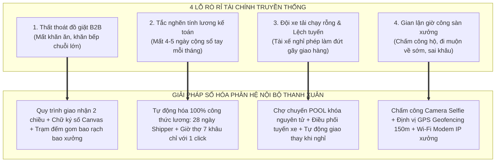
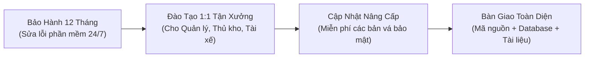

# HỒ SƠ ĐỀ XUẤT GIẢI PHÁP VÀ CHI PHÍ ĐẦU TƯ PHÂN HỆ NỘI BỘ

## DỰ ÁN: HỆ SINH THÁI CÔNG NGHỆ ĐIỀU HÀNH XƯỞNG GIẶT LÀ & LOGISTICS B2B

> **Kính gửi:** Ban Giám Đốc / Chủ Doanh Nghiệp - Công ty TNHH Kinh doanh Thương mại và Dịch vụ Thanh Xuân  
> **Đơn vị lập hồ sơ:** Đội Ngũ Kỹ Thuật & Tư Vấn Giải Pháp Chuyển Đổi Số  
> **Mục tiêu:** Cung cấp hồ sơ phân tích giá trị nghiệp vụ, bảng phân rã chi phí đầu tư 13 phân hệ, tính toán hiệu quả hoàn vốn (ROI) và cam kết chất lượng dịch vụ (SLA) của Phân hệ Cổng Vận Hành Nội Bộ (`fe-react-thanhxuan-internal` + Backend API Internal).  
> **Ngày phát hành:** 2026-10-29  
> **Hiệu lực báo giá:** 30 ngày kể từ ngày phát hành  

---

## MỤC LỤC HỒ SƠ

1. [PHẦN 1: BẢN ĐỀ XUẤT GIÁ TRỊ DOANH NGHIỆP (THE VALUE PROPOSITION)](#phan-1)
2. [PHẦN 2: BẢN TRÌNH BÀY CHI PHÍ ĐẦU TƯ PHÂN HỆ NỘI BỘ (25.000.000 VNĐ)](#phan-2)
3. [PHẦN 3: BẢNG TÍNH TOÁN HIỆU QUẢ ĐẦU TƯ & HOÀN VỐN (ROI CALCULATOR)](#phan-3)
4. [PHẦN 4: ĐIỀU KHOẢN HỢP ĐỒNG, LỘ TRÌNH THANH TOÁN & CAM KẾT BÀN GIAO](#phan-4)

---

<a name="phan-1"></a>

## PHẦN 1: BẢN ĐỀ XUẤT GIÁ TRỊ DOANH NGHIỆP (THE VALUE PROPOSITION)

### 1.1. Giải Quyết Triệt Để 4 "Nỗi Đau Vận Hành" Lớn Nhất Của Xưởng Giặt Là

Xưởng giặt là công nghiệp truyền thống luôn đối mặt với 4 lỗ rò rỉ tài chính và thất thoát nghiêm trọng mà việc ghi chép sổ sách thủ công không thể xử lý được:



### 1.2. Hệ Thống 8 Vai Trò Chuyên Nghiệp (RBAC) Khép Kín Chuỗi Cung Ứng

Không chỉ là một trang web đơn giản, đây là một nền tảng **ERP / WMS / TMS thu nhỏ** phục vụ toàn diện mọi mắt xích trong công ty:

1. **Ban Giám Đốc (`ADMIN`):** Giám sát KPI thời gian thực, toàn quyền nhân sự 60 ngày, khóa/mở khóa kỳ lương an toàn tuyệt đối.
2. **Quản Lý Xưởng (`MANAGER`):** Chỉ huy 7 khâu sản xuất, rà soát ca bất thường, duyệt công ngày *(Bảo mật: Phân quyền che giấu 100% dữ liệu tiền bạc)*.
3. **Thủ Kho (`WAREHOUSE_MANAGER`):** Soạn đồ sạch xuất kho theo ngày, ký Canvas xuất ảnh phiếu Cloudinary, quản lý thư viện ảnh phiếu và trạm đếm rạch bao.
4. **Kế Toán (`ACCOUNTANT`):** Thẩm định chi phí xe máy (xăng + sửa xe với 2 ảnh bắt buộc), định mức thù lao chuyến lẻ, chạy tính bảng lương tự động và xuất báo cáo Excel chuẩn kế toán.
5. **Tài Xế Xe Tải (`SHIPPER`):** 100% Mobile PWA, lộ trình 4 ca sáng/chiều/tối, chợ chuyến nhận đơn lẻ hưởng thù lao, đếm thay đồ bẩn toàn màn hình và xin nghỉ phép không làm đứt gãy tuyến.
6. **Thợ Xưởng (`WORKER`):** Chấm công selfie + GPS vệ tinh $\le 150\text{m}$, đồng hồ đếm giờ làm việc 7 khâu cập nhật mỗi 30s, tự động quay lại khâu mặc định (`AUTO_RESUME`), tra cứu lương ngày minh bạch.
7. **Quản Lý Đối Tác (`PARTNER_MANAGER`):** Cổng nhà hàng (Pizza 4P's, Haidilao...), đếm đồ bẩn Auto-save onBlur chống xung đột, kiểm nhận đồ sạch qua ảnh WebP, duyệt nhân viên cơ sở.
8. **Nhân Viên Đối Tác (`PARTNER_STAFF`):** Giao diện 3 tab di động tinh gọn đếm đồ bẩn và nhận đồ sạch trực quan ngay trên điện thoại.

---

<a name="phan-2"></a>

## PHẦN 2: BẢN TRÌNH BÀY CHI PHÍ ĐẦU TƯ PHÂN HỆ NỘI BỘ (GÓI CHỐT 25.000.000 VNĐ)

### 2.1. Căn Cứ Định Mức Kỹ Thuật Ban Đầu & Chính Sách Ưu Đãi Monorepo

- **Định mức kỹ thuật độc lập ban đầu:** Một hệ thống ERP xưởng và Logistics chuyên sâu với 8 vai trò RBAC, 16 Collections MongoDB và Mobile PWA phần cứng có giá trị công sức thị trường tương đương **36.000.000 VNĐ** (gấp 2.4 lần so với Web Marketing 15tr).
- **Chính sách hỗ trợ chuyển đổi số của Đội ngũ phát triển:** Nhờ mô hình kiến trúc Monorepo dùng chung tài nguyên với Web Giặt Là, chúng tôi áp dụng 3 khoản trừ tiết kiệm **11.000.000 VNĐ** để đưa chi phí về đúng ngân sách đầu tư ưu đãi là **25.000.000 VNĐ**:

```
┌─────────────────────────────────────────────────────────────┬────────────────────────┐
│ KHOẢN MỤC ĐỊNH MỨC & CHIẾT KHẤU TỐI ƯU                      │ GIÁ TRỊ (VNĐ)          │
├─────────────────────────────────────────────────────────────┼────────────────────────┤
│ 1. ĐỊNH MỨC CÔNG SỨC KỸ THUẬT ĐỘC LẬP (GẤP 2.4 LẦN WEB CMS) │         36.000.000 VNĐ │
│ 2. Trừ Tiết kiệm Hạ tầng Core NestJS & VPS Server dùng chung│        - 5.000.000 VNĐ │
│ 3. Trừ Kế thừa Bộ Thư Viện UI Design System & Tokens        │        - 3.500.000 VNĐ │
│ 4. Trừ Chiết khấu Gói Đồng Hành Hệ Sinh Thái Monorepo       │        - 2.500.000 VNĐ │
├─────────────────────────────────────────────────────────────┼────────────────────────┤
│ 👉 CHI PHÍ ĐẦU TƯ TRỌN GÓI BÀN GIAO TOÀN DIỆN               │         25.000.000 VNĐ │
└─────────────────────────────────────────────────────────────┴────────────────────────┘
```

> 🎯 **CAM KẾT CHẤT LƯỢNG TOÀN DIỆN:**  
> Dù được hỗ trợ mức ưu đãi chuyển đổi số từ 36 triệu xuống 25 triệu, **toàn bộ 100% tính năng kỹ thuật và nghiệp vụ chuyên sâu của hệ thống vẫn được giữ nguyên vẹn**, không cắt giảm bất kỳ module nào!

---

### 2.2. Bảng Phân Rã Chi Tiết 13 Module Công Việc (Work Breakdown Structure)

Tổng ngân sách đầu tư: **25.000.000 VNĐ** (Hai mươi lăm triệu đồng chẵn).

| STT | Phân Hệ Nghiệp Vụ & Module Chức Năng | Chi Tiết Nghiệp Vụ Đã Bàn Giao | Tỷ Trọng | Thành Tiền (VNĐ) |
| :---: | :--- | :--- | :---: | :---: |
| **01** | **Hạ Tầng Phân Quyền 8 Vai Trò RBAC & Nhân Sự** | Ma trận 8 vai trò; Auth JWT nội bộ (`aud: 'internal'`); Quản lý nhân sự 6 tabs, tạm khóa 60 ngày tự hủy, xóa vĩnh viễn duy nhất cho Admin; phê duyệt tài khoản mới; modal lưu chữ ký mẫu cá nhân. | 8.5% | **2.125.000** |
| **02** | **Quản Trị Đối Tác B2B & Mạng Lưới Chi Nhánh** | Quản lý chuỗi nhà hàng (Pizza 4P's, Haidilao...); phân quyền theo chi nhánh; danh mục bảng giá đồ giặt B2B; cơ chế phê duyệt nhân viên đối tác tự đăng ký. | 7.0% | **1.750.000** |
| **03** | **Phiếu Giao Nhận Kép 2 Chiều & Chữ Ký Số Canvas** | Quy trình khép kín: Soạn đồ sạch $\rightarrow$ Giao hàng $\rightarrow$ Ký nhận Canvas trên mobile $\rightarrow$ Nhận đồ bẩn $\rightarrow$ Ký nhận $\rightarrow$ Về xưởng kiểm đếm; lưu trữ ảnh phiếu trên Cloudinary; mã chuẩn hóa `GN-YYYYMMDD-NNN`. | 13.0% | **3.250.000** |
| **04** | **Trạm Rạch Bao Đếm Lại & Thư Viện Ảnh Phiếu** | Trạm đếm xưởng (`RecountStationPage`) đối chiếu số lượng thực tế với số bao gom; cảnh báo chênh lệch đồ giặt; thư viện ảnh phiếu lọc linh hoạt từ đầu tháng đến ngày mai, hỗ trợ ca đêm (21h-24h). | 7.5% | **1.875.000** |
| **05** | **Điều Phối Tuyến Xe, Chợ Chuyến POOL & Nghỉ Phép** | Lập lịch xe chạy 4 ca/ngày; cơ chế Chợ chuyến đơn lẻ (Shipper nhận đơn lẻ hưởng thù lao chuyến); tự động khóa nguyên tử (Atomic locking) chống tranh đơn; đăng ký nghỉ phép có phân công người chạy thay. | 10.0% | **2.500.000** |
| **06** | **Chấm Công Đa Phương Thức (Selfie + GPS + Wi-Fi)** | Chấm công bằng camera selfie chống chụp ảnh màn hình; định vị GPS Geofencing bán kính $\le 150\text{m}$; đối chiếu địa chỉ IP Wi-Fi modem xưởng; tự động check-in cho Shipper khi ký đơn đầu ngày. | 9.0% | **2.250.000** |
| **07** | **Đồng Hồ Tính Giờ Thợ 7 Khâu & Auto-Resume** | Tính công theo giờ: $(\text{phút} / 60) \times \text{đơn giá} \times \text{hệ số khâu}$; 7 khâu chuẩn (Rũ x1.2, Giặt/Sấy x1.3, Là/Ủi x1.2, Đếm x1.1...); tự động quay lại khâu chính (`AUTO_RESUME`) sau 3 phút. | 11.5% | **2.875.000** |
| **08** | **Thẩm Định & Thanh Toán Chi Phí Xe Máy** | Shipper chụp ảnh đồng hồ ODO công-tơ-mét và hóa đơn tiền xăng/sửa xe; Kế toán & Quản lý thẩm định 2 cấp; đối soát minh bạch từng km di chuyển. | 5.5% | **1.375.000** |
| **09** | **Tự Động Hóa Bảng Lương Đa Vai Trò & Xuất Excel** | Tính lương tự động theo chu kỳ cho cả 8 nhóm vai trò; tách lương giờ thợ và định mức Shipper 28 ngày; khóa kỳ lương bảo vệ lịch sử; streaming file Excel chuẩn kế toán. | 10.0% | **2.500.000** |
| **10** | **Cổng Dành Cho Đối Tác B2B (Nhà Hàng, Khách Sạn)** | Giao diện riêng cho nhà hàng: Đếm đồ bẩn Auto-save onBlur chống mất mạng; kiểm nhận đồ sạch qua ảnh WebP chất lượng cao; phân quyền quản lý cơ sở và nhân viên. | 6.0% | **1.500.000** |
| **11** | **Bảo Mật Tài Chính Đa Tầng & Khóa Kỳ Dữ Liệu** | Interceptor Backend bóc tách trường tiền bạc đối với vai trò Quản lý sản xuất (`MANAGER`); Admin sở hữu quyền mở khóa dữ liệu đã chốt trong vòng 60 ngày. | 4.0% | **1.000.000** |
| **12** | **Công Nghệ Mobile PWA, Ngoại Tuyến & Lưu Trữ Đệm** | Cài đặt như App di động trên iOS/Android không cần tải từ App Store; cơ chế lưu trữ ngoại tuyến (Offline Queue) tự động đồng bộ khi xe ra khỏi vùng sóng yếu hoặc tầng hầm. | 4.0% | **1.000.000** |
| **13** | **Tối Ưu VPS Bộ Nhớ Thấp & Kiến Trúc Monorepo** | Tối ưu Backend NestJS và MongoDB chạy ổn định trên gói VPS kinh tế (< 1GB RAM); kết nối mượt mà với Web Giặt Là qua cấu trúc Monorepo thống nhất. | 4.0% | **1.000.000** |
| **TỔNG** | **HỆ THỐNG CỔNG VẬN HÀNH NỘI BỘ TOÀN DIỆN** | **Trọn gói 13 Module chuyên sâu - Bàn giao chìa khóa trao tay** | **100%** | **25.000.000 VNĐ** |

---

<a name="phan-3"></a>

## PHẦN 3: BẢNG TÍNH TOÁN HIỆU QUẢ ĐẦU TƯ & HOÀN VỐN (ROI CALCULATOR)

### 3.1. Phân Tích Lợi Ích Kinh Tế Thực Tế Hàng Tháng

Dựa trên khảo sát thực tế tại các xưởng giặt công nghiệp công suất 1.000 - 3.000 sản phẩm/ngày, việc áp dụng Phân hệ Nội Bộ giúp ngăn chặn các khoản thất thoát trực tiếp như sau:

```
┌────────────────────────────────────────────────────────┬──────────────────────────────────┐
│ KHOẢN MỤC TIẾT KIỆM TÀI CHÍNH THỰC TẾ                  │ GIÁ TRỊ TIẾT KIỆM / THÁNG        │
├────────────────────────────────────────────────────────┼──────────────────────────────────┤
│ 1. Chống thất thoát đồ giặt B2B (Khăn ăn, đồ nhà hàng) │ 8.000.000 - 12.000.000 VNĐ       │
│    (Chữ ký số 2 chiều + Trạm đếm ảnh phiếu Cloudinary) │                                  │
│ 2. Cắt giảm 80% thời gian tính lương của Kế toán       │ 3.000.000 - 5.000.000 VNĐ        │
│    (Từ 4-5 ngày/tháng giảm xuống còn 30 phút rà soát)  │                                  │
│ 3. Tối ưu chi phí nhiên liệu & quản lý xe máy chặt chẽ │ 2.000.000 - 3.000.000 VNĐ        │
│    (Kiểm soát 2 ảnh hóa đơn + Km đồng hồ chống gian lận)│                                 │
│ 4. Chống gian lận giờ công thợ (Camera Selfie + GPS)   │ 3.000.000 - 4.000.000 VNĐ        │
├────────────────────────────────────────────────────────┼──────────────────────────────────┤
│ 💰 TỔNG LỢI ÍCH TIẾT KIỆM TỐI THIỂU MỖI THÁNG          │ 16.000.000 - 24.000.000 VNĐ      │
└────────────────────────────────────────────────────────┴──────────────────────────────────┘
```

### 3.2. Thời Gian Hoàn Vốn Đầu Tư (Payback Period)

$$
\text{Thời gian hoàn vốn} = \frac{\text{Chi phí đầu tư 25.000.000 VNĐ}}{\text{Mức tiết kiệm trung bình 16.000.000 VNĐ/tháng}} \approx \mathbf{1.5 \text{ Tháng!}}
$$

> ⚡ **KẾT QUẢ PHÂN TÍCH ĐẦU TƯ:**  
> **Chỉ sau 1.5 tháng vận hành thực tế, hệ thống đã bù đắp 100% số tiền đầu tư ban đầu!** Kể từ tháng thứ 2 trở đi, doanh nghiệp liên tục hưởng lợi ích tiết kiệm dòng tiền từ 16 đến 24 triệu đồng mỗi tháng.

---

<a name="phan-4"></a>

## PHẦN 4: ĐIỀU KHOẢN HỢP ĐỒNG, LỘ TRÌNH THANH TOÁN & CAM KẾT BÀN GIAO

### 4.1. Lộ Trình Thanh Toán 3 Đợt An Toàn & Linh Hoạt

Để đảm bảo quyền lợi tối đa cho doanh nghiệp, chúng tôi áp dụng tiến độ thanh toán gắn chặt với kết quả nghiệm thu thực tế:

```
┌───────┬──────────────────────────────────┬──────────┬──────────────────────────────────────┐
│ ĐỢT   │ GIAI ĐOẠN TRIỂN KHAI             │ TỶ LỆ    │ SỐ TIỀN (VNĐ)                        │
├───────┼──────────────────────────────────┼──────────┼──────────────────────────────────────┤
│ Đợt 1 │ Ngay sau khi ký hợp đồng         │ 40%      │ 10.000.000 VNĐ                       │
│ Đợt 2 │ Bàn giao thử nghiệm (UAT)        │ 40%      │ 10.000.000 VNĐ                       │
│ Đợt 3 │ Nghiệm thu toàn diện & Vận hành  │ 20%      │ 5.000.000 VNĐ                        │
├───────┼──────────────────────────────────┼──────────┼──────────────────────────────────────┤
│ TỔNG  │ TOÀN BỘ DỰ ÁN                    │ 100%     │ 25.000.000 VNĐ                       │
└───────┴──────────────────────────────────┴──────────┴──────────────────────────────────────┘
```

### 4.2. Chính Sách Bảo Hành & Cam Kết Dịch Vụ Kỹ Thuật (SLA)



1. **Bảo hành kỹ thuật miễn phí 12 tháng:** Khắc phục mọi lỗi phát sinh (bugs) trong quá trình vận hành thực tế mà không thu thêm bất kỳ phụ phí nào.
2. **Đào tạo hướng dẫn trực tiếp:** Cung cấp trọn bộ 8 cẩm nang hướng dẫn sử dụng chuyên biệt cho từng vai trò và tổ chức các buổi hướng dẫn thực tế cho Quản lý xưởng, Thủ kho, Kế toán và Tài xế.
3. **Bàn giao trọn gói (No Vendor Lock-in):** Bàn giao toàn bộ quyền quản trị VPS, mã nguồn và tài liệu kiến trúc, doanh nghiệp toàn quyền làm chủ hệ thống công nghệ của mình.

---

### 4.3. Kết Luận

Phân hệ Cổng Vận Hành Nội Bộ trị giá **25.000.000 VNĐ** là khoản đầu tư chiến lược mang lại giá trị hoàn vốn tức thì, giúp Công ty TNHH Kinh doanh Thương mại và Dịch vụ Thanh Xuân chuyển mình từ một xưởng giặt thủ công trở thành một **doanh nghiệp F&B Logistics chuyên nghiệp chuẩn công nghệ cao**, sẵn sàng tiếp nhận các hợp đồng lớn hàng chục nghìn sản phẩm mỗi ngày.
