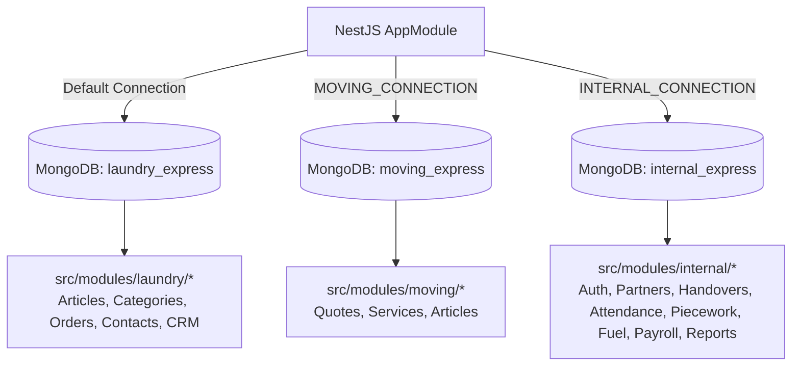
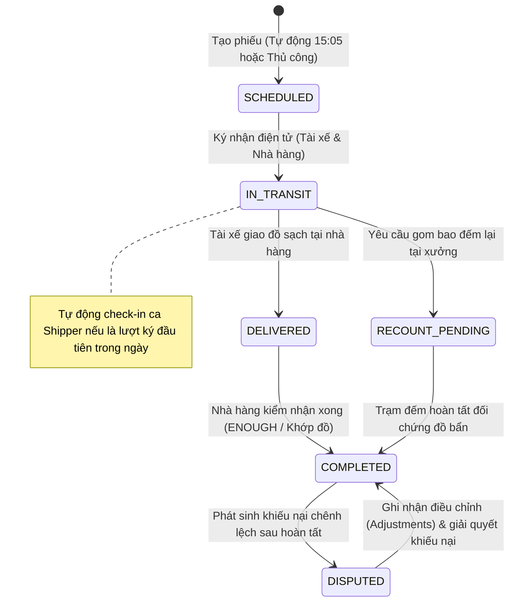

# ĐẶC TẢ YÊU CẦU & THIẾT KẾ HỆ THỐNG BACKEND (SRS & SDD)
## PHÂN HỆ BACKEND API TẬP TRUNG (be-nestjs-thanhxuan)

> **Tài liệu tham chiếu cấp cao:** [SRS_SDD.md (Kiến Trúc Tổng Quan)](file:///d:/PROJECT/Website_Thanh_Xuan_Company/.agents/docs/SRS_SDD.md)  
> **Phiên bản:** 2.2 | **Synced:** 2026-10-10 | **Môi trường:** NestJS 10, Node.js v20+, MongoDB Multi-Database  
> **Phạm vi mã nguồn:** `be-nestjs-thanhxuan/src/**`  
> **Quy chuẩn kỹ thuật:** Clean Architecture, Repository Pattern, Multi-Database Isolation, SOLID, Defensive Programming

---

## 1. YÊU CẦU NGHIỆP VỤ BACKEND (SRS)

### 1.1. Mục Tiêu & Bối Cảnh Phân Hệ Backend
Backend API tập trung phục vụ toàn bộ các kênh tương tác của Công ty Thanh Xuân:
1. **Dịch vụ Giặt Là Công Nghiệp & B2C (`laundry_express`)**: Phục vụ Web Next.js khách hàng, đặt lịch, bài viết SEO, CRM liên hệ và chiến dịch tiếp thị Zalo/Email.
2. **Dịch vụ Chuyển Nhà Trọn Gói (`moving_express`)**: Tiếp nhận khảo sát, tính cước vận tải xe tải theo cự ly Km, quản lý bài viết tư vấn chuyển nhà.
3. **Cổng Vận Hành Xưởng Nội Bộ & Quản Trị Đối Tác B2B (`internal_express`)**: Hệ thống ERP/WMS vận hành xưởng giặt là, điều phối phiếu giao nhận 2 chiều, trạm đếm đồ gom bao, chấm công camera selfie, khoán sản lượng thợ, quản lý đề xuất xăng xe, tính bảng lương chu kỳ và trung tâm báo cáo streaming.

---

### 1.2. Danh Sách Tính Năng Theo Sub-Modules (Functional Requirements)

#### BE-FR-01: Quản Trị Tài Khoản, Xác Thực & RBAC v2 (`/api/v1/internal/auth`, `/api/v1/internal/accounts`)
- **Đăng ký tài khoản công khai:** Chỉ cho phép đăng ký 3 vai trò thực thi: Nhân viên xưởng (`WORKER`), Tài xế giao nhận (`SHIPPER`) và Nhân viên đối tác (`PARTNER_STAFF`). Bắt buộc chặn tự đăng ký Quản lý đối tác (`PARTNER_MANAGER` / `RESTAURANT_MANAGER`) và các vai trò quản lý khác từ cổng công khai.
- **Khởi tạo Quản lý Đối tác:** Tài khoản `PARTNER_MANAGER` chỉ được khởi tạo bởi `ADMIN` hoặc `MANAGER` trong phân hệ Quản lý nhân sự kèm ràng buộc chọn `brand` và `partnerId`.
- **Quản lý nhân sự & Tạm khóa 60 ngày:**
  - Hỗ trợ thêm/sửa nhân sự, tạm khóa (`LOCKED`) và mở khóa (`ACTIVE`).
  - Ghi nhận `lockedAt` khi tạm khóa. Cơ chế dọn dẹp tự động (`cleanupExpiredLockedAccounts`): Tự động xóa vĩnh viễn các tài khoản có `status === 'LOCKED'` đã quá 60 ngày.
  - Xóa tài khoản vĩnh viễn (`DELETE /accounts/:id`): Chỉ dành riêng cho vai trò `ADMIN` (MANAGER không có quyền xóa).
- **Hồ sơ cá nhân & Upload Avatar Cloudinary:**
  - Cập nhật thông tin cá nhân (`PATCH /accounts/me/profile`).
  - Upload avatar (`POST /accounts/me/avatar`) lưu trữ Cloudinary thư mục `internal/avatars`, tự động xóa avatar cũ khi thay mới.
  - Endpoint `GET /auth/me` trả về `avatarUrl` và `lockedAt`.
- **Tự động Seed 8 tài khoản mẫu (`onModuleInit`):**
  - Khởi tạo sẵn các tài khoản: `admin`, `manager`, `warehouse_manager`, `accountant`, `shipper`, `worker`, `partner_manager`, `partner_staff` với mật khẩu chung `ThanhXuan@2026`.
- **Xác thực OTP & Trạng thái tài khoản:** Sinh mã OTP 6 chữ số gửi qua email SMTP/Resend, cooldown 60s, giới hạn 5 lần/giờ (`OtpCodeRepository`). Sau khi xác thực OTP, tài khoản chuyển sang `PENDING_APPROVAL`.
- **Phê duyệt tài khoản (`approval_requests`):**
  - Quản lý đối tác (`PARTNER_MANAGER`): Phê duyệt nhân viên thuộc đúng chi nhánh đối tác của mình (`partnerId`).
  - Quản trị viên/Quản lý (`ADMIN`, `MANAGER`, `WAREHOUSE_MANAGER`): Phê duyệt nhân sự xưởng nội bộ.
- **Đăng nhập & Quản lý phiên:**
  - Cấp cặp Access Token (JWT 15 phút, bắt buộc `aud: 'internal'`, chứa `partnerId` và `brand`) và Refresh Token (7 ngày).
  - Tự động khóa tài khoản tạm thời 15 phút sau 5 lần nhập sai mật khẩu liên tiếp.
  - Xoay vòng Refresh Token Rotation: Mỗi lần refresh sẽ thu hồi token cũ và sinh cặp token mới; phát hiện dùng lại token đã thu hồi sẽ khóa toàn bộ phiên.
  - Phân vùng dữ liệu (Scope Isolation): `PartnerScopeGuard` tự động cô lập truy vấn của tài khoản đối tác theo đúng `partnerId`.
- **Bảo mật tài chính đa tầng (`PayFieldFilterInterceptor`):**
  - Đệ quy duyệt và bóc tách toàn bộ trường tiền/lương (`rate`, `totalEarnings`, `estimatedPrice`, `amount`, `salary`...) khỏi JSON response khi user không có quyền `pay.view` (đặc biệt là Quản lý xưởng `MANAGER` và Quản lý kho `WAREHOUSE_MANAGER`).

#### BE-FR-02: Quản Lý Đối Tác & Danh Mục Bảng Giá (`/api/v1/internal/partners`)
- **Thông tin đối tác:** Quản lý danh sách các chuỗi nhà hàng (Pizza 4P's, Haidilao Hotpot, Golden Gate...), địa chỉ chi nhánh, người liên hệ, tần suất giao nhận (`DAILY`, `ALTERNATE_DAYS`).
- **Lịch giao nhận trong ngày (`/schedule`):** Tự động tính toán các chi nhánh cần giao trong ngày theo múi giờ `Asia/Ho_Chi_Minh` (đối với lịch cách ngày, tính theo chẵn/lẻ số ngày trong năm).
- **Danh mục đồ giặt & Đơn giá khoán (`item_catalogs`):**
  - Quản lý mã đồ giặt theo thương hiệu đối tác (ví dụ `4PS_GRAY_TOWEL`, `4PS_APRON`...).
  - Thiết lập đơn giá khoán thợ (`foldingRateWorker`, `ironingRateWorker`, `packingRateWorker`).
  - Hỗ trợ ảnh chụp mẫu đồ giặt lưu trữ Cloudinary kèm cơ chế xóa ảnh cũ khi cập nhật.

#### BE-FR-03: Phiếu Giao Nhận Kép & Đếm Lại Tại Xưởng (`/api/v1/internal/handover`)
- **Tạo phiếu giao nhận:** Hỗ trợ tạo thủ công từ Shipper hoặc tạo tự động qua Cron lúc 15:05 mỗi ngày theo lịch giao nhận đã cấu hình. Định dạng mã phiếu atomic `GN-YYYYMMDD-NNN`.
- **Cơ chế Khóa lạc quan (Optimistic Locking):** Toàn bộ thao tác cập nhật phiếu yêu cầu truyền trường `version`. Nếu `version` trong DB khác `version` client gửi lên, trả về HTTP `409 Conflict`.
- **2 Chế độ kiểm đếm đồ bẩn:**
  - `ON_SITE`: Tài xế và nhân viên nhà hàng đếm chi tiết từng món tại chỗ.
  - `AT_FACTORY`: Gom bao niêm phong, ghi nhận số lượng bao (`bagsCount`), chuyển về trạm rạch bao tại xưởng đếm lại.
- **Trạm rạch bao đếm lại xưởng (`recount_tasks`):**
  - Thợ kho/quản lý rạch bao, đếm chi tiết số lượng thực tế, chụp ảnh đối chứng hiện trường, tự động tính chênh lệch thừa/thiếu (`variance`).
- **Ký nhận điện tử & Rà soát sửa đổi:**
  - Ký nhận Canvas Base64 PNG (< 280KB) giữa tài xế và đại diện nhà hàng $\rightarrow$ chuyển trạng thái sang `IN_TRANSIT`.
  - Tự động kích hoạt check-in ca làm việc cho Shipper khi ký phiếu giao nhận đầu tiên trong ngày nếu chưa check-in.
  - Sửa đổi trường phiếu sau khi đã ký (`/fields`): Bắt buộc lưu vết `edit_marks`, phát sinh audit log và thông báo rà soát tới Quản lý (`MANAGER`, `ADMIN`).
- **State Machine phiếu giao nhận:** `SCHEDULED` $\rightarrow$ `IN_TRANSIT` $\rightarrow$ `DELIVERED` $\rightarrow$ `COMPLETED` (hoặc `DISPUTED` khi có khiếu nại).

#### BE-FR-04: Chấm Công Camera Selfie & Khoán Sản Lượng (`/api/v1/internal/attendance`, `/piecework`)
- **Chấm công camera selfie:**
  - Bắt buộc tải ảnh chụp trực tiếp từ camera của thợ/nhân viên, lưu trữ trên Cloudinary.
  - Mỗi nhân sự chỉ có duy nhất 1 ca làm việc `OPEN` tại một thời điểm (trùng trả về HTTP `409 Conflict`).
  - Ghi nhận giờ vào/ra chuẩn server theo múi giờ `Asia/Ho_Chi_Minh`, tự động tính số phút làm việc `workedMinutes`.
  - Cron lúc 00:30 mỗi ngày quét các ca làm việc quá 16 giờ chưa check-out để chuyển sang trạng thái cảnh báo `NEEDS_REVIEW`.
- **Ghi nhận sản lượng khoán thợ xưởng:**
  - Chỉ cho phép thợ đang có ca làm việc `OPEN` ghi nhận sản lượng khoán.
  - Mỗi request gửi đúng 1 dòng `{ itemCode, quantity }`. Hỗ trợ số âm để bù trừ/sửa sai.
  - Đơn giá được snapshot tự động (`rateSnapshot`) từ `ItemCatalog` tại thời điểm thợ ghi nhận (chống gian lận đơn giá client).
  - Quản lý xưởng xác nhận chốt sản lượng cuối ngày (`CONFIRMED`).

#### BE-FR-05: Quản Lý Hoàn Tiền Xăng Xe (`/api/v1/internal/fuel`)
- Shipper nộp đề xuất hoàn tiền xăng: Bắt buộc đính kèm ảnh hóa đơn cây xăng và ảnh đồng hồ công-tơ-mét / vạch xăng xe.
- Trạng thái đề xuất: `PENDING` $\rightarrow$ `APPROVED` hoặc `REJECTED` (kèm lý do).
- Phân quyền nghiêm ngặt: Chỉ Kế toán (`ACCOUNTANT`) và Quản trị viên (`ADMIN`) có quyền duyệt và xem số tiền xăng. Quản lý xưởng (`MANAGER`) bị chặn xem số tiền.

#### BE-FR-06: Quản Lý Bảng Lương & Bảo Mật Phiếu Lương (`/api/v1/internal/payroll`)
- **Cấu hình lương (`pay_settings`):** 4 cơ chế tính (`HOURLY`, `PIECEWORK`, `HYBRID`, `MONTHLY_FIXED`), thiết lập hệ số tăng ca, chủ nhật, ngày lễ.
- **Tính toán bảng lương chu kỳ:** Tổng hợp tự động từ giờ công chấm công đã duyệt, tổng thu nhập khoán sản lượng, các khoản hoàn tiền xăng đã duyệt, thưởng/phụ cấp/khấu trừ. Làm tròn số nguyên tiền Việt Nam Đồng (`roundVnd`).
- **Vòng đời kỳ lương:** `OPEN` $\rightarrow$ `CALCULATING` $\rightarrow$ `LOCKED` (đóng băng dữ liệu nguồn chấm công, khoán, xăng) $\rightarrow$ `PAID`. Chỉ `ADMIN` mới có quyền mở khóa kỳ lương kèm lý do audit log.
- **Bảo mật phiếu lương cá nhân (`payslips`):** Nhân viên chỉ được xem phiếu lương của chính mình và chỉ khi kỳ lương đã ở trạng thái `LOCKED` hoặc `PAID`. Tuyệt đối chặn truy cập chéo giữa các nhân sự.

#### BE-FR-07: Báo Cáo Phân Tích & Streaming Export (`/api/v1/internal/reports`)
- 6 Báo cáo Aggregation chuyên sâu:
  1. `warehouse-summary`: Tổng hợp xuất nhập tồn kho.
  2. `partner-reconciliation`: Bảng kê đối soát giao nhận với chuỗi nhà hàng.
  3. `attendance-summary`: Báo cáo chấm công & công thợ (ẩn toàn bộ tiền lương với Quản lý xưởng).
  4. `shipper-deliveries`: Thống kê lịch trình và lượt giao của đội xe.
  5. `variance-incidents`: Báo cáo chênh lệch số lượng đếm lại, đồ rách hỏng và sửa đổi sau ký.
  6. `fuel-summary`: Báo cáo tiêu hao và chi phí xăng xe toàn đội.
- Giới hạn khoảng thời gian truy vấn tối đa 31 ngày.
- Streaming Export bảo vệ VPS (< 512MB RAM): Xuất file Excel XLSX bằng `exceljs` ghi dòng stream và PDF bằng `pdfmake`. Hàng đợi concurrency = 1 chống tràn RAM.

#### BE-FR-08: Dịch Vụ Khảo Sát Báo Giá Chuyển Nhà (`/api/v1/moving`)
- Tiếp nhận yêu cầu khảo sát chuyển nhà trọn gói, địa chỉ đi/đến, tầng lầu, thang máy, danh mục đồ đạc cồng kềnh và ảnh hiện trường.
- Bảng cước vận tải xe tải 1.25 tấn - 2.4 tấn và tự động ước tính cước sơ bộ (`estimatedPrice`).

---

## 2. THIẾT KẾ KIẾN TRÚC BACKEND (SDD)

### 2.1. Cấu Trúc Thư Mục & Tổ Chức Mã Nguồn

```Markdown
be-nestjs-thanhxuan/src/
├── app.module.ts                         # Đăng ký 3 Mongoose Connections & RouterModule
├── common/                               # Hạ tầng dùng chung toàn Backend
│   ├── base/base.repository.ts          # Generic BaseRepository<T> triển khai CRUD chuẩn
│   ├── guards/                          # InternalJwtGuard, InternalRolesGuard, Throttler
│   ├── interceptors/                    # PayFieldFilterInterceptor, LoggingInterceptor
│   ├── pipes/                           # ParseObjectIdPipe, CustomValidationPipe
│   └── utils/time.util.ts               # startOfDayVN, endOfDayVN, getDatePrefixVN (Asia/Ho_Chi_Minh)
├── config/                              # app.config, database.config, jwt.config
├── mail/                                # MailService gửi email OTP & thông báo (Nodemailer/Resend)
└── modules/
    ├── core/                            # Upload (Cloudinary/Local), AI (Gemini), Audit, Idempotency
    ├── laundry/                         # 12 modules Giặt Là Website & CMS (DB: laundry_express)
    ├── moving/                          # Quotes, Services, Articles (DB: moving_express)
    └── internal/                        # Vận Hành Nội Bộ & Quản Trị Đối Tác (DB: internal_express)
        ├── auth/                        # dto/, schemas/, repositories/, specs/, controllers/, strategies/
        ├── partners/                    # dto/, schemas/, repositories/, specs/
        ├── handovers/                   # dto/, schemas/, repositories/, specs/, controllers/
        ├── piecework/                   # dto/, schemas/, repositories/, specs/
        ├── attendance/                  # dto/, schemas/, repositories/, specs/
        ├── fuel/                        # dto/, schemas/, repositories/, specs/
        ├── payroll/                     # dto/, schemas/, repositories/, specs/
        └── reports/                     # dto/, services/, specs/
```

---

### 2.2. Kiến Trúc Cô Lập 3 Cơ Sở Dữ Liệu MongoDB (Multi-Database)



- **Mongoose Multi-Database Isolation:**
  - `laundry_express` (Default Connection): Phục vụ các API truyền thống của web giặt sấy (`/articles`, `/orders`, `/contacts`...).
  - `moving_express` (`MOVING_CONNECTION`): Cô lập hoàn toàn dữ liệu dịch vụ chuyển nhà (`moving_quotes`, `moving_services`, `moving_articles`).
  - `internal_express` (`INTERNAL_CONNECTION`): Toàn bộ dữ liệu nhạy cảm vận hành xưởng, đối tác nhà hàng, nhân sự và bảng lương.

---

### 2.3. Quy Chuẩn Repository Pattern

Mọi truy vấn Mongoose bắt buộc đi qua tầng **Repository** kế thừa `BaseRepository<TDocument>`. Tầng **Service** tuyệt đối không inject trực tiếp Mongoose `@InjectModel`.

```typescript
// Định dạng chuẩn một Repository kế thừa BaseRepository
@Injectable()
export class HandoverRecordRepository extends BaseRepository<HandoverRecordDocument> {
  constructor(
    @InjectModel(HandoverRecord.name, INTERNAL_CONNECTION)
    model: Model<HandoverRecordDocument>,
  ) {
    super(model);
  }

  async findByCode(recordCode: string): Promise<HandoverRecordDocument | null> {
    return this.model.findOne({ recordCode }).lean();
  }
}
```

*Danh sách Repositories cốt lõi trong `internal_express`:*
1. `StaffAccountRepository`
2. `OtpCodeRepository`
3. `RefreshTokenRepository`
4. `ApprovalRequestRepository`
5. `PartnerRepository`
6. `ItemCatalogRepository`
7. `HandoverRecordRepository`
8. `RecountTaskRepository`
9. `PieceworkLogRepository`
10. `AttendanceRecordRepository`
11. `FuelLogRepository`
12. `PaySettingsRepository`
13. `PayrollPeriodRepository`
14. `PayslipRepository`
15. `AuditLogRepository`
16. `NotificationRepository`
17. `CounterRepository` *(Atomic Sequence Generator, dùng `findByIdAndUpdate` với `$inc`)*.

---

### 2.4. Danh Sách API Contracts Chi Tiết

#### A. Nhóm API Xác Thực & Phân Quyền (`/api/v1/internal/auth`)

| Phương thức | Tuyến API | Guard / Xác thực | Vai trò cho phép | Ghi chú & Ràng buộc |
| :--- | :--- | :--- | :--- | :--- |
| `POST` | `/api/v1/internal/auth/login` | Public | Mọi người dùng | Cấp Access Token (`aud: 'internal'`, 12h) + Refresh Token (7d). Khóa 15p nếu sai 5 lần. |
| `POST` | `/api/v1/internal/auth/register` | Public | WORKER, SHIPPER, RESTAURANT_STAFF | Đăng ký tài khoản (bắt buộc `partnerId` cho nhân viên nhà hàng). Gửi OTP email. |
| `POST` | `/api/v1/internal/auth/verify-otp` | Public | Khách vừa đăng ký | Xác thực OTP 6 số. Đổi trạng thái sang `PENDING_APPROVAL`. |
| `POST` | `/api/v1/internal/auth/resend-otp` | Public | Khách vừa đăng ký | Gửi lại OTP (cooldown 60s, tối đa 5 lần/giờ). |
| `POST` | `/api/v1/internal/auth/refresh` | Public | Mọi người dùng | Xoay vòng Refresh Token Rotation. |
| `POST` | `/api/v1/internal/auth/logout` | `InternalJwtGuard` | Mọi người dùng | Thu hồi Refresh Token phiên hiện tại. |
| `POST` | `/api/v1/internal/auth/forgot-password` | Public | Mọi người dùng | Gửi OTP 6 số qua email để đặt lại mật khẩu. |
| `POST` | `/api/v1/internal/auth/reset-password` | Public | Mọi người dùng | Đặt lại mật khẩu mới bằng OTP xác thực. |
| `POST` | `/api/v1/internal/auth/change-password` | `InternalJwtGuard` | Mọi người dùng | Đổi mật khẩu trong phiên đăng nhập. |
| `GET` | `/api/v1/internal/auth/me` | `InternalJwtGuard` | Mọi người dùng | Lấy thông tin cá nhân và quyền hạn từ token. |
| `GET` | `/api/v1/internal/auth/approvals` | `InternalJwtGuard` + `InternalRolesGuard` | ADMIN, MANAGER, RESTAURANT_MANAGER | Xem danh sách chờ duyệt (RM chỉ xem nhân viên chi nhánh mình). |
| `PATCH` | `/api/v1/internal/auth/approvals/:id` | `InternalJwtGuard` + `InternalRolesGuard` | ADMIN, MANAGER, RESTAURANT_MANAGER | Phê duyệt hoặc từ chối tài khoản. |
| `GET` | `/api/v1/internal/auth/staffs` | `InternalJwtGuard` + `InternalRolesGuard` | ADMIN, MANAGER | Danh sách toàn bộ nhân sự xưởng. |
| `POST` | `/api/v1/internal/auth/staffs` | `InternalJwtGuard` + `InternalRolesGuard` | ADMIN | Admin chủ động tạo tài khoản nhân sự. |
| `PATCH` | `/api/v1/internal/auth/staffs/:id/lock` | `InternalJwtGuard` + `InternalRolesGuard` | ADMIN | Khóa hoặc mở khóa thủ công tài khoản. |

#### B. Nhóm API Đối Tác & Danh Mục (`/api/v1/internal/partners`)

| Phương thức | Tuyến API | Guard / Xác thực | Vai trò cho phép | Ghi chú & Ràng buộc |
| :--- | :--- | :--- | :--- | :--- |
| `GET` | `/api/v1/internal/partners` | `InternalJwtGuard` | Mọi người dùng | Danh sách nhà hàng đối tác đang hoạt động. |
| `GET` | `/api/v1/internal/partners/schedule` | `InternalJwtGuard` | Mọi người dùng | Lịch giao nhận trong ngày (DAILY / ALTERNATE_DAYS theo ngày VN). |
| `POST`, `PATCH`, `DELETE` | `/api/v1/internal/partners` | `InternalJwtGuard` + `InternalRolesGuard` | ADMIN, MANAGER | Quản lý thông tin đối tác và chi nhánh. |
| `GET` | `/api/v1/internal/partners/catalogs` | `InternalJwtGuard` | Mọi người dùng (Bao gồm PARTNER_MANAGER, PARTNER_STAFF với quyền `CATALOG_PRICE_CUSTOMER_VIEW`) | Danh mục đồ giặt, hỗ trợ lọc theo `brand`. |
| `POST`, `PATCH`, `DELETE` | `/api/v1/internal/partners/catalogs` | `InternalJwtGuard` + `InternalRolesGuard` | ADMIN | Quản trị mã đồ giặt, đơn giá khoán thợ và ảnh Cloudinary. |

#### C. Nhóm API Phiếu Giao Nhận Kép (`/api/v1/internal/handover`)

| Phương thức | Tuyến API | Guard / Xác thực | Vai trò cho phép | Ghi chú & Ràng buộc |
| :--- | :--- | :--- | :--- | :--- |
| `POST` | `/api/v1/internal/handover` | `InternalJwtGuard` + `InternalRolesGuard` | SHIPPER, ADMIN, MANAGER | Tạo phiếu giao nhận mới (`GN-YYYYMMDD-NNN`, `SCHEDULED`). |
| `GET` | `/api/v1/internal/handover` | `InternalJwtGuard` | Phân quyền theo vai trò | SHIPPER chỉ xem của mình; RM/RS chỉ xem chi nhánh mình; ADMIN/MG xem toàn bộ. |
| `GET` | `/api/v1/internal/handover/:recordCode` | `InternalJwtGuard` | Phân quyền theo vai trò | Xem chi tiết phiếu giao nhận theo mã. |
| `GET` | `/api/v1/internal/handover/monthly` | `InternalJwtGuard` + `InternalRolesGuard` | RESTAURANT_MANAGER, RESTAURANT_STAFF, ADMIN | Bảng kê giao nhận theo tháng cho nhà hàng (bảo mật ẩn hoàn toàn đơn giá). |
| `POST` | `/api/v1/internal/handover/prep-order` | `InternalJwtGuard` + `InternalRolesGuard` | WAREHOUSE_MANAGER, ADMIN, MANAGER | Soạn đồ sạch cho ngày mai: lưu 3 loại số lượng (*Đã giao*, *Chưa giao*, *Giao trả*), ghi chú từng dòng và chữ ký điện tử. |
| `POST` | `/api/v1/internal/handover/partner-count` | `InternalJwtGuard` + `InternalRolesGuard` | RESTAURANT_MANAGER, RESTAURANT_STAFF, PARTNER_MANAGER, PARTNER_STAFF | Đếm đồ bẩn đối tác gửi về xưởng: lưu số lượng chưa giặt, chữ ký và họ tên người đếm. |
| `POST` | `/api/v1/internal/handover/auto-schedule` | `InternalJwtGuard` + `InternalRolesGuard` | WAREHOUSE_MANAGER, ADMIN, MANAGER | Tự động sinh phiếu giao nhận theo lịch định kỳ (`DAILY`, `ALTERNATE_DAYS`), prefill số lượng đồ bẩn hôm trước. |
| `GET` | `/api/v1/internal/handover/previous-dirty` | `InternalJwtGuard` | Mọi vai trò nội bộ | Lấy số lượng đồ bẩn đã nhận hôm trước của đối tác để điền sẵn vào phiếu soạn đồ. |
| `POST` | `/api/v1/internal/handover/clean-planned` | `InternalJwtGuard` + `InternalRolesGuard` | WAREHOUSE_MANAGER, ADMIN, MANAGER | Thủ kho lên kế hoạch soạn đồ sạch tại kho. |
| `PATCH` | `/api/v1/internal/handover/:id/clean-delivery` | `InternalJwtGuard` + `InternalRolesGuard` | SHIPPER, ADMIN, MANAGER | Cập nhật số lượng đồ sạch bàn giao. |
| `PATCH` | `/api/v1/internal/handover/:id/dirty-pickup` | `InternalJwtGuard` + `InternalRolesGuard` | SHIPPER, ADMIN, MANAGER, RESTAURANT_STAFF | Cập nhật số lượng đồ bẩn thu gom (`ON_SITE` hoặc `AT_FACTORY`). |
| `PATCH` | `/api/v1/internal/handover/:id/sign` | `InternalJwtGuard` + `InternalRolesGuard` | SHIPPER, ADMIN, MANAGER | Ký nhận điện tử Base64 PNG. Tự động kích hoạt check-in ca làm việc nếu là phiếu đầu tiên của Shipper. Chuyển sang `IN_TRANSIT`. |
| `PATCH` | `/api/v1/internal/handover/:id/deliver` | `InternalJwtGuard` + `InternalRolesGuard` | SHIPPER, ADMIN | Tài xế xác nhận giao đồ sạch đến nhà hàng. |
| `PATCH` | `/api/v1/internal/handover/:id/receipt-check` | `InternalJwtGuard` + `InternalRolesGuard` | RESTAURANT_MANAGER, RESTAURANT_STAFF | Nhà hàng kiểm nhận đồ sạch (`ENOUGH`, `SHORT`, `EXCESS`). |
| `POST` | `/api/v1/internal/handover/:id/request-recount` | `InternalJwtGuard` + `InternalRolesGuard` | SHIPPER, RESTAURANT_MANAGER, ADMIN | Yêu cầu rạch bao đếm lại tại xưởng (`recount_tasks`). |
| `PATCH` | `/api/v1/internal/handover/:id/complete-recount`| `InternalJwtGuard` + `InternalRolesGuard` | WAREHOUSE_MANAGER, ADMIN | Hoàn tất đếm lại xưởng kèm ảnh chụp đối chứng. |
| `PATCH` | `/api/v1/internal/handover/:id/fields` | `InternalJwtGuard` + `InternalRolesGuard` | SHIPPER, ADMIN | Sửa đổi sau ký $\rightarrow$ sinh `edit_marks`, audit log, gửi notification. |
| `PATCH` | `/api/v1/internal/handover/:id/review-edits` | `InternalJwtGuard` + `InternalRolesGuard` | MANAGER, ADMIN | Quản lý xác nhận đã rà soát các trường sửa đổi sau ký. |
| `POST` | `/api/v1/internal/handover/:id/adjustments` | `InternalJwtGuard` + `InternalRolesGuard` | ADMIN, MANAGER, ACCOUNTANT | Điều chỉnh số liệu sau khi phiếu đã hoàn tất do khiếu nại. |

#### D. Nhóm API Chấm Công, Khoán Sản Lượng, Xăng Xe, Lương & Báo Cáo

| Tuyến API | Phương thức | Guard / Quyền | Mục đích & Ràng buộc |
| :--- | :--- | :--- | :--- |
| `/api/v1/internal/attendance/check-in` | `POST` | `InternalJwtGuard` (Worker/Shipper) | Bắt buộc ảnh selfie camera, chặn trùng 1 ca/người (409 Conflict). |
| `/api/v1/internal/attendance/check-out` | `POST` | `InternalJwtGuard` | Chốt ca kèm ảnh selfie, tính `workedMinutes`. |
| `/api/v1/internal/attendance/today` | `GET` | `InternalJwtGuard` | Lấy trạng thái ca làm việc hiện tại của nhân sự. |
| `/api/v1/internal/piecework/me/tasks` | `POST` | `InternalJwtGuard` (Worker) | Ghi nhận sản lượng khoán (snapshot đơn giá, hỗ trợ số âm sửa sai). |
| `/api/v1/internal/piecework/:id/confirm` | `PATCH` | ADMIN, MANAGER | Quản lý xưởng xác nhận chốt sản lượng (`CONFIRMED`). |
| `/api/v1/internal/fuel` | `POST` | `InternalJwtGuard` (Shipper) | Nộp đề xuất xăng (ảnh hóa đơn + ảnh vạch xăng). |
| `/api/v1/internal/fuel/:id/approve` | `PATCH` | ACCOUNTANT, ADMIN | Kế toán/Admin duyệt đề xuất hoàn tiền xăng. |
| `/api/v1/internal/payroll/periods/calculate` | `POST` | ACCOUNTANT, ADMIN | Tính toán bảng lương chu kỳ tháng. |
| `/api/v1/internal/payroll/periods/:id/lock` | `PATCH` | ACCOUNTANT, ADMIN | Khóa kỳ lương (`LOCKED`), đóng băng dữ liệu nguồn. |
| `/api/v1/internal/payroll/me/payslips` | `GET` | `InternalJwtGuard` | Nhân sự tra cứu phiếu lương cá nhân (chỉ kỳ LOCKED/PAID). |
| `/api/v1/internal/reports/*` | `GET` | AC, MG, AD, WM | 6 Báo cáo Aggregation tổng hợp (≤ 31 ngày). Bóc tách trường tiền đối với MG. |
| `/api/v1/internal/reports/export/excel` | `GET` | AC, MG, AD, WM | Streaming file XLSX bằng `exceljs`, hàng đợi concurrency = 1. |
| `/api/v1/internal/reports/export/pdf` | `GET` | AC, MG, AD, WM | Streaming file PDF bằng `pdfmake`, hàng đợi concurrency = 1. |

---

## 3. STATE MACHINES & BUSINESS LOGIC

### 3.1. Vòng Đời Phiếu Giao Nhận Kép (`HandoverRecord`)



---

## 4. QUY CHUẨN XỬ LÝ LỖI, TIMEZONE & BẢO MẬT

1. **Chuẩn hóa Timezone:** Toàn bộ ngày giờ chốt ca, chu kỳ lương, tiền tố mã phiếu (`GN-YYYYMMDD-NNN`) và báo cáo tổng hợp phải chuẩn hóa theo múi giờ `Asia/Ho_Chi_Minh` (GMT+7) qua helper `time.util.ts`. Tuyệt đối không dùng `setHours(0,0,0,0)` theo local của máy chủ VPS.
2. **Defensive Programming:** Luôn dùng Optional Chaining `?.`, ném NestJS Built-in Exceptions (`BadRequestException`, `UnauthorizedException`, `ForbiddenException`, `NotFoundException`, `ConflictException`).
3. **Audit Log Tự Động:** Mọi thao tác phê duyệt tài khoản, sửa phiếu sau ký, điều chỉnh chấm công, khóa/mở khóa kỳ lương đều ghi nhận bản ghi `AuditLog` lưu trữ tại `internal_express`.
