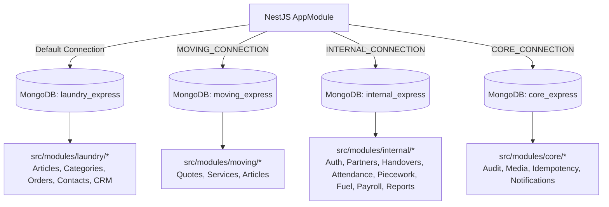
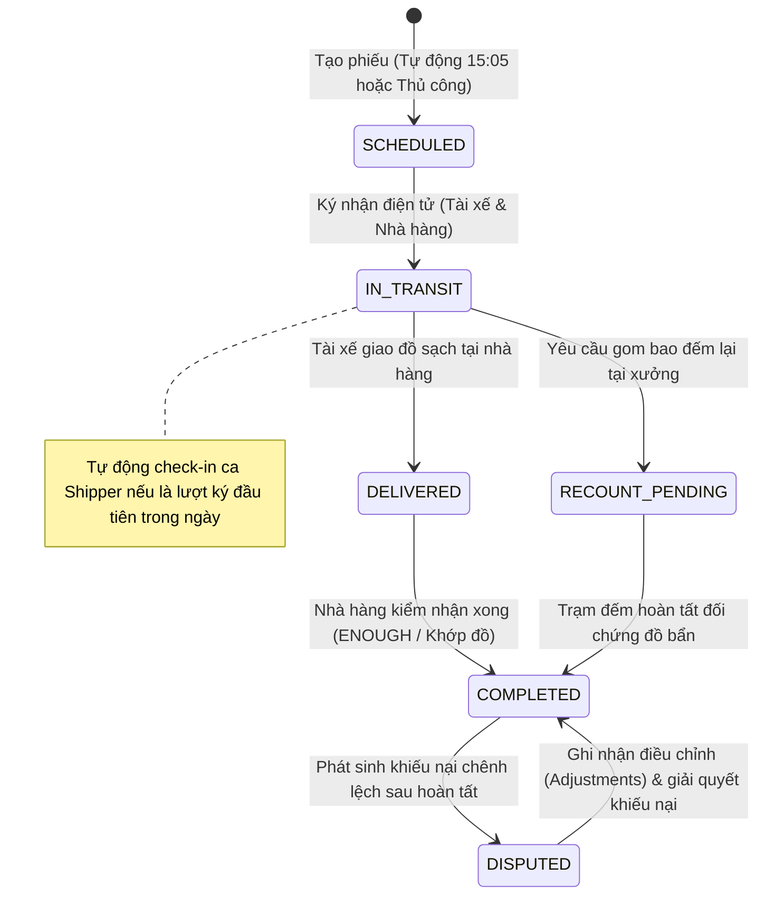
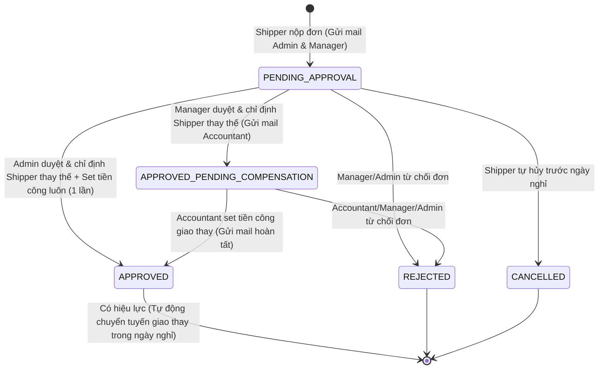

# ĐẶC TẢ YÊU CẦU & THIẾT KẾ HỆ THỐNG BACKEND (SRS & SDD)
## PHÂN HỆ BACKEND API TẬP TRUNG (be-nestjs-thanhxuan)

> **Phiên bản:** 2.5 | **Synced:** 2026-10-28 | **Môi trường:** NestJS 10, Node.js v20+, MongoDB Multi-Database  
> **Phạm vi mã nguồn:** `be-nestjs-thanhxuan/src/**`  
> **Quy chuẩn kỹ thuật:** Clean Architecture, Repository Pattern, Multi-Database Isolation, SOLID, Defensive Programming

---

## 1. YÊU CẦU NGHIỆP VỤ BACKEND (SRS)

### 1.1. Mục Tiêu & Bối Cảnh Phân Hệ Backend
Backend API tập trung phục vụ toàn bộ các kênh tương tác của Công ty Thanh Xuân:
1. **Dịch vụ Giặt Là Công Nghiệp & B2C (`laundry_express`)**: Phục vụ Web Next.js khách hàng, đặt lịch, bài viết SEO, CRM liên hệ và chiến dịch tiếp thị Zalo/Email.
2. **Dịch vụ Chuyển Nhà Trọn Gói (`moving_express`)**: Tiếp nhận khảo sát, tính cước vận tải xe tải theo cự ly Km, quản lý bài viết tư vấn chuyển nhà.
3. **Cổng Vận Hành Xưởng Nội Bộ & Quản Trị Đối Tác B2B (`internal_express`)**: Hệ thống ERP/WMS vận hành xưởng giặt là, điều phối phiếu giao nhận 2 chiều theo quy trình 5 bước, trạm rạch bao đếm lại xưởng, chấm công camera selfie, ghi nhận công thợ theo giờ nhân hệ số, quản lý chi phí xe shipper (xăng & sửa xe), tính bảng lương chu kỳ và trung tâm báo cáo streaming.

---

### 1.2. Danh Sách Tính Năng Theo Sub-Modules (Functional Requirements)

#### BE-FR-01: Quản Trị Tài Khoản, Xác Thực & RBAC v2 (`/api/v1/internal/auth`, `/api/v1/internal/accounts`)
- **Đăng ký tài khoản công khai:** Chỉ cho phép đăng ký 3 vai trò thực thi: Nhân viên xưởng (`WORKER`), Tài xế giao nhận (`SHIPPER`) và Nhân viên đối tác (`PARTNER_STAFF`). Bắt buộc chặn tự đăng ký Quản lý đối tác (`PARTNER_MANAGER` / `RESTAURANT_MANAGER`) và các vai trò quản lý khác từ cổng công khai.
- **Khởi tạo Quản lý Đối tác:** Tài khoản `PARTNER_MANAGER` chỉ được khởi tạo bởi `ADMIN` hoặc `MANAGER` trong phân hệ Quản lý nhân sự kèm ràng buộc chọn `brand` và `partnerId`.
- **Quản lý nhân sự & Tạm khóa 60 ngày:**
  - Hỗ trợ thêm/sửa nhân sự, tạm khóa (`LOCKED`) và mở khóa (`ACTIVE`).
  - Single Source of Truth cho phân quyền vai trò là duy nhất trường `role: StaffRole` (đã loại bỏ hoàn toàn mảng `roles: string[]` trùng lặp).
  - Cấu hình lương `pay_profile` chỉ khởi tạo khi tài khoản thợ xưởng hoặc tài xế được thiết lập lương thực tế, không sinh object rỗng mặc định cho các tài khoản quản lý hay đối tác.
  - Ghi nhận `lockedAt` khi tạm khóa. Cơ chế dọn dẹp tự động (`cleanupExpiredLockedAccounts`): Tự động xóa vĩnh viễn các tài khoản có `status === 'LOCKED'` đã quá 60 ngày.
  - Xóa tài khoản vĩnh viễn (`DELETE /accounts/:id`): Chỉ dành riêng cho vai trò `ADMIN` (MANAGER không có quyền xóa).
- **Hồ sơ cá nhân & Upload Avatar Cloudinary:**
  - Cập nhật thông tin cá nhân (`PATCH /accounts/me/profile`).
  - Upload avatar (`POST /accounts/me/avatar`) lưu trữ Cloudinary thư mục `internal/avatars`, tự động xóa avatar cũ khi thay mới.
  - Endpoint `GET /auth/me` trả về `avatarUrl` và `lockedAt`.
  - Endpoint `GET /accounts/shippers-list` (Admin/Manager): Danh sách tài xế xe tải (Shipper) đang hoạt động (`status = ACTIVE`) phục vụ gán tuyến cố định.
- **Tự động Seed 8 tài khoản mẫu (`onModuleInit`):**
  - Khởi tạo sẵn các tài khoản: `admin`, `manager`, `warehouse_manager`, `accountant`, `shipper`, `worker`, `partner_manager`, `partner_staff` với mật khẩu chung `ThanhXuan@2026`.
- **Xác thực OTP & Trạng thái tài khoản:** Sinh mã OTP 6 chữ số gửi qua email SMTP/Resend, cooldown 60s, giới hạn 5 lần/giờ (`OtpCodeRepository`). Sau khi xác thực OTP, tài khoản chuyển sang `PENDING_APPROVAL`.
- **Phê duyệt tài khoản (`approval_requests`):**
  - Quản lý đối tác (`PARTNER_MANAGER`): Phê duyệt nhân viên thuộc đúng chi nhánh đối tác của mình (`partnerId`).
  - Quản trị viên/Quản lý (`ADMIN`, `MANAGER`, `WAREHOUSE_MANAGER`): Phê duyệt nhân sự xưởng nội bộ.
- **Đăng nhập & Quản lý phiên:**
  - Cấp cặp Access Token (JWT 15 phút, bắt buộc `aud: 'internal'`, chứa `partnerId` và `brand`) và Refresh Token (7 ngày).
  - Tự động khóa tài khoản tạm thời 15 phút sau 5 lần nhập sai mật khẩu liên tiếp.
  - Xoay vòng Refresh Token Rotation: Mỗi lần refresh sẽ thu hồi token cũ và sinh cặp token mới; phát hiện dùng lại token đã thu hồi sẽ khóa toàn bộ phiên.
  - Phân vùng dữ liệu (Scope Isolation): `PartnerScopeGuard` tự động cô lập truy vấn của tài khoản đối tác theo đúng `partnerId`.
- **Bảo mật tài chính đa tầng (`PayFieldFilterInterceptor`):**
  - Đệ quy duyệt và bóc tách toàn bộ trường tiền/lương (`rate`, `totalEarnings`, `estimatedPrice`, `amount`, `salary`, `priceToCustomer`...) khỏi JSON response khi user không có quyền `pay.view` (đặc biệt là Quản lý xưởng `MANAGER` và Quản lý kho `WAREHOUSE_MANAGER`).

#### BE-FR-02: Quản Lý Đối Tác & Danh Mục Bảng Giá (`/api/v1/internal/partners`)
- **Thông tin đối tác:** Quản lý danh sách các chuỗi đối tác (Pizza 4P's, Haidilao Hotpot, Golden Gate...), địa chỉ chi nhánh, người liên hệ, tần suất giao nhận (`DAILY`, `ALTERNATE_DAYS`), ca giao nhận mặc định (`deliveryShift`: `MORNING` / `AFTERNOON` / `EVENING`).
- **Phân công tài xế cố định (`defaultShipperId`):** Cho phép Admin và Manager chỉ định một tài xế xe tải (Shipper) cố định phụ trách tuyến giao nhận cho chi nhánh đối tác. Chi nhánh có tài xế cố định sẽ tính theo chế độ lương cố định + phụ cấp theo tháng (không tính tiền chuyến riêng). Nếu để trống (`null`), chi nhánh được xếp vào diện Tuyến Tự Do và phiếu giao nhận sẽ xuất hiện tại Chợ Chuyến (Job Pool) cho các tài xế tự bấm nhận theo chuyến.
- **Mã viết tắt đối tác (`shortCode`):** Bắt buộc thiết lập khi tạo và sửa chi nhánh đối tác (ví dụ: `TT` cho Tràng Tiền, `TDH` cho Trần Duy Hưng). Lưu trữ uppercase, index unique để làm tiền tố sinh mã phiếu giao nhận.
- **Lịch giao nhận trong ngày (`/schedule`):** Tự động tính toán các chi nhánh cần giao trong ngày theo múi giờ `Asia/Ho_Chi_Minh` (đối với lịch cách ngày, tính theo chẵn/lẻ số ngày trong năm). Hỗ trợ lọc theo `shipperId`: Khi vai trò gọi là `SHIPPER`, chỉ trả về danh sách đối tác mà tài xế này phụ trách cố định (`defaultShipperId = user.sub`), loại bỏ hoàn toàn các tuyến tự do khỏi lộ trình mặc định để đảm bảo chuyến tự do phải được nhận riêng cho từng ngày.
- **Danh mục đồ giặt & Đơn giá dịch vụ (`item_catalogs`):**
  - Quản lý chuẩn hóa đúng **8 trường cốt lõi** (`itemCode`, `brand`, `name`, `unit`, `priceToCustomer`, `sortOrder`, `imageUrl`, `isActive`).
  - `priceToCustomer`: Đơn giá dịch vụ thu đối tác phục vụ báo cáo doanh thu & đối soát công nợ (bảo mật qua interceptor chỉ Admin/Kế toán thấy).
  - `sortOrder`: Thứ tự sắp xếp hiển thị cố định trên bảng đếm đồ và phiếu in A4.
  - Hỗ trợ ảnh chụp mẫu đồ giặt lưu trữ Cloudinary kèm cơ chế xóa ảnh cũ khi cập nhật.
  - Loại bỏ hoàn toàn mô hình khoán thợ đơn chiếc cũ do công ty đã chuyển sang tính công thợ theo thời gian $\times$ hệ số loại việc (`hourly_work`).

#### BE-FR-03: Phiếu Giao Nhận Kép & Quy Trình 5 Bước Vận Hành (`/api/v1/internal/handover`)
- **Tự sinh mã phiếu chuẩn hóa:** Sinh mã định dạng `GN-XXX-DDMMYYYY` (với `XXX` là `shortCode` của partner viết hoa, `DDMMYYYY` theo ngày giao nhận giờ Việt Nam UTC+7). Nếu trùng phiếu trong ngày, cơ chế retry loop tự động thêm hậu tố phân biệt `-1`, `-2`.
- **Chuẩn hóa ngày giao nhận & múi giờ:** Lưu `recordDate` (chuỗi ngày `YYYY-MM-DD` theo múi giờ `Asia/Ho_Chi_Minh`), mặc định ngày mai khi thủ kho soạn đồ buổi tối (17h-21h) hoặc tự động tính ngày mai khi đối tác đếm đồ bẩn trong khung giờ 21h-23h59 (`getTargetRecordDateVN`). Chặn chọn ngày đã qua.
- **Quy trình vận hành 5 bước & Cập nhật nguyên tử chống xung đột:**
  1. *Bước 1 (Thủ kho soạn hàng 17h-21h):* Nhập `cleanClothes.items`, ký tên thủ kho `signatures.warehouseManager` (lưu chữ ký duy nhất 1 nơi, triệt tiêu lặp Base64), sinh ảnh phiếu WebP lưu trữ Cloudinary (`slipImageUrl`). Cron Job tự động chạy lúc 12:00 trưa mỗi ngày sinh phiếu tự động theo `deliveryFrequency`. Bản ghi siêu tinh gọn không sinh các object/mảng rỗng mặc định.
  2. *Bước 2 (Đối tác đếm đồ bẩn 21h-23h59):* Auto-save onblur từng dòng đồ bẩn qua endpoint nguyên tử `PATCH /handover/:id/dirty-item-onblur` dùng toán tử `$set` của MongoDB (ngăn chặn Race Condition), ký nhận qua `PATCH /handover/:id/partner-count-signature`.
  3. *Bước 3 (Shipper nhận & bàn giao):* Shipper kiểm đếm, xác nhận qua `PATCH /handover/:id/shipper-confirm`. Hỗ trợ kích hoạt đếm lại `recount: { isRecount: true, status: 'PENDING' }` nếu đối tác chưa đếm hoặc nghi ngờ sai lệch.
  4. *Bước 4 (Trạm rạch bao đếm lại xưởng):* Lọc các phiếu có `recount.isRecount === true` hoặc đồ bẩn trống số, thợ xưởng cập nhật số thực tế qua `PATCH /handover/:id/recount-actual`.
  5. *Bước 5 (Đối tác kiểm nhận đồ sạch):* Đối tác kiểm nhận số lượng đồ sạch đã nhận, ký xác nhận qua `PATCH /handover/:id/partner-check-signature`, chuyển trạng thái phiếu sang hoàn thành dựa trên chữ ký thực tế.
- **Thư viện ảnh phiếu (`GET /handover/slip-gallery`):** Cho phép xem ảnh phiếu giao nhận theo ngày, thương hiệu, chi nhánh và khoảng thời gian.
- **Chợ Chuyến (Job Pool) & Nhận Chuyến Nguyên Tử (Atomic Claim):**
  - Danh sách chuyến tự do (`GET /handover/pool`): Liệt kê các phiếu giao nhận chưa có tài xế phụ trách (`shipperId = null`) hoặc thuộc chi nhánh tuyến tự do (`partner.defaultShipperId = null`).
  - Nhận chuyến nguyên tử (`POST /handover/:id/claim`): Áp dụng truy vấn atomic `findOneAndUpdate({ _id: id, shipperId: null }, { $set: { shipperId: user.sub, claimedAt, claimedBy } })` của MongoDB để loại bỏ hoàn toàn Race Condition khi 2 tài xế bấm nhận cùng thời điểm (tài xế chậm hơn nhận HTTP `409 Conflict`).
- **Cài Đặt Tiền Công Chuyến Lẻ & Cụm Tuyến (Trip Compensation):**
  - Cài đặt chuyến lẻ (`PATCH /handover/:id/compensation`): Admin và Kế toán (`ACCOUNTANT`) thiết lập tiền công `amount` (`x` VNĐ) và ghi chú tuyến.
  - Gom cụm đối tác cùng tuyến (`POST /handover/cluster-compensation`): Cho phép gom `N` phiếu giao nhận thành một cụm chuyến với tổng tiền `totalAmount` (`xx` VNĐ). Hệ thống sinh mã cụm `CLUSTER-YYYYMMDD-XXXX` và chia đều `perRecordAmount = Math.round(totalAmount / N)` vào từng phiếu.
  - Tích hợp Bảng lương Shipper: Khi tài xế hoàn thành phiếu giao nhận trong tháng, tổng tiền các chuyến tự do được helper `payroll-shipper-calculator.helper.ts` tự động tổng hợp vào trường `extraDeliveryPay` và cộng trực tiếp vào thu nhập thực nhận `netPay` của tháng đó.
  - Phân quyền bảo mật tài chính: Cả hai endpoint cấu hình tiền chuyến (`/compensation` và `/cluster-compensation`) được bảo vệ bằng quyền duy nhất `pay.rate.manage` (`PERMISSIONS.PAY_RATE_MANAGE`), chỉ cho phép Quản trị viên (`ADMIN`) và Kế toán (`ACCOUNTANT`) thực hiện, ngăn chặn hoàn toàn Thủ kho (`WAREHOUSE_MANAGER`) hay Quản lý xưởng (`MANAGER`) can thiệp vào định mức thù lao.

#### BE-FR-04: Chấm Công Camera Selfie & Công Thợ Theo Thời Gian x Hệ Số (`/api/v1/internal/attendance`, `/piecework`)
- **Chấm công camera selfie:**
  - Bắt buộc tải ảnh chụp trực tiếp từ camera của thợ/nhân viên, lưu trữ trên Cloudinary.
  - Mỗi nhân sự chỉ có duy nhất 1 ca làm việc `OPEN` tại một thời điểm (trùng trả về HTTP `409 Conflict`).
  - Ghi nhận giờ vào/ra chuẩn server theo múi giờ `Asia/Ho_Chi_Minh`, tự động tính số phút làm việc `workedMinutes`.
  - Cron lúc 00:30 mỗi ngày quét các ca làm việc quá 16 giờ chưa check-out để chuyển sang trạng thái cảnh báo `NEEDS_REVIEW`.
- **Ghi nhận công việc thợ xưởng theo giờ nhân hệ số:**
  - Ghi nhận thời gian làm việc theo phút (`minutesWorked`) và phân loại công việc `jobType` (`IRONING`, `FOLDING`, `PACKING`, `WASHING`, `DRYING`, `OTHER`).
  - Tự động snapshot đơn giá giờ `hourlyBaseRate` từ hồ sơ thợ và `coefficient` từ `PaySettings.jobCoefficients`.
  - Tiền công tính toán tự động = `(minutesWorked / 60) * hourlyBaseRate * coefficient`.
  - Quản lý xưởng xác nhận chốt công cuối ca (`CONFIRMED`).

#### BE-FR-05: Quản Lý Chi Phí Phương Tiện Của Shipper (`/api/v1/internal/fuel`)
- Shipper nộp đề xuất chi phí xe gồm 2 loại (`expenseType`): Đổ Xăng (`FUEL`) và Sửa Chữa Xe (`REPAIR`).
- Bắt buộc đính kèm ảnh hóa đơn/biên lai và ảnh đồng hồ công-tơ-mét / ảnh xe máy sửa chữa.
- Trạng thái đề xuất: `PENDING` $\rightarrow$ `APPROVED` hoặc `REJECTED` (kèm lý do).
- Phân quyền nghiêm ngặt: Chỉ Kế toán (`ACCOUNTANT`) và Quản trị viên (`ADMIN`) có quyền duyệt và xem số tiền. Khoản duyệt được cộng tự động vào phiếu lương shipper.

#### BE-FR-06: Quản Lý Bảng Lương & Bảo Mật Phiếu Lương (`/api/v1/internal/payroll`)
- **Cấu hình lương (`pay_settings`):** Thiết lập bảng hệ số công việc thợ (`jobCoefficients`) và định mức Shipper (chuẩn 28 ngày công, bonus ca cuối tuần 60k/ca tối T7/CN và sáng CN/T2, chuyên cần 7k/ngày, phụ cấp điện thoại 200k, khấu trừ BHXH 400k).
- **Tính toán bảng lương chu kỳ:**
  - *Shipper:* `baseSalary = (monthlyBaseSalary / 28) * actualWorkedDays`, cộng bonus ca cuối tuần, cộng chuyên cần, cộng phụ cấp điện thoại, cộng chi phí xăng & sửa xe đã duyệt, trừ khấu trừ BHXH 400k.
  - *Thợ xưởng:* Tổng hợp tiền công các phiên làm việc theo giờ $\times$ hệ số đã chốt (`workerDetails.byStage` và `byDay`). Khi điều chỉnh phiếu lương, đồng bộ cập nhật trường tiền công thợ và thưởng/phạt.
  - *Bộ lọc chấm công hợp lệ:* Quét toàn bộ bản ghi điểm danh có trạng thái `CLOSED` hoặc `APPROVED` (và Shipper check-in qua `AUTO_HANDOVER_SIGN`) trong dải ngày của tháng, tránh bỏ sót ca làm việc đã hoàn thành nhưng chưa bấm duyệt thủ công.
  - *Bảo toàn Shipper khi điều chỉnh:* Khi Kế toán điều chỉnh phiếu lương (`adjustPayslip`), cấu trúc `shipperDetails` (xăng xe, phụ cấp, thưởng chuyên cần/ca) được giữ nguyên vẹn và tính lại `netPay` chính xác.
- **Vòng đời kỳ lương:** `OPEN` $\rightarrow$ `CALCULATING` $\rightarrow$ `LOCKED` (đóng băng dữ liệu nguồn chấm công, công việc, chi phí xe) $\rightarrow$ `PAID`. Chỉ `ADMIN` mới có quyền mở khóa kỳ lương kèm lý do audit log.
- **Bảo mật phiếu lương cá nhân (`payslips`):** Nhân viên chỉ được xem phiếu lương của chính mình và chỉ khi kỳ lương đã ở trạng thái `LOCKED` hoặc `PAID`. Phiếu lương hiển thị chi tiết minh bạch `shipperDetails` hoặc `workerDetails`.

#### BE-FR-07: Báo Cáo Phân Tích & Streaming Export (`/api/v1/internal/reports`)
- 6 Báo cáo Aggregation chuyên sâu:
  1. `warehouse-summary`: Tổng hợp xuất nhập tồn kho.
  2. `partner-reconciliation`: Bảng kê đối soát giao nhận với chuỗi nhà hàng.
  3. `attendance-summary`: Báo cáo chấm công & công thợ (ẩn toàn bộ tiền lương với Quản lý xưởng).
  4. `shipper-deliveries`: Thống kê lịch trình và lượt giao của đội xe.
  5. `variance-incidents`: Báo cáo chênh lệch số lượng đếm lại, đồ rách hỏng và sửa đổi sau ký.
  6. `fuel-summary`: Báo cáo tiêu hao và chi phí xăng xe toàn đội.
- Giới hạn khoảng thời gian truy vấn tối đa 31 ngày.
- Streaming Export bảo vệ VPS (< 512MB RAM): Xuất file Excel XLSX bằng `exceljs` ghi dòng stream và PDF bằng `pdfmake`. Hàng đợi concurrency = 1 chống tràn RAM.

#### BE-FR-08: Dịch Vụ Khảo Sát Báo Giá Chuyển Nhà (`/api/v1/moving`)
- Tiếp nhận yêu cầu khảo sát chuyển nhà trọn gói, địa chỉ đi/đến, tầng lầu, thang máy, danh mục đồ đạc cồng kềnh và ảnh hiện trường.
- Bảng cước vận tải xe tải 1.25 tấn - 2.4 tấn và tự động ước tính cước sơ bộ (`estimatedPrice`).

#### BE-FR-09: Lưu Trữ Kép & Sao Lưu Tự Động Google Drive (`/api/v1/internal/archive`)
- **Lưu trữ kép (Hybrid Dual-Storage):** Mọi ảnh nội bộ upload lên (`handovers`, `attendance`, `fuel`) được lưu đồng thời một bản vật lý tại ổ cứng VPS `/uploads/internal-thanhxuan/` và tải lên Cloudinary folder `internal-thanhxuan/` phân cấp theo năm/tháng. Khi cập nhật sinh ảnh mới, tự động xóa đè file ảnh cũ cả trên Cloudinary và VPS.
- **Nén ZIP gửi email đối soát tháng (02:00 sáng ngày 1 hàng tháng):** Tự động gom toàn bộ ảnh phiếu giao nhận tháng trước theo từng đối tác, nén ZIP `PhieuGiaoNhan_ThangMM_YYYY_[TenDoiTac].zip`. Nếu $\le 20$ MB: Đính kèm gửi email đối soát cho Kế toán & Quản lý. Nếu $> 20$ MB: Đẩy lên Google Drive qua Rclone (`gdrive:Anh_Giao_Nhan_Luu_Tru/HangThang/`) và gửi email thông báo.
- **Quét và dọn dẹp ảnh mồ côi (02:30 sáng ngày 1 hàng tháng):** Quét đối chiếu toàn bộ file thực tế trên VPS với dữ liệu trong MongoDB. Gom các file mồ côi nén ZIP đẩy lên Google Drive `gdrive:Anh_Mo_Coi_Du_Phong/` rồi xóa triệt để khỏi VPS và Cloudinary.
- **Dọn dẹp ảnh phụ 90 ngày (03:00 sáng mùng 1 mỗi quý):** Dọn dẹp ảnh chấm công camera và ảnh đổ xăng xe tải cũ hơn 90 ngày.
- **Kiểm soát dung lượng Google Drive 5GB (04:00 sáng Chủ nhật hàng tuần):** Quét dung lượng Drive qua `rclone about`. Khi dung lượng $\ge 80\%$ (hoặc trống $< 1$ GB), tự động dọn dẹp các bản sao lưu cũ nhất theo FIFO và gửi email cảnh báo cho Admin.

---

## 2. THIẾT KẾ KIẾN TRÚC BACKEND (SDD)

### 2.1. Cấu Trúc Thư Mục & Tổ Chức Mã Nguồn

```Markdown
be-nestjs-thanhxuan/src/
├── app.module.ts                         # Đăng ký 3 Mongoose Connections & RouterModule
├── common/                               # Hạ tầng dùng chung toàn Backend
│   ├── base/base.repository.ts          # Generic BaseRepository<T> triển khai CRUD chuẩn
│   ├── guards/                          # InternalJwtGuard, InternalRolesGuard, Throttler
│   ├── interceptors/                    # PayFieldFilterInterceptor, LoggingInterceptor
│   ├── pipes/                           # ParseObjectIdPipe, CustomValidationPipe
│   └── utils/time.util.ts               # startOfDayVN, endOfDayVN, getDatePrefixVN (Asia/Ho_Chi_Minh)
├── config/                              # app.config, database.config, jwt.config
├── mail/                                # MailService gửi email OTP & thông báo (Nodemailer/Resend)
└── modules/
    ├── core/                            # Upload (Cloudinary/Local), AI (Gemini), Audit, Idempotency
    ├── laundry/                         # LaundryModule: Đóng gói 12 submodule Giặt Là & CMS (DB: laundry_express)
    │   ├── laundry.constants.ts         # Hằng số cấu hình domain LAUNDRY_CONNECTION
    │   ├── laundry.module.ts            # Gom cụm và export 12 submodule giặt là
    │   ├── articles/                    # dto/, schemas/, repositories/, specs/, controllers/, services/
    │   ├── categories/                  # dto/, schemas/, repositories/, specs/, controllers/, services/
    │   ├── contacts/                    # dto/, schemas/, repositories/, specs/, controllers/, services/
    │   ├── crm/                         # dto/, schemas/, repositories/, controllers/, services/
    │   ├── orders/                      # dto/, schemas/, repositories/, controllers/, services/
    │   ├── settings/                    # dto/, schemas/, repositories/, specs/, controllers/, services/
    │   ├── users/                       # schemas/, repositories/, specs/, controllers/, services/
    │   ├── auth/                        # dto/, guards/, strategies/, specs/, controllers/, services/
    │   ├── dashboard/                   # specs/, controllers/, services/
    │   ├── email-marketing/             # schemas/, controllers/, services/
    │   ├── zalo/                        # services/, controllers/
    │   └── zalo-marketing/              # schemas/, services/, controllers/
    ├── moving/                          # Quotes, Services, Articles (DB: moving_express)
    └── internal/                        # Vận Hành Nội Bộ & Quản Trị Đối Tác (DB: internal_express)
        ├── auth/                        # dto/, schemas/, repositories/, specs/, controllers/, strategies/
        ├── partners/                    # dto/, schemas/, repositories/, specs/
        ├── handovers/                   # dto/, schemas/, repositories/, specs/, controllers/
        ├── piecework/                   # dto/, schemas/, repositories/, specs/
        ├── attendance/                  # dto/, schemas/, repositories/, specs/
        ├── fuel/                        # dto/, schemas/, repositories/, specs/
        ├── payroll/                     # dto/, schemas/, repositories/, specs/
        └── reports/                     # dto/, services/, specs/
```

---

### 2.2. Kiến Trúc Cô Lập 4 Cơ Sở Dữ Liệu MongoDB (Multi-Database)



- **Mongoose Multi-Database Isolation:**
  - `laundry_express` (Default Connection): Phục vụ các API truyền thống của web giặt sấy (`/articles`, `/orders`, `/contacts`...).
  - `moving_express` (`MOVING_CONNECTION`): Cô lập hoàn toàn dữ liệu dịch vụ chuyển nhà (`moving_quotes`, `moving_services`, `moving_articles`).
  - `internal_express` (`INTERNAL_CONNECTION`): Toàn bộ dữ liệu vận hành xưởng, đối tác nhà hàng, nhân sự và bảng lương.
  - `core_express` (`CORE_CONNECTION`): Toàn bộ dữ liệu hạ tầng dùng chung toàn hệ thống (`audit_logs`, `media_files`, `idempotency_keys`, `notifications`).

---

### 2.3. Quy Chuẩn Repository Pattern

Mọi truy vấn Mongoose bắt buộc đi qua tầng **Repository** kế thừa `BaseRepository<TDocument>`. Tầng **Service** tuyệt đối không inject trực tiếp Mongoose `@InjectModel`.

```typescript
// Định dạng chuẩn một Repository kế thừa BaseRepository
@Injectable()
export class HandoverRecordRepository extends BaseRepository<HandoverRecordDocument> {
  constructor(
    @InjectModel(HandoverRecord.name, INTERNAL_CONNECTION)
    model: Model<HandoverRecordDocument>,
  ) {
    super(model);
  }

  async findByCode(recordCode: string): Promise<HandoverRecordDocument | null> {
    return this.model.findOne({ recordCode }).lean();
  }
}
```

*Danh sách Repositories cốt lõi trong `internal_express`:*
1. `StaffAccountRepository`
2. `OtpCodeRepository`
3. `RefreshTokenRepository`
4. `ApprovalRequestRepository`
5. `PartnerRepository`
6. `ItemCatalogRepository`
7. `HandoverRecordRepository` *(Xử lý toàn bộ vòng đời phiếu, đếm lại recount và concurrency lock)*
8. `PieceworkLogRepository`
9. `AttendanceRecordRepository`
10. `FuelLogRepository`
11. `PaySettingsRepository`
12. `PayrollPeriodRepository`
13. `PayslipRepository`
14. `AuditLogRepository`
15. `NotificationRepository`
16. `ShipperLeaveRepository`
*(Lưu ý: `CounterRepository` và `RecountTaskRepository` đã được xóa bỏ hoàn toàn từ Plan 24).*

---

### 2.4. Danh Sách API Contracts Chi Tiết

#### A. Nhóm API Xác Thực & Phân Quyền (`/api/v1/internal/auth`)

| Phương thức | Tuyến API | Guard / Xác thực | Vai trò cho phép | Ghi chú & Ràng buộc |
| :--- | :--- | :--- | :--- | :--- |
| `POST` | `/api/v1/internal/auth/login` | Public | Mọi người dùng | Cấp Access Token (`aud: 'internal'`, 12h) + Refresh Token (7d). Khóa 15p nếu sai 5 lần. |
| `POST` | `/api/v1/internal/auth/register` | Public | WORKER, SHIPPER, RESTAURANT_STAFF | Đăng ký tài khoản (bắt buộc `partnerId` cho nhân viên nhà hàng). Gửi OTP email. |
| `POST` | `/api/v1/internal/auth/verify-otp` | Public | Khách vừa đăng ký | Xác thực OTP 6 số. Đổi trạng thái sang `PENDING_APPROVAL`. |
| `POST` | `/api/v1/internal/auth/resend-otp` | Public | Khách vừa đăng ký | Gửi lại OTP (cooldown 60s, tối đa 5 lần/giờ). |
| `POST` | `/api/v1/internal/auth/refresh` | Public | Mọi người dùng | Xoay vòng Refresh Token Rotation. |
| `POST` | `/api/v1/internal/auth/logout` | `InternalJwtGuard` | Mọi người dùng | Thu hồi Refresh Token phiên hiện tại. |
| `POST` | `/api/v1/internal/auth/forgot-password` | Public | Mọi người dùng | Gửi OTP 6 số qua email để đặt lại mật khẩu. |
| `POST` | `/api/v1/internal/auth/reset-password` | Public | Mọi người dùng | Đặt lại mật khẩu mới bằng OTP xác thực. |
| `POST` | `/api/v1/internal/auth/change-password` | `InternalJwtGuard` | Mọi người dùng | Đổi mật khẩu trong phiên đăng nhập. |
| `GET` | `/api/v1/internal/auth/me` | `InternalJwtGuard` | Mọi người dùng | Lấy thông tin cá nhân và quyền hạn từ token. |
| `GET` | `/api/v1/internal/auth/approvals` | `InternalJwtGuard` + `InternalRolesGuard` | ADMIN, MANAGER, RESTAURANT_MANAGER | Xem danh sách chờ duyệt (RM chỉ xem nhân viên chi nhánh mình). |
| `PATCH` | `/api/v1/internal/auth/approvals/:id` | `InternalJwtGuard` + `InternalRolesGuard` | ADMIN, MANAGER, RESTAURANT_MANAGER | Phê duyệt hoặc từ chối tài khoản. |
| `GET` | `/api/v1/internal/auth/staffs` | `InternalJwtGuard` + `InternalRolesGuard` | ADMIN, MANAGER | Danh sách toàn bộ nhân sự xưởng. |
| `POST` | `/api/v1/internal/auth/staffs` | `InternalJwtGuard` + `InternalRolesGuard` | ADMIN | Admin chủ động tạo tài khoản nhân sự. |
| `PATCH` | `/api/v1/internal/auth/staffs/:id/lock` | `InternalJwtGuard` + `InternalRolesGuard` | ADMIN | Khóa hoặc mở khóa thủ công tài khoản. |

#### B. Nhóm API Đối Tác & Danh Mục (`/api/v1/internal/partners`)

| Phương thức | Tuyến API | Guard / Xác thực | Vai trò cho phép | Ghi chú & Ràng buộc |
| :--- | :--- | :--- | :--- | :--- |
| `GET` | `/api/v1/internal/partners` | `InternalJwtGuard` | Mọi người dùng | Danh sách nhà hàng đối tác đang hoạt động. |
| `GET` | `/api/v1/internal/partners/schedule` | `InternalJwtGuard` | Mọi người dùng | Lịch giao nhận trong ngày (DAILY / ALTERNATE_DAYS theo ngày VN). |
| `POST`, `PATCH`, `DELETE` | `/api/v1/internal/partners` | `InternalJwtGuard` + `InternalRolesGuard` | ADMIN, MANAGER | Quản lý thông tin đối tác và chi nhánh. |
| `GET` | `/api/v1/internal/partners/catalogs` | `InternalJwtGuard` | Mọi người dùng (Bao gồm PARTNER_MANAGER, PARTNER_STAFF với quyền `CATALOG_PRICE_CUSTOMER_VIEW`) | Danh mục đồ giặt, hỗ trợ lọc theo `brand`. |
| `POST`, `PATCH`, `DELETE` | `/api/v1/internal/partners/catalogs` | `InternalJwtGuard` + `InternalRolesGuard` | ADMIN | Quản trị mã đồ giặt, đơn giá khoán thợ và ảnh Cloudinary. |

#### C. Nhóm API Phiếu Giao Nhận Kép (`/api/v1/internal/handover`)

| Phương thức | Tuyến API | Guard / Xác thực | Vai trò cho phép | Ghi chú & Ràng buộc |
| :--- | :--- | :--- | :--- | :--- |
| `POST` | `/api/v1/internal/handover` | `InternalJwtGuard` + `InternalRolesGuard` | SHIPPER, ADMIN, MANAGER | Tạo phiếu giao nhận mới (`GN-YYYYMMDD-XXXX`, `SCHEDULED`). |
| `GET` | `/api/v1/internal/handover` | `InternalJwtGuard` | Phân quyền theo vai trò | SHIPPER chỉ xem của mình; RM/RS chỉ xem chi nhánh mình; ADMIN/MG/WM xem toàn bộ. |
| `GET` | `/api/v1/internal/handover/:recordCode` | `InternalJwtGuard` | Phân quyền theo vai trò | Xem chi tiết phiếu giao nhận theo mã. |
| `GET` | `/api/v1/internal/handover/monthly` | `InternalJwtGuard` + `InternalRolesGuard` | RESTAURANT_MANAGER, RESTAURANT_STAFF, ADMIN | Bảng kê giao nhận theo tháng cho nhà hàng (bảo mật ẩn hoàn toàn đơn giá). |
| `POST` | `/api/v1/internal/handover/prep-order` | `InternalJwtGuard` + `InternalRolesGuard` | WAREHOUSE_MANAGER, ADMIN, MANAGER | Soạn đồ sạch cho ngày mai (chặn ngày đã qua): lưu `cleanClothes`, `notes`, chữ ký thủ kho, ảnh WebP Canvas (`slipImageUrl`). |
| `POST` | `/api/v1/internal/handover/auto-schedule` | `InternalJwtGuard` + `InternalRolesGuard` | WAREHOUSE_MANAGER, ADMIN, MANAGER | Cron 12:00 trưa hoặc thủ công sinh phiếu theo lịch định kỳ (`DAILY`, `ALTERNATE_DAYS`), prefill đồ bẩn hôm trước. |
| `GET` | `/api/v1/internal/handover/previous-dirty` | `InternalJwtGuard` | Mọi vai trò nội bộ | Lấy số lượng đồ bẩn đã nhận phiếu hôm trước của đối tác để điền sẵn vào phiếu soạn đồ. |
| `GET` | `/api/v1/internal/handover/slip-gallery` | `InternalJwtGuard` + `InternalRolesGuard` | WAREHOUSE_MANAGER, ADMIN, MANAGER | Thư viện ảnh phiếu giao nhận: lọc theo brand, partner, khoảng ngày, xem fullscreen và tải ảnh. |
| `PATCH` | `/api/v1/internal/handover/:id/dirty-item-onblur` | `InternalJwtGuard` | RESTAURANT_MANAGER, RESTAURANT_STAFF, SHIPPER, ADMIN | Cập nhật nguyên tử từng ô đồ bẩn dùng `$set` (`quantityReceived`, `actualQuantityReceived`), ngăn chặn race condition. |
| `PATCH` | `/api/v1/internal/handover/:id/partner-count-signature` | `InternalJwtGuard` | RESTAURANT_MANAGER, RESTAURANT_STAFF, PARTNER_STAFF, ADMIN | Đối tác ký nhận đếm đồ bẩn (`signatures.partnerCount`). |
| `PATCH` | `/api/v1/internal/handover/:id/shipper-confirm` | `InternalJwtGuard` | SHIPPER, ADMIN, MANAGER | Shipper ký nhận và bàn giao đồ, hỗ trợ cờ `isRecount` và lý do đếm lại, chuyển sang `IN_TRANSIT` hoặc `DELIVERED`. |
| `PATCH` | `/api/v1/internal/handover/:id/recount-flag` | `InternalJwtGuard` + `PermissionsGuard` | SHIPPER, ADMIN, MANAGER | Bật/tắt cờ đếm lại đồ bẩn xưởng (`recount.isRecount`, `status: PENDING/NONE`), kèm lý do đếm lại. |
| `PATCH` | `/api/v1/internal/handover/:id/recount-actual` | `InternalJwtGuard` | WORKER, WAREHOUSE_MANAGER, ADMIN | Trạm đếm lại xưởng cập nhật `actualQuantityReceived`, hoàn tất yêu cầu recount (`recount.status = 'DONE'`). |
| `PATCH` | `/api/v1/internal/handover/:id/partner-check-signature` | `InternalJwtGuard` | RESTAURANT_MANAGER, RESTAURANT_STAFF, PARTNER_STAFF, ADMIN | Đối tác kiểm nhận đồ sạch và ký nhận, chuyển trạng thái phiếu sang `COMPLETED`. |
| `PATCH` | `/api/v1/internal/handover/:id/fields` | `InternalJwtGuard` + `InternalRolesGuard` | SHIPPER, ADMIN | Sửa đổi sau ký $\rightarrow$ sinh `edit_marks`, audit log, gửi notification. |
| `PATCH` | `/api/v1/internal/handover/:id/review-edits` | `InternalJwtGuard` + `InternalRolesGuard` | MANAGER, ADMIN | Quản lý xác nhận đã rà soát các trường sửa đổi sau ký. |
| `POST` | `/api/v1/internal/handover/:id/adjustments` | `InternalJwtGuard` + `InternalRolesGuard` | ADMIN, MANAGER, ACCOUNTANT | Điều chỉnh số liệu sau khi phiếu đã hoàn tất do khiếu nại. |

#### D. Nhóm API Chấm Công, Khoán Sản Lượng, Xăng Xe, Lương & Báo Cáo

| Tuyến API | Phương thức | Guard / Quyền | Mục đích & Ràng buộc |
| :--- | :--- | :--- | :--- |
| `/api/v1/internal/attendance/check-in` | `POST` | `InternalJwtGuard` (Worker/Shipper) | Bắt buộc ảnh selfie camera, chặn trùng 1 ca/người (409 Conflict). |
| `/api/v1/internal/attendance/check-out` | `POST` | `InternalJwtGuard` | Chốt ca kèm ảnh selfie, tính `workedMinutes`. |
| `/api/v1/internal/attendance/today` | `GET` | `InternalJwtGuard` | Lấy trạng thái ca làm việc hiện tại của nhân sự. |
| `/api/v1/internal/attendance/workshop-config` | `GET` / `PUT` | `InternalJwtGuard` / ADMIN | Xem và cập nhật cấu hình xưởng (Tên, địa chỉ, Geofencing, sai số GPS ±350m, Wi-Fi IP). |
| `/api/v1/internal/attendance/geocode` | `GET` | ADMIN | Tra cứu tọa độ GPS từ địa chỉ thực tế (Nominatim OpenStreetMap) phục vụ cấu hình xưởng. |
| `/api/v1/internal/piecework/job-types` | `GET` | `InternalJwtGuard` | Lấy danh mục 7 công việc chuẩn, hệ số thù lao snapshot từ PaySettings và đơn giá giờ cơ bản. |
| `/api/v1/internal/piecework/me/tasks` | `POST` | `InternalJwtGuard` (Worker) | Ghi nhận công việc thợ xưởng theo giờ (`jobType`, `minutesWorked`, tính theo hệ số và đơn giá giờ, ràng buộc ca OPEN). |
| `/api/v1/internal/piecework/me/tasks/:taskIndex` | `DELETE` | `InternalJwtGuard` (Worker) | Thợ xóa một dòng công việc đã ghi nhầm trong ngày khi bản ghi chưa bị CONFIRMED. |
| `/api/v1/internal/piecework/confirm` | `POST` | ADMIN, MANAGER | Quản lý xưởng xác nhận chốt công việc (`CONFIRMED`). |
| `/api/v1/internal/fuel` | `POST` | `InternalJwtGuard` (Shipper) | Nộp đề xuất chi phí xe (`expenseType: 'FUEL' | 'REPAIR'`, `amountMoney`, ảnh biên lai, ảnh xe). |
| `/api/v1/internal/fuel/:id/approve` | `PATCH` | ACCOUNTANT, ADMIN | Kế toán/Admin duyệt đề xuất chi phí xe. |
| `/api/v1/internal/payroll/periods/calculate` | `POST` | ACCOUNTANT, ADMIN | Tính toán bảng lương chu kỳ tháng (Shipper chuẩn 28 ngày, Thợ xưởng theo giờ x hệ số). |
| `/api/v1/internal/payroll/periods/:id/lock` | `PATCH` | ACCOUNTANT, ADMIN | Khóa kỳ lương (`LOCKED`), đóng băng dữ liệu nguồn. |
| `/api/v1/internal/payroll/me/payslips` | `GET` | `InternalJwtGuard` | Nhân sự tra cứu phiếu lương cá nhân (chỉ kỳ LOCKED/PAID). |
| `/api/v1/internal/reports/*` | `GET` | AC, MG, AD, WM | 6 Báo cáo Aggregation tổng hợp (≤ 31 ngày). Bóc tách trường tiền đối với MG. |
| `/api/v1/internal/reports/export/excel` | `GET` | AC, MG, AD, WM | Streaming file XLSX bằng `exceljs`, hàng đợi concurrency = 1. |
| `/api/v1/internal/reports/export/pdf` | `GET` | AC, MG, AD, WM | Streaming file PDF bằng `pdfmake`, hàng đợi concurrency = 1. |
| `/api/v1/internal/shipper-leaves` | `POST` | `InternalJwtGuard` (Shipper/Manager/Admin) | Nộp đơn xin nghỉ giao nhận (danh sách ngày, lý do, tự động tính số điểm cần giao). Bắn event gửi mail Admin & Manager. |
| `/api/v1/internal/shipper-leaves` | `GET` | `InternalJwtGuard` | Xem danh sách đơn xin nghỉ (Shipper chỉ xem đơn của mình; Manager/Accountant/Admin xem toàn bộ kèm bộ lọc). |
| `/api/v1/internal/shipper-leaves/:id/approve` | `PATCH` | MANAGER, ADMIN | Manager duyệt bước 1 & chọn Shipper thay thế (chuyển `APPROVED_PENDING_COMPENSATION`, mail Kế toán). Admin có thể duyệt 1 chạm hoàn tất cả 2 bước. |
| `/api/v1/internal/shipper-leaves/:id/set-compensation` | `PATCH` | ACCOUNTANT, ADMIN | Kế toán/Admin thiết lập tiền công giao thay, chuyển `APPROVED` (chính thức có hiệu lực nghỉ, gửi mail hoàn tất). |
| `/api/v1/internal/shipper-leaves/:id/reject` | `PATCH` | MANAGER, ADMIN | Từ chối đơn xin nghỉ kèm lý do, gửi mail thông báo cho Shipper. |
| `/api/v1/internal/shipper-leaves/:id/cancel` | `PATCH` | `InternalJwtGuard` | Shipper tự hủy đơn xin nghỉ của mình trước ngày nghỉ. |

---

## 3. STATE MACHINES & BUSINESS LOGIC

### 3.1. Vòng Đời Phiếu Giao Nhận Kép (`HandoverRecord`)



### 3.2. Vòng Đời Đơn Xin Nghỉ Giao Nhận & Phân Tuyến (`ShipperLeaveRequest`)



---

## 4. QUY CHUẨN XỬ LÝ LỖI, TIMEZONE & BẢO MẬT

1. **Chuẩn hóa Timezone:** Toàn bộ ngày giờ chốt ca, chu kỳ lương, tiền tố mã phiếu (`GN-YYYYMMDD-NNN`) và báo cáo tổng hợp phải chuẩn hóa theo múi giờ `Asia/Ho_Chi_Minh` (GMT+7) qua helper `time.util.ts`. Tuyệt đối không dùng `setHours(0,0,0,0)` theo local của máy chủ VPS.
2. **Defensive Programming:** Luôn dùng Optional Chaining `?.`, ném NestJS Built-in Exceptions (`BadRequestException`, `UnauthorizedException`, `ForbiddenException`, `NotFoundException`, `ConflictException`).
3. **Audit Log Tự Động:** Mọi thao tác phê duyệt tài khoản, sửa phiếu sau ký, điều chỉnh chấm công, khóa/mở khóa kỳ lương đều ghi nhận bản ghi `AuditLog` lưu trữ tại `internal_express`.
