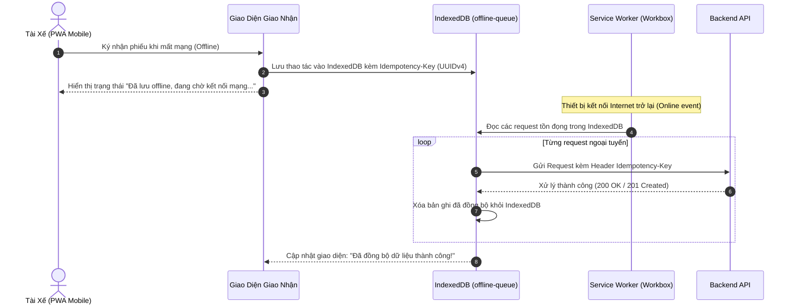

# ĐẶC TẢ YÊU CẦU & THIẾT KẾ CỔNG VẬN HÀNH NỘI BỘ (SRS & SDD)
## PHÂN HỆ CỔNG VẬN HÀNH XƯỞNG & ĐIỀU PHỐI ĐỐI TÁC (fe-react-thanhxuan-internal)

> **Tài liệu tham chiếu cấp cao:** [SRS_SDD.md (Kiến Trúc Tổng Quan)](file:///d:/PROJECT/Website_Thanh_Xuan_Company/.agents/docs/SRS_SDD.md)  
> **Phiên bản:** 2.1 | **Môi trường:** React 18, Vite, TypeScript Strict, React Router v7, TailwindCSS, shadcn/ui  
> **Phạm vi mã nguồn:** `fe-react-thanhxuan-internal/src/**`  
> **Quy chuẩn kỹ thuật:** Feature-Based Flat Colocation, Barrel `index.ts`, Mobile-First PWA, Canvas Signature, Offline Queue IndexedDB, RBAC UI Guards

---

## 1. YÊU CẦU NGHIỆP VỤ (SRS)

### 1.1. Mục Tiêu & Đối Tượng Sử Dụng
Phân hệ `fe-react-thanhxuan-internal` là cổng điều hành số hóa toàn diện xưởng giặt là công nghiệp và chuỗi cung ứng B2B của Công ty Thanh Xuân:
1. **Đối tượng người dùng đa dạng (8 vai trò RBAC):**
   - **Tài xế giao nhận (`SHIPPER`)**: Thao tác trên thiết bị di động (Mobile PWA) tại nhà hàng đối tác để giao nhận đồ sạch/đồ bẩn, lấy chữ ký điện tử, nộp hóa đơn xăng xe.
   - **Thợ xưởng (`WORKER`)**: Chấm công vào/ra ca bằng camera selfie di động, chấm sản lượng khoán từng công đoạn (gấp, ủi, đóng gói), rạch bao đếm lại đồ gom.
   - **Thủ kho (`WAREHOUSE_MANAGER`)**: Soạn đồ sạch theo kế hoạch xuất xưởng, tiếp nhận đồ bẩn, kiểm đếm đối soát tại trạm đếm.
   - **Quản lý xưởng (`MANAGER`)**: Giám sát vận hành xưởng, phê duyệt tài khoản, chốt sản lượng khoán cuối ngày, rà soát các ca công bất thường. *(Ràng buộc: Bị ẩn 100% thông tin tiền bạc/lương)*.
   - **Đại diện nhà hàng đối tác (`RESTAURANT_MANAGER`, `RESTAURANT_STAFF`)**: Kiểm nhận đồ sạch tại chỗ, ký xác nhận giao nhận, tra cứu bảng kê đối soát tháng.
   - **Kế toán (`ACCOUNTANT`)**: Phê duyệt đề xuất hoàn tiền xăng xe, cấu hình tham số lương, chạy tính bảng lương chu kỳ và xuất các báo cáo tài chính.
   - **Quản trị viên hệ thống (`ADMIN`, `SYSTEM_ADMIN`)**: Toàn quyền quản trị nhân sự, đối tác, danh mục đồ giặt, khóa/mở khóa kỳ lương và giám sát toàn hệ thống.

---

### 1.2. Danh Sách Tính Năng Theo Nhóm Nghiệp Vụ (Functional Requirements)

#### FE-INT-FR-01: Xác Thực & Phân Quyền Vai Trò (`features/auth`)
- **Đăng nhập & Quản lý phiên:** Xác thực bằng Email/Mật khẩu với Backend NestJS. Cấp Access Token (JWT 12h, `aud: 'internal'`) và Refresh Token lưu trữ an toàn trong `localStorage`. Tự động gia hạn phiên ngầm định (Silent Refresh).
- **Đăng ký tài khoản:** Dành cho thợ xưởng, tài xế và nhân viên nhà hàng (bắt buộc chọn chi nhánh đối tác). Nhập mã OTP 6 số gửi qua email.
- **Phê duyệt tài khoản:** Danh sách chờ duyệt tài khoản. Quản lý nhà hàng duyệt nhân viên nhà hàng; Quản lý/Admin xưởng duyệt nhân sự nội bộ.
- **Quên mật khẩu & Đặt lại mật khẩu:** Quy trình khôi phục mật khẩu 2 bước thông qua OTP email.

#### FE-INT-FR-02: Phân Hệ Phiếu Giao Nhận Kép (`features/handover`)
- **Tạo phiếu giao nhận:** Shipper hoặc Quản lý tạo phiếu theo chi nhánh đối tác. Tự động tải danh mục đồ vải theo đúng thương hiệu (`brand`).
- **Soạn đồ sạch xuất kho (`features/warehouse` - `WarehousePage`):** Thủ kho chuẩn bị số lượng đồ sạch dự kiến giao theo lịch đối tác.
- **Giao nhận 2 chiều trên Mobile:**
  - Cập nhật số lượng đồ sạch bàn giao thực tế (`cleanDelivery`).
  - Ghi nhận đồ bẩn thu gom (`dirtyPickup`): Chọn chế độ `ON_SITE` (đếm chi tiết từng món tại quán) hoặc `AT_FACTORY` (gom bao niêm phong đếm tại xưởng).
- **Chữ ký điện tử Canvas (`SignatureCanvas`):** Đại diện nhà hàng ký nhận trực tiếp trên màn hình cảm ứng điện thoại/tablet (Base64 PNG < 280KB).
- **Cơ chế Tự động Check-in cho Shipper (Plan 13):** Khi Shipper ký xác nhận phiếu giao nhận đầu tiên trong ngày, hệ thống tự động kích hoạt check-in ca làm việc nếu chưa check-in.
- **Sửa đổi ô phiếu sau ký (`EditFieldModal`):** Cho phép sửa ô phiếu khi có sai lệch phát hiện sau ký, ghi nhận `edit_marks`, lý do sửa, phát sinh thông báo tới Quản lý và audit log.
- **Bảng kê tháng nhà hàng (`features/restaurant` - `RestaurantMonthlyPage`):** Cổng tra cứu riêng cho nhà hàng đối soát tổng sản lượng giao nhận theo tháng, ẩn hoàn toàn đơn giá tài chính.

#### FE-INT-FR-03: Trạm Đếm Đồ Bẩn Tại Xưởng (`features/recount` - `RecountStationPage`)
- Phân quyền chuyên biệt cho Thợ xưởng (`WORKER`) và Thủ kho (`WAREHOUSE_MANAGER`).
- Danh sách các phiếu gom bao niêm phong từ xe tải chở về xưởng.
- Thao tác rạch bao đếm lại: Nhập số lượng thực tế từng món đồ, chụp ảnh hiện trường bao niêm phong, tự động tính chênh lệch thừa/thiếu (`variance`) so với số lượng nhà hàng khai báo.

#### FE-INT-FR-04: Chấm Công Camera Selfie & Khoán Sản Lượng (`features/attendance`, `features/piecework`)
- **Chấm công camera selfie (`WorkerAttendancePage`):**
  - Chỉ hiển thị cho Thợ xưởng (`WORKER`). Bắt buộc chụp ảnh trực tiếp từ camera trước của điện thoại, nén ảnh client trước khi tải lên.
  - Chặn chấm ca trùng (mỗi thợ chỉ có 1 ca mở trong ngày).
- **Chấm sản lượng khoán thợ (`WorkerPieceworkPage`):**
  - Thợ chọn món đồ và công đoạn (Gấp, Ủi, Đóng gói) để ghi nhận sản lượng.
  - Tự động lấy đơn giá chuẩn từ hệ thống tại thời điểm làm việc, thợ không thể can thiệp đơn giá.
  - Hỗ trợ nhập số âm để trừ bù khi kiểm đếm nhầm.
- **Chốt duyệt sản lượng (`ManagerPieceworkConfirmModal`):** Quản lý xưởng rà soát tổng sản lượng toàn xưởng vào cuối ngày và chốt duyệt trạng thái `CONFIRMED`.

#### FE-INT-FR-05: Quản Lý Hoàn Tiền Xăng Xe (`features/fuel`)
- **Tài xế nộp đề xuất xăng (`FuelProposalPage`):** Chỉ hiển thị cho vai trò `SHIPPER`. Bắt buộc chụp ảnh hóa đơn cây xăng và ảnh đồng hồ công-tơ-mét / vạch xăng xe.
- **Kế toán duyệt xăng xe (`FuelApprovalPage`):** Kế toán và Admin duyệt hoặc từ chối đề xuất hoàn tiền. Quản lý xưởng bị ẩn chức năng này để bảo vệ thông tin tài chính.

#### FE-INT-FR-06: Quản Trị Bảng Lương & Tra Cứu Phiếu Lương (`features/payroll`)
- **Quản lý kỳ lương (`PayrollPeriodPage`):** Kế toán và Admin khởi tạo kỳ lương tháng, tính toán tổng hợp tự động từ giờ công, sản lượng khoán và tiền hoàn xăng.
- **Đóng băng kỳ lương:** Khóa kỳ lương chuyển sang `LOCKED` (đóng băng dữ liệu nguồn). Chỉ Admin có quyền mở khóa kèm ghi nhận audit log.
- **Tra cứu phiếu lương cá nhân (`PayslipViewPage`):**
  - Nhân viên tự tra cứu chi tiết phiếu lương của mình (giờ công, sản lượng, hoàn xăng, khấu trừ, thực nhận).
  - Chỉ hiển thị khi kỳ lương đã ở trạng thái `LOCKED` hoặc `PAID`. Tuyệt đối không cho phép xem chéo phiếu lương.
  - Ẩn hoàn toàn với vai trò `ADMIN` (Admin không có phiếu lương nhân viên).

#### FE-INT-FR-07: Trung Tâm Báo Cáo Phân Tích & Xuất File (`features/reports` - `ReportsPage`)
- Giao diện trực quan hóa 6 báo cáo aggregation: Báo cáo kho, Đối soát đối tác, Chấm công thợ, Lịch trình shipper, Sự cố chênh lệch và Báo cáo xăng xe.
- Bộ lọc khoảng ngày linh hoạt (tối đa 31 ngày).
- Xuất file tải về trực tiếp: Xuất file Excel XLSX và PDF streaming.
- Tự động bóc tách trường tiền lương khi Quản lý xưởng (`MANAGER`) truy cập.

---

## 2. THIẾT KẾ KIẾN TRÚC & HỆ THỐNG (SDD)

### 2.1. Cấu Trúc Thư Mục & Tổ Chức Mã Nguồn

```Markdown
fe-react-thanhxuan-internal/src/
├── app/
│   ├── (auth)/                          # Đăng nhập, Đăng ký OTP, Quên mật khẩu
│   │   ├── login/page.tsx               # /login
│   │   ├── register/page.tsx            # /register
│   │   └── forgot-password/page.tsx     # /forgot-password
│   │
│   ├── (internal)/                      # Vùng vận hành yêu cầu JWT xác thực
│   │   ├── layout.tsx                   # Layout khung: Topbar, Sidebar, Navigation
│   │   ├── dashboard/page.tsx           # /dashboard - Thống kê KPI tổng quan
│   │   │
│   │   ├── operations/                  # Phân hệ Vận Hành theo đối tượng (/operations/*)
│   │   │   ├── attendance/page.tsx      # /operations/attendance - Thợ chấm công selfie
│   │   │   ├── payslip/page.tsx         # /operations/payslip - Tra cứu phiếu lương cá nhân
│   │   │   ├── reports/page.tsx         # /operations/reports - Trung tâm 6 báo cáo & xuất Excel/PDF
│   │   │   ├── warehouse-manager/
│   │   │   │   └── warehouse/page.tsx   # /operations/warehouse-manager/warehouse - Thủ kho soạn đồ sạch
│   │   │   ├── shipper/
│   │   │   │   ├── handover/page.tsx    # /operations/shipper/handover - Giao nhận 2 chiều
│   │   │   │   ├── handover/[recordCode]/page.tsx # Chi tiết phiếu & chữ ký Canvas
│   │   │   │   └── fuel/page.tsx        # /operations/shipper/fuel - Nộp hóa đơn xăng xe
│   │   │   ├── worker/
│   │   │   │   ├── recount/page.tsx     # /operations/worker/recount - Trạm đếm gom bao xưởng
│   │   │   │   └── piecework/page.tsx   # /operations/worker/piecework - Chấm sản lượng khoán
│   │   │   └── restaurant-manager/
│   │   │       └── restaurant/page.tsx  # /operations/restaurant-manager/restaurant - Cổng đối soát nhà hàng
│   │   │   └── restaurant-staff/
│   │   │       └── restaurant/page.tsx  # /operations/restaurant-staff/restaurant - Cổng đối soát nhà hàng
│   │   │
│   │   └── management/                  # Phân hệ Quản Trị theo vai trò (/management/*)
│   │       ├── page.tsx                 # /management - Hub điều hành chung (thích ứng theo role)
│   │       ├── approvals/page.tsx       # /management/approvals - Phê duyệt tài khoản nhân viên
│   │       ├── manager/
│   │       │   ├── personnel/page.tsx   # /management/manager/personnel - Quản trị nhân sự & RBAC
│   │       │   ├── partners/page.tsx    # /management/manager/partners - Quản trị chuỗi đối tác & bảng giá
│   │       │   ├── attendance/page.tsx  # /management/manager/attendance - Bảng công toàn xưởng
│   │       │   └── piecework/page.tsx   # /management/manager/piecework - Chốt sản lượng khoán toàn xưởng
│   │       └── accountant/
│   │           ├── fuel/page.tsx        # /management/accountant/fuel - Duyệt đề xuất xăng xe
│   │           └── payroll/page.tsx     # /management/accountant/payroll - Bảng lương chu kỳ & chốt sổ
│   │
│   ├── layout.tsx                       # Root Layout: AuthProvider, QueryClientProvider
│   └── router.tsx                       # Centralized Router cấu hình Route Guards & Redirects
│
├── components/                          # Layout, Shell, Notifications, shadcn/ui
├── features/                            # 13 Feature Modules độc lập (Colocation)
│   ├── auth/                            # AuthContext, LoginForm, RegisterForm, ApprovalList
│   ├── attendance/                      # CameraCheckIn, AttendanceList, ReviewModal
│   ├── piecework/                       # WorkerPieceworkForm, PieceworkConfirmModal
│   ├── handover/                        # HandoverList, HandoverDetail, CanvasSign, EditModal
│   ├── recount/                         # RecountStationPage, RecountTaskModal
│   ├── warehouse/                       # WarehousePage, CleanPlannedModal
│   ├── fuel/                            # FuelProposalForm, FuelApprovalList
│   ├── payroll/                         # PayrollPeriodList, PayslipDetailModal
│   ├── partners/                        # PartnerList, ItemCatalogManagement
│   ├── restaurant/                      # RestaurantMonthlyTable
│   ├── reports/                         # ReportsDashboard, ExportModal
│   └── management/                      # ManagementPage, AdaptiveActionCards
│
├── lib/                                 # Tiện ích hạ tầng
│   ├── api-client.ts                    # Axios client gắn Interceptors và Refresh Token
│   ├── offline-queue.ts                 # Hàng đợi ngoại tuyến IndexedDB (PWA Offline)
│   ├── permissions.ts                   # Ma trận kiểm tra quyền vai trò & canViewFinancials
│   └── utils.ts                         # Định dạng ngày giờ VN, formatCurrencyVND
│
└── types/                               # TypeScript Interfaces chuẩn hóa
```

---

### 2.2. Ma Trận Điều Hướng & Phân Quyền Menu (Navigation & RBAC)

Dựa trên cấu hình chuẩn hóa từ Plan 13 và Plan 14:

| Nhóm Tài Khoản | Tuyến Đường Mặc Định | Quyền Truy Cập Vận Hành (`/operations`) | Quyền Truy Cập Quản Lý (`/management`) |
| :--- | :--- | :--- | :--- |
| **`SHIPPER`** | `/operations/shipper/handover` | `/operations/shipper/handover`, `/operations/shipper/fuel`, `/operations/payslip` | ❌ Không có quyền |
| **`WORKER`** | `/operations/worker/piecework` | `/operations/worker/piecework`, `/operations/attendance`, `/operations/worker/recount`, `/operations/payslip` | ❌ Không có quyền |
| **`WAREHOUSE_MANAGER`**| `/operations/warehouse-manager/warehouse` | `/operations/warehouse-manager/warehouse`, `/operations/worker/recount`, `/operations/shipper/handover` (chế độ xem), `/operations/payslip` | ❌ Không có quyền *(Bị ẩn trường tiền)* |
| **`RESTAURANT_MANAGER`**| `/operations/restaurant-manager/restaurant`| `/operations/restaurant-manager/restaurant`, `/operations/shipper/handover` (chỉ chi nhánh mình) | `/management/approvals` (Chỉ xem và duyệt nhân viên chi nhánh mình) |
| **`RESTAURANT_STAFF`** | `/operations/restaurant-staff/restaurant` | `/operations/restaurant-staff/restaurant`, `/operations/shipper/handover` (chỉ chi nhánh mình) | ❌ Không có quyền |
| **`ACCOUNTANT`** | `/dashboard` | `/operations/payslip`, `/operations/reports` | Toàn quyền Quản lý: `/management/accountant/payroll`, `/management/accountant/fuel`, `/management/manager/partners`, `/management/manager/personnel` |
| **`MANAGER`** | `/dashboard` | `/operations/shipper/handover` (chế độ xem), `/operations/reports` | Quản lý vận hành xưởng: `/management/manager/personnel`, `/management/manager/partners`, `/management/manager/attendance`, `/management/manager/piecework` *(Ẩn hoàn toàn bảng lương & tiền)* |
| **`ADMIN`** | `/dashboard` | Toàn bộ các trang vận hành | Toàn quyền tuyệt đối 100% các chức năng quản lý |

---

### 2.3. Cơ Chế PWA & Hàng Đợi Ngoại Tuyến (Offline Queue)



- **An toàn giao dịch:** Mỗi request gửi từ offline queue luôn đính kèm header `Idempotency-Key` (UUIDv4) để Backend nhận diện và xử lý idempotent, tuyệt đối không bị trùng lặp dữ liệu khi kết nối mạng chập chờn.
- **Tối ưu hóa ảnh & Canvas:** Ảnh chụp camera selfie và ảnh hóa đơn xăng được nén trực tiếp qua canvas client trước khi lưu queue hoặc gửi API (giới hạn dung lượng < 500KB) nhằm tiết kiệm băng thông di động 4G.
