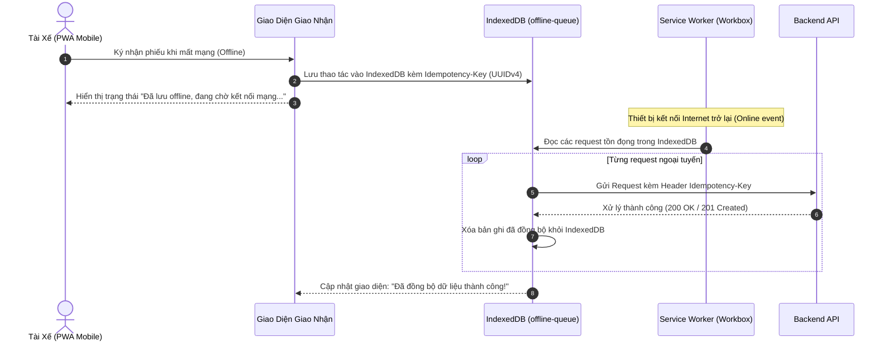

# ĐẶC TẢ YÊU CẦU & THIẾT KẾ CỔNG VẬN HÀNH NỘI BỘ (SRS & SDD)

## PHÂN HỆ CỔNG VẬN HÀNH XƯỞNG & ĐIỀU PHỐI ĐỐI TÁC (fe-react-thanhxuan-internal)

> **Tài liệu tham chiếu cấp cao:** [SRS_SDD.md (Kiến Trúc Tổng Quan)](file:///d:/PROJECT/Website_Thanh_Xuan_Company/.agents/docs/SRS_SDD.md)  
> **Phiên bản:** 2.3 | **Synced:** 2026-10-13 | **Môi trường:** React 18, Vite, TypeScript Strict, React Router v7, TailwindCSS, shadcn/ui  
> **Phạm vi mã nguồn:** `fe-react-thanhxuan-internal/src/**`  
> **Quy chuẩn kỹ thuật:** Feature-Based Flat Colocation, Barrel `index.ts`, Mobile-First PWA, Canvas Signature, Offline Queue IndexedDB, RBAC UI Guards

---

## 1. YÊU CẦU NGHIỆP VỤ (SRS)

### 1.1. Mục Tiêu & Đối Tượng Sử Dụng

Phân hệ `fe-react-thanhxuan-internal` là cổng điều hành số hóa toàn diện xưởng giặt là công nghiệp và chuỗi cung ứng B2B của Công ty Thanh Xuân:

1. **Đối tượng người dùng đa dạng (8 vai trò RBAC):**
   - **Tài xế giao nhận (`SHIPPER`)**: Thao tác trên thiết bị di động (Mobile PWA) tại đối tác để giao nhận đồ sạch/đồ bẩn, lấy chữ ký điện tử, bật cờ yêu cầu đếm lại xưởng (`isRecount`), nộp đề xuất chi phí xe máy (xăng xe và sửa chữa).
   - **Thợ xưởng (`WORKER`)**: Chấm công vào/ra ca bằng camera selfie di động, ghi nhận thời gian làm việc theo giờ nhân hệ số công việc (`WorkshopJobType`), rạch bao đếm lại đồ bẩn tại xưởng.
   - **Thủ kho (`WAREHOUSE_MANAGER`)**: Soạn đồ sạch xuất xưởng (chặn ngày đã qua), duyệt xem thư viện ảnh phiếu giao nhận (`WarehouseSlipGalleryTabComponent`), kiểm đếm trạm đếm.
   - **Quản lý xưởng (`MANAGER`)**: Giám sát vận hành xưởng, phê duyệt tài khoản thợ/tài xế, chốt công thợ cuối ngày, rà soát các ca công bất thường. _(Ràng buộc: Bị ẩn 100% thông tin tiền bạc/lương)_.
   - **Đại diện đối tác (`PARTNER_MANAGER`, `PARTNER_STAFF`)**: Quản lý đối tác và Nhân viên đối tác. Tự động tính ngày hôm sau khi đếm đêm 21h-23h59, auto-save onblur từng ô đồ bẩn chống xung đột, ký nhận đếm đồ bẩn, kiểm nhận đồ sạch qua ảnh Cloudinary và ký nhận hoàn tất.
   - **Kế toán (`ACCOUNTANT`)**: Phê duyệt đề xuất chi phí xe máy (xăng & sửa xe), cấu hình tham số định mức và hệ số lương, chạy tính bảng lương chu kỳ và xuất các báo cáo tài chính. _(Ràng buộc: Không tham gia phê duyệt tài khoản nhân sự)_.
   - **Quản trị viên hệ thống (`ADMIN`, `SYSTEM_ADMIN`)**: Toàn quyền quản trị nhân sự, đối tác, danh mục đồ giặt, khóa/mở khóa kỳ lương và giám sát toàn hệ thống.

---

### 1.2. Danh Sách Tính Năng Theo Nhóm Nghiệp Vụ (Functional Requirements)

#### FE-INT-FR-01: Xác Thực, Quản Trị Nhân Sự & Profile Header (`features/auth`, `features/management/auth`, `components/layout/AppHeader`)

- **Đăng nhập & Tài khoản mẫu:** Xác thực Email/Mật khẩu với Backend NestJS. Lưới tài khoản mẫu gồm 8 nút (Admin, Quản lý xưởng, Quản lý kho, Kế toán trưởng, Tài xế, Thợ xưởng, QL Đối Tác, NV Đối Tác) với mật khẩu mặc định `ThanhXuan@2026`, hỗ trợ đăng nhập tức thì.
- **Đăng ký tài khoản công khai (`/register`, `RegisterModal`):** Chỉ cho phép đăng ký 3 vai trò thực thi: **NV Xưởng** (`WORKER`), **NV Giao Hàng** (`SHIPPER`) và **Nhân Viên Đối Tác** (`PARTNER_STAFF`). Bỏ hoàn toàn vai trò Quản lý đối tác khỏi trang đăng ký công khai. Khi chọn Nhân viên đối tác, cascade chọn Thương hiệu (Brand) trước rồi lọc Chi nhánh (Partner).
- **Header Profile, Avatar & Dropdown Menu:**
  - Góc phải Header hiển thị Avatar tròn (ảnh Cloudinary hoặc ký tự viết tắt), Họ tên và Huy hiệu vai trò.
  - Dropdown Popover gồm 3 chức năng:
    - 👤 **Thông tin cá nhân:** Mở `ProfileEditModal` cho phép sửa họ tên, SĐT và chọn ảnh trực tiếp từ máy tính để upload lên Cloudinary. Cập nhật tức thì avatar trên Header.
    - 🔑 **Đổi mật khẩu:** Mở `ChangePasswordModal` nhập mật khẩu cũ, mật khẩu mới, xác nhận mật khẩu mới.
    - 🚪 **Đăng xuất:** Gọi `logout()` và xóa toàn bộ session storage.
- **Quản lý nhân sự toàn diện (`StaffManagementView`):**
  - **Tabs phân loại tài khoản:** 6 nhóm: _Tất Cả_, _Ban Quản Trị & Kế Toán_, _Vận Hành Xưởng & Kho_, _Giao Nhận_, _Khối Đối Tác B2B_, _Tài Khoản Tạm Khóa_.
  - **Thêm nhân sự:** Modal tạo mới tài khoản cho `ADMIN` và `MANAGER`, hỗ trợ tạo cả tài khoản Quản lý đối tác (`PARTNER_MANAGER`) kèm chọn Brand và Chi nhánh. Mật khẩu khởi tạo: `ThanhXuan@2026`.
  - **Chỉnh sửa nhân sự:** Cập nhật họ tên, SĐT, vai trò, thương hiệu và chi nhánh.
  - **Tạm khóa tài khoản & Cơ chế 60 ngày:** Chuyển trạng thái sang `LOCKED`, ghi nhận thời điểm `lockedAt`, hiển thị số ngày còn lại (ví dụ: _Còn 59 ngày trước khi xóa vĩnh viễn_). Backend tự động xóa các tài khoản đã khóa quá 60 ngày. Hỗ trợ Mở khóa (`ACTIVE`).
  - **Xóa tài khoản vĩnh viễn:** **Chỉ hiển thị và cho phép thực hiện đối với vai trò `ADMIN`**. Quản lý xưởng (`MANAGER`) không có nút xóa.
- **Phê duyệt tài khoản (`approval_requests`):** Quản lý đối tác (`PARTNER_MANAGER`) duyệt nhân viên đối tác thuộc cơ sở mình; Quản lý xưởng và Admin duyệt nhân sự nội bộ (`WORKER`, `SHIPPER`). Kế toán bị tước bỏ hoàn toàn quyền duyệt nhân sự.
- **Quên mật khẩu & Đặt lại mật khẩu:** Quy trình khôi phục mật khẩu 2 bước thông qua OTP email.

#### FE-INT-FR-02: Phân Hệ Phiếu Giao Nhận Kép & Quy Trình 5 Bước Vận Hành (`features/operations/handovers`)

- **Tạo phiếu & Soạn đồ sạch xuất kho (`WarehousePage`, `PrepOrderModal`):**
  - Quản lý tab qua URL Search Param `?tab=CLEAN_PLAN | SUMMARY | SLIP_GALLERY`.
  - Thủ kho chuẩn bị số lượng đồ sạch dự kiến giao theo lịch đối tác vào ngày chọn (`recordDate`), mặc định ngày mai khi soạn tối (17h-21h), chặn chọn ngày đã qua (`min = getTodayVN()`).
  - Tối ưu responsive trên Mobile: Thanh tiêu đề mỏng 1 dòng, 3 trường khóa cố định 2 hàng gọn gàng, nút đóng banner prefill tiện lợi.
  - Ký tên Canvas thủ kho, tự động render phiếu và nén ảnh WebP base64 gửi Backend upload Cloudinary `slipImageUrl`.
- **Component Thư viện ảnh phiếu dùng chung (`HandoverSlipGalleryComponent`):**
  - Component dùng chung hợp nhất toàn diện Thư viện ảnh phiếu cho cả 3 phân hệ: Thủ kho (`WarehousePage?tab=SLIP_GALLERY`), Cổng đối tác (`PartnerPortalPage?tab=HISTORY`) và Tài xế (`HandoverListPage?tab=HISTORY`).
  - Hỗ trợ 3 chế độ (`mode: 'WAREHOUSE' | 'SHIPPER' | 'PARTNER'`):
    - _Kho (`WAREHOUSE`)_: Bộ lọc Thương hiệu (Brand), Chi nhánh đối tác (Partner), Từ ngày, Đến ngày, Tìm mã phiếu.
    - _Tài xế (`SHIPPER`)_: Bộ lọc Chi nhánh đối tác (Partner), Từ ngày, Đến ngày, Tìm mã phiếu.
    - _Đối tác (`PARTNER`)_: Khóa cố định đối tác `fixedPartnerId`, chỉ hiện bộ lọc Từ ngày, Đến ngày, Tìm mã phiếu.
  - Lưới hiển thị Card đồng nhất tỷ lệ `aspect-[3/4]`: Ảnh thumbnail phiếu, badge thương hiệu, ngày giao nhận, trạng thái phiếu, 3 chấm tròn kiểm soát chữ ký (Kho, Shipper, Quán) kèm tooltip chi tiết.
  - Nút **Xem Phóng To** kết nối modal `SlipFullscreenViewerModal`, nút **Tải ảnh** WebP/PNG an toàn (hỗ trợ CORS fallback), nút **Chi tiết**. Phân trang mượt mà 12 phiếu/trang.
- **Component Lightbox Phóng to ảnh phiếu dùng chung (`SlipFullscreenViewerModal`):**
  - Component hiển thị phóng to ảnh phiếu toàn màn hình dùng chung cho toàn bộ hệ thống (`WarehousePage`, `PrepOrderModal`, `HandoverDeliverySlipModal`, `ShipperHandoverItemCardComponent`, `HandoverSlipGalleryComponent`).
  - Hỗ trợ zoom đa cấp từ 75% đến 250%, thanh công cụ nổi (Zoom In, Zoom Out, 100%, Tải ảnh, Đóng), cuộn pan tự do, phím tắt `Escape` tự động đóng, double-tap zoom 175% trên điện thoại di động.
- **Cổng giao nhận đối tác nhà hàng (`PartnerPortalPage`):**
  - Tự động phát hiện khung giờ đêm $\ge 21\text{h}00$ để nhảy ngày sang ngày mai (`getTargetRecordDateVN`).
  - **Đếm đồ bẩn (`PartnerCountTabComponent`):** Auto-save onBlur từng ô nhập số lượng thông qua endpoint nguyên tử `PATCH /dirty-item-onblur` của Backend, loại bỏ triệt để xung đột đồng thời khi nhiều người cùng thao tác. Ký nhận đếm đồ bẩn qua `PATCH /partner-count-signature`.
  - **Kiểm nhận đồ sạch (`PartnerReceiptTabComponent`):** Hiển thị trực tiếp thẻ `` phiếu WebP từ Cloudinary, đối tác kiểm nhận số lượng và ký xác nhận qua `PATCH /partner-check-signature`, chuyển trạng thái phiếu sang `COMPLETED`.
  - **Thư viện ảnh phiếu đối soát lịch sử:** Tích hợp `HandoverSlipGalleryComponent` với `mode="PARTNER"` và `fixedPartnerId={userPartnerId}`.
- **Thao tác Shipper trên di động (`HandoverListPage`, `ShipperHandoverItemCardComponent`, `ShipperCountPartnerModal`):**
  - **Tab Lộ trình giao nhận vs Lịch sử phiếu đã giao:** Quản lý qua URL Search Param `?tab=ROUTE | HISTORY`. Tab lịch sử tích hợp `HandoverSlipGalleryComponent` với `mode="SHIPPER"`.
  - **Bộ điều khiển ngày tối giản:** Cụm `[< Ngày trước]` - `[Ngày ở giữa (click chọn ngày)]` - `[Ngày sau >]`.
  - **Hiển thị trực tiếp ảnh phiếu & Thanh công cụ hành động:** Thẻ phiếu hiển thị trực tiếp ảnh phiếu xuất kho kèm 3 nút: **Đếm thay**, **Phóng to** (mở `SlipFullscreenViewerModal`), **Tải ảnh** (tải ảnh phiếu WebP/PNG về máy có xử lý CORS fallback).
  - **Nút "Đếm thay" mở Modal chuyên dụng (`ShipperCountPartnerModal`):** Giao diện đồng bộ 100% với tab `COUNT` bên Partner: Khung thông tin cố định khóa 3 trường (Thương hiệu, Chi nhánh, Ngày), chuyển đổi linh hoạt dạng Thẻ / Bảng, nhập biểu thức thông minh `12 34` hoặc `10+5`, bàn ký Canvas và Live Preview Canvas A4. Cấp quyền `HANDOVER_PARTNER_COUNT` và `PARTNER_VIEW` cho Shipper, triệt tiêu lỗi 403 Forbidden.
  - **Ký bàn giao điện tử & Đếm lại:** Bảng ký Canvas, checkbox tích đếm lại (`isRecount`).
  - **Chỉ đường Google Maps & Ngày góc phải:** Nút chỉ đường mở Google Maps, ngày giao nhận hiển thị cùng hàng ở góc phải.

#### FE-INT-FR-03: Trạm Đếm Đồ Bẩn Tại Xưởng (`features/operations/handovers` - `RecountStationPage`)

- Phân quyền chuyên biệt cho Thợ xưởng (`WORKER`) và Thủ kho (`WAREHOUSE_MANAGER`).
- Tự động lọc danh sách phiếu cần đếm lại: các phiếu có `isRecount === true` hoặc phiếu có đồ bẩn chưa đếm số lượng mà Shipper đã ký nhận giao về.
- **Thao tác rạch bao đếm lại:** Thợ xưởng nhập số lượng thực tế từng chiếc đồ (`actualQuantityReceived`), cập nhật trực tiếp vào hệ thống qua endpoint `PATCH /recount-actual`, hoàn tất quy trình kiểm đếm đối chứng.

#### FE-INT-FR-04: Chấm Công Camera Selfie & Ghi Nhận Công Thợ Theo Giờ x Hệ Số (`features/attendance`, `features/piecework`)

- **Chấm công camera selfie (`WorkerAttendancePage`):** Bắt buộc chụp ảnh trực tiếp từ camera trước của điện thoại, nén ảnh client trước khi tải lên. Chặn chấm ca trùng trong ngày.
- **Ghi nhận thời gian công việc thợ (`PieceworkStationPage`):**
  - Thợ chọn loại công việc (`WorkshopJobType`: Ủi đồ, Gấp đồ, Đóng gói, Giặt, Sấy, Khác) và nhập số phút làm việc (`minutesWorked`).
  - Hệ thống tự động snapshot hệ số loại việc từ cấu hình và đơn giá giờ thợ để tính tiền công minh bạch.
- **Chốt duyệt công thợ cuối ngày (`PieceworkConfirmPage`):** Quản lý xưởng rà soát tổng hợp thời gian làm việc của thợ và chốt duyệt trạng thái `CONFIRMED`.

#### FE-INT-FR-05: Quản Lý Chi Phí Xe Máy Của Shipper (`features/operations/fuel`, `features/management/fuel`)

- **Tài xế nộp đề xuất chi phí xe (`FuelPage`):**
  - Hỗ trợ 2 tabs nghiệp vụ: **Đổ Xăng (`FUEL`)** và **Sửa Chữa Xe (`REPAIR`)**.
  - Nhập số tiền đề xuất hoàn (`amountMoney`), số lít xăng, số Km đồng hồ (nếu đổ xăng) hoặc mô tả chi tiết sửa chữa (nếu sửa xe).
  - Bắt buộc đính kèm ảnh chụp hóa đơn/biên lai và ảnh đồng hồ công-tơ-mét / ảnh xe máy tại tiệm sửa xe.
- **Kế toán duyệt chi phí xe (`FuelReviewPage`):** Kế toán và Admin duyệt hoặc từ chối đề xuất. Số tiền được duyệt tự động tính vào phiếu lương shipper. Quản lý xưởng bị ẩn chức năng này.

#### FE-INT-FR-06: Quản Trị Bảng Lương & Tra Cứu Phiếu Lương (`features/operations/payroll`, `features/management/payroll`)

- **Quản lý kỳ lương (`PayrollManagementPage`):** Kế toán và Admin cấu hình tham số, chạy tính toán bảng lương chu kỳ và đóng băng (`LOCKED`).
- **Tra cứu phiếu lương cá nhân (`MyPayslipPage`):**
  - Nhân viên tự tra cứu chi tiết phiếu lương cá nhân khi kỳ lương đã `LOCKED` hoặc `PAID`.
  - **Minh bạch theo chức danh:**
    - _Tài xế Shipper:_ Bảng tính chi tiết gồm ngày công chuẩn (28 ngày), ngày thực tế, lương cơ bản theo ngày, thưởng ca cuối tuần (60k/ca tối T7/CN và sáng CN/T2), chuyên cần (7k/ngày), phụ cấp điện thoại (200k), hoàn chi phí xăng và sửa xe đã duyệt, khấu trừ BHXH (400k) và thực nhận.
    - _Thợ xưởng:_ Bảng tổng hợp tổng phút làm việc và thu nhập theo từng nhóm công việc nhân hệ số.

#### FE-INT-FR-07: Trung Tâm Báo Cáo Phân Tích & Xuất File (`features/operations/reports`, `features/management/reports`)

- Giao diện trực quan hóa 6 báo cáo aggregation: Báo cáo kho, Đối soát đối tác, Chấm công thợ, Lịch trình shipper, Sự cố chênh lệch và Báo cáo xăng xe.
- Bộ lọc khoảng ngày linh hoạt (tối đa 31 ngày).
- Xuất file tải về trực tiếp: Xuất file Excel XLSX và PDF streaming.
- Tự động bóc tách trường tiền lương khi Quản lý xưởng (`MANAGER`) truy cập.

---

## 2. THIẾT KẾ KIẾN TRÚC & HỆ THỐNG (SDD)

### 2.1. Cấu Trúc Thư Mục & Tổ Chức Mã Nguồn

```Markdown
fe-react-thanhxuan-internal/src/
├── app/
│   ├── (auth)/                          # Đăng nhập, Đăng ký OTP, Quên mật khẩu
│   │   ├── login.tsx               # /login
│   │   ├── register.tsx            # /register
│   │   └── forgot-password.tsx     # /forgot-password
│   │
│   ├── (internal)/                      # Vùng vận hành yêu cầu JWT xác thực
│   │   ├── layout.tsx                   # Layout khung: Topbar, Sidebar, Navigation
│   │   ├── dashboard.tsx           # /dashboard - Thống kê KPI tổng quan
│   │   │
│   │   ├── operations/                  # Phân hệ Vận Hành theo đối tượng (/operations/* - 100% số ít)
│   │   │   ├── attendance.tsx      # /operations/attendance - Thợ chấm công selfie
│   │   │   ├── payslip.tsx         # /operations/payslip - Tra cứu phiếu lương cá nhân
│   │   │   ├── report.tsx          # /operations/report - Trung tâm báo cáo & xuất Excel/PDF (số ít)
│   │   │   ├── warehouse-manager/
│   │   │   │   └── warehouse.tsx   # /operations/warehouse-manager/warehouse - Thủ kho soạn đồ sạch
│   │   │   ├── shipper/
│   │   │   │   ├── handover.tsx    # /operations/shipper/handover - Giao nhận 2 chiều
│   │   │   │   ├── handover/[recordCode]/page.tsx # Chi tiết phiếu & chữ ký Canvas
│   │   │   │   └── fuel.tsx        # /operations/shipper/fuel - Nộp hóa đơn xăng xe
│   │   │   ├── worker/
│   │   │   │   ├── recount.tsx     # /operations/worker/recount - Trạm đếm gom bao xưởng
│   │   │   │   └── piecework.tsx   # /operations/worker/piecework - Chấm sản lượng khoán
│   │   │   ├── partner-manager/
│   │   │   │   └── partner.tsx     # /operations/partner-manager/partner - Cổng đối tác (Quản lý)
│   │   │   └── partner-staff/
│   │   │       └── partner.tsx     # /operations/partner-staff/partner - Cổng đối tác (Nhân viên)
│   │   │
│   │   └── management/                  # Phân hệ Quản Trị theo vai trò (/management/* - 100% số ít)
│   │       ├── management.tsx           # /management - Hub điều hành chung (thích ứng theo role)
│   │       ├── manager/
│   │       │   ├── approval.tsx    # /management/manager/approval - Phê duyệt tài khoản (số ít)
│   │       │   ├── personnel.tsx   # /management/manager/personnel - Quản trị nhân sự & RBAC
│   │       │   ├── partner.tsx     # /management/manager/partner - Quản trị chuỗi đối tác (số ít)
│   │       │   ├── attendance.tsx  # /management/manager/attendance - Bảng công toàn xưởng
│   │       │   └── piecework.tsx   # /management/manager/piecework - Chốt sản lượng khoán
│   │       └── accountant/
│   │           ├── fuel.tsx        # /management/accountant/fuel - Duyệt đề xuất xăng xe
│   │           └── payroll.tsx     # /management/accountant/payroll - Bảng lương chu kỳ & chốt sổ
│   │
│   ├── layout.tsx                       # Root Layout: AuthProvider, QueryClientProvider
│   └── router.tsx                       # Centralized Router cấu hình Route Guards & Backward Redirects
│
├── components/                          # Layout (nav-config, AppHeader, Sidebar), Shell, shadcn/ui
├── features/                            # Phân định rõ ràng Management vs Operations, chuẩn hóa file: *Page.tsx, modals/*Modal.tsx, components/*Component.tsx
│   ├── auth/                            # LoginPage, RegisterPage; modals/ (*Modal.tsx); components/ (*Component.tsx)
│   ├── dashboard/                       # DashboardPage, KPICards, QuickActions
│   ├── management/                      # Module Quản trị cấp quản lý & văn phòng
│   │   ├── attendance/                  # AttendanceReviewPage
│   │   ├── auth/                        # StaffManagementPage, ApprovalManagementPage, AuditLogPage; modals/ (*Modal.tsx); components/ (*Component.tsx)
│   │   ├── fuel/                        # FuelReviewPage
│   │   ├── partners/                    # PartnersManagementPage; modals/ (PartnerModal, BrandModal, CatalogModal...); components/ (*Component.tsx)
│   │   ├── payroll/                     # PayrollManagementPage
│   │   └── piecework/                   # HourlyWorkReviewPage
│   │
│   └── operations/                      # Module Vận hành hiện trường xưởng & di động
│       ├── attendance/                  # AttendancePage
│       ├── fuel/                        # ShipperFuelPage
│       ├── handovers/                   # ShipperHandoverPage, WarehouseHandoverPage, PartnerHandoverPage, RecountStationPage; modals/ (*Modal.tsx); components/ (*Component.tsx); hooks/ (use*Flow.ts)
│       ├── payroll/                     # MyPayslipPage
│       ├── piecework/                   # HourlyWorkStationPage
│       └── reports/                     # ReportsPage; components/ (*Component.tsx)
│
├── lib/                                 # Tiện ích hạ tầng (api-client, permissions, offline-queue, utils)
└── types/                               # TypeScript Interfaces & Enums chuẩn hóa
```

---

### 2.2. Ma Trận Điều Hướng & Phân Quyền Menu (Navigation & RBAC)

Dựa trên cấu hình chuẩn hóa từ Plan 13, Plan 14 và Plan 16:

| Nhóm Tài Khoản           | Tuyến Đường Mặc Định                      | Quyền Truy Cập Vận Hành (`/operations`)                                                                                                     | Quyền Truy Cập Quản Lý (`/management`)                                                                                                                                                                                       |
| :----------------------- | :---------------------------------------- | :------------------------------------------------------------------------------------------------------------------------------------------ | :--------------------------------------------------------------------------------------------------------------------------------------------------------------------------------------------------------------------------- |
| **`SHIPPER`**            | `/operations/shipper/handover`            | `/operations/shipper/handover`, `/operations/shipper/fuel`, `/operations/payslip`                                                           | ❌ Không có quyền                                                                                                                                                                                                            |
| **`WORKER`**             | `/operations/worker/piecework`            | `/operations/worker/piecework`, `/operations/attendance`, `/operations/worker/recount`, `/operations/payslip`                               | ❌ Không có quyền                                                                                                                                                                                                            |
| **`WAREHOUSE_MANAGER`**  | `/operations/warehouse-manager/warehouse` | `/operations/warehouse-manager/warehouse`, `/operations/worker/recount`, `/operations/shipper/handover` (chế độ xem), `/operations/payslip` | ❌ Không có quyền _(Bị ẩn trường tiền)_                                                                                                                                                                                      |
| **`RESTAURANT_MANAGER`** | `/operations/partner-manager/partner`     | `/operations/partner-manager/partner`, `/operations/shipper/handover` (chỉ chi nhánh mình)                                                  | `/management/manager/approval` (Chỉ xem và duyệt nhân viên chi nhánh mình)                                                                                                                                                   |
| **`RESTAURANT_STAFF`**   | `/operations/partner-staff/partner`       | `/operations/partner-staff/partner`, `/operations/shipper/handover` (chỉ chi nhánh mình)                                                    | ❌ Không có quyền                                                                                                                                                                                                            |
| **`ACCOUNTANT`**         | `/dashboard`                              | `/operations/payslip`, `/operations/report`                                                                                                 | Quản lý kế toán & đối tác: `/management/accountant/payroll`, `/management/accountant/fuel`, `/management/manager/partner`, `/management/manager/personnel` _(Không có quyền duyệt tài khoản)_                                |
| **`MANAGER`**            | `/dashboard`                              | `/operations/shipper/handover` (chế độ xem), `/operations/report`                                                                           | Quản lý vận hành xưởng: `/management/manager/personnel`, `/management/manager/partner`, `/management/manager/attendance`, `/management/manager/piecework`, `/management/manager/approval` _(Ẩn hoàn toàn bảng lương & tiền)_ |
| **`ADMIN`**              | `/dashboard`                              | Toàn bộ các trang vận hành                                                                                                                  | Toàn quyền tuyệt đối 100% các chức năng quản lý                                                                                                                                                                              |

---

### 2.3. Cơ Chế PWA & Hàng Đợi Ngoại Tuyến (Offline Queue)



- **An toàn giao dịch:** Mỗi request gửi từ offline queue luôn đính kèm header `Idempotency-Key` (UUIDv4) để Backend nhận diện và xử lý idempotent, tuyệt đối không bị trùng lặp dữ liệu khi kết nối mạng chập chờn.
- **Tối ưu hóa ảnh & Canvas:** Ảnh chụp camera selfie và ảnh hóa đơn xăng được nén trực tiếp qua canvas client trước khi lưu queue hoặc gửi API (giới hạn dung lượng < 500KB) nhằm tiết kiệm băng thông di động 4G.

---

### 2.4. Hệ Thống Thiết Kế Giao Diện Vận Hành (Modern Industrial UI System - Plan 19)

- **Typography & Font Stack:** Chuẩn hóa toàn bộ hệ thống sang `Plus Jakarta Sans` kết hợp `JetBrains Mono` cho các trường dữ liệu số/tiền tệ (`tabular-nums font-mono`).
- **Triết lý Thiết kế Ergonomics (Mode: Operate):**
  - Loại bỏ hoàn toàn các mẫu thiết kế "AI slop" (gradient rập khuôn, thẻ card phẳng lì).
  - Nút bấm cảm ứng cỡ lớn (`size="touch"` >= 52-56px) tối ưu thao tác 1 tay cho thợ xưởng và tài xế xe tải.
  - Hỗ trợ vùng đệm an toàn `env(safe-area-inset-bottom)` cho thiết bị iOS Safari và cử chỉ vuốt Android.
- **Bộ Component UI Cốt Lõi Mới (`src/components/ui/`):**
  - **`StatCard`:** Thẻ thống kê KPI vận hành chuyên nghiệp (container icon đa sắc thái, chỉ số nổi bật, badge xu hướng).
  - **`EmptyState`:** Minh họa trạng thái dữ liệu rỗng tinh tế kèm lời giải thích và nút hành động (CTA).
  - **`SkeletonLoader`:** Hiệu ứng shimmer mịn màng cho card và bảng dữ liệu khi tải mạng yếu.
  - **`Badge` & `Card`:** Bổ sung dot status indicator cho 5 trạng thái logistics (`SCHEDULED`, `IN_TRANSIT`, `PROCESSING`, `COMPLETED`, `DISPUTED`) và hiệu ứng hover elevation cho thẻ tương tác.
- **Trung Tâm Điều Hành (`DashboardPage.tsx`):**
  - Tích hợp Hero Banner thời gian thực, lưới 4 thẻ KPI trực quan và 2 bảng theo dõi tiến độ vận hành có trạng thái rỗng sinh động.

---

### 2.5. Phân Hệ Soạn Đồ Giao Hàng, Xuất Phiếu Giấy Zalo & Quản Lý Đối Tác (Plan 20)

- **Soạn Đồ Thủ Công & Prefill Thông Minh (`PrepOrderModal`):**
  - Cho phép chọn Thương hiệu -> Chi nhánh đối tác -> nạp danh mục đồ giặt (`item_catalogs`).
  - Tự động gọi API `/handover/previous-dirty` lấy số lượng đồ bẩn nhận hôm trước để điền sẵn vào cột số lượng sẽ giao ngày mai.
  - Hỗ trợ nhập 3 loại số lượng sạch: _Đã giao_, _Chưa giao_, _Giao trả nợ_ kèm cột _Ghi chú_ từng dòng (ví dụ: _"đã giao trước trong ngày xxx chiếc"_).
  - Tích hợp khung Canvas ký tên điện tử và tự động điền họ tên người lập phiếu theo tài khoản đăng nhập.
  - Tối ưu hiển thị Responsive trên di động: Hỗ trợ chuyển đổi linh hoạt Dual View Mode giữa **Dạng Thẻ (`Card View`)** tiện bấm stepper và **Dạng Bảng (`Table View`)** cuộn ngang với cột STT, Tên đồ giặt ghim cố định bên trái (ẩn mã đồ phụ).
- **Xuất Phiếu Xuất Nhập Kho Vận Chuyển Chuẩn Mẫu Thực Tế (`HandoverDeliverySlipModal` & `HandoverExportHelper`):**
  - Render Canvas HTML5 mô phỏng chính xác phiếu giấy in thực tế của Pizza 4P's: khổ giấy A4 nền trắng (`900x1320px`), viền sắc nét.
  - **Khung thông tin công ty góc trên:** Cách lề trên chuẩn `50px` (`box1Y = 50;`), bố cục căn trái (`textAlign = "left"`) gồm 4 dòng độc lập: Tên công ty (`bold 17px`), Mã số thuế (`bold 15px`), Điện thoại (`bold 15px`), Địa chỉ (`bold 15px / 14px`) với các dấu hai chấm `:` thẳng hàng theo chiều dọc.
  - **Khung Nơi Nhận (`box2`):** Cỡ chữ to rõ (`15.5px` - `16.5px`), tên đối tác viết hoa in đậm `16.5px`, chi nhánh/bộ phận màu xanh dương đậm `#1d4ed8`.
  - **Bảng dịch vụ 16 dòng kẻ ô:** Hàng tiêu đề các cột chính nâng lên `bold 15px`, các cột con nâng lên `bold 12.5px`.
  - **Chân trang cam kết dịch vụ:** Căn đều 2 lề 100% chiều rộng bảng 820px (`footerY = 1100;`), cỡ chữ `13px` - `14px`, không để khoảng trắng thừa.
  - **Chế độ In Sạch (Clean Print):** Áp dụng CSS `@page { size: A4 portrait; margin: 0mm !important; }` triệt tiêu 100% header/footer của trình duyệt (`about:blank`, `1/1`, ngày giờ in).
  - **Khắc phục lỗi cuộn đỉnh phiếu trên PC:** Tái cấu trúc container sang `flex flex-col items-center justify-start py-6`, loại bỏ lỗi `items-center` đẩy đỉnh ảnh phiếu vào vùng âm cuộn.
  - Hỗ trợ nút **"In Phiếu"**, **"Tải Xuống Thành Ảnh (.PNG)"** và **"Sao chép ảnh"** để dán gửi ngay vào nhóm Zalo giao nhận.
- **Phân Quyền & Quản Lý Mã QR Zalo CSKH (`ZaloQrSettingsModal`, `PartnersActionBar`, `PartnersPage`):**
  - Tách nút cài đặt mã QR Zalo khỏi modal xem phiếu của nhân viên kho vận.
  - Tích hợp nút **"Cài QR Zalo Phiếu"** vào thanh công cụ Quản lý Đối tác (`/management/manager/partner`), giới hạn phân quyền truy cập cho vai trò **`ADMIN`** và **`MANAGER`**.
  - Thanh công cụ [PartnersActionBar.tsx](file:///d:/PROJECT/Website_Thanh_Xuan_Company/fe-react-thanhxuan-internal/src/features/management/partners/components/PartnersActionBar.tsx) chuẩn hóa các nút hành động bên phải sang kích thước gọn gàng `size="sm"` (`h-8`, font `text-xs font-semibold`, icon `w-3.5 h-3.5`), cân đối với khối tab bên trái.
  - Modal xem phiếu tự động đọc mã QR đã lưu trong `localStorage ('TX_ZALO_QR_CODE')` và vẽ trực tiếp lên phiếu xuất.
- **Tự Động Lên Đơn Định Kỳ (`WarehouseScheduleSettingsDialog`):**
  - Cấu hình tự động sinh phiếu giao nhận cho các chi nhánh có lịch giao định kỳ (`DAILY`, `ALTERNATE_DAYS`) và tự động prefill số lượng đồ bẩn hôm trước sang số lượng sẽ giao ngày mai.
  - Các chi nhánh chưa có lịch cố định (`ON_DEMAND`) chỉ lên đơn thủ công.
- **Sửa Lỗi Popup Modal Chuẩn UX (`PartnerDialog` & `dialog.tsx`):**
  - Chuẩn hóa layout `Dialog` chống tràn mép, cố định Header và Footer, bọc các input vào container `max-h-[60vh] overflow-y-auto` giải quyết triệt để lỗi footer đè lên input.

---

### 2.6. Cải Tiến Cổng Đối Tác B2B, Form Đếm Đồ Bẩn Thông Minh & Kiểm Nhận Canvas 2 Chiều (Plan 21)

- **Quy Chuẩn 3 Tầng Giao Diện Với `@/components/common`:**
  - Tầng 1: `PageBanner` hiển thị tiêu đề cổng đối tác B2B, tên thương hiệu/chi nhánh, icon và trạng thái liên kết.
  - Tầng 2: `PageActionBar` chứa thanh điều hướng tab trên Desktop (`lg:flex`) và các nút thao tác nhanh.
  - Tầng 3: `ResponsiveCardGrid` hiển thị danh sách phiếu lịch sử tự co dãn từ 1 đến 4 cột chuẩn công thái học.
- **Menu Phân Hệ Đối Tác Mobile-First & Bỏ Hoàn Toàn Sidebar:**
  - Áp dụng cho 2 tuyến đường `/operations/partner-manager/partner` và `/operations/partner-staff/partner`.
  - 4 mục điều hướng cốt lõi: **Đếm đồ bẩn** (`COUNT`), **Kiểm nhận đồ sạch** (`RECEIPT`), **Lịch sử** (`HISTORY`), **Phê duyệt tài khoản** (`STAFF`, chỉ hiển thị nếu role là `PARTNER_MANAGER`).
  - Trên màn hình di động (`lg:hidden`), toàn bộ điều hướng chuyển xuống thanh **Mobile Bottom Bar** cố định đáy màn hình, đồng bộ trạng thái qua query param URL `?tab=`, ẩn nút Hamburger trên Header và nút 'Thêm' trên Bottom Bar.
  - **Bỏ hoàn toàn Sidebar trên Desktop & Drawer trên Mobile:** Ẩn `DesktopSidebar` và `MobileNavDrawer`, bỏ lùi lề `lg:pl-64` để nội dung mở rộng toàn màn hình, tinh giản tối đa không gian làm việc cho nhân viên và quản lý nhà hàng đối tác.
- **Form Đếm Đồ Bẩn Thông Minh & Ghép Phiếu Giao Nhận Kép (`PartnerCountTabComponent.tsx`):**
  - Tái cấu trúc chuẩn theo form `PrepOrderModal` hỗ trợ chuyển đổi linh hoạt Dual View Mode giữa **Dạng Thẻ (`Card View`)** và **Dạng Bảng (`Table View`)**.
  - Tự động nhận diện tài khoản để khóa cứng (disabled / read-only) Thương hiệu, Chi nhánh và Ngày (mặc định lấy theo ngày của phiếu soạn đồ do quản lý kho tạo).
  - Thay thế các cột soạn đồ thành duy nhất **1 cột số lượng: "Đồ chưa giặt"**. Bỏ ghi chú chung, giữ ghi chú từng chiếc nếu có phát sinh rách/hỏng.
  - **Cơ chế Smart Math Input & Tự động lưu khi rời ô (`onBlur`):** Hàm `parseSmartQtyExpression(input)` an toàn (không dùng `eval`), hỗ trợ nhập biểu thức tính toán phân cách bằng dấu cách hoặc phép tính (`12 34`, `12 + 34` => tính ra `46`, `50-10` => tính ra `40`); tự động tính kết quả và lưu ngay khi rời ô input.
  - **Lưu & Xuất Phiếu Kép:** Bấm _"Lưu và xem phiếu giao nhận"_ sẽ ghi nhận dữ liệu đếm đồ bẩn và chữ ký người đếm vào phiếu giao nhận (cột _Số lượng đã nhận_ `dirtyReceivedQty`), đồng thời ghép dữ liệu đồ sạch xưởng đã soạn trong ngày để hiển thị đồng thời cả 2 chiều trên phiếu xuất nhập kho Canvas.
- **Kiểm Nhận Đồ Sạch Trực Quan Bằng Canvas 2 Chiều (Tab `RECEIPT` - `PartnerReceiptTabComponent.tsx`):**
  - Hiển thị trực tiếp phiếu giao nhận 2 chiều xuất nhập kho vẽ bằng HTML5 Canvas sắc nét để đối tác kiểm đếm đồ sạch đối soát với đồ bẩn.
  - Nút điều hướng ngày: **Sang trái (`ChevronLeft`)** lùi 1 ngày, **Sang phải (`ChevronRight`)** tiến 1 ngày để dễ dàng lật xem phiếu giao nhận theo ngày.
  - **Kiểm đếm chi tiết từng món đồ sạch:** Cho phép ghi chú trực tiếp từng món đồ sạch: *Đủ hàng*, *Thiếu ? chiếc*, *Dư ? chiếc*, kèm nút bấm nhanh *✓ Tất Cả Đủ Hàng* và bộ điều chỉnh số lượng tăng/giảm chiếc thiếu/dư tiện lợi. Ghi chú này hiển thị trực tiếp vào ô Ghi chú của dòng tương ứng trên phiếu Canvas.
  - **Ghi chú chung ở hàng Tổng cộng:** Ô ghi chú chung (nhận xét đợt giao nhận) được viết trực tiếp vào hàng **TỔNG CỘNG**, cột **GHI CHÚ** trên phiếu xuất nhập kho Canvas.
  - **Live Canvas Preview:** Mỗi khi thay đổi ghi chú từng món, ghi chú chung hay chữ ký, phiếu Canvas 2 chiều tự động vẽ lại theo thời gian thực để người dùng xem trực quan trước khi xác nhận.
  - Ô **họ tên người nhận** (mặc định nạp tự động từ tài khoản đăng nhập `user.fullName || user.name`) và ô **ký tên** (`SignatureCanvas`) ngay dưới phiếu để ký xác nhận kiểm nhận gửi API `PATCH /handover/:id/partner-check-signature`.
- **Lịch Sử Giao Nhận Phân Trang & Tra Cứu Theo Ngày (Tab `HISTORY` - `PartnerHistoryTabComponent.tsx`):**
  - Danh sách phiếu giao nhận sắp xếp theo thứ tự **từ mới đến cũ** (mới nhất lên đầu) trong `ResponsiveCardGrid`.
  - **Phân trang (Pagination):** Tối đa **12 phiếu / trang** kèm thanh chuyển trang tiện lợi.
  - **Bộ lọc ngày cụ thể:** Bộ chọn ngày (Date Picker) lọc và xem ngay phiếu giao nhận của 1 ngày bất kỳ, bấm vào mở modal xem chi tiết phiếu Canvas.
- **Khắc Phục Toàn Diện Lỗi Console & Quyền Hạn:**
  - Sửa lỗi **403 Forbidden** trên các API `/partners/brands`, `/partners`, `/partners/catalogs`, `/handover/prep-order`: Cập nhật `permissions.map.ts` cấp đúng quyền truy cập cho `PARTNER_MANAGER` và `PARTNER_STAFF`.
  - Sửa lỗi **Maximum update depth exceeded** ở `PrepOrderModal.tsx`: Thêm điều kiện chặn vòng lặp `useEffect` khi danh sách chi nhánh rỗng hoặc nạp lại `defaultPartnerId`.

---

### 2.7. Tái Cấu Trúc HandoverRecord, Xem Trước Canvas Trực Quan, WebP Cloudinary & Gộp Trạm Đếm (Plan 23)

- **Xem Trước Canvas Trực Tiếp Trước Khi Lưu (Live Slip Preview):**
  - **Thủ kho (`PrepOrderModal.tsx` & `PrepOrderSlipPreviewComponent.tsx`):** Tích hợp component xem trước toàn bộ phiếu in ngay trong modal soạn đồ. Thủ kho kiểm tra trực quan các chiếc đồ đã soạn, chưa giao, giao trả nợ và chữ ký trước khi bấm lưu.
  - **Đại diện đối tác (`PartnerCountTabComponent.tsx`):** Render Canvas xem trước trực tiếp trên form đếm đồ bẩn, đặt phía trên nút lưu phiếu để đối tác quan sát dữ liệu ghép 2 chiều trước khi xác nhận.
- **Tối Ưu Hóa Ảnh Phiếu & Lưu Trữ Đám Mây (WebP Client Compress & Cloudinary CDN):**
  - Hàm tiện ích `renderHandoverSlipToWebpBase64` nén canvas sang định dạng `image/webp` chất lượng `0.85` (dung lượng < 120KB), truyền qua thuộc tính `slipImageBase64` khi lưu phiếu.
  - Backend NestJS nhận Base64 tải lên Cloudinary folder `thanhxuan/handovers`, lưu đường dẫn URL vào `slipImageUrl`, tự động xóa ảnh cũ ở background tránh rác bộ nhớ lưu trữ.
- **Tăng Tốc Hiển Thị Tab Kiểm Nhận (`PartnerReceiptTabComponent.tsx`):**
  - Loại bỏ hoàn toàn thao tác tính toán vẽ Canvas nặng nề trên thiết bị di động của đối tác; hiển thị trực tiếp thẻ `` từ Cloudinary `slipImageUrl`.
  - Giữ lại fallback vẽ Canvas cục bộ chỉ khi phiếu cũ chưa có `slipImageUrl`.
- **Shipper Đếm Thay Đối Tác (`ShipperCountPartnerModal.tsx` & `ShipperHandoverItemCardComponent.tsx`):**
  - Shipper kích hoạt tính năng đếm thay khi đối tác bận rộn; tự động đánh dấu `countedByRole: 'SHIPPER'`.
  - Thẻ chiếc đồ tách thành `ShipperHandoverItemCardComponent` với nút stepper bấm nhạy trên di động.
  - Shipper có thể xem và tải trực tiếp ảnh phiếu Cloudinary đã lưu.
- **Gộp Trạm Đếm Lại Xưởng Vào HandoverRecord (`RecountStationPage.tsx`):**
  - Xóa bỏ collection `recount_tasks`, quản lý trạng thái kiểm đếm trực tiếp qua `recount` (`isRecount`, `status`, `recountedAt`, `recountedBy`) và `dirtyClothes.actualQuantity` của `HandoverRecord`.
  - Thợ kiểm đếm chỉ cần nhập số lượng đếm thực tế của từng chiếc hàng và lưu thẳng (`POST /handover/:id/recount`), không yêu cầu ký tên Canvas; hệ thống tự động sinh lại Canvas phiếu và cập nhật `slipImageUrl`.
- **Kỷ Luật Cấu Trúc Mã Nguồn Frontend:**
  - Bóc tách toàn diện các file lớn sang `modals/*Modal.tsx` và `components/*Component.tsx` (ví dụ `PrepOrderSlipPreviewComponent`, `ShipperCountPartnerModal`, `ShipperHandoverItemCardComponent`), đảm bảo mọi file dưới 250 - 300 dòng, tuân thủ nghiêm ngặt quy tắc dự án.

---

### 2.8. Chuẩn Hóa Bộ Lọc Ngày & Trải Nghiệm Tạo/Sửa Phiếu Giao Nhận (Plan 29)

- **Bộ lọc Thư viện ảnh phiếu (`HandoverSlipGalleryComponent.tsx`):**
  - Mặc định ngày bắt đầu `fromDate` là ngày đầu tháng hiện tại (`getFirstDayOfMonthVN()`) và ngày kết thúc `toDate` là ngày mai (`getTomorrowVN()`, tức ngày hiện tại + 1), áp dụng đồng bộ cho cả 3 tab: `WarehousePage?tab=SLIP_GALLERY`, `HandoverListPage?tab=HISTORY`, `PartnerPortalPage?tab=HISTORY`.
- **Tab Kiểm nhận đối tác (`PartnerPortalPage.tsx` & `PartnerReceiptTabComponent.tsx`):**
  - Tự động chuyển sang ngày mai khi truy cập vào khung giờ đêm 21h00 - 23h59 (`getTargetRecordDateVN()`).
  - Logic tìm phiếu hỗ trợ cả `h.recordDate === currentReceiptDate`.
  - Hiển thị badge trực quan "Hôm nay" hoặc "Giao ngày mai (Ca đêm)".
- **Tab Kho Sạch (`WarehouseHandoverPage.tsx`, `WarehouseCleanPlanTabComponent.tsx`, `WarehouseSummaryTabComponent.tsx`):**
  - Danh sách phiếu mặc định hiển thị ngày mai (`getTomorrowVN()`), tích hợp thanh điều khiển chọn ngày linh hoạt (Hôm nay, Ngày mai, Lùi/Tiến ngày, DatePicker).
  - Đổi tên toàn diện sang "Phiếu Giao Nhận" và nút "Tạo Phiếu Giao Nhận".
  - Đổi nút "Nhập đồ sạch sẽ giao" thành "Sửa Phiếu Giao Nhận", tích hợp chung modal `PrepOrderModal` nhận prop `initialRecord` để tự động điền dữ liệu đã tạo trước đó.
  - **Cài đặt hiển thị 1 loại đồ kho (`WarehouseItemFilterSettingsModal`, `warehouseItemDisplayHelper`):**
    - Cho phép cấu hình theo từng thương hiệu đối tác (ví dụ: Pizza 4P's chỉ hiện **Khăn ăn xám**) hoặc chọn lọc toàn cục.
    - Lưu trạng thái vào `localStorage` (`warehouse_item_display_settings`).
    - Tại tab `CLEAN_PLAN`: Số lượng đồ sạch trong phiếu hiển thị theo loại đồ lọc (kèm phụ chú tổng các loại nếu có khác biệt).
    - Tại tab `SUMMARY`: Số lượng "Bẩn vào" và "Sạch ra" ở từng chi nhánh và các card KPI tổng hợp tính chính xác theo loại đồ đã chọn.
    - Thanh điều khiển có nút cài đặt nhanh và banner trực quan hiển thị chế độ lọc đang bật, cho phép đổi hoặc tắt lọc 1-click.

---

### 2.9. Chuyển Đổi Trạm Khoán Việc Thợ Xưởng Sang Mô Hình HourlyWork (Plan 30)

- **Trạm công việc thợ theo giờ (`PieceworkStationPage.tsx`):**
  - Thay thế mô hình đếm sản lượng từng chiếc cũ sang mô hình tính công thợ theo thời gian làm việc nhân hệ số loại công việc: $\text{Tiền công} = (\text{minutesWorked} / 60) \times \text{hourlyBaseRate} \times \text{coefficient}$.
  - Danh mục 7 khâu công việc chuẩn: Rũ đồ (`SHAKE` - x1.2), Giặt & Sấy (`WASH_DRY` - x1.3), Gấp (`FOLD` - x1.0), Đếm/Phân loại (`COUNT` - x1.1), Là/Ủi (`IRON` - x1.2), Đóng gói (`PACK` - x1.0), Khác (`OTHER` - x1.0).
  - Bộ chọn thời gian tiện dụng cho thợ (các nút nhanh 15p, 30p, 45p, 60p, 120p kèm nút cộng/trừ và input phút tự do).
  - Khung tính trước tiền công ước tính hiển thị trực tiếp.
  - Bảng nhật ký công việc trong ngày, hỗ trợ thợ xóa mục đã ghi nhầm khi phiếu chưa bị xác nhận/CONFIRMED.
  - Ràng buộc ca làm việc: Thợ phải có ca `OPEN` trong ngày mới được phép ghi nhận công việc; giao diện có cảnh báo và nút chuyển sang trang chấm công nếu chưa check-in.
- **Menu điều hướng (`nav-config.ts`):**
  - Đổi tiêu đề menu từ "Khoán Việc" sang **"Công Thợ Theo Giờ"** (vận hành) và **"Duyệt Công Thợ Theo Giờ"** (quản lý).

### 2.10. Quản Lý Chữ Ký Điện Tử Đã Lưu & Trợ Thủ Ký Tên Thông Minh (Plan 35)

- **Hồ sơ cá nhân (`ProfileEditModal.tsx`):**
  - Hiển thị chữ ký điện tử mẫu đã lưu của tài khoản.
  - Hỗ trợ vẽ chữ ký mẫu mới trên Canvas hoặc xóa chữ ký mẫu đã lưu.
- **Component dùng chung (`SignatureInputComponent.tsx`):**
  - Tự động nhận diện `user.signatureUrl`.
  - Toggle linh hoạt giữa "Chữ ký đã lưu" và "Ký tay mới".
  - Hỗ trợ checkbox "Lưu làm chữ ký mặc định vào tài khoản cho các lần sau" khi đang ký tay mới.
- **Tích hợp đồng bộ 5 vị trí ký tên:**
  - `PrepOrderModal.tsx`: Thủ kho soạn đồ sạch xuất xưởng.
  - `SignatureModal.tsx`: Modal chung ký nhận bàn giao đồ sạch.
  - `ShipperCountPartnerModal.tsx`: Shipper kiểm đếm đồ bẩn cùng đối tác.
  - `PartnerReceiptTabComponent.tsx`: Đối tác xác nhận nhận đồ sạch.
  - `PartnerCountTabComponent.tsx`: Đối tác kiểm đếm và giao đồ bẩn.

