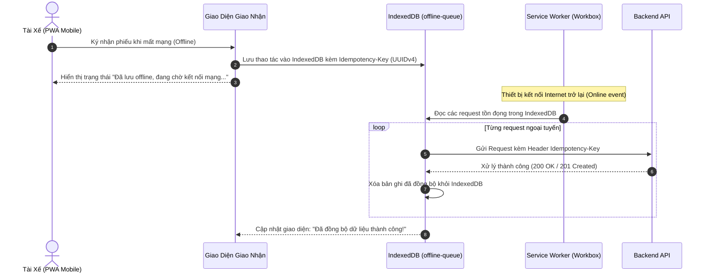

# ĐẶC TẢ YÊU CẦU & THIẾT KẾ CỔNG VẬN HÀNH NỘI BỘ (SRS & SDD)
## PHÂN HỆ CỔNG VẬN HÀNH XƯỞNG & ĐIỀU PHỐI ĐỐI TÁC (fe-react-thanhxuan-internal)

> **Tài liệu tham chiếu cấp cao:** [SRS_SDD.md (Kiến Trúc Tổng Quan)](file:///d:/PROJECT/Website_Thanh_Xuan_Company/.agents/docs/SRS_SDD.md)  
> **Phiên bản:** 2.2 | **Synced:** 2026-10-10 | **Môi trường:** React 18, Vite, TypeScript Strict, React Router v7, TailwindCSS, shadcn/ui  
> **Phạm vi mã nguồn:** `fe-react-thanhxuan-internal/src/**`  
> **Quy chuẩn kỹ thuật:** Feature-Based Flat Colocation, Barrel `index.ts`, Mobile-First PWA, Canvas Signature, Offline Queue IndexedDB, RBAC UI Guards

---

## 1. YÊU CẦU NGHIỆP VỤ (SRS)

### 1.1. Mục Tiêu & Đối Tượng Sử Dụng
Phân hệ `fe-react-thanhxuan-internal` là cổng điều hành số hóa toàn diện xưởng giặt là công nghiệp và chuỗi cung ứng B2B của Công ty Thanh Xuân:
1. **Đối tượng người dùng đa dạng (8 vai trò RBAC):**
   - **Tài xế giao nhận (`SHIPPER`)**: Thao tác trên thiết bị di động (Mobile PWA) tại đối tác để giao nhận đồ sạch/đồ bẩn, lấy chữ ký điện tử, nộp hóa đơn xăng xe.
   - **Thợ xưởng (`WORKER`)**: Chấm công vào/ra ca bằng camera selfie di động, chấm sản lượng khoán từng công đoạn (gấp, ủi, đóng gói), rạch bao đếm lại đồ gom.
   - **Thủ kho (`WAREHOUSE_MANAGER`)**: Soạn đồ sạch theo kế hoạch xuất xưởng, tiếp nhận đồ bẩn, kiểm đếm đối soát tại trạm đếm.
   - **Quản lý xưởng (`MANAGER`)**: Giám sát vận hành xưởng, phê duyệt tài khoản thợ/tài xế, chốt sản lượng khoán cuối ngày, rà soát các ca công bất thường. *(Ràng buộc: Bị ẩn 100% thông tin tiền bạc/lương)*.
   - **Đại diện đối tác (`PARTNER_MANAGER`, `PARTNER_STAFF`)**: Quản lý đối tác và Nhân viên đối tác (hỗ trợ alias tương thích ngược `RESTAURANT_MANAGER`, `RESTAURANT_STAFF`). Kiểm nhận đồ sạch tại chỗ, đếm đồ bẩn, ký xác nhận giao nhận, tra cứu bảng kê đối soát tháng, duyệt tài khoản nhân viên đối tác thuộc cơ sở mình.
   - **Kế toán (`ACCOUNTANT`)**: Phê duyệt đề xuất hoàn tiền xăng xe, cấu hình tham số lương, chạy tính bảng lương chu kỳ và xuất các báo cáo tài chính. *(Ràng buộc: Không tham gia phê duyệt tài khoản nhân sự)*.
   - **Quản trị viên hệ thống (`ADMIN`, `SYSTEM_ADMIN`)**: Toàn quyền quản trị nhân sự, đối tác, danh mục đồ giặt, khóa/mở khóa kỳ lương và giám sát toàn hệ thống.

---

### 1.2. Danh Sách Tính Năng Theo Nhóm Nghiệp Vụ (Functional Requirements)

#### FE-INT-FR-01: Xác Thực, Quản Trị Nhân Sự & Profile Header (`features/auth`, `features/management/auth`, `components/layout/AppHeader`)
- **Đăng nhập & Tài khoản mẫu:** Xác thực Email/Mật khẩu với Backend NestJS. Lưới tài khoản mẫu gồm 8 nút (Admin, Quản lý xưởng, Quản lý kho, Kế toán trưởng, Tài xế, Thợ xưởng, QL Đối Tác, NV Đối Tác) với mật khẩu mặc định `ThanhXuan@2026`, hỗ trợ đăng nhập tức thì.
- **Đăng ký tài khoản công khai (`/register`, `RegisterModal`):** Chỉ cho phép đăng ký 3 vai trò thực thi: **NV Xưởng** (`WORKER`), **NV Giao Hàng** (`SHIPPER`) và **Nhân Viên Đối Tác** (`PARTNER_STAFF`). Bỏ hoàn toàn vai trò Quản lý đối tác khỏi trang đăng ký công khai. Khi chọn Nhân viên đối tác, cascade chọn Thương hiệu (Brand) trước rồi lọc Chi nhánh (Partner).
- **Header Profile, Avatar & Dropdown Menu:**
  - Góc phải Header hiển thị Avatar tròn (ảnh Cloudinary hoặc ký tự viết tắt), Họ tên và Huy hiệu vai trò.
  - Dropdown Popover gồm 3 chức năng:
    * 👤 **Thông tin cá nhân:** Mở `ProfileEditModal` cho phép sửa họ tên, SĐT và chọn ảnh trực tiếp từ máy tính để upload lên Cloudinary. Cập nhật tức thì avatar trên Header.
    * 🔑 **Đổi mật khẩu:** Mở `ChangePasswordModal` nhập mật khẩu cũ, mật khẩu mới, xác nhận mật khẩu mới.
    * 🚪 **Đăng xuất:** Gọi `logout()` và xóa toàn bộ session storage.
- **Quản lý nhân sự toàn diện (`StaffManagementView`):**
  - **Tabs phân loại tài khoản:** 6 nhóm: *Tất Cả*, *Ban Quản Trị & Kế Toán*, *Vận Hành Xưởng & Kho*, *Giao Nhận*, *Khối Đối Tác B2B*, *Tài Khoản Tạm Khóa*.
  - **Thêm nhân sự:** Modal tạo mới tài khoản cho `ADMIN` và `MANAGER`, hỗ trợ tạo cả tài khoản Quản lý đối tác (`PARTNER_MANAGER`) kèm chọn Brand và Chi nhánh. Mật khẩu khởi tạo: `ThanhXuan@2026`.
  - **Chỉnh sửa nhân sự:** Cập nhật họ tên, SĐT, vai trò, thương hiệu và chi nhánh.
  - **Tạm khóa tài khoản & Cơ chế 60 ngày:** Chuyển trạng thái sang `LOCKED`, ghi nhận thời điểm `lockedAt`, hiển thị số ngày còn lại (ví dụ: *Còn 59 ngày trước khi xóa vĩnh viễn*). Backend tự động xóa các tài khoản đã khóa quá 60 ngày. Hỗ trợ Mở khóa (`ACTIVE`).
  - **Xóa tài khoản vĩnh viễn:** **Chỉ hiển thị và cho phép thực hiện đối với vai trò `ADMIN`**. Quản lý xưởng (`MANAGER`) không có nút xóa.
- **Phê duyệt tài khoản (`approval_requests`):** Quản lý đối tác (`PARTNER_MANAGER`) duyệt nhân viên đối tác thuộc cơ sở mình; Quản lý xưởng và Admin duyệt nhân sự nội bộ (`WORKER`, `SHIPPER`). Kế toán bị tước bỏ hoàn toàn quyền duyệt nhân sự.
- **Quên mật khẩu & Đặt lại mật khẩu:** Quy trình khôi phục mật khẩu 2 bước thông qua OTP email.

#### FE-INT-FR-02: Phân Hệ Phiếu Giao Nhận Kép (`features/operations/handovers`)
- **Tạo phiếu giao nhận:** Shipper hoặc Quản lý tạo phiếu theo chi nhánh đối tác. Tự động tải danh mục đồ vải theo đúng thương hiệu (`brand`).
- **Soạn đồ sạch xuất kho (`features/operations/handovers` - `WarehousePage`, `PrepOrderModal`):**
  - Thủ kho chuẩn bị số lượng đồ sạch dự kiến giao theo lịch đối tác vào ngày hôm sau.
  - Tự động điền trước (prefill) số lượng đồ sạch cần soạn dựa trên lượng đồ bẩn nhận về từ hôm trước.
  - **Giao diện Danh mục đồ giặt tối ưu hóa Mobile (Dual View Mode):**
    * **Dạng Thẻ (`Card View`):** Tự động kích hoạt trên thiết bị di động (< 768px). Hiển thị từng món theo khối thẻ dọc với nút bấm cảm ứng to bản, nhập Chưa giao, Giao trả nợ và Ghi chú trực tiếp mà không cần cuộn ngang màn hình.
    * **Dạng Bảng (`Table View`):** Bảng dữ liệu đầy đủ hỗ trợ vuốt cuộn ngang mượt mà (`overflow-x-auto min-w-[720px]`), cố định 2 cột đầu (*STT* `sticky left-0` và *Tên đồ giặt* `sticky left-10`) tránh mất dấu tên món đồ khi cuộn.
    * Nút chuyển đổi View Mode linh hoạt giữa 2 chế độ ngay trên thanh tiêu đề danh mục.
  - Tích hợp khung ký số điện tử (`SignatureCanvas`) và xuất phiếu giao nhận thành ảnh độ nét cao (`HandoverExportHelper`, `HandoverDeliverySlipModal`) để gửi vào nhóm Zalo.
- **Giao nhận 2 chiều trên Mobile:**
  - Cập nhật số lượng đồ sạch bàn giao thực tế (`cleanDelivery`).
  - Ghi nhận đồ bẩn thu gom (`dirtyPickup`): Chọn chế độ `ON_SITE` (đếm chi tiết từng món tại quán) hoặc `AT_FACTORY` (gom bao niêm phong đếm tại xưởng).
- **Chữ ký điện tử Canvas (`SignatureCanvas`):** Đại diện đối tác ký nhận trực tiếp trên màn hình cảm ứng điện thoại/tablet (Base64 PNG < 280KB).
- **Cơ chế Tự động Check-in cho Shipper (Plan 13):** Khi Shipper ký xác nhận phiếu giao nhận đầu tiên trong ngày, hệ thống tự động kích hoạt check-in ca làm việc nếu chưa check-in.
- **Sửa đổi ô phiếu sau ký (`EditFieldModal`):** Cho phép sửa ô phiếu khi có sai lệch phát hiện sau ký, ghi nhận `edit_marks`, lý do sửa, phát sinh thông báo tới Quản lý và audit log.
- **Cổng giao nhận & đối soát đối tác (`features/operations/partners` - `PartnerPortalPage`):** Cổng tra cứu riêng cho đối tác đối soát tổng sản lượng giao nhận theo tháng, đếm đồ bẩn gửi về xưởng (`/handover/partner-count`), xem lịch sử phiếu của đúng chi nhánh mình (Scope Isolation), ẩn hoàn toàn đơn giá tài chính. Quản lý đối tác có thêm tab duyệt nhân viên chi nhánh mình.

#### FE-INT-FR-03: Trạm Đếm Đồ Bẩn Tại Xưởng (`features/recount` - `RecountStationPage`)
- Phân quyền chuyên biệt cho Thợ xưởng (`WORKER`) và Thủ kho (`WAREHOUSE_MANAGER`).
- Danh sách các phiếu gom bao niêm phong từ xe tải chở về xưởng.
- Thao tác rạch bao đếm lại: Nhập số lượng thực tế từng món đồ, chụp ảnh hiện trường bao niêm phong, tự động tính chênh lệch thừa/thiếu (`variance`) so với số lượng nhà hàng khai báo.

#### FE-INT-FR-04: Chấm Công Camera Selfie & Khoán Sản Lượng (`features/attendance`, `features/piecework`)
- **Chấm công camera selfie (`WorkerAttendancePage`):**
  - Chỉ hiển thị cho Thợ xưởng (`WORKER`). Bắt buộc chụp ảnh trực tiếp từ camera trước của điện thoại, nén ảnh client trước khi tải lên.
  - Chặn chấm ca trùng (mỗi thợ chỉ có 1 ca mở trong ngày).
- **Chấm sản lượng khoán thợ (`WorkerPieceworkPage`):**
  - Thợ chọn món đồ và công đoạn (Gấp, Ủi, Đóng gói) để ghi nhận sản lượng.
  - Tự động lấy đơn giá chuẩn từ hệ thống tại thời điểm làm việc, thợ không thể can thiệp đơn giá.
  - Hỗ trợ nhập số âm để trừ bù khi kiểm đếm nhầm.
- **Chốt duyệt sản lượng (`ManagerPieceworkConfirmModal`):** Quản lý xưởng rà soát tổng sản lượng toàn xưởng vào cuối ngày và chốt duyệt trạng thái `CONFIRMED`.

#### FE-INT-FR-05: Quản Lý Hoàn Tiền Xăng Xe (`features/operations/fuel`, `features/management/fuel`)
- **Tài xế nộp đề xuất xăng (`FuelProposalPage`):** Chỉ hiển thị cho vai trò `SHIPPER`. Bắt buộc chụp ảnh hóa đơn cây xăng và ảnh đồng hồ công-tơ-mét / vạch xăng xe.
- **Kế toán duyệt xăng xe (`FuelApprovalPage`):** Kế toán và Admin duyệt hoặc từ chối đề xuất hoàn tiền. Quản lý xưởng bị ẩn chức năng này để bảo vệ thông tin tài chính.

#### FE-INT-FR-06: Quản Trị Bảng Lương & Tra Cứu Phiếu Lương (`features/operations/payroll`, `features/management/payroll`)
- **Quản lý kỳ lương (`PayrollPeriodPage`):** Kế toán và Admin khởi tạo kỳ lương tháng, tính toán tổng hợp tự động từ giờ công, sản lượng khoán và tiền hoàn xăng.
- **Đóng băng kỳ lương:** Khóa kỳ lương chuyển sang `LOCKED` (đóng băng dữ liệu nguồn). Chỉ Admin có quyền mở khóa kèm ghi nhận audit log.
- **Tra cứu phiếu lương cá nhân (`PayslipViewPage`):**
  - Nhân viên tự tra cứu chi tiết phiếu lương của mình (giờ công, sản lượng, hoàn xăng, khấu trừ, thực nhận).
  - Chỉ hiển thị khi kỳ lương đã ở trạng thái `LOCKED` hoặc `PAID`. Tuyệt đối không cho phép xem chéo phiếu lương.
  - Ẩn hoàn toàn với vai trò `ADMIN` (Admin không có phiếu lương nhân viên).

#### FE-INT-FR-07: Trung Tâm Báo Cáo Phân Tích & Xuất File (`features/operations/reports`, `features/management/reports`)
- Giao diện trực quan hóa 6 báo cáo aggregation: Báo cáo kho, Đối soát đối tác, Chấm công thợ, Lịch trình shipper, Sự cố chênh lệch và Báo cáo xăng xe.
- Bộ lọc khoảng ngày linh hoạt (tối đa 31 ngày).
- Xuất file tải về trực tiếp: Xuất file Excel XLSX và PDF streaming.
- Tự động bóc tách trường tiền lương khi Quản lý xưởng (`MANAGER`) truy cập.

---

## 2. THIẾT KẾ KIẾN TRÚC & HỆ THỐNG (SDD)

### 2.1. Cấu Trúc Thư Mục & Tổ Chức Mã Nguồn

```Markdown
fe-react-thanhxuan-internal/src/
├── app/
│   ├── (auth)/                          # Đăng nhập, Đăng ký OTP, Quên mật khẩu
│   │   ├── login/page.tsx               # /login
│   │   ├── register/page.tsx            # /register
│   │   └── forgot-password/page.tsx     # /forgot-password
│   │
│   ├── (internal)/                      # Vùng vận hành yêu cầu JWT xác thực
│   │   ├── layout.tsx                   # Layout khung: Topbar, Sidebar, Navigation
│   │   ├── dashboard/page.tsx           # /dashboard - Thống kê KPI tổng quan
│   │   │
│   │   ├── operations/                  # Phân hệ Vận Hành theo đối tượng (/operations/* - 100% số ít)
│   │   │   ├── attendance/page.tsx      # /operations/attendance - Thợ chấm công selfie
│   │   │   ├── payslip/page.tsx         # /operations/payslip - Tra cứu phiếu lương cá nhân
│   │   │   ├── report/page.tsx          # /operations/report - Trung tâm báo cáo & xuất Excel/PDF (số ít)
│   │   │   ├── warehouse-manager/
│   │   │   │   └── warehouse/page.tsx   # /operations/warehouse-manager/warehouse - Thủ kho soạn đồ sạch
│   │   │   ├── shipper/
│   │   │   │   ├── handover/page.tsx    # /operations/shipper/handover - Giao nhận 2 chiều
│   │   │   │   ├── handover/[recordCode]/page.tsx # Chi tiết phiếu & chữ ký Canvas
│   │   │   │   └── fuel/page.tsx        # /operations/shipper/fuel - Nộp hóa đơn xăng xe
│   │   │   ├── worker/
│   │   │   │   ├── recount/page.tsx     # /operations/worker/recount - Trạm đếm gom bao xưởng
│   │   │   │   └── piecework/page.tsx   # /operations/worker/piecework - Chấm sản lượng khoán
│   │   │   ├── partner-manager/
│   │   │   │   └── partner/page.tsx     # /operations/partner-manager/partner - Cổng đối tác (Quản lý)
│   │   │   └── partner-staff/
│   │   │       └── partner/page.tsx     # /operations/partner-staff/partner - Cổng đối tác (Nhân viên)
│   │   │
│   │   └── management/                  # Phân hệ Quản Trị theo vai trò (/management/* - 100% số ít)
│   │       ├── page.tsx                 # /management - Hub điều hành chung (thích ứng theo role)
│   │       ├── manager/
│   │       │   ├── approval/page.tsx    # /management/manager/approval - Phê duyệt tài khoản (số ít)
│   │       │   ├── personnel/page.tsx   # /management/manager/personnel - Quản trị nhân sự & RBAC
│   │       │   ├── partner/page.tsx     # /management/manager/partner - Quản trị chuỗi đối tác (số ít)
│   │       │   ├── attendance/page.tsx  # /management/manager/attendance - Bảng công toàn xưởng
│   │       │   └── piecework/page.tsx   # /management/manager/piecework - Chốt sản lượng khoán
│   │       └── accountant/
│   │           ├── fuel/page.tsx        # /management/accountant/fuel - Duyệt đề xuất xăng xe
│   │           └── payroll/page.tsx     # /management/accountant/payroll - Bảng lương chu kỳ & chốt sổ
│   │
│   ├── layout.tsx                       # Root Layout: AuthProvider, QueryClientProvider
│   └── router.tsx                       # Centralized Router cấu hình Route Guards & Backward Redirects
│
├── components/                          # Layout (nav-config, AppHeader, Sidebar), Shell, shadcn/ui
├── features/                            # Phân định rõ ràng Management vs Operations, chuẩn hóa file: *Page.tsx, modals/*Modal.tsx, components/*Component.tsx
│   ├── auth/                            # LoginPage, RegisterPage; modals/ (*Modal.tsx); components/ (*Component.tsx)
│   ├── dashboard/                       # DashboardPage, KPICards, QuickActions
│   ├── management/                      # Module Quản trị cấp quản lý & văn phòng
│   │   ├── attendance/                  # AttendanceReviewPage
│   │   ├── auth/                        # StaffManagementPage, ApprovalManagementPage, AuditLogPage; modals/ (*Modal.tsx); components/ (*Component.tsx)
│   │   ├── fuel/                        # FuelReviewPage
│   │   ├── partners/                    # PartnersPage; modals/ (PartnerModal, BrandModal, CatalogModal...); components/ (*Component.tsx)
│   │   ├── payroll/                     # PayrollManagementPage
│   │   └── piecework/                   # PieceworkConfirmPage
│   │
│   └── operations/                      # Module Vận hành hiện trường xưởng & di động
│       ├── attendance/                  # AttendancePage
│       ├── fuel/                        # FuelPage
│       ├── handovers/                   # HandoverListPage, HandoverDetailPage, WarehousePage, RecountStationPage; modals/ (*Modal.tsx); components/ (*Component.tsx)
│       ├── partners/                    # PartnerPortalPage; components/ (*Component.tsx)
│       ├── payroll/                     # MyPayslipPage
│       ├── piecework/                   # PieceworkStationPage; components/ (*Component.tsx)
│       └── reports/                     # ReportsPage; components/ (*Component.tsx)
│
├── lib/                                 # Tiện ích hạ tầng (api-client, permissions, offline-queue, utils)
└── types/                               # TypeScript Interfaces & Enums chuẩn hóa
```

---

### 2.2. Ma Trận Điều Hướng & Phân Quyền Menu (Navigation & RBAC)

Dựa trên cấu hình chuẩn hóa từ Plan 13, Plan 14 và Plan 16:

| Nhóm Tài Khoản | Tuyến Đường Mặc Định | Quyền Truy Cập Vận Hành (`/operations`) | Quyền Truy Cập Quản Lý (`/management`) |
| :--- | :--- | :--- | :--- |
| **`SHIPPER`** | `/operations/shipper/handover` | `/operations/shipper/handover`, `/operations/shipper/fuel`, `/operations/payslip` | ❌ Không có quyền |
| **`WORKER`** | `/operations/worker/piecework` | `/operations/worker/piecework`, `/operations/attendance`, `/operations/worker/recount`, `/operations/payslip` | ❌ Không có quyền |
| **`WAREHOUSE_MANAGER`**| `/operations/warehouse-manager/warehouse` | `/operations/warehouse-manager/warehouse`, `/operations/worker/recount`, `/operations/shipper/handover` (chế độ xem), `/operations/payslip` | ❌ Không có quyền *(Bị ẩn trường tiền)* |
| **`RESTAURANT_MANAGER`**| `/operations/partner-manager/partner`| `/operations/partner-manager/partner`, `/operations/shipper/handover` (chỉ chi nhánh mình) | `/management/manager/approval` (Chỉ xem và duyệt nhân viên chi nhánh mình) |
| **`RESTAURANT_STAFF`** | `/operations/partner-staff/partner` | `/operations/partner-staff/partner`, `/operations/shipper/handover` (chỉ chi nhánh mình) | ❌ Không có quyền |
| **`ACCOUNTANT`** | `/dashboard` | `/operations/payslip`, `/operations/report` | Quản lý kế toán & đối tác: `/management/accountant/payroll`, `/management/accountant/fuel`, `/management/manager/partner`, `/management/manager/personnel` *(Không có quyền duyệt tài khoản)* |
| **`MANAGER`** | `/dashboard` | `/operations/shipper/handover` (chế độ xem), `/operations/report` | Quản lý vận hành xưởng: `/management/manager/personnel`, `/management/manager/partner`, `/management/manager/attendance`, `/management/manager/piecework`, `/management/manager/approval` *(Ẩn hoàn toàn bảng lương & tiền)* |
| **`ADMIN`** | `/dashboard` | Toàn bộ các trang vận hành | Toàn quyền tuyệt đối 100% các chức năng quản lý |

---

### 2.3. Cơ Chế PWA & Hàng Đợi Ngoại Tuyến (Offline Queue)



- **An toàn giao dịch:** Mỗi request gửi từ offline queue luôn đính kèm header `Idempotency-Key` (UUIDv4) để Backend nhận diện và xử lý idempotent, tuyệt đối không bị trùng lặp dữ liệu khi kết nối mạng chập chờn.
- **Tối ưu hóa ảnh & Canvas:** Ảnh chụp camera selfie và ảnh hóa đơn xăng được nén trực tiếp qua canvas client trước khi lưu queue hoặc gửi API (giới hạn dung lượng < 500KB) nhằm tiết kiệm băng thông di động 4G.

---

### 2.4. Hệ Thống Thiết Kế Giao Diện Vận Hành (Modern Industrial UI System - Plan 19)

- **Typography & Font Stack:** Chuẩn hóa toàn bộ hệ thống sang `Plus Jakarta Sans` kết hợp `JetBrains Mono` cho các trường dữ liệu số/tiền tệ (`tabular-nums font-mono`).
- **Triết lý Thiết kế Ergonomics (Mode: Operate):**
  - Loại bỏ hoàn toàn các mẫu thiết kế "AI slop" (gradient rập khuôn, thẻ card phẳng lì).
  - Nút bấm cảm ứng cỡ lớn (`size="touch"` >= 52-56px) tối ưu thao tác 1 tay cho thợ xưởng và tài xế xe tải.
  - Hỗ trợ vùng đệm an toàn `env(safe-area-inset-bottom)` cho thiết bị iOS Safari và cử chỉ vuốt Android.
- **Bộ Component UI Cốt Lõi Mới (`src/components/ui/`):**
  - **`StatCard`:** Thẻ thống kê KPI vận hành chuyên nghiệp (container icon đa sắc thái, chỉ số nổi bật, badge xu hướng).
  - **`EmptyState`:** Minh họa trạng thái dữ liệu rỗng tinh tế kèm lời giải thích và nút hành động (CTA).
  - **`SkeletonLoader`:** Hiệu ứng shimmer mịn màng cho card và bảng dữ liệu khi tải mạng yếu.
  - **`Badge` & `Card`:** Bổ sung dot status indicator cho 5 trạng thái logistics (`SCHEDULED`, `IN_TRANSIT`, `PROCESSING`, `COMPLETED`, `DISPUTED`) và hiệu ứng hover elevation cho thẻ tương tác.
- **Trung Tâm Điều Hành (`DashboardPage.tsx`):**
  - Tích hợp Hero Banner thời gian thực, lưới 4 thẻ KPI trực quan và 2 bảng theo dõi tiến độ vận hành có trạng thái rỗng sinh động.

---

### 2.5. Phân Hệ Soạn Đồ Giao Hàng, Xuất Phiếu Giấy Zalo & Quản Lý Đối Tác (Plan 20)

- **Soạn Đồ Thủ Công & Prefill Thông Minh (`PrepOrderModal`):**
  - Cho phép chọn Thương hiệu -> Chi nhánh đối tác -> nạp danh mục đồ giặt (`item_catalogs`).
  - Tự động gọi API `/handover/previous-dirty` lấy số lượng đồ bẩn nhận hôm trước để điền sẵn vào cột số lượng sẽ giao ngày mai.
  - Hỗ trợ nhập 3 loại số lượng sạch: *Đã giao*, *Chưa giao*, *Giao trả nợ* kèm cột *Ghi chú* từng dòng (ví dụ: *"đã giao trước trong ngày xxx chiếc"*).
  - Tích hợp khung Canvas ký tên điện tử và tự động điền họ tên người lập phiếu theo tài khoản đăng nhập.
  - Tối ưu hiển thị Responsive trên di động: Hỗ trợ chuyển đổi linh hoạt Dual View Mode giữa **Dạng Thẻ (`Card View`)** tiện bấm stepper và **Dạng Bảng (`Table View`)** cuộn ngang với cột STT, Tên đồ giặt ghim cố định bên trái (ẩn mã đồ phụ).
- **Xuất Phiếu Xuất Nhập Kho Vận Chuyển Chuẩn Mẫu Thực Tế (`HandoverDeliverySlipModal` & `HandoverExportHelper`):**
  - Render Canvas HTML5 mô phỏng chính xác phiếu giấy in thực tế của Pizza 4P's: khổ giấy A4 nền trắng (`900x1320px`), viền sắc nét.
  - **Khung thông tin công ty góc trên:** Cách lề trên chuẩn `50px` (`box1Y = 50;`), bố cục căn trái (`textAlign = "left"`) gồm 4 dòng độc lập: Tên công ty (`bold 17px`), Mã số thuế (`bold 15px`), Điện thoại (`bold 15px`), Địa chỉ (`bold 15px / 14px`) với các dấu hai chấm `:` thẳng hàng theo chiều dọc.
  - **Khung Nơi Nhận (`box2`):** Cỡ chữ to rõ (`15.5px` - `16.5px`), tên đối tác viết hoa in đậm `16.5px`, chi nhánh/bộ phận màu xanh dương đậm `#1d4ed8`.
  - **Bảng dịch vụ 16 dòng kẻ ô:** Hàng tiêu đề các cột chính nâng lên `bold 15px`, các cột con nâng lên `bold 12.5px`.
  - **Chân trang cam kết dịch vụ:** Căn đều 2 lề 100% chiều rộng bảng 820px (`footerY = 1100;`), cỡ chữ `13px` - `14px`, không để khoảng trắng thừa.
  - **Chế độ In Sạch (Clean Print):** Áp dụng CSS `@page { size: A4 portrait; margin: 0mm !important; }` triệt tiêu 100% header/footer của trình duyệt (`about:blank`, `1/1`, ngày giờ in).
  - **Khắc phục lỗi cuộn đỉnh phiếu trên PC:** Tái cấu trúc container sang `flex flex-col items-center justify-start py-6`, loại bỏ lỗi `items-center` đẩy đỉnh ảnh phiếu vào vùng âm cuộn.
  - Hỗ trợ nút **"In Phiếu"**, **"Tải Xuống Thành Ảnh (.PNG)"** và **"Sao chép ảnh"** để dán gửi ngay vào nhóm Zalo giao nhận.
- **Phân Quyền & Quản Lý Mã QR Zalo CSKH (`ZaloQrSettingsModal`, `PartnersActionBar`, `PartnersPage`):**
  - Tách nút cài đặt mã QR Zalo khỏi modal xem phiếu của nhân viên kho vận.
  - Tích hợp nút **"Cài QR Zalo Phiếu"** vào thanh công cụ Quản lý Đối tác (`/management/manager/partner`), giới hạn phân quyền truy cập cho vai trò **`ADMIN`** và **`MANAGER`**.
  - Thanh công cụ [PartnersActionBar.tsx](file:///d:/PROJECT/Website_Thanh_Xuan_Company/fe-react-thanhxuan-internal/src/features/management/partners/components/PartnersActionBar.tsx) chuẩn hóa các nút hành động bên phải sang kích thước gọn gàng `size="sm"` (`h-8`, font `text-xs font-semibold`, icon `w-3.5 h-3.5`), cân đối với khối tab bên trái.
  - Modal xem phiếu tự động đọc mã QR đã lưu trong `localStorage ('TX_ZALO_QR_CODE')` và vẽ trực tiếp lên phiếu xuất.
- **Tự Động Lên Đơn Định Kỳ (`WarehouseScheduleSettingsDialog`):**
  - Cấu hình tự động sinh phiếu giao nhận cho các chi nhánh có lịch giao định kỳ (`DAILY`, `ALTERNATE_DAYS`) và tự động prefill số lượng đồ bẩn hôm trước sang số lượng sẽ giao ngày mai.
  - Các chi nhánh chưa có lịch cố định (`ON_DEMAND`) chỉ lên đơn thủ công.
- **Sửa Lỗi Popup Modal Chuẩn UX (`PartnerDialog` & `dialog.tsx`):**
  - Chuẩn hóa layout `Dialog` chống tràn mép, cố định Header và Footer, bọc các input vào container `max-h-[60vh] overflow-y-auto` giải quyết triệt để lỗi footer đè lên input.

---

### 2.6. Cải Tiến Cổng Đối Tác B2B, Form Đếm Đồ Bẩn Thông Minh & Kiểm Nhận Canvas 2 Chiều (Plan 21)

- **Quy Chuẩn 3 Tầng Giao Diện Với `@/components/common`:**
  - Tầng 1: `PageBanner` hiển thị tiêu đề cổng đối tác B2B, tên thương hiệu/chi nhánh, icon và trạng thái liên kết.
  - Tầng 2: `PageActionBar` chứa thanh điều hướng tab trên Desktop (`lg:flex`) và các nút thao tác nhanh.
  - Tầng 3: `ResponsiveCardGrid` hiển thị danh sách phiếu lịch sử tự co dãn từ 1 đến 4 cột chuẩn công thái học.
- **Menu Phân Hệ Đối Tác Mobile-First & Bỏ Hoàn Toàn Sidebar:**
  - Áp dụng cho 2 tuyến đường `/operations/partner-manager/partner` và `/operations/partner-staff/partner`.
  - 4 mục điều hướng cốt lõi: **Đếm đồ bẩn** (`COUNT`), **Kiểm nhận đồ sạch** (`RECEIPT`), **Lịch sử** (`HISTORY`), **Phê duyệt tài khoản** (`STAFF`, chỉ hiển thị nếu role là `PARTNER_MANAGER`).
  - Trên màn hình di động (`lg:hidden`), toàn bộ điều hướng chuyển xuống thanh **Mobile Bottom Bar** cố định đáy màn hình, đồng bộ trạng thái qua query param URL `?tab=`, ẩn nút Hamburger trên Header và nút 'Thêm' trên Bottom Bar.
  - **Bỏ hoàn toàn Sidebar trên Desktop & Drawer trên Mobile:** Ẩn `DesktopSidebar` và `MobileNavDrawer`, bỏ lùi lề `lg:pl-64` để nội dung mở rộng toàn màn hình, tinh giản tối đa không gian làm việc cho nhân viên và quản lý nhà hàng đối tác.
- **Form Đếm Đồ Bẩn Thông Minh & Ghép Phiếu Giao Nhận Kép (`PartnerCountTabComponent.tsx`):**
  - Tái cấu trúc chuẩn theo form `PrepOrderModal` hỗ trợ chuyển đổi linh hoạt Dual View Mode giữa **Dạng Thẻ (`Card View`)** và **Dạng Bảng (`Table View`)**.
  - Tự động nhận diện tài khoản để khóa cứng (disabled / read-only) Thương hiệu, Chi nhánh và Ngày (mặc định lấy theo ngày của phiếu soạn đồ do quản lý kho tạo).
  - Thay thế các cột soạn đồ thành duy nhất **1 cột số lượng: "Đồ chưa giặt"**. Bỏ ghi chú chung, giữ ghi chú từng món nếu có phát sinh rách/hỏng.
  - **Cơ chế Smart Math Input & Tự động lưu khi rời ô (`onBlur`):** Hàm `parseSmartQtyExpression(input)` an toàn (không dùng `eval`), hỗ trợ nhập biểu thức tính toán phân cách bằng dấu cách hoặc phép tính (`12 34`, `12 + 34` => tính ra `46`, `50-10` => tính ra `40`); tự động tính kết quả và lưu ngay khi rời ô input.
  - **Lưu & Xuất Phiếu Kép:** Bấm *"Lưu và xem phiếu giao nhận"* sẽ ghi nhận dữ liệu đếm đồ bẩn và chữ ký người đếm vào phiếu giao nhận (cột *Số lượng đã nhận* `dirtyReceivedQty`), đồng thời ghép dữ liệu đồ sạch xưởng đã soạn trong ngày để hiển thị đồng thời cả 2 chiều trên phiếu xuất nhập kho Canvas.
- **Kiểm Nhận Đồ Sạch Trực Quan Bằng Canvas 2 Chiều (Tab `RECEIPT` - `PartnerReceiptTabComponent.tsx`):**
  - Hiển thị trực tiếp phiếu giao nhận 2 chiều xuất nhập kho vẽ bằng HTML5 Canvas sắc nét để đối tác kiểm đếm đồ sạch đối soát với đồ bẩn.
  - Nút điều hướng ngày: **Sang trái (`ChevronLeft`)** lùi 1 ngày, **Sang phải (`ChevronRight`)** tiến 1 ngày để dễ dàng lật xem phiếu giao nhận theo ngày.
  - Ô **họ tên người nhận** (mặc định nạp tự động từ tài khoản đăng nhập `user.fullName || user.name`) và ô **ký tên** (`SignatureCanvas`) ngay dưới phiếu để ký xác nhận kiểm nhận gửi API `/handover/:id/receipt-check`.
- **Lịch Sử Giao Nhận Phân Trang & Tra Cứu Theo Ngày (Tab `HISTORY` - `PartnerHistoryTabComponent.tsx`):**
  - Danh sách phiếu giao nhận sắp xếp theo thứ tự **từ mới đến cũ** (mới nhất lên đầu) trong `ResponsiveCardGrid`.
  - **Phân trang (Pagination):** Tối đa **12 phiếu / trang** kèm thanh chuyển trang tiện lợi.
  - **Bộ lọc ngày cụ thể:** Bộ chọn ngày (Date Picker) lọc và xem ngay phiếu giao nhận của 1 ngày bất kỳ, bấm vào mở modal xem chi tiết phiếu Canvas.
- **Khắc Phục Toàn Diện Lỗi Console & Quyền Hạn:**
  - Sửa lỗi **403 Forbidden** trên các API `/partners/brands`, `/partners`, `/partners/catalogs`, `/handover/prep-order`: Cập nhật `permissions.map.ts` cấp đúng quyền truy cập cho `PARTNER_MANAGER` và `PARTNER_STAFF`.
  - Sửa lỗi **Maximum update depth exceeded** ở `PrepOrderModal.tsx`: Thêm điều kiện chặn vòng lặp `useEffect` khi danh sách chi nhánh rỗng hoặc nạp lại `defaultPartnerId`.


