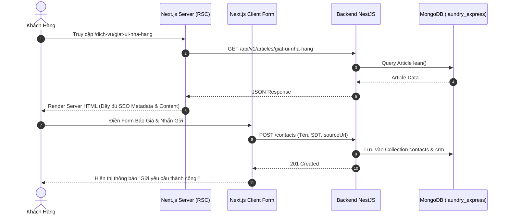

# ĐẶC TẢ YÊU CẦU & THIẾT KẾ HỆ THỐNG WEB GIẶT LÀ & CMS (SRS & SDD)
## PHÂN HỆ WEB KHÁCH HÀNG & QUẢN TRỊ MARKETING (fe-nextjs-thanhxuan-laundry)

> **Tài liệu tham chiếu cấp cao:** [SRS_SDD.md (Kiến Trúc Tổng Quan)](file:///d:/PROJECT/Website_Thanh_Xuan_Company/.agents/docs/SRS_SDD.md)  
> **Phiên bản:** 2.4 | **Môi trường:** Next.js 14+ (App Router), React 18/19, TailwindCSS, shadcn/ui, Port 3000  
> **Phạm vi mã nguồn:** `fe-nextjs-thanhxuan-laundry/src/**`  
> **Quy chuẩn kỹ thuật:** Server Components mặc định, Feature-based Colocation, Metadata SEO & JSON-LD, React Hook Form + Zod  
> **Database Backend kết nối:** MongoDB `laundry_express` qua Backend NestJS (Port 5001)

---

## 1. YÊU CẦU NGHIỆP VỤ (SRS)

### 1.1. Mục Tiêu & Đối Tượng Sử Dụng
Phân hệ đảm nhiệm 2 vai trò cốt lõi trong mảng dịch vụ giặt là của Thanh Xuân Company:
1. **Cổng Thông Tin Tiếp Thị & Dịch Vụ Khách Hàng (Public Facing - `thanhxuanlaundry.com`)**:
   - Đối tượng: Khách hàng doanh nghiệp B2B (Nhà hàng, khách sạn, spa) và khách hàng cá nhân có nhu cầu giặt sấy cao cấp.
   - Mục tiêu: Tiếp thị thương hiệu, tối ưu hóa công cụ tìm kiếm (SEO Top Google), cung cấp thông tin bảng giá minh bạch, thu thập leads liên hệ và yêu cầu báo giá chuyển đổi.
2. **Hệ Thống Quản Trị Nội Dung & Tiếp Thị (CMS Admin - `/admin`)**:
   - Đối tượng: Quản trị viên marketing (`ADMIN`, `MARKETER`, `CONTENT_CREATOR`).
   - Mục tiêu: Quản lý bài viết SEO, biên tập danh mục dịch vụ, theo dõi khách hàng liên hệ (CRM Leads), quản lý đơn đặt lịch giặt và triển khai chiến dịch tiếp thị qua Zalo OA / Email.

---

### 1.2. Danh Sách Tính Năng Theo Nhóm (Functional Requirements)

#### FE-LAUNDRY-FR-01: Phân Hệ Web Khách Hàng Công Khai (`(public)`)
- **Trang chủ (`/`):** Hero Section chia chéo (Diagonal Split) video reel xưởng giặt công nghiệp + ảnh thành phẩm cao cấp & floating badges, giới thiệu năng lực xưởng giặt là công nghiệp, quy trình giặt sấy tiêu chuẩn, danh sách đối tác lớn, bảng giá tóm tắt và Pre-Footer CTA (cam kết tặng 01 tuần giặt mẫu, giao nhận 24/7, bồi thường 100% kèm form thu thập lead chuyển đổi).
- **Giới thiệu (`/gioi-thieu`):** Lịch sử phát triển công ty, quy mô máy móc công nghệ, cam kết chất lượng dịch vụ.
- **Dịch vụ giặt là (`/dich-vu`, `/dich-vu/[slug]`):**
  - Danh mục dịch vụ chuyên sâu: Giặt ủi nhà hàng, giặt chăn ga khách sạn, giặt đồ spa, giặt sấy công nghiệp, giặt hấp đồ hiệu.
  - Tự động tích hợp Form nhận báo giá / CTA chuyển đổi ở cuối mỗi bài viết dịch vụ.
- **Tin tức & Cẩm nang SEO (`/tin-tuc`, `/tin-tuc/[slug]`):**
  - Hệ thống bài viết tư vấn giặt ủi, chia sẻ kinh nghiệm xử lý vết bẩn, hướng dẫn đối tác bảo quản vải vóc.
  - Tự động liên kết bài viết liên quan và form liên hệ cuối bài.
- **Liên hệ báo giá (`/lien-he`):** Form thu thập thông tin khách hàng (Tên, SĐT, Email, Nhu cầu, Số lượng ước tính, Ghi chú), tích hợp Google Maps vị trí xưởng và thông tin hotline.
- **Lead Capture & Context Tracking:** Mọi form gửi thông tin liên hệ đều tự động đính kèm ngữ cảnh (`sourceUrl`, `category`, `slug`) để đo lường hiệu quả từng bài viết marketing.

#### FE-LAUNDRY-FR-02: Phân Hệ Quản Trị Nội Dung CMS (`(admin)/admin`)
- **Xác thực Quản trị viên (`/admin/login`):** Đăng nhập bảo mật bằng tài khoản Admin Backend, lưu JWT token an toàn trong httpOnly Cookie (`admin_access_token`, `admin_refresh_token`, cờ `secure: true` trên production, `sameSite: 'lax'`) và quản lý phiên tự động qua Next.js Middleware. Route Handler `/api/upload` được bảo vệ nghiêm ngặt bằng cookie xác thực trước khi cho phép tải hoặc xóa file.
- **Tổng quan Bảng điều khiển (`/admin/dashboard`):** Thống kê số lượng leads mới, đơn hàng chờ xử lý, số bài viết đã xuất bản và biểu đồ tương tác khách hàng.
- **Quản lý Bài viết & Danh mục (`/admin/articles`, `/admin/categories`):**
  - Thêm, sửa, xóa, xuất bản bài viết chuẩn SEO.
  - Soạn thảo rich-text hoặc markdown, cấu hình ảnh đại diện Thumbnail (tải lên Cloudinary).
  - Tùy biến Meta Title, Meta Description, Open Graph Image và Slug URL thân thiện SEO.
- **Quản lý Khách hàng & Leads (`/admin/contacts`, `/admin/crm`):** Tiếp nhận danh sách khách hàng gửi yêu cầu tư vấn, cập nhật trạng thái xử lý (Mới, Đang tư vấn, Đã chốt, Không thành công).
- **Quản lý Đơn hàng Giặt Sấy (`/admin/orders`):** Quản lý các đơn đặt lịch dịch vụ của khách hàng cá nhân và doanh nghiệp.
- **Chiến dịch Tiếp thị (`/admin/email-marketing`, `/admin/zalo-marketing`):** Soạn thảo kịch bản chăm sóc khách hàng và gửi thông báo qua Zalo OA và Email tự động.
- **Cấu hình Hệ thống (`/admin/settings`, `/admin/accounts`):** Thông tin công ty, hotline, email liên hệ, banner quảng cáo.

---

### 1.3. Yêu Cầu Phi Chức Năng & SEO
- **Tối ưu hóa SEO 100%:**
  - 100% các trang `(public)` sử dụng **React Server Components (RSC)** để HTML được render hoàn toàn tại server (SSR/SSG), tối đa hóa điểm Google Core Web Vitals.
  - Cung cấp Metadata động (`generateMetadata`) cho từng bài viết và dịch vụ (Title, Description, Canonical URL, OpenGraph, Twitter Card).
  - Tự động phát sinh `sitemap.xml` qua `src/app/sitemap.ts` và `robots.txt` qua `src/app/robots.ts`.
  - Nhúng dữ liệu có cấu trúc Schema.org JSON-LD (`LocalBusiness`, `Organization`, `Article`, `Service`).
- **Tối ưu hình ảnh:** Dùng `next/image` kết hợp Cloudinary Loader hoặc Next.js Image Optimization, định dạng WebP/AVIF, lazy loading ảnh ngoài màn hình.

---

## 2. THIẾT KẾ KIẾN TRÚC & HỆ THỐNG (SDD)

### 2.1. Cấu Trúc Thư Mục Dự Án

```Markdown
fe-nextjs-thanhxuan-laundry/src/
├── app/
│   ├── (public)/                        # Route Group: Web Khách Hàng (Server Components)
│   │   ├── page.tsx                     # Trang chủ (Server Component render HomePage)
│   │   ├── layout.tsx                   # Header, Footer, Zalo Widget chung cho public
│   │   ├── dich-vu/                     # Danh sách và chi tiết dịch vụ ([...slug]/page.tsx -> ServiceDetailPage)
│   │   ├── tin-tuc/                     # Cẩm nang & bài viết SEO (page.tsx -> ArticleListPage)
│   │   ├── gioi-thieu/                  # Giới thiệu công ty
│   │   └── lien-he/                     # Form liên hệ & bản đồ (page.tsx -> ContactPage)
│   │
│   ├── (admin)/admin/                   # Route Group: CMS Quản Trị
│   │   ├── layout.tsx                   # AdminShellComponent (Sidebar & Topbar CMS)
│   │   ├── login/                       # Trang đăng nhập Admin (LoginFormComponent)
│   │   ├── dashboard/                   # Bảng điều khiển tổng hợp (DashboardPage)
│   │   ├── articles/                    # Quản lý bài viết SEO (ArticleManagerPage)
│   │   ├── categories/                  # Quản lý danh mục bài viết / dịch vụ (CategoryManagerPage)
│   │   ├── contacts/                    # Quản lý khách hàng liên hệ (ContactManagerPage)
│   │   ├── crm/                         # Pipeline chăm sóc khách hàng (CrmManagerPage)
│   │   ├── orders/                      # Quản trị đơn giặt sấy (OrdersManagerPage)
│   │   ├── zalo-marketing/              # Quản lý chiến dịch Zalo OA (ZaloMarketingPage)
│   │   ├── email-marketing/             # Quản lý chiến dịch Email (EmailMarketingPage)
│   │   ├── accounts/                    # Quản lý tài khoản Admin (AccountManagerPage)
│   │   └── settings/                    # Cấu hình website (SettingEditor*Component)
│   │
│   ├── api/                             # Route Handlers nội bộ (proxy, upload)
│   ├── globals.css                      # Tailwind tokens & CSS Variables
│   ├── layout.tsx                       # Root Layout (Font Inter, Metadata chung)
│   ├── robots.ts                        # Trả về robots.txt tự động
│   └── sitemap.ts                       # Sinh sitemap.xml động từ Backend API
│
├── components/                          # UI & Shared Components dùng chung
│   ├── common/                          # Tiện ích chung (ConfirmAlertDialogComponent, ProfileModal, ThemeToggleComponent, ThemeProvider)
│   ├── layout/                          # Layout shells & navigation
│   │   ├── admin/                       # AdminShellComponent, AdminHeaderComponent, AdminSidebarComponent
│   │   └── public/                      # PublicHeaderComponent, PublicFooterComponent, DraggableFloatingContactComponent
│   └── ui/                              # shadcn/ui primitives (Button, Input, Dialog, Table, Form...)
│
├── features/                            # Feature-based Flat Colocation
│   ├── admin/                           # 11 Modules Quản Trị CMS
│   │   ├── articles/                    # ArticleManagerPage.tsx, modals/ (ArticleEditorModal, ArticleTrashModal), components/
│   │   ├── categories/                  # CategoryManagerPage.tsx, modals/ (CategoryEditorModal), admin-categories.service.ts
│   │   ├── contacts/                    # ContactManagerPage.tsx, modals/ (ContactTrashModal), components/
│   │   ├── crm/                         # CrmManagerPage.tsx, components/ (CrmManagerTable, CrmManagerToolbar)
│   │   ├── dashboard/                   # DashboardPage.tsx
│   │   ├── email-marketing/             # EmailMarketingPage.tsx, modals/, components/
│   │   ├── orders/                      # OrdersManagerPage.tsx, modals/, components/
│   │   ├── settings/                    # SettingsPage.tsx, components/ (SettingEditor*Component)
│   │   ├── users/                       # AccountManagerPage.tsx, modals/ (AccountEditorModal)
│   │   ├── auth/                        # LoginFormComponent.tsx, admin-auth.service.ts
│   │   ├── zalo/                        # ZaloMarketingPage.tsx, admin-zalo.service.ts
│   │   └── index.ts                     # Barrel export 11 feature quản trị
│   │
│   └── public/                          # 6 Modules Web Khách Hàng B2B & Public
│       ├── home/                        # HomePage.tsx, components/ (HeroSection, IntroSection, ServicesGrid, WhyChooseUs, FaqSection, PreFooterCta)
│       ├── articles/                    # ArticleListPage.tsx, components/ (ArticleList, ArticleSortFilter)
│       ├── contacts/                    # ContactPage.tsx, public-contacts.service.ts, public-contacts.action.ts
│       ├── services/                    # ServiceDetailPage.tsx, public-services.service.ts
│       ├── settings/                    # public-settings.service.ts
│       ├── seo/                         # Cấu hình Metadata & Schema.org JSON-LD
│       └── index.ts                     # Barrel export các feature public
│
├── services/                            # Tầng kết nối API Backend tập trung (api.service.ts)
├── types/                               # TypeScript Interfaces & DTOs
└── middleware.ts                        # Bảo vệ route /admin/*, kiểm tra JWT Cookie
```

---

### 2.2. Luồng Xử Lý & Tích Hợp API Backend



---

### 2.3. Quy Chuẩn Kỹ Thuật Bắt Buộc
1. **Server Components:** Mọi trang đọc dữ liệu hiển thị trong thư mục `(public)` bắt buộc là Server Component. Chỉ thêm `"use client"` cho các component tương tác ở lá (Leaf Components) như form, slider, dynamic UI.
2. **Form Validation:** Sử dụng `react-hook-form` kết hợp `zod` schema để validate dữ liệu form phía client trước khi gửi lên API Backend.
3. **Quản lý Media:** Hình ảnh tải lên bài viết được gửi qua Backend để lưu trữ trực tiếp trên Cloudinary, không lưu trữ file tĩnh trên server Next.js.
4. **Quy Chuẩn Cấu Trúc & Đặt Tên File Frontend (Đồng bộ theo AGENTS.md Mục 5.3):**
   - File màn hình chính cấp cao nhất: `[Tên]Page.tsx` đặt trực tiếp tại root của feature (VD: `ArticleManagerPage.tsx`, `HomePage.tsx`).
   - Thư mục `modals/`: Chứa các modal nghiệp vụ `[Tên]Modal.tsx` kèm `modals/index.ts`.
   - Thư mục `components/`: Chứa các subcomponent hiển thị `[Tên]Component.tsx` kèm `components/index.ts`.
   - Shared components: Phân tách rõ ràng `components/layout/` (`admin/`, `public/`), `components/common/`, `components/ui/`.
   - Giới hạn kích thước file 250 - 300 dòng; bóc tách modal và subcomponents kịp thời, không dồn hàng nghìn dòng vào 1 file.
