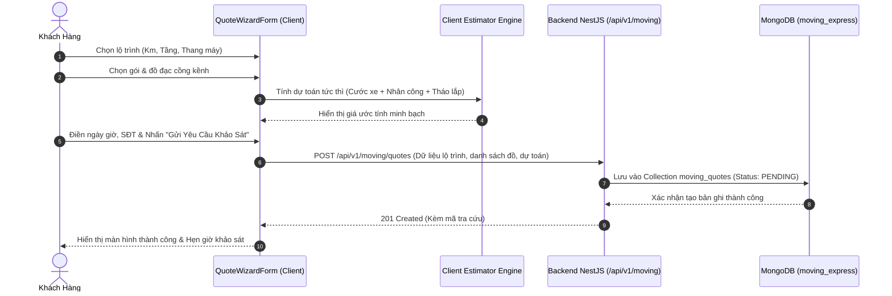

# ĐẶC TẢ YÊU CẦU & THIẾT KẾ HỆ THỐNG WEB CHUYỂN NHÀ TIẾT KIỆM (SRS & SDD)
## PHÂN HỆ WEB DỊCH VỤ & BÁO GIÁ CƯỚC XE TẢI (fe-nextjs-chuyennhatietkiem)

> **Tài liệu tham chiếu cấp cao:** [SRS_SDD.md (Kiến Trúc Tổng Quan)](file:///d:/PROJECT/Website_Thanh_Xuan_Company/.agents/docs/SRS_SDD.md)  
> **Phiên bản:** 1.2 | **Môi trường:** Next.js 16 (App Router), React 19, TailwindCSS, Port 3002  
> **Phạm vi mã nguồn:** `fe-nextjs-chuyennhatietkiem/src/**`  
> **Quy chuẩn kỹ thuật:** Server Components SEO, Feature-based Colocation, Wizard Form Step-by-Step, TypeScript Strict Mode  
> **Database Backend kết nối:** MongoDB `moving_express` qua Backend NestJS (Port 5001, tiền tố `/api/v1/moving`)

---

## 1. YÊU CẦU NGHIỆP VỤ (SRS)

### 1.1. Mục Tiêu & Định Vị Kinh Doanh
Phân hệ đảm nhiệm vai trò tiếp thị trực tuyến và thu hút khách hàng cho mảng dịch vụ dọn nhà, chuyển văn phòng trọn gói và cho thuê xe tải của Thanh Xuân Company:
1. **Định Vị Kinh Doanh:** Mô hình Logistics Tinh Gọn (Asset-Light):
   - Thế mạnh độc quyền: **Đội thợ bốc xếp, thợ mộc, thợ điện lạnh cơ hữu** lành nghề trực tiếp thi công tháo lắp đồ gỗ, điều hòa, đóng gói tiêu chuẩn cao.
   - Kết hợp **Mạng lưới đối tác xe tải vệ tinh điều xe giá gốc**, giúp tối ưu hóa chi phí vận hành, giảm 30% giá thành so với các hãng vận tải truyền thống nuôi đội xe nặng nề.
2. **Đối Tượng Phục Vụ:**
   - Sinh viên, người độc thân thuê trọ (gói tiết kiệm, xe van/ba gác/xe tải nhỏ 500kg).
   - Hộ gia đình chuyển nhà chung cư, nhà phố (gói trọn gói tháo lắp nội thất, điều hòa).
   - Doanh nghiệp chuyển văn phòng, kho xưởng (gói dự án, xuất hóa đơn VAT).
   - Khách hàng tự dọn cần thuê riêng thợ bốc xếp theo giờ hoặc thuê xe tải tự lái/kèm tài xế.

---

### 1.2. Danh Sách Tính Năng Theo Nhóm (Functional Requirements)

#### FE-MOVING-FR-01: Phân Hệ Web Khách Hàng Công Khai (`(public)`)
- **Trang chủ (`/`):**
  - `HeroEstimatorComponent`: Bộ dự toán cước phí tức thì trong 5 giây với thanh trượt cự ly (Km), lựa chọn gói dịch vụ (Trọn gói / Chỉ thuê thợ / Tháo lắp kỹ thuật), bộ đếm nhảy số sinh động và nút CTA chuyển tiếp sang luồng đặt lịch.
  - `WhySaveBentoComponent`: Thẻ Bento Grid trực quan giải thích 4 lý do tiết kiệm (Mô hình tinh gọn không phí nuôi xe, Thợ kiêm mộc & điện lạnh, Tặng miễn phí vật tư thùng carton/màng PE bọc lót, Cam kết bồi thường 100% nếu trầy xước/đổ vỡ).
  - `SmartCargoVisualizerComponent`: Công cụ khảo sát tải trọng thông minh — khách hàng click chọn danh sách đồ đạc (tủ lạnh, máy giặt, giường tủ, sofa, số thùng...) $\rightarrow$ hệ thống tự động quy đổi m³ và đề xuất kích cỡ xe tải (500kg, 1.25 tấn, 1.9 tấn, 2.4 tấn) cùng số lượng nhân công bốc xếp tối ưu.
  - `CostComparisonComponent`: Bảng so sánh đa chiều chi phí ẩn giữa việc tự dọn/thuê xe ba gác tự phát vs Dịch vụ chuyển nhà trọn gói Thanh Xuân (rủi ro mất đồ, hỏng nội thất, mệt mỏi, phát sinh phụ phí).
  - `PackingProtectionComponent`: Trực quan hóa quy chuẩn đóng gói bọc lót 4 lớp bảo vệ tài sản (Màng PE chống bụi $\rightarrow$ Xốp nổ chống sốc $\rightarrow$ Thùng carton 5 lớp $\rightarrow$ Băng keo chuyên dụng).
  - `RecentProjectsShowcaseComponent`: Hình ảnh và thông tin các dự án dọn nhà, chuyển văn phòng thực tế đã hoàn thành.
  - `CustomerReviewsComponent`: Đánh giá phản hồi thật từ khách hàng trải nghiệm dịch vụ.
  - `InteractiveChecklistComponent`: Danh sách 10 việc cần chuẩn bị trước ngày dọn nhà, tự động lưu tiến độ vào `localStorage` của trình duyệt.
  - `CtaSection`: Khối kêu gọi hành động đặt lịch nhanh với cam kết khảo sát tận nơi miễn phí.

- **Khảo sát & Đặt lịch chuyển nhà (`/dat-lich`):**
  - Sử dụng Form tương tác đa bước `QuoteWizardForm.tsx` (chia thành 4 sub-components chuyên trách `< 200 dòng/file`):
    - `Step1LocationComponent`: Nhập điểm bốc hàng, điểm dỡ hàng, thông tin số tầng lầu, thang bộ hay thang máy, khoảng cách cự ly di chuyển (Km).
    - `Step2ItemsComponent`: Chọn gói dịch vụ (`STUDENT_ROOM`, `APARTMENT`, `OFFICE`, `TRUCK_RENTAL`, `LABOR_ONLY`) và bộ tăng giảm số lượng đồ đạc cồng kềnh, thiết bị cần tháo lắp (điều hòa, giường tầng, tủ quần áo).
    - `Step3ScheduleComponent`: Chọn ngày giờ chuyển dọn, gửi đính kèm liên kết ảnh chụp hiện trường/đồ đạc, ghi chú ngõ hẹp/cấm giờ xe tải.
    - `Step4ReviewComponent`: Nhập thông tin người liên hệ (Tên, SĐT, Email), hiển thị bảng bóc tách chi tiết dự toán tự động, gửi lead về Backend NestJS lưu vào collection `moving_quotes` thuộc DB `moving_express`.

- **Bảng giá niêm yết công khai (`/bang-gia`):**
  - Bảng cước mở cửa xe tải đối tác theo các cung cự ly (dưới 5km, từ 5-10km, từ 10-20km, trên 20km) cho các loại tải trọng (500kg, 1 tấn, 1.5 tấn, 2 tấn).
  - Đơn giá thuê thợ bốc xếp tính theo giờ hoặc theo người (150.000đ/giờ/người).
  - Bảng phí tháo lắp kỹ thuật chuyên dụng (tháo lắp máy lạnh, bình nóng lạnh, tủ quần áo 3 cánh/4 cánh, bàn làm việc văn phòng).

- **Dịch vụ chuyển dọn (`/dich-vu`, `/dich-vu/[slug]`):**
  - Chuyển nhà trọn gói, Chuyển văn phòng công ty, Thuê thợ bốc xếp, Thuê xe tải chở hàng, Tháo lắp nội thất chuyên nghiệp.
  - Server Component render SEO chuẩn Google kèm Form đăng ký tư vấn tích hợp ngữ cảnh.

- **Tin tức & Kinh nghiệm dọn nhà (`/tin-tuc`, `/tin-tuc/[slug]`):**
  - Cẩm nang kinh nghiệm đóng gói đồ vỡ, xem ngày đẹp dọn nhà nhập trạch, phong thủy nhà mới.

- **Liên hệ hỗ trợ (`/lien-he`):** Form gửi thắc mắc, bản đồ bãi xe vệ tinh, số hotline tư vấn 24/7.

#### FE-MOVING-FR-02: Phân Hệ Quản Trị Chuyển Nhà CMS (`/admin`)
- **Đăng nhập (`/admin/login`):** Xác thực tài khoản quản trị viên chuyển nhà bằng JWT lưu an toàn trong cookie.
- **Bảng điều khiển (`/admin/dashboard`):** Thống kê số lượng đơn khảo sát báo giá mới trong ngày, tỷ lệ chốt đơn, doanh thu ước tính.
- **Quản lý Báo giá Khảo sát (`/admin/quotes`):** Tiếp nhận thông tin yêu cầu dọn nhà từ form `/dat-lich`, lọc theo trạng thái (`PENDING`, `SURVEYING`, `QUOTED`, `CONFIRMED`, `CANCELLED`), xem chi tiết đồ đạc và lộ trình di chuyển.
- **Quản lý Bài viết & Dịch vụ (`/admin/articles`):** Biên tập bài viết chia sẻ kinh nghiệm và tối ưu hóa SEO danh mục chuyển nhà.
- **Cấu hình Bảng giá & Hệ thống (`/admin/settings`):** Điều chỉnh đơn giá xe tải theo km, đơn giá thợ theo giờ, hotline và thông tin hỗ trợ.

---

### 1.3. Yêu Cầu Phi Chức Năng & SEO
- **Tối ưu SEO Google:** 100% các trang nội dung công khai render bằng Server Components (RSC), có Metadata động, sitemap.xml tự động (`/sitemap.ts`) và robots.txt (`/robots.ts`).
- **Tốc độ phản hồi:** Thiết kế Mobile-First, kích thước bundle tối ưu, hỗ trợ khách hàng thao tác khảo sát cước xe mượt mà trên điện thoại ngay trên vỉa hè hoặc hiện trường.

---

## 2. THIẾT KẾ KIẾN TRÚC & HỆ THỐNG (SDD)

### 2.1. Cấu Trúc Thư Mục Dự Án

```Markdown
fe-nextjs-chuyennhatietkiem/src/
├── app/
│   ├── (public)/                        # Route công khai (Server Components)
│   │   ├── page.tsx                     # Trang chủ dọn nhà (render các bento & visualizer)
│   │   ├── layout.tsx                   # Header, Footer, Widget liên hệ công khai
│   │   ├── bang-gia/                    # Bảng giá niêm yết xe tải & nhân công (page.tsx)
│   │   ├── dat-lich/                    # Khảo sát & Đặt lịch thông minh (page.tsx -> QuoteWizardForm)
│   │   ├── dich-vu/                     # Danh sách & chi tiết dịch vụ ([slug]/page.tsx)
│   │   ├── tin-tuc/                     # Cẩm nang dọn nhà ([slug]/page.tsx)
│   │   └── lien-he/                     # Thông tin liên hệ & bãi xe (page.tsx)
│   │
│   ├── admin/                           # Route Quản trị CMS Chuyển Nhà
│   │   ├── layout.tsx                   # Layout shell quản trị
│   │   ├── login/                       # Đăng nhập admin
│   │   ├── dashboard/                   # Thống kê báo giá
│   │   ├── quotes/                      # Danh sách & xử lý yêu cầu báo giá dọn nhà
│   │   ├── articles/                    # Quản lý bài viết cẩm nang
│   │   └── settings/                    # Cấu hình giá cước & xe tải
│   │
│   ├── globals.css                      # Tailwind tokens & biến màu sắc
│   ├── layout.tsx                       # Root Layout (Font, Provider, Theme)
│   ├── robots.ts                        # robots.txt động
│   └── sitemap.ts                       # sitemap.xml sinh từ API Backend
│
├── components/                          # UI & Layout components
│   ├── common/                          # CtaSection.tsx, ThemeToggleComponent.tsx...
│   ├── home/                            # Subcomponents độc lập của trang chủ (< 200 dòng/file)
│   │   ├── CostComparisonComponent.tsx
│   │   ├── CustomerReviewsComponent.tsx
│   │   ├── HeroEstimatorComponent.tsx
│   │   ├── InteractiveChecklistComponent.tsx
│   │   ├── PackingProtectionComponent.tsx
│   │   ├── RecentProjectsShowcaseComponent.tsx
│   │   ├── SmartCargoVisualizerComponent.tsx
│   │   └── WhySaveBentoComponent.tsx
│   └── layout/                          # Header, Footer, Floating Contact
│
├── features/                            # Logic nghiệp vụ theo module
│   └── quote-form/                      # Module khảo sát báo giá đa bước
│       ├── QuoteWizardForm.tsx          # Component cha điều phối 4 bước
│       └── components/                  # 4 Sub-components từng bước độc lập
│           ├── Step1LocationComponent.tsx
│           ├── Step2ItemsComponent.tsx
│           ├── Step3ScheduleComponent.tsx
│           └── Step4ReviewComponent.tsx
│
├── context/                             # React context chia sẻ state (ví dụ: quote wizard state)
├── lib/                                 # Tiện ích bổ trợ (api-client.ts, utils.ts)
└── types/                               # TypeScript Interfaces & DTOs
```

---

### 2.2. Luồng Xử Lý Báo Giá & Gửi Yêu Cầu Chuyển Nhà



---

### 2.3. Quy Chuẩn Kỹ Thuật Bắt Buộc
1. **Server Components:** Trang thông tin, dịch vụ và bài viết áp dụng RSC để tối đa hóa điểm SEO Google.
2. **Kỷ Luật Chia Nhỏ File:** Mỗi bước trong wizard khảo sát báo giá hoặc từng section trên trang chủ được tách thành component riêng biệt (`< 200 - 250 dòng`).
3. **TypeScript Strict Mode:** Sử dụng đầy đủ kiểu dữ liệu cho đồ đạc, tải trọng xe và các bước wizard, cấm dùng `any`.
4. **Cô Lập Dữ Liệu:** Toàn bộ API và DTO chuyển nhà giao tiếp qua endpoint tiền tố `/api/v1/moving/*`, kết nối riêng biệt vào MongoDB `moving_express`, không trộn lẫn dữ liệu với mảng giặt là.

