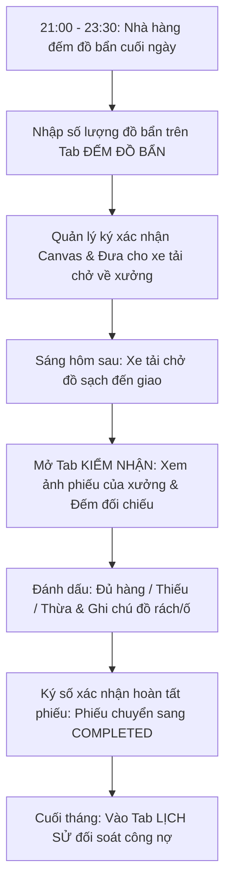

# HƯỚNG DẪN SỬ DỤNG HỆ THỐNG NỘI BỘ - VAI TRÒ QUẢN LÝ ĐỐI TÁC (PARTNER_MANAGER)

> **Cổng vận hành xưởng & quản vận B2B PWA:** `noibo.thanhxuanlaundry.com` (Port `3001`)  
> **Tài khoản:** `PARTNER_MANAGER` (Quản lý Đối tác / Quản lý Chi nhánh Nhà hàng & Khách sạn)  
> **Mật khẩu khởi tạo / Mẫu:** `ThanhXuan@2026`  
> **Môi trường sử dụng:** Giao diện Cổng Đối Tác B2B chuyên biệt, tối ưu trên cả máy tính bàn tại quầy quản lý và điện thoại di động (PWA).  
> 🔒 **Bảo mật dữ liệu chi nhánh:** Quản lý đối tác chỉ nhìn thấy dữ liệu đồ giặt, phiếu giao nhận và nhân sự thuộc đúng thương hiệu và chi nhánh mà mình quản lý (ví dụ: *Pizza 4P's Phan Kế Bính* hoặc *Haidilao Vincom*).

---

## 1. TỔNG QUAN VAI TRÒ QUẢN LÝ ĐỐI TÁC

Quản lý đối tác đại diện cho quyền lợi và sự minh bạch của chuỗi nhà hàng/khách sạn khi sử dụng dịch vụ giặt ủi công nghiệp của Công ty Thanh Xuân:
1. **Kiểm soát giao nhận 2 chiều:** Đảm bảo số lượng đồ bẩn gửi đi và số lượng đồ sạch nhận về luôn khớp nhau, hạn chế tối đa thất thoát.
2. **Cơ chế chống xung đột khi kiểm kê:** Hệ thống tự động lưu từng ô số lượng ngay khi rời chuột/rời ngón tay (`Auto-save onBlur`), nhiều nhân viên cùng mở máy đếm đồ không bị đè dữ liệu lên nhau.
3. **Kiểm nhận đồ sạch qua ảnh số hóa:** Xem trực tiếp ảnh chụp phiếu xuất kho của xưởng giặt, ghi nhận tức thời các trường hợp đồ bị rách, ố mốc hoặc thiếu số lượng.
4. **Phê duyệt nhân viên cơ sở:** Duyệt kích hoạt tài khoản cho các nhân viên phục vụ, nhân viên bếp hoặc nhân viên kho mới thuộc chi nhánh của mình để họ có quyền vào đếm đồ.
5. **Thư viện ảnh đối soát lịch sử:** Tra cứu toàn bộ phiếu giao nhận có đầy đủ chữ ký 3 bên để phục vụ đối soát chi phí cuối tháng với công ty Thanh Xuân.

---

## 2. QUY TRÌNH PHỐI HỢP VẬN HÀNH GIỮA NHÀ HÀNG & THANH XUÂN



---

## 3. HƯỚNG DẪN CHI TIẾT CỔNG ĐỐI TÁC B2B (`/operations/partner-manager/partner`)

Khi Quản lý đối tác đăng nhập, hệ thống sẽ tự động chuyển thẳng vào **Cổng Đối Tác B2B**. Thanh tiêu đề trên cùng hiển thị rõ ràng Tên chi nhánh, Thương hiệu, Địa chỉ và Lịch giao nhận (ví dụ: *Pizza 4P's Tràng Tiền • Lịch giao nhận: Hàng ngày*).

Giao diện chia làm 4 Tabs nghiệp vụ:

```
[Tab 1: ĐẾM ĐỒ BẨN]  |  [Tab 2: KIỂM NHẬN ĐỒ SẠCH]  |  [Tab 3: LỊCH SỬ]  |  [Tab 4: DUYỆT NHÂN VIÊN]
```

---

### 3.1. Tab 1: Đếm Đồ Bẩn Bàn Giao Xuất Quán (`COUNT`)

Sử dụng vào mỗi buổi tối khi nhà hàng gom đồ bẩn gửi đi giặt:

1. **Cơ chế nhảy ngày tự động thông minh:**
   - Nếu bạn đếm đồ sau **$21\text{h}00$ đêm**, hệ thống tự động xác định đây là mẻ đồ giặt cho **ngày hôm sau** (`targetRecordDate`), bạn không cần chỉnh ngày bằng tay.
2. **Nhập số lượng đồ bẩn:**
   - Danh sách hiển thị các món đồ giặt đã cài đặt riêng cho thương hiệu của bạn (ví dụ: *Khăn ăn, Khăn lau bếp, Tạp dề, Áo nhân viên, Khăn bàn tròn...*).
   - Nhập số lượng thực tế kiểm đếm vào ô của từng món.
   - ⚡ **Tính năng Tự Động Lưu (Auto-save onBlur):** Bạn gõ số xong và bấm chuyển sang ô khác, hệ thống sẽ lập tức lưu số liệu đó lên máy chủ. Nếu có 2 hay 3 nhân viên cùng cầm điện thoại đếm ở các khu vực khác nhau trong nhà hàng, số liệu sẽ được tổng hợp mượt mà không lo mất dữ liệu hay bị đè số của nhau.
3. **Nút "+ Tự nhập món đồ":**
   - Nếu chi nhánh có phát sinh món đồ mới chưa có trong danh mục (ví dụ: *Rèm cửa, Vải bọc sofa, Thảm trang trí*), bấm nút **"+ Tự nhập món đồ"** để điền tên món và số lượng bàn giao.
4. **Tùy chọn Gom Bao Niêm Phong Đếm Lại Tại Xưởng:**
   - Vào các dịp lễ tết hoặc cuối tuần nhà hàng quá đông khách không đủ nhân lực đếm từng chiếc, bạn có thể gom toàn bộ đồ bẩn vào các bao hàng lớn, kẹp niêm phong và tích chọn vào ô **"Gom bao đếm lại tại xưởng"** (`isRecount`).
   - Tài xế sẽ chở nguyên bao về xưởng, Thủ kho và Thợ xưởng Thanh Xuân sẽ có trách nhiệm rạch bao đếm lại và cập nhật số lượng minh bạch cho bạn.
5. **Ký tên bàn giao điện tử:**
   - Dùng ngón tay hoặc bút cảm ứng ký vào khung Canvas ký tên.
   - Bấm nút **"Xác Nhận & Gửi Đồ Bẩn"**. Phiếu giao nhận sẽ được kích hoạt chuyển sang trạng thái đã đếm, sẵn sàng cho tài xế xe tải tới nhận.

---

### 3.2. Tab 2: Kiểm Nhận Đồ Sạch Trả Quán (`RECEIPT`)

Sử dụng khi tài xế xe tải giao đồ sạch từ xưởng trả về cho nhà hàng:

1. **Hiển thị trực tiếp ảnh phiếu giao nhận WebP của xưởng:**
   - Màn hình hiển thị hình ảnh phiếu giao nhận có đầy đủ chữ ký của Thủ kho Thanh Xuân lúc xuất xưởng.
   - Bấm vào ảnh để xem phóng to chi tiết từng loại đồ sạch mà xưởng đã đóng gói giao trả cho quán.
2. **Kiểm đếm đồ sạch thực tế nhận được:**
   - Đếm thực tế số lượng đồ sạch trong các bao hàng giao đến xem có khớp với số lượng ghi trên phiếu không.
   - Kiểm tra chất lượng giặt là: Độ sạch, độ trắng sáng, độ phẳng phiu của nếp ủi và mùi hương.
3. **Đánh dấu kết quả kiểm nhận:**
   - 🟢 **ĐỦ (`ENOUGH`):** Số lượng đồ sạch thực tế nhận được trùng khớp 100% với phiếu xuất kho.
   - 🟡 **THIẾU (`SHORT`):** Số lượng thực tế nhận được ít hơn trên phiếu.
   - 🔵 **THỪA (`EXCESS`):** Số lượng thực tế nhận được nhiều hơn trên phiếu.
4. **Ghi chú sự cố chất lượng (nếu có):**
   - Nếu phát hiện đồ bị rách, bị thủng, ố mốc khó giặt hoặc thất lạc, ghi chú rõ vào ô *Ghi chú sự cố* (ví dụ: *Phát hiện 2 khăn bàn tròn bị rách góc, 1 áo bếp dính vết ố màu*).
   - Dữ liệu này sẽ được lưu vào hệ thống để bộ phận CSKH của Thanh Xuân liên hệ giải quyết đền bù hoặc xử lý tẩy điểm cho quán.
5. **Ký số xác nhận hoàn tất:**
   - Nhập họ tên người nhận đồ sạch (ví dụ: *Nguyễn Văn A - Quản lý ca*).
   - Ký tên Canvas xác nhận $\rightarrow$ Bấm nút **"Hoàn Tất Kiểm Nhận"**.
   - Phiếu giao nhận chuyển sang trạng thái **Hoàn thành (`COMPLETED`)**, quy trình giao nhận khép lại an toàn.

---

### 3.3. Tab 3: Thư Viện Lịch Sử Giao Nhận & Đối Soát (`HISTORY`)

Nơi lưu trữ toàn bộ hồ sơ giao nhận của chi nhánh phục vụ đối soát công nợ:
1. **Bộ lọc tìm kiếm:**
   - Chọn khoảng ngày (Từ ngày - Đến ngày).
   - Tìm kiếm nhanh theo Mã phiếu giao nhận.
2. **Lưới thẻ phiếu giao nhận (Aspect 3:4):**
   - Mỗi thẻ hiển thị: Mã phiếu, ngày giao nhận, tổng số lượng đồ, trạng thái.
   - **Đèn báo kiểm soát chữ ký:** Xem nhanh phiếu đã có đủ chữ ký của Kho, Shipper và Quán hay chưa.
3. **Xem phóng to & Tải ảnh phiếu:**
   - Bấm **"Xem Phóng To"** để mở `SlipFullscreenViewerModal`: Cho phép phóng to từ 75% đến 250%, hỗ trợ chạm đúp (double-tap) trên điện thoại.
   - Bấm **"Tải Ảnh"**: Tải ảnh phiếu WebP/PNG chất lượng cao về máy tính để lưu vào hồ sơ kế toán của nhà hàng.

---

### 3.4. Tab 4: Phê Duyệt & Quản Lý Nhân Viên Chi Nhánh (`STAFF`)

Chức năng đặc thù chỉ dành riêng cho tài khoản Quản lý đối tác (`PARTNER_MANAGER`):
1. **Bối cảnh:** Khi nhân viên mới của nhà hàng (phục vụ, phụ bếp, nhân viên kho) tải web về và đăng ký tài khoản mới với vai trò *Nhân viên đối tác (`PARTNER_STAFF`)* chọn đúng cơ sở của bạn, tài khoản của họ sẽ ở trạng thái chờ duyệt.
2. **Thao tác phê duyệt:**
   - Quản lý mở Tab **Duyệt Nhân Viên**.
   - Xem danh sách nhân viên đang chờ duyệt: Họ tên, Email, Số điện thoại.
   - Xác nhận đúng là nhân viên của cơ sở mình $\rightarrow$ Bấm nút màu xanh **"Phê Duyệt"**.
   - Tài khoản nhân viên sẽ được kích hoạt ngay lập tức, nhân viên có thể đăng nhập vào để thực hiện đếm đồ bẩn hoặc kiểm nhận đồ sạch.
   - Nếu là người lạ hoặc nhân viên đã nghỉ việc $\rightarrow$ Bấm **"Từ Chối"**.

---

## 4. XỬ LÝ KHIẾU NẠI & CÂU HỎI THƯỜNG GẶP (FAQ)

| Vấn Đề Phát Sinh | Cách Xử Lý Nhanh |
| :--- | :--- |
| **Nhà hàng kiểm nhận thấy thiếu 5 khăn ăn so với phiếu xuất kho** | Tại Tab *Kiểm Nhận Đồ Sạch*, chọn tình trạng là **"THIẾU"**, ghi rõ vào ô ghi chú: *Thiếu 5 khăn ăn so với phiếu*. Sau đó ký tên hoàn tất. Hệ thống sẽ gắn cờ cảnh báo đỏ, bộ phận điều hành của Thanh Xuân sẽ lập tức kiểm tra lại camera khu vực đóng gói tại xưởng để xác minh. |
| **Nhân viên nhà hàng báo đăng ký tài khoản xong nhưng không đăng nhập được** | Nhắc nhân viên rằng tài khoản mới đăng ký cần được Quản lý duyệt trước. Bạn chỉ cần mở Tab **Duyệt Nhân Viên** trên máy của bạn và bấm nút **"Phê duyệt"** là nhân viên đó đăng nhập được ngay. |
| **Cuối tháng kế toán nhà hàng cần toàn bộ ảnh phiếu để kiểm toán** | Vào Tab **Lịch Sử**, chọn khoảng ngày từ đầu tháng đến cuối tháng, bấm mở từng phiếu và bấm nút **"Tải Ảnh"** để lưu về máy tính. |