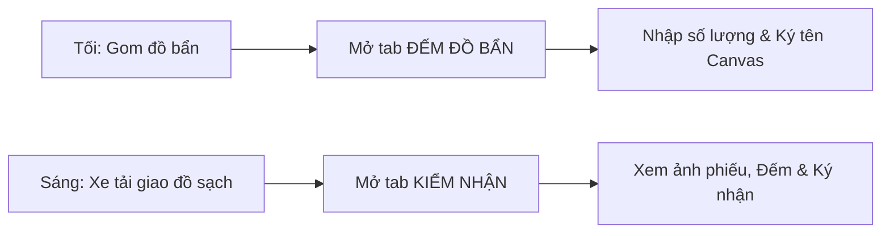

# HƯỚNG DẪN SỬ DỤNG HỆ THỐNG NỘI BỘ - VAI TRÒ NHÂN VIÊN ĐỐI TÁC (PARTNER_STAFF)

> **Cổng vận hành xưởng & quản vận B2B PWA:** `noibo.thanhxuanlaundry.com` (Port `3001`)  
> **Tài khoản:** `PARTNER_STAFF` (Nhân viên Đối tác / Nhân viên Nhà hàng & Khách sạn)  
> **Mật khẩu khởi tạo / Mẫu:** `ThanhXuan@2026`  
> **Môi trường sử dụng:** Thao tác trực tiếp trên điện thoại thông minh cá nhân (PWA - Mobile Web) tại quầy thu ngân, khu vực bếp hoặc kho của nhà hàng.  
> 📱 **Giao diện tinh gọn:** Thiết kế cực kỳ đơn giản gồm 3 chức năng cốt lõi: Đếm đồ bẩn gửi đi, Kiểm nhận đồ sạch trả về và Xem lại lịch sử phiếu.

---

## 1. TỔNG QUAN VAI TRÒ NHÂN VIÊN ĐỐI TÁC

Nhân viên đối tác (`PARTNER_STAFF`) là các bạn nhân viên phục vụ bàn, nhân viên phụ bếp hoặc nhân viên kho của nhà hàng/khách sạn trực tiếp giao nhận đồ giặt với tài xế xe tải của Công ty Thanh Xuân:
1. **Kiểm đếm đồ bẩn cuối ca:** Gom đồ bẩn sau ca làm việc, đếm số lượng từng loại và nhập vào điện thoại để bàn giao cho tài xế xe tải chở về xưởng giặt.
2. **Kiểm nhận đồ sạch đầu ca:** Khi xe tải chở đồ sạch đến, mở app kiểm tra ảnh phiếu của xưởng, đối chiếu số lượng và ký xác nhận nhận đồ.
3. **Tra cứu lịch sử:** Xem lại các phiếu giao nhận của cơ sở mình khi quản lý nhà hàng yêu cầu đối soát.

---

## 2. QUY TRÌNH THAO TÁC HÀNG NGÀY TRÊN ĐIỆN THOẠI

---

## 3. HƯỚNG DẪN CHI TIẾT CÁC BƯỚC THAO TÁC

### 3.1. Đăng Ký & Đăng Nhập Tài Khoản Lần Đầu

1. **Đăng ký tài khoản mới (`/register`):**
   - Truy cập trang web trên điện thoại, bấm **"Đăng ký tài khoản mới"**.
   - Chọn vai trò: **Nhân viên đối tác** (`PARTNER_STAFF`).
   - Chọn **Thương hiệu** của bạn (ví dụ: *Pizza 4P's* hoặc *Haidilao*).
   - Chọn đúng **Chi nhánh cơ sở** nơi bạn đang làm việc (ví dụ: *Chi nhánh Hai Bà Trưng*).
   - Nhập Họ và tên, Email, Số điện thoại và Mật khẩu $\rightarrow$ Bấm **"Đăng Ký"**.
   - ⚠️ *Lưu ý quan trọng:* Sau khi đăng ký xong, hãy báo cho Quản lý nhà hàng của bạn mở máy lên và bấm nút **"Phê duyệt"** thì tài khoản của bạn mới kích hoạt để đăng nhập được.
2. **Đăng nhập (`/login`):**
   - Nhập Email và Mật khẩu vừa tạo.
   - Giao diện Cổng đối tác sẽ mở ra ngay lập tức, hiển thị tên nhà hàng của bạn ở đầu trang.
3. **Thanh điều hướng đáy màn hình (Mobile Quick Nav):**
   - 📤 **Đếm Đồ:** Tab đếm đồ bẩn gửi xưởng.
   - 📥 **Kiểm Nhận:** Tab nhận đồ sạch từ xe tải.
   - 🕒 **Lịch Sử:** Tra cứu các phiếu đã giao nhận.

---

### 3.2. Bước 1: Đếm Đồ Bẩn Bàn Giao Cho Xe Tải (Tab "Đếm Đồ")

Thực hiện vào cuối ca làm việc buổi tối khi thu gom đồ bẩn gửi giặt:

1. **Nhập số lượng từng món đồ:**
   - Màn hình hiển thị danh mục các món đồ giặt quen thuộc của quán: Khăn ăn, Khăn lau, Tạp dề, Áo nhân viên, Khăn bàn...
   - Đếm thực tế có bao nhiêu chiếc thì nhập số lượng tương ứng vào ô bên cạnh.
   - ⚡ **Tính năng Tự Động Lưu (Auto-save onBlur):** Nhập xong số lượng của một món và bấm chuyển sang món tiếp theo, hệ thống sẽ **tự động lưu ngay lập tức** lên máy chủ. Bạn không phải lo lắng bị mất mạng hay lỡ tay thoát ứng dụng.
2. **Trường hợp có đồ phát sinh ngoài menu:**
   - Nếu hôm đó có gửi thêm món đồ lạ chưa có trong danh sách (ví dụ: *Rèm cửa*, *Áo mưa*), bấm nút **"+ Tự nhập món đồ"** $\rightarrow$ Gõ tên món và số lượng.
3. **Ký tên xác nhận bàn giao:**
   - Kéo xuống dưới cùng màn hình, dùng ngón tay ký chữ ký của bạn vào khung ký Canvas màu trắng.
   - Bấm nút **"Xác Nhận & Gửi Đồ Bẩn"**.
   - Màn hình thông báo thành công. Khi tài xế xe tải tới lấy đồ, bạn chỉ việc bàn giao các bao đồ bẩn cho tài xế.

---

### 3.3. Bước 2: Nhận Đồ Sạch Từ Xe Tải Bàn Giao (Tab "Kiểm Nhận")

Thực hiện khi tài xế xe tải chở đồ sạch từ xưởng đến giao cho nhà hàng:

1. **Mở Tab "Kiểm Nhận":**
   - Màn hình hiển thị hình ảnh phiếu xuất kho của chuyến hàng hôm nay do Thủ kho xưởng giặt đã soạn sẵn.
   - Bấm vào ảnh phiếu để phóng to: Kiểm tra xem xưởng giao bao nhiêu khăn bàn, bao nhiêu áo bếp...
2. **Kiểm đếm thực tế:**
   - Mở các bao đồ sạch ra kiểm tra thực tế xem số lượng có đủ như trên phiếu không.
   - Kiểm tra xem đồ có được là phẳng phiu, thơm tho và sạch sẽ hay không.
3. **Chọn kết quả kiểm nhận:**
   - Bấm chọn 1 trong 3 trạng thái:
     - 🟢 **Đủ hàng:** Nhận đủ 100% số lượng như ghi trên phiếu.
     - 🟡 **Thiếu hàng:** Số lượng thực tế nhận được ít hơn trên phiếu.
     - 🔵 **Thừa hàng:** Số lượng thực tế nhận được nhiều hơn trên phiếu.
4. **Ghi chú nếu phát hiện đồ rách hoặc ố bẩn:**
   - Nếu trong quá trình kiểm đồ phát hiện có chiếc nào bị rách góc, thủng lỗ hoặc dính vết ố màu không giặt sạch được, hãy gõ rõ vào ô *Ghi chú sự cố* (ví dụ: *1 khăn bàn bị rách mép, 2 khăn ăn bị ố vàng*).
5. **Ký nhận hoàn tất:**
   - Nhập họ tên của bạn vào ô *Người nhận đồ*.
   - Ký chữ ký điện tử của bạn vào khung Canvas.
   - Bấm nút **"Hoàn Tất Kiểm Nhận"**. Phiếu giao nhận được đóng lại thành công.

---

### 3.4. Bước 3: Tra Cứu Lịch Sử Giao Nhận (Tab "Lịch Sử")

- Bấm vào tab **Lịch Sử** ở thanh đáy màn hình:
  - Xem danh sách toàn bộ các phiếu giao nhận của quán mình trong các ngày trước.
  - Xem lại hình ảnh phiếu có đầy đủ 3 chữ ký: Chữ ký của Thủ kho Thanh Xuân, Chữ ký của Tài xế xe tải và Chữ ký của người nhận tại quán.
  - Bấm nút **"Xem Phóng To"** để soi rõ từng chi tiết trên phiếu.
  - Bấm nút **"Tải Ảnh"** để tải ảnh phiếu về bộ sưu tập ảnh trên điện thoại khi cần gửi qua Zalo cho Quản lý.

---

## 4. MẸO SỬ DỤNG TIỆN LỢI CHO NHÂN VIÊN NHÀ HÀNG (FAQ)

| Câu Hỏi / Vấn Đề | Hướng Dẫn Nhanh |
| :--- | :--- |
| **Giờ cao điểm đông khách quá không kịp đếm chi tiết từng chiếc đồ bẩn thì làm sao?** | Bạn chỉ cần gom toàn bộ đồ bẩn vào các bao hàng, kẹp niêm phong lại, sau đó tích chọn vào ô **"Gom bao đếm lại tại xưởng"** (`isRecount`) và ký tên gửi đi. Tài xế sẽ chở nguyên bao về xưởng Thanh Xuân để nhân viên xưởng rạch bao đếm lại giúp bạn. |
| **Đang nhập số lượng thì điện thoại bị hết pin tắt nguồn** | Nhờ tính năng Auto-save onBlur, toàn bộ những ô số lượng bạn đã nhập xong trước đó đều đã được lưu an toàn trên hệ thống. Bạn chỉ cần cắm sạc hoặc mượn điện thoại của bạn khác đăng nhập vào tài khoản của mình là tiếp tục đếm được bình thường mà không bị mất dữ liệu. |
| **Ký tên bị lệch hoặc xấu thì xóa đi ký lại thế nào?** | Bấm vào nút icon hoàn tác xoay tròn (Xóa chữ ký) ở góc phải khung ký tên để xóa sạch bảng ký và dùng ngón tay ký lại chữ ký mới. |