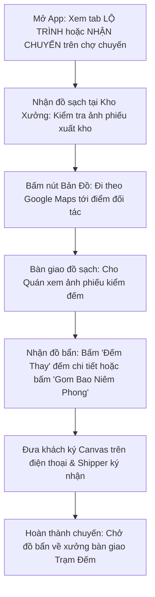

# HƯỚNG DẪN SỬ DỤNG HỆ THỐNG NỘI BỘ - VAI TRÒ TÀI XẾ GIAO NHẬN (SHIPPER)

> **Cổng vận hành xưởng & quản vận B2B PWA:** `noibo.thanhxuanlaundry.com` (Port `3001`)  
> **Tài khoản:** `SHIPPER` (Nhân viên giao nhận / Tài xế xe tải)  
> **Mật khẩu khởi tạo / Mẫu:** `ThanhXuan@2026`  
> **Môi trường sử dụng:** Tối ưu hóa 100% cho điện thoại di động (PWA - Mobile Web), thao tác tiện lợi bằng một tay khi đang chạy xe hoặc tại điểm giao hàng.

---

## 1. TỔNG QUAN VAI TRÒ TÀI XẾ XE TẢI

Tài xế giao nhận (`SHIPPER`) là cầu nối trực tiếp giữa xưởng giặt là công nghiệp Thanh Xuân và các chuỗi nhà hàng, khách sạn đối tác:
1. **Giao nhận 2 chiều:** Nhận đồ sạch từ xưởng chở tới giao cho nhà hàng; đồng thời nhận đồ bẩn từ nhà hàng chở về xưởng.
2. **Ký số & Đối soát điện tử:** Mở ảnh phiếu xuất kho cho khách kiểm tra, hỗ trợ đếm đồ bẩn, lấy chữ ký số của đại diện nhà hàng ngay trên màn hình cảm ứng điện thoại.
3. **Linh hoạt nhận chuyến (Chợ Chuyến):** Ngoài các tuyến cố định được giao, tài xế có thể vào chợ chuyến để nhận thêm các đơn hàng lẻ hưởng thêm tiền thù lao chuyến đi.
4. **Nộp chi phí xe máy & Xin nghỉ phép:** Chụp ảnh hóa đơn xăng, chụp ảnh sửa chữa xe nộp đề xuất hoàn tiền ngay trên app; gửi đơn xin nghỉ phép và theo dõi kết quả phê duyệt.

---

## 2. QUY TRÌNH MỘT CHUYẾN GIAO NHẬN CHUẨN CỦA SHIPPER



---

## 3. HƯỚNG DẪN SỬ DỤNG CHI TIẾT TRÊN ĐIỆN THOẠI DI ĐỘNG

### 3.1. Đăng Nhập & Giao Diện Mobile Đáy Màn Hình (Bottom Bar)

1. **Đăng nhập (`/login`):**
   - Mở trình duyệt trên điện thoại (Safari hoặc Chrome), truy cập địa chỉ web nội bộ.
   - Nhập Email và Mật khẩu (hoặc bấm nút **"Tài xế"** trên lưới đăng nhập mẫu).
   - *Mẹo cài đặt như ứng dụng native (PWA):* Bấm vào nút *Chia sẻ* trên Safari $\rightarrow$ Chọn *"Thêm vào Màn hình chính"* (Add to Home Screen). Biểu tượng Thanh Xuân sẽ xuất hiện trên màn hình điện thoại như một app thực thụ.
2. **Thanh điều hướng đáy màn hình (Mobile Bottom Bar):**
   - 🚚 **Giao Nhận:** Màn hình lộ trình chuyến xe, chợ chuyến và lịch sử.
   - ⛽ **Xăng Xe:** Nộp hóa đơn tiền xăng và chi phí sửa xe.
   - 💵 **Lương:** Tra cứu bảng tính lương minh bạch hàng tháng.

---

### 3.2. Màn Hình Giao Nhận 2 Chiều (`/operations/shipper/handover`)

Màn hình chia làm 3 Tabs chính ở đầu trang:

```
[Tab 1: LỘ TRÌNH (ROUTE)]  |  [Tab 2: NHẬN CHUYẾN (POOL)]  |  [Tab 3: LỊCH SỬ (HISTORY)]
```

---

#### Tab 1: Lộ Trình Giao Nhận Của Bạn (`ROUTE`)

Hiển thị danh sách các chi nhánh nhà hàng được giao cho bạn trong ngày hôm đó:
1. **Bộ chọn ca làm việc:** Bấm vào các chip ca để lọc nhanh:
   - *Tất cả*
   - *Ca Sáng (Vàng hổ phách)*: Nhận trả đồ sáng sớm.
   - *Ca Chiều (Cam ấm)*: Giao nhận buổi chiều.
   - *Ca Tối (Tím)*: Giao nhận ca tối (nhà hàng đóng cửa đêm).
2. **Thẻ điểm giao nhận (Item Card):** Mỗi nhà hàng hiển thị trên một thẻ card gồm:
   - Tên nhà hàng, thương hiệu, địa chỉ cụ thể.
   - **Nút "Chỉ đường" (icon Google Maps):** Bấm vào sẽ tự động mở ứng dụng Google Maps chỉ đường đi ngắn nhất tới quán.
   - **Ảnh Phiếu Xuất Kho:** Hiển thị trực tiếp ảnh phiếu do Thủ kho đã soạn sẵn. Bấm vào ảnh hoặc bấm nút **"Phóng To"** để mở toàn màn hình, chạm đúp 2 lần để zoom rõ chữ ký và số lượng.
   - **Nút "Tải Ảnh":** Tải ảnh phiếu về máy nếu muốn lưu trữ offline khi đi vào vùng sóng yếu.
3. **Thao tác bàn giao đồ sạch & đếm nhận đồ bẩn:**
   - **Trường hợp 1 - Nhà hàng tự đếm trên máy của họ:** Khách tự vào web cổng đối tác đếm và ký, bạn chỉ cần mở phiếu ký nhận của Shipper.
   - **Trường hợp 2 - Bạn đếm thay cho nhà hàng (Phổ biến nhất):**
     - Bấm nút màu xanh **"Đếm Thay"** $\rightarrow$ Màn hình mở modal toàn màn hình `ShipperCountPartnerModal`.
     - Danh sách các món đồ giặt của quán hiển thị rõ ràng.
     - **Nhập số lượng đồ bẩn:** Nhập số lượng thực tế nhận được. Hỗ trợ nhập biểu thức cộng dồn thông minh: gõ `12 34` hoặc `10+5`, máy tự tính ra `15`.
     - **Món đồ ngoài menu:** Nếu khách gửi thêm món đồ lạ chưa cài đặt sẵn, bấm nút **"+ Tự nhập món đồ"** để thêm tên món và số lượng.
     - **Chọn số lượng bao gom niêm phong:** Sử dụng nút `[-] [+]` hoặc bấm nhanh các nút `1, 2, 3, 4 bao` để ghi nhận số bao đồ bẩn niêm phong chở về xưởng.
     - **Trường hợp quán quá đông khách không kịp đếm chiếc:** Tích chọn vào ô **"Gom bao đếm lại tại xưởng"** (`isRecount`). Khi về xưởng, Thủ kho và Thợ xưởng sẽ rạch bao đếm lại sau.
     - **Lấy chữ ký của đại diện nhà hàng:** Đưa điện thoại cho nhân viên quán ký tên xác nhận vào khung Canvas.
     - **Ký tên Shipper:** Bấm ký tên của bạn và bấm nút **"Xác Nhận Bàn Giao"**.
     - Chuyến đi hoàn tất, trạng thái chuyển sang màu xanh lá!

---

#### Tab 2: Chợ Chuyến Khả Dụng (`POOL`)

Nơi hiển thị các đơn hàng lẻ của các nhà hàng chưa có tài xế cố định phụ trách:
1. Danh sách các chuyến đang chờ tài xế nhận.
2. Thông tin hiển thị rõ: Tên nhà hàng, địa chỉ, số món đồ sạch đã soạn, số bao hàng và **Mức tiền công dự kiến (`amount` VNĐ)** do Kế toán đã cài đặt sẵn cho chuyến này.
3. Bấm nút **"Nhận Chuyến Này"**:
   - Hệ thống thực hiện khóa nguyên tử tức thì (chống việc 2 tài xế cùng bấm nhận 1 chuyến).
   - Chuyến đi sẽ được chuyển ngay lập tức vào **Tab Lộ Trình** của bạn trong ngày hôm đó.
   - Tiền công của chuyến này sẽ tự động được cộng vào bảng lương cuối tháng của bạn.

---

#### Tab 3: Lịch Sử Chuyến Đi (`HISTORY`)

- Xem lại toàn bộ các chuyến giao nhận bạn đã hoàn thành trong tuần/tháng.
- Tra cứu lại ảnh phiếu giao nhận có đầy đủ chữ ký 3 bên (Kho - Bạn - Quán) để đối chứng khi có tranh chấp số lượng.

---

### 3.3. Nộp Đơn Xin Nghỉ Phép Giao Nhận

Khi có việc bận gia đình cần nghỉ phép:
1. Tại màn hình Giao Nhận, bấm nút **"Xin Nghỉ Phép"** (mở `ShipperLeaveRequestModal`).
2. **Chọn ngày xin nghỉ:** Chọn một hoặc nhiều ngày bạn cần nghỉ (ví dụ: *28/10/2026*).
3. **Nhập lý do:** Ghi rõ lý do xin nghỉ (ví dụ: *Gia đình có việc hiếu hỉ, xin nghỉ 1 ngày*).
4. Bấm **"Gửi Đơn Xin Nghỉ"**.
5. Bấm nút **"Lịch Sử Nghỉ"** để theo dõi trạng thái:
   - *Chờ duyệt (`PENDING_APPROVAL`):* Quản lý đang sắp xếp tài xế thay thế.
   - *Đã duyệt (`APPROVED`):* Đã có tài xế khác nhận chạy thay tuyến của bạn trong ngày đó. Bạn yên tâm nghỉ ngơi.
   - *Từ chối:* Bấm vào để xem lý do từ chối của Quản lý.

---

### 3.4. Nộp Đề Xuất Hoàn Chi Phí Xe Máy: Đổ Xăng & Sửa Xe (`/operations/shipper/fuel`)

Hệ thống hỗ trợ nộp chi phí hoàn tiền nhanh chóng:

```
[Tab 1: ĐỔ XĂNG (FUEL)]    |    [Tab 2: SỬA CHỮA XE (REPAIR)]
```

#### Tab 1: Đề Xuất Tiền Xăng (`FUEL`)
1. Nhập **Số tiền** đổ xăng thực tế (ví dụ: *80.000 VNĐ*).
2. Nhập **Số lít xăng** (ví dụ: *3.5 lít*) và **Số Km trên đồng hồ xe** (ví dụ: *45.210 Km*).
3. **Chụp 2 ảnh bắt buộc:**
   - Ảnh 1: Bấm nút chụp ảnh hóa đơn/biên lai của cây xăng.
   - Ảnh 2: Bấm nút chụp ảnh đồng hồ công-tơ-mét xe máy của bạn.
4. Bấm **"Gửi Đề Xuất Đổ Xăng"**.

#### Tab 2: Đề Xuất Tiền Sửa Xe Máy (`REPAIR`)
1. Nhập **Số tiền sửa xe** (ví dụ: *150.000 VNĐ*).
2. Nhập **Mô tả chi tiết:** Ghi rõ phụ tùng đã thay (ví dụ: *Thay dầu nhớt máy và vá săm sau*).
3. **Chụp 2 ảnh bắt buộc:**
   - Ảnh 1: Ảnh chụp hóa đơn/phiếu thu tiền của tiệm sửa xe.
   - Ảnh 2: Ảnh chụp xe máy của bạn đang được sửa tại tiệm.
4. Bấm **"Gửi Đề Xuất Sửa Xe"**.

> 💡 *Tiền xăng và tiền sửa xe sau khi được Kế toán bấm "Duyệt" sẽ tự động được cộng vào mục Hoàn tiền chi phí xe trong phiếu lương tháng của bạn.*

---

### 3.5. Tra Cứu Bảng Lương Minh Bạch Hàng Tháng (`/operations/payslip`)

Bấm vào tab **Lương** ở thanh đáy màn hình:
1. **Xem chi tiết từng khoản thu nhập minh bạch:**
   - **Ngày công chuẩn:** 28 ngày.
   - **Ngày công thực tế:** Số ngày bạn thực tế có chạy xe đi làm.
   - **Lương cơ bản thực nhận:** Tính theo công thức $\frac{\text{Lương cơ bản}}{28} \times \text{Ngày thực tế}$.
   - **Thưởng ca cuối tuần:** 60.000 VNĐ/ca (dành cho ca tối Thứ 7/Chủ Nhật và ca sáng Chủ Nhật/Thứ 2).
   - **Thưởng chuyên cần:** 7.000 VNĐ cho mỗi ngày đi làm đầy đủ.
   - **Phụ cấp điện thoại:** 200.000 VNĐ/tháng.
   - **Hoàn tiền chi phí xe:** Tổng toàn bộ tiền đổ xăng và tiền sửa xe đã được Kế toán duyệt trong tháng.
   - **Thù lao chuyến lẻ & chạy thay:** Tiền thù lao các chuyến nhận thêm trên chợ chuyến hoặc chạy thay đồng nghiệp nghỉ phép.
   - **Khấu trừ Bảo hiểm xã hội:** Trừ 400.000 VNĐ theo quy định công ty.
   - **Thực nhận (Net Pay):** Số tiền thực tế công ty chuyển khoản vào tài khoản ngân hàng của bạn.

---

## 4. MẸO VẬN HÀNH TRÊN ĐƯỜNG & XỬ LÝ SỰ CỐ (FAQ)

| Sự Cố Gặp Phải | Cách Xử Lý Nhanh |
| :--- | :--- |
| **Mất mạng 4G khi đang ở tầng hầm nhà hàng** | Bạn vẫn nhập số lượng đồ bẩn và cho khách ký Canvas bình thường. Hệ thống PWA của Thanh Xuân có bộ nhớ đệm Offline Queue, phiếu sẽ được lưu tạm trong máy. Khi bạn chạy xe lên mặt đất có sóng 4G, app sẽ tự động đồng bộ phiếu lên máy chủ. |
| **Khách đếm thiếu đồ so với phiếu xuất kho** | Mở thẻ phiếu giao nhận, bấm vào nút **"Khiếu nại / Bất thường"** (`DisputeModal`), chụp ảnh biên bản hoặc ghi chú rõ: *Quán kiểm thiếu 2 áo bếp so với phiếu*. Báo ngay cho Thủ kho ở xưởng kiểm tra lại camera khu vực soạn đồ. |
| **Bấm nhầm nhận chuyến trên chợ chuyến** | Chợ chuyến có cơ chế khóa tức thời. Nếu bạn có việc đột xuất không thể chạy được chuyến đã nhận, hãy gọi điện ngay cho Quản lý xưởng để Quản lý gán lại chuyến đó cho tài xế khác. |