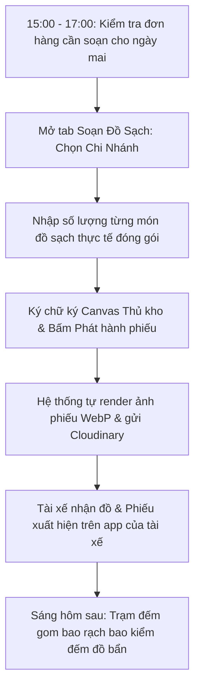

# HƯỚNG DẪN SỬ DỤNG HỆ THỐNG NỘI BỘ - VAI TRÒ THỦ KHO / QUẢN LÝ KHO (WAREHOUSE_MANAGER)

> **Cổng vận hành xưởng & quản vận B2B PWA:** `noibo.thanhxuanlaundry.com` (Port `3001`)  
> **Tài khoản:** `WAREHOUSE_MANAGER` (Quản lý Kho / Thủ kho)  
> **Mật khẩu khởi tạo / Mẫu:** `ThanhXuan@2026`  
> **Phạm vi quyền hạn:** Chịu trách nhiệm toàn diện về đồ sạch xuất xưởng (soạn đồ, lập phiếu xuất kho, ký tên Canvas, render ảnh phiếu WebP gửi xe tải) và trạm rạch bao đếm lại đồ bẩn gom bao tại xưởng.  
> ⚠️ **Lưu ý:** Thủ kho không nhìn thấy trường tiền bạc hay giá bán của đối tác (các trường tiền đã được ẩn tự động).

---

## 1. TỔNG QUAN VAI TRÒ & TRÁCH NHIỆM THỦ KHO

Thủ kho giữ vai trò là "chốt chặn đầu - cuối" về số lượng và chất lượng hàng hóa luân chuyển giữa xưởng giặt và chuỗi đối tác:
1. **Soạn đồ sạch xuất kho:** Dựa trên lịch giao nhận của các nhà hàng/khách sạn, chuẩn bị số lượng đồ sạch (khăn bàn, áo bếp, ga giường...), đóng gói đúng quy cách và lập phiếu xuất kho điện tử.
2. **Ký số & Phát hành phiếu điện tử:** Ký trực tiếp trên màn hình cảm ứng, hệ thống tự động render phiếu giao nhận kèm mã QR/chữ ký và nén ảnh WebP tải lên đám mây Cloudinary để tài xế và nhà hàng cùng đối soát.
3. **Quản lý Thư viện ảnh phiếu:** Tra cứu, phóng to kiểm tra và tải ảnh phiếu xuất kho phục vụ công tác đối chiếu khi có khiếu nại.
4. **Trạm rạch bao đếm lại đồ bẩn:** Phối hợp cùng thợ xưởng mở các bao đồ bẩn niêm phong do tài xế mang về, đếm thực tế từng chiếc và nhập số lượng vào hệ thống.

---

## 2. QUY TRÌNH TÁC NGHIỆP CỦA THỦ KHO



---

## 3. HƯỚNG DẪN CHI TIẾT TỪNG MÀN HÌNH TÁC NGHIỆP

### 3.1. Đăng Nhập & Menu Điều Hướng Của Thủ Kho

1. **Đăng nhập (`/login`):** Nhập tài khoản và mật khẩu. (Có thể bấm nút **"Quản lý Kho"** trên lưới đăng nhập mẫu).
2. **Thanh Menu:**
   - *Tổng quan (`/dashboard`):* Nắm bắt số lượng phiếu xuất kho trong ngày.
   - *Kho Sạch & Soạn Đồ (`/operations/warehouse-manager/warehouse`):* Màn hình tác nghiệp chính hàng ngày.
   - *Trạm Đếm Gom Bao (`/operations/worker/recount`):* Kiểm đếm đồ bẩn về xưởng.
   - *Báo Cáo (`/operations/report`):* Xem sản lượng luân chuyển kho.
   - *Phiếu Lương (`/operations/payslip`):* Tra cứu lương cá nhân.
3. **Thanh Mobile Bottom Bar (trên điện thoại):** Gồm 5 nút tiện lợi: *Tổng Quan*, *Kho Sạch*, *Trạm Đếm*, *Báo Cáo*, *Lương*.

---

### 3.2. Màn Hình Kho Sạch & Soạn Đồ (`/operations/warehouse-manager/warehouse`)

Trang này quản lý 3 Tabs nghiệp vụ chính:

```
[Tab 1: SOẠN ĐỒ SẠCH (CLEAN_PLAN)]  |  [Tab 2: TỔNG HỢP (SUMMARY)]  |  [Tab 3: THƯ VIỆN ẢNH PHIẾU (SLIP_GALLERY)]
```

---

#### Tab 1: Soạn Đồ Sạch & Phát Hành Phiếu (`CLEAN_PLAN`)

Đây là chức năng quan trọng nhất của Thủ kho mỗi buổi chiều/tối:

1. **Bộ chọn ngày giao hàng (`recordDate`):**
   - Mặc định: Nếu soạn trong khung giờ 17h-21h, hệ thống tự động chọn ngày mai.
   - Chặn ngày quá khứ: Hệ thống khóa không cho chọn các ngày đã qua để tránh sai lệch số liệu lịch sử.
2. **Danh sách các chi nhánh đối tác theo lịch:**
   - Thẻ từng chi nhánh hiển thị: Tên nhà hàng, thương hiệu, địa chỉ, lịch giao nhận (Hàng ngày / Cách ngày).
   - Trạng thái phiếu: *Chưa soạn* (màu xám), *Đã soạn sẵn* (màu xanh lá kèm ảnh thumbnail phiếu).
3. **Thao tác soạn đồ sạch qua Modal (`PrepOrderModal`):**
   - Bấm nút **"Soạn Đồ"** hoặc **"Chỉnh Sửa"** tại thẻ của nhà hàng cần soạn.
   - Khung modal mở ra hiển thị danh mục các món đồ giặt đã cài đặt riêng cho đối tác đó (Khăn trải bàn, Áo nhân viên, Khăn ăn, Ga gối...).
   - **Nhập số lượng đồ sạch thực tế đã đóng gói:** Nhập số lượng vào ô của từng món.
   - **Tính năng giao trước (Advance Delivery):** Nếu nhà hàng có nhu cầu lấy trước một phần đồ cho sự kiện đột xuất, sử dụng popover Giao Trước để ghi nhận.
   - **Ký tên xác nhận Thủ kho:**
     - Sử dụng ngón tay (trên điện thoại/máy tính bảng) hoặc chuột máy tính để ký chữ ký điện tử vào khung Canvas ký tên.
     - Có thể bấm *"Lưu làm chữ ký mặc định"* để các lần soạn sau không cần ký lại, hệ thống sẽ tự động áp dụng.
   - **Phát hành phiếu xuất kho:**
     - Bấm nút **"Lưu & Phát Hành Phiếu"**.
     - Hệ thống chạy bộ render HTML5 Canvas: Tự động tổng hợp tên đối tác, ngày tháng, danh sách số lượng đồ, gắn chữ ký của Thủ kho, nén ảnh định dạng WebP siêu nhẹ và gửi lên Cloudinary.
     - Phiếu xuất kho này sẽ lập tức xuất hiện trên app điện thoại của Tài xế xe tải và Cổng đối tác của nhà hàng.

---

#### Tab 2: Bảng Tổng Hợp Đồ Sạch (`SUMMARY`)

- **Mục đích:** Giúp Thủ kho có cái nhìn tổng quan toàn xưởng trong ngày mai cần chuẩn bị bao nhiêu chiếc khăn, bao nhiêu chiếc áo để giục sàn giặt/sấy kịp tiến độ.
- **Hiển thị:** Bảng gom nhóm theo từng thương hiệu (Pizza 4P's, Haidilao...) và chi tiết từng món: Tổng số lượng đã soạn, số lượng còn thiếu, tổng số bao hàng cần vận chuyển.

---

#### Tab 3: Thư Viện Ảnh Phiếu Giao Nhận (`SLIP_GALLERY`)

Tích hợp component chuẩn `HandoverSlipGalleryComponent`:
1. **Bộ lọc tìm kiếm đa năng:**
   - Lọc theo Thương hiệu (Brand).
   - Lọc theo Chi nhánh đối tác (Partner).
   - Lọc theo khoảng ngày (Từ ngày - Đến ngày).
   - Ô tìm kiếm nhanh theo Mã phiếu giao nhận (ví dụ: `GN-20261028-005`).
2. **Lưới thẻ ảnh phiếu (Card Grid):**
   - Mỗi thẻ phiếu hiển thị tỷ lệ chuẩn $3:4$: Ảnh thu nhỏ của phiếu giao nhận, mã phiếu, ngày tháng, đối tác.
   - **Kiểm soát 3 chữ ký qua đèn báo trạng thái:**
     - ⚪ Đèn 1 (Kho): Xanh lá nếu Thủ kho đã ký xuất xưởng.
     - ⚪ Đèn 2 (Shipper): Xanh lá nếu Tài xế đã ký nhận chở đi.
     - ⚪ Đèn 3 (Quán): Xanh lá nếu Đại diện nhà hàng đã kiểm đủ và ký nhận đồ sạch.
3. **Thao tác trên từng phiếu:**
   - **Xem Phóng To:** Bấm nút mở `SlipFullscreenViewerModal` toàn màn hình. Hỗ trợ zoom từ 75% đến 250%, cuộn xem chi tiết từng dòng chữ ký, xem trên điện thoại có thể chạm đúp (double-tap) để zoom nhanh 175%.
   - **Tải Ảnh:** Tải file ảnh WebP/PNG chất lượng cao về máy tính hoặc điện thoại có xử lý an toàn CORS.

---

### 3.3. Trạm Kiểm Đếm Lại Gom Bao Xưởng (`/operations/worker/recount`)

Khi tài xế nhận đồ bẩn từ nhà hàng vào giờ cao điểm, nếu nhà hàng không kịp đếm chi tiết từng chiếc, đồ bẩn sẽ được niêm phong vào bao và tài xế tích chọn cờ **"Đếm lại tại xưởng"** (`isRecount`).

Khi chuyến xe chở đồ về xưởng:
1. **Truy cập Trạm Đếm Gom Bao:**
   - Màn hình tự động hiển thị danh sách các phiếu có bao đồ bẩn đang chờ rạch bao đếm lại.
   - Xem thông tin: Mã phiếu, tên nhà hàng, số bao niêm phong mang về, tên tài xế chở về.
2. **Thao tác rạch bao & đếm thực tế:**
   - Thủ kho phối hợp cùng thợ xưởng tiến hành cắt niêm phong và đếm từng loại đồ.
   - Nhập số lượng đếm được thực tế (`actualQuantityReceived`) vào từng dòng món đồ trên màn hình.
   - Nếu có phát hiện đồ rách, đồ dính vết ố nặng không tẩy được hoặc có vật lạ (dao, dĩa, thìa khách để quên), ghi rõ vào ô *Ghi chú bất thường*.
3. **Hoàn tất kiểm đếm:**
   - Bấm nút **"Xác Nhận Số Lượng Đếm Lại"**.
   - Hệ thống cập nhật số liệu chính xác vào phiếu giao nhận để làm căn cứ đối soát công nợ cuối tháng với đối tác.

---

### 3.4. Tra Cứu Phiếu Lương Cá Nhân (`/operations/payslip`)

- Thủ kho có thể tra cứu chi tiết thu nhập hàng tháng của chính mình:
  - Chọn tháng cần xem.
  - Xem ngày công thực tế, lương cơ bản, các khoản thưởng chuyên cần và phụ cấp.
  - Tải phiếu lương chính thức khi Kế toán đã chốt sổ kỳ lương.

---

## 4. LƯU Ý QUAN TRỌNG & MẸO CHO THỦ KHO

| Tình Huống | Mẹo Thao Tác |
| :--- | :--- |
| **Không tìm thấy chi nhánh cần soạn đồ sạch** | 1. Kiểm tra xem ngày chọn ở đầu trang có đúng không (nếu sau 17h hệ thống mặc định nhảy sang ngày mai).<br>2. Kiểm tra xem chi nhánh đó có lịch giao hàng vào ngày đó không (ví dụ quán chỉ nhận đồ vào ngày chẵn/lẻ). |
| **Soạn nhầm số lượng đồ sau khi đã bấm phát hành phiếu** | Khi tài xế chưa bấm xác nhận chuyến đi trên app, Thủ kho vẫn có thể bấm nút **"Chỉnh Sửa"** trên thẻ phiếu, nhập lại số lượng chính xác và ký tên phát hành lại phiếu mới đè lên phiếu cũ. |
| **Chữ ký bị mờ hoặc ký lệch trên điện thoại** | Bấm nút **"Ký lại"** (icon hoàn tác) để xóa trắng khung ký Canvas và ký lại. Nên sử dụng chế độ lưu chữ ký mặc định để tiết kiệm thời gian. |