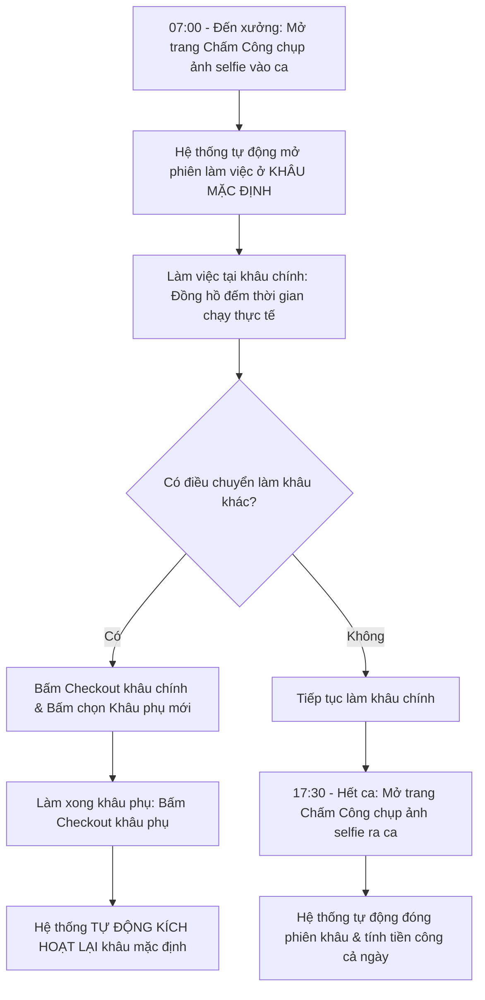

# HƯỚNG DẪN SỬ DỤNG HỆ THỐNG NỘI BỘ - VAI TRÒ THỢ XƯỞNG / CÔNG NHÂN (WORKER)

> **Cổng vận hành xưởng & quản vận B2B PWA:** `noibo.thanhxuanlaundry.com` (Port `3001`)  
> **Tài khoản:** `WORKER` (Thợ xưởng / Công nhân sản xuất giặt là)  
> **Mật khẩu khởi tạo / Mẫu:** `ThanhXuan@2026`  
> **Môi trường sử dụng:** Thao tác trên điện thoại thông minh cá nhân (PWA) hoặc máy tính bảng cảm ứng tại các trạm làm việc trong xưởng.  
> 🌟 **Cơ chế tính công mới theo thời gian thực:** Tính tiền công theo giờ chuẩn xác từng phút:  
> $$\text{Tiền công} = \left(\frac{\text{Số phút làm thực tế}}{60}\right) \times \text{Đơn giá giờ cơ bản} \times \text{Hệ số khâu}$$

---

## 1. TỔNG QUAN VAI TRÒ & 7 KHÂU LÀM VIỆC CHUẨN

Thợ xưởng (`WORKER`) là lực lượng sản xuất nòng cốt tại xưởng giặt là công nghiệp Thanh Xuân:
- **Chấm công công nghệ cao:** Điểm danh vào ca và ra ca bằng camera selfie chụp ảnh khuôn mặt kết hợp định vị GPS xưởng chính xác cao.
- **Tác nghiệp theo phiên khâu (Hourly Work):** Không còn mô hình đếm từng cái khoán cũ, thợ được phân khâu mặc định và tự do chuyển đổi giữa các khâu theo sự điều động của quản lý xưởng.
- **7 Khâu công việc chuẩn tại xưởng:**
  1. **Rũ đồ:** Khâu giũ tơi đồ bẩn trước khi đưa vào máy giặt (Hệ số x1.2).
  2. **Giặt & Sấy:** Vận hành hệ thống máy giặt công nghiệp, máy vắt và máy sấy (Hệ số x1.3).
  3. **Là / Ủi:** Vận hành máy là lô công nghiệp là phẳng khăn bàn, ga giường, ủi áo quần (Hệ số x1.2).
  4. **Gấp đồ:** Gấp phẳng phiu khăn ăn, khăn tắm, ga gối theo tiêu chuẩn khách sạn (Hệ số x1.0).
  5. **Đếm / Phân loại:** Phân loại đồ theo từng chất liệu vải và màu sắc (Hệ số x1.1).
  6. **Đóng gói:** Đóng bọc nilon bảo vệ đồ sạch, dán nhãn chuẩn bị xuất kho (Hệ số x1.0).
  7. **Khác:** Các công việc phụ trợ, vệ sinh nhà xưởng (Hệ số x1.0).
- **Trạm đếm gom bao xưởng:** Cắt niêm phong các bao đồ bẩn gom từ nhà hàng mang về xưởng và đếm số lượng thực tế.

---

## 2. QUY TRÌNH MỘT NGÀY LÀM VIỆC CỦA THỢ XƯỞNG



---

## 3. HƯỚNG DẪN CHI TIẾT CÁC MÀN HÌNH TÁC NGHIỆP

### 3.1. Đăng Nhập & Bố Cục Nhanh Dưới Đáy Màn Hình

1. **Đăng nhập (`/login`):** Nhập Email và Mật khẩu (hoặc bấm nút **"Thợ xưởng"** trên lưới đăng nhập mẫu).
2. **Thanh Mobile Bottom Bar (4 icon đáy màn hình điện thoại):**
   - ⏱️ **Công Thợ:** Trạm công việc ghi nhận thời gian thực các khâu.
   - 🧺 **Trạm Đếm:** Rạch bao niêm phong và đếm lại đồ bẩn xưởng.
   - 📅 **Chấm Công:** Chụp ảnh selfie vào ca và ra ca.
   - 💵 **Lương:** Xem tạm tính thu nhập từng ngày và phiếu lương tháng.

---

### 3.2. Chấm Công Vào / Ra Ca Bằng Camera Selfie & GPS (`/operations/attendance`)

Mỗi ngày đi làm, thợ bắt buộc phải thực hiện 2 thao tác chấm công:

```
[BƯỚC 1: VÀO CA ĐẦU NGÀY]   -------->   [BƯỚC 2: RA CA CUỐI NGÀY]
```

1. **Điểm danh vào ca (Check-in):**
   - Đứng trong khuôn viên xưởng giặt (hệ thống kiểm tra GPS bán kính $\le 150\text{m}$).
   - Bấm nút **"Bắt Đầu Chấm Công Vào Ca"**.
   - Trình duyệt sẽ yêu cầu quyền mở Camera $\rightarrow$ Bấm **"Cho phép"**.
   - Căn chỉnh khuôn mặt vào giữa khung tròn $\rightarrow$ Bấm nút **"Chụp Ảnh Selfie"**.
   - Bấm **"Xác Nhận Check-in"**:
     - Màn hình thông báo: *Check-in thành công!*.
     - 🚀 **Điểm cực kỳ tiện lợi:** Ngay khi bạn check-in ca thành công, hệ thống **tự động kích hoạt luôn phiên làm việc ở Khâu Mặc Định** của bạn (ví dụ: khâu *Gấp* hoặc khâu *Là/Ủi* do Quản lý xưởng gán cho bạn), bạn không cần bấm thêm bất kỳ nút nào mà có thể bắt tay vào làm việc ngay!
2. **Điểm danh ra ca (Check-out):**
   - Khi hết giờ làm việc chuẩn bị ra về, mở lại trang Chấm Công.
   - Bấm nút **"Chấm Công Ra Ca"**.
   - Chụp ảnh selfie xác nhận $\rightarrow$ Bấm **"Xác Nhận Check-out"**.
   - Hệ thống tự động đóng phiên khâu làm việc cuối cùng trong ngày với giờ kết thúc trùng khớp với giờ bạn ra ca.

---

### 3.3. Trạm Công Việc Thợ Theo Giờ (`/operations/worker/piecework`)

Màn hình này hiển thị toàn bộ tiến trình công việc của bạn trong ngày:

1. **Thẻ phiên làm việc đang chạy (`CurrentSegmentCardComponent`):**
   - Hiển thị khâu bạn đang làm (ví dụ: *Là / Ủi đồ*).
   - **Đồng hồ đếm thời gian thực:** Cập nhật liên tục mỗi 30 giây (ví dụ: *Đã làm 01 giờ 45 phút*).
   - **Tiền công tạm tính:** Hiển thị số tiền công tích lũy đang tăng lên theo thời gian thực (ví dụ: *Tạm tính: 43.750 VNĐ*).
2. **Nút "Checkout Khâu" (Đóng phiên hiện tại):**
   - Sử dụng khi: Bạn hoàn thành mẻ đồ này và muốn chuyển sang làm khâu khác, hoặc nghỉ giải lao giữa ca.
   - Bấm nút **"Checkout Khâu"**: Hệ thống đóng phiên, lưu lại số phút thực tế đã làm và tính tiền công chính xác cho mẻ đó.
3. **Lưới chọn khâu làm việc mới (`JobStagePickerComponent`):**
   - Hiển thị danh sách các khâu: *Rũ đồ*, *Giặt & Sấy*, *Gấp đồ*, *Là/Ủi*, *Đóng gói*, *Khác*.
   - Khi Quản lý điều bạn sang khâu khác: Bấm chọn vào biểu tượng khâu mới (ví dụ: bấm vào *Giặt & Sấy*). Phiên làm việc mới sẽ lập tức đếm giờ cho bạn.
   - *Lưu ý:* Nếu bạn đang có một phiên khâu đang chạy dở, lưới này sẽ tạm khóa để nhắc nhở bạn bấm "Checkout Khâu" trước khi nhận khâu mới.
4. **Cơ chế Tự Động Quay Lại Khâu Mặc Định (`AUTO_RESUME`):**
   - Nếu bạn được điều sang làm một khâu phụ (ví dụ khâu chính của bạn là *Gấp*, bạn sang làm giúp khâu *Rũ đồ* 45 phút).
   - Khi bạn làm xong khâu Rũ đồ và bấm "Checkout Khâu", hệ thống sẽ **tự động mở lại phiên làm việc cho khâu Gấp mặc định của bạn** mà bạn không cần phải thao tác chọn lại!
5. **Nhật ký các mẻ việc trong ngày (`HourlyWorkTaskListComponent`):**
   - Kéo xuống dưới để xem toàn bộ danh sách các mẻ việc bạn đã làm từ sáng đến giờ.
   - Xem chi tiết: Tên khâu, giờ bắt đầu, giờ kết thúc, số phút làm việc, hệ số lương và số tiền công kiếm được.
   - Huy hiệu nguồn gốc rõ ràng: *Mặc định*, *Phụ*, *Tự quay lại*.

---

### 3.4. Trạm Kiểm Đếm Gom Bao Xưởng (`/operations/worker/recount`)

Khi xe tải chở các bao đồ bẩn từ nhà hàng về xưởng có cờ đếm lại:
1. Bạn vào mục **Trạm Đếm**.
2. Tìm phiếu giao nhận tương ứng với nhà hàng vừa giao đồ về.
3. Cùng Thủ kho rạch bao niêm phong, đếm số lượng thực tế từng chiếc khăn, chiếc áo.
4. Nhập số lượng thực tế đếm được vào ô **Số lượng đếm lại** trên màn hình.
5. Bấm **"Xác Nhận Đếm Lại"** để hoàn tất kiểm đếm.

---

### 3.5. Tra Cứu Thu Nhập & Bảng Lương Cá Nhân (`/operations/payslip`)

Thợ xưởng có thể theo dõi thu nhập minh bạch của mình bất kỳ lúc nào:

1. **Bảng thu nhập theo ngày (`DailyEarningsTableComponent`):**
   - Hiển thị danh sách từng ngày trong tháng bạn đã đi làm.
   - Mỗi ngày hiển thị: Tổng số phút làm việc, chi tiết từng khâu đã làm, số tiền công tạm tính kiếm được trong ngày hôm đó.
   - Cột trạng thái duyệt:
     - 🟡 *Chờ duyệt:* Ca công vừa làm xong trong ngày, chờ Quản lý bấm xác nhận vào cuối ngày.
     - 🟢 *Đã duyệt:* Quản lý xưởng đã xác nhận công việc hợp lệ.
2. **Thẻ phiếu lương chính thức (`OfficialPayslipCardComponent`):**
   - Khi hết tháng và Kế toán đã chốt sổ kỳ lương, phiếu lương chính thức sẽ xuất hiện.
   - Hiển thị đầy đủ: Tổng tiền công theo giờ, tiền thưởng chuyên cần, các khoản phụ cấp trách nhiệm, trừ tiền bảo hiểm/tạm ứng và số tiền thực lĩnh nhận về qua tài khoản ngân hàng.

---

## 4. XỬ LÝ SỰ CỐ THƯỜNG GẶP CỦA THỢ XƯỞNG (FAQ)

| Sự Cố Gặp Phải | Cách Xử Lý Nhanh |
| :--- | :--- |
| **Quên bấm chụp ảnh selfie lúc ra về cuối ca** | Ca làm việc của bạn sẽ chuyển sang trạng thái màu vàng cảnh báo *Cần rà soát* (`NEEDS_REVIEW`). Đừng quá lo lắng! Sáng hôm sau khi đến xưởng, hãy báo ngay cho Quản lý xưởng để Quản lý mở modal rà soát và bổ sung giờ ra ca thực tế cho bạn. |
| **Điện thoại báo "Không thể lấy vị trí GPS" khi chấm công** | 1. Bật tính năng "Vị trí" (GPS) trên thanh cài đặt nhanh của điện thoại.<br>2. Kiểm tra xem bạn có đang cấp quyền truy cập vị trí cho trình duyệt (Chrome/Safari) không.<br>3. Bước ra gần cửa xưởng hoặc khu vực thoáng đãng để điện thoại bắt sóng vệ tinh GPS tốt hơn. |
| **Quên bấm "Checkout Khâu" khi đi ăn cơm trưa** | Hãy bấm nút "Checkout Khâu" ngay khi nhớ ra. Sau đó báo Quản lý xưởng biết khoảng thời gian nghỉ trưa để Quản lý điều chỉnh trừ số phút nghỉ trưa trong nhật ký duyệt công cuối ngày. |