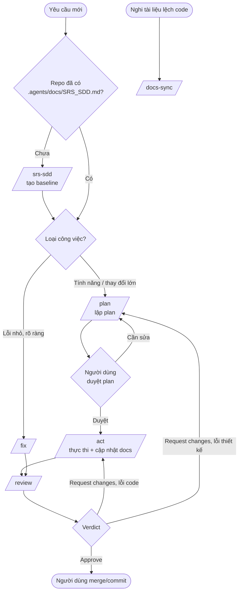

# AGENTS.md - Quy ước chung & Quy trình làm việc

Tài liệu này là nguồn quy ước chung cho mọi agent/workflow trong dự án (`/srs-sdd`, `/plan`, `/act`, `/review`, `/fix`, `/docs-sync`). Prompt của từng workflow chỉ chứa phần riêng của nó; những gì dùng chung (lệnh verify, coding style, quy trình) nằm ở đây. Nếu prompt và file này mâu thuẫn, ưu tiên prompt của workflow đang chạy; hãy báo cho người dùng để sửa cho thống nhất.

Ngôn ngữ giao tiếp và tổng quan hệ sinh thái: xem `GEMINI.md`.

## 1. Quy ước chung

- **Ngôn ngữ:** plan, review, tài liệu và báo cáo viết bằng tiếng Việt; giữ nguyên identifier, tên file, thuật ngữ kỹ thuật bằng tiếng Anh.
- **Dẫn chứng:** mọi nhận định về code hiện có phải kèm `path:line`. Không đoán tên file/hàm/script; chưa xác minh được thì ghi vào Open Questions.
- **Nguồn sự thật:** code là nguồn sự thật về hiện trạng; plan là nguồn sự thật về ý định thay đổi; `.agents/docs/SRS_SDD.md` phải phản ánh code sau mỗi plan hoàn tất.
- **An toàn:**
  - Không commit/push trừ khi người dùng yêu cầu rõ.
  - Không chạy lệnh phá hủy (`reset --hard`, `rm -rf`, drop DB, force push).
  - Không đọc/in giá trị trong `.env`, secrets, token; chỉ nhắc tên biến.
  - Không tự cài dependency ngoài plan.
  - Không đụng vào thay đổi chưa commit không thuộc phạm vi công việc.
  - Không chạy lệnh ghi/xóa trên database thật.
- **Dừng và hỏi** thay vì đoán khi: yêu cầu mơ hồ ảnh hưởng lớn đến thiết kế (hỏi tối đa 3 câu), plan thiếu/sai, hoặc cần vượt phạm vi đã duyệt.

## 2. Thông tin dự án

Dự án là Monorepo gồm 3 app, mỗi app có lệnh verify riêng. Workflow chạy lệnh ở đúng thư mục của app bị ảnh hưởng.

| Mục                     | Backend                      | Web + CMS                      | Internal                       |
| :---------------------- | :--------------------------- | :----------------------------- | :----------------------------- |
| Thư mục                 | `be-nestjs-thanhxuan/`       | `fe-nextjs-thanhxuan-laundry/` | `fe-react-thanhxuan-internal/` |
| Runtime                 | Node.js 20+                  | Node.js 20+                    | Node.js 20+                    |
| Package manager         | `pnpm`                       | `pnpm`                         | `pnpm`                         |
| Cài dependency          | `pnpm install`               | `pnpm install`                 | `pnpm install`                 |
| Lint                    | `pnpm lint`                  | `pnpm lint`                    | `pnpm lint`                    |
| Typecheck               | `pnpm exec tsc --noEmit`     | `pnpm exec tsc --noEmit`       | `pnpm exec tsc --noEmit`       |
| Test (toàn bộ)          | `pnpm test`                  | `pnpm test`                    | `pnpm test`                    |
| Test (một file/pattern) | `pnpm test -- <pattern>`     | `pnpm test -- <pattern>`       | `pnpm test -- <pattern>`       |
| Build                   | `pnpm build`                 | `pnpm build`                   | `pnpm build`                   |
| Chạy dev                | `pnpm start:dev` (cổng 5001) | `pnpm dev` (cổng 3000)         | `pnpm dev` (cổng 3001)         |
| Nhánh chính             | `main`                       | `main`                         | `main`                         |

> **Cần đối chiếu:** các lệnh trên là script chuẩn của NestJS / Next.js / Vite, chưa được xác minh với `package.json` thực tế (package manager, tên script, nhánh chính, app nào chưa có test). Nếu lệnh nào không tồn tại, agent ghi vào Open Questions thay vì tự đoán, và người dùng sửa lại bảng này.

Quy tắc code, naming, kiến trúc, error handling: xem mục 8.

## 3. Bản đồ workflow

| Lệnh         | Khi nào dùng                                                  | Quyền ghi                                                                                          | Output                                           |
| :----------- | :------------------------------------------------------------ | :------------------------------------------------------------------------------------------------- | :----------------------------------------------- |
| `/srs-sdd`   | Repo mới hoặc chưa có tài liệu hệ thống (baseline)            | Chỉ `.agents/docs/SRS_SDD.md`                                                                      | `Created .agents/docs/SRS_SDD.md` + số liệu quét |
| `/plan`      | Tính năng mới, thay đổi lớn, đổi thiết kế/schema/API          | Chỉ `.agents/docs/plans/plan<N>.md`                                                                | `Created/Updated .agents/docs/plans/plan<N>.md`   |
| `/act`       | Thực thi một plan đã có                                       | Code, test, `.agents/docs/`, và (hạn chế) file plan: tick checkbox, Status, Execution Log          | Báo cáo thực thi                                 |
| `/review`    | Sau `/act` hoặc `/fix`, trước khi merge                       | Chỉ `.agents/docs/reviews/review<N>.md`                                                            | Verdict + danh sách phát hiện                    |
| `/fix`       | Lỗi nhỏ, rõ ràng, tối đa 3 file code, không đổi schema/API    | Code, test, và `.agents/docs/` nếu hành vi đổi                                                     | Báo cáo bugfix                                   |
| `/docs-sync` | Tài liệu nghi ngờ lệch code (sửa tay, sau nhiều lần thay đổi) | Chỉ `.agents/docs/SRS_SDD.md`                                                                      | Báo cáo drift + `Updated .agents/docs/SRS_SDD.md` |

## 4. Quy trình làm việc

### 4.1. Sơ đồ tổng thể

### 4.2. Các bước chuẩn cho một tính năng

1. **Chuẩn bị:** nếu chưa có `.agents/docs/SRS_SDD.md`, chạy `/srs-sdd`.
2. **Lập kế hoạch:** chạy `/plan`. Plan có mục "Docs impact" liệt kê FR-xx, bảng, endpoint dự kiến bị ảnh hưởng, và ghi rõ app nào bị tác động (Backend / Web + CMS / Internal). Người dùng review; yêu cầu chỉnh sửa thì `/plan` sửa trực tiếp trên cùng file.
3. **Duyệt:** người dùng đổi Status `Draft` → `Approved` (bước này là tùy chọn nhưng khuyến nghị).
4. **Thực thi:** chạy `/act` với plan đã duyệt. Executor làm tuần tự từng task, verify, tick checkbox, rồi cập nhật SRS/SDD khi toàn bộ kiểm thử pass.
5. **Review:** chạy `/review`. Verdict ghi ở `.agents/docs/reviews/review<N>.md`. Review đối chiếu theo quy tắc code ở mục 8 tương ứng với app đã sửa.
6. **Xử lý review:**
   - Lỗi code trong phạm vi plan: chạy `/act` kèm chỉ định "xử lý các finding R.. trong `.agents/docs/reviews/review<N>.md`", sau đó `/review` lại (thêm Round mới).
   - Lỗi thiết kế hoặc ngoài phạm vi: quay lại `/plan` để sửa plan hiện tại.
7. **Hoàn tất:** Verdict Approve thì người dùng tự commit/merge.

### 4.3. Chọn `/fix` hay `/plan`

Dùng `/fix` khi đồng thời thỏa mãn: là lỗi (hành vi sai so với mong đợi), tái hiện được, sửa tối đa 3 file mã nguồn, không đổi schema/API contract/dependency/kiến trúc. Ngược lại dùng `/plan`. Nếu `/fix` giữa chừng phát hiện vượt ngưỡng, nó phải dừng và đề nghị `/plan`.

### 4.4. Vòng đời Status của plan

| Status        | Ý nghĩa                                                   | Ai đặt     |
| :------------ | :-------------------------------------------------------- | :--------- |
| `Draft`       | Plan mới tạo hoặc đang sửa                                | `/plan`    |
| `Approved`    | Người dùng đã duyệt, sẵn sàng thực thi                    | Người dùng |
| `In progress` | Đang thực thi                                             | `/act`     |
| `Blocked`     | Dừng do gặp điều kiện dừng, kèm lý do trong Execution Log | `/act`     |
| `Done`        | Đã hoàn tất và verify pass                                | `/act`     |

Sửa plan sau khi đã `In progress` thì ghi rõ trong Changelog của plan và báo người dùng, vì Executor có thể đã làm một phần.

## 5. Quy ước file và thư mục

| Đường dẫn                                   | Nội dung                                            | Ai ghi                                                       |
| :------------------------------------------ | :-------------------------------------------------- | :----------------------------------------------------------- |
| `.agents/docs/plans/plan<N>.md`             | Kế hoạch kỹ thuật; N tăng dần, dùng số lớn nhất + 1 | `/plan` (nội dung); `/act` (checkbox, Status, Execution Log) |
| `.agents/docs/reviews/review<N>.md`         | Kết quả review plan N; review lại thì thêm `Round`  | `/review`                                                    |
| `.agents/docs/reviews/review-<YYYYMMDD>.md` | Review không gắn với plan nào                       | `/review`                                                    |
| `.agents/docs/SRS_SDD.md`                   | Tài liệu SRS/SDD (living documentation)             | `/srs-sdd` (tạo), `/act`, `/fix`, `/docs-sync` (cập nhật)    |

Quy tắc cho `.agents/docs/SRS_SDD.md`:

- Giữ ID `FR-xx` cố định; không đánh số lại.
- Chỉ cập nhật phần liên quan đến thay đổi; không viết lại toàn bộ.
- Mỗi lần cập nhật thêm một dòng vào Document History: `<YYYY-MM-DD> - <Plan N | Fix | Docs-sync> - <tóm tắt>`.
- Sơ đồ dùng Mermaid, chỉ vẽ thành phần có thật trong code.

## 6. Ma trận quyền hạn

| Agent        | Đọc repo | Ghi code/test |   Ghi `.agents/docs/plans/`   | Ghi `.agents/docs/reviews/` |  Ghi `.agents/docs/`   | Chạy lint/typecheck/test |
| :----------- | :------: | :-----------: | :---------------------------: | :-------------------------: | :--------------------: | :----------------------: |
| `/srs-sdd`   |    Có    |     Không     |             Không             |            Không            |        Có (tạo)        |          Không           |
| `/plan`      |    Có    |     Không     |           Có (plan)           |            Không            |         Không          |          Không           |
| `/act`       |    Có    |      Có       |  Hạn chế (tick, Status, Log)  |            Không            |           Có           |            Có            |
| `/review`    |    Có    |     Không     |             Không             |       Có (chỉ review)       |         Không          |            Có            |
| `/fix`       |    Có    |      Có       |             Không             |            Không            |  Có (khi hành vi đổi)  |            Có            |
| `/docs-sync` |    Có    |     Không     |             Không             |            Không            |           Có           |          Không           |

Không agent nào được commit/push, cài dependency, hoặc chạy lệnh phá hủy trừ khi người dùng yêu cầu rõ.

## 7. Định nghĩa hoàn thành (Definition of Done)

Một thay đổi coi là xong khi:

- Mọi task trong plan đã tick và tiêu chí hoàn thành được kiểm chứng.
- Lint, typecheck, test pass cho **từng app bị ảnh hưởng** (lỗi baseline có sẵn được báo cáo riêng).
- Build pass cho từng app bị ảnh hưởng (`pnpm build` ở thư mục app).
- Thay đổi API contract (DTO, response) ở Backend thì phía gọi (Web + CMS, Internal) đã được cập nhật theo.
- `.agents/docs/SRS_SDD.md` phản ánh đúng thay đổi và có dòng Document History.
- `/review` trả Verdict Approve (không còn Blocker/Major), đã đối chiếu mục 8.
- Không còn code thừa, log debug, mock data, TODO ngoài plan.

## 8. Quy tắc code bắt buộc

`/plan`, `/act`, `/fix` phải tuân thủ; `/review` dùng làm tiêu chí kiểm tra.

### 8.1. Chung (cả 3 app)

- TypeScript Strict Mode. Cấm `any`; cần thì dùng `unknown` rồi narrow, hoặc khai báo type/interface rõ ràng. Ưu tiên Generics, Discriminated Unions, Utility Types.
- Đặt tên: file kebab-case, class PascalCase, biến/hàm camelCase.
- Type dùng chung giữa các app không copy tay nhiều nơi.
- Không commit `.env`; thêm biến môi trường mới phải cập nhật `.env.example`.
- Dữ liệu gửi từ form hoặc tracking của client phải kèm ngữ cảnh (`sourceUrl`, `category`, `slug`...).

### 8.2. Backend (`be-nestjs-thanhxuan`)

- **Kiến trúc phân tầng nghiêm ngặt:** Controller -> Service -> Repository -> Model. Mỗi module gồm Controller, Service, Repository, DTO, Schema. Tránh circular dependency.
- **Truy cập database:** mọi truy vấn nằm ở tầng Repository. Tuyệt đối không gọi trực tiếp Mongoose Model từ Service hoặc Controller.
- **Hiệu năng đọc:** query chỉ đọc dùng `.lean()` và `.select()`; field hay filter/sort phải có Index; list API phải phân trang và giới hạn `limit` tối đa; hạn chế `populate` lồng nhau.
- **Multi-Database:** đúng connection cho từng database (`laundry_express`, `moving_express`, `internal_express`), không dùng nhầm.
- **DTO & Validation:**
  - Mọi `@Body()` bắt buộc dùng Class DTO. Không dùng `interface` hay `Partial<T>`.
  - Thuộc tính Nested Object bắt buộc phải khai báo đủ `@IsDefined()` + `@ValidateNested()` + `@Type(() => DtoClass)`. Không dùng `@ValidateNested()` đơn độc vì sẽ bị bypass khi client không gửi trường đó.
  - Bật global `ValidationPipe` với `whitelist: true`, `transform: true`.
  - Không trả thẳng document Mongoose ra ngoài; map sang response DTO. Không bao giờ trả field nhạy cảm (password, token).
  - Không nhận object thô từ client đưa vào filter (tránh NoSQL injection như `$where`, `$ne`).
- **Defensive Programming ở Service:** dùng Optional Chaining `?.` và fallback để không ném `TypeError` (HTTP 500). Dùng exception có sẵn của Nest (`NotFoundException`, `BadRequestException`...), không throw `Error` thô.
- **Timezone:** toàn bộ logic ngày/thời điểm (chấm công, báo cáo sản lượng, sinh mã phiếu theo ngày) chuẩn hóa theo `Asia/Ho_Chi_Minh` qua helper `startOfDayVN`, `endOfDayVN`, `getDatePrefixVN`. Không dùng `setHours(0,0,0,0)` theo local của VPS.
- **Auth:** Passport JWT Strategy cho phân hệ nội bộ bắt buộc xác thực `audience` (`aud: 'internal'`) để chặn dùng chéo token giữa các hệ thống.
- **Config:** qua ConfigModule, không dùng `process.env` rải rác.

### 8.3. Web + CMS (`fe-nextjs-thanhxuan-laundry`)

- **Server Components mặc định**, đặc biệt các trang `(public)` để tối ưu SEO. Chỉ dùng `"use client"` cho component thực sự cần tương tác DOM, state hoặc event handler (Form, Tab, Modal, Carousel...), và đẩy xuống component lá.
- **Kiến trúc Feature-based Colocation:** `src/features/<feature>/` chứa components, actions, hooks. Component dùng chung ở `src/components/`, API fetcher ở `src/services/`.
- **Tách logic và giao diện:** không viết logic xử lý dữ liệu phức tạp hay API call trực tiếp trong JSX/TSX. Tách ra Custom Hook, Service hoặc Server Action.
- **Business rule:** trang nội dung/bài viết (dịch vụ, tin tức, giới thiệu) phải tự động có form liên hệ / CTA chuyển đổi ở cuối trang.
- **SEO:** metadata đầy đủ cho trang `(public)`.
- Biến môi trường chỉ expose ra client với tiền tố `NEXT_PUBLIC_`.
- Mọi màn hình có data phải có đủ trạng thái loading, empty, error.

### 8.4. Internal (`fe-react-thanhxuan-internal`)

- Cùng nguyên tắc tách logic và giao diện như 8.3: logic nằm ở Custom Hook/Service, không nằm trong JSX.
- Tổ chức code theo nghiệp vụ (`handover`, `piecework`, `attendance`, `partners`), không dồn vào `App.tsx`.
- Biến môi trường phía client chỉ dùng tiền tố `VITE_`.
- Logic ngày giờ hiển thị và gửi lên API thống nhất theo múi giờ `Asia/Ho_Chi_Minh`.

### 8.5. UI (Web + CMS và Internal)

- Dùng shadcn/ui, thêm component bằng CLI (`npx shadcn@latest add <component>`), không tự viết lại component đã có. Component sinh ra ở `components/ui/` chỉ chỉnh khi thật sự cần.
- Style bằng TailwindCSS và `cn()`; dùng token màu/theme (CSS variables), không hardcode màu. Icon dùng Lucide.
- Form dùng react-hook-form + zod kết hợp `Form` của shadcn.
- Text hiển thị trên UI viết bằng tiếng Việt tự nhiên. Chú ý accessibility (label, aria, focus, keyboard).

## 9. Deployment & CI/CD

- **Build Docker Image chỉ thực hiện trên GitHub Actions.** Tuyệt đối không chạy `docker-compose build` trực tiếp trên VPS (tránh cạn CPU/RAM).
- **Quy trình deploy:**
  1. GitHub Actions build image: Backend, Next.js Frontend, React Internal Frontend.
  2. Push image lên GitHub Container Registry (GHCR).
  3. SSH vào VPS và chạy `docker compose pull && docker compose up -d`.
- **Biến môi trường:**
  - `NEXT_PUBLIC_*` và `VITE_*` truyền qua GitHub Secrets dưới dạng Build Arguments (`args`) tại thời điểm build image.
  - Biến bí mật Backend (MongoDB URI, JWT Secret, SMTP, API Keys) nằm trong file `.env` trên VPS.
- Agent không sửa file CI/CD hoặc `docker-compose.yml` ngoài phạm vi plan đã duyệt.
