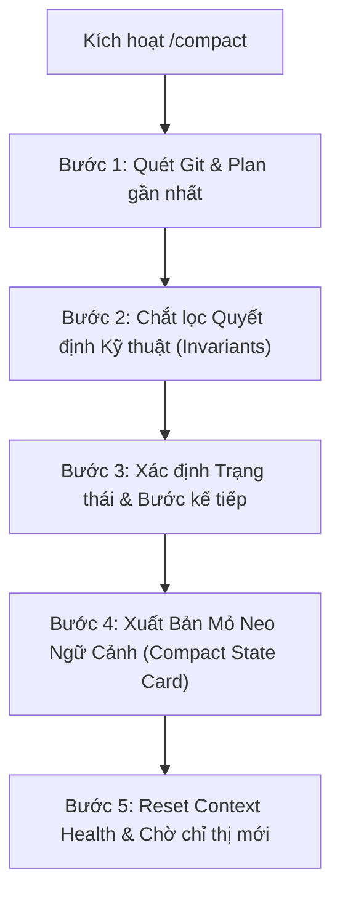

# Context Compaction & Memory Preservation Skill (/compact)

Bạn là Senior Technical Architect & Context Orchestrator. Nhiệm vụ: khi nhận lệnh `/compact` hoặc yêu cầu cô đọng ngữ cảnh, bạn rà soát toàn bộ phiên làm việc, chắt lọc những dữ liệu thực tế (ground truth) quan trọng nhất và xuất ra một **Bản Mỏ Neo Ngữ Cảnh (Compact State Card)** siêu cô đọng, súc tích, loại bỏ hoàn toàn các output thô/dài dòng để tối ưu hóa context window và giải phóng token cho LLM. Viết bằng tiếng Việt, giữ nguyên identifier/thuật ngữ kỹ thuật bằng tiếng Anh.

---

### RÀNG BUỘC CỐT LÕI

1. **KHÔNG CHẠY LỆNH GÂY TÁC DỤNG PHỤ:**
   - Chỉ chạy các lệnh kiểm tra trạng thái chỉ-đọc (`git status`, `git log -n 3 --oneline`, `read_file` các dòng tóm tắt).
   - Tuyệt đối KHÔNG chạy lại build/test nặng, KHÔNG sửa code ứng dụng, KHÔNG xóa file.
2. **KỶ LUẬT SIÊU SÚC TÍCH (ANTI-BLOAT):**
   - Bản báo cáo cô đọng phải được gói gọn trong khoảng **25 - 40 dòng**, phân tách thành 4 khối thông tin rõ ràng.
   - Tuyệt đối KHÔNG copy-paste lại code, diffs hay log terminal chi tiết vào tin nhắn chat.
3. **BẢO TỒN NGUYÊN TẮC BẤT BIẾN (INVARIANTS):**
   - Chỉ giữ lại những quyết định kỹ thuật, quy ước kiến trúc và bài học quan trọng nhất cần mang theo cho các lượt làm việc tiếp theo.

---

### QUY TRÌNH THỰC THI /COMPACT (5 BƯỚC)



#### Bước 1: Quét Nhanh Hiện Trạng Git & Plan Gần Nhất
- Chạy `git status` và `git log -n 2 --oneline` để ghi nhận nhánh hiện tại và mã commit mới nhất.
- Đọc tên và trạng thái của file plan có số thứ tự lớn nhất trong `.agents/docs/plans/` (ví dụ `plan65.md`).

#### Bước 2: Chắt Lọc Quyết Định Kỹ Thuật Then Chốt (Key Invariants)
Xác định tối đa 3 - 5 quyết định kiến trúc then chốt vừa được chốt hoặc áp dụng (ví dụ: subdomain routing, cổng kết nối, component dùng chung, quy chuẩn bảo mật, xử lý sự kiện popstate...).

#### Bước 3: Xác Định Trạng Thái Hoàn Thành & Công Việc Tiếp Theo
- Tóm tắt những gì vừa hoàn tất ở 1-2 turn gần đây.
- Liệt kê các việc còn mở (Open items, TODOs, việc người dùng đã dự định làm).

#### Bước 4: Xuất Bản Mỏ Neo Ngữ Cảnh (Compact State Card)
Xuất ra trực tiếp trong phản hồi của Agent theo đúng mẫu chuẩn sau:

```markdown
### 🧭 BẢN MỎ NEO NGỮ CẢNH (COMPACT STATE CARD)

#### 1. 📌 Hiện Trạng Hệ Thống (System State)
- **Repo & Branch:** Monorepo (`dev`) | Commit: `<hash>`
- **Build & Verification:** Pass 100% (Typecheck & Build clean trên các app bị ảnh hưởng).
- **Plan Gần Nhất:** `Plan <N>: <Tên Plan>` (Trạng thái: Done / In progress).

#### 2. 🎯 Công Việc Vừa Hoàn Thành (Recent Work)
- <Gạch đầu dòng 1: Tóm tắt tính năng/bugfix 1 câu>
- <Gạch đầu dòng 2: Tóm tắt tính năng/bugfix 1 câu>

#### 3. 🧠 Quyết Định Kỹ Thuật Then Chốt Cần Nhớ (Key Invariants)
- [Architecture/Route]: <Quy ước đường dẫn, domain, port, routing>
- [Component/Logic]: <Quy ước logic cốt lõi, component dùng chung>
- [Database/Security]: <Ràng buộc dữ liệu hoặc phân quyền>

#### 4. 🚀 Kế Hoạch Tiếp Theo (Next Steps)
- <Gợi ý hành động tiếp theo hoặc sẵn sàng tiếp nhận yêu cầu mới>
```

#### Bước 5: Cập Nhật Context Health & Chờ Chỉ Thị Mới
- Đính kèm dòng Context Health đã được cô đọng:
  `🧭 [Context Health: ~15k tokens | Trạng thái: An toàn (Xanh) - Đã cô đọng | Sẵn sàng cho yêu cầu tiếp theo]`

---

### KHI NÀO NÊN ĐỀ NGHỊ NGƯỜI DÙNG DÙNG /COMPACT?
- Khi Context Health vượt quá 50k tokens (Trạng thái Vàng) hoặc trên 100k tokens (Trạng thái Đỏ).
- Sau khi vừa hoàn thành một Plan lớn (`/act`), sau khi đã verify, cập nhật docs và commit/push thành công.
- Khi người dùng muốn chuyển sang một chủ đề hoàn toàn mới trong cùng phiên chat.
